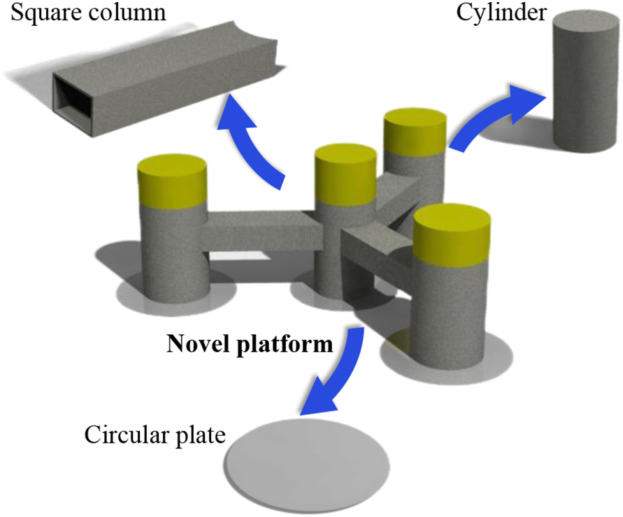
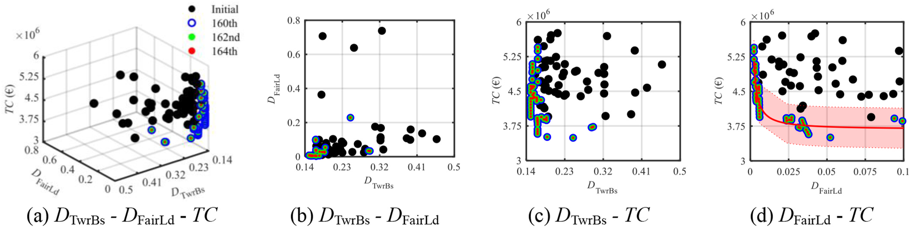

.. _concrete-floating-structures:

混凝土浮体 Concrete Floating Structures
====================================================================

:doc:`海洋能源结构 <MarineEnergyStructures>` · :doc:`研究方向总览 <Research>`

混凝土材料改变浮式平台的质量、刚度、造价与构造要求，动力性能较好的概念并不自动成为可建造的结构。该方向以混凝土浮式结构设计和材料方案比较为中心，连接主尺度、系泊与长期响应，再追问局部结构如何承载。

- 材料选择、平台几何与系泊怎样共同影响长期响应和成本？
- 优化后的概念怎样进入有限元强度与预应力评估？
- 总体应力改善与局部节点、应力集中之间还存在哪些差距？

.. contents:: 本页导读
   :local:
   :depth: 2

.. _concrete-floating-structures-methods:

方法与创新
----------------------------------------

将平台几何、材料与系泊放在同一评估过程中，再把方案带入结构强度检查；概念优化与局部构造设计是不同阶段。

代表成果与验证
----------------------------------------

.. _story-ref-he2026-OE-structural:

混凝土平台：连接长期响应与结构强度
~~~~~~~~~~~~~~~~~~~~~~~~~~~~~~~~~~~~~~~~

**问题**　材料选择改变平台质量、响应与成本。平台本体更便宜，不代表整个浮式系统更优；选出的动力方案也需要承担荷载的结构评估。

**创新**　提出模块化钢筋混凝土半潜平台概念，以降阶模型和 NSGA-II 探索主尺度、系泊与成本—疲劳权衡，再对选定方案进行包含预应力筋的有限元分析。

**验证与发现**　在论文风机、海况与成本假设下，选定方案相较 OO-Star 的数值比较显示较低累计塔底/导缆孔疲劳和估算建造成本；预应力改善整体应力分布。结果强调系泊疲劳与系统成本应一起考虑。

**适用边界**　这是数值评估的概念设计，不是已建平台或认证设计。局部应力峰值不能与整体应力范围混同；节点、应力集中及后续缩尺试验仍需工作，成本估算不是工程报价。

.. _research-figure-ref-he2026-oe-structural-fig07:

   模块化钢筋混凝土半潜平台概念，由圆柱、方柱与圆板组合而成。图为论文设计方案，不是已建工程。原论文图7。

   来源：He 等，Ocean Engineering (2026)，`原论文 <https://doi.org/10.1016/j.oceaneng.2025.123951>`__。

.. _research-figure-ref-he2026-oe-structural-fig16:

   塔底疲劳、导缆孔疲劳与总建造成本的多目标优化结果；颜色区分不同代数的候选方案，四面板展示概念设计权衡，不能解读为任意场址下的保证成本。原论文图16。

   来源：He 等，Ocean Engineering (2026)，`原论文 <https://doi.org/10.1016/j.oceaneng.2025.123951>`__。

:doc:`阅读全文与图表 <paper-notes/ref-he2026-OE-structural>` · :ref:`完整论文记录 <ref-he2026-OE-structural>`

仍待解决的问题
----------------------------------------

当前为数值评估的概念方案，尚不能称作已建成或认证的平台。节点、应力集中、局部构造和未来缩尺试验需要继续研究；不同场址与造价假设应重新评估。跨平台系统动力学与试验对照见 :doc:`IntegratedAnalysis`。

论文与项目
----------------------------------------

- :ref:`混凝土浮体设计优化 <ref-he2026-OE-structural>`
- :ref:`混凝土与钢支撑结构比较 <ref-li2022-SOS>`

相关公开项目记录（年份与角色不表示仍在执行或当前合作关系）：

- 2022-2025 省级，FRP-钢复合筋-海水海砂混凝土的半潜式风机基础结构设计方法，参与。

:ref:`一级方向完整项目记录 <floating-wind-project-support>`。

.. _concrete-technical-details:

技术详情：混凝土平台框架
----------------------------------------

既有技术框图保留完整内容，可点击放大；方法框架不等于试验验证或已建平台。

.. raw:: html

   

展开技术框图

.. _concrete-floater-design-figure:

.. figure:: ../_static/concrete_structure_floating_wind_turbine_optimization.png
   :figclass: research-evidence
   :width: 100%
   :alt: 混凝土结构浮式风机基础结构的设计与优化

   混凝土结构浮式风机基础结构的设计与优化。既有技术说明图，可点击放大。

.. raw:: html

   

