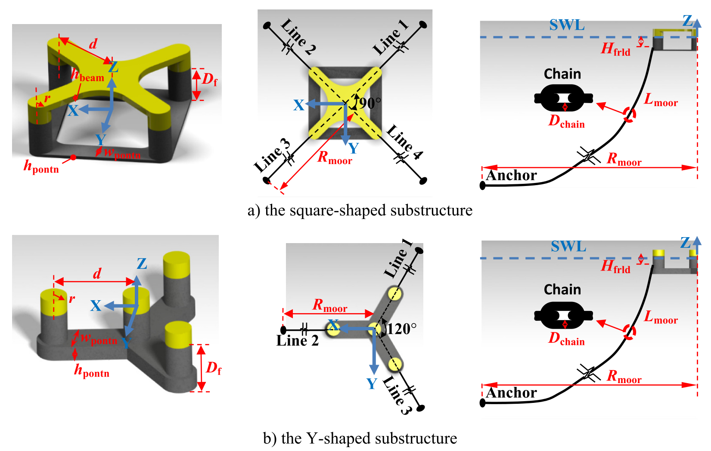
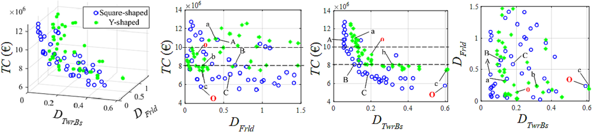
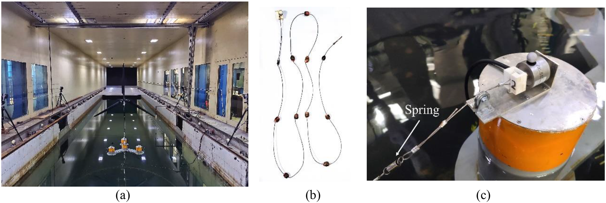
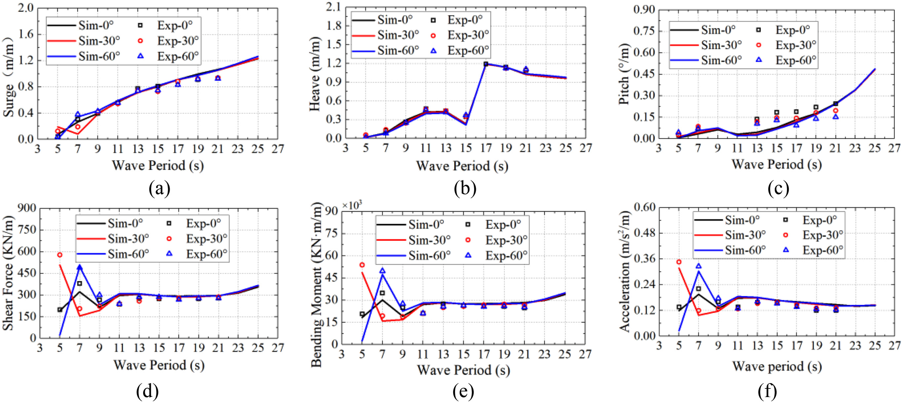

.. _floating-wind-integrated-analysis:

一体化分析 Integrated Analysis
==================================================

:doc:`海洋能源结构 <MarineEnergyStructures>` · :doc:`研究方向总览 <Research>`

浮式风机的运动与荷载由风机、平台、系泊和环境共同决定，单独优化一个部件可能改变整个系统的响应。该方向把耦合动力学、荷载传递、长期服役条件、优化与物理对照放在同一分析过程中，关注系统设计方案的权衡及其验证边界。

- 平台主尺度与系泊如何共同改变长期成本—疲劳权衡？
- 不同运动与部件荷载各自对应怎样的不利风浪来向？
- 数值响应与缩尺试验的对照能够验证什么，又保留哪些尺度和控制限制？

.. contents:: 本页导读
   :local:
   :depth: 2

.. _floating-wind-integrated-analysis-methods:

方法与创新
----------------------------------------

风机—平台—系泊耦合模型、降阶动力学和代理辅助优化，将长期海况接入设计比较；风浪联合模型试验提供物理对照。

代表成果与验证
----------------------------------------

.. _story-ref-zhou2023-AE:

长期优化：比较成本与疲劳的取舍
~~~~~~~~~~~~~~~~~~~~~~~~~~~~~~~~~~~~~~~~

**问题**　平台主尺度与系泊配置共同影响制造成本和疲劳。面对大量风浪组合，怎样以可承受的计算量比较不同构型，而非只挑各自一个固定方案？

**创新**　把降阶动力模型、代表性海况采样与 Kriging 代理模型串联，通过 NSGA-II 搜索制造成本、塔底疲劳与导缆孔疲劳之间的 Pareto 折中，比较优化后的方案集合。

**验证与发现**　降阶响应与 OpenFAST 对比后，用于方形和 Y 形钢制半潜式方案。长期环境和平台—系泊参数改变成本—疲劳前沿；方形方案的塔底疲劳更有利，而部分 Y 形方案的系泊疲劳较低。

**适用边界**　制造成本不是全生命周期成本。这是受场址、风机、成本口径与约束限定的概念筛选，论文未校核船体强度；不能据一个指标宣称普遍最优平台。

.. _research-figure-ref-zhou2023-ae-fig07:

   所比较的方形（上）与 Y 形（下）钢制半潜平台及系泊布置。每排包括平台几何、俯视系泊和锚链剖面，明确比较对象与边界。原论文图7。

   来源：Zhou 等，Applied Energy (2023)，`原论文 <https://doi.org/10.1016/j.apenergy.2023.121941>`__。

.. _research-figure-ref-zhou2023-ae-fig23:

   方形与 Y 形方案的成本—疲劳 Pareto 集合及投影：蓝色空心圆为方形，绿色点为 Y 形；四面板保留制造成本、塔底与导缆孔疲劳的不同取舍，结论限于本文算例。原论文图23。

   来源：Zhou 等，Applied Energy (2023)，`原论文 <https://doi.org/10.1016/j.apenergy.2023.121941>`__。

:doc:`阅读全文与图表 <paper-notes/ref-zhou2023-AE>` · :ref:`完整论文记录 <ref-zhou2023-AE>`

.. _story-ref-zheng2023-JRSE:

1:70 风浪试验：不利来向取决于响应
~~~~~~~~~~~~~~~~~~~~~~~~~~~~~~~~~~~~~~~~

**问题**　Y 形半潜平台和系泊具有方向性。改变风浪来向可能同时改变平台运动、塔底荷载与机舱加速度，不能只看一个位移指标。

**创新**　面向 10 MW 参考机组开展 1:70 风洞—波浪水槽联合试验，通过推力匹配和风浪输入标定，比较三个来向下静水、单风、单浪与风浪联合响应，并与 OpenFAST 对照。

**验证与发现**　规则波响应的试验与模拟总体呈现一致趋势。不利来向随波周期和响应指标变化，说明运动、上部结构荷载与系泊应在系统层面评估。

**适用边界**　这是实验室缩尺试验，不是海上实机验证。试验风浪同向、转子迎风；推力匹配不复现全部气动与控制效应，自由衰减数据亦参与模型标定，不能称为完全独立盲验。

.. _research-figure-ref-zheng2023-jrse-fig07:

   风洞—波浪水槽中的 1:70 模型与等效截断系泊：(a)浮式风机，(b)带配重系泊线，(c)导缆点与弹簧。照片为实验室模型，不是海上实机。原论文图7。

   来源：Zheng 等，Journal of Renewable and Sustainable Energy (2023)，`原论文 <https://doi.org/10.1063/5.0131279>`__。

.. _research-figure-ref-zheng2023-jrse-fig17:

   三波向下的平台运动、塔底荷载和机舱加速度响应幅值算子：线为模拟，点为试验；试验覆盖的原型尺度规则波周期为 5–21 秒，延伸曲线不是额外实测数据。不利来向依指标而变。原论文图17。

   来源：Zheng 等，Journal of Renewable and Sustainable Energy (2023)，`原论文 <https://doi.org/10.1063/5.0131279>`__。

:doc:`阅读全文与图表 <paper-notes/ref-zheng2023-JRSE>` · :ref:`完整论文记录 <ref-zheng2023-JRSE>`

仍待解决的问题
----------------------------------------

场址相关极值与疲劳、耦合模型和控制效应仍需进一步核查。现有证据限于所列半潜式算例和试验条件，不覆盖全部平台类型；混凝土方案的材料与强度问题见 :doc:`ConcreteFloatingStructures`，数值造波和自由面方法见 :doc:`NumericalWaveBasin`。

论文与项目
----------------------------------------

- :ref:`长期动力优化 <ref-zhou2023-AE>`
- :ref:`平台全局敏感性 <ref-zhou2021-OE>`
- :ref:`Y 形平台安装朝向 <ref-zhou2020-RE>`
- :ref:`等效静力波浪荷载 <ref-zheng2025-OE>`
- :ref:`风洞—浪槽联合试验 <ref-zheng2023-JRSE>`
- :ref:`固定式导管架优化（关联基础） <ref-zheng2023-MS>`

相关公开项目记录（年份与角色不表示仍在执行或当前合作关系）：

- 2022-2025 省级，面向多设计阶段的浮式风机系统一体化分析与优化方法，主持。
- 2018-2020 市级，浮式海上风机的平衡及振动控制系统研究，骨干成员。
- 2016-2018 市级，柱稳型海上浮式风机基础的关键技术开发，主持。
- 2013-2015 市级，垂直轴风机的主/被动桨距控制策略优化研究，主持。

:ref:`一级方向完整项目记录 <floating-wind-project-support>`。

.. _floating-wind-figures:

技术详情：系统分析框架
----------------------------------------

既有技术框图保留完整内容，可点击放大；方法框架不等于试验验证或已建平台。

.. raw:: html

   

展开技术框图

.. _floating-wind-dimensions-figure:

.. figure:: ../_static/sea_floating_wind_turbine_optimization.png
   :figclass: research-evidence
   :width: 100%
   :alt: 浮式风机基础的主尺寸优化

   浮式风机基础的主尺寸优化。既有技术说明图，可点击放大。

.. _floating-wind-coupling-figure:

.. figure:: ../_static/multiphysics_multibody_model_floating_wind_turbine_optimization.png
   :figclass: research-evidence
   :width: 100%
   :alt: 浮式风机系统多物理场多体动力学分析模型

   浮式风机系统多物理场多体动力学分析模型。既有技术说明图，可点击放大。

.. raw:: html

   

