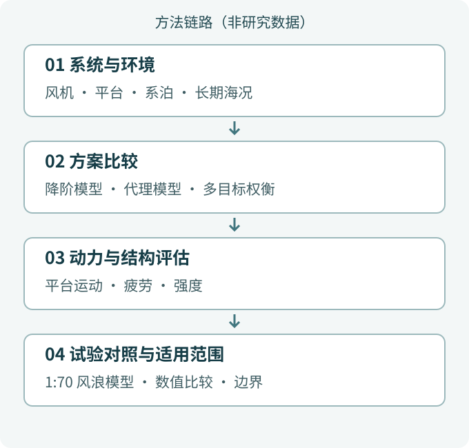

.. _research-direction-floating-wind:

.. _floating-offshore-wind-turbine:

海洋能源结构 Marine Energy Structures
==============================================================

:doc:`研究方向总览 <Research>`

浮式风机由转子、塔架、平台和系泊共同组成，在变化的海洋环境中工作。一个运动指标更好，不一定意味着另一处荷载、疲劳或结构强度也更有利。研究因此需要同时考虑长期海况、系统动力学、材料与构造，并用适当的物理证据检查数值预测。

- 平台尺度与系泊怎样共同改变长期成本—疲劳权衡？
- 混凝土浮体如何从动力性能较好的概念，走向能够承载的结构评估？
- 不同运动与部件荷载各自对应怎样的不利风浪来向？

.. raw:: html

   

.. rubric:: 二级研究方向

:doc:`一体化分析 <IntegratedAnalysis>`
   浮式风机的运动与荷载由风机、平台、系泊和环境共同决定，单独优化一个部件可能改变整个系统的响应。

:doc:`混凝土浮体 <ConcreteFloatingStructures>`
   混凝土材料改变浮式平台的质量、刚度、造价与构造要求，动力性能较好的概念并不自动成为可建造的结构。

:doc:`数值水池 <NumericalWaveBasin>`
   波浪的生成、传播和吸收，以及自由面与结构之间的相互作用，决定水动力计算的可信程度。

.. toctree::
   :hidden:
   :maxdepth: 2

   一体化分析 <IntegratedAnalysis>
   混凝土浮体 <ConcreteFloatingStructures>
   数值水池 <NumericalWaveBasin>

.. raw:: html

   

.. rubric:: 方向之间的方法联系

.. _marine-method-overview-figure:

   原创方法说明图，非研究数据。流程概括不同论文的方法，不表示同一平台已完成整条验证链，也不表示数值性能或已完成工程。

.. _floating-wind-project-support:

科研项目 Research Project
------------------------------------------

以下公开项目记录支撑上述研究问题；年份和承担角色不表示项目仍在执行或存在当前合作关系。

- 2022-2025 省级，面向多设计阶段的浮式风机系统一体化分析与优化方法，主持。
- 2022-2025 省级，FRP-钢复合筋-海水海砂混凝土的半潜式风机基础结构设计方法，参与。
- 2018-2020 市级，浮式海上风机的平衡及振动控制系统研究，骨干成员。
- 2016-2018 市级，柱稳型海上浮式风机基础的关键技术开发，主持。
- 2013-2015 市级，垂直轴风机的主/被动桨距控制策略优化研究，主持。

应用场景与企业委托项目证据见 :doc:`EngineeringApplications`。
