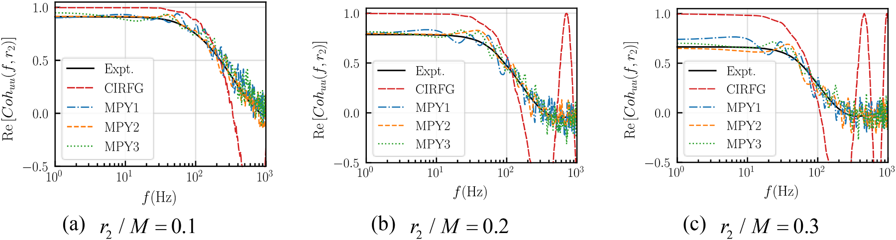
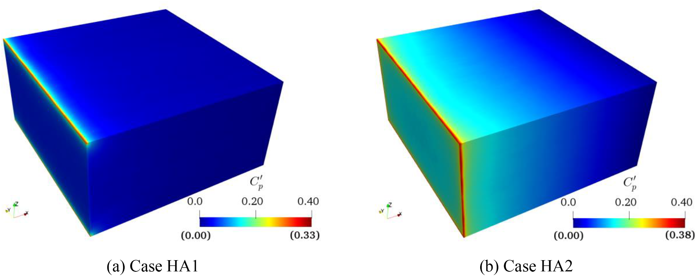
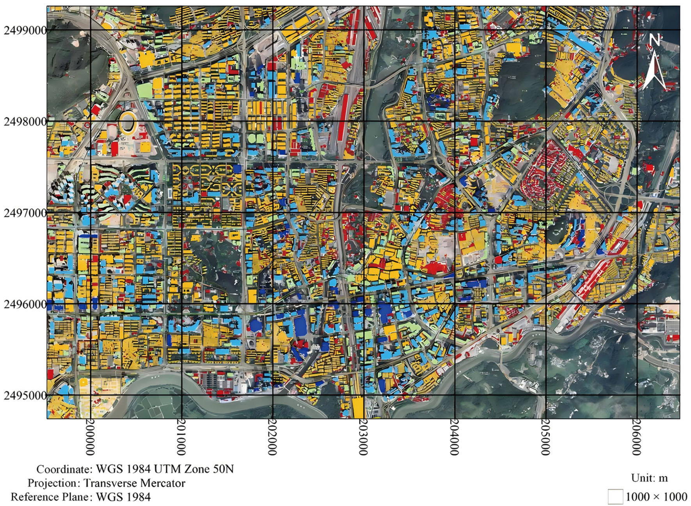
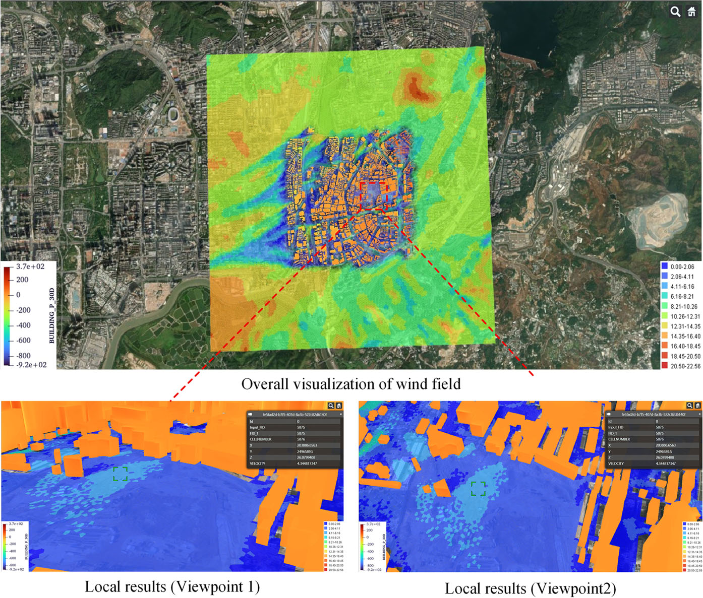

.. _numerical-wind-tunnel:

数值风洞 Numerical Wind Tunnel
====================================================

:doc:`结构风工程 <StructuralWindEngineering>` · :doc:`研究方向总览 <Research>`

城市建筑与地形改变局部风场，而入口湍流及边界条件决定数值风洞中的流动能否可信发展。面向城市风环境和复杂地形评估，研究从大气边界层入流、几何建模走向高成本风场计算的复用，先解决“风从哪里来、如何流动”的问题。

- 如何同时保留湍流统计与空间相干，并避免入口引入非物理压力？
- 分块风场怎样保留周边建筑影响，又减少重复计算？
- 几何与气象输入变化后，哪些模拟需要更新、哪些结果可以复用？

.. contents:: 本页导读
   :local:
   :depth: 2

.. _numerical-wind-tunnel-methods:

方法与创新
----------------------------------------

以湍动入流与明确的边界条件构建风场；通过城市分块数据库、几何重建与局部风环境计算，让高成本模拟可复用，同时保留周边环境影响。

代表成果与验证
----------------------------------------

.. _story-ref-chen2024-JCP:

可信入流：相干与质量平衡一起考虑
~~~~~~~~~~~~~~~~~~~~~~~~~~~~~~~~~~~~~~~~

**问题**　速度谱吻合，并不意味着数值风洞中的压力响应可靠。空间相干偏差与瞬时入口通量不平衡，会影响下游流场发展。

**创新**　CMRFG 在随机流生成阶段结合目标相干函数、无散度条件与入口质量平衡，而不是仅在生成后修补速度场。

**验证与发现**　均匀各向同性与空间衰减均匀各向异性算例检验了速度统计、空间相干和压力发展。结果表明相干更接近目标，质量平衡修正抑制了计算域内部的非物理压力污染。

**适用边界**　直接指定的是特定速度分量与方向的相干，不是所有分量可任意独立指定。入口与侧边界交线仍有局部残余压力；建筑群与复杂地形需另行验证。

.. _research-figure-ref-chen2024-jcp-fig17:

   不同间距下的 Y 向空间相干函数实部。黑线为实验目标，红线为 CIRFG，其他三色为 CMRFG 工况；结果保留负相干区间，随机实现并非每次具有相同精度。原论文图17。

   来源：Chen 等，Journal of Computational Physics (2024)，`原论文 <https://doi.org/10.1016/j.jcp.2023.112706>`__。

.. _research-figure-ref-chen2024-jcp-fig28:

   相同色标下的脉动压力系数：左为质量平衡修正后的 HA1，右为未修正的 HA2；对照显示域内压力污染受到抑制，边界交线仍有残余。原论文图28。

   来源：Chen 等，Journal of Computational Physics (2024)，`原论文 <https://doi.org/10.1016/j.jcp.2023.112706>`__。

:doc:`阅读全文与图表 <paper-notes/ref-chen2024-JCP>` · :ref:`完整论文记录 <ref-chen2024-JCP>`

.. _story-ref-zhao2026-BS:

城市风场：先计算，再按需查询
~~~~~~~~~~~~~~~~~~~~~~~~~~~~~~~~~~~~~~~~

**问题**　城市风环境既需要建筑尺度的局部细节，也需要控制反复评估的计算成本。分块计算可缩小规模，却可能截断周边建筑和地形的影响。

**创新**　以深圳部分城区为例，在核心区块外保留过渡区，预计算来流条件下的 CFD 风场，把风速比与风压系数存入数据库，再结合气象输入在 WebGIS 中查询展示。

**验证与发现**　研究比较过渡区长度、相邻区块公共界面、分块与合并计算，并用筛选后的气象站观测检验风速比。这些对照支持所研究条件下的分块建库方法，同时显示局部差异与界面处理仍需关注。

**适用边界**　验证限于中性大气边界层和有限测站、风向及强风样本。几何变化后需重算受影响区块及周边；WebGIS 是研究展示，不等于已验证的实时预警、AI 代理或数字孪生服务。

.. _research-figure-ref-zhao2026-bs-fig02:

   深圳研究区的建筑分块：黑色网格为 1 km × 1 km 核心区，实际 CFD 域还包括周边过渡区；网格线不是完整计算域边界。原论文图2。

   来源：Zhao 等，Building Simulation (2026)，`原论文 <https://doi.org/10.1007/s12273-025-1379-7>`__。

.. _research-figure-ref-zhao2026-bs-fig25:

   WebGIS 中整体与局部风速、建筑风压查询视图，风压和风速使用不同图例。该图展示研究系统，而非已验证的实时预警服务。原论文图25。

   来源：Zhao 等，Building Simulation (2026)，`原论文 <https://doi.org/10.1007/s12273-025-1379-7>`__。

:doc:`阅读全文与图表 <paper-notes/ref-zhao2026-BS>` · :ref:`完整论文记录 <ref-zhao2026-BS>`

仍待解决的问题
----------------------------------------

新的地形、建筑群、非中性边界层与非定常环境需要重新验证边界条件、局部压力和数据覆盖。已有城市数据库验证不自动延伸为实时预警能力；结构响应的评估继续在 :doc:`StructuralWindResistance` 中展开。

论文与项目
----------------------------------------

- :ref:`城市 CFD 数据库 <ref-zhao2026-BS>`
- :ref:`卫星影像重建城市几何 <ref-zhao2026-BE>`
- :ref:`风场时间超分辨率 <ref-tang2026-RE>`
- :ref:`三维高斯建筑几何重建 <ref-zhao2025-SCS>`
- :ref:`矢势随机流生成 <ref-li2024-POF>`
- :ref:`相干与质量平衡入流 <ref-chen2024-JCP>`

相关公开项目记录（年份与角色不表示仍在执行或当前合作关系）：

- 2018-2021 国家，数值大气湍流边界层生成方法的改进与验证，主持。
- 2014-2016 国家，基于粗糙壁面修正的平衡大气边界层紊流风场大涡模拟研究，主持。
- 2014-2016 校级，三维自平衡紊流边界层风场的大涡模拟研究，主持。
- 2013-2015 校级，大气边界层数值风洞中三维紊流风场的大涡模拟研究，主持。

:ref:`一级方向完整项目记录 <building-wind-project-support>`。
