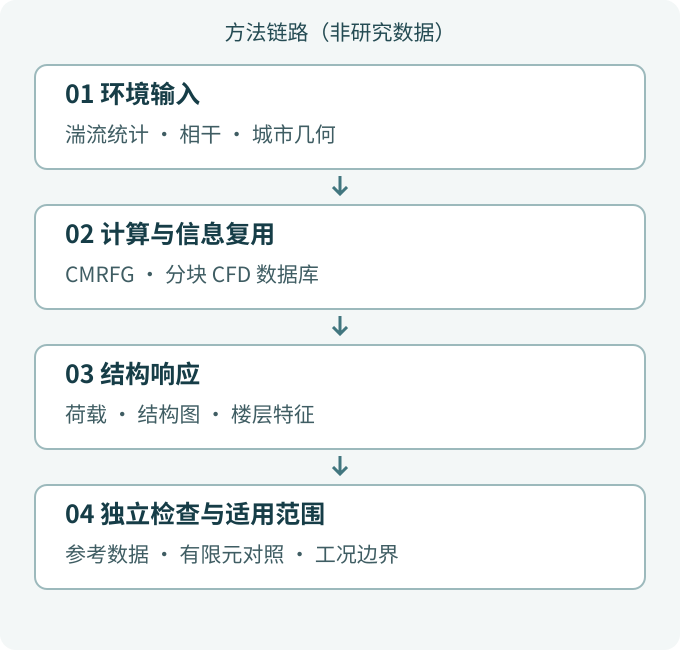
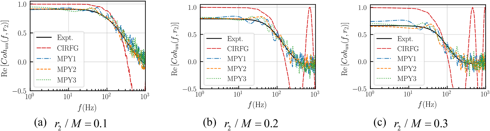
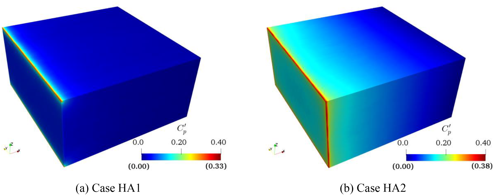
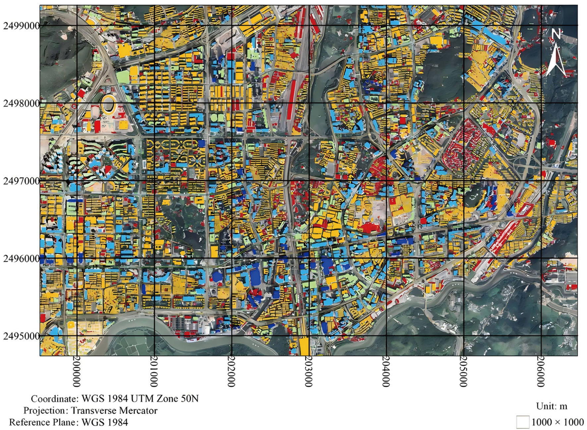
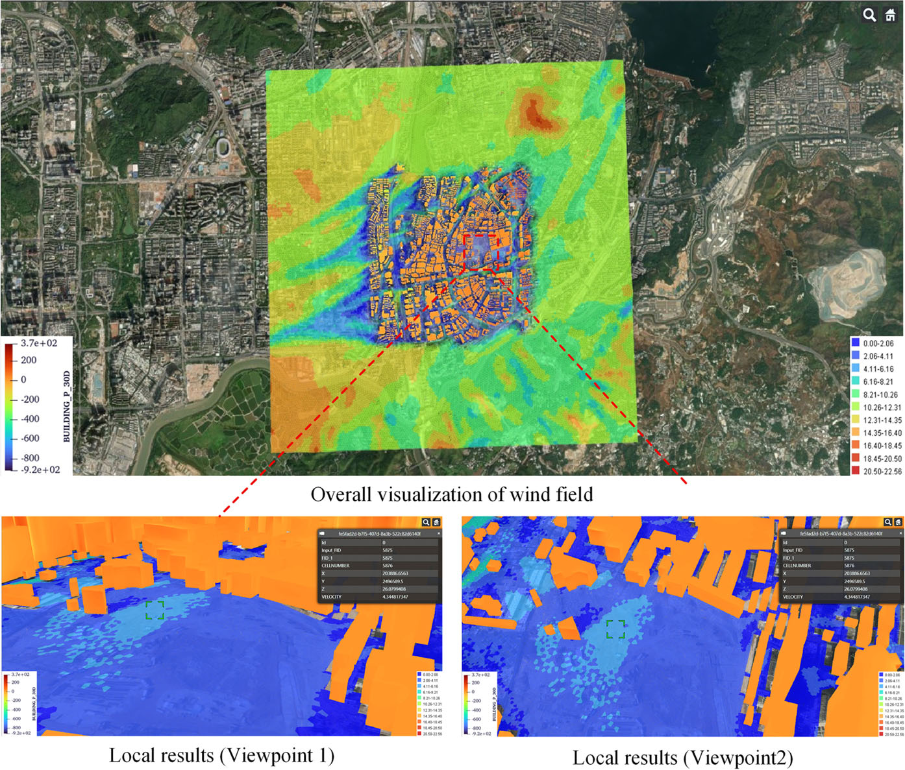
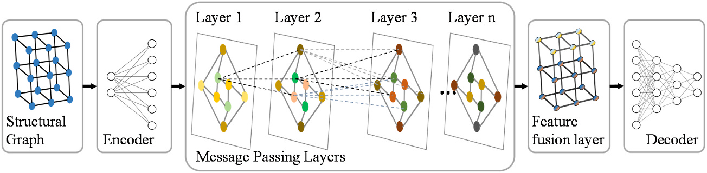
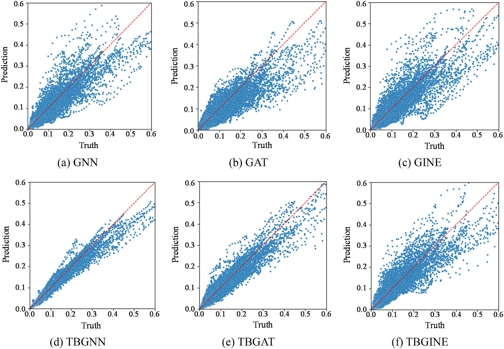

.. _research-direction-structural-wind:

结构风工程 Structural Wind Engineering
=================================================================

:doc:`研究方向总览 <Research>` · :doc:`海洋能源结构 <MarineEnergyStructures>`

从可信风场输入，到可验证的结构响应。

.. contents:: 本页导读
   :local:
   :depth: 2

研究背景
------------------------------

强风作用不是一个孤立的荷载数值：周边建筑与地形改变局部风场，建筑外形影响气动作用，结构体系再决定响应。可信的判断需要把湍流输入、绕流、风荷载与结构行为连起来。另一方面，方案调整会反复触发计算；快速模型的价值，取决于它保留了哪些物理关系、经过哪些验证。

核心问题
------------------------------

- 如何让入口湍流满足数值风洞所需的统计与相干特征，同时避免人为压力污染？
- 如何保留城市局部流动细节，又复用昂贵的 CFD 计算？
- 代理模型要保留哪些结构信息，才能跟随方案和荷载变化？

方法与创新
------------------------------

.. _numerical-wind-tunnel:

数值风洞
~~~~~~~~~~~~~~~~~~~~~~~~~~~~~~~~~~~~~~~~

以湍动入流与明确的边界条件构建风场；通过城市分块数据库、几何重建与局部风环境计算，让高成本模拟可复用，同时保留周边环境影响。

.. _structural-wind-resistance:

结构抗风
~~~~~~~~~~~~~~~~~~~~~~~~~~~~~~~~~~~~~~~~

连接风荷载、结构响应与气动优化/减振控制；把结构连接和楼层信息引入代理模型，支持反复方案比较，而不是用一个黑箱替代工程复核。

   原创方法说明图，非研究数据。流程概括下列研究如何连接问题、模型和验证，不表示数值性能或已完成工程。

代表成果与验证
------------------------------

以下三个研究故事连接具体问题、方法与验证证据，并说明适用边界。科研图保留完整比例与图例，可点击查看大图。

.. _story-ref-chen2024-JCP:

可信入流：相干与质量平衡一起考虑
~~~~~~~~~~~~~~~~~~~~~~~~~~~~~~~~~~~~~~~~

**问题**　速度谱吻合，并不意味着数值风洞中的压力响应可靠。空间相干偏差与瞬时入口通量不平衡，会影响下游流场发展。

**创新**　CMRFG 在随机流生成阶段结合目标相干函数、无散度条件与入口质量平衡，而不是仅在生成后修补速度场。

**验证与发现**　均匀各向同性与空间衰减均匀各向异性算例检验了速度统计、空间相干和压力发展。结果表明相干更接近目标，质量平衡修正抑制了计算域内部的非物理压力污染。

**适用边界**　直接指定的是特定速度分量与方向的相干，不是所有分量可任意独立指定。入口与侧边界交线仍有局部残余压力；建筑群与复杂地形需另行验证。

   不同间距下的 Y 向空间相干函数实部。黑线为实验目标，红线为 CIRFG，其他三色为 CMRFG 工况；结果保留负相干区间，随机实现并非每次具有相同精度。原论文图17。

   来源：Chen 等，Journal of Computational Physics (2024)，`原论文 <https://doi.org/10.1016/j.jcp.2023.112706>`__。

   相同色标下的脉动压力系数：左为质量平衡修正后的 HA1，右为未修正的 HA2；对照显示域内压力污染受到抑制，边界交线仍有残余。原论文图28。

   来源：Chen 等，Journal of Computational Physics (2024)，`原论文 <https://doi.org/10.1016/j.jcp.2023.112706>`__。

:doc:`阅读全文与图表 <paper-notes/ref-chen2024-JCP>` · :ref:`完整论文记录 <ref-chen2024-JCP>`

.. _story-ref-zhao2026-BS:

城市风场：先计算，再按需查询
~~~~~~~~~~~~~~~~~~~~~~~~~~~~~~~~~~~~~~~~

**问题**　城市风环境既需要建筑尺度的局部细节，也需要控制反复评估的计算成本。分块计算可缩小规模，却可能截断周边建筑和地形的影响。

**创新**　以深圳部分城区为例，在核心区块外保留过渡区，预计算来流条件下的 CFD 风场，把风速比与风压系数存入数据库，再结合气象输入在 WebGIS 中查询展示。

**验证与发现**　研究比较过渡区长度、相邻区块公共界面、分块与合并计算，并用筛选后的气象站观测检验风速比。这些对照支持所研究条件下的分块建库方法，同时显示局部差异与界面处理仍需关注。

**适用边界**　验证限于中性大气边界层和有限测站、风向及强风样本。几何变化后需重算受影响区块及周边；WebGIS 是研究展示，不等于已验证的实时预警、AI 代理或数字孪生服务。

   深圳研究区的建筑分块：黑色网格为 1 km × 1 km 核心区，实际 CFD 域还包括周边过渡区；网格线不是完整计算域边界。原论文图2。

   来源：Zhao 等，Building Simulation (2026)，`原论文 <https://doi.org/10.1007/s12273-025-1379-7>`__。

   WebGIS 中整体与局部风速、建筑风压查询视图，风压和风速使用不同图例。该图展示研究系统，而非已验证的实时预警服务。原论文图25。

   来源：Zhao 等，Building Simulation (2026)，`原论文 <https://doi.org/10.1007/s12273-025-1379-7>`__。

:doc:`阅读全文与图表 <paper-notes/ref-zhao2026-BS>` · :ref:`完整论文记录 <ref-zhao2026-BS>`

.. _story-ref-tang2025-JBE:

图神经网络：保留连接关系与楼层信息
~~~~~~~~~~~~~~~~~~~~~~~~~~~~~~~~~~~~~~~~

**问题**　高层建筑方案比选反复调整梁柱尺寸。代理模型怎样同时保留构件连接、风荷载与楼层信息，避免每次都从头进行完整响应计算？

**创新**　以参数化有限元模型生成训练数据，将钢筋混凝土框架表示为图；TBGNN 把楼层特征融合进消息传递，并以包含工程知识的损失函数约束位移曲线。

**验证与发现**　论文验证集对比表明，楼层特征融合改善了位移与层间位移预测。风压变化及迁移学习版 TBGNN-TL 的 CAARC 构件尺寸算例进一步检验了响应趋势跟踪能力，支持在所研究框架范围内快速筛选方案。

**适用边界**　验证主要针对钢筋混凝土框架的静力响应。超出训练楼层范围会增加误差；剪力墙、核心筒与动力时程需另行处理，最终方案仍需有限元与规范复核。

   TBGNN 架构：结构图经编码、消息传递与楼层特征融合，再解码得到响应预测。图展示模型方法，不是实测结果。原论文图6。

   来源：Tang 等，Journal of Building Engineering (2025)，`原论文 <https://doi.org/10.1016/j.jobe.2025.112131>`__。

   验证集预测：上排为 GNN、GAT、GINE，下排为相应楼层增强模型；横轴为参考值，纵轴为预测值，红虚线表示相等。完整六面板用于比较特征融合效果。原论文图9。

   来源：Tang 等，Journal of Building Engineering (2025)，`原论文 <https://doi.org/10.1016/j.jobe.2025.112131>`__。

:doc:`阅读全文与图表 <paper-notes/ref-tang2025-JBE>` · :ref:`完整论文记录 <ref-tang2025-JBE>`

仍待解决的问题
------------------------------

走向新的建筑、地形或结构体系，需要重新检查几何、边界条件、训练覆盖与荷载范围。非定常环境、局部压力效应及训练范围外的泛化仍是需要研究的问题，不是已保证的能力。快速筛选后的方案，应继续接受实测、物理试验或适当高保真模型的检查。

论文与项目
------------------------------

以下短标题便于浏览，不替换原论文题名；完整题名、作者、期刊与 DOI 保留在论文记录和精解详情中。

- :ref:`城市 CFD 数据库 <ref-zhao2026-BS>`
- :ref:`卫星影像重建城市几何 <ref-zhao2026-BE>`
- :ref:`风场时间超分辨率 <ref-tang2026-RE>`
- :ref:`三维高斯建筑几何重建 <ref-zhao2025-SCS>`
- :ref:`矢势随机流生成 <ref-li2024-POF>`
- :ref:`相干与质量平衡入流 <ref-chen2024-JCP>`
- :ref:`图神经网络结构响应 <ref-tang2025-JBE>`
- :ref:`二维向量响应极值 <ref-yang2025-JBE>`
- :ref:`立柱液舱晃荡与减振 <ref-he2025-POF>`
- :ref:`强化学习主动流动控制 <ref-yan2025-POF>`
- :ref:`高层风荷载大涡模拟 <ref-chen2024-POF>`
- :ref:`强风下塔线耦合 <ref-liu2024-JWEIA>`

.. _building-wind-project-support:

科研项目 Research Project
~~~~~~~~~~~~~~~~~~~~~~~~~~~~~~~~~~~~~~~~~~

以下公开项目记录支撑上述研究问题；年份和承担角色不表示项目仍在执行或存在当前合作关系。

- 2018-2021 国家，数值大气湍流边界层生成方法的改进与验证，主持。
- 2014-2016 国家，基于粗糙壁面修正的平衡大气边界层紊流风场大涡模拟研究，主持。
- 2014-2016 校级，三维自平衡紊流边界层风场的大涡模拟研究，主持。
- 2013-2015 校级，大气边界层数值风洞中三维紊流风场的大涡模拟研究，主持。
- 2020-2023 市级，考虑风致荷载及响应的高层建筑气动外形优化研究，主持。

应用场景与企业委托项目证据见 :doc:`EngineeringApplications`。
