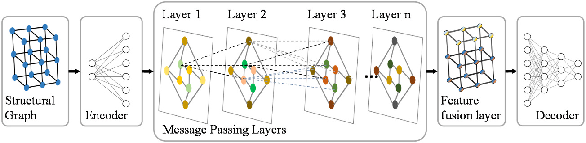
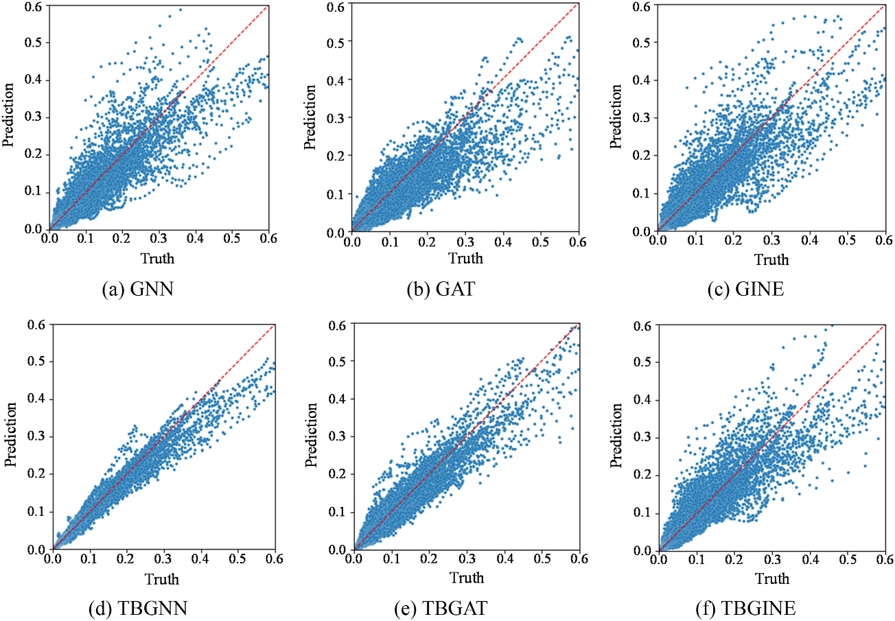

.. _structural-wind-resistance:

结构抗风 Structural Wind Resistance
==============================================================

:doc:`结构风工程 <StructuralWindEngineering>` · :doc:`研究方向总览 <Research>`

可靠的风场输入只是抗风设计的起点。建筑外形、结构连接和构件尺寸共同决定风荷载如何转化为位移、振动与极值响应。该方向围绕高层建筑及相关工程结构的荷载、响应、优化与控制，研究怎样让方案比较既快，又不丢失关键力学关系。

- 哪些结构信息必须进入代理模型，才能跟随构件尺寸与荷载变化？
- 怎样评价风致响应、极值和控制效果，而不把一种算例的结论泛化到所有结构？
- 快速筛选与有限元、物理试验及规范复核如何衔接？

.. contents:: 本页导读
   :local:
   :depth: 2

.. _structural-wind-resistance-methods:

方法与创新
----------------------------------------

连接风荷载、结构响应与气动优化/减振控制；把结构连接和楼层信息引入代理模型，支持反复方案比较，而不是用一个黑箱替代工程复核。

代表成果与验证
----------------------------------------

.. _story-ref-tang2025-JBE:

图神经网络：保留连接关系与楼层信息
~~~~~~~~~~~~~~~~~~~~~~~~~~~~~~~~~~~~~~~~

**问题**　高层建筑方案比选反复调整梁柱尺寸。代理模型怎样同时保留构件连接、风荷载与楼层信息，避免每次都从头进行完整响应计算？

**创新**　以参数化有限元模型生成训练数据，将钢筋混凝土框架表示为图；TBGNN 把楼层特征融合进消息传递，并以包含工程知识的损失函数约束位移曲线。

**验证与发现**　论文验证集对比表明，楼层特征融合改善了位移与层间位移预测。风压变化及迁移学习版 TBGNN-TL 的 CAARC 构件尺寸算例进一步检验了响应趋势跟踪能力，支持在所研究框架范围内快速筛选方案。

**适用边界**　验证主要针对钢筋混凝土框架的静力响应。超出训练楼层范围会增加误差；剪力墙、核心筒与动力时程需另行处理，最终方案仍需有限元与规范复核。

.. _research-figure-ref-tang2025-jbe-fig06:

   TBGNN 架构：结构图经编码、消息传递与楼层特征融合，再解码得到响应预测。图展示模型方法，不是实测结果。原论文图6。

   来源：Tang 等，Journal of Building Engineering (2025)，`原论文 <https://doi.org/10.1016/j.jobe.2025.112131>`__。

.. _research-figure-ref-tang2025-jbe-fig09:

   验证集预测：上排为 GNN、GAT、GINE，下排为相应楼层增强模型；横轴为参考值，纵轴为预测值，红虚线表示相等。完整六面板用于比较特征融合效果。原论文图9。

   来源：Tang 等，Journal of Building Engineering (2025)，`原论文 <https://doi.org/10.1016/j.jobe.2025.112131>`__。

:doc:`阅读全文与图表 <paper-notes/ref-tang2025-JBE>` · :ref:`完整论文记录 <ref-tang2025-JBE>`

仍待解决的问题
----------------------------------------

训练楼层范围、结构体系和荷载形式限制了现有响应代理的应用。静力框架结果不能替代剪力墙、核心筒或动力时程验证；减振与流动控制也需保留各自实际研究对象。风场输入和局部环境建模见 :doc:`NumericalWindTunnel`。

论文与项目
----------------------------------------

- :ref:`图神经网络结构响应 <ref-tang2025-JBE>`
- :ref:`二维向量响应极值 <ref-yang2025-JBE>`
- :ref:`立柱液舱晃荡与减振 <ref-he2025-POF>`
- :ref:`强化学习主动流动控制 <ref-yan2025-POF>`
- :ref:`高层风荷载大涡模拟 <ref-chen2024-POF>`
- :ref:`强风下塔线耦合 <ref-liu2024-JWEIA>`

相关公开项目记录（年份与角色不表示仍在执行或当前合作关系）：

- 2020-2023 市级，考虑风致荷载及响应的高层建筑气动外形优化研究，主持。

:ref:`一级方向完整项目记录 <building-wind-project-support>`。
