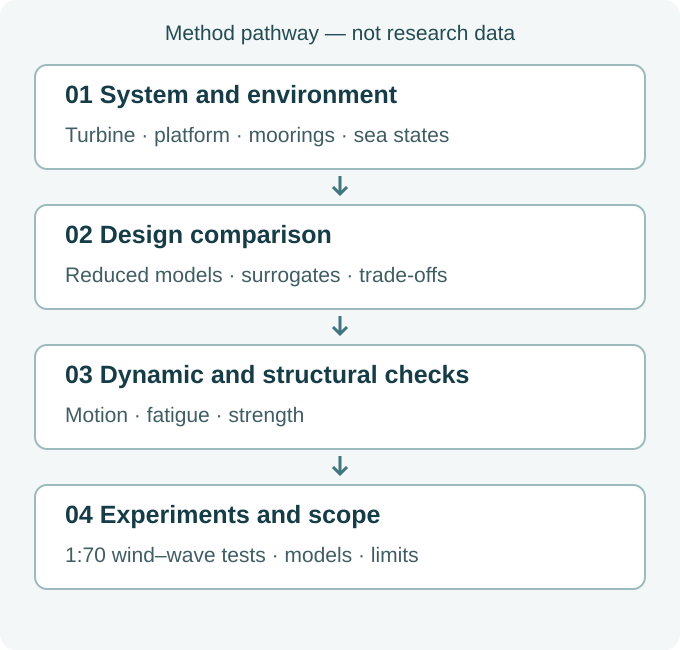

.. _en-research-direction-floating-wind:

.. _en-floating-offshore-wind-turbine:

Marine Energy Structures
================================================

:doc:`Research overview <Research>`

Floating wind turbines combine a rotor, tower, platform and moorings in a changing marine environment. A design favourable for one motion may worsen another load or fatigue measure. Long-term conditions, structural strength and cost must therefore be considered together, with numerical predictions checked against suitable physical evidence.

- How do platform dimensions and moorings change long-term cost–fatigue trade-offs?
- How can a concrete platform concept connect dynamic performance to load-bearing structural assessment?
- Which wind–wave headings are adverse for different motions and component loads?

.. raw:: html

   

.. rubric:: Explore the subdirections

:doc:`Integrated Analysis <IntegratedAnalysis>`
   Motion and loads of a floating wind turbine depend jointly on the turbine, platform, moorings and environment.

:doc:`Concrete Floating Structures <ConcreteFloatingStructures>`
   Concrete changes a floating platform’s mass, stiffness, cost and detailing requirements.

:doc:`Numerical Wave Basin <NumericalWaveBasin>`
   Wave generation, propagation and absorption, and interactions between the free surface and structures, determine the credibility of hydrodynamic computation.

.. toctree::
   :hidden:
   :maxdepth: 2

   IntegratedAnalysis
   ConcreteFloatingStructures
   NumericalWaveBasin

.. raw:: html

   

.. rubric:: Connections across subdirections

.. _en-marine-method-overview-figure:

   Original explanatory diagram, not research data. Methods span separate studies; this is not an end-to-end validation of one platform. No numerical performance is implied.

.. raw:: html

   

.. _en-floating-wind-project-support:

Project support
----------------------------------------

The following public project records support the questions above; their dates and roles do not imply ongoing funding or current partnerships.

- 2022–2025 · Provincial project · Integrated analysis and optimisation of floating wind turbines across design stages · Principal investigator.
- 2022–2025 · Provincial project · Semi-submersible foundation design using FRP–steel composite reinforcement and seawater sea-sand concrete · Participant.
- 2018–2020 · Municipal project · Equilibrium and vibration-control systems for floating offshore wind turbines · Core member.
- 2016–2018 · Municipal project · Key technologies for column-stabilised floating wind turbine foundations · Principal investigator.
- 2013–2015 · Municipal project · Optimisation of active/passive pitch control for vertical-axis wind turbines · Principal investigator.

:doc:`Engineering applications and enterprise project evidence (Chinese) </EngineeringApplications>`.
