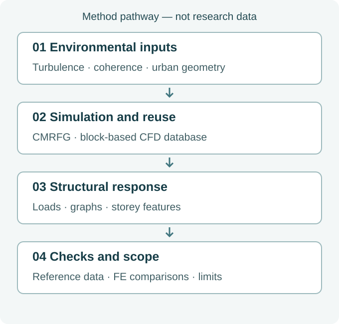

.. _en-research-direction-structural-wind:

Structural Wind Engineering
=================================================================

:doc:`Research overview <Research>` · :doc:`Marine Energy Structures <MarineEnergyStructures>`

From environmental inputs to verified structural response.

.. contents:: On this page
   :local:
   :depth: 2

Background
------------------------------

Strong winds interact with surrounding buildings, terrain and structural form. A credible response estimate depends on the full chain: incoming turbulence, local flow, loads and structural behaviour. Repeated simulations can make broad design comparisons expensive; faster models are useful only when their physical meaning and validation scope remain clear.

Research questions
------------------------------

- How can inlet turbulence reproduce the statistics and coherence required by a numerical wind tunnel without introducing artificial pressure?
- How can local urban flow detail be retained while reusing expensive CFD calculations?
- Which structural information must a surrogate retain to track changes in design and loading?

Methods and contributions
------------------------------

.. _en-numerical-wind-tunnel:

Numerical Wind Tunnel
~~~~~~~~~~~~~~~~~~~~~~~~~~~~~~~~~~~~~~~~~~

Synthetic turbulent inflow and explicit boundary conditions underpin CFD. Urban block databases and geometry reconstruction make high-cost simulations reusable while retaining the influence of surrounding conditions.

.. _en-structural-wind-resistance:

Structural Wind Resistance
~~~~~~~~~~~~~~~~~~~~~~~~~~~~~~~~~~~~~~~~~~~~~~~~~~~~

Wind loads, structural response and aerodynamic or vibration-control choices form a connected assessment. Graph-based surrogates use structural connectivity and storey information to support repeated design comparison.

   Original explanatory diagram, not research data. The steps summarise the methods below; no numerical performance is implied.

Evidence in practice
------------------------------

The studies below mirror the Chinese topic page. Original research figures remain in the linked Chinese reading notes; the schematic above explains the method without reproducing data or implying a new result.

.. _en-story-ref-chen2024-JCP:

CMRFG: coherent, mass-balanced inflow
~~~~~~~~~~~~~~~~~~~~~~~~~~~~~~~~~~~~~~~~~~~~~~~~~~~~~~~~~~~~~~~~~~~~~~~~~~

**Question**　Matching a velocity spectrum does not establish credible pressure behaviour. Spatial-coherence errors and unbalanced instantaneous inlet flux can affect downstream flow development.

**Contribution**　CMRFG combines target coherence, a divergence-free field and inlet mass balance during random-flow generation, rather than relying only on corrections after generation.

**Evidence**　Homogeneous isotropic and spatially decaying homogeneous anisotropic cases examine velocity statistics, coherence and pressure development. Coherence follows the target more closely, while mass-balance correction suppresses non-physical pressure contamination inside the domain.

**Limits**　The prescribed coherence concerns a particular velocity component and direction, not independently arbitrary functions for every component. Local residual pressure remains at inlet–side-boundary intersections. Buildings and complex terrain require further validation.

:doc:`Read the English highlight <highlights/ref-chen2024-JCP>` · :doc:`Original figures and full reading notes (Chinese) </paper-notes/ref-chen2024-JCP>` · :ref:`Full publication record <en-ref-chen2024-JCP>`

.. _en-story-ref-zhao2026-BS:

Urban CFD: precompute once, query locally
~~~~~~~~~~~~~~~~~~~~~~~~~~~~~~~~~~~~~~~~~~~~~~~~~~~~~~~~~~~~~~~~~~~~~~~~~~~~~~~~~~

**Question**　Urban assessment needs building-scale flow detail without repeating expensive simulations. Dividing a city into blocks can reduce the computation but also omit surrounding buildings and terrain.

**Contribution**　For part of Shenzhen, core blocks are surrounded by transition regions. Precomputed CFD wind-speed ratios and pressure coefficients form a reusable database for queries and WebGIS display with meteorological inputs.

**Evidence**　Tests compare transition lengths, shared interfaces and separate versus combined simulations, then check wind-speed ratios against filtered station observations. They support the block-based approach in the studied setting while exposing local differences and the need for interface treatment.

**Limits**　Evidence is limited to neutral atmospheric boundary-layer conditions and selected stations, headings and high-wind samples. Geometry changes require recomputation of affected blocks and their surroundings. The WebGIS demonstration does not establish operational warning accuracy, AI-surrogate performance or digital-twin performance.

:doc:`Read the English highlight <highlights/ref-zhao2026-BS>` · :doc:`Original figures and full reading notes (Chinese) </paper-notes/ref-zhao2026-BS>` · :ref:`Full publication record <en-ref-zhao2026-BS>`

.. _en-story-ref-tang2025-JBE:

TBGNN: structural connectivity meets storey features
~~~~~~~~~~~~~~~~~~~~~~~~~~~~~~~~~~~~~~~~~~~~~~~~~~~~~~~~~~~~~~~~~~~~~~~~~~~~~~~~~~~~~~~~~~~~~~~~~~~~~~~~

**Question**　Tall-building design comparisons repeatedly change member dimensions. A useful surrogate must retain member connectivity, wind loads and storey information while estimating changing responses.

**Contribution**　Parametric finite-element models provide training data, and reinforced-concrete frames become graphs. TBGNN adds storey-feature fusion to message passing and an engineering-informed loss to guide displacement curves.

**Evidence**　Storey-feature fusion improves displacement and inter-storey drift predictions in the reported validation set. Wind-pressure variations and CAARC member-sizing examples using the transfer-learning variant TBGNN-TL test response trends, supporting screening within the studied frame setting.

**Limits**　Validation mainly concerns static responses of reinforced-concrete frames. Errors increase beyond the training storey range; shear walls, cores and dynamic histories need separate treatment. Selected designs still require finite-element and code-based checks.

:doc:`Read the English highlight <highlights/ref-tang2025-JBE>` · :doc:`Original figures and full reading notes (Chinese) </paper-notes/ref-tang2025-JBE>` · :ref:`Full publication record <en-ref-tang2025-JBE>`

Open questions
------------------------------

Transfer to a new building, terrain or structural system needs new checks of geometry, boundary conditions, training coverage and loading. Non-stationary environments, local pressure effects and generalisation beyond a training set remain questions to investigate, not promised capabilities. Numerical predictions and rapid screening should be checked against observations, physical experiments or appropriate high-fidelity models.

Publications and projects
------------------------------

Full titles, authors, journals and DOI links are retained in the publication records and reading pages. The short links below are navigation labels, not replacements for the original titles.

- :ref:`Urban CFD database <en-ref-zhao2026-BS>`
- :ref:`Satellite-based urban geometry <en-ref-zhao2026-BE>`
- :ref:`Temporal wind super-resolution <en-ref-tang2026-RE>`
- :ref:`3D Gaussian building reconstruction <en-ref-zhao2025-SCS>`
- :ref:`Vector-potential flow generation <en-ref-li2024-POF>`
- :ref:`Coherent, mass-balanced inflow <en-ref-chen2024-JCP>`
- :ref:`Graph-based structural response <en-ref-tang2025-JBE>`
- :ref:`Vectorial response extremes <en-ref-yang2025-JBE>`
- :ref:`Implanted-pole liquid damping <en-ref-he2025-POF>`
- :ref:`Learning-based active flow control <en-ref-yan2025-POF>`
- :ref:`LES of tall-building wind loads <en-ref-chen2024-POF>`
- :ref:`Tower–line coupling in strong winds <en-ref-liu2024-JWEIA>`

.. _en-building-wind-project-support:

.. raw:: html

   

Project support
~~~~~~~~~~~~~~~~~~~~~~~~~~~~~~~~~~~~~~~~

The following public project records support the questions above; their dates and roles do not imply ongoing funding or current partnerships.

- 2018–2021 · National project · Improvement and validation of numerical atmospheric turbulent boundary-layer generation methods · Principal investigator.
- 2014–2016 · National project · LES of equilibrium atmospheric boundary-layer turbulence with rough-wall correction · Principal investigator.
- 2014–2016 · University project · LES of three-dimensional self-balanced turbulent boundary-layer flow · Principal investigator.
- 2013–2015 · University project · LES of three-dimensional turbulence in an atmospheric boundary-layer numerical wind tunnel · Principal investigator.
- 2020–2023 · Municipal project · Aerodynamic shape optimisation of tall buildings considering wind loads and responses · Principal investigator.

:doc:`Engineering applications and enterprise project evidence (Chinese) </EngineeringApplications>`.
