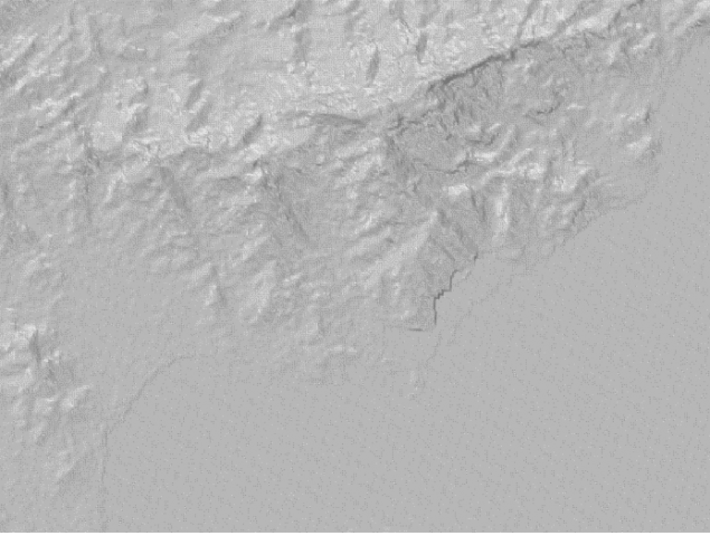
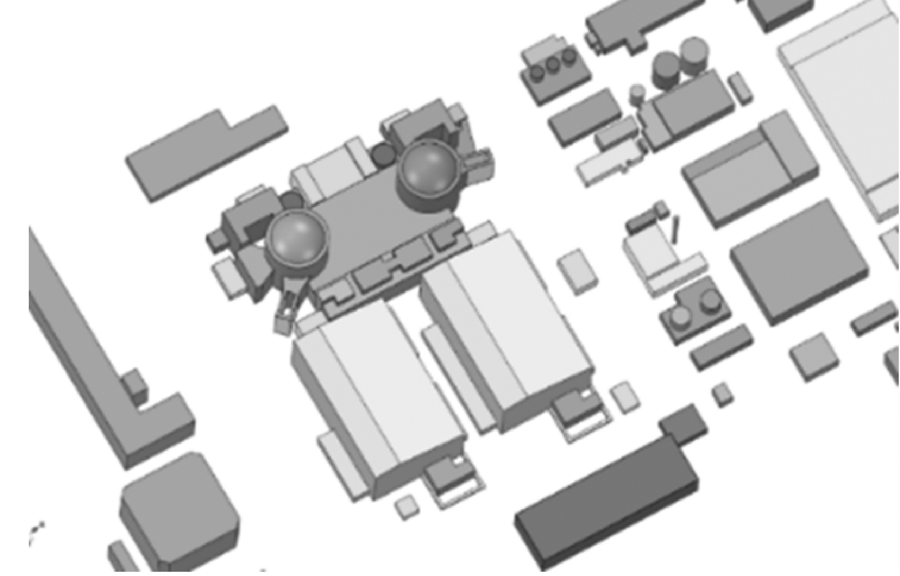
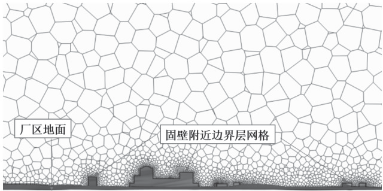
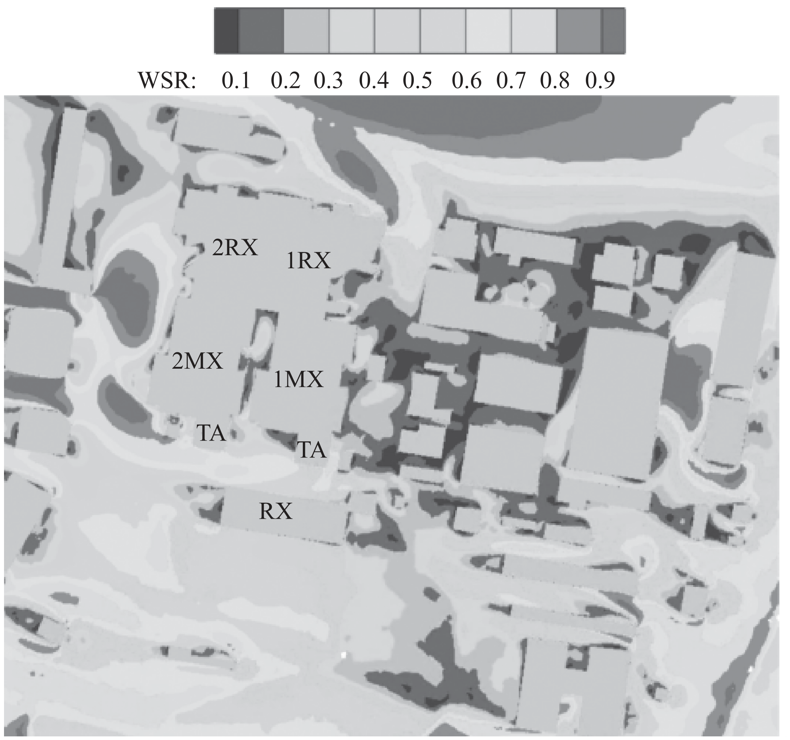
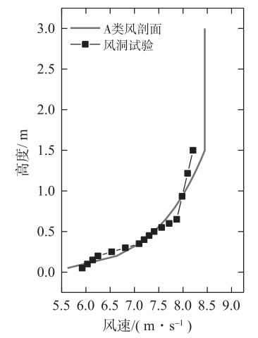
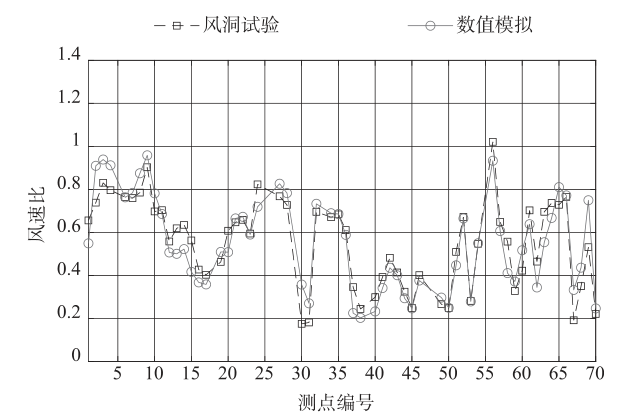
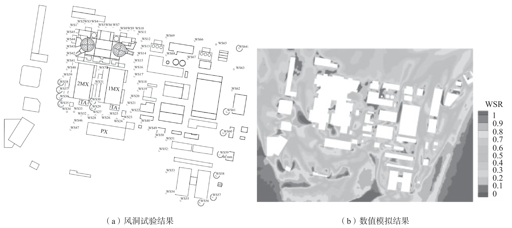
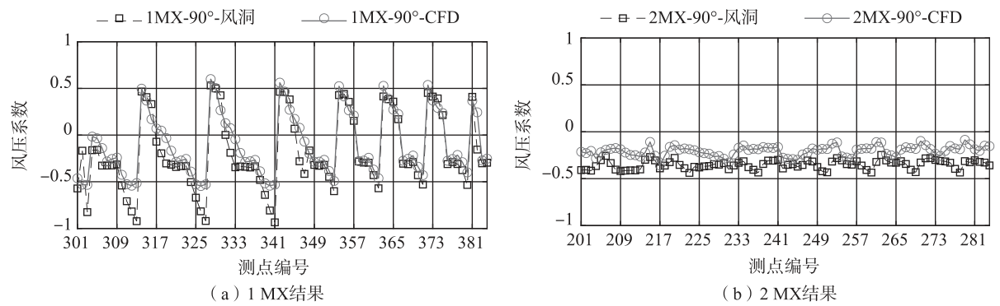

.. _paper-note-ref-feng2023-HKXYGC:

核电厂微地形风场分析与验证：论文精解
====================================

精简版微信公众号文章：待发布

.. contents:: 本页目录
   :local:
   :depth: 2

论文信息
--------

**题名：** 基于数值风洞试验的核电厂微地形风场分析与验证。

**英文题名：** Analysis and Verification on Micro-scale Wind Field of Nuclear Power Plant Based on Numerical Wind Tunnel Test。

**作者：** 冯丙辰\ :sup:`1`、肖扬\ :sup:`2`、李朝\ :sup:`2`、肖仪清\ :sup:`2`。

**作者单位：** 1. 苏州热工研究院有限公司，深圳 518038；2. 哈尔滨工业大学（深圳），深圳 518055。

**期刊：** 《核科学与工程》，2023 年 6 月，第 43 卷增刊，392–395 页。

**WOEAI 相关方向：** 工程结构抗风 / 数值风洞。

本文为中文论文的完整正文整理，保留原有论证、数据及引用编号；英文摘要另译为中文。原文中可辨认的引文错配和数字表述差异在相邻校核注中说明，不以编辑判断替换原文。

摘要
----

建筑群相互干扰下的微尺度风场信息是风环境评估和风灾危险区域识别的基础。尽管在物理风洞中能够复原建筑群缩尺流场，但复杂的风速和风向使得信息测量效率低且精度受限，难以应用于大规模实际工程。数值风洞方法有能力克服物理风洞的局限性，精准刻画大规模复杂地形和建筑群几何对风场的影响，获取微尺度风场信息。本文在精细化几何建模的基础上，完成了核电厂建筑群风环境的大涡模拟数值风洞试验。与物理风洞试验中获取的小区域风速、风压场对比，验证了数值风洞试验方法的有效性。数值风洞试验可以同实测站点数据相结合，识别核电厂建筑群中高风灾风险区域，为核电厂的风灾防范、抗风加固提供科学依据。

关键词
------

建筑群风场；山地地形；风灾风险识别；数值风洞试验。

英文摘要译文
------------

建筑群相互干扰下的微尺度风场信息是风环境评估和风灾识别的基础。尽管物理风洞能够再现建筑群周围的缩尺流动，复杂的风速和风向使测量效率低、精度受限，难以应用于大规模实际工程。数值风洞方法能够克服物理风洞的局限，描述大规模复杂地形和建筑群对风场的影响，获得微尺度风场。本文基于精细化几何建模，完成了核电厂建筑群风环境的大涡模拟数值风洞试验。通过与物理风洞试验获得的风速场和风压场比较，验证了数值风洞试验的有效性。数值风洞试验可与现场实测数据结合，识别核电厂建筑群中的高风灾风险区域，为核电厂的风灾防范和抗风加固提供科学依据。

**英文关键词译文：** 城市风场；山地地形；风风险识别；数值风洞试验。

1 引言
------

风在给人类社会带来了巨大的效益的同时也造成了巨大的损失。根据吴亚玲、李辉对气象灾害的统计可知，深圳市在 2000–2007 年期间气象灾害造成的经济损失高达 8.2929 亿元，其中有 33.4% 的经济损失是由于风灾直接或间接引起的 [1]。故而近年来在强风作用下的城市风场分析中，城市建筑群中各类风敏感结构的安全性备受关注。我国核电厂属于典型的沿海建筑群，且大部分位于东南沿海，属于台风等风灾高发区域。对于核电厂而言，如果无法有效识别由于建筑风场形成的风敏感结构和区域，不仅可能造成经济损失，还可能对核电机组的安全性构成威胁。因此，有必要针对核电厂开展微地形风场分析，识别潜在的高风险区域。

计算流体力学（Computational Fluid Dynamics，简称 CFD）是研究风场的一种高效且重要的方法，已在城市建筑群风场分析中得到广泛应用。CFD 数值模拟具有能够进行足尺试验、周期短费用低等诸多优点。但 Blocken [2] 指出，近 50 年来 CFD 数值模拟结果其决定作用的实际上是用户输入的参数。Mochida 和 Yoshie 等人 [3] 对比了风洞试验、现场实测与行人高度风环境的 CFD 模拟结果得出，当风速较大的时候，CFD 对单体建筑模型的风场模拟结果与风洞试验结果具有较好的吻合度，误差不超过 10%。宫文壮 [4] 利用 CFD 对广东沿海地区比较典型低矮建筑进行了数值模拟，得到了各风向下局部风压系数。2007 年 Franke [5] 等对 CFD 精度问题进行了系统的总结，指出了误差的来源主要是模型建模误差、湍流模型及离散格式等。本文以国内某核电厂为例，首先使用卫星影像定位建筑与山体，然后利用地理信息系统（Geographic Information System，简称 GIS）技术精细化修剪地形，使得地形在几何描述上更接近研究区域所处的海岸环境，确保数值风洞分析的准确性，最后将地形模型应用到数值模拟中，并采用物理风洞对分析结果进行验证。

.. note::

   引文校核：原文此处的 Blocken [2] 与 Franke [5] 和文末同号条目不对应；文末 [2] 与 [5] 均为 Zhang、Nishijima 和 Maruyama（2014），Franke 等的指南列在 [6]。本页保留原文引用编号及参考文献表，不猜测或补造被遗漏的文献。

2 海岸地形下建筑群数值模拟
--------------------------

2.1 建筑群与地形模型的建立
~~~~~~~~~~~~~~~~~~~~~~~~~~

开展 CFD 数值模拟首先需建立核电厂的建筑群和地形模型。地形数据三维坐标从专业 GIS 软件获取，并通过射线法算法模型处理数据，实现任意加密和任意修剪平整地形，保证地形数据的精度要求。最后生成建模软件可用的实体模型，如图 1 所示。

   **图 1** 地形模型图。

建筑物拉伸后需要进行几何清理及修缮工作，建筑物细节如图 2 所示。将包含地形高程信息的地形文件同步导入建模软件中，选取与计算域相对应的范围拟合出表层曲面使之生成光滑实体模型，形成建筑与地形实体模型。地形模型作为 CFD 计算域的下垫面参与数值模拟。

   **图 2** 建筑模型图。

2.2 数值模拟方法与网格划分方案
~~~~~~~~~~~~~~~~~~~~~~~~~~~~~~~~

综合考虑多风向工况的计算求解代价、计算域边界的地形截断情况，将 CFD 的三维模型范围（求解域）设定为内部圆柱体计算域和外部计算域构成，通过计算域边界互通。其中目标求解区域为内部计算域，通过旋转外部计算域的方法保证分析不同风场时监测点保持不变。确定多面体网格用于 CFD 数值模拟计算，核电厂厂区内局部加密，并在建筑及地形固壁边界设置边界层网格，如图 3 所示。

   **图 3** 网格划分剖面示意图。图内标出“厂区地面”和“固壁附近边界层网格”。

2.3 CFD 数值模拟结果
~~~~~~~~~~~~~~~~~~~~

通过对不同风场情况开展数值风洞模拟，可得不同风向角下核电厂各区域微地形风场结果。分析中以所观测测点风速与来流风速的比值，即风速比（WSR）作为主要的评价参数。风速比越高，代表风险越高。图 4 以 120 度风向（正北向为 0 度，顺时针旋转）为例，给出了核电厂主体区域微地形风场分析的结果。图中风速比以不同颜色表示，其中红色代表风速比 ≥1，属于高风险区域。由图可知，该风向下 2 号机组汽轮机厂房（MX）西侧的区域风险较高。

   **图 4** 微地形风场风速比分析结果（120 度）。WSR 为风速比；图中保留 1RX、2RX、1MX、2MX、TA 和 RX 的原始区域标记，色标显示 0.1–0.9。

.. note::

   图像与原文校核：本篇来源中的图 4 为灰度图，不能从这份图像识别正文所称的“红色”；本页保留原始灰度图，不自行补色。风速比用来识别局部加速位置，并不单独给出结构失效概率或设备抗风承载能力。

3 海岸地形下建筑群风洞试验验证
------------------------------

3.1 建筑群风洞试验条件
~~~~~~~~~~~~~~~~~~~~~~

风洞试验平均风速剖面模拟结果如图 5 所示。从图中可以看出，风洞来流风场与规范要求 A 类风剖面大致符合。为保证试验条件与数值模拟具有较好的一致性，对来流风试验值进行相应的拟合，并作为数值模拟的速度入口。

   **图 5** 风洞来流风剖面。横轴为风速（m·s⁻¹），纵轴为高度（m）；灰色实线为 A 类风剖面，方形标记为风洞试验。

物理风洞试验中，选择所分析厂址发生概率较高的 90 度至 210 度风向角开展验证。

3.2 风洞试验与数值模拟风速比对比
~~~~~~~~~~~~~~~~~~~~~~~~~~~~~~~~

Schatzmann 和 Olesen 等人 [6] 的文献使用三个验证指标评定风场数值模拟精度，分别是小数偏差（Fractional Bias，FB）、归一化均方误差（Normalized mean square error，NMSE）和 FAC2（A factor of 2）。同样的，Gousseau 和 Blocken 等人 [7] 也使用这三个验证指标量化分析数值结果与试验结果的一致性。三个验证指标的取值范围为 0–1，其中 FAC2 值接近 1、FB 和 NMSE 接近 0 时表示 CFD 数值模拟风速比结果和风洞缩尺试验实测结果一致性较好。此外，单独引入平均相对误差（Mean Absolute Relatively Error，简称 MARE）用以更直观地评估每个工况下的数值模拟的预测精度，该指标值越小表示预测精度越高。

.. note::

   指标与引文校核：以上“取值范围为 0–1”为原文表述，但表 1 中 FB 均为负值，不能据该句将 FB 限制为非负。原文未列这些指标的计算公式，本页不补写为原公式。正文的 Schatzmann 等 [6]、Gousseau 等 [7] 实际分别对应文末 [7]、[8]，保留原号并提示错配。

.. list-table:: 表 1 各工况模拟精度表
   :header-rows: 1
   :widths: 20 20 20 20 20

   * - 工况
     - FB
     - NMSE
     - FAC2
     - MARE
   * - 90 度
     - −0.0481
     - 0.1124
     - 0.9286
     - 0.1373
   * - 120 度
     - −0.1225
     - 0.1417
     - 0.9143
     - 0.1548
   * - 150 度
     - −0.0747
     - 0.1057
     - 0.9286
     - 0.1381
   * - 180 度
     - −0.1283
     - 0.1452
     - 0.9143
     - 0.1644
   * - 210 度
     - −0.1188
     - 0.1081
     - 0.9286
     - 0.1564

由表 1 中小数偏差 FB 和平均相对误差 MARE 可知，90 度和 150 度风向角小数偏差较小对应平均相对误差较小，其他三个风向角小数偏差大对应平均相对误差较大。这是因为在面对类似风速比小而测点误差偏大的工况，小数偏差受这种情况的影响较大。120 度、150 度和 210 度风向角在风速比相对较小测点的误差明显大于 90 度和 150 度，这样就会大幅拉低平均相对误差。从整体上来看，数值模拟结果满足对风洞试验结果的预测精度要求。

.. note::

   原文同一比较中两次列出 150 度，并把较大测点误差描述为“大幅拉低平均相对误差”。这些文字与前句和表 1 存在不一致。本页保留原文，不将其中一个 150 度擅自替换为 180 度，也不反转其结论；需要定量比较时以表 1 的原始数值为准。

在 90 度风向角下风速比绘制如图 6。结合表 1，FB 和 NMSE 接近 0，FAC2 接近 1，结果符合性较好。所有测点平均相对误差为 0.1373，将剔除后的测点依风洞试验风速比降序排列后得知，绝大多数测点相对误差均低于 10%，低风速比测点相对误差陡增。这是因为在相同的绝对误差下，由于测点本身风速比处于 0.1–0.3 的低区间，绝对误差比本身风速比产生的相对误差就较大。这也说明了对类似风速比的无量纲参数进行量化分析时，小数偏差 FB 对整体平均相对误差的影响比较大。

   **图 6** 风洞试验与 CFD 数值模拟风速比对比（90 度）。横轴为测点编号，纵轴为风速比；方形虚线为风洞试验，圆形实线为数值模拟。

以 180 度风向角为例，图 7 给出了风洞试验和数值模拟的风速比结果对比。其中，风洞试验结果中，风速比大于 0.8 的测点用红圈标出。由图可知，风洞试验探头测点风速比对比数值模拟结果发现 180 度风向下风速较大区域主要集中在 WS35、WS36 对应的建筑群西南角区域，数值模拟云图也显示附近区域风速出现较大值，该处风洞试验与数值模拟结果规律一致。WS29、WS30 与 WS57–WS61 受“狭管效应”影响风速偏大，TA 区域其主要原因还是 2MX 厂房前无遮挡而厂房本身对来流风有一个分离作用，涡脱效应形成风速叠加区致使风速变大，应效仿 1MX 厂前方有 PX 泵房作为遮挡。WS64 和 WS56 作为建筑群角部，受来流风漩涡脱落形成风速叠加区。

   **图 7** 风洞试验与 CFD 数值模拟风速比云图对比（180 度）。（a）风洞试验结果；（b）数值模拟结果。WS 标记为测点编号，WSR 色标为风速比（0–1）；原图为灰度，正文所称“红圈”在此以灰度圈线保留。

3.3 风洞试验与数值模拟风压系数对比
~~~~~~~~~~~~~~~~~~~~~~~~~~~~~~~~~~

在结构风工程中，对风压的描述通常采用无量纲的压力系数表示。通过风洞实验与 CFD 模拟建筑表面风压系数的对比，进一步说明 CFD 模拟的可靠性。图 8 以 90 度风向角为例，给出了厂房 1MX 与 2MX 上各测点的风压系数。由图可知，数值模拟与风洞试验在风压系数上整体误差小于 10%。

   **图 8** 风压系数对比（90 度）。（a）1MX 结果；（b）2MX 结果。横轴为测点编号，纵轴为风压系数；方形虚线为风洞试验，圆形实线为 CFD。

4 结论
------

本文将较粗糙的数字高程模型与局部地形平整优化方法结合，提升了沿海复杂场地的几何描述精度。基于 CFD 数值风洞模拟计算，开展了针对核电厂的微地形风场分析。并借助物理风洞试验的测量结果，从近地面风速和建筑表面风压两个维度验证了微地形风场数值风洞方法的有效性。具体结论为：

1) 构筑物周边区域存在风速较高的绕流，物理与数值风洞试验均能够捕捉此类加速现象。70 个实测点风速比的最大相对误差在 15%–20%，其中绝大多数测点低于 10%。小部分测点本身风速比处于 0.1–0.3 的低区间使得相对误差偏大，但绝对误差仍可接受。重点建筑 MX 上的测压结果表明，80 多个测点风压系数误差在 10% 以内，物理与数值风洞的一致性也较好。多方面验证了 CFD 数值风洞的可靠性和准确性。

2) 根据数值风洞试验提供的高分辨率流场分析结果，初步评估厂房 2MX 相邻的 TA 区域为高风速危险区。建议重点关注该区域主变压器和辅助变压器的抗风能力，必要时采取防风加固措施，如在迎海面设置相应的遮风物以改善风环境效果。

上述结论说明 CFD 数值模拟计算对分析海岸地形下复杂的核电厂建筑群风场是可行的。对于类似的研究场景，可采用 CFD 数值模拟的方法。物理风洞试验可作为辅助手段，用于验证和更新数值模拟，从而得到更准确的分析结果。

通过基于数值风洞试验的核电厂微地形风场分析，可全面识别核电厂风灾高风险区域。对于运行核电厂，该分析可用于灾害风险评价、优化风灾防范行动、支持抗风加固改造；对于新建核电厂，该分析可用于厂址可行性研究、优化厂房布局等。

参考文献
--------

[1] 吴亚玲，李辉. 深圳市 2000 年以来气象灾害及其风险评估 [J]. 广东气象，2009，31(3): 43–45.

[2] ZHANG S, NISHIJIMA K, MARUYAMA T. Reliability-based modeling of typhoon induced wind vulnerability for residential buildings in Japan [J]. Journal of Wind Engineering & Industrial Aerodynamics, 2014, 124(7): 68–81.

[3] YOSHIE R, MOCHIDA A, TOMINAGA Y, et al. Cooperative project for CFD prediction of pedestrian wind environment in the Architectural Institute of Japan [J]. Journal of Wind Engineering & Industrial Aerodynamics, 2007, 95(9–11): 1551–1578.

[4] 宫文壮. 广东沿海地区村镇低矮房屋台风易损性研究 [D]. 哈尔滨工业大学，2009.

[5] ZHANG S, NISHIJIMA K, MARUYAMA T. Reliability-based modeling of typhoon induced wind vulnerability for residential buildings in Japan [J]. Journal of Wind Engineering & Industrial Aerodynamics, 2014, 124(7): 68–81.

[6] FRANKE J, HIRSCH C, HELLSTEN A, et al. Best Practice Guideline for the CFD Simulation of Flows in the Urban Environment [J]. Brussels: COST Office, 2007: 1–33.

[7] SCHATZMANN M, OLESEN H, FRANKE J. COST ES1006 Model Evaluation Case Studies: Approach and Results [M]. Hamburg, Germany: COST Office, 2010: 39–40.

[8] GOUSSEAU P, BLOCKEN B, VAN HEIJST G J F. Quality Assessment of Large-Eddy Simulation of Wind Flow around a High-Rise Building: Validation and Solution Verification [J]. Computers & Fluids, 2013, 79: 120–133.

完整引用
--------

冯丙辰，肖扬，李朝，肖仪清. 基于数值风洞试验的核电厂微地形风场分析与验证 [J]. 核科学与工程，2023，43（增刊）：392–395。

收录信息见 :ref:`WOEAI 学术成果页对应条目 <ref-feng2023-HKXYGC>`。
