.. _paper-note-ref-he2024-JBE:

调谐液体阻尼器非线性晃荡与减振性能的数值研究：论文精解
========================================================================================================

精简版微信公众号文章：待发布

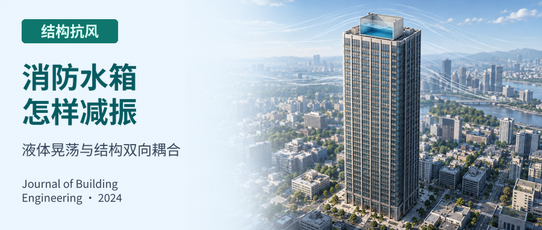

**精解范围：** 覆盖摘要、科学正文、全部公式图表及参考文献；不含作者贡献、利益冲突、数据可用性和致谢等声明尾节。

.. contents:: 本页目录
   :local:
   :depth: 2

论文信息
--------

**原文题名：** Numerical research on nonlinear liquid sloshing and vibration control performance of tuned liquid damper。

**作者：** Xin He、Chao Li（通讯作者）、Lingwei Chen、Junhui Yang、Gang Hu、Jinping Ou。

**单位：** 哈尔滨工业大学（深圳）土木与环境工程学院；广东省土木工程智能与韧性结构重点实验室；粤港澳数据驱动流体力学与工程应用联合实验室。

**期刊：** Journal of Building Engineering，96（2024），110660。

**DOI：** `10.1016/j.jobe.2024.110660 <https://doi.org/10.1016/j.jobe.2024.110660>`_。

**收稿与发表：** 2024年8月5日收稿，8月23日修回，9月1日录用，9月4日在线发表。

**WOEAI 相关方向：** 工程结构抗风 / 结构抗风。

摘要
----

通常设置于高层建筑顶部的高位消防水箱可改造为调谐液体阻尼器（Tuned Liquid Damper，TLD），减轻建筑结构的风致振动，从而改善人员舒适度。本文采用计算流体力学（Computational Fluid Dynamics，CFD）方法研究TLD的非线性液体晃荡特性，重点建立分析TLD与高层建筑耦合过程的数值模型。考察液深、激励幅值等因素对非线性液体晃荡特性的影响。此外，基于OpenFOAM二次开发，提出结构—TLD系统双向耦合数值模型。该耦合模型实现结构振动与TLD液体晃荡之间的相互作用，同时有效降低计算资源需求和计算时间。利用振动台试验结果，对比非线性液体晃荡特性和结构振动响应，验证数值模型的准确性。通过改变质量比和调谐比，进一步分析TLD减轻足尺高层建筑风致振动响应的效果。双向耦合数值模型旨在揭示TLD的非线性液体晃荡特性和振动控制性能，为工程师提供准确、经济、高效的TLD详细设计与评估方法。

**关键词：** 调谐液体阻尼器；非线性液体晃荡；计算流体力学；双向耦合数值模型；振动控制。

1 引言
--------

高层建筑不断刷新高度纪录，先进建筑材料和施工技术也日益得到应用。这些结构因此具有更大的高宽比、更低的固有阻尼和更强的柔性，对风荷载更加敏感 [1]。合理选择结构体系、设计建筑形态并优化气动外形，可显著减轻这些影响。这些措施能够使高层建筑满足风荷载承载力要求，从而保证结构安全。然而，在强风条件下，建筑仍会发生较大振动，顶部峰值加速度可能超过行业标准。这不仅使使用者产生不安，还会加速非结构构件损耗，并干扰内部机械系统正常运行 [2]。

增加结构质量和刚度，可使其固有频率远离易受风致振动影响的频段，是降低高层建筑振动响应的一种策略 [3]。然而，这会显著增加建筑材料用量、提高建造成本，并可能限制内部使用空间。另一个重要结构因素是阻尼，它影响结构耗散能量的能力。阻尼难以量化，尤其高层建筑的阻尼往往较小，需要由外部系统提供附加阻尼 [4]。动力吸振器通过阻尼机制耗散振动能量，因而广泛用于结构振动控制。高层建筑中主要采用调谐质量阻尼器（TMD）和TLD [5]。

TMD由质量块和辅助阻尼装置构成，能有效减轻高层建筑的动力响应 [6]。但其系统构造复杂、占用空间较大、建造费用较高，这些都是明显局限。TLD由部分充液的水箱构成，通常安装在结构响应最大的位置，其设计使液体晃荡频率接近结构固有频率。TLD利用内部液体晃荡动力学有效耗散振动能量，从而降低结构动力响应。它具有设计施工简单、经济、易安装、维护需求少和使用寿命长等优点 [7]。高层建筑顶部必须设置高位消防水箱，并需保证其水位稳定。因此，可将这类水箱改造成TLD系统，利用内部液体运动实现减振。

TLD内部液深的差异会显著改变液面振荡。TLD按液深 :math:`h` 与水箱长度 :math:`L` 之比分类：当 :math:`h/L<0.1` 时为浅水型TLD [8]，自由液面快速振荡，产生破碎并耗散较多能量；当 :math:`h/L>0.5` 时为深水型TLD [9]，自由液面主要呈驻波，液体振幅较小。在后一情况下，水箱底部液体保持静止，降低了容积利用率和减振效果。液深比处于上述临界范围之间时为中等液深TLD [10]，自由液面呈过渡波。已有研究采用的TLD形状包括矩形 [11]、圆形 [12]、环形 [13]，以及U形调谐液柱阻尼器（TLCD）[14,15]。

近几十年，学者通过理论推导和振动台试验，对TLD晃荡特性进行了广泛研究。Housner [16] 提出集中质量模型，研究水箱内部液体振荡。Faltinsen [17] 基于势流理论推导二维矩形水箱液体振荡的线性解析解。Fujino [18] 利用浅水波理论建立矩形TLD非线性晃荡动力学模型，并推导液体阻尼的半解析公式。Yu [19] 基于大量试验数据，建立将TLD等效为TMD的经验模型；该模型同时考虑非线性刚度和阻尼，称为非线性刚度阻尼（NSD）模型。Tait [20] 运用浅水波理论，建立带内部格栅的TLD等效力学模型。Love [21] 采用非线性多模态模型 [22]，将液体晃荡模态扩展到第一、第三和第五阶，同时考虑这些模态之间的非线性耦合。Xiao [23] 改进NSD模型 [19]，提出考虑激励频率对波高影响的NSD-h模型，并用振动台数据确认其精度。Sun [24] 针对内部设有阻尼网和斜底的DNS-TLD，建立等效阻尼比计算公式。等效力学模型可快速分析TLD内部液体晃荡，但其适用性受激励幅值、液深等因素限制 [21]。在较强外部激励下，它可能低估液体晃荡特征 [25]，并使结构响应控制结果产生偏差 [26]。这类模型适用于TLD初步设计；在详细设计阶段，仍需充分的振动台试验，才能准确掌握内部液体晃荡特性 [20,27]。

当前TLD研究主要采用振动台开展试验。Molin [28] 在矩形TLD中系统布置不同筛板，通过六自由度振动台试验研究孔隙率对液体晃荡频率的影响。Zhang [29] 对斜底TLD开展振动台试验，分析液深和底坡角对晃荡波高及频率的影响。Zahrai [30] 在五层刚架顶部设置TLD，并在箱内加入可转动挡板；根据振动台结果，详细分析挡板角度和频率比对减振效率的影响。Pabarja [31] 在三层框架上设置TLD，考察不同安装位置和调谐比下位移响应的变化。Xu [32] 采用实时混合模拟试验，研究配有矩形TLD的三层刚架振动响应，分析液深对控制效果的影响。Tang [33] 采用实时混合模拟试验研究20层结构基准模型的地震响应，将足尺TLD分割成相同的试验子结构；结果发现，TLD对结构位移响应的控制优于加速度响应。振动台试验通常受到承载力和台面尺寸限制，必须使用缩尺模型；但缩尺模型与原型之间的液体晃荡特性存在差异，可能不利于TLD的实际应用 [14,34]。实时混合模拟虽能解决振动台试验的一部分限制，却面临设备敏感性问题。试验子结构与数值子结构之间的时间延迟，会使计算误差随时间步逐渐累积。此外，试验缩尺模型成本较高，限制了广泛参数研究。

CFD方法已广泛用于TLD研究，能有效捕捉非线性液体晃荡，具有计算较快、预测较准确等优点。Liu [35] 采用NEWTANK数值分析模型模拟自由液面破碎的非线性晃荡，数值结果与试验数据接近。Xue [36] 运用虚拟边界力法，对水箱挡板进行数值模拟。Chu [37] 采用有限体积法，分析多道水平挡板对矩形TLD波高的影响，模拟与试验结果一致。Cavalagli [38] 基于OpenFOAM建立VOF数值模型，研究TLD晃荡特性，获得力—位移耗能曲线。McNamara [39] 采用无网格光滑粒子流体动力学（SPH）方法，建立结构—TLD系统数值模型，研究大幅激励下阻尼筛对液体晃荡频率的影响；模型能够有效预测晃荡力并准确跟踪自由液面。Tuong [40] 分别用Ansys的CFX和Mechanical模块建立流体域与结构域，通过流固耦合模型研究多TLD对单自由度（SDOF）结构振动响应的控制性能。这类方法在复杂结构的流固耦合建模方面存在困难，需要较多计算资源和时间。

本文提出基于OpenFOAM的计算结构动力学—计算流体力学（CSD–CFD）耦合分析框架，研究结构振动响应与TLD液体晃荡的相互作用。首先建立数值模型，预测水平简谐激励下TLD的非线性液体晃荡；改变液深、激励幅值、湍流模型等参数，分析其对晃荡力和波高响应的影响。随后对OpenFOAM进行二次开发，建立结构—TLD系统双向耦合数值模型：结构域用Newmark-beta法求解运动方程，流体域用VOF方法预测晃荡特性，通过实时通信接口函数交换耦合数据，简化流固耦合界面的处理，从而降低计算资源需求和时间消耗。利用振动台试验结果验证模型精度。最后研究TLD对高层建筑风致振动的控制，分析质量比和调谐比的影响。

2 TLD数值模型
------------------

2.1 控制方程
----------------

本文使用OpenFOAM两相流求解器研究TLD内部液体晃荡，将液体视为不可压缩、等温且互不相溶的流体 [41]。流体运动控制方程包括连续方程和Navier–Stokes方程，分别为：

.. math::

   \frac{\partial\rho}{\partial t}+\nabla\cdot(\rho U)=0 \qquad (1)

.. math::

   \frac{\partial(\rho U)}{\partial t}+\nabla\cdot(\rho UU)=-\nabla P+\nabla\tau+\rho g+f \qquad (2)

其中， :math:`U` 为流速， :math:`\rho` 为流体密度， :math:`P` 为液体瞬时有效压力， :math:`\tau` 为黏性应力张量， :math:`f` 为液体表面张力等外力。黏性应力张量 :math:`\tau` 定义为：

.. math::

   \tau=2\mu S=2\mu\left(0.5\left(\nabla U+\nabla U^{T}\right)\right) \qquad (3)

其中， :math:`\mu` 为流体黏度系数。采用流体体积（Volume-of-Fluid，VOF）方法 [42] 捕捉振荡自由液面，其平流输运方程为：

.. math::

   \frac{\partial\alpha}{\partial t}+\nabla\bullet(U\alpha)=0 \qquad (4)

其中， :math:`\alpha` 为相分数，表示两类流体在网格内占据的体积比例。0表示空气，1表示液体，0到1之间表示混合单元。两相流数值模型通常使用单一混合流体来计算物理性质：

.. math::

   \rho=\alpha\rho_l+(1-\alpha)\rho_a \qquad (5)

.. math::

   \mu=\alpha\mu_l+(1-\alpha)\mu_a \qquad (6)

下标 :math:`l` 表示液体， :math:`a` 表示空气。

.. note::

   式(2)黏性项按原文记作梯度符号与应力张量的组合，未显式写出散度点号；本页保留原式，不将其自行替换为另一套离散实现。

2.2 数值实现
----------------

在OpenFOAM中，定义全局网格运动类函数，利用动网格技术控制水箱运动。有限体积法（FVM）离散流体运动控制方程，在各网格单元内求解Navier–Stokes方程，以保证物理量守恒。时间项 :math:`\partial U/\partial t` 和 :math:`\partial\alpha/\partial t` 用一阶隐式Euler法离散，梯度项 :math:`\nabla U` 用二阶Gauss linear格式； :math:`\nabla(UU)` 和 :math:`\nabla(U\alpha)` 采用Gauss vanLeerV格式。压力—速度耦合使用PIMPLE算法，它结合SIMPLE与PISO算法的优点，原文称可在CFD模拟中获得更高效、准确的稳态解 [41]。为保证求解稳定性，需要限制Courant数 :math:`Cr`。原文给出的理论值为1，通常可在强非线性流动中保证精度与稳定性；实际计算中，这类工况一般将其维持在0.5以下。

2.3 验证与评估
------------------

.. note::

   原文wave elevation指测点处液面相对参考位置的波面高程，下文沿原文用法简称“波高”；不把时程中的单侧高程误当作波峰与波谷的总高度。

本节数值模拟矩形TLD的液体振荡特性，并与Liu [35] 的解析和试验结果对比。水箱尺寸为 :math:`0.57\,\mathrm{m}\times0.31\,\mathrm{m}\times0.3\,\mathrm{m}`，液深为 :math:`0.15\,\mathrm{m}`。根据线性波理论 [20]，液体固有晃荡角频率可按下式计算：

.. math::

   \omega_n=\sqrt{\frac{n\pi g}{L}\tanh\left(\frac{n\pi h}{L}\right)} \qquad (7)

其中， :math:`n` 为模态阶次， :math:`h` 为液深， :math:`L` 为沿液体晃荡方向的水箱尺寸。在水箱底部施加单向水平简谐激励 :math:`x=-A\sin(\omega_e t)`，幅值 :math:`A=5\,\mathrm{mm}`。激励角频率与液体一阶晃荡角频率相同， :math:`\omega_e=\omega_1=6.0578\,\mathrm{rad/s}`。在距壁面 :math:`20\,\mathrm{mm}` 处设置波高探针1和2，监测液位变化，见图1。采用Sweep方法生成尺寸为 :math:`5\,\mathrm{mm}` 的六面体计算网格，见图2；时间步长取 :math:`dt=0.005\,\mathrm{s}`。图3表明，当前数值模型对晃荡波高的预测与试验数据接近，而理论解析解低估了液体晃荡响应。

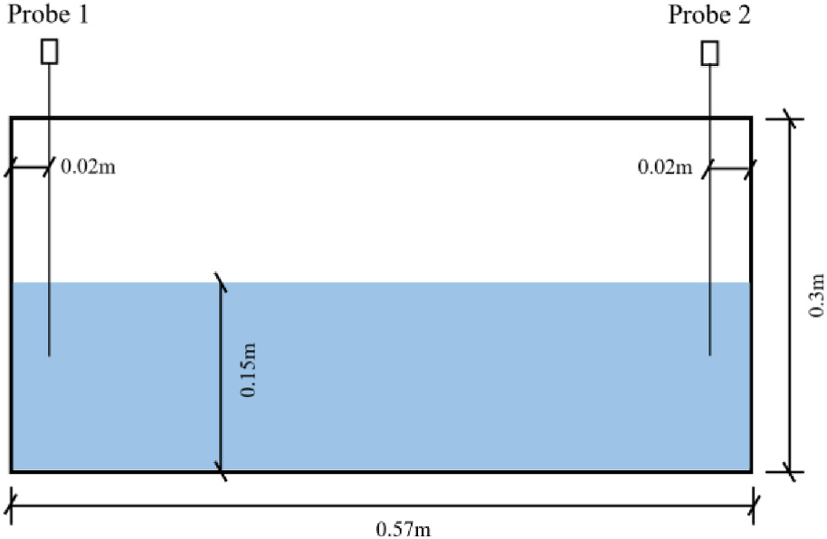

   **图 1** 波高探针布置示意图。

   图中标注：探针 1；探针 2；探针距侧壁 0.02 m；液深 0.15 m；液箱高 0.3 m；液箱长 0.57 m。

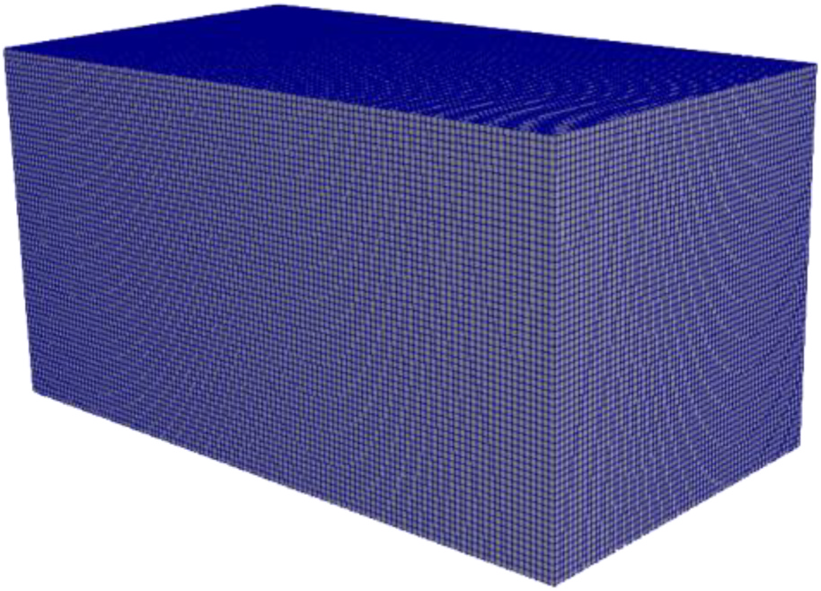

   **图 2** 计算网格示意图。

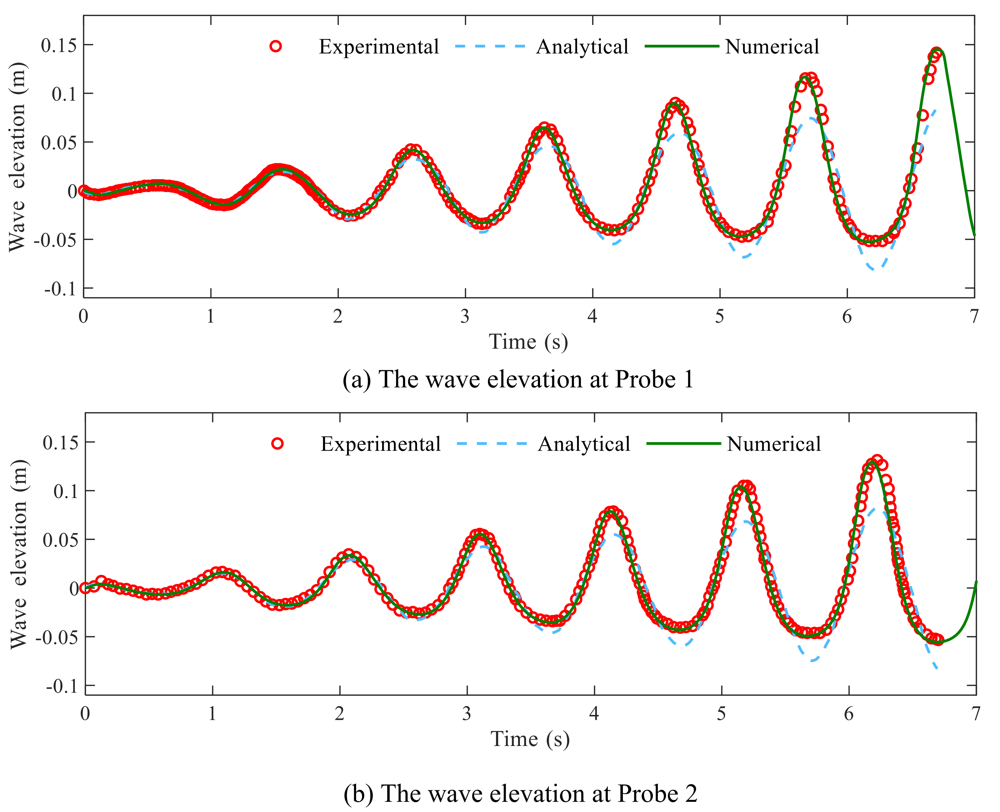

   **图 3** 晃荡波面高程时程曲线的比较，实验数据和理论解析解来自 Liu [35]。

   图中标注：实验结果；数值结果；理论解析解；波面高程（m）；时间（s）；（a）探针 1 处的波面高程；（b）探针 2 处的波面高程。

2.4 湍流模型选择
--------------------

两相流自由液面附近的密度差异很大，大幅晃荡时可能产生湍流。目前尚无专门适配两相流的成熟湍流模型。因此，本文分别采用 :math:`k\text{-}\varepsilon` 模型、 :math:`k\text{-}\omega` SST模型和大涡模拟（LES）的WALE模型，预测液体晃荡特性并选择适合的湍流模型。 :math:`k\text{-}\varepsilon` 模型 [43] 是广泛使用的两方程模型，通过求解湍动能 :math:`k` 与湍流耗散率 :math:`\varepsilon` 的输运方程计算湍流长度和时间尺度；其计算较快、稳健性较好，但在附壁流动或逆压梯度情况下常表现欠佳。 :math:`k\text{-}\omega` SST模型 [44] 结合 :math:`k\text{-}\varepsilon` 与 :math:`k\text{-}\omega` 模型的优点，考虑湍流剪应力输运并改进近壁流处理，使其适用于更多流动类型且预测更准，但仍受各向同性假设限制。前两类模型基于雷诺平均，LES则通过滤波将湍流运动分为大尺度和小尺度涡：大涡直接由Navier–Stokes方程求解，小涡通常采用亚格子尺度（SGS）应力模型。WALE模型 [45] 考虑附加涡黏度在壁面的衰减，并使层流区域涡黏度为零，从而提高预测精度；但它对网格尺寸和时间步长更敏感，收敛性较差。

水箱尺寸为 :math:`0.57\,\mathrm{m}\times0.31\,\mathrm{m}\times0.7\,\mathrm{m}`，液深 :math:`h=0.18\,\mathrm{m}`。在水箱底部施加单向水平简谐激励 :math:`x=-a\cos(\omega_e t)`，幅值 :math:`a=100\,\mathrm{mm}`，角频率 :math:`\omega_e=3.5317\,\mathrm{rad/s}`。在两侧各距壁面 :math:`10\,\mathrm{mm}` 处设置波高探针。图4给出各湍流模型的数值预测： :math:`k\text{-}\varepsilon` 模型误差较大、精度不足，而LES和 :math:`k\text{-}\omega` SST模型与试验结果一致。

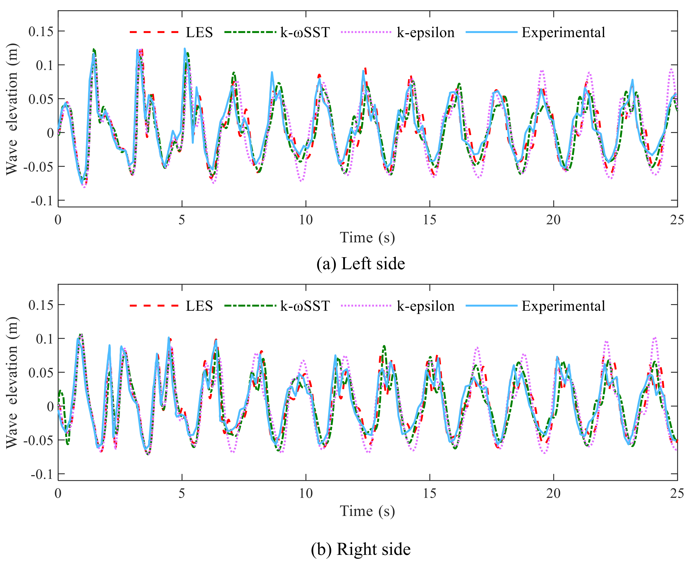

   **图 4** 数值模型预测的晃荡波面高程曲线与 Xue [36] 的实验结果比较。

   图中标注：大涡模拟（LES）；k–ω SST 模型；k–ε 模型；实验结果；波面高程（m）；时间（s）；（a）左侧；（b）右侧。

液体晃荡在水箱壁面监测点产生的压力，是理解其动力特性的重要参数。数值模型用于预测壁面各点压力，水箱几何参数与液深保持前一算例的设置。根据线性波理论 [20]，液体一阶晃荡角频率为 :math:`\omega_1=6.4029\,\mathrm{rad/s}`。在箱底施加单向水平简谐激励 :math:`x=-a\cos(\omega_e t)`，幅值 :math:`a=10\,\mathrm{mm}`，频率 :math:`\omega_e=0.94\omega_1`。在右侧壁距箱底分别为65 mm和105 mm处设置监测点P1、P2，见图5。图6将不同湍流模型的模拟结果与Xue [46] 的试验结果进行比较。对晃荡波高和监测点压力时程的分析表明， :math:`k\text{-}\omega` SST模型能够有效、准确地捕捉气液两相流行为；后续模拟均采用该模型。

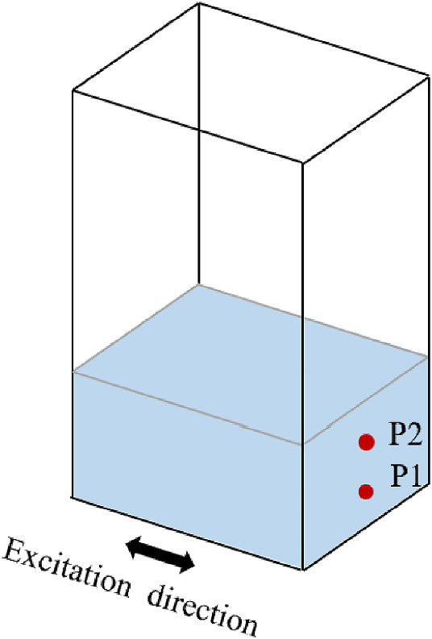

   **图 5** 监测点 P1 和 P2 的布置示意图。

   图中标注：监测点 P1；监测点 P2；激励方向。

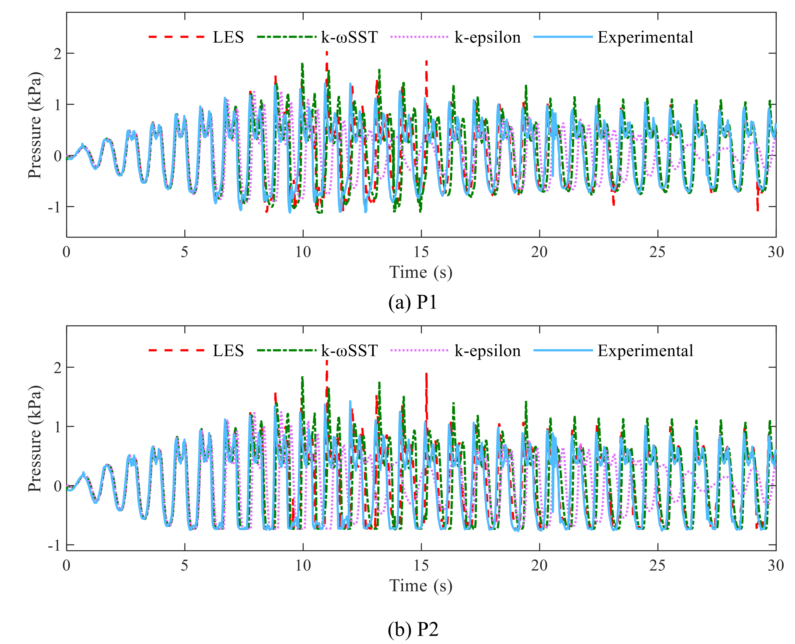

   **图 6** 监测点处的压力时程曲线，实验结果来自 Xue [46]。

   图中标注：大涡模拟（LES）；k–ω SST 模型；k–ε 模型；实验结果；时间（s）；压力（kPa）；（a）监测点 P1；（b）监测点 P2。

.. note::

   这里的湍流模型优劣来自本文给出的水箱与激励算例，不是所有两相流场景的通用排名。PIMPLE“稳态解”的措辞按原文保留；文中的波高和压力验证本身均为随时间变化的响应。

3 TLD的非线性晃荡特性
--------------------------

TLD液体振荡可用线性波理论分析并预测晃荡频率。然而，当晃荡幅值增大、自由液面破碎时，非线性效应变得显著，使共振频率发生偏移。在某一临界液深处，晃荡行为由硬弹簧效应转变为软弹簧效应 [47]。本节开展大量数值模拟，研究液体振荡与弹簧效应的关系，并考察不同激励幅值对TLD非线性晃荡特性的影响。在箱底施加单向水平简谐激励 :math:`x=-A\sin(\omega_e t)`，频率比定义为：

.. math::

   \beta=\frac{\omega_e}{\omega_1}=0.75\sim1.2 \qquad (8)

.. list-table:: 表 1 模拟工况参数
   :header-rows: 1
   :class: longtable

   * - 工况
     - 水箱尺寸 L×B×H（mm）
     - 液深 h（mm）
     - h/L
     - 晃荡角频率 ω₁（rad/s）
     - 激励幅值 A（mm）
   * - Case1
     - 600 × 300 × 400
     - 50
     - 8.33 %
     - 3.6261
     - 5
   * - Case2
     - —
     - 100
     - 16.67 %
     - 4.9678
     - —
   * - Case3
     - —
     - 150
     - 25 %
     - 5.8039
     - —
   * - Case4
     - —
     - 200
     - 33.33 %
     - 6.3326
     - —
   * - Case5
     - 450 × 300 × 400
     - 75
     - 16.67
     - 5.7364
     - —
   * - Case6
     - 750 × 300 × 400
     - 125
     - —
     - 4.4434
     - —
   * - Case7
     - 450 × 300 × 400
     - 100
     - 22.22 %
     - 6.4273
     - —
   * - Case8
     - 750 × 300 × 400
     - —
     - 13.33 %
     - 4.0338
     - —
   * - Case9
     - 600 × 300 × 400
     - 100
     - 16.67 %
     - 4.9678
     - 0.625
   * - Case10
     - —
     - —
     - —
     - —
     - 1

.. note::

   表1保留原表未重复列值的空白单元格，不填入推断值；“—”仅表示原表此处未重复列值，不表示零或缺测。Case5的液深比原表印为16.67，未带百分号；不静默补写成不同原值。

表1列出各模拟工况参数。Case1–Case4改变液深，Case5–Case8改变水箱尺寸，Case9–Case10改变激励幅值，分析内部液体晃荡力和波高峰值的变化规律。网格单元尺寸为 :math:`5\,\mathrm{mm}`，时间步长 :math:`dt=0.005\,\mathrm{s}`，模拟时长为 :math:`12\,\mathrm{s}`。

3.1 液深的影响
------------------

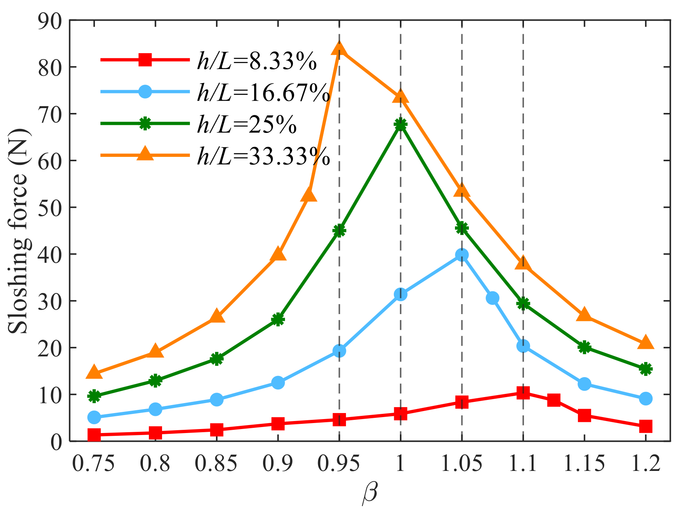

   **图 7** 不同液深下 TLD 的晃荡力峰值。

   图中标注：晃荡力（N）；频率比 β；液深比 h/L 分别为 8.33%、16.67%、25% 和 33.33%。

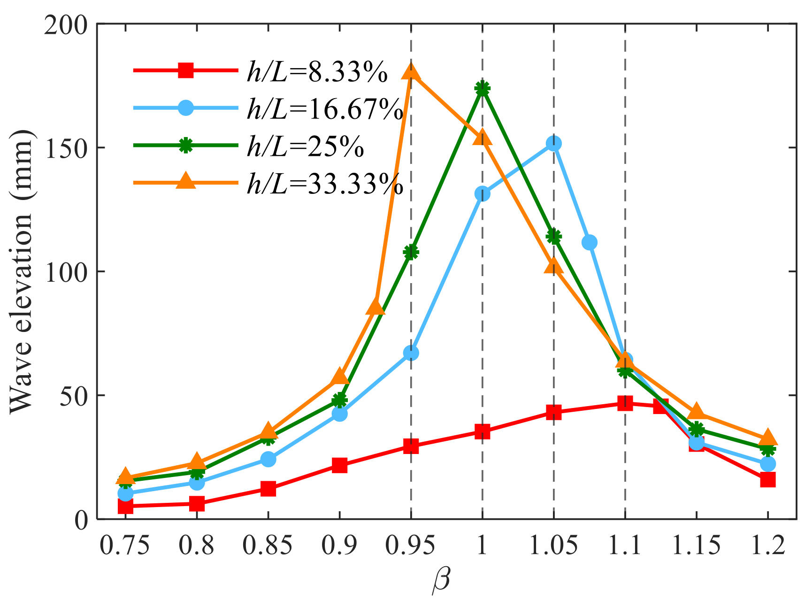

   **图 8** 不同液深下 TLD 的晃荡波面高程峰值。

   图中标注：波面高程（mm）；频率比 β；液深比 h/L 分别为 8.33%、16.67%、25% 和 33.33%。

图7给出Case1–Case4不同液深比 :math:`h/L` 下的晃荡力峰值响应曲线。液深较浅时，晃荡力随激励频率逐渐增大，缓慢达到峰值后迅速衰减，共振频率出现滞后，液体晃荡呈硬弹簧行为。随着 :math:`h/L` 增大，数值计算得到的频率趋近线性波理论 [20] 预测的晃荡频率。本研究中， :math:`h/L=25\%` 达到临界液深，此时未观察到共振响应偏移。液深超过该阈值后，晃荡特性明显不同于浅水：晃荡力随激励频率增加迅速上升，随后缓慢衰减，呈现弹簧软化行为。图8中，晃荡波高峰值的变化与晃荡力一致，较浅液深下共振响应滞后，液深增加则共振响应提前。晃荡力和波高均随液深增加而增大，但增速逐渐下降，这是因为 :math:`h/L` 较大时水箱底部液体保持静止。

线性波理论推导晃荡频率时，引入了简化假设，并将非线性自由液面边界作线性近似；数值模拟则能捕捉非线性晃荡特性。液深 :math:`h` 较浅时，液体对外部激励十分敏感，高阶晃荡模态被激发 [48]，使液体剧烈振荡并引起共振响应偏移。随着 :math:`h/L` 增大，液体出现软化，高阶晃荡模态的贡献减小。能量达到临界值时，振荡状态迅速改变，导致晃荡响应曲线突然跳跃。弹簧效应是液体晃荡非线性的重要指标，与内部液体晃荡的具体形式密切相关，见图9。液深较浅时，初始振荡持续积累能量，自由液面以孤立波形式振荡。能量达到阈值后，自由液面撞击边界发生飞溅，主波与次波相互作用并产生新波形，使波速增大、液体振荡周期缩短，同时共振响应滞后。液深较大时，振荡特性与浅水显著不同：振荡初期自由液面呈驻波，持续输入能量后出现爬升，在上升和下落过程中形成新波形。振荡周期延长时，共振响应提前。

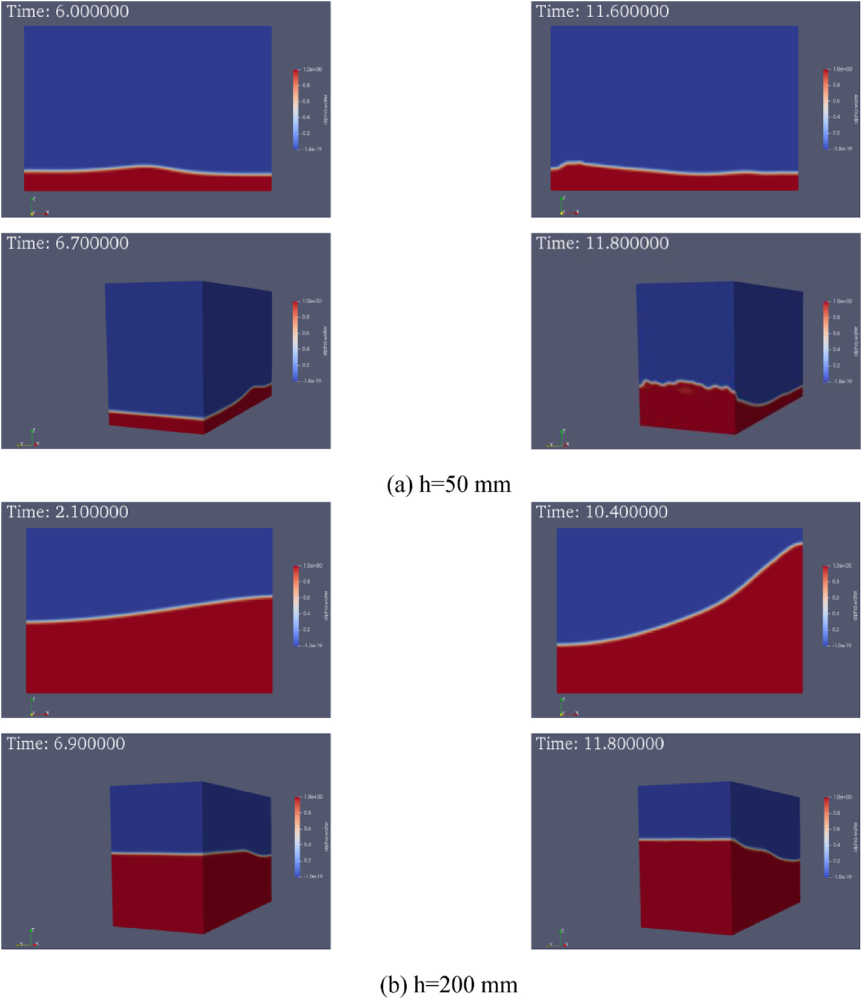

   **图 9** 不同液深下自由液面波动的变化。

   图中标注：（a）液深 h = 50 mm；（b）液深 h = 200 mm；水相体积分数（alpha.water）；时间；（a）按从左到右、从上到下排列的时刻：6.0、11.6、6.7、11.8；（b）按从左到右、从上到下排列的时刻：2.1、10.4、6.9、11.8。

.. note::

   本节“提前／滞后”描述频率扫描中共振峰的位置，不是将时程相位差重新定义为频率。25%的临界液深比来自本文水箱、幅值、计算时长等设置，不能直接作为所有TLD的普适设计常数。

3.2 水箱尺寸的影响
----------------------

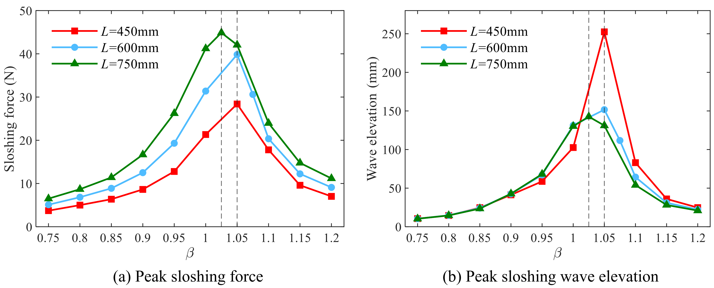

   **图 10** 保持 h/L 不变时，液体振荡特性随 L 的变化。

   图中标注：（a）晃荡力峰值；（b）晃荡波面高程峰值；晃荡力（N）；波面高程（mm）；频率比 β；液箱长度 L 分别为 450、600 和 750 mm。

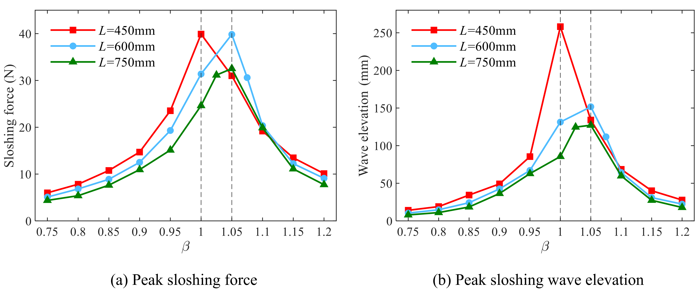

   **图 11** 保持 h 不变时，液体振荡特性随 L 的变化。

   图中标注：（a）晃荡力峰值；（b）晃荡波面高程峰值；晃荡力（N）；波面高程（mm）；频率比 β；液箱长度 L 分别为 450、600 和 750 mm。

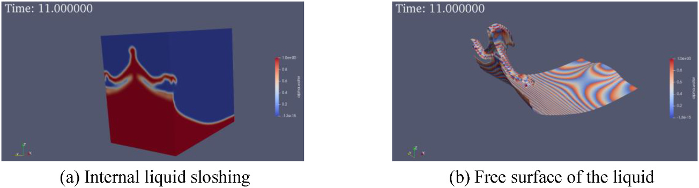

   **图 12** 工况 5 中的液体破碎现象。

   图中标注：（a）内部液体晃荡；（b）液体自由表面；水相体积分数（alpha.water）；时间；时刻：11.0。

式(7)表明， :math:`L` 和 :math:`h` 是计算液体晃荡频率的控制参数。分别保持 :math:`h/L` 与 :math:`h` 不变，研究改变水箱尺寸对内部液体晃荡响应的影响。图10、11给出Case5–Case8的晃荡力与波高峰值响应。图10表明，在相同 :math:`h/L` 下改变箱长 :math:`L`，共振响应仍表现为滞后。Case5中，箱长 :math:`L` 减小后液体破碎，使波高明显增加，见图12。图11中， :math:`L` 减小时液体往复晃荡的路径缩短、波速增加，内部晃荡响应明显变化。比较Case5与Case7，液深增加25 mm后 :math:`h/L` 增大，共振响应提前；比较Case6与Case8，液深减少25 mm后 :math:`h/L` 从16.67%降到13.33%，共振响应滞后。这说明弹簧效应并不局限于某一特定水箱尺寸， :math:`h/L` 是影响液体晃荡响应的关键因素。

3.3 激励幅值的影响
----------------------

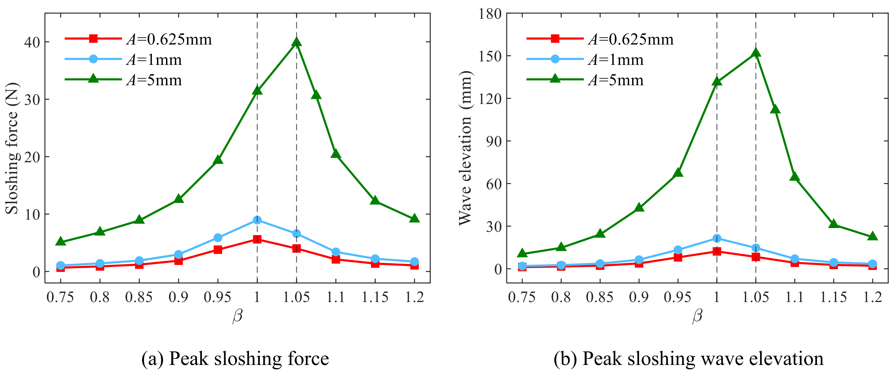

   **图 13** 不同激励振幅下液体晃荡响应的变化。

   图中标注：（a）晃荡力峰值；（b）晃荡波面高程峰值；晃荡力（N）；波面高程（mm）；频率比 β；激励振幅 A 分别为 0.625、1 和 5 mm。

.. figure:: ../../../wechat/assets/public-safe/ref-he2024-JBE/fig14-scaled-sloshing-time-history.png
   :alt: 论文图 14 不同激励振幅下放大后的液体晃荡响应时程曲线比较。
   :align: center
   :width: 100%

   **图 14** 不同激励振幅下放大后的液体晃荡响应时程曲线比较。

   图中标注：（a）放大后的晃荡力时程曲线；（b）放大后的晃荡波面高程时程曲线；放大后的晃荡力（N）；放大后的波面高程（mm）；时间（s）；激励振幅 A 分别为 0.625、1 和 5 mm。

外部激励幅值代表输入能量水平，对内部液体振荡特性具有重要影响。本节改变激励幅值，区分晃荡力和波高响应的变化。图13给出Case9–Case10的两类峰值响应曲线。激励幅值较小、输入能量较低时，内部液体仅发生轻微振荡，自由液面稳定振荡且不破碎，表现为纯线性振荡；共振响应不偏移，并关于 :math:`\beta=1.0` 对称变化。将 :math:`A=0.625\,\mathrm{mm}` 和 :math:`A=1\,\mathrm{mm}` 的晃荡响应时程分别放大8倍和5倍，与 :math:`A=5\,\mathrm{mm}` 下的响应对比，见图14。晃荡初期幅值较小，时程曲线保持一致；随幅值增加，非线性特征显现，晃荡力曲线出现双峰。第一峰由液体首次撞击箱壁形成，第二峰来自液体在重力作用下回落。这一现象无法由理论模型预测 [46]。波高曲线中，受硬弹簧效应影响，非线性晃荡响应明显大于线性响应，与理论分析模型倾向于低估液体振荡特性的结论一致 [20]。

.. note::

   此处“理论模型无法预测”沿用作者对本文所讨论模型的表述，不应推广为所有非线性理论或等效模型都不能描述双峰。

4 结构与TLD之间的双向耦合算法
----------------------------------

液体晃荡的非线性效应，使简化等效力学模型难以准确分析TLD的减振性能。当前结构—TLD耦合系统研究主要依赖振动台试验，但试验受到缩尺模型和试验条件限制 [33]。CFD方法能够准确捕捉液体晃荡特性，流固相互作用（FSI）数值模拟也已有较大进展；但建模复杂、计算时间较长，使其难以实用地分析复杂系统 [39]。本节在前述TLD数值模型基础上进一步开发OpenFOAM，提出CSD–CFD双向耦合数值模型，实现结构振动与液体晃荡之间的相互作用，研究TLD振动控制性能。

.. figure:: ../../../wechat/assets/public-safe/ref-he2024-JBE/fig15-two-way-coupling-model.png
   :alt: 论文图 15 双向耦合数值模型示意图。
   :align: center
   :width: 100%

   **图 15** 双向耦合数值模型示意图。

   图中标注：CFD 模型（计算流体动力学模型）；CSD 模型（计算结构动力学模型）；TLD 晃荡力；结构位移；结构质量、刚度和阻尼；外部激励。

4.1 耦合系统运动方程
------------------------

将TLD设置于结构顶部，在结构底部施加外部激励。结构—TLD耦合系统运动方程为：

.. math::

   M_s\ddot{X}_s+C_s\dot{X}_s+K_sX_s=F_e+F_{\mathrm{TLD}} \qquad (9)

其中， :math:`M_s`、 :math:`K_s`、 :math:`C_s` 分别为结构质量、刚度和阻尼矩阵， :math:`X_s` 为结构位移， :math:`F_e` 为外部激励， :math:`F_{\mathrm{TLD}}` 为TLD晃荡力，由冲击压力与黏性力组成：

.. math::

   F_{\mathrm{TLD}}=\int_s(p+\tau)\,\mathrm{d}s \qquad (10)

其中， :math:`s` 为内壁面， :math:`p` 为冲击压力， :math:`\tau` 为液体边界层与壁面之间的黏性应力。

.. note::

   式(10)按原文保留积分形式，原式没有显式展开压力和应力向量在壁面法向或所取作用方向上的投影。复现求力步骤时需核对原始实现，不能只凭该简式自行补造界面力算法。

结构域采用自主编写的程序，以Newmark-beta数值积分法求解结构运动方程，获得结构位移响应。在OpenFOAM流体域中，以FVM离散流体运动方程，用VOF准确跟踪振荡自由液面并计算晃荡力。双向耦合模型不再需要为结构域生成复杂网格，并简化流固相互作用边界条件的设置。该方法能够高效求取结构—TLD耦合系统的振动响应，显著减少计算资源需求和时间成本，模型示意见图15。

4.2 通信接口函数
--------------------

利用OpenFOAM平台开源的优势，定义连接用户自定义函数（UDF）与OpenFOAM的通信接口，实现耦合数据实时交换。将结构位移 :math:`X_s` 传递给顶部TLD；OpenFOAM完成流体域计算后，再将晃荡力 :math:`F_{\mathrm{TLD}}` 反馈给结构域，开始下一时间步计算。通信接口函数的详细信息见表2。

.. list-table:: 表 2 通信接口函数说明
   :header-rows: 1
   :class: longtable

   * - 类型
     - 功能
   * - UDF \*Ptr
     - OpenFOAM通过该指针连接UDF平台。
   * - UDF Putdata
     - 将变量从OpenFOAM传至UDF平台。
   * - UDF String
     - OpenFOAM以字符串形式向UDF平台传送命令。
   * - UDF Getdata
     - 将变量从UDF平台传至OpenFOAM。
   * - UDF Close
     - 完成计算并关闭UDF平台。

4.3 双向耦合数值模型验证
----------------------------

本节研究装有纯水TLD的单自由度刚架振动响应控制。水箱尺寸为 :math:`0.51\,\mathrm{m}\times0.15\,\mathrm{m}\times0.47\,\mathrm{m}`，液深为178.5 mm。单自由度刚架初始质量为31.8 kg，一阶固有频率为2.5 Hz；顶部安装质量为10.5 kg的空箱后，基频降为1.9 Hz。结构固有阻尼比为0.28%。在距右壁20 mm处设置波高探针监测液位变化，见图16。内部液体晃荡采用 :math:`k\text{-}\omega` SST湍流模型，利用Sweep方法生成5 mm六面体网格，并将箱壁设为刚性。在刚架底部施加单向水平简谐激励，幅值 :math:`A=3\,\mathrm{mm}`，激励频率与单自由度刚架基频相同。图17给出装设TLD后的结构振动响应，图18展示纯水TLD的控制效果，图19为液体晃荡波高时程，图20对比自由液面捕捉结果。共振激励下，TLD耗能显著，使结构最大位移响应降低78.5%。双向耦合模型预测结果与Dou [49] 的试验结果一致。数值模拟能有效捕捉自由液面的剧烈翻转和破碎，但波高时程的局部峰值存在偏差。VOF能有效捕捉自由液面动力学；如图20所示，在 :math:`t=5.9\,\mathrm{s}` 时，液面受迫破碎，较多液体脱离自由液面。数值模型的界面区域网格密度有限，因此预测的破碎波高低于试验观测。

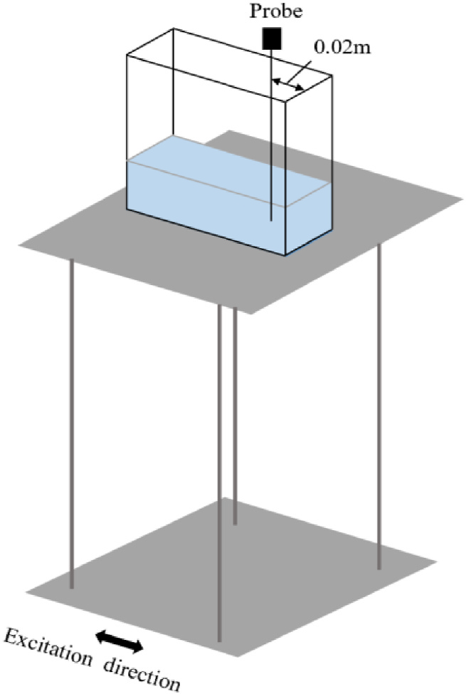

   **图 16** 单自由度刚架结构–TLD 系统示意图。

   图中标注：波高探针；距侧壁 0.02 m；激励方向。

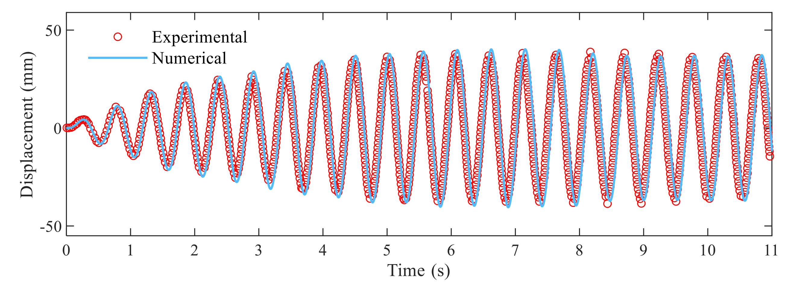

   **图 17** TLD 控制下的结构位移响应，实验结果来自 Dou [49]。

   图中标注：实验结果；数值结果；时间（s）；位移（mm）。

.. figure:: ../../../wechat/assets/public-safe/ref-he2024-JBE/fig18-top-displacement-comparison.png
   :alt: 论文图 18 安装和未安装 TLD 时的结构顶部位移响应。
   :align: center
   :width: 100%

   **图 18** 安装和未安装 TLD 时的结构顶部位移响应。

   图中标注：无控制；实验结果；数值结果；时间（s）；位移（mm）。

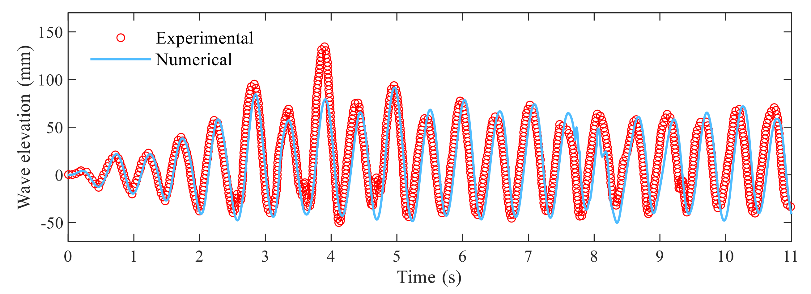

   **图 19** 晃荡波面高程曲线。

   图中标注：实验结果；数值结果；波面高程（mm）；时间（s）。

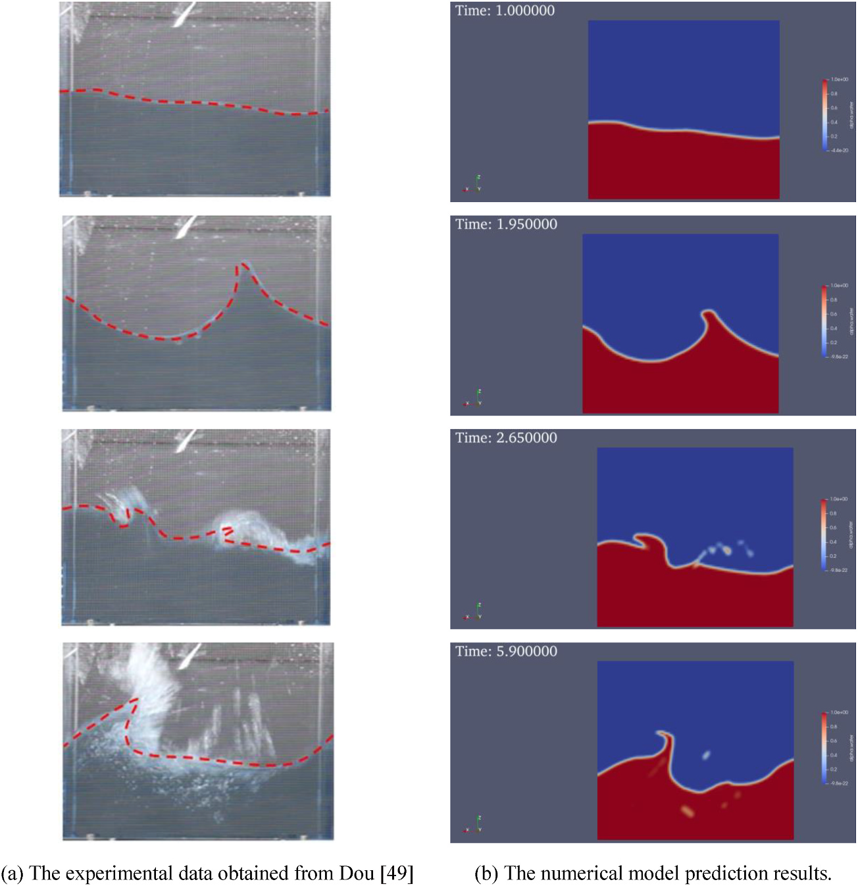

   **图 20** 自由液面捕捉结果的比较。

   图中标注：（a）来自 Dou [49] 的实验数据；（b）数值模型预测结果；水相体积分数（alpha.water）；时间；从上到下的时刻：1.0、1.95、2.65、5.9。

.. note::

   78.5%对应上述单自由度刚架的共振简谐激励与最大位移响应，不是足尺高层建筑在随机风荷载下的普遍减振率。关于计算资源和时间的改善，原文这里给出定性描述，未提供可泛化的运行时间或加速比。

5 高层建筑中TLD的振动控制性能
----------------------------------

5.1 基准结构
----------------

进一步采用CFD方法，分析TLD减轻足尺高层建筑风致振动的效果。选用CAARC高层建筑标准模型，该模型广泛用于提高风洞试验质量和试验技术。标准模型几何尺寸为 :math:`45.72\,\mathrm{m}\times30.48\,\mathrm{m}\times182.88\,\mathrm{m}`，为固定矩形柱体。利用美国国家标准与技术研究院（NIST）网站的CAARC模型数据，经调整建立有限元模型。模型为60层钢筋混凝土框架，梁柱截面为正方形，构件配筋按中国行业标准设计。材料弹性模量为 :math:`3.8\times10^7\,\mathrm{kPa}`，剪切模量为 :math:`1.585\times10^7\,\mathrm{kPa}`，泊松比为0.2；混凝土密度为 :math:`2.5\,\mathrm{t/m^3}`。40层以上采用C60混凝土，40层以下采用C80。通过SAP2000提取结构模态信息。原文称结构广义质量为86861.6 t，X向模态质量为30719 t，Y向模态质量为28828 t，固有阻尼比假定为2%。前三阶模态频率为0.174 Hz、0.187 Hz和0.232 Hz，振型见图21。在风洞实验室开展CAARC模型测压试验，缩尺比为1:200，几何尺寸为225 mm × 150 mm × 900 mm；模型用10 mm厚有机玻璃制成，见图22。试验所选风向角见图23。

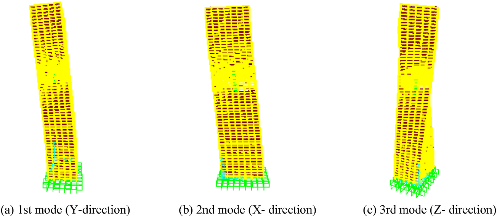

   **图 21** CAARC 模型的前三阶振型。

   图中标注：（a）第一阶振型（Y 方向）；（b）第二阶振型（X 方向）；（c）第三阶振型（Z 方向）。

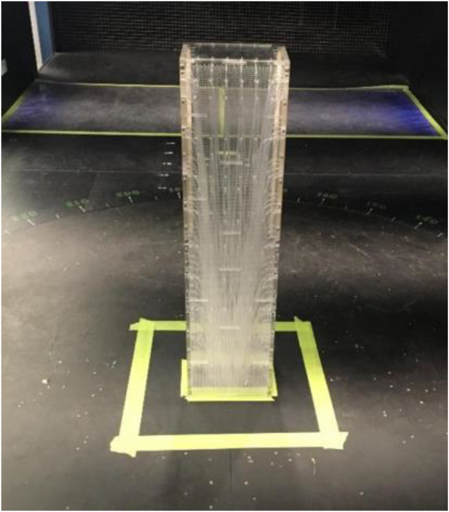

   **图 22** 风洞实验缩尺模型。

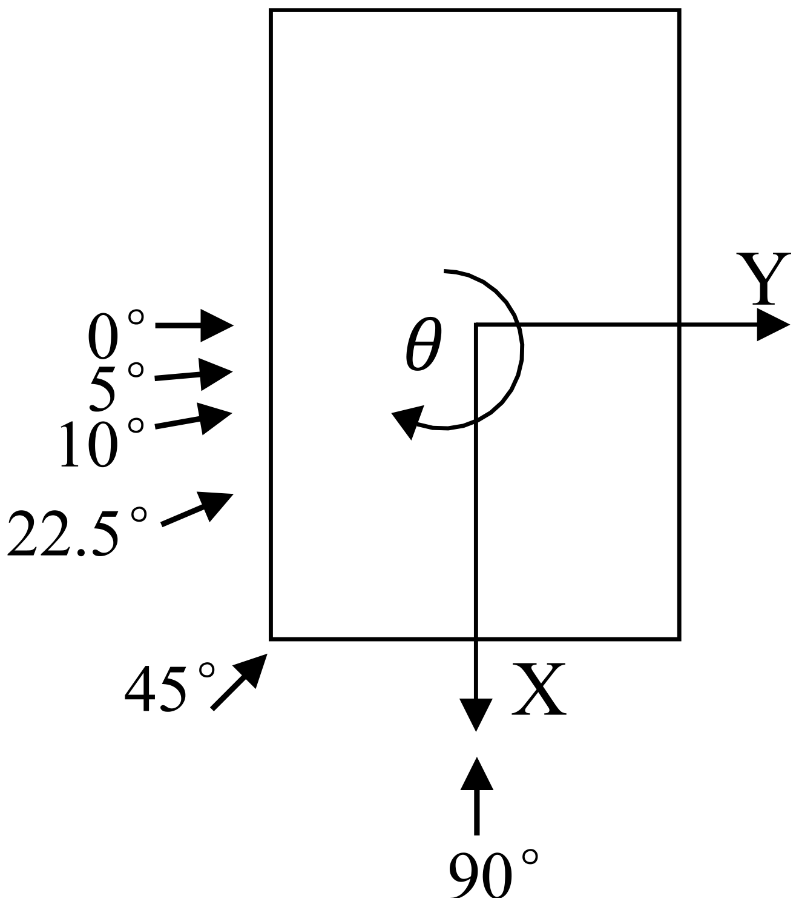

   **图 23** 风向角示意图。

   图中标注：风向角 θ；X 轴；Y 轴；标示风向角：0°、5°、10°、22.5°、45° 和 90°。

.. note::

   原文并列给出的原型尺寸、1:200缩尺比及模型225 mm×150 mm×900 mm并不严格一致：按所列尺寸逐轴相除为203.2。本页保留三组源值，不替作者修订相似比。广义质量86861.6 t与两向模态质量也分别保留，不自行统一其定义或归一化。

5.2 TLD减振
------------------

高层建筑在风荷载下可能出现过大的结构动力响应，影响使用者舒适度。在最大动力响应位置安装TLD，可有效耗散振动能量并降低结构加速度。本节将TLD设置于CAARC建筑顶部。按结构特点采用集中质量法，将每层楼板简化为一个质量点，每个质量点具有三个自由度，即X、Y向平动和绕Z轴扭转，计算分析模型见图24。根据CAARC顶部尺寸和结构前三阶固有频率，对TLD进行初步设计，参数见表3。原文给出的液深比为24.8%，属于中等液深TLD。利用结构—TLD双向耦合数值模型，以Newmark-beta数值积分法计算风致振动响应，以VOF分析液体晃荡。

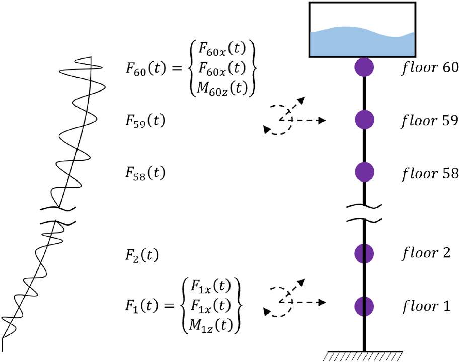

   **图 24** 计算分析模型示意图。

   图中标注：第 60 层；第 59 层；第 58 层；第 2 层；第 1 层；对应楼层的时变外荷载；第 60 层与第 1 层绕 Z 轴的时变力矩。

.. note::

   图24原图中F60(t)和F1(t)荷载向量的前两行都印为x下标，而正文定义了X、Y平动与绕Z转动。本页保留原图，不把重复的x标签静默改成y。图27、28的(c)图单位为rad/s²，属于绕Z轴角加速度，不是Z向平动加速度。

.. list-table:: 表 3 TLD设计参数
   :header-rows: 1
   :class: longtable

   * - 水箱尺寸（m）
     - 液深（m）
     - 液体质量（t）
     - 质量比
     - 晃荡频率（Hz）
   * - 14.54 × 15.82 × 6.8
     - 3.6
     - 828.08
     - 0.95 %
     - fx = 0.187; fy = 0.174

.. note::

   表3的频率单位是Hz，与式(7)的角频率rad/s不同。3.6/14.54约为24.8%，而3.6/15.82约为22.8%；原文只写一个24.8%，不应据此把两方向液深比说成完全相同。

结果表明，10年重现期风荷载下，结构顶部X向最大振动响应出现在5°风向，Y向峰值响应出现在90°风向。TLD通过液体振荡提供附加阻尼，耗散结构振动能量。X向峰值加速度从 :math:`0.316\,\mathrm{m/s^2}` 降至 :math:`0.252\,\mathrm{m/s^2}`，Y向从 :math:`0.468\,\mathrm{m/s^2}` 降至 :math:`0.422\,\mathrm{m/s^2}`。TLD有效减轻了CAARC建筑模型的平动响应，但对绕Z轴的扭转响应控制不足。

5.3 质量比的影响
--------------------

TLD通过内部液体晃荡耗散振动能量，液体质量对控制性能有显著影响。本节考察不同质量比：

.. math::

   \psi=\frac{m_w}{M_s} \qquad (11)

其中， :math:`m_w` 为液体质量， :math:`M_s` 为结构广义质量。以峰值和均方根值作为控制参数，峰值因子 :math:`g=2.5`，比较结构顶部加速度和位移响应的减振率：

.. math::

   \eta=1-\frac{R}{R_O} \qquad (12)

其中， :math:`R` 为设置TLD后的结构振动响应， :math:`R_O` 为未设置TLD时的响应。图25展示控制性能。分析峰值和均方根值的变化可知，TLD能有效降低CAARC建筑模型的动力响应，最大减振率 :math:`\eta` 为28.9%。大幅增加液体质量虽可增强耗能，但效率不高，并非最优方案。

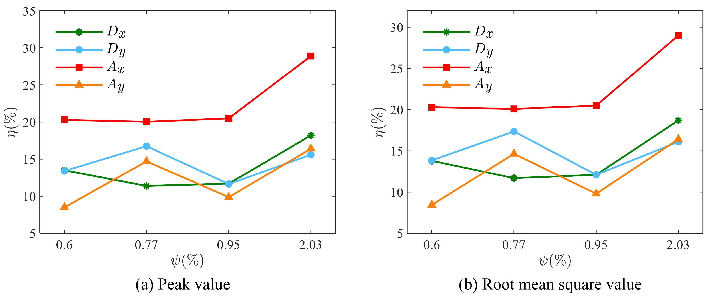

   **图 25** 不同质量比 ψ 下 TLD 减振率 η 的比较。

   图中标注：（a）峰值；（b）均方根值；减振率 η（%）；质量比 ψ（%）；X、Y 方向位移与 X、Y 方向加速度。

5.4 调谐比的影响
--------------------

通过调节TLD晃荡频率，使其与结构固有频率相匹配，可有效耗散振动能量并获得明显减振效果。调谐比是影响TLD控制性能的重要参数：

.. math::

   \Omega=\frac{\omega_{\mathrm{TLD}}}{\omega_s} \qquad (13)

保持液深 :math:`h` 不变、质量比为0.95%，通过调整水箱几何尺寸控制 :math:`\omega_{\mathrm{TLD}}`。本节研究调谐比 :math:`\Omega` 对减振率 :math:`\eta` 的影响，见图26。当X向 :math:`\Omega=0.973`、Y向 :math:`\Omega=1.029` 时，图27展示5°风向下CAARC顶部动力响应时程，图28展示90°风向下的相应时程。选择合适的调谐比，即使质量比较小，也能显著提高TLD的减振性能。

.. figure:: ../../../wechat/assets/public-safe/ref-he2024-JBE/fig26-mitigation-tuning-ratio.png
   :alt: 论文图 26 不同调谐比 Ω 下 TLD 减振率 η 的比较。
   :align: center
   :width: 100%

   **图 26** 不同调谐比 Ω 下 TLD 减振率 η 的比较。

   图中标注：（a）5° 风向角下的峰值；（b）5° 风向角下的均方根值；（c）90° 风向角下的峰值；（d）90° 风向角下的均方根值；减振率 η（%）；调谐比 Ω；X 方向位移与加速度；Y 方向位移与加速度。

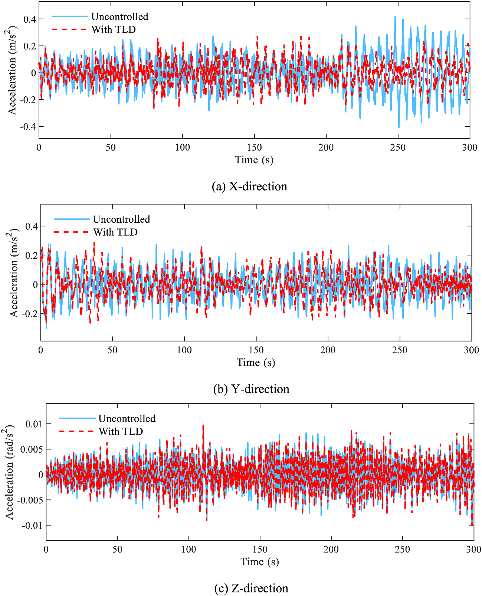

   **图 27** 5° 风向角下的加速度时程曲线。

   图中标注：（a）X 方向；（b）Y 方向；（c）Z 方向；无控制；安装 TLD；加速度（m/s²）；角加速度（rad/s²）；时间（s）。

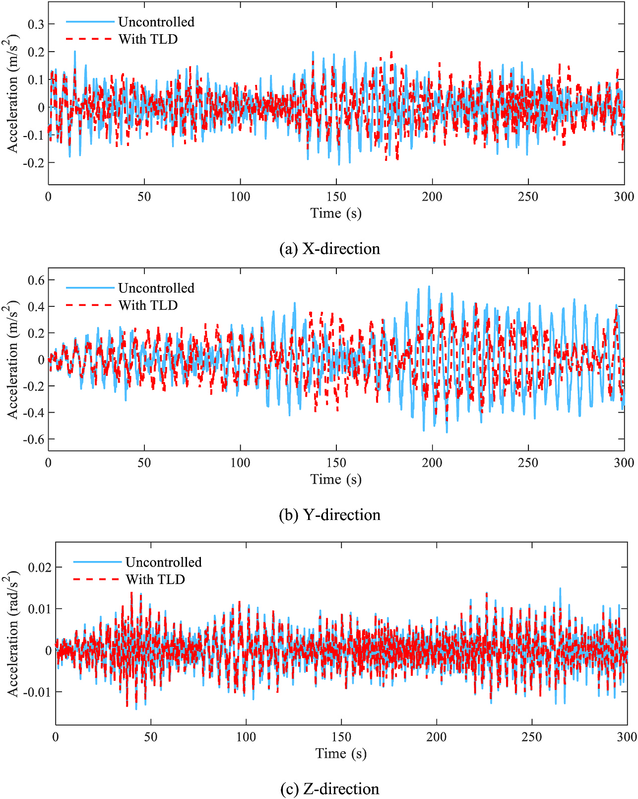

   **图 28** 90° 风向角下的加速度时程曲线。

   图中标注：（a）X 方向；（b）Y 方向；（c）Z 方向；无控制；安装 TLD；加速度（m/s²）；角加速度（rad/s²）；时间（s）。

6 结论
--------

本文利用CFD方法数值分析TLD的液体晃荡与结构振动控制性能。首先基于OpenFOAM建立液体振荡数值模型，有效预测非线性晃荡特征；通过试验数据验证，并对液深、激励幅值等参数开展研究。随后提出结构—TLD双向耦合数值模型，实现结构振动与液体晃荡的相互作用：结构域采用Newmark-beta数值积分法求解运动方程，流体域采用VOF计算晃荡力。该模型明显简化流固相互作用处理，降低计算资源与时间需求，数值预测与试验数据符合良好。最后分析TLD减轻足尺高层建筑风致振动的效果，重点研究质量比与调谐比对控制性能的影响。主要结论如下。

(1) :math:`k\text{-}\omega` SST湍流模型在气液两相流中具有较好的预测精度，尤其是在较强外部激励下。

(2) 随TLD内部液深增加，出现弹簧软化现象。振荡特性由硬弹簧转为软弹簧，晃荡力和波高随激励频率增加迅速上升，随后缓慢衰减，共振响应提前。

(3) 外部激励幅值较小时，液体振幅较小，呈线性晃荡，共振频率未见偏移。将此时响应曲线放大，与较大激励幅值下的结果比较，线性晃荡明显低估波高；作者指出，其所讨论的理论模型未能预测该晃荡力双峰现象。

(4) TLD能有效降低简谐激励下单自由度刚架的振动响应。在共振激励下，结构位移响应降低78.5%。

(5) 10年重现期风荷载下，TLD能有效降低CAARC建筑模型X、Y向风致振动，而对绕Z方向的扭转响应没有影响。质量比 :math:`\psi` 增大时，减振率 :math:`\eta` 没有明显提高；调谐比 :math:`\Omega` 则对控制性能影响显著。保持质量比0.95%并调整调谐比，可使减振率由15.6%提高到28.8%。

(6) 对实际高层建筑，考虑高位消防水箱的特点，作者建议采用矩形中等液深TLD，原文建议条件写作 :math:`h/L>10\%\sim15\%`。根据建筑空间和结构平动频率，确定TLD尺寸及液深。利用双向耦合数值模型，在结构频率的 :math:`\pm5\%` 调谐范围内选择合适的 :math:`\Omega`，使减振率 :math:`\eta` 最大。

.. note::

   结论中的“h/L>10%～15%”按原文不等式与范围并列保留，不擅自解释为另一个上下界明确的通用区间。质量比研究的28.9%与调谐研究的28.8%属于不同比较；15.6%到28.8%不改写成所有方向或所有指标均达到相同增幅。正文称扭转控制不足，结论称没有影响，两处分别保留。工程使用仍需满足原消防储量、结构承载与相应规范等独立要求，本研究不等于既有建筑改造认证。

所提出的双向耦合数值模型，为研究配置TLD的高层建筑振动响应提供了准确、便利且经济的方法，使工程师能够确定TLD动力特性并评估其可靠性。未来可利用该耦合模型，进一步研究不同TLD构型的性能。

参考文献
--------

[1] A. Das, T. Konar, Design and optimization of roof-top fire water tanks as compliant deep tank dampers-inerter for seismic protection of multi-storeyed buildings, J. Build. Eng. 80 (2023) 107957.

[2] L.G. Griffis, Serviceability limit states under wind load, Eng. J. (1993).

[3] B.J. Vickery, N. Isyumov, A.G. Davenport, The role of damping, mass and stiffness in the reduction of wind effects on structures, J. Wind Eng. Ind. Aerod. 11 (1983) 285–294.

[4] P. Irwin, J. Kilpatrick, J. Robinson, A. Frisque, Wind and tall buildings: negatives and positives, Struct. Des. Tall Special Build. (2008).

[5] A. Kareem, T. Kijewski, Y. Tamura, Mitigation of motions of tall buildings with specific examples of recent applications, Wind and Structures An International Journal 2 (1999) 201–251.

[6] A. Nishitani, Structural control: then and now, JPN ARCHIT REV. 2 (2019) 217–218.

[7] B.N. Awad, M.J. Tait, Macroscopic modelling for screens inside a tuned liquid damper using incompressible smoothed particle hydrodynamics, Ocean Eng. 263 (2022) 112320.

[8] O.M. Faltinsen, Sloshing, Advances in Mechanics, 2017.

[9] J.B. Frandsen, Numerical predictions of tuned liquid tank structural systems, J. Fluid Struct. 20 (2005) 309–329.

[10] T. Konar, A.D. Ghosh, A review on various configurations of the passive tuned liquid damper, J. Vib. Control 29 (2023) 1945–1980.

[11] J.A. Hamelin, J.S. Love, M.J. Tait, J.C. Wilson, Tuned liquid dampers with a Keulegan–Carpenter number-dependent screen drag coefficient, J. Fluid Struct. 43 (2013) 271–286.

[12] Y. Li, A. Li, Y. Deng, Performance investigation of circular TLD devices used in wind turbine generation tower via both experiment and numerical simulation, J VIB ENG TECHNOL. 9 (2021) 1715–1732.

[13] Y. An, Z. Wang, G. Ou, S. Pan, J. Ou, Vibration mitigation of suspension bridge suspender cables using a ring-shaped tuned liquid damper, J. Bridge Eng. 24 (2019) 04019020.

[14] S. Cammelli, Y.F. Li, S. Mijorski, Mitigation of wind-induced accelerations using tuned liquid column dampers: experimental and numerical studies, J. Wind Eng. Ind. Aerod. 155 (2016) 174–181.

[15] B. Mehrkian, O. Altay, Omnidirectional liquid column vibration absorbers for multi-story buildings, J. Build. Eng. 62 (2022) 105306.

[16] G.W. Housner, Dynamic pressures on accelerated fluid containers, Bull.seism.soc.am. 48 (1957).

[17] O.M. Faltinsen, A nonlinear theory of sloshing in rectangular tanks, Journal of Ship ResearchJournal of Ship Research. 18 (1974) 224–241.

[18] Y. Fujino, L. Sun, B.M. Pacheco, P. Chaiseri, Tuned liquid damper (TLD) for suppressing horizontal motion of structures, J. Eng. Mech. 118 (1992) 2017–2030.

[19] J. Yu, T. Wakahara, D.A. Reed, A non-linear numerical model of the tuned liquid damper, EARTHQ ENG STRUCT D 28 (1999) 671–686.

[20] M.J. Tait, Modelling and preliminary design of a structure-TLD system, Eng. Struct. 30 (2008) 2644–2655.

[21] J.S. Love, M.J. Tait, Nonlinear simulation of a tuned liquid damper with damping screens using a modal expansion technique, J. Fluid Struct. 26 (2010) 1058–1077.

[22] O.M. Faltinsen, O.F. Rognebakke, I.A. Lukovsky, A.N. Timokha, Multidimensional modal analysis of nonlinear sloshing in a rectangular tank with finite water depth, J. Fluid Mech. 407 (2000) 201–234.

[23] C. Xiao, Z. Wu, K. Chen, Y. Tang, Y. Yan, An experimental study on the equivalent nonlinear model for a large-sized tuned liquid damper, J. Build. Eng. 73 (2023) 106754.

[24] H. Sun, H. He, Y. Cheng, Q. Cao, Theoretical and experimental research on vibration control of the tuned liquid damper with damping net and sloped-bottom, J. Build. Eng. 81 (2024) 108170.

[25] M.J. Tait, A.A. El Damatty, N. Isyumov, M.R. Siddique, Numerical flow models to simulate tuned liquid dampers (TLD) with slat screens, J. Fluid Struct. 20 (2005) 1007–1023.

[26] H. Malekghasemi, A. Ashasi-Sorkhabi, A.R. Ghaemmaghami, O. Mercan, Experimental and numerical investigations of the dynamic interaction of tuned liquid damper–structure systems, J. Vib. Control 21 (2015) 2707–2720.

[27] J.S. Love, M.J. Tait, Equivalent mechanical model for tuned liquid damper of complex tank geometry coupled to a 2D structure, Struct. Control Health Monit. 21 (2014) 43–60.

[28] B. Molin, F. Remy, Inertia effects in TLD sloshing with perforated screens, J. Fluid Struct. 59 (2015) 165–177.

[29] Z. Zhang, Numerical and experimental investigations of the sloshing modal properties of sloped-bottom tuned liquid dampers for structural vibration control, Eng. Struct. 204 (2020) 110042.

[30] S.M. Zahrai, S. Abbasi, B. Samali, Z. Vrcelj, Experimental investigation of utilizing TLD with baffles in a scaled down 5-story benchmark building, J. Fluid Struct. 28 (2012) 194–210.

[31] A. Pabarja, M. Vafaei, S.C. Alih, M.Y. Md Yatim, S.A. Osman, Experimental study on the efficiency of tuned liquid dampers for vibration mitigation of a vertically irregular structure, MECH SYST SIGNAL PR 114 (2019) 84–105.

[32] G. Xu, L. Zheng, Y. Bao, Shaking table substructure test of tuned liquid damper for controlling earthquake response of structure, Struct. Control Health Monit. 29 (2022).

[33] Z. Tang, J. Sheng, Y. Dong, Effects of tuned liquid dampers on the nonlinear seismic responses of high-rise structures using real-time hybrid simulations, J. Build. Eng. 70 (2023) 106333.

[34] F. Zhu, J.T. Wang, F. Jin, L.Q. Lu, Y. Gui, M.X. Zhou, Real-time hybrid simulation of the size effect of tuned liquid dampers, Struct. Control Health Monit. 24 (2017) e1962–n/a.

[35] D. Liu, P. Lin, A numerical study of three-dimensional liquid sloshing in tanks, J. Comput. Phys. 227 (2008) 3921–3939.

[36] M. Xue, P. Lin, Numerical study of ring baffle effects on reducing violent liquid sloshing, Comput. Fluids 52 (2011) 116–129.

[37] C. Chu, Y. Wu, T. Wu, C. Wang, Slosh-induced hydrodynamic force in a water tank with multiple baffles, Ocean Eng. 167 (2018) 282–292.

[38] N. Cavalagli, C. Biscarini, A.L. Facci, F. Ubertini, S. Ubertini, Experimental and numerical analysis of energy dissipation in a sloshing absorber, J. Fluid Struct. 68 (2017) 466–481.

[39] K.P. McNamara, M.J. Tait, Modeling the response of structure–tuned liquid damper systems under large amplitude excitation using smoothed particle hydrodynamics, J. Vib. Acoust. 144 (2022).

[40] B.P.D. Tuong, P.D. Huynh, Experimental test and numerical analysis of a structure equipped with a multi-tuned liquid damper subjected to dynamic loading, Int. J. Struct. Stabil. Dynam. 20 (2020) 2050075.

[41] M. Xue, Y. Chen, J. Zheng, L. Qian, X. Yuan, Fluid dynamics analysis of sloshing pressure distribution in storage vessels of different shapes, Ocean Eng. 192 (2019) 106582.

[42] C.W. Hirt, B.D. Nichols, Volume of fluid (VOF) method for the dynamics of free boundaries, J. Comput. Phys. 39 (1981).

[43] E.B. Launder, B.D. Spalding, The numerical computation of turbulent flows - ScienceDirect, COMPUT METHOD APPL M 3 (1974) 269–289.

[44] F.R. Menter, Two-equation eddy-viscosity turbulence models for engineering applications, AIAA J. 32 (1994).

[45] F. Nicoud, F. Ducros, Subgrid-scale stress modelling based on the square of the velocity gradient tensor, Flow, Turbul. Combust. 62 (1999) 183–200.

[46] M. Xue, J. Zheng, P. Lin, X. Yuan, Experimental study on vertical baffles of different configurations in suppressing sloshing pressure, Ocean Eng. 136 (2017) 178–189.

[47] J.B. Frandsen, Sloshing motions in excited tanks, J. Comput. Phys. 196 (2004) 53–87.

[48] J.S. Love, M.J. Tait, Parametric depth ratio study on tuned liquid dampers: fluid modelling and experimental work, Comput. Fluids 79 (2013) 13–26.

[49] P. Dou, M. Xue, J. Zheng, C. Zhang, L. Qian, Numerical and experimental study of tuned liquid damper effects on suppressing nonlinear vibration of elastic supporting structural platform, Nonlinear Dynam. 99 (2020) 2675–2691.

完整引用
--------

收录信息见 :ref:`WOEAI 学术成果页对应条目 <ref-he2024-JBE>`。
