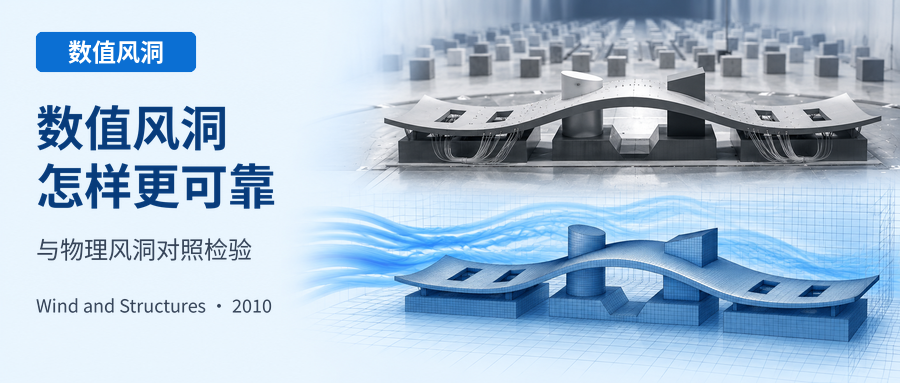
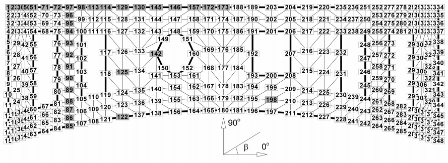
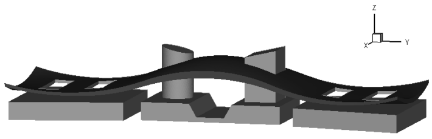
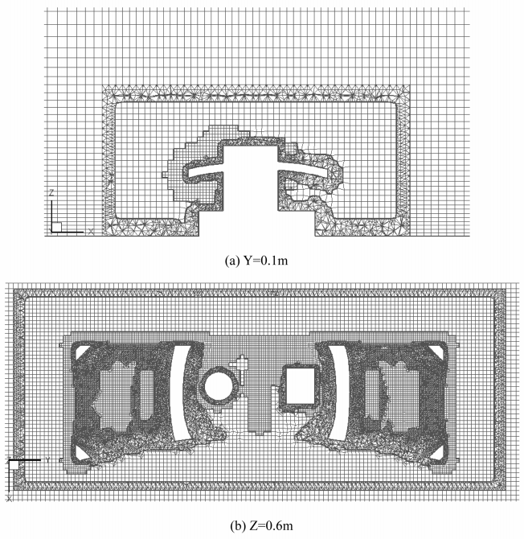
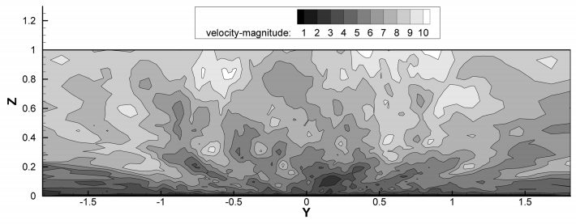
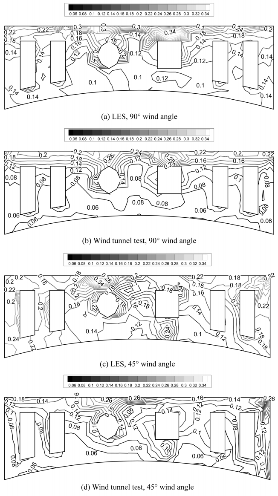
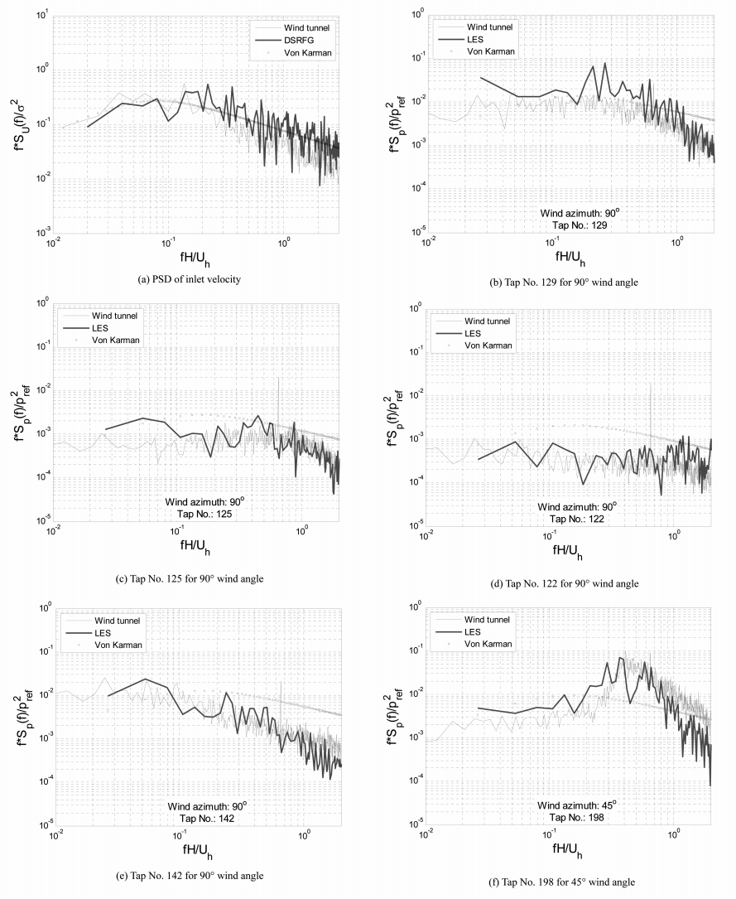
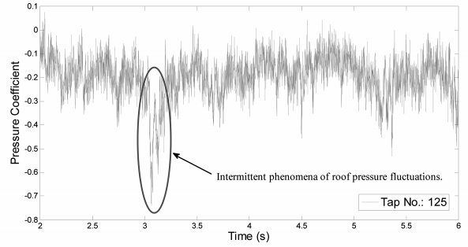
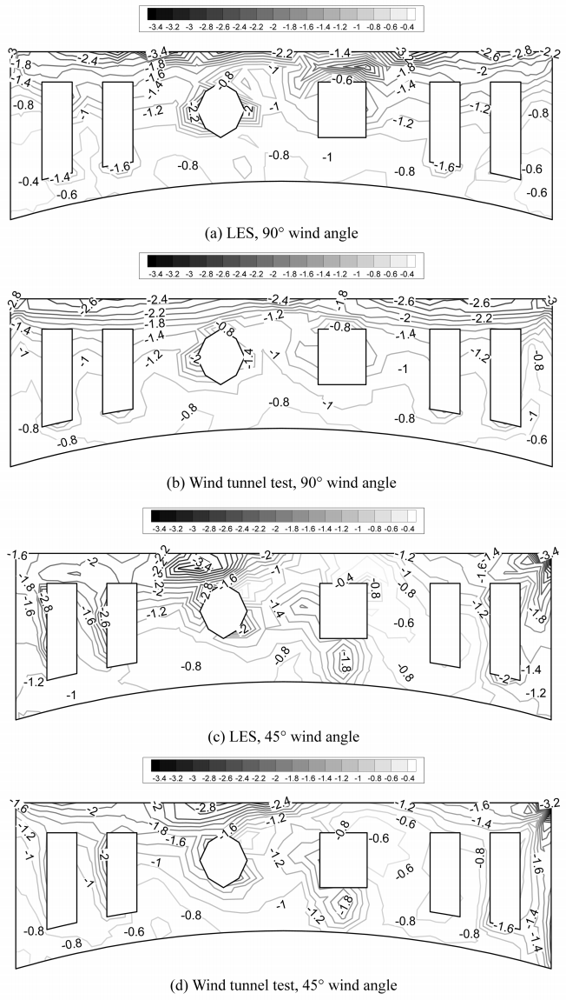

.. _paper-note-ref-li2010-WAS:

大跨度空间网格屋盖风荷载的大涡模拟：论文精解
============================================================

精简版微信公众号文章：待发布

.. contents:: 本页目录
   :local:
   :depth: 2

论文信息
--------

**论文题名：** Large eddy simulation of wind loads on a long-span spatial lattice roof

**作者：** Chao Li、Q.S. Li、S.H. Huang、J.Y. Fu、Y.Q. Xiao。

**通讯作者：** Chao Li、Q.S. Li（原文两位作者均带星号）。

**作者单位：** 哈尔滨工业大学深圳研究生院；香港城市大学建筑系；中国科学技术大学工程科学学院；广州大学土木工程系。

**期刊：** Wind and Structures，2010，13(1)：57–82。

**收稿与录用：** 2008 年 12 月 10 日收稿，2009 年 9 月 21 日录用。

**DOI：** `10.12989/was.2010.13.1.057 <https://doi.org/10.12989/was.2010.13.1.057>`_。

.. note::

   本页按原文顺序提供完整科学正文精解，保留全部编号公式、图、表与参考文献，省略致谢等出版性尾节。论文研究的是固定建筑屋盖的风压，不是结构动力响应计算；由于数值模型省略树状支柱，正文比较只覆盖屋盖上表面。原文中的历史规范、软件版本与适用性判断均按论文发表时的语境保留。

摘要
----

深圳市民中心长 :math:`486\,\mathrm{m}` 的屋盖是世界上最长的空间网格屋盖结构之一。本文对这座大跨度结构的风作用开展了全面数值研究。采用两位作者近期提出的离散合成随机流生成技术（discretizing and synthesizing of random flow generation，DSRFG；Huang and Li 2008），生成具有空间相关性的湍流入口场。采用计算流体力学（CFD）方法，以大涡模拟（LES）和雷诺平均 Navier–Stokes 方程（RANS）模型，数值评估屋盖风荷载的分布与特征。研究的主要目标是探索利用 CFD 技术估计复杂曲面屋盖风作用的有效方法。在数值研究的同时，在边界层风洞中对整个屋盖进行同步测压，确定平均、脉动及峰值风压系数分布，以及压力脉动的频谱、空间相关系数和概率特征。随后将数值结果与这些试验数据比较，以验证数值方法。比较表明，结合 DSRFG 技术的 LES 能够较好地预测复杂形状大跨度屋盖的风作用，尤其是迎风檐口附近通常出现最不利负风压的分离区。所推荐的 LES、入口湍流生成技术及相关数值处理，可为结构工程师在设计阶段评估大跨度屋盖风作用提供帮助。

关键词
------

大跨度屋盖；计算流体力学（CFD）；大涡模拟；风作用；风洞试验。

1 引言
--------

近年来，大跨度结构不断增多，跨度也持续增大。这类大跨度屋盖通常具有质量轻、柔性大、阻尼小和固有频率低等特点。随着跨度增加，固有频率一般降低，屋盖受到湍流风作用时发生共振激励的可能性随之增大。因此，大跨度结构的风作用与较小低层建筑屋盖的风作用存在明显差别。Holmes (2001) 指出，准定常方法虽然适合小型建筑，却不适用于大型屋盖，而且共振效应可能很显著。事实上，尽管风荷载通常是这类结构的主要荷载，超大跨度屋盖结构的抗风设计要求尚未被当时世界上的任何规范或标准完全覆盖。

目前，估计建筑和结构设计风荷载主要有两种方法：风洞试验，以及基于计算流体力学（CFD）的数值模拟。数值模拟经济、便于参数分析，通常能够提供全面的信息或结果。过去二十年计算能力的革命性增长，推动了 CFD 分支计算风工程（CWE）的快速发展，用来评估风与结构之间的相互作用。CFD 中的大涡模拟（LES）、雷诺平均 Navier–Stokes 方程（RANS）模型等湍流建模方法，已经广泛用于风工程中钝体周围流动的预测。RANS 通过雷诺时间平均，将时变量分为平均项与脉动项；由此增加的雷诺应力项，被视为湍流脉动输运的能量，并不直接求解，而是通过模型表示。湍流模型的作用就是建立时间平均项与雷诺应力项之间的联系。显然，通过 RANS 模型只能得到平均流动变量，即平均风荷载（Wilcox 1993；Mochida et al. 2002）。但 Fu et al. (2006)、Robertson et al. (2007) 等大量研究表明，大跨度屋盖的峰值风压可超过相应平均风压的三倍。因此，估计脉动风荷载对于大跨度屋盖的振动分析和围护结构设计十分重要且必要。

利用非定常 RANS 方程预测钝体风作用的尝试，即使采用当时最先进的湍流模型，成功程度也有限（Huang et al. 2007）。Cheng et al. (2003)、Kim (2004)、Zhang et al. (2006) 等研究表明，LES 是模拟钝体周围非定常流动的有效工具。但正如 Murakami (1998) 所述，LES 应用于风工程时存在四项困难：（1）入口边界条件；（2）出口边界条件；（3）网格拉伸；（4）近壁处理。借助超高性能计算机和平行处理技术，后三项困难可以减轻或克服。对流边界条件能够更准确地描述出口；采用计算代价较高的网格系统，可以减小网格尺寸或拉伸率过大造成的数值误差；壁面函数则是处理近壁湍流的一种经济而有用的方法。由于生成满足大气边界层风特性的入口湍流场始终是 LES 的一个重要问题（Tutar and Celik 2007），这一问题需要得到充分关注和研究。

本文采用两位作者近期基于离散合成随机流生成（DSRFG）技术开发的有效入口湍流生成方法（Huang and Li 2008）。依据风洞试验结果，评估 LES 与 DSRFG 相结合的有效性，以及预测超大跨度空间网格屋盖（深圳市民中心）风压分布和特征的能力与精度。深圳市民中心的屋盖长 :math:`486\,\mathrm{m}`，是世界上最长的空间网格屋盖结构之一，也是检验 CFD 技术评估复杂大跨度屋盖风作用能力的理想对象。边界层风洞一直是研究建筑和结构风作用的基本工具，因此开展风洞试验，为验证 CFD 技术提供这座大跨度屋盖风作用的有用信息，非常必要。在数值研究的同时，对深圳市民中心整个屋盖进行了边界层风洞同步测压，以确定屋盖风荷载。

本文将数值模拟与风洞试验结合，研究深圳市民中心超大跨度屋盖的风作用，主要包括三部分。首先介绍风洞试验布置；随后结合 DSRFG 与 LES，数值预测屋盖风压分布与特征；最后根据全面的数值结果与模型试验数据，进行详细比较，探索采用 CFD 技术评估复杂曲面屋盖风作用的有效方法。

2 风洞试验
------------

深圳市民中心的风洞试验在一座试验段尺寸为 :math:`3\,\mathrm{m}\times2\,\mathrm{m}\times20\,\mathrm{m}` （宽×高×长）的边界层风洞中开展。制作了几何长度比例为 :math:`1{:}400` 的刚性模型。图 1 为模型安装在风洞中的照片。采用尖劈与粗糙元模拟中国荷载规范（2001）规定的 C 类地貌典型边界层风流。该城市地貌的平均风速剖面采用幂律指数 :math:`\alpha=0.22`，模型试验中的梯度高度为 :math:`1\,\mathrm{m}`，对应实尺度 :math:`400\,\mathrm{m}`，满足下式：

.. math::

   U=\begin{cases}U_{\mathrm{ref}}(z/z_{\mathrm{ref}})^{0.22},&0<z\leq1\,\mathrm{m},\\U_{\mathrm{grad}},&z\geq1\,\mathrm{m}.\end{cases} \qquad (1)

试验中，参考高度 :math:`z_{\mathrm{ref}}=0.6\,\mathrm{m}` 处的风速 :math:`U_{\mathrm{ref}}` 为 :math:`7.5\,\mathrm{m/s}`。实尺度 :math:`90\,\mathrm{m}` 高度处（风洞试验段地板以上 :math:`0.225\,\mathrm{m}`）的纵向风速谱与 von Karman 型谱吻合良好。von Karman 型谱的表达式为：

.. figure:: ../../../wechat/assets/public-safe/ref-li2010-WAS/fig01.png
   :alt: 图 1 风洞试验中的深圳市民中心模型
   :align: center
   :width: 100%

   **图 1** 风洞试验中的深圳市民中心模型。

.. math::

   S_u(f)=\frac{4(I\overline{U})^2 L/\overline{U}}{\left[1+70.8(fL/\overline{U})^2\right]^{5/6}} \qquad (2)

其中 :math:`I` 为湍流强度。

深圳市民中心屋盖的上、下表面都暴露于风流中。因此，为得到屋盖两侧的压力差，在上下表面的对应位置安装了 348 对测压孔。图 2 给出上下表面的测压孔布置与编号。试验同步测量两个屋面上全部测点的压力，数据采样频率为 :math:`312.5\,\mathrm{Hz}`，样本长度为 20480。来流风向定义为从正东向逆时针量取的夹角 :math:`\beta`，如图 2 所示；测压时 :math:`\beta` 从 :math:`0^\circ` 到 :math:`360^\circ`，增量为 :math:`15^\circ`。

   **图 2** 屋盖上、下表面测压孔的布置与编号。

屋盖表面测点 :math:`i` 的压力系数定义为：

.. math::

   C_{pi}(t)=\frac{p_i(t)-p_\infty}{p_0-p_\infty} \qquad (3)

其中 :math:`p_i(t)` 为测点 :math:`i` 的表面实测压力； :math:`p_0` 和 :math:`p_\infty` 分别为参考高度处的总压和静压。风洞试验的详细信息可参阅 Fu and Li (2007)。本文选取部分模型试验数据，主要用于与数值结果比较。

3 数值建模
------------

深圳市民中心（SZCC）位于中国深圳市中心区，如图 1 所示，总建筑面积约 :math:`210{,}000\,\mathrm{m^2}`。屋盖由中央部分与两侧对称翼部三部分组成，是由树状钢柱及下方两座塔楼支承的空间网格结构。两座塔楼位于中央部分：一座是直径 :math:`36\,\mathrm{m}` 的十二层圆形塔楼，另一座是平面尺寸 :math:`36\,\mathrm{m}\times45\,\mathrm{m}` 的十五层矩形塔楼。屋盖长 :math:`486\,\mathrm{m}`，宽度由中央的 :math:`120\,\mathrm{m}` 变化至两端的 :math:`154\,\mathrm{m}`，结构厚度在 :math:`2.25\,\mathrm{m}` 与 :math:`9.00\,\mathrm{m}` 之间变化。地面到屋盖顶部的高度为 :math:`80\,\mathrm{m}`。屋盖上下表面都是曲面。两侧对称翼部采用螺栓球节点双层四面体空间网格结构，由 17 根树状柱支承。

本文采用商业 CFD 软件 Fluent 6.2，并结合两位作者近期提出的入口湍流场生成技术 DSRFG（Huang and Li 2008），模拟深圳市民中心周围的三维流场及屋盖风压。Fluent 基于有限体积法（FVM），首先将计算域离散成小体积单元。以下各节介绍具体的计算处理与算法。

3.1 计算域与网格布置
------------------------

为比较 CFD 模拟与风洞试验结果，深圳市民中心计算模型采用与风洞试验相同的比例。如图 3 所示，计算模型在纵向（ :math:`X`）、横向（ :math:`Y`）和竖向（ :math:`Z`）的最大尺寸分别为 :math:`0.385\,\mathrm{m}`、 :math:`1.215\,\mathrm{m}` 和 :math:`0.2\,\mathrm{m}`。为消除外边界影响并保证充分发展的湍流条件，计算域尺寸设为 :math:`8.5\,\mathrm{m}(X)\times4.0\,\mathrm{m}(Y)\times1.0\,\mathrm{m}(Z)`。

.. note::

   这里的纵向、横向按原文计算坐标表述保留。屋盖实物的长向在模型中对应上述 Y 方向的 1.215 m，不应把模型 X 向的 0.385 m 误作屋盖长向。

屋盖标高在实尺度 :math:`30\,\mathrm{m}` 至 :math:`70\,\mathrm{m}` 之间变化，这一高度范围内大气边界层（ABL）的湍流强度较高，风速变化明显，因此必须准确模拟近地面风速剖面。为了得到所需的入流剖面，并避免四面体网格带来的离散误差，上游流场采用能够较好模拟大气边界层剪切流的六面体网格，同时考虑地面粗糙度效应。图 3 所示的建筑几何非常复杂，难以用纯六面体网格填满整个计算域，因此在屋盖表面布置贴体边界层网格。如图 4(a)、(b) 所示，计算域中央区域采用称为“Hex Core”的混合网格（Fluent Inc. 2006），以提高计算效率。Hex Core 用更灵活的四面体网格适应复杂建筑几何，用收敛性较好的六面体网格填充计算域的“核心”。最小网格尺度为 :math:`0.004\,\mathrm{m}`，最大为 :math:`0.02\,\mathrm{m}`，全域网格拉伸比不大于 :math:`1.05`，以减小 LES 相邻网格截断波数的差别（Huang et al. 2007）。图 4 中 :math:`90^\circ` 入射风向模型共含 1,631,533 个单元。当对 :math:`45^\circ` 入射风向模型的中央区域使用 Hex Core 网格时，单元偏斜度明显恶化，因此该工况只使用四面体网格，单元总数增加到 2,276,948，约为 :math:`90^\circ` 工况的 1.5 倍。两个风向均进行了网格依赖性检验；检验将最小网格尺度改为 :math:`0.002\,\mathrm{m}`，采用 Hex Core 网格时相应单元数约为三百万。网格依赖性检验结果在第 4.1 节讨论。

   **图 3** 深圳市民中心计算模型。

   **图 4** 90° 风向工况的混合网格系统。（a） :math:`Y=0.1\,\mathrm{m}`；（b）原图标注 :math:`Z=0.6\,\mathrm{m}`。

.. note::

   图 4(b) 原图将截面标为 Z=0.6 m；上文模型最大高度写为 0.2 m。这里保留原图和原标注，不推断作者本意或替换坐标值。

3.2 大涡模拟
----------------

湍流由跨越广泛长度尺度和时间尺度的涡组成。大涡更依赖具体流动问题，具有各向异性；小涡对边界的依赖较弱，趋于各向同性。这种明显差别意味着分别处理大涡与小涡是可行的。在 Fluent 中（Kim 2004），LES 采用网格间距作为滤波函数，将湍流分为大涡与小涡：大涡由控制方程直接求解，小涡的影响则由亚格子尺度（SGS）模型描述。与直接数值模拟（DNS）相比，LES 通过对小涡建模减少计算资源消耗，同时保留非定常大尺度相干结构，因此较 RANS 能适应更广泛的湍流。这些特点使 LES 更适合评估建筑和结构周围的复杂非定常大气边界层流动及其风作用。

对于通用 SGS 模型的探索一直没有停止，缺乏这种模型也是限制 LES 实际应用的部分原因。Smagorinsky (1963) 提出的原始 SGS 模型，即 Smagorinsky（S）模型，自 Deardorff (1970) 的开创性工作后得到广泛应用。为克服定义 SGS 黏度 :math:`\mu_t` 时使用常数 :math:`C_S` 的不足，研究者提出了多种改进 SGS 模型。其中，Germano et al. (1991) 提出并由 Lilly (1992) 修正的动态 Smagorinsky（DS）模型最为成功。但 S 模型与 DS 模型都假定：通过网格滤波尺度传递的能量，与小亚格子尺度动能耗散之间存在局部平衡。动态亚格子动能（DKE）模型（Kim and Menon 1995）考虑 SGS 湍动能输运来描述 SGS 湍流，被认为优于基于局部平衡假设的 Smagorinsky 系列代数表达式。对于高雷诺数钝体流动，局部平衡假设本身就值得怀疑。因此，本文采用动态 SGS 动能模型。

为进行比较并确定初始流场，本文还采用了一种 RANS 模型，即 RNG :math:`k\text{-}\varepsilon` 模型。

3.3 数值算法
----------------

风工程关注的风流速度相对较低，一般可以视为不可压缩流。离散连续方程与动量方程采用分离式方法求解，时间离散采用二阶隐式格式。压力–速度耦合采用 SIMPLE 系列中的压力关联方程半隐式一致性算法（SIMPLEC）。对于非定常问题，在 LES 时间步较小时，SIMPLEC 比 SIMPLE 收敛更快，也比算子分裂压力隐式（PISO）算法更稳定（Fluent Inc. 2007）。还引入偏斜度修正技术，以缓解高度畸变四面体网格造成的收敛困难。动量与亚格子动能的空间离散采用有界中心差分（BCD）格式，它组合了纯中心差分、中心差分与二阶迎风格式的混合格式，以及一阶迎风格式。相对准确的初始流场可以加快迭代收敛，并缩短 LES 达到统计稳定状态的时间，因此以 RNG :math:`k\text{-}\varepsilon` 模型的稳态结果生成初始速度场。

3.4 边界条件
----------------

3.4.1 入口湍流生成方法
----------------------------

本文采用两位作者近期提出的 DSRFG 入口湍流生成方法（Huang and Li 2008），它可以生成满足给定谱（包括 von Karman 谱）的脉动速度场。根据 DSRFG 方法， :math:`\boldsymbol{x}` 空间中的各向同性脉动速度场可以由下列谐波函数叠加而成：

.. math::

   u_i(\boldsymbol{x},t)=\sum_{n=1}^{N}\left[\boldsymbol{v}(k_j^n)\cos(k_j^n x_j+\omega_n t)+\boldsymbol{w}(k_j^n)\sin(k_j^n x_j+\omega_n t)\right] \qquad (4)

.. math::

   \boldsymbol{v}(\boldsymbol{k}_n)=\boldsymbol{\varsigma}_n\times\boldsymbol{k}_n,\qquad\boldsymbol{w}(\boldsymbol{k}_n)=\boldsymbol{\xi}_n\times\boldsymbol{k}_n \qquad (5)

.. math::

   \varsigma_i^n,\xi_i^n\in N(0,1),\qquad\omega_n\in N(0,\omega_0) \qquad (6)

其中 :math:`\boldsymbol{x}` 和 :math:`t` 分别为空间坐标向量与时间； :math:`\omega_0` 为依赖脉动速度相关性的正数； :math:`N(M,\sigma)` 表示均值为 :math:`M`、标准差为 :math:`\sigma` 的正态分布。对于三维问题，当 :math:`N\to\infty`，且 :math:`\boldsymbol{k}^n` 在半径为 :math:`k_0` 的球面上各向同性分布时，得到的速度场满足谱 :math:`E(k)=\frac32u_{\mathrm{rms},i}^2\delta(k-k_0)`。这个谱仅在 :math:`k_0` 处非零，这一灵活性质可用于构造任意形状的谱。

DSRFG 通过离散与合成过程生成入口脉动速度场。详细推导见 Huang and Li (2008)，这里给出其简化表达式：

.. math::

   \begin{aligned}\boldsymbol{u}(\boldsymbol{x},t)&=\sum_{m=k_0}^{k_{\max}}\boldsymbol{u}_m(\boldsymbol{x},t)\\&=\sum_{m=k_0}^{k_{\max}}\sum_{n=1}^{N}\left[\boldsymbol{p}^{m,n}\cos(\widetilde{\boldsymbol{k}}^{m,n}\cdot\widetilde{\boldsymbol{x}}+\omega_{m,n}t)+\boldsymbol{q}^{m,n}\sin(\widetilde{\boldsymbol{k}}^{m,n}\cdot\widetilde{\boldsymbol{x}}+\omega_{m,n}t)\right].\end{aligned} \qquad (7)

其中，

.. math::

   \boldsymbol{p}^{m,n}=\frac{\boldsymbol{\varsigma}\times\boldsymbol{k}^{m,n}}{|\boldsymbol{\varsigma}\times\boldsymbol{k}^{m,n}|}\sqrt{a\frac{4E(k_m)}{N}},\qquad \boldsymbol{q}^{m,n}=\frac{\boldsymbol{\xi}\times\boldsymbol{k}^{m,n}}{|\boldsymbol{\xi}\times\boldsymbol{k}^{m,n}|}\sqrt{(1-a)\frac{4E(k_m)}{N}},

.. math::

   \widetilde{\boldsymbol{x}}=\frac{\boldsymbol{x}}{L_s},\qquad\widetilde{\boldsymbol{k}}^{m,n}=\frac{\boldsymbol{k}^{m,n}}{k_0},\qquad |\boldsymbol{k}^{m,n}|=k_m,\quad\omega_{m,n}\in N(0,2\pi f_m),\quad f_m=k_m U_{\mathrm{avg}}.

变量 :math:`\varsigma_i^n` 与 :math:`\xi_i^n` 的定义与式 (6) 相同， :math:`k_m` 为波数。 :math:`L_s` 为湍流积分长度尺度，是控制空间相关性的尺度因子。 :math:`\alpha` 是在 :math:`0\sim1` 之间均匀分布的随机数。对本文研究而言，每个波数 :math:`k_m` 的采样数取 :math:`N=100`，采样频率取 :math:`f_{\max}=500`，已具有足够精度且较经济。

.. note::

   式 (7) 系数中印为 a，随后文字将这个 0～1 均匀随机数写为 α；此处保留原文符号差异。求和上下限 m=k₀ 至 kmax 也沿用原式记法。原文 fmax=500 未在该句标单位，不另补单位。

将 DSRFG 方法编写为 Fluent 的用户自定义函数（UDF）库，并进行并行化。该方法能够生成满足目标风速和湍流强度剖面的入口场，同时使纵向脉动风速谱与风洞试验保持一致。湍流积分长度尺度代表大尺度湍涡的相关特征。然而，风洞试验很难按大气边界层中实际观测到的比例，模拟湍流尺度随高度的变化（Li and Melbourne 1999；Li et al. 2000、2003、2004）。因此，本文数值模拟采用《AIJ 建筑荷载建议》（AIJ 2004）中确定湍流积分尺度的半经验公式。经缩尺变换后，其形式为：

.. math::

   L_s=\begin{cases}0.25(z/0.075)^{0.5},&z>0.075,\\0.25,&z\leq0.075.\end{cases} \qquad (8)

图 5 给出了 :math:`t=4.2\,\mathrm{s}` 时生成的瞬时速度等值图。

   **图 5** t=4.2 s 时生成的瞬时入口速度等值图。横、纵坐标分别为 :math:`Y`、 :math:`Z`；灰度表示速度大小。

3.4.2 近壁流动处理
------------------------

与远离壁面的区域不同，近壁区域的平均速度场与湍流都显著受到壁面的影响，因此必须谨慎计算近壁流动。LES 计算近壁流动需要满足 :math:`y^+\approx1` 的网格，其中 :math:`y^+\approx\rho y u_\tau/\mu`， :math:`y` 为单元中心到壁面的法向距离，摩擦速度 :math:`u_\tau=\sqrt{\tau_w/\rho}`， :math:`\tau_w` 为壁面剪应力， :math:`\rho` 为空气密度， :math:`\mu` 为动力黏度。然而，建筑周围的冲击、边界层分离等复杂流动，会使 :math:`y^+` 沿壁面迅速变化。例如，本文最终网格的 :math:`y^+` 大约分布在 1 到 100 之间。因此，采用“增强壁面函数”，以单一壁面律覆盖整个壁面区域（Fluent Inc. 2007）。增强壁面函数可视为两种传统近壁处理，即 Launder and Spalding (1974) 的标准壁面函数与近壁建模方法之间的折中。考虑到其经济性、合理精度，以及对钝体流动模拟的普遍适用性，本文将其用于 LES。

RNG :math:`k\text{-}\varepsilon` 模拟采用类似的“增强壁面处理”；当第一层网格中心位于层流底层时，该方法通过双层模型计算近壁流动。

3.4.3 其他边界条件
------------------------

假设流动在出口处已经充分发展，出口条件将所有流动变量在出口平面法向上的零扩散通量，与总体质量平衡修正相结合。

计算域两侧和顶部采用自由滑移边界条件：法向速度分量及所有速度分量的法向梯度均为零。通过将壁面条件中的剪应力设为零，实现自由滑移条件。

3.5 后处理
--------------

本文 LES 的时间步长设为 :math:`0.001\,\mathrm{s}`，足以捕捉随机速度脉动和周期性涡脱落等现象。相应采样频率应取 :math:`1000\,\mathrm{Hz}`。但受计算机能力限制，LES 样本长度 :math:`N` 取 4000，比风洞试验更短。

计算域沿风向长度为 :math:`8.5\,\mathrm{m}`，深圳市民中心模型布置在计算域前方约三分之一处，檐口高度的风速为 :math:`5.89\,\mathrm{m/s}`。因此，入口施加大气边界层风流两秒后，认为流场已足够统计稳定，可以采样。从第三秒开始至第六秒结束采集全部统计后处理数据。模拟在包含 16 个节点的 Linux 集群上运行；对本文网格系统，以 20 个进程完成一次完整 DSRFG–LES 模拟约需 5 天。DSRFG–LES 的计算时间比普通 LES 长约 15%。

本次数值模型没有考虑支承屋盖的树状钢柱。比较 LES 计算与风洞试验的屋盖下表面压力，发现两组结果存在明显差异，说明这些柱可能显著影响下表面的压力分布。因此，本文仅讨论屋盖上表面的计算压力。LES 在上表面与风洞试验相同的 348 个测点位置提取压力时程。尽管 LES 能提供比风洞试验更多的信息，为便于比较，以下只展示并讨论这 348 个位置的模拟结果。

对数值模拟结果和风洞试验数据采用相同的数据分析方法。测点 :math:`i` 的压力系数由下式确定：

.. math::

   C_{pi}=\frac{p_i(t)}{\frac12\rho V_{\mathrm{ref}}^2} \qquad (9)

在风洞试验中，动压可由总压减静压得到，如式 (3) 所示。总压在模型前方给定参考高度处测量，静压则在流场外测量，有时在完全静止、没有风速的缩尺建筑模型内部测量。Fluent 将式 (9) 的分子称为表压。对不含压力边界的不可压缩流，每次迭代后，求解器都会让整个表压场减去位于“参考压力位置”或最接近该位置的单元压力，使参考压力位置的表压始终为零。因此，参考压力位置的压力脉动可能影响整个表压场，寻找一个压力基本不脉动的位置很重要。风洞试验通常不存在这一问题，因为参考位置在流场外，可认为压力完全静止。本文在顶部滑移边界附近的前几层网格施加很低湍流强度的入口流，并将参考压力位置设于建筑模型正上方、靠近顶部边界的一个单元。参考位置压力脉动的影响将在第 4.4 节说明。下面给出平均、均方根（rms）与峰值压力系数、压力系数偏度与峰度、峰值体型变化系数以及相关系数的计算公式：

平均压力系数：

.. math::

   C_{pi,\mathrm{mean}}=\sum_{n=1}^{N}C_{pi}/N \qquad (10)

脉动压力系数：

.. math::

   C_{pi,\mathrm{rms}}=\sqrt{\sum_{n=1}^{N}(C_{pi}-\overline{C_{pi}})^2/(N-1)} \qquad (11)

压力系数偏度：

.. math::

   C_{pi,\mathrm{sk}}=\sum_{n=1}^{N}(C_{pi}-\overline{C_{pi}})^3/N/C_{pi,\mathrm{rms}}^3 \qquad (12)

压力系数峰度：

.. math::

   C_{pi,\mathrm{ku}}=\sum_{n=1}^{N}(C_{pi}-\overline{C_{pi}})^4/N/C_{pi,\mathrm{rms}}^4 \qquad (13)

峰值压力系数：

.. math::

   C_{pi,\mathrm{peak}}=\overline{C_{pi}}-g\,C_{pi,\mathrm{rms}} \qquad (14)

峰值体型变化系数：

.. math::

   \mu_{si,\mathrm{peak}}=C_{pi,\mathrm{peak}}\left(\frac{z_{\mathrm{ref}}}{z_i}\right)^{2\alpha} \qquad (15)

脉动压力相关系数：

.. math::

   \rho_{ij}=\frac{E\!\left[(C_{pi}(t)-\overline{C_{pi}})(C_{pj}(t)-\overline{C_{pj}})\right]}{C_{pi,\mathrm{rms}}C_{pj,\mathrm{rms}}} \qquad (16)

其中 :math:`\rho` 为空气密度， :math:`z_i` 为测点 :math:`i` 的高度， :math:`E` 表示期望， :math:`g` 为峰值因子，其计算方法将在后文介绍。

4 数值结果与讨论
------------------

4.1 平均风压
----------------

风吹向具有尖锐檐口的屋盖时，会出现分离和涡脱落等复杂流动；脱落涡可能在屋盖上再附，也可能在开放尾流中耗散。这些高度湍流化的涡通常产生较大吸力，是导致大跨度屋盖破坏的关键因素。若来流流线垂直于迎风檐口边缘，会在边缘后方产生柱状涡；若来流并非垂直檐口，即斜向来流，则可能沿屋盖两侧角部形成一对反向旋转的涡，也就是锥形涡（He and Song 1997；Franchini et al. 2005；He et al. 2007）。图 6 给出 :math:`90^\circ` 和 :math:`45^\circ` 来流角下，CFD 与风洞试验得到的深圳市民中心屋盖上表面平均压力系数等值线。 :math:`90^\circ` 风向时，压力等值线呈对称分布。这些图显示，平均吸力峰值位于迎风檐口边缘后方，由屋盖角部或迎风边缘的流动分离引起。流动再附区的平均吸力幅值较小。

.. figure:: ../../../wechat/assets/public-safe/ref-li2010-WAS/fig06.png
   :alt: 图 6 屋盖上表面平均压力系数等值线
   :align: center
   :width: 100%

   **图 6** 屋盖上表面平均压力系数等值线。（a）LES，90°；（b）RNG :math:`k\text{-}\varepsilon`，90°；（c）风洞试验，90°；（d）LES，45°；（e）RNG :math:`k\text{-}\varepsilon`，45°；（f）风洞试验，45°；（g）LES，90°，直接采用全部网格节点生成。

表 1 比较 CFD 与风洞试验的平均压力系数 :math:`C_{p,\mathrm{mean}}` 之差。RNG1 和 LES1 对应本文采用的最小尺度为 :math:`0.004\,\mathrm{m}` 的网格；RNG2 和 LES2 对应最小尺度为 :math:`0.002\,\mathrm{m}` 的网格。现有计算网格与加密网格得到的屋盖上表面平均风压没有明显差异。CFD 与风洞试验平均压力系数之差的标准差，在 :math:`90^\circ` 与 :math:`45^\circ` 风向时分别约为 :math:`0.07` 和 :math:`0.075`。

在分离区，RNG :math:`k\text{-}\varepsilon` 模型高估了迎风边缘的最大平均吸力，例如 :math:`90^\circ` 风向的测点 220、130，以及 :math:`45^\circ` 风向的测点 334。相对于风洞结果，平均压力系数最大负差（Max. under）约为 :math:`-0.31`。LES 在分离区给出的预测更合理。 :math:`90^\circ` 风向时，LES 与模型试验的最大差值约为 :math:`-0.21`，出现在测点 142；这里圆形塔楼侧缘引起流动分离与涡脱落。 :math:`45^\circ` 风向时，相应最大差值约为 :math:`-0.26`，出现在靠近屋盖迎风边缘的测点 334。

在流动再附区，RNG :math:`k\text{-}\varepsilon` 的结果优于 LES。屋盖曲率的微小变化可能引起风压分布明显改变。对于曲面向上抬升的屋盖区段，LES 与 RNG 都能预测出正压。

从图 6 的模拟或试验结果，也可以观察到屋盖中央圆形与方形塔楼（见图 3）的阻挡效应。来流分离流撞击塔楼迎风面时，再循环流在屋盖上形成两个正压区。LES 和 RNG :math:`k\text{-}\varepsilon` 都能预测这些局部正压，但都高估了压力。在这一区域的测点 189、201 和 206，两种 CFD 模型得到了高于风洞结果的最大平均压力系数正差（Max. over）。

当 :math:`\beta=90^\circ` 时，图 6(a)、(b)、(c) 中测点 142 与 160 出现较大的吸力，可能源于圆形塔楼侧缘形成的马蹄涡。同样，LES 和 RNG :math:`k\text{-}\varepsilon` 都能捕捉方形塔楼两侧的两个局部高吸力区，在图 6(g) 中以灰色标示。为与试验比较，图 6(a)–(f) 采用与屋盖上表面 348 个测压孔相同位置的计算压力绘制。另一方面，为展示 CFD 能提供更细致信息的优势，图 6(g) 直接采用所有网格节点的压力值生成；上表面网格节点数显然远多于 348。由于试验在该区域布置的测点有限，图 6(c) 中没有呈现明显压力梯度。CFD 可以克服风洞测点数量的限制。

.. list-table:: 表 1 CFD 与风洞试验结果的平均压力系数差值
   :header-rows: 1
   :widths: 8 14 10 8 10 8 10 8 10 8

   * - 风向
     - 差值指标
     - RNG1 数值
     - 测点
     - RNG2 数值
     - 测点
     - LES1 数值
     - 测点
     - LES2 数值
     - 测点
   * - 90°
     - 最大正差
     - 0.252
     - 189
     - 0.239
     - 201
     - 0.295
     - 189
     - 0.288
     - 189
   * - 90°
     - 最大负差
     - -0.321
     - 220
     - -0.335
     - 130
     - -0.215
     - 142
     - -0.209
     - 142
   * - 90°
     - 差值标准差
     - 0.069
     - —
     - 0.070
     - —
     - 0.070
     - —
     - 0.072
     - —
   * - 45°
     - 最大正差
     - 0.357
     - 206
     - 0.365
     - 206
     - 0.284
     - 206
     - 0.304
     - 206
   * - 45°
     - 最大负差
     - -0.316
     - 334
     - -0.305
     - 334
     - -0.263
     - 334
     - -0.258
     - 334
   * - 45°
     - 差值标准差
     - 0.074
     - —
     - 0.076
     - —
     - 0.078
     - —
     - 0.074
     - —

表注：Max. over 为 CFD 高估的最大差值；Max. under 为 CFD 低估的最大差值；Std. 为 CFD 与模型试验结果之差的标准差。差值按 CFD 减试验理解，负差意味着压力系数更负，不能与“吸力幅值被低估”混为一谈。表内“—”表示原表未给该类测点编号，不是零。

4.2 均方根脉动风压
----------------------

脉动压力系数（式 (11)）是屋盖表面风荷载的重要特征之一，反映包括各种尺度涡在内的压力脉动湍流能量大小。图 7 给出 LES 与试验得到的脉动压力系数等值图。与图 6 的平均压力系数等值线比较，可以看到相似的分布趋势：平均与脉动压力系数的最大幅值都位于迎风屋角，其绝对值从迎风边缘向背风边缘逐渐减小。这种相似性源于间歇性分离涡的旋转、附着与卷起，是平均吸力与脉动吸力的主要成因。图 8 展示了 LES 模拟的分离、再附和涡脱落等瞬时现象。

当 :math:`\beta=90^\circ` 时，图 8(b) 给出 :math:`y=0.1\,\mathrm{m}` 平面的非定常流线，说明 LES 能再现塔楼上游与下游流动中的涡运动。如图 7(a)、(b) 所示，最大脉动压力出现在方形塔楼前方的测点 202 附近，而塔楼后方脉动压力小得多。

当 :math:`\beta=45^\circ` 时，最大脉动压力出现在迎风屋角，此处锥形涡开始沿檐口卷起，受其影响的区域承受强烈的湍流压力。方形塔楼引起的马蹄涡也使测点 198 附近出现较大的压力脉动。

图 7 表明，LES 模拟的均方根压力与相应风洞结果具有大致相同的分布。但 LES 预测的脉动压力系数普遍高于试验数据，这将在第 4.4 节讨论。

   **图 7** 屋盖上表面均方根压力系数分布。（a）LES，90°；（b）风洞试验，90°；（c）LES，45°；（d）风洞试验，45°。

.. figure:: ../../../wechat/assets/public-safe/ref-li2010-WAS/fig08.png
   :alt: 图 8 LES 模拟的非定常流线
   :align: center
   :width: 100%

   **图 8** LES 模拟的非定常流线。（a） :math:`y=0.59\,\mathrm{m}` 平面；（b） :math:`y=0.1\,\mathrm{m}` 平面。

4.3 压力脉动功率谱
----------------------

Li et al. (2000、2003、2004) 的现场观测表明，纵向、横向和竖向脉动风速的实测功率谱密度与 von Karman 型谱吻合较好，说明这种谱能够较好描述典型城市区域三个风速分量的能量分布。图 9(a) 给出风洞试验与 LES 生成的入口谱，同时列出目标 von Karman 谱供比较。本文 LES 和模型试验得到的谱与 von Karman 谱均吻合良好。

图 9(b)–(f) 将模拟与实测无量纲压力谱，以及变换得到的 von Karman 压力谱，表示为约化频率 :math:`f^*=fH/U_h` 的函数，其中 :math:`H` 为屋盖平均高度， :math:`U_h` 为该高度处的来流平均风速。纵坐标为归一化压力谱 :math:`S_{p,i}^*(f)=fS_{p,i}(f)/p_{\mathrm{ref}}^2`，其中 :math:`S_{p,i}(f)` 为测点 :math:`i` 压力的功率谱密度（PSD）， :math:`p_{\mathrm{ref}}^2` 为平均参考动压的平方；PSD 通过 MATLAB 采用 Welch 方法（Welch 1967）计算。由于第 3.5 节说明的原因，CFD 与试验的采样频率和样本长度并不相同，得到的 LES 信号最小阈值频率为 :math:`0.9435\,\mathrm{Hz}`，原文认为这一频率适用于该大跨度屋盖风荷载分析。

图 9(b)、(c)、(d) 分别给出沿纵向选取的测点 129、125、122 的压力谱，对应 :math:`\beta=90^\circ`。位于迎风檐口分离区的测点 129，在低频带含有较多能量，且该区域的 PSD 近似均匀分布；约化频率超过 :math:`0.5` 后出现能量衰减。位于屋盖中部的测点 125，相对于测点 129，有更多能量从低频转向高频，说明分离涡在与屋盖相互作用时分解为更小尺度。屋盖后部测点 122 的 PSD 曲线在整个频段分布平滑，随频率增加缓慢下降，表明涡结构趋于完全无序，各尺度的比例趋于均匀。测点 142 紧邻气流绕过圆形塔楼时发生局部边界层分离的位置，更多脉动能量分布在低频范围。原文所引图 8(f) 表明，方形塔楼在测点 198 附近产生的马蹄涡，其平均约化频率估计约为 :math:`0.5`。

   **图 9** 功率谱密度。（a）入口风速谱；（b）90° 风向测点 129；（c）90° 风向测点 125；（d）90° 风向测点 122；（e）90° 风向测点 142；（f）45° 风向测点 198。

.. note::

   上一段的原文引用为 Fig. 8(f)，但原图 8 只有 (a)、(b) 两幅，测点 198 的压力谱位于图 9(f)。这里保留原文引用并说明对应差异，不静默改写。

已有多项研究指出，准定常理论不能充分预测分离流下方的压力，尤其是锥形涡下方或附近的压力（Letchford et al. 1993；Uematsu and Isyumov 1998；Banks and Meroney 2001）。比较图 9 中的压力谱与变换后的 von Karman 压力谱，也可以得到类似结论。这些压力脉动由不同于充分发展大气边界层流动的湍流引起。

就屋盖风压功率谱而言，DSRFG 与 LES 相结合的模拟结果与风洞试验较好一致。比较全部实测与模拟压力谱，可以总结为：（1）LES 在迎风边缘分离区的谱比再附区吻合得更好；可能是屋盖曲率变化和开口使沿屋盖发展的流动难以准确模拟。（2）LES 可以较好预测局部边界分离、涡脱落等流动形态的频率特征。

4.4 压力脉动的概率特征
--------------------------

多数大跨度屋盖的破坏，是由短时极端风压导致局部围护构件破坏后，引起连锁反应。为确定压力峰值，分析屋盖风压的概率特征十分重要。概率密度函数（PDF）的形状，可以用相对于标准差归一化的三阶、四阶中心矩描述。压力系数偏度 :math:`C_{p,\mathrm{sk}}` 与峰度 :math:`C_{p,\mathrm{ku}}` 分别由式 (12)、(13) 定义。正态或高斯分布的偏度和峰度分别为 0 与 3。偏度衡量数据相对于样本均值的不对称性： :math:`C_{p,\mathrm{sk}}<0` 表示压力系数向左侧展开更多， :math:`C_{p,\mathrm{sk}}>0` 则向右侧展开更多。峰度衡量分布出现离群值的倾向； :math:`C_{p,\mathrm{ku}}>3` 表示比高斯分布更尖， :math:`C_{p,\mathrm{ku}}<3` 表示比高斯分布更平。

Li et al. (1999) 指出，分离区风压分布具有明显负偏和非高斯特征，其他研究者也观察到了这一现象（Holmes 1981；Ahmad and Kumar 2002）。图 10 展示 :math:`90^\circ` 风向时，屋盖前部测点 129、中部测点 125 和后部测点 122 的平均值、均方根、偏度、峰度及压力脉动概率分布直方图。将压力系数全范围划为 50 个区间绘制直方图，同时绘出经缩放的高斯概率密度函数。为便于比较，高斯 PDF 乘以取值范围和区间数 50 的倒数，使直方图纵坐标值之和等于缩放后高斯 PDF 的投影面积。从图 10(b)、(d)、(f) 的试验数据可见，随着测点向下游移动，偏度逐渐减小，后部测点 122 的分布已很接近高斯分布，但全部峰度都大于 3。负偏和较大峰度都会使大负压发生的概率高于高斯 PDF 的预测。LES 结果（图 10(a)、(c)、(e)）与试验有小幅偏差。原文写道，LES 测点 129 和 122 的 PDF 峰度为 :math:`1.5` 和 :math:`1.05`，低于试验结果，这表明 LES 分布比试验更平，也可能是 LES 脉动压力系数高于试验的一项原因。

.. figure:: ../../../wechat/assets/public-safe/ref-li2010-WAS/fig10.png
   :alt: 图 10 压力系数的概率分布
   :align: center
   :width: 100%

   **图 10** 压力系数的概率分布。（a）、（c）、（e）分别为 LES 的测点 129、125、122；（b）、（d）、（f）为对应风洞试验。图中保留各自的峰值因子、平均值、均方根、偏度与峰度。

.. note::

   原文正文的“偏度逐渐减小”按原词保留；图 10 风洞偏度为 −0.96、−0.46、−0.36，实际是负偏程度减弱、偏度值向零增加。正文的 LES 峰度 1.5、1.05，与图 10(a)、(e) 标注 3.28、3.03 不一致；对应试验峰度为 4.86、4.09。这里不将正文数字默认为峰度差，也不据其重新计算概率。

测点 125 的 :math:`C_{p,\mathrm{sk}}=-0.81`、 :math:`C_{p,\mathrm{ku}}=5.06`，相对于对应试验数据和其他 LES 结果存在中等程度的偏差。分析风压系数时程后，发现在 :math:`3\,\mathrm{s}` 至 :math:`3.3\,\mathrm{s}` 压力系数出现明显的负向下探，如图 11 所示。这种分离与再附流中的现象，已经在许多现场观测和风洞试验中出现，例如 Li and Melbourne (1999)。图 11 表明，LES 能预测屋盖压力脉动的间歇性现象。

.. note::

   本段正文的测点 125 偏度 −0.81、峰度 5.06，与图 10(c) 标注的 −0.89、5.30 不同。图 10(c) 的平均压力系数为 −0.20。

   **图 11** 测点 125 的模拟风压系数时程。圈选区表示屋盖压力脉动的间歇性现象。

依据计算的风压概率分布，采用简单的概率方法计算峰值因子 :math:`g`，原文给出 :math:`g_i=|C_{pi,\mathrm{obj}}-C_{pi,\mathrm{mean}}|/C_{pi,\mathrm{rms}}`。其中 :math:`C_{pi,\mathrm{obj}}` 为对应某一概率置信水平的压力系数阈值，本文取该水平为 :math:`98.5\%`。也就是说，测点 :math:`i` 大于 :math:`C_{pi,\mathrm{obj}}` 的压力系数信号占总信号的 :math:`98.5\%`。测点 129、125、122 的峰值因子绘于图 10。为将 CFD 结果与中国荷载规范（2001）比较，采用式 (14)、(15) 计算全部 348 个测点的峰值体型变化系数 :math:`\mu_{s,\mathrm{peak}}`，并在图 12 给出等值图。模拟与试验的峰值体型变化系数分布及峰值因子数值均吻合较好。

.. note::

   原文阈值是样本分布的下侧阈值：98.5% 的信号高于它，不是重现期极值或结构可靠度保证。峰值因子分子采用绝对值，与式 (14) 的减号以及图 10 中的正峰值因子相容。

   **图 12** 屋盖上表面的峰值体型变化系数。（a）LES，90°；（b）风洞试验，90°；（c）LES，45°；（d）风洞试验，45°。

4.5 压力脉动的空间相关性
----------------------------

式 (16) 定义的两点 :math:`i`、 :math:`j` 脉动压力空间相关系数 :math:`\rho_{ij}`，反映两者在同一时刻增大或减小的趋势关系。风流与屋盖相互作用所产生涡的结构尺度和运动轨迹，也与空间相关系数有关。

图 13(a) 给出第一排测点 1 与其余 17 个测点的互相关系数，横坐标为距第一个测点的实尺度距离。LES 与风洞试验的相关系数曲线吻合良好，且压力脉动相关性随距测点 1 的距离增加逐渐减小。图中还以虚线绘出 Davenport (1968) 提出的指数衰减形式简单风速相关函数，供比较。准定常理论中，脉动动压 :math:`p'` 与脉动风速 :math:`u'` 通过 :math:`p'=C_p\rho\overline{U}u'` 联系，因此风速相关函数 :math:`\rho_{ij}=\exp(-|y|/50)` 能较好拟合屋盖脉动压力相关系数，并不令人意外。这一吻合可能表明，当来流垂直迎风边缘时，沿该边缘测点的压力脉动相关性，在一定程度上依赖入口流的脉动。

.. figure:: ../../../wechat/assets/public-safe/ref-li2010-WAS/fig13.png
   :alt: 图 13 LES 与风洞试验的压力相关性比较
   :align: center
   :width: 100%

   **图 13** LES 与风洞试验的压力相关性比较。（a）横向一排测点的互相关系数，从左到右编号为 1、23、30、50、51、71、72、97、98、113、114、129、130、145、146、157、172、173；（b）纵向一列测点，从左到右编号为 97、96、95、94、93、92、91、90、89、88、87、86、85。测点位置见图 2。

屋盖表面风压相关性主要受涡的分离、再附与脱落控制，其强弱取决于分离涡的尺寸和轨迹（Richards and Hoxey 2006）。沿纵向来流方向，在远离方形塔楼处选取若干屋盖测点，确定其压力相关性；计算与试验结果见图 13(b)。两种结果都在测点 93 得到最小相关系数，因此推断平均再附位置在测点 93 附近。如第 3.2 节所述，LES 直接计算大于滤波尺度的涡脉动，而比滤波尺度更小、可能降低相关性的湍流脉动被忽略。由于流动相关性更多地受大尺度湍流控制，LES 预测的相关系数高于风洞试验结果。

5 结论
--------

本文结合 LES 与入口湍流速度场生成方法 DSRFG，模拟深圳市民中心周围的湍流场和大跨度屋盖压力分布。根据数值模拟与风洞试验的详细比较，得到以下结论：

1. LES 与 RNG :math:`k\text{-}\varepsilon` 模型预测的平均压力系数总体上与试验数据吻合良好。分离区内，LES 的结果相对试验较为合理；再附区内，RNG :math:`k\text{-}\varepsilon` 的结果相对更好。

2. LES 模拟的脉动压力系数幅值略高于试验结果；LES 还能够捕捉屋盖压力脉动的间歇性现象。

3. 对多数测点，檐口边缘分离区的脉动压力 PSD 与试验吻合良好，再附区的数值预测与实测之间存在较小偏差。本文 LES 能有效模拟分离区压力脉动的非高斯特征。

4. LES 模拟的纵向与横向屋盖风压空间相关性，与风洞试验较好一致，说明 LES 能较好预测风流与屋盖相互作用形成的涡结构。

总之，本文 LES 与 DSRFG 技术相结合，能够较好预测复杂形状大跨度屋盖的风作用。模拟结果可与风洞测量相比较，是令人鼓舞的。因此，所推荐的 LES、入口湍流生成技术以及相关数值处理，可为结构工程师在设计阶段评估大跨度屋盖风作用提供帮助。

参考文献
--------

* Ahmad, S. and Kumar, K. (2002), “Effect of geometry on wind pressures on low-rise hip roof buildings”, J. Wind Eng. Ind. Aerod., 90(7), 755-779.

* Architectural Institute of Japan (2004), Recommendations for loads on buildings.

* Banks, D. and Meroney, R.N. (2001), “The applicability of quasi-steady theory to pressure statistics beneath rooftop vortices”, J. Wind Eng. Ind. Aerod., 89(6), 569-598.

* Cheng, Y., Lien, F.S., Yee, E. and Sinclair, R. (2003), “A comparison of large eddy simulations with a standard kepsilon Reynolds-averaged Navier-Stokes model for the prediction of a fully developed turbulent flow over a matrix of cubes”, J. Wind Eng. Ind. Aerod., 91(11), 1301-1328.

* Davenport, A.G. (1968), “The dependence of wind load upon meteorological parameters”, Proc. of the Int. Research Seminar on Wind Effects on Buildings and Structures, University of Toronto Press, Toronto, 19-82.

* Deardorff, J.W. (1970), “A numerical study of three-dimensional turbulent channel flow at large Reynolds numbers”, J. Fluid Mech., 41, 453-480.

* Fluent, Inc. (2007), Fluent 6.3 User's Guide.

* Fluent. Inc. (2006), Gambit 2.3 Documentation.

* Franchini, S., Pindado, S., Meseguer, J. and Sanz-Andres, A. (2005), “A parametric, experimental analysis of conical vortices on curved roofs of low-rise buildings”, J. Wind Eng. Ind. Aerod., 93(8), 639-650.

* Fu, J.Y., Li, Q.S. and Xie, Z.N. (2006), “Prediction of wind loads on a large flat roof using fuzzy neural networks”, Eng. Struct., 28(1), 153-161.

* Fu, J.Y. and Li, Q.S. (2007), “Wind effects on the World’s longest spatial lattice structure: loading characteristics and numerical prediction”, J. Constr. Steel Res., 63, 1341-1350.

* GB50009-2001 (2002), Load code for the design of building structures, Beijing: China Architecture & Building Press.

* Germano, M., Piomelli, U., Moin, P. and Cabot, W.H. (1991), “A dynamic subgrid-scale eddy viscosity model”, Phys. Fluids, 3, 1760.

* He, H., Ruan, D., Mehta, K.C., Gilliam, X. and Wu, F. (2007), “Nonparametric independent component analysis for detecting pressure fluctuation induced by roof corner vortex”, J. Wind Eng. Ind. Aerod., 95(6), 429-443.

* He, J. and Song, C.C. (1997), “A numerical study of wind flow around the TTU building and the roof corner vortex”, J. Wind Eng. Ind. Aerod., 67-68, 547-558.

* Holmes, J.D. (1981), “Non-Gaussian characteristics of wind pressure fluctuations”, J. Wind Eng. Ind. Aerod., 17, 103-108.

* Holmes, J.D. (2001), Wind Loading of Structures, Spon Press.

* Huang, S.H. and Li, Q.S. (2008), “A general inflow turbulence generator for large eddy simulation”, submitted to J. Wind Eng. Ind. Aerod.

* Huang, S.H., Li, Q.S. and Xu, S. (2007), “Numerical evaluation of wind effects on a tall steel building by CFD”, J. Constr. Steel Res., 63(5), 612-627.

* Kim, S. (2004), “Large eddy simulation using an unstructured mesh based finite-Volume solver”,  34th AIAA Fluid Dynamics Conf. and Exhibit, Portland, Oregon.

* Kim, W.W. and Menon,  S.  (1995), “A new dynamic one-equation  subgrid-scale model  for  large eddy simulations”, AIAA, 33rd Aerospace Sciences Meeting and Exhibit, Reno, NV.

* Launder, B.E. and Spalding, D.B. (1974), “The numerical computation of turbulent flows”, Comput. Methods Appl. M., 3, 269-289.

* Letchford, C.W., Iverson, R.E. and McDonald, J.R. (1993), “The application of the quasi-steady theory to full scale measurements on the Texas Tech Building”, J. Wind Eng. Ind. Aerod., 48, 111-132.

* Li, Q.S., Calderone,  I. and Melbourne, W.H. (1999), “Probabilistic characteristics of pressure fluctuations in separated and reattaching flows for various free-stream turbulence”, J. Wind Eng. Ind. Aerod., 82(1-3), 125- 145.

* Li, Q.S. and Melbourne, W.H. (1999), “The effects of large scale turbulence on pressure fluctuations in separated and reattaching flow”, J. Wind Eng. Ind. Aerod., 83, 159-169.

* Li, Q.S., Fang, J.Q., Jeary, A.P., Wong, C.K. and Liu, D.K. (2000), “Evaluation of wind effects on a super tall building based on full scale measurements”, Earthq. Eng. Struct. D., 29(12), 1845-1862.

* Li, Q.S., Yang, K., Wong, C.K. and Jeary, A.P. (2003), “The effect of amplitude-dependent damping on wind induced vibrations of a super tall building”, J. Wind Eng. Ind. Aerod., 91, 1175-1198.

* Li, Q.S., Xiao, Y.Q., Wong, C.K. and Jeary, A.P. (2004), “Field measurements of typhoon effects on a super tall building”, Eng. Struct., 26, 233-244.

* Lilly, D.K. (1992), “A proposed modification of the Germano subgrid-scale closure method”, Phys. Fluids, 4(3), 633-635.

* Mochida, A., Tominaga, Y., Murakami, S., Yoshie, R., Ishihara, T. and Ooka, R. (2002), “Comparison of various k-epsilon models and DSM applied to flow around a high-rise building - report on AIJ cooperative project for CFD prediction of wind environment”, Wind Struct., 5(2-4), 227-244.

* Murakami, S. (1998), “Overview of turbulence models applied in CWE-1997”, J. Wind Eng. Ind. Aerod., 74-76, 1-24.

* National Standard of the People's Republic of China (2001), Chinese code for loading on buildings and structures, GB50009-2001.

* Richards, P.J. and Hoxey, R.P. (2006), “Flow reattachment on the roof of a 6 m cube”, J. Wind Eng. Ind. Aerod., 94(2), 77-99.

* Robertson, A.P., Hoxey, R.P., Rideout, N.M. and Freathy, P. (2007), “Full-scale study of wind loads on roof tiles and felt underlay and comparisons with design data”, Wind Struct., 10(6), 495-510.

* Smagorinsky, J. (1963), “General circulation experiments with the primitive equations. I. the basic experiment”, Mon. Weather Rev., 99-164.

* Tutar, M. and Celik,  I. (2007), “Large eddy simulation of a square cylinder flow: Modelling of inflow turbulence”, Wind Struct., 10(6), 511-532.

* Uematsu, Y. and Isyumov, N. (1998), “Peak gust pressures acting on the roof and wall edges of a low-rise building”, J. Wind Eng. Ind. Aerod., 77-78, 217-231.

* Welch, P. (1967), “The use of fast Fourier transform for the estimation of power spectra: A method based on time averaging over short”, IEEE T. Audio Electro., modified periodograms, 15(2), 70-73.

* Wilcox, D.C. (1993), Turbulence modeling for CFD, La Canada, CA, DCW Industries, Inc.

* Zhang, N., Jiang, W.M. and Miao, S.G. (2006), “A large eddy simulation on the effect of buildings on urban flows”, Wind Struct., 9(1), 23-35.

完整引用
--------

收录信息见 :ref:`WOEAI 学术成果页对应条目 <ref-li2010-WAS>`。
