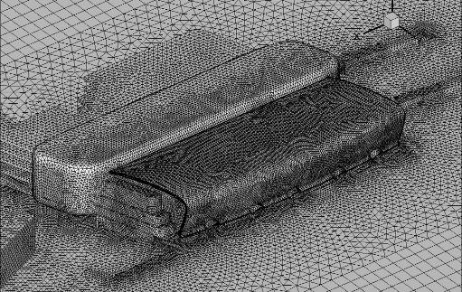

.. _paper-note-ref-li2012-GCLX:

行人风环境超越阈值概率评估：论文精解
========================================

精简版微信公众号文章：待发布

.. contents:: 本页目录
   :local:
   :depth: 2

论文信息
--------

**题名：** 基于超越阈值概率的行人风环境数值评估。

**作者：** 李朝\ :sup:`1`、肖仪清\ :sup:`1,*`、滕军\ :sup:`1`、欧进萍\ :sup:`1`、陈宜言\ :sup:`2`。

**作者单位：** 1. 哈尔滨工业大学深圳研究生院，深圳 518055；2. 深圳市市政设计研究院有限公司，深圳 518055。星号根据首页脚注表示通讯作者肖仪清。

**期刊：** 《工程力学》，2012 年 12 月，第 29 卷第 12 期，15–21 页。**DOI：** `10.6052/j.issn.1000-4750.2011.03.0106 <https://doi.org/10.6052/j.issn.1000-4750.2011.03.0106>`_。

**英文题名：** Numerical Evaluation of Pedestrian Wind Environment Using Threshold Exceedance Probability Approach。

**WOEAI 相关方向：** 结构风工程 / 数值风洞。

本页按原顺序完整整理中文论文正文、公式、图表和参考文献，首页英文摘要另行翻译。文中有关规范、技术发展和评估标准的表述属于原论文发表时的讨论，不表示当前规范要求；独立校核注不作为作者勘误。

摘要
----

大尺度的建筑物和密集的建筑群都会对其周边的风环境造成较大的影响，并可能引起行人风环境问题。首先阐述了行人风环境评估的超越阈值概率方法，提出了综合考虑平均风和阵风影响的行人风环境评估标准；其次，结合某半开敞式的大跨空间建筑，统计了该地区风速气象观测资料并估计了概率参数；再次，使用计算流体力学数值风洞技术，获得了 8 个风向下的风场分布；最后，给出了场地全风向超越不舒适风速阈值的概率分布图，评价了该建筑的行人风环境。结果表明：该文所述方法能够给出复杂建筑的行人不舒适度和危险度详实评估结果。

关键词
------

行人风环境；超越阈值概率；风速比；计算流体力学；数值风洞。

英文摘要译文
------------

大尺度建筑物和密集建筑群都会改变其周围的风环境，并可能伴随行人风舒适性问题。首先介绍采用超越阈值概率评估行人风环境的方法，并提出一种同时考虑平均风和阵风对人影响的判据。其次，为研究一座半开敞式大跨建筑出现的风环境问题，对风气象统计资料的参数进行了估计。再次，采用计算流体力学（CFD）模拟获得行人高度处的空气动力学特征。最后，给出全风向不舒适风速阈值超越概率分布图，并评估行人风环境。结果表明，该方法能够对复杂建筑的行人风舒适度和危险度作出详细评估。

**英文关键词译文：** 行人风环境；阈值超越概率；风速比；计算流体力学；数值风洞。

引言
----

城市的高速、密集发展使得市区内的风环境问题日益凸显。城市内局部区域的风环境问题主要分为 2 个方面：局地滞风和局地强风。局地滞风问题虽不会带来危险，但会引起污染物、粉尘等在局部堆积，造成空气质量下降，应加以避免；局地强风往往由于单个或多个建筑物的钝体外形及布局引起，形成下冲风、狭谷风、穿堂风、角隅风以及尾流风等。常态风况时，会增加行人的不舒适感，影响建筑物的正常使用；极端风况时，将影响行人安全，均需予以避免。

国外的城市发展以及区域高大建筑群的形成比中国早，其行人风环境问题研究的开展也更早。Davenport [1] 在 1972 年提出的一套以人的舒适度为指标的风环境评估标准，至今仍有应用 [2]；Lawson 和 Penwarden [3] 扩展了蒲氏风级至 1.75 m 高度，建立了风速等级同行人感觉的关系，这是行人风环境评估的基础。近年来，欧洲参与 COST-C14 项目 [4–5] 的研究机构提出了多个行人风环境评估标准，日本 AIJ 也开展了基于 CFD 的行人风环境评估研究 [6]。此外，Bottema [7] 和 Sanz-Andres 等 [4] 分析比较了多个行人风环境评估标准间的差异，认为等效阈值风速及对应的超越概率为行人风环境评估的关键参数，并提出了最优化建议。

近些年，我国大城市中高大建筑的密集建设使得行人风环境问题日益凸现。符龙彪等人 [8] 研究了北京 MOMA 建筑群的风环境问题，认为建筑群间的相互干扰对风环境的影响较大，应通过建筑和园林设计进行补救。我国研究人员对高层建筑（群）开展的风环境研究已有一些 [2,8–10]，但目前的建筑结构设计规范中并无行人风环境相关的规定或指引，这使得行人风环境评估无章可循，以至于一些建筑在落成后才发现风环境问题的严重性。对于大型复杂建筑物，如（半）开敞结构，还存在物理风洞中风速测量的困难。

本文将使用超越阈值概率方法，结合某开敞式大跨空间建筑出现的行人风环境问题，对行人风环境的评估程序和标准做初步的探讨。

1 行人风环境舒适度评估的超越阈值概率法及评估标准
--------------------------------------------------

1.1 评估方法
~~~~~~~~~~~~

评估行人风环境的优劣，首先要建立风的强度等级与对人的作用效果之间的关系。表 1 列出了由 Lawson 和 Penwarden [3] 扩展的蒲福风级，表中的平均风速指在粗糙长度为 0.03 m（与 B 类场地接近）的空旷场地中测得的 1.75 m 高度的 10 min 平均风速。由表 1 中可知，4 级风的作用效果包括尘土扬起、纸片飞动、头发吹乱，这个级别的风将影响行人的一般活动，同时 8 级大风将使行人前行困难，易失去平衡，有一定危险性。和平均风相比，短时的阵风也会对行人造成不适和危险，Bottema [7] 总结了其他学者关于阵风对行人的影响效果研究，其得到的主要几点结论也列于表 1 中。可以看出，即使作用时间仅有几秒钟的阵风对人的作用效果也不容忽略。行人风环境评估的阈值超越概率方法包括风不舒适度评估及风危险度评估两部分，其中不舒适或危险“与否”通过风速阈值来界定，而不舒适与危险的“度”则由超越该阈值的概率大小来评判 [4,11]。

.. list-table:: 表 1 基于对地面行人作用效果的蒲福风级（Extended land beaufort scale showing wind effects on people）
   :header-rows: 1
   :widths: 6 7 14 16 57

   * - 蒲福风级
     - 名称
     - 平均风速 / (m/s)
     - 阵风风速 / (m/s) ／ 持续时间 / s
     - 对行人作用效果
   * - 0
     - 无风
     - 0.0–0.1
     - —
     - 平静
   * - 1
     - 微风
     - 0.2–1.0
     - —
     - 无可察觉的风
   * - 2
     - 软风
     - 1.1–2.3
     - —
     - 脸部可感觉到风
   * - 3
     - 轻风
     - 2.4–3.8
     - 4 ／ 7
     - 扰动头发，衣襟、报纸飘动
   * - 4
     - 和风
     - 3.9–5.5
     - 6 ／ 7
     - 尘土扬起，纸片飞动，头发吹乱
   * - 5
     - 清风
     - 5.6–7.5
     - —
     - 身体可感觉风力，易失去平衡
   * - 6
     - 强风
     - 7.6–9.7
     - 10 ／ 3
     - 举伞困难，头发被吹直，稳步行走困难，耳边的风声令人不悦
   * - 7
     - 疾风
     - 9.8–12.0
     - 15 ／ 3
     - 行走觉得不便，年老体弱者行走危险
   * - 8
     - 大风
     - 12.1–14.5
     - 20 ／ 3
     - 前行困难，在阵风中保持身体的平衡极度困难，行走有危险性
   * - 9
     - 烈风
     - 14.6–17.1
     - 23 ／ 3
     - 人被吹倒

仅考虑平均风的阈值将忽略阵风对行人舒适度的影响，因此本文将采用综合平均风速及阵风影响的等效风速阈值标准。基于现场及风洞中的行人舒适度调查报告的统计 [4–5]，等效风速的阈值判断形式：

.. math::

   \widetilde V_{ped}=\overline V_{ped}+g\cdot\sigma_V>V_{THR}
   \qquad (1)

其中： :math:`\overline V_{ped}` 为行人高度平均风速； :math:`g` 为峰值因子； :math:`\sigma_V` 为脉动风速标准差； :math:`\widetilde V_{ped}` 为行人高度等效风速； :math:`V_{THR}` 为不舒适或危险阈值风速。

为了确定超越阈值的概率，需要得到常年风速的概率分布函数。Weibull 双参数分布是一种普遍认可的常态风分布概率模型 [12]，对于给定风向 :math:`\theta` ，风速超越阈值 :math:`V_{THR}` 的发生概率为：

.. math::

   P_\theta(\widetilde V_{ped}>V_{THR})=
   A_\theta\cdot\exp\left[-\left(\frac{V_{THR}}{c_\theta}\right)^{k_\theta}\right]
   \qquad (2)

其中： :math:`P_\theta` 为 :math:`\theta` 风向风速超过 :math:`V_{THR}` 的累积概率； :math:`A_\theta` 是 :math:`\theta` 风向的发生频率； :math:`c_\theta` 为 :math:`\theta` 风向风速概率分布函数的尺度参数； :math:`k_\theta` 为 :math:`\theta` 风向风速概率分布函数的形状参数。

评估行人风环境需要两方面的数据支持：一是该场地的空气动力学特性，如风速比、湍流强度、场地类别等用以得到建筑周围等效风速场分布；二是该场地附近气象观测站的常年风速风向观测资料用以确定常年风速的概率分布函数。

常年风速风向观测资料可通过气象部门收集。获取建筑流场空气动力学特性的方法有三种，分别是现场实测、风洞试验和数值模拟。现场实测需要在建筑建成以后，在场地中安装风速仪来获得流场特征。现场实测是一种值得信赖的方法，但耗时耗力且局限性强，使用的较少。风洞试验获得行人高度流场运动特征的途径主要有两种：一是采用测风仪器逐点测量风场，二是采用风蚀技术得到面的风场分布 [9]。逐点测量的方法能够测量的位置较少，且难于测量开敞建筑的内部流场；风蚀技术还是一种较新的技术，其通用性和实用性还需进一步的验证。数值模拟，又称数值风洞，是基于计算流体动力学（Computational Fluid Dynamics，CFD）求解流场运动的方法。随着 CFD 技术的逐步成熟，应用也更加广泛深入，其优势在于成本低、周期短、多参数分析、无扰测量及详尽的流场模拟结果。

对于拟建建筑，基于这些数据资料评估行人风环境的基本程序为：

1. 统计分析常年观测到的风速风向资料，得到各风向角度区间的风频并确定其风速概率分布函数。
2. 通过（数值）风洞试验获取各风向下的风速比。
3. 基于风速比和场地类别，将该场地行人高度的阈值风速转化为观测点处的阈值风速。
4. 将转换风速代入概率分布函数，综合各风向的风频加权求和获得此阈值风速的总发生概率。

1.2 评估标准
~~~~~~~~~~~~

基于上述程序评估行人风环境需要有一套合理有效的行人风环境舒适度评估标准。各国学者提出了不同的风环境评估标准，其中在荷兰实施的行人风环境评估标准 [5] 给出了风不舒适和危险的阈值及超越概率级别划分，但此标准并未考虑阵风的影响。引入等效风速则可综合考虑平均风与阵风影响，Bottema [7] 建议在评估风舒适度时，取等效风速阈值和峰值因子分别为 :math:`V_{THR}=6\ \mathrm{m/s}` 和 :math:`g=1` ；评估风危险度时，取等效风速阈值和峰值因子分别为 :math:`V_{THR}=20\ \mathrm{m/s}` 和 :math:`g=3` 。Willemsen 在荷兰标准 [5] 中选定的仅考虑平均风速的不舒适阈值为 5 m/s（对应 4 级蒲氏风），危险阈值为 15 m/s（对应 9 级蒲氏风）。将 Willemsen 的平均风阈值与 Bottema 的建议值代入式（1）可得判定舒适度和危险度时的湍流强度分别为 0.20 和 0.11，与不同平均风速范围的湍流强度一般观测结果比较一致，说明 Bottema 标准与 Willemsen 标准基本相当。本文选定的考虑不同类型阈值和相应超越概率的评估标准列于表 2。

.. list-table:: 表 2 风不舒适度评估标准（Criteria for wind comfort）
   :header-rows: 1
   :widths: 40 20 20 20

   * - :math:`P(\widetilde V_{ped}>6\ \mathrm{m/s})` / %
     - 快步
     - 漫步
     - 闲坐
   * - < 2.5
     - 优
     - 优
     - 优
   * - 2.5–5.0
     - 优
     - 优
     - 中
   * - 5.0–10
     - 优
     - 中
     - 差
   * - 10–20
     - 中
     - 差
     - 差
   * - > 20
     - 差
     - 差
     - 差

.. list-table:: 表 2（续）风危险度评估标准（Criteria for wind danger）
   :header-rows: 1
   :widths: 60 40

   * - :math:`P(\widetilde V_{ped}>20\ \mathrm{m/s})` / %
     - 危险度
   * - 0.05–0.3
     - 有一定危险
   * - > 0.3
     - 危险

2 某大跨半开敞建筑的行人风环境舒适度评估
----------------------------------------

2.1 评估工程背景
~~~~~~~~~~~~~~~~

本文研究的工程应用实例是位于深圳市的某交通枢纽中心，依据建筑功能要求，设计选择了半开敞的大跨空间建筑型式，本文将主要研究该建筑行人区域风环境舒适度评估问题。

2.2 周边地区风环境资料的统计与分析
~~~~~~~~~~~~~~~~~~~~~~~~~~~~~~~~~~

如前文所述，局地风环境与其所在地区的整体风环境密切相关。本文收集了该建筑周边地区多达 44 个气象观测站点 3 年逐小时的风速风向观测资料。气象观测站建立在空旷 B 类场地，风速仪安装在 10 m 高度，记录每小时末 10 min 的平均风速与风向。本文忽略了周边环境对气象观测站的影响，将各个站点数据合并统计。去除因仪器故障产生的无效数据，44 个测风站点三年观测期记录的有效数据为 739965 次。将 360° 划分为 8 个风向区间，统计得到的风速风向频率玫瑰图如图 1 所示，可以看出该地区常年风向主要集中在北、东北、东、东南这 4 个风向上，而强度较大的风也出现在这 4 个风向。各风向的平均风速及该风向频率列于表 3 中。

确定概率模型之后，本文采用了最大似然估计法估计了各风向的 Weibull 分布函数的参数。估计的参数通过了置信度为 95% 的 K-S 检验，结果列于表 3 中，后续的风环境评估将采用此结果。

.. figure:: ../../../wechat/assets/public-safe/ref-li2012-GCLX/fig01.png
   :alt: 图1该地区风速风向频率玫瑰图
   :align: center
   :width: 65%

   **图 1** 该地区风速风向频率玫瑰图（Rose map of wind speed and direction frequency at the site）。径向刻度表示频率；颜色分组表示风速区间。有效样本数为 739965。

.. list-table:: 表 3 气象观测资料的统计和威布尔参数估计结果（The statistics and Weibull parameters estimation of meteorological data）
   :header-rows: 1
   :widths: 24 19 19 19 19

   * - 风向
     - 平均风速
     - 频率 :math:`A_\theta`
     - 尺度参数 :math:`c_\theta`
     - 形状参数 :math:`k_\theta`
   * - 北风（N）
     - 3.06
     - 0.1435
     - 3.45
     - 1.69
   * - 东北风（NE）
     - 2.789
     - 0.1640
     - 3.12
     - 1.74
   * - 东风（E）
     - 2.81
     - 0.2096
     - 3.18
     - 1.83
   * - 东南风（SE）
     - 2.83
     - 0.1783
     - 3.20
     - 2.16
   * - 南风（S）
     - 2.60
     - 0.1056
     - 2.94
     - 2.10
   * - 西南风（SW）
     - 2.69
     - 0.0912
     - 3.04
     - 1.83
   * - 西风（W）
     - 2.26
     - 0.0566
     - 2.56
     - 1.86
   * - 西北风（NW）
     - 2.22
     - 0.0513
     - 2.51
     - 1.76

2.3 风速场分布的数值风洞模拟
~~~~~~~~~~~~~~~~~~~~~~~~~~~~

2.3.1 数值模型参数设置
^^^^^^^^^^^^^^^^^^^^^^

建筑二层楼板上的椭圆形孔洞将一层流场同室内的开敞空间相连，改善了室内空气的自然对流，对一层的空气流通也有一定影响，因此建立的三维模型包括了建筑的内部空间，同时对周边建筑进行了简单建模以考虑建筑物间的风场干扰作用。原尺寸的模型如图 2 所示。

.. figure:: ../../../wechat/assets/public-safe/ref-li2012-GCLX/fig02.png
   :alt: 图2建筑三维模型
   :align: center
   :width: 70%

   **图 2** 建筑三维模型（The 3D model of this building）。模型包含半开敞建筑内部空间，并简化考虑周边建筑。

由于该建筑造型复杂，在整个计算域中生成正交性好的六面体网格十分困难。为了能够准确地描述大气边界层的风场特性，本文采用了四面体与六面体的混合网格。先将计算域分区，将模型边界区域采用四面体网格划分，将其他区域采用六面体网格划分。同时，地面附近使用了三棱柱型的边界层网格以保证壁面边界层流场求解的网格尺度要求，同时加密了行人高度处的网格提高对此处风场的计算精度。在不同密度网格试算的基础上，计算结果的数值精度通过了网格独立性的检验。为了得到全风向的舒适度结果，沿 8 个方向分别建立了数值网格模型，网格单元总数均在 350 万左右，其中 0° 风向的计算模型网格如图 3 所示。

   **图 3** 模型网格（The grid system）。展示 0° 风向模型的网格；各风向网格单元总数约为 350 万。

本文要模拟定常风场作用下的风场特性，湍流的模拟采用了 RANS（Reynolds Averaged Navier-Stokes equation）方法中基于 :math:`k` – :math:`\omega` 模式改进的剪应力输运（Shear Stress Transport，SST）湍流模式。SST 湍流模式综合了 :math:`k` – :math:`\varepsilon` 和 :math:`k` – :math:`\omega` 这两种湍流模式的优点，在近壁面区采用求解湍流边界层更好的 :math:`k` – :math:`\omega` 模式，而在流场核心区采用精度更高的 :math:`k` – :math:`\varepsilon` 模式，能够准确求解边界层并预测分离的特性，这对求解近地面行人高度的风场十分有利。离散方程组的求解采用基于解耦思想的 SIMPLE（Semi-Implicit Method for Pressure-Linked Equations）系列求解方法。具体采用了 SIMPLEC（SIMPLE-Consistent）算法，该方法收敛速度快，由于采用了部分非结构网格，设置了网格倾斜校正，提高了计算的收敛性和健壮性。数值离散精度方面：对流项采用了具有三阶精度的 QUICK（Quadratic Upwind Interpolation for Convective Kinematics）格式，当网格为顺流向的六面体网格时，QUICK 格式可以较大地提高计算精度。

该建筑位于市中心的 C 类场地，则计算域风速入口采用的指数率剖面列于下式：

.. math::

   \overline V=V_{10}^{C}\times(z/10)^{0.22}\qquad (3)

由于我国荷载规范中并未给出湍流强度的建议公式，本文入口湍流强度采用了日本 AIJ 规范中的建议公式：

.. math::

   I=\begin{cases}
   0.1\times(Z_b/Z_G)^{-\alpha-0.05},&z\le Z_b,\\
   0.1\times(z/Z_G)^{-\alpha-0.05},&Z_b<z\le Z_G,\\
   0.1,&z>Z_G.
   \end{cases}\qquad (4)

其中：粗糙度指数 :math:`\alpha=0.22` ；参数 :math:`Z_b=10\ \mathrm{m}` ，梯度风高度 :math:`Z_G=400\ \mathrm{m}` 。

2.3.2 等效风速比
^^^^^^^^^^^^^^^^

本文采用的 RANS 系列的湍流模型，因此仅能得到流场中平均风速的分布，无法直接获得局部的阵风脉动，但由于 SST :math:`k` – :math:`\omega` 模式中求解了流场湍动能，则任意 :math:`i` 位置的湍流强度 :math:`I_i` 同湍动能 :math:`k_i` 有如下关系：

.. math::

   I_i=\sqrt{\frac{2}{3}k_i}\big/\overline V_{ped,i}\qquad (5)

又因等效风速同平均风速和湍流强度有如下关系：

.. math::

   \widetilde V_{ped,i}=\overline V_{ped,i}(1+gI_i)\qquad (6)

则等效风速可由下式计算：

.. math::

   \widetilde V_{ped,i}=\overline V_{ped,i}+g\sqrt{\frac{2}{3}k_i}\qquad (7)

实际建筑的尺寸（特征尺度）较庞大，因此其流场雷诺数一般都超过了垮临界雷诺数（ :math:`3.6\times10^6` ），则当风速在较小的范围内变化时，流场的运动结构变化可以忽略，也即不同来流风速计算得到的无量纲流场基本一致。因此，引入无量纲量，即风速比，来描绘建筑物周围的风速分布比例情况，风速比 :math:`r` 的定义为：

.. math::

   r_i=\frac{\widetilde V_{ped,i}}{\overline V_{ped,ref}}\qquad (8)

式中： :math:`\widetilde V_{ped,i}` 是流场中 :math:`i` 点位置行人高度处的等效风速； :math:`\overline V_{ped,ref}` 是参考风速，此处为风洞入口处等高度的平均风速。

.. note::

   原文使用“垮临界雷诺数”及数值 :math:`3.6\times10^6` ，此处照录。该段说明本文复用无量纲风场时所作的假定，不应据此把这一数值视作所有建筑、粗糙度和来流状态通用的临界值。

本文计算了 8 个风向下的流场运动，篇幅关系在图 4 中只给出了结构一层 1.75 m 高度在北风和东北风作用下的等效风速比分布图。可以看出，在通风门都开启的情况下，有遮挡室内空间的风速比基本在 0.2 以内，在迎风门开启的局部区域有 0.8 的风速比，在无遮挡的开敞室内空间最大风速比为 1.6，在建筑物外部最大的风速比达到了 2。可见，该建筑物对气流的阻挡作用和对局部气流的加速作用均较明显。同时，室内外的高风速比区域应在保证建筑美观的同时设置绿化防风带，确保行人的舒适度和安全。

.. figure:: ../../../wechat/assets/public-safe/ref-li2012-GCLX/fig04.png
   :alt: 图4北风和东北风的等效风速比分布图
   :align: center
   :width: 80%

   **图 4** 等效风速比分布图（Contour map of equivalent wind speed ratios）。（a）北风；（b）东北风。平面位于结构一层 1.75 m 高度；灰度色标为无量纲风速比，不能当作风速单位 m/s。

2.4 行人风环境评估
~~~~~~~~~~~~~~~~~~

该半开敞式大跨空间建筑所处的场地类别为 C 类，其地面粗糙程度与气象观测站的 B 类不同，需要将风速进行转换。一般认为，城市市区内平均风速较郊区低，但梯度风速相同，基于此有以下转换公式：

.. math::

   V_{10}^{B}=V_{10}^{C}\cdot\left(\frac{400}{10}\right)^{0.22}
   \cdot\left(\frac{350}{10}\right)^{-0.16}
   =1.275\cdot V_{10}^{C}\qquad (9)

其中：B 类梯度风高度为 350 m，粗糙度指数为 0.16；C 类梯度风高度为 400 m，粗糙度指数为 0.22。即在 10 m 高度处，观测站处风速为建筑物场地处风速的 1.275 倍。又由于行人风环境评估的高度为 1.75 m，则与气象观测站点 10 m 高度的风速有以下关系：

.. math::

   V_{10}^{B}=1.275\cdot\left(\frac{10}{1.75}\right)^{0.22}
   \cdot\overline V_{ped}=1.870\cdot\overline V_{ped}\qquad (10)

则由式（3）至式（10）可得到建筑物场地中风速阈值 :math:`V_{THR}` 与外围观测站的风速 :math:`V_{O,i,THR}` 的关系：

.. math::

   V_{O,i,THR}=\frac{1.870}{r_i}V_{THR}\qquad (11)

将式（11）代入式（2）并在各风向求和有：

.. math::

   P(\widetilde V_{ped,i}>V_{THR})=
   \sum_{\theta=0}^{360}A_\theta\cdot\exp\left[
   -\left(\frac{V_{O,i,THR}}{c_\theta}\right)^{k_\theta}\right]
   \qquad (12)

由式（12）即可得到任意 :math:`i` 点位置处在各风向下等效风速超越舒适度或危险度阈值的概率总和，即可给出该区域全风向的行人风环境评估。

.. note::

   式（12）的求和上下限按原式保留。本文实际将圆周分为 8 个风向区间，实施时是对这些区间的风频加权结果求和，并非把 0° 和 360° 当成两个独立来风重复计入。式（2）的 :math:`A_\theta` 已包含风向发生频率，不能在式（12）外再重复乘一次同一风频。

不同风向下建立的数值模型网格节点坐标不重合，即各风向下得到的超越概率 :math:`P_i` 对应的坐标不重合，无法将各风向结果直接相加。为了将各风向的结果综合至同一网格系统下，本文采用了 Kriging 插值 [13] 的方法，将 8 个风向的结果在一套网格系统下进行插值。取峰值因子 :math:`g=1` ，得到的全风向行人不舒适阈值风速超越概率分布，如图 5 所示。

.. figure:: ../../../wechat/assets/public-safe/ref-li2012-GCLX/fig05.png
   :alt: 图5全风向行人不舒适阈值风速超越概率分布图
   :align: center
   :width: 85%

   **图 5** 全风向行人不舒适阈值风速超越概率分布图（The distribution of the exceedance probability of the wind discomfort threshold for full directions）。此图采用 :math:`g=1` 、等效风速阈值 6 m/s；色标采用概率小数而非百分数，0.040 对应 4%。

该半开敞式大跨度空间建筑室内的功能需求表明其主要人员活动类型为漫步，按表 2 中的评估标准，由图 5 可以看出，可知该场地的行人舒适度状况等级为优，局部区域等效风速超越不舒适阈值的全风向概率较大，这同建筑物现场的工作人员的反应的风速较大区域吻合。该区域最大超越概率约为 0.04，包括了室外、半开敞的车流区及建筑行人区的入口。由于入口为行人活动密集区域，应采取防风措施以提高此处舒适度。

在计算危险度时，取 :math:`g=3` ，得到的超越危险阈值风速的最大概率为 :math:`1.757\times10^{-6}` ，远小于有一定危险的下限概率 :math:`5\times10^{-4}` ，则该区域并不危险。

.. note::

   “优”和“并不危险”是针对本算例、给定统计资料与表 2 判据的原文结论。现场工作人员的反馈是区域对应的定性比较，不是全场风速误差验证；论文没有报告实施绿化或其他防风措施后的效果。表 2 的活动类型不同，舒适度等级亦可能不同，不能将漫步评价直接用于闲坐。

3 结论
------

本文阐述了基于等效风速的行人风环境舒适度评估的超越阈值概率方法及评估标准，在统计周边地区整体风环境观测数据及通过 CFD 数值风洞模拟得到建筑物流场特性的基础上，评估了某半开敞式大跨度空间建筑行人风环境舒适度，有以下几点结论：

1. 同时考虑平均风及阵风对行人的作用效果，计算超越阈值风速概率的方法能够将场地风气候特性与建筑物的空气动力特性结合，综合评估指定区域的行人风环境舒适度和危险度。对某半开敞式大跨度空间建筑的行人风环境评估结果同现场情况吻合。
2. 对于半开敞式大跨度空间建筑的复杂内部流场，风洞试验存在模型制作和仪器测量的困难，采用 CFD 数值风洞模拟可有效地解决这一难题，并给出更详实流场运动特性结果。
3. 评估标准是行人风环境评估中重要一环，应当慎重选择，本文提出的行人风环境评估标准还需要结合大量现场和风洞中对行人舒适度的调查统计来验证。

参考文献
--------

[1] Davenport A G. An approach to human comfort criteria for environmental wind conditions [C]. Colloquium on Building Climatology, Stockholm, 1972.

[2] 王宝民, 刘辉志, 桑建国, 等. 北京商务中心风环境风洞实验研究 [J]. 气候与环境研究, 2004, 9(4): 631–640. / Wang Baomin, Liu Huizhi, Sang Jianguo, et al. Numerical simulation of atmospheric environment of the central business district in Beijing [J]. Climatic and Environmental Research, 2004, 9(4): 631–640. (in Chinese)

[3] Lawson T V, Penwarden A D. The effects of wind on people in the vicinity of buildings [C]. Proceedings of the 4th International Conference on Wind Effects on Buildings and Structures. Heathrow: Cambridge University Press, 1975: 605–622.

[4] Sanz-Andres A, Cuerva A. Pedestrian wind comfort: Feasibility study of criteria homogenization [J]. Journal of Wind Engineering and Industrial Aerodynamics, 2006, 94(11): 799–813.

[5] Willemsen E, Wisse J A. Design for wind comfort in The Netherlands: Procedures, criteria and open research issues [J]. Journal of Wind Engineering and Industrial Aerodynamics, 2007, 95(9/10/11): 1541–1550.

[6] Yoshie R, Mochida A, Tominaga Y, et al. Cooperative project for CFD prediction of pedestrian wind environment in the Architectural Institute of Japan [J]. Journal of Wind Engineering and Industrial Aerodynamics, 2007, 95(9/10/11): 1551–1578.

[7] Bottema M. A method for optimization of wind discomfort criteria [J]. Building and Environment, 2000, 35(1): 1–18.

[8] 符龙彪, 夏育颖, 肖从真. 北京当代 MOMA 风载及风环境数值模拟研究 [J]. 土木工程学报, 2008, 41(3): 71–74. / Fu Longbiao, Xia Yuying, Xiao Congzhen. Numerical simulation of wind load and wind environment for Beijing MOMA [J]. China Civil Engineering Journal, 2008, 41(3): 71–74. (in Chinese)

[9] 刘辉志, 姜瑜君, 梁彬, 等. 城市高大建筑群周围风环境研究 [J]. 中国科学 D 辑, 2005(增刊 I): 84–96. / Liu Huizhi, Jiang Yujun, Liang Bin, et al. Investigation of wind environment around urban big building group [J]. Science in China Ser. D Earth Sciences, 2005(Suppl 1): 84–96. (in Chinese)

[10] 陈德江, 石碧青, 谢壮宁. 某高层建筑风环境风洞试验研究 [J]. 汕头大学学报(自然科学版), 2002, 17(1): 74–80. / Chen Dejiang, Shi Biqing, Xie Zhuangning. A simulation test on the wind environment around a high-rise [J]. Journal of Shantou University (Natural Science), 2002, 17(1): 74–80. (in Chinese)

[11] Blocken B, Carmeliet J. Pedestrian wind environment around buildings: Literature review and practical examples [J]. Journal of Building Physics, 2004, 28(2): 107.

[12] Holmes J D. Wind loading of structures [M]. London and New York: Spon Press, 2001: 39–40.

[13] Trochu F. A contouring program based on dual kriging interpolation [J]. Engineering with Computers, 1993, 9(3): 160–177.

原文出处
--------

:ref:`李朝、肖仪清、滕军、欧进萍、陈宜言. 基于超越阈值概率的行人风环境数值评估. 工程力学, 2012, 29(12): 15–21. <ref-li2012-GCLX>`
