.. _paper-note-ref-li2012-JWEIA:

下击暴流与冲击射流三维轴对称稳态流的修正经验模型及 CFD 模拟：论文精解
============================================================================================

精简版微信公众号文章：待发布

.. contents:: 本页目录
   :local:
   :depth: 2

论文信息
--------

原文题名：A revised empirical model and CFD simulations for 3D axisymmetric steady-state flows of downbursts and impinging jets。

作者：Chao Li；Q.S. Li（通讯作者）；Y.Q. Xiao；J.P. Ou。

作者单位：哈尔滨工业大学深圳研究生院，中国深圳 518055；香港城市大学建筑土木工程系，中国香港。

期刊：Journal of Wind Engineering and Industrial Aerodynamics，102（2012），48–60。
DOI：https://doi.org/10.1016/j.jweia.2011.12.004。

收稿：2010 年 3 月 25 日；修回：2011 年 12 月 21 日；录用：2011 年 12 月 21 日；在线发表：2012 年 1 月 31 日。

摘要
----

已有研究认识到，下击暴流在年极值风中占有很高的比例。尽管真实下击暴流的风特性十分复杂，且远未得到全面认识，但在极端风主要由下击暴流控制的地区，简化的解析模型和经验模型仍是结构抗风设计的有用工具。本文旨在建立一个简单且精度更高的经验模型，用于描述下击暴流和冲击射流的三维轴对称稳态速度场。原始 OBV 模型（Oseguera and Bowles, 1988；Vicroy, 1991）仅通过形状函数考虑边界层效应，并将边界层的发展视为线性变化。然而，下击暴流和冲击射流的边界层厚度呈非线性增长。本文发展的修正模型将变化的特征长度引入速度形状函数，并为强度尺度量增加独立形状函数，从而纳入这种非线性效应。此外，通过深入分析形状函数的内在性质，本文提出一个简单的径向速度竖向形状函数，并修正径向速度的径向形状函数，以提高模型的简洁性和精度。采用雷诺应力模型（Reynolds Stress Model, RSM）开展详细的三维计算流体动力学（Computational Fluid Dynamics, CFD）模拟，用于修正模型的拟合与验证。与原始 OBV 模型相比，修正模型得到的稳态流场更加准确，尤其是径向速度剖面。

关键词
------

下击暴流；冲击射流；雷暴；经验模型；计算流体动力学（CFD）。

1 引言
------

澳大利亚（Holmes, 1999）、美国（Letchford et al., 2002）、中国（Qin et al., 2006；Choi et al., 2007）、新加坡（Choi, 1999）等多个国家的研究人员近期开展的雷暴研究表明，无论一个地区是否位于热带气旋易发区，雷暴阵风在该地区年极值风统计中都占有很高的比例。雷暴的破坏力确实给人们及其财产造成了严重损害。因此，未来的风荷载规范有必要考虑雷暴风的特性。

下击暴流的形成与发展明显不同于边界层风。Letchford et al. (2002) 总结了其中最显著的五点差异，Chen and Letchford (2004) 对此进行了讨论。从设计风荷载的角度看，这些风特性差异可简化为三方面：径向和竖向平均风速剖面；非平稳风速与风向；以及强风区内高度相关的风。本文聚焦第一方面。

与其他风工程问题的研究一样，下击暴流的风特性也可以采用现场观测、风洞试验、CFD 模拟以及解析或经验建模等方法研究。为保障飞机安全起降，NIMROD（Northern Illinois Meteorological Research on Downbursts，北伊利诺伊州下击暴流气象研究）和 JAWS（Joint Airport Weather Studies，联合机场天气研究）项目开展了早期的下击暴流实测研究（McCarthy et al., 1982；Fujita, 1985）。Hjelmfelt (1988) 根据实测资料总结了微下击暴流的结构和特征，并指出实验室壁面射流与微下击暴流外流具有许多相似特征。下击暴流实测（Sherman, 1987；Choi, 2004；Jarvi et al., 2007；Orwig and Schroeder, 2007；Holmes et al., 2008）是揭示下击暴流风特性的最可靠途径。然而，下击暴流的时间尺度短、发生具有随机性、空间尺度小，使其特性监测极其困难。

缩尺风洞试验是研究下击暴流的另一种参数化方法。冲击射流通过喷嘴喷出气流并使其撞击平面，物理模拟下击暴流，是使用最广泛的试验装置（例如 Hjelmfelt, 1988；Wood et al., 2001；Chay and Letchford, 2002；Sengupta and Sarkar, 2008；Xu and Hangan, 2008）。研究发现，冲击射流的流场，尤其是平均速度剖面，与下击暴流现场记录吻合良好。为模拟下击暴流的“阵风锋”和“涡环”等瞬态运动，Mason (2003) 和 McConville et al. (2009) 研究了不同的喷嘴开启机制。Zhao et al. (2009) 采用主动控制的多风机风洞再现了下击暴流产生的阵风锋，Cao et al. (2002) 则详细介绍了这一装置。Butler and Kareem (2007) 采用大迎角平板模拟下击暴流产生的阵风锋。

符号表
~~~~~~

.. list-table:: 原文符号表
   :header-rows: 1
   :widths: 30 70

   * - 符号
     - 定义
   * - :math:`\delta(r)`
     - 随 :math:`r` 变化的半峰值速度高度（m）
   * - :math:`\lambda`
     - 强度尺度因子（1/s）
   * - :math:`r`
     - 径向坐标，即距下击暴流中心的距离（m）
   * - :math:`r_m(z)`
     - 随 :math:`z` 变化的最大径向速度所在半径（m）
   * - :math:`r_{mm}`
     - 整个流场最大径向速度所在半径（m）
   * - :math:`R`
     - OBV 模型中的下击暴流半径（m）
   * - :math:`R_c`
     - Holmes 模型中的特征长度尺度
   * - :math:`u(w)`
     - 径向（竖向）风速（m/s）
   * - :math:`u_{\mathrm{VS}}(u_{\mathrm{RS}})`
     - 径向速度的竖向（径向）形状函数
   * - :math:`w_{\mathrm{VS}}(w_{\mathrm{RS}})`
     - 竖向速度的竖向（径向）形状函数
   * - :math:`u_m(w_m)`
     - 特定位置 :math:`r(z)` 处的最大径向（竖向）速度（m/s）
   * - :math:`u_{mm}`
     - 全场最大径向速度（m/s）
   * - :math:`u_{m,\mathrm{VS}}(u_{m,\mathrm{RS}})`
     - 最大径向速度的竖向（径向）形状函数
   * - :math:`z`
     - 竖向坐标，即距地面的高度（m）
   * - :math:`z_m(r)`
     - 随 :math:`r` 变化的最大径向速度所在高度（m）
   * - :math:`z_{mm}`
     - 整个流场最大径向速度所在高度（m）
   * - :math:`\alpha,\beta,\gamma,\chi,\eta,A,B,C,c_1,c_2`
     - 无量纲参数

CFD 技术已广泛应用于风工程，包括下击暴流模拟。Chay et al. (2006) 采用雷诺平均 Navier–Stokes 方程（RANS）的 :math:`k\text{–}\varepsilon` 模型模拟下击暴流的非湍流风速。Kim and Hangan (2007) 采用 RSM 研究用于下击暴流模拟的冲击射流的雷诺数依赖性及非定常特征。Sengupta and Sarkar (2008) 将 RANS 湍流模型和大涡模拟（LES）的 CFD 结果与热线、皮托静压管排和粒子图像测速（PIV）试验数据进行比较，指出 CFD 适用于下击暴流流动模拟。此外，Mason et al. (2009a) 提出了轴对称、干燥、非静力云下模型，以数值方式研究下击暴流特性。

解析模型和经验模型能够以简化而直接的方式描述下击暴流速度剖面。由于下击暴流运动机制复杂，多数既有解析模型由不可压缩 Euler 方程推导，并结合经验方程模拟湍流边界层。考虑下击暴流流场的轴对称性，Oseguera and Bowles (1988) 在柱坐标系中提出了三维稳态下击暴流解析模型，随后 Vicroy (1991) 根据现场观测改进其径向形状函数，这一模型称为 OBV 模型。Holmes and Oliver (2000) 提出了径向速度的水平剖面，Wood et al. (2001) 提出的径向速度竖向剖面模型则与壁面射流试验结果吻合良好。Xu et al. (2008) 将无黏自由高斯射流解与试验拟合的边界层模型叠加，推导出适用于多种冲击射流的解析模型。Mason et al. (2009b) 发展了实验室尺度冲击射流速度结构的经验模型，其中同时考虑射流倾斜与表面粗糙度的影响。

已发表的原始 OBV 模型仅通过形状函数考虑边界层效应，并将边界层视为线性发展，这限制了模型的适用范围。如图 1 所示，中心区域的边界层远未充分发展，其特征长度 :math:`z_m` （虚线）随半径 :math:`r` 增大，并随着边界层的发展呈非线性增长。为扩展原始 OBV 模型的适用范围并提高精度，本文通过纳入边界层的非线性增长，提出用于下击暴流与冲击射流三维轴对称稳态流的修正经验模型。开展详细的 CFD 模拟，以拟合并验证这一修正模型。

.. figure:: ../../../wechat/assets/public-safe/ref-li2012-JWEIA/fig01-original.png
   :alt: 图 1 下击暴流与冲击射流边界层非线性增长示意图。图中 nozzle or cumulonimbus 表示喷嘴或积雨云，vertical direction 为竖向，radial direction 为径向；虚线表示最大径向速度所在高度随半径的变化。
   :align: center
   :width: 100%

   **图 1** 下击暴流与冲击射流边界层非线性增长示意图。图中 nozzle or cumulonimbus 表示喷嘴或积雨云，vertical direction 为竖向，radial direction 为径向；虚线表示最大径向速度所在高度随半径的变化。

2 修正经验模型
--------------

如图 1 所示，圆形冲击射流和下击暴流可视为柱坐标系中的轴对称驻点流。其稳态速度场可由径向速度 :math:`u(r,z)` 和竖向速度 :math:`w(r,z)` 描述。

2.1 径向速度剖面
~~~~~~~~~~~~~~~~

结构风工程更关注近地面的下击暴流流动，其中径向风占主导。根据既有研究（Oseguera and Bowles, 1988；Vicroy, 1991；Holmes and Oliver, 2000；Wood et al., 2001），可使用一个广义模型确定径向速度的竖向剖面：

.. math::

   u(z)=u_m\,u_{\mathrm{VS}}(z/z_m) \qquad (1)

其中 :math:`u_m` 为强度尺度量，:math:`u_{\mathrm{VS}}` 为最大值等于 1 的竖向形状函数。:math:`z_m` 被视为确定形状函数的特征长度尺度。将式 (1) 中的 :math:`z` 换为 :math:`r`，可得到径向速度径向剖面的类似模型：

.. math::

   u(r)=u_m\,u_{\mathrm{RS}}(r/r_m) \qquad (2)

其中 :math:`r_m` 是最大径向速度对应的半径，同时也是径向特征长度尺度；:math:`u_{\mathrm{RS}}` 为最大值等于 1 的径向形状函数。

2.1.1 竖向形状函数
^^^^^^^^^^^^^^^^^^

与描述一般大气边界层风的对数律和幂律类似，径向速度的竖向形状函数是下击暴流风建模的重要组成部分。针对下击暴流的轴对称流场，Oseguera and Bowles (1988) 与 Vicroy (1991) 在柱坐标系中提出稳态下击暴流模型（OBV 模型），其竖向形状函数为

.. math::

   u_{\mathrm{VS}}(z)=\frac{e^{c_1z/z_m}-e^{c_2z/z_m}}{e^{c_1}-e^{c_2}} \qquad (3)

其中 :math:`c_1=-0.22`、:math:`c_2=-2.75`；随后 Vicroy (1992) 推荐 :math:`c_1=-0.15`、:math:`c_2=-3.2175`。为确保 :math:`u` 的最大值出现在 :math:`z_m`，须满足 :math:`\left.\partial u_{\mathrm{VS}}(z)/\partial z\right|_{z=z_m}=0`，因此 :math:`c_1` 与 :math:`c_2` 的关系可写为

.. math::

   c_1e^{c_1}=c_2e^{c_2},\quad c_1\in(0,-1),\ c_2\in(-1,-\infty) \qquad (3.a)

.. math::

   c_1=\operatorname{LambertW}(0,c_1e^{c_1}) \qquad (3.b)

.. math::

   c_2=\operatorname{LambertW}(-1,c_1e^{c_1}) \qquad (3.c)

其中 LambertW 为 Lambert W 函数；:math:`c_1` 对应 Lambert W 函数的 0 阶分支值，:math:`c_2` 对应其 −1 阶分支值。

Wood et al. (2001) 根据热线风速仪壁面射流试验提出了径向速度的竖向剖面：

.. math::

   u_{\mathrm{VS}}(z)=A\left(\frac z\delta\right)^B\left[1-\operatorname{erf}\left(C\frac z\delta\right)\right] \qquad (4)

其中 erf 为误差函数，:math:`A=1.55`、:math:`B=1/6`、:math:`C=0.7`。Sengupta and Sarkar (2008) 报告，通过对其 PIV 测量数据进行最优曲线拟合，确定 :math:`A=1.52`、:math:`B=1/6.5`、:math:`C=0.68`。Wood 模型的这些参数之间存在隐式关系。由 :math:`u_{\mathrm{VS}}(\delta)=1/2`，有

.. math::

   A=1/[2(1-\operatorname{erf}(C))] \qquad (4.a)

由 :math:`\left.\partial u_{\mathrm{VS}}(z)/\partial z\right|_{z=z_m}=0`，有

.. math::

   B=\frac{2C(z_m/\delta)e^{-C^2(z_m/\delta)^2}}{\sqrt\pi[1-\operatorname{erf}(Cz_m/\delta)]} \qquad (4.b)

由 :math:`u_{\mathrm{VS}}(z_m)=1`，有

.. math::

   \frac{(z_m/\delta)^B[1-\operatorname{erf}(Cz_m/\delta)]}{2-2\operatorname{erf}(C)}=1 \qquad (4.c)

因此，若预先给定参数 :math:`C`，即可通过式 (4.a) 和 (4.b) 相应确定 :math:`A`、:math:`B` 和 :math:`z_m/\delta`。

本文提出一个更简单的径向速度竖向形状函数：

.. math::

   u_{\mathrm{VS}}(z)=\left(\frac z{z_m}\right)^\gamma e^{\gamma(1-z/z_m)} \qquad (5)

容易看出，所提模型只有一个参数，且自然满足 :math:`u_{\mathrm{VS}}(z_m)=1` 和 :math:`\left.\partial u_{\mathrm{VS}}(z)/\partial z\right|_{z=z_m}=0`。因此，新模型便于用于确定下击暴流作用的规范化表达。

实际上，上述三个模型都是单参数模型，只是多个参数之间还存在额外的显式或隐式关系。图 2 给出了以 :math:`u_m` 归一化的径向速度。由于 Hjelmfelt (1988) 报道的 NIMROD 项目没有高度 :math:`\delta` 处的速度数据，纵坐标必须采用 :math:`z_m` 归一化。三个模型均采用最小二乘法拟合平均实测数据。最优拟合参数为：OBV 模型中 :math:`c_1=-0.144`、:math:`c_2=-3.263`，与 Vicroy (1992) 推荐值很接近；Wood 模型中 :math:`A=1.644`、:math:`B=0.1983`、:math:`C=0.727`；新模型中 :math:`\gamma=0.261`。径向速度从地面的零值逐渐增大，在高度 :math:`z_m` 处达到 :math:`u_m`。然而，Holmes et al. (2008) 报道，2002 年 6 月 4 日美国得克萨斯州 Lubbock 附近一次下击暴流事件记录到了近地面平坦阵风剖面，当时风速仪安装高度为 2、4、6 和 15 m。三个模型在这一范围内的预测风速均低于实测值。OBV 模型与实测数据的一致性最差，而 Wood 模型与新模型的结果相当接近。高度越低，与实测资料的偏差越大。对于考虑下击暴流风作用的低层结构设计，这种偏差是潜在危险，可能导致不安全的设计。图 2 所示的全部模拟风速在 :math:`z_m` 至 :math:`3z_m` 之间逐渐下降，随后在约 :math:`3z_m` 的高度开始分离。

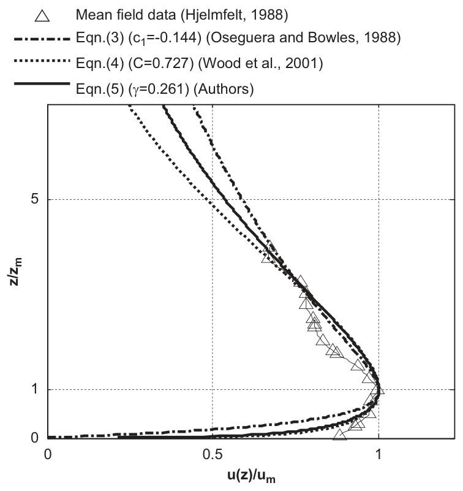

   **图 2** 径向速度的竖向形状函数。三角形为 Hjelmfelt (1988) 的平均实测数据，其余线型对应式 (3)、(4)、(5)。

2.1.2 径向形状函数
^^^^^^^^^^^^^^^^^^

在空间域内，径向速度的径向形状函数给出沿径向的速度分布。在时间域内，如 Holmes and Oliver (2000) 所讨论的那样，将径向速度与移动速度结合，可表示固定位置上随时间变化的速度。因此，正确选择径向速度的径向形状函数，对模拟移动下击暴流速度场至关重要。

Oseguera and Bowles (1988) 提出了如下径向形状函数：

.. math::

   u_{\mathrm{RS}}(r)=\frac{\lambda R^2}{2r}\left(1-e^{-(r/R)^2}\right) \qquad (6)

其中 :math:`\lambda` 为强度尺度量，单位为 :math:`1/\mathrm{s}`。式 (6) 的最大值出现在 :math:`r_m=1.1209R`。然而，Hjelmfelt (1988) 的实测结果给出 :math:`1.5R\leq r_m\leq2R`，Xu and Hangan (2008) 的实验室试验结果给出 :math:`r_m\approx2.2R`；与这些结果相比，式 (6) 的误差过大且无法调节。随后，Vicroy (1991) 基于现场观测改进了 OBV 模型的径向形状函数：

.. math::

   u_{\mathrm{RS}}(r)=\frac r{r_m}\exp\!\left(\frac{1-(r/r_m)^{2\alpha}}{2\alpha}\right) \qquad (7)

其中推荐值为 :math:`\alpha=2`。

Holmes and Oliver (2000) 也提出了径向速度的径向剖面。他们给出的移动下击暴流经验模型为

.. math::

   u_{\mathrm{RS}}(r)=\begin{cases}r/r_m,&r\leq r_m,\\e^{-[(r-r_m)/R_c]^2},&r>r_m,\end{cases} \qquad (8)

其中 :math:`R_c` 为径向长度尺度。

事实上，对于分段形式的形状函数，我们发现式 (8) 中取为 2 的指数应根据可用的测量结果确定。将指数改为变量 :math:`\beta` 后，得到的下述修正模型不仅更加灵活，而且保持了模型的原有性质：

.. math::

   u_{\mathrm{RS}}(r)=\begin{cases}r/r_m,&r\leq r_m,\\e^{-[(r-r_m)/R_c]^\beta},&r>r_m,\end{cases} \qquad (9)

为保证函数具有正确的变化趋势，要求 :math:`\beta>1`。

同样，将三个径向形状函数与 Hjelmfelt (1988) 获得的平均实测数据拟合，得到 Vicroy 模型的最优参数 :math:`\alpha=2.147`，Holmes 模型为 :math:`R_c/r_m=0.599`，修正模型为 :math:`R_c/r_m=0.599`、:math:`\beta=1.287`。在下击暴流驻点区（:math:`r<r_m`），线性增长函数比 Vicroy 模型更准确。在中心区以外（:math:`r>r_m`），径向速度迅速衰减。如图 3 所示，可调指数 :math:`\beta` 使修正模型比其他模型更好地拟合实测数据。

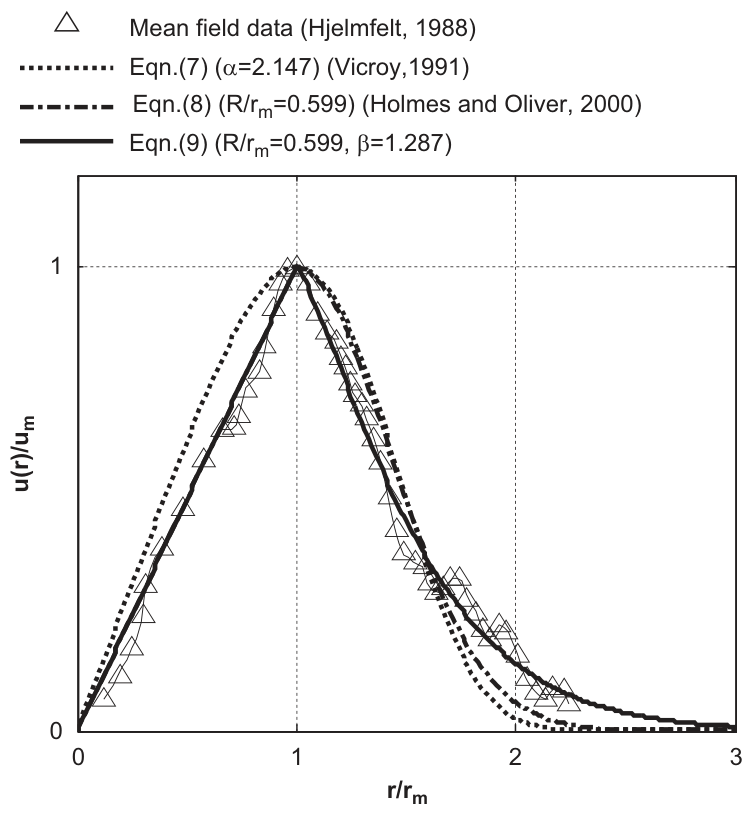

   **图 3** 径向速度的径向形状函数。三角形为 Hjelmfelt (1988) 的平均实测数据；三种线型对应式 (7)、(8)、(9)。图例中的比值沿用原图写法。

这里对径向速度形状函数作简要总结。所有径向速度形状函数均经过归一化且无量纲，并应满足下列条件：

.. math::

   u_{\mathrm{VS}}(z_m)=1,\quad
   \left.\frac{\partial u_{\mathrm{VS}}(z)}{\partial z}\right|_{z=z_m}=0,\quad
   u_{\mathrm{VS}}(\infty)=0;

   u_{\mathrm{RS}}(r_m)=1,\quad
   \left.\frac{\partial u_{\mathrm{RS}}(r)}{\partial r}\right|_{r=r_m}=0,\quad
   u_{\mathrm{RS}}(\infty)=0.

:math:`u_{\mathrm{VS}}` 与 :math:`u_{\mathrm{RS}}` 的主要特征相似，二者均为勺形函数。

2.2 竖向速度剖面
~~~~~~~~~~~~~~~~

在下击暴流流场中，竖向速度的量级小于径向速度，许多既有研究通常将其忽略。然而，下击暴流中的涡环可能在近地面诱发大攻角风，这对露天体育场和桥梁等大跨结构是危险的。

2.2.1 原始 OBV 模型
^^^^^^^^^^^^^^^^^^^

OBV 模型的竖向速度推导过程包括两步：首先，根据若干微下击暴流事件的实测资料，按前述各节确定径向速度剖面；其次，由质量连续方程推导竖向速度剖面。本文重新推导原始 OBV 模型，并作一些改进，以便对模型形成新的认识。柱坐标系下的质量连续方程（Oseguera and Bowles, 1988）为

.. math::

   \frac{\partial\rho}{\partial t}+\frac1r\frac{\partial(r\rho u)}{\partial r}+\frac1r\frac{\partial(\rho v)}{\partial\theta}+\frac{\partial(\rho w)}{\partial z}=0 \qquad (10)

对于不可压缩轴对称流，有 :math:`\rho=\mathrm{constant}` 和 :math:`\partial/\partial\theta=0`，式 (10) 可简化为

.. math::

   \frac{\partial u}{\partial r}+\frac{\partial w}{\partial z}+\frac ur=0 \qquad (11)

下列各式是式 (11) 的解：

.. math::

   u(r,z)=u_{mm}u_{\mathrm{RS}}(r)u_{\mathrm{VS}}(z) \qquad (12)

.. math::

   w(r,z)=u_{mm}\phi_r w_{\mathrm{RS}}(r)\,\phi_z w_{\mathrm{VS}}(z) \qquad (13)

其条件是

.. math::

   \frac{\partial w_{\mathrm{VS}}(z)}{\partial z}=-\frac1{\phi_z}u_{\mathrm{VS}}(z) \qquad (14)

.. math::

   \frac{\partial(ru_{\mathrm{RS}}(r))}{\partial r}=\phi_r r w_{\mathrm{RS}}(r) \qquad (15)

利用式 (14)–(15)，可推导出

.. math::

   w_{\mathrm{VS}}(z)=-\frac1{\phi_z}\int_0^z u_{\mathrm{VS}}(z)\,\mathrm dz \qquad (16)

.. math::

   w_{\mathrm{RS}}(r)=\frac1{\phi_r}\left(\frac{u_{\mathrm{RS}}(r)}r+\frac{\partial u_{\mathrm{RS}}(r)}{\partial r}\right) \qquad (17)

其中 :math:`\phi_r` 和 :math:`\phi_z` 为两个归一化因子，使 :math:`w_{\mathrm{RS}}(r)` 和 :math:`w_{\mathrm{VS}}(z)` 成为归一化形状函数。当 :math:`z\to\infty` 时，:math:`w_{\mathrm{VS}}(z)` 达到最大值 1，因此有

.. math::

   \phi_z=-\int_0^\infty u_{\mathrm{VS}}(z)\,\mathrm dz \qquad (18)

当 :math:`r\to0` 时，:math:`w_{\mathrm{RS}}(r)` 达到最大值 1，因而有

.. math::

   \phi_r=\left.\left(\frac{u_{\mathrm{RS}}(r)}r+\frac{\partial u_{\mathrm{RS}}(r)}{\partial r}\right)\right|_{r\to0} \qquad (19)

根据式 (16)–(19)，若分别选取式 (3) 和 (7) 作为 :math:`u_{\mathrm{VS}}(z)` 和 :math:`u_{\mathrm{RS}}(r)`，则相应的竖向速度形状函数为

.. math::

   w_{\mathrm{VS}}(z)=\frac{c_2(e^{c_1z/z_m}-1)-c_1(e^{c_2z/z_m}-1)}{c_1-c_2} \qquad (20)

.. math::

   w_{\mathrm{RS}}(r)=\left(1-\frac12(r/r_m)^{2\alpha}\right)e^{-(r/r_m)^{2\alpha}/(2\alpha)} \qquad (21)

.. math::

   \phi_z=\frac{z_m(c_2-c_1)}{c_1c_2(e^{c_1}-e^{c_2})} \qquad (22)

.. math::

   \phi_r=\frac2{r_m}e^{1/(2\alpha)} \qquad (23)

现在，原始 OBV 模型可重新写为

.. math::

   u(r,z)=u_{mm}\frac r{r_m}e^{[1-(r/r_m)^{2\alpha}]/(2\alpha)}\frac{e^{c_1z/z_m}-e^{c_2z/z_m}}{e^{c_1}-e^{c_2}} \qquad (24)

.. math::

   \begin{aligned}w(r,z)={}&u_{mm}\frac2{r_m}e^{1/(2\alpha)}\left(1-\frac12(r/r_m)^{2\alpha}\right)e^{-(r/r_m)^{2\alpha}/(2\alpha)}\\&\times\frac{z_m(c_2-c_1)}{c_1c_2(e^{c_1}-e^{c_2})}\frac{c_2(e^{c_1z/z_m}-1)-c_1(e^{c_2z/z_m}-1)}{c_1-c_2}\end{aligned} \qquad (25)

:math:`u_{mm}` 可视为新的强度尺度因子，与原始 OBV 模型中的 :math:`\lambda` 相比，它采用的单位 m/s 更合理。在实际结构设计中确定下击暴流风荷载时，:math:`u_{mm}` 是类似设计风速的参考风速。然而，下击暴流风远比天气尺度边界层风复杂，记录完善的下击暴流观测十分稀缺。因此，现阶段难以通过气象统计确定 :math:`u_{mm}`。

2.2.2 OBV 模型的进一步发展
^^^^^^^^^^^^^^^^^^^^^^^^^^

将不同的径向速度形状函数代入式 (16)–(17)，即可得到相应的竖向速度形状函数。例如，若采用 Wood 的径向速度形状函数，则对应的竖向速度竖向形状函数具有下列隐式形式：

.. math::

   w_{\mathrm{VS}}(z)=\frac{\int_0^z A(z/\delta)^B[1-\operatorname{erf}(Cz/\delta)]\,\mathrm dz}{\int_0^\infty A(z/\delta)^B[1-\operatorname{erf}(Cz/\delta)]\,\mathrm dz} \qquad (26)

对于本文提出的新模型，有

.. math::

   w_{\mathrm{VS}}(z)=\frac{\int_0^z(z/z_m)^\gamma e^{\gamma(1-z/z_m)}\,\mathrm dz}{\int_0^\infty(z/z_m)^\gamma e^{\gamma(1-z/z_m)}\,\mathrm dz} \qquad (27)

图 4 绘出了 NIMROD 项目在一次微下击暴流核心区观测到的一组数据，以及三个模型对应的竖向速度竖向形状函数。形状函数的正值表示向下的竖向速度。三个模型与实测数据均呈现增大至最大值 1 的相似趋势。

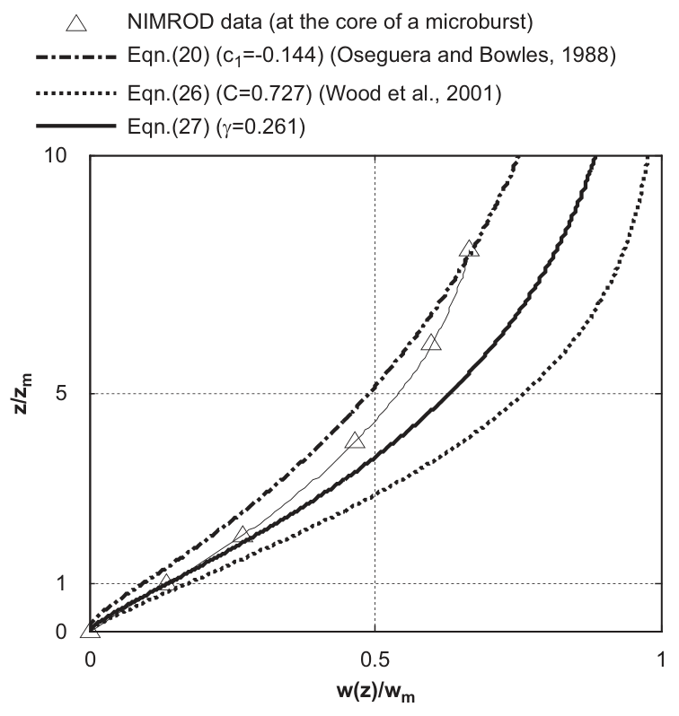

   **图 4** 竖向速度的竖向形状函数。三角形为微下击暴流核心区的 NIMROD 数据，三条曲线对应式 (20)、(26)、(27)。

若将 Holmes 模型，即式 (8)，代入式 (17)，则竖向速度的径向形状函数为

.. math::

   w_{\mathrm{RS}}(r)=\begin{cases}1,&r\leq r_m,\\\dfrac{e^{-[(r-r_m)/R_c]^2}}{2r}-\dfrac{(r-r_m)e^{-[(r-r_m)/R_c]^2}}{R^2},&r>r_m,\end{cases} \qquad (28)

若采用修正的 Holmes 模型，即式 (9)，则竖向速度的径向形状函数为

.. math::

   w_{\mathrm{RS}}(r)=\begin{cases}1,&r\leq r_m,\\\dfrac{e^{-[(r-r_m)/R_c]^\beta}}{2r}-\dfrac{\beta(r-r_m)^{\beta-1}e^{-[(r-r_m)/R_c]^\beta}}{2R_c^2},&r>r_m,\end{cases} \qquad (29)

上述两个函数的归一化因子为 :math:`\phi_r=2`。下击暴流事件中竖向速度剖面的现场实测数据相当稀少，因此图 5 仅绘出三个竖向速度径向形状函数。

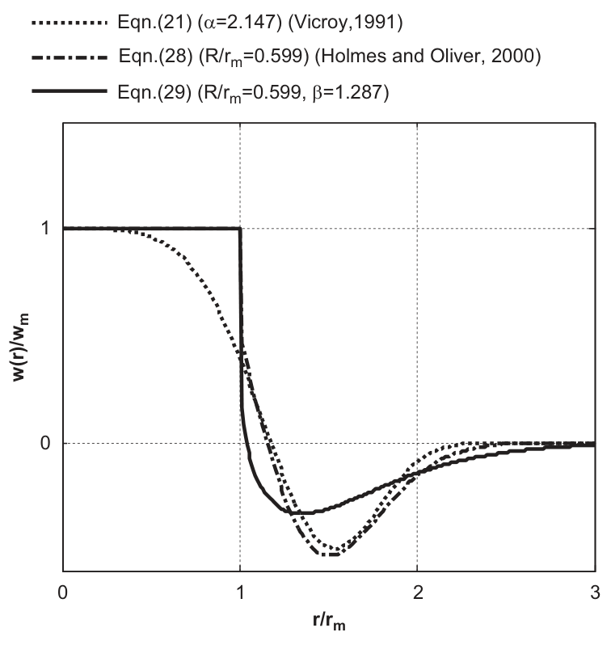

   **图 5** 竖向速度的径向形状函数。曲线对应式 (21)、(28)、(29)。

译注：式 (28)–(29) 按原文保留，其中式 (28) 第二项分母为 :math:`R^2`，原版未带前文尺度参数 :math:`R_c` 的下标；式 (29) 第二项分母为 :math:`2R_c^2`；其与式 (9)、(17) 的一般指数推导之间存在代数一致性疑点，不能将此处转写视作重新推导后的勘误公式。

2.3 边界层增长的非线性效应
~~~~~~~~~~~~~~~~~~~~~~~~~~

对于壁面冲击射流（Sengupta and Sarkar, 2008），当流动从辐散中心向外扩展、涡环离开地面时，边界层厚度随之增大。Choi (2004) 通过足尺实测观测到了边界层的发展。根据式 (1)–(2)，应同时考虑边界层增长对特征长度尺度（:math:`z_m` 与 :math:`r_m`）和最大风速（:math:`u_m`）的非线性影响。然而，全部既有下击暴流模型均未考虑边界层厚度的扩展；也就是说，过去的研究采用恒定的 :math:`z_m(\delta)`、:math:`r_m` 和线性分布的 :math:`u_m`。

本文将 :math:`z_m(r)(\delta(r))` 和 :math:`r_m(z)` 视为分别随自变量 :math:`r` 和 :math:`z` 变化的特征长度尺度函数。第 4.2 节将基于 CFD 结果给出 :math:`z_m(r)(\delta(r))` 和 :math:`r_m(z)` 的曲线拟合公式。

边界层非线性增长的另一项影响体现在 :math:`u_m` 的分布上。根据式 (24) 中的 OBV 模型，可得到 :math:`u_m(z)` 和 :math:`u_m(r)` 的两个隐含关系：

.. math::

   u_m(r)=u_{mm}u_{\mathrm{RS}}(r) \qquad (30)

.. math::

   u_m(z)=u_{mm}u_{\mathrm{VS}}(z) \qquad (31)

这意味着 :math:`u` 的形状函数与 :math:`u_m` 的形状函数相同。显然，当边界层并非线性增长时，这并不成立。本文为 :math:`u_m` 引入专门的形状函数 :math:`u_{m,\mathrm{VS}}` 和 :math:`u_{m,\mathrm{RS}}`：

.. math::

   u_m(r)=u_{mm}u_{m,\mathrm{RS}}(r) \qquad (32)

.. math::

   u_m(z)=u_{mm}u_{m,\mathrm{VS}}(z) \qquad (33)

后文将根据 CFD 模拟结果详细讨论 :math:`u_{m,\mathrm{VS}}` 和 :math:`u_{m,\mathrm{RS}}`。原文此处指向第 4.2.2 节，实际对应的章节标题为第 4.3 节。

纳入边界层增长的非线性效应后，在半径 :math:`r` 处，径向速度竖向剖面可更完整地描述为

.. math::

   \left.u(z)\right|_r=u_{mm}u_{m,\mathrm{RS}}(r)u_{\mathrm{VS}}\!\left(\frac z{z_m(r)}\right) \qquad (34)

在高度 :math:`z` 处，径向速度径向剖面为

.. math::

   \left.u(r)\right|_z=u_{mm}u_{m,\mathrm{VS}}(z)u_{\mathrm{RS}}\!\left(\frac r{r_m(z)}\right) \qquad (35)

如第 2.2.1 节所述，竖向速度剖面由连续方程推导。然而，加入边界层增长后，独立变量 :math:`r` 与 :math:`z` 相互耦合，难以分离。因此，现阶段通过将 :math:`z_m(r)` 和 :math:`r_m(z)` 直接代入竖向速度模型，考虑边界层增长的影响：

.. math::

   w(r,z)=u_{mm}\phi_r w_{\mathrm{RS}}\!\left(\frac r{r_m(z)}\right)\phi_z w_{\mathrm{VS}}\!\left(\frac z{z_m(r)}\right) \qquad (36)

修正 OBV 模型，即式 (34)–(36)，的精度与适用范围将在下一节利用冲击射流 CFD 模拟结果验证。

3 CFD 模拟
----------

本文全部 CFD 模拟均采用笛卡尔坐标系下的三维计算域（见图 6）。这与 Kim and Hangan (2007) 采用二维计算域并施加轴对称边界条件的工作不同。将冲击射流与下击暴流视为不可压缩流，利用商业 CFD 软件 Fluent 6.3，以有限体积法（FVM）求解。

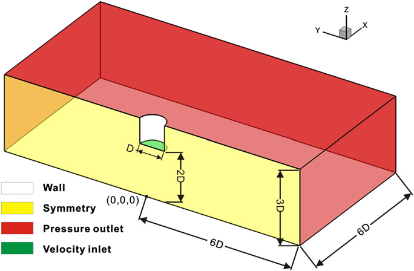

   **图 6** 计算域及边界条件。Wall 为壁面，Symmetry 为对称边界，Pressure outlet 为压力出口，Velocity inlet 为速度入口。

3.1 湍流模型的选择
~~~~~~~~~~~~~~~~~~

Chen (1995)、Mason et al. (2007)、Sengupta and Sarkar (2008) 等研究了湍流模型对冲击流的影响。目前，RANS 湍流模型因精度与效率适当而广泛用于实际湍流建模。冲击流撞击地面后向外扩展，并伴随边界层分离和涡环旋转等现象。对于这类流动，所有采用法向雷诺应力各向同性假设的线性湍流模型，例如 :math:`k\text{–}\varepsilon` 模型，均给出不理想的结果（Wilcox, 1994）。Chen (1995) 认为重整化群（RNG） :math:`k\text{–}\varepsilon` 模型对冲击射流给出的结果最好。Mason et al. (2007) 指出，剪切应力输运（SST） :math:`k\text{–}\omega` 模型对冲击流最好，但他们也指出，所用 RSM 未能考虑壁面反射效应，这可能影响其性能。Sengupta and Sarkar (2008) 认为 LES、realizable :math:`k\text{–}\varepsilon` 与 RSM 优于其他模型。在作者先前的工作（Li et al., 2009a）中，发现线性两方程 RNG :math:`k\text{–}\varepsilon` 模型低估了冲击射流边界层厚度的增长，而 RSM 的结果相当合理。因此，本文选择作为非线性 RANS 模型的 RSM，考察其在下击暴流模拟中的性能。RSM 能考虑湍流各向异性，预期对复杂流动有更好的表现。但 RSM 必须额外求解六个雷诺应力输运方程，增加计算成本，也加大收敛难度。

3.2 网格布置与边界条件
~~~~~~~~~~~~~~~~~~~~~~

实际下击暴流与实验室冲击射流在尺度、横截面、风速脉动、降水以及来自高空的低温下沉气流等方面存在差异。然而，二者均由积雨云或喷嘴向下推出的下沉气流驱动，撞击地面或平板后，伴随阵风锋或涡环向外扩展。尽管存在差异，冲击射流仍与下击暴流风流动的许多主要特征相似（Hjelmfelt, 1988；Choi, 2004），尤其是平均速度剖面。因此，CFD 建模中的边界条件及其他处理可以与冲击射流试验相似。

由于下击暴流的平均流场具有轴对称性，二维模型（Nicholls et al., 1993；Chen, 1995；Wood et al., 2001）与二维轴对称模型（Kim and Hangan, 2007）已用于 CFD 模拟并得到广泛验证。本文的一个目标是验证一组能准确模拟静止下击暴流的 CFD 配置，并期望将其进一步扩展至移动下击暴流模拟（Li et al., 2009b）。显然，移动下击暴流在空间中不具轴对称性，因此 Sengupta and Sarkar (2008) 使用的圆柱形三维计算域并不适用于这类流动。Sengupta and Sarkar (2008) 表明，当径向尺寸 :math:`X` 大于射流直径 :math:`D` 的五倍，且竖向长度 :math:`Z` 大于射流高度 :math:`H` 时，计算域尺寸对外流剖面的影响很小。如图 6 所示，本文计算域尺寸为 :math:`X(6D)\times Y(12D)\times Z(3D)`。Xu and Hangan (2008) 根据冲击射流试验指出，当喷口距表面的距离大于涡环形成长度时，向外扩展的流动对这一距离仅有较弱依赖。因此，本文采用常用的喷嘴离地距离 :math:`2D`。

如图 6 所示，为节约计算时间，将 :math:`X=0` 平面设为对称边界；坐标原点位于射流中心正下方的地面。后续分析结果均从 :math:`Y=0` 平面提取。壁面边界不考虑地面粗糙度效应。其他边界条件见图 6。为将 CFD 结果与 Chay and Letchford (2002) 的试验数据比较，同时调整入口速度幅值 :math:`u_{\mathrm{jet}}` 与射流直径 :math:`D`，分别得到雷诺数为 :math:`6.9\times10^4`、:math:`3.5\times10^5` 和 :math:`6.9\times10^5` 的目标流动。入口湍流强度设为 0.04。

整个计算域全部采用六面体网格，总网格数为 1,089,822。图 7 给出了 :math:`Z=0` 与 :math:`Y=0` 平面的网格分布。为使流向与网格线一致，从而尽量减小伪扩散（Versteeg and Malalasekera, 2007），在径向 :math:`0\text{–}3D` 的中心区域采用 O 型分块网格。为更好求解边界层流动，近壁区网格布置经过精心处理。采用 RANS 模型时，壁面函数是处理边界层流动问题的常用方法，但它只能以相对较低的精度给出对数层内的结果。另一方面，壁面函数假设湍流生成与耗散平衡，使高雷诺数模型可能无法正确模拟分离等流动（Chen, 1995）。本文采用 Chen and Patel (1988) 提出的低雷诺数湍流模型，结合 Kader (1981) 的增强壁面函数，将边界层流动计算深入至黏性底层。在 :math:`0\text{–}2D` 区域，流体运动比外侧更复杂，包含冲击、分离及高强度涡环；根据预计算结果，利用自适应技术对近壁网格进行两次强加密，以满足 :math:`y^+` 要求（见图 7）。其中 :math:`y^+=\rho yu_\tau/\mu`，:math:`y` 为网格单元中心至壁面的法向距离，:math:`u_\tau` 为摩擦速度，由 :math:`u_\tau=\sqrt{\tau_w/\rho}` 确定；:math:`\tau_w` 为壁面剪应力，:math:`\rho` 为空气密度，:math:`\mu` 为动力黏度。在最大雷诺数工况下，地面所有位置均满足 :math:`y^+<5`，即位于黏性底层厚度范围内。根据 Menter (2002)，:math:`0\text{–}2D` 区域的网格长宽比小于 50。值得指出，这一限制也明显有利于 RSM 方程收敛。时间和空间离散均至少采用二阶格式。网格增长因子小于 1.2。当归一化残差小于 :math:`10^{-3}`，且指定关键点的速度不再变化时，认为解已收敛。

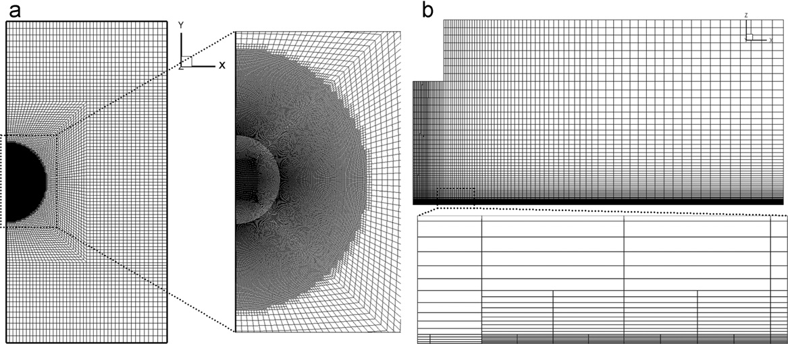

   **图 7** Z=0 与 Y=0 平面的网格分布。（a）Z=0；（b）Y=0。

4 结果与讨论
------------

第 2 节将径向与竖向速度剖面的形状函数与可用的归一化实测资料进行了比较。因此，在将所提模型，即式 (34)–(36)，用于缩尺 CFD 冲击射流速度场建模前，还需要解决三个问题。首先，检查全部形状函数的最佳拟合参数和有效区域。其次，确定壁面射流边界层厚度的非线性增长函数，即 :math:`z_m(r)(\delta(r))` 与 :math:`r_m(z)`。最后，为 :math:`u_m(r)` 和 :math:`u_m(z)` 的形状函数建立适用的经验公式。

4.1 形状函数的最佳拟合参数与有效区域
~~~~~~~~~~~~~~~~~~~~~~~~~~~~~~~~~~~~

图 8 和图 9 比较了形状函数与 CFD 结果，其中纵坐标以 :math:`\delta` 归一化，横坐标以相应的最大速度归一化。如图所示，最佳拟合参数与实测数据拟合参数（图 2、3）存在一定差异。这些差异可归因于流动雷诺数的巨大差别。另一方面，这证明通过重新拟合参数，这些经验模型适用于不同雷诺数的流动。

.. figure:: ../../../wechat/assets/public-safe/ref-li2012-JWEIA/fig08-original.png
   :alt: 图 8 竖向形状函数与 CFD 结果的比较。（a）径向速度；（b）竖向速度。不同符号对应不同径向位置，线型对应各经验模型。
   :align: center
   :width: 100%

   **图 8** 竖向形状函数与 CFD 结果的比较。（a）径向速度；（b）竖向速度。不同符号对应不同径向位置，线型对应各经验模型。

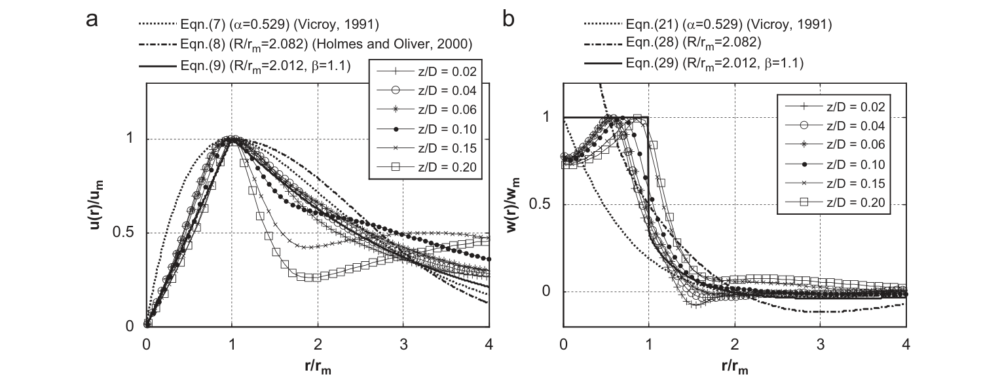

   **图 9** 径向形状函数与 CFD 结果的比较。（a）径向速度；（b）竖向速度。不同符号对应不同高度，线型对应各经验模型。

译注：上段关于坐标归一化的表述保留原文；实际上图 8 为竖向剖面，图 9 为径向剖面，二者坐标不同，应分别以原图轴标为准。

径向速度竖向形状函数的有效范围为 :math:`0.75<r/D<3`，这一范围也得到其他研究者验证（Wood et al., 2001；Choi, 2004；Sengupta and Sarkar, 2008；McConville et al., 2009）。在此范围之外，径向速度很小，对实际应用没有用途。

然而，竖向速度的竖向剖面（图 8b）在 :math:`0.75<r/D<3` 范围内并不一致。在 :math:`r/D=0.75` 与 1 附近，向下速度在近地面达到最大值。这个最大竖向速度由涡环的向下运动引起，而涡环源于高处的初始 Kelvin–Helmholtz 不稳定性（Kim and Hangan, 2007）。随着涡环继续前进，在外侧约 :math:`r/D\geq1.5` 处离开地面，形成向上（负）的速度。由于竖向速度形状函数未考虑涡环向下（冲击）及向上（分离）运动引起的边界层非线性增长，经验模型与 CFD 剖面的偏差可由模型中卷起涡环的水平、线性运动描述来解释。

如图 9 所示，:math:`0.02<z/D<0.2` 范围内的剖面用于验证径向与竖向速度的径向形状函数。对于径向速度，修正 Holmes 模型与 CFD 结果吻合最好。在 :math:`1<r/r_m<2` 范围内，:math:`z/D=0.1` 以上的剖面比更低位置的剖面衰减更快。与实测剖面相比，CFD 模拟的径向速度沿径向衰减得更慢。这可由两个原因解释（Li et al., 2009b）。第一，真实下击暴流生命周期短，没有后续能量供给让涡环运动得更远，而实验室和 CFD 冲击射流剖面均从稳态流场提取。第二，地面粗糙度也加快衰减；相反，实验室和模拟中的地面是光滑的。

由于地面的阻挡效应，竖向速度从约 :math:`r/r_m=0.5` 处迅速下降。超过 :math:`r/r_m=1.5` 后，竖向速度降至接近零。本文提出的形状函数，即式 (29)，与实际速度变化吻合最好。

4.2 冲击射流边界层厚度的非线性增长
~~~~~~~~~~~~~~~~~~~~~~~~~~~~~~~~~~

根据径向速度竖向剖面的特征，已有研究选择两种长度尺度作为边界层特征厚度参数，即 :math:`z_m` （Vicroy, 1991；Chay et al., 2006；Xu and Hangan, 2008）与 :math:`\delta` （Wood et al., 2001；Sengupta and Sarkar, 2008；McConville et al., 2009）。在实验室尺度试验中，与 :math:`\delta` 相比，:math:`z_m` 过于敏感且不稳定，不适合用于归一化竖向速度剖面。此外，:math:`z_m` 太靠近地面，难以准确测量；换言之，其精度受风速测量仪器精度制约。因此，本文采用 :math:`\delta` 作为边界层特征厚度。当形状函数需要 :math:`z_m` 时，可通过极值分析确定 :math:`z_m` 与 :math:`\delta` 的关系。

对于 OBV 模型的形状函数，可以得到 :math:`z_m` 与 :math:`\delta` 的隐式关系：

.. math::

   \frac{e^{c_1\delta/z_m}-e^{c_2\delta/z_m}}{e^{c_1}-e^{c_2}}=\frac12 \qquad (37)

对于 Wood 形状函数，相应关系见式 (4.a) 与 (4.b)。对于新的形状函数，即式 (5)，有如下显式关系：

.. math::

   \frac{z_m}\delta=\exp\!\left[\frac1\gamma\left(\gamma+\gamma\operatorname{LamberW}\!\left(-1,-\exp\!\left[-\frac{\gamma+\ln2}\gamma\right]\right)+\ln2\right)\right] \qquad (38)

图 10 给出了三个模型中 :math:`\delta/z_m` 随各自参数的变化。

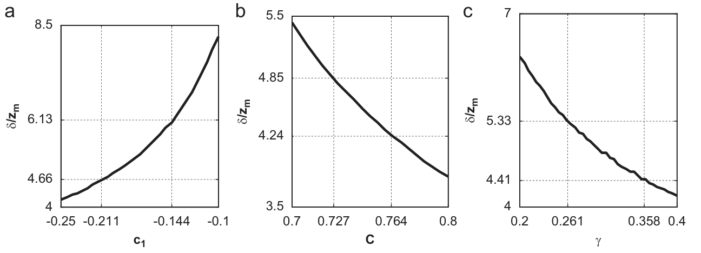

   **图 10** δ/z_m 随参数的变化。（a）OBV 模型；（b）Wood 模型；（c）新模型。

Sengupta and Sarkar (2008) 根据 PIV 观测的冲击射流试验结果给出的 :math:`\delta` 分布为

.. math::

   \frac\delta D=-0.0362+0.0818\frac rD+1.0062\exp\!\left(-2.472\frac rD\right) \qquad (39)

Xu and Hangan (2008) 也针对光滑地面的湍流区域，基于下式给出了 :math:`z_m` 的经验曲线：

.. math::

   \sqrt{\frac r{z_m}}=-1.95\ln\!\left[\frac{139}{Re_l\sqrt{2z_m/D}}\right] \qquad (40)

其中 :math:`Re_l` 为局部雷诺数。需要注意，上式仅在 :math:`r/D=1` 处得到验证；在其他范围内，它预测的边界层厚度增长缓慢，且近似线性（Li et al., 2009a）。通过拟合本文 CFD 结果，可得到参数较少的 :math:`\delta` 沿 :math:`r` 分布表达式：

.. math::

   \frac\delta D=\eta-\frac r{r_{\delta m}}\exp\!\left(\frac{1-(r/r_{\delta m})^{2\chi}}{2\chi}\right) \qquad (41)

其中 :math:`\chi=0.280`、:math:`r_{\delta m}=1.473D`、:math:`\eta=1.134`；:math:`r_{\delta m}` 为 :math:`\delta` 达到最小值处的半径。如图 11 所示，本文 CFD 结果与 Sengupta and Sarkar 的 PIV 数据非常接近。与式 (39) 相比，所提出的 :math:`\delta` 经验剖面，即式 (41)，仅有三个参数，且与 CFD 结果吻合良好。为研究雷诺数对 :math:`\delta` 分布的影响，图中比较了 :math:`6.9\times10^4`、:math:`3.5\times10^5` 和 :math:`6.9\times10^5` 三种雷诺数对应的结果，表明雷诺数影响较小。原文句末标注“图 12”，但这一 :math:`\delta` 对比位于图 11。

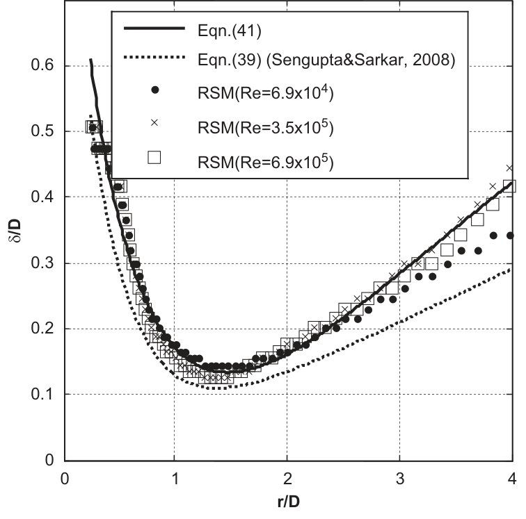

   **图 11** δ 沿 r 的剖面。实线为式 (41)，虚线为式 (39)，点、叉号和方框分别表示三种雷诺数的 RSM 结果。

拟合的 :math:`r_m` 剖面形式为

.. math::

   \frac{r_m}D=\eta-\frac z{r_{mm}}\exp\!\left(\frac{1-(z/r_{mm})^{2\chi}}{2\chi}\right) \qquad (42)

其中 :math:`\chi=-0.0363`、:math:`r_{mm}=0.0078D`、:math:`\eta=2.01`。应注意，当 :math:`z` 非常接近 0，例如 0.0001 时，上式会给出负值。

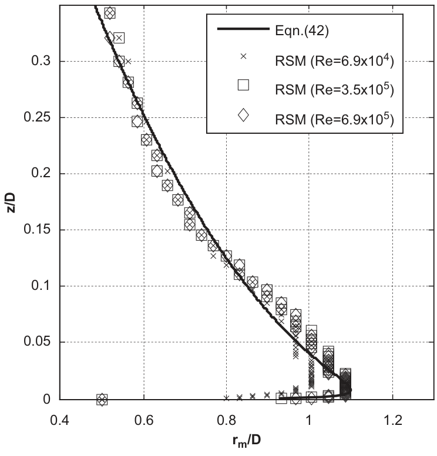

   **图 12** r_m 沿 z 的剖面。实线为式 (42)，其余符号为不同雷诺数的 RSM 结果。

4.3 最大径向速度的形状函数
~~~~~~~~~~~~~~~~~~~~~~~~~~

:math:`u_m(z)` 是最大径向速度的竖向剖面。类似地，:math:`u_m(r)` 是最大径向速度的径向剖面。:math:`u_m(z)` 和 :math:`u_m(r)` 是全部径向速度剖面的包络线。通过拟合 CFD 结果，得到 :math:`u_{m,\mathrm{VS}}(z)` 的形式为

.. math::

   u_{m,\mathrm{VS}}(z)=\left(\frac z{z_{um}}\right)^\gamma e^{\gamma(1-z/z_{um})} \qquad (43)

其中 :math:`\gamma=0.159`，:math:`z_{um}=0.0393D` 为 :math:`u_{m,\mathrm{VS}}(z)` 达到最大值 1 的高度。如图 13 所示，:math:`u_{m,\mathrm{VS}}(z)` 大于 :math:`u_{\mathrm{VS}}(z)`，在较高处尤其明显，这意味着原始 OBV 模型可能随着高度增加而低估径向速度。

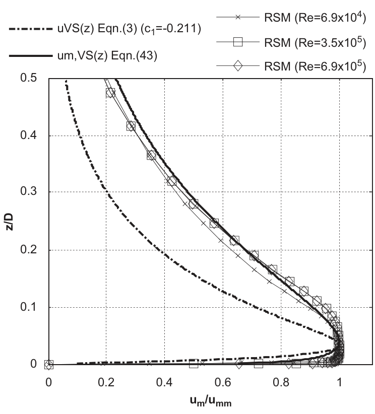

   **图 13** u_m(z) 的形状函数。点划线为式 (3)，实线为式 (43)，符号为三种雷诺数的 RSM 结果。

拟合的 :math:`u_{m,\mathrm{RS}}(r)` 形式为

.. math::

   u_{m,\mathrm{RS}}(r)=\exp\!\left[2.242\left(1-\frac{r_{um}}r-\ln\!\left(\frac r{r_{um}}\right)\right)\right] \qquad (44)

其中 :math:`r_{um}=1.007D` 为 :math:`u_{m,\mathrm{RS}}(r)` 达到最大值 1 的半径。Sengupta and Sarkar (2008) 表明，:math:`u_m/w_{\mathrm{jet}}` 的剖面可写为

.. math::

   \frac{u_m}{w_{\mathrm{jet}}}=\exp\!\left(1.905-\frac{1.858}{r/D}-1.949\ln\!\left(\frac rD\right)\right) \qquad (45)

图 14 将可用的试验结果、本文三种不同雷诺数的 CFD 结果，以及形状函数 :math:`u_{m,\mathrm{RS}}` 和 :math:`u_{\mathrm{RS}}` 一同绘出以供比较。然而，各组测量结果彼此吻合并不好。另一方面，CFD 结果与 Chay and Letchford (2002)、Sengupta and Sarkar (2008) 的结果更加一致，且雷诺数的影响可忽略。在 :math:`r/D<3` 范围内，:math:`u_{\mathrm{RS}}` 高于 :math:`u_{m,\mathrm{RS}}`，这意味着 OBV 模型可能高估径向速度。

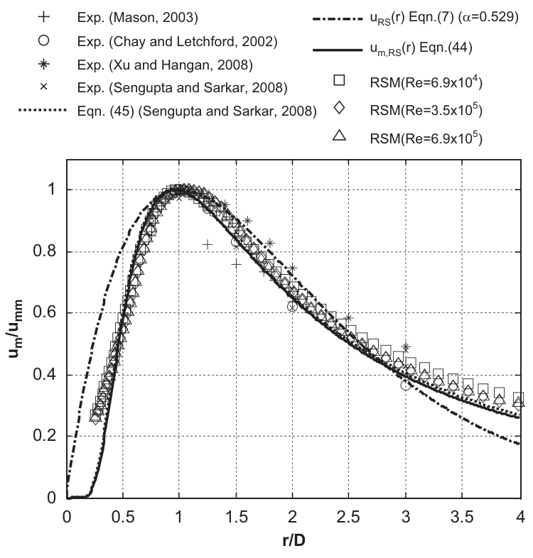

   **图 14** u_m(r) 的形状函数。Exp. 表示试验；图中分别给出既有试验、式 (45)、两种形状函数及三种雷诺数的 RSM 结果。

4.4 速度场验证
~~~~~~~~~~~~~~

将采用重新拟合参数的形状函数（式 (5)、(9)、(27)、(29)），以及 :math:`\delta(r)`、:math:`r_m(z)`、:math:`u_{m,\mathrm{RS}}(r)` 和 :math:`u_{m,\mathrm{VS}}(z)` 的最佳拟合公式（式 (41)–(44)）代入式 (34)–(36)，即可得到修正 OBV 模型计算的冲击射流稳态速度场。原始 OBV 模型的速度剖面采用常数 :math:`z_m=0.02D` 和 :math:`r_m=1.1D`，这些常数由全场最大径向速度的位置确定，同时使用第 4.1 节的最佳拟合参数 :math:`c_1=-0.211` 和 :math:`\alpha=0.529`。图 15、16 分别绘出了 :math:`r/D=0.75,1,1.5,2,2.5,3` 处径向速度和竖向速度的竖向剖面。图中附有 :math:`w_{\mathrm{jet}}` 标尺，以量化速度大小。图 15 表明，修正模型与 CFD 结果及风洞试验数据（Chay and Letchford, 2002）吻合良好。与原始 OBV 模型相比，修正模型明显提高了径向速度剖面的精度。但在 :math:`r/D=1` 处，两个经验模型均低估了近地面径向速度。

.. figure:: ../../../wechat/assets/public-safe/ref-li2012-JWEIA/fig15-original.png
   :alt: 图 15 径向速度的竖向剖面。空心圆为 Chay and Letchford (2002) 风洞试验，点线为 CFD，实线为修正模型，点划线为 OBV 模型；水平标尺为 1 倍喷口速度。
   :align: center
   :width: 100%

   **图 15** 径向速度的竖向剖面。空心圆为 Chay and Letchford (2002) 风洞试验，点线为 CFD，实线为修正模型，点划线为 OBV 模型；水平标尺为 1 倍喷口速度。

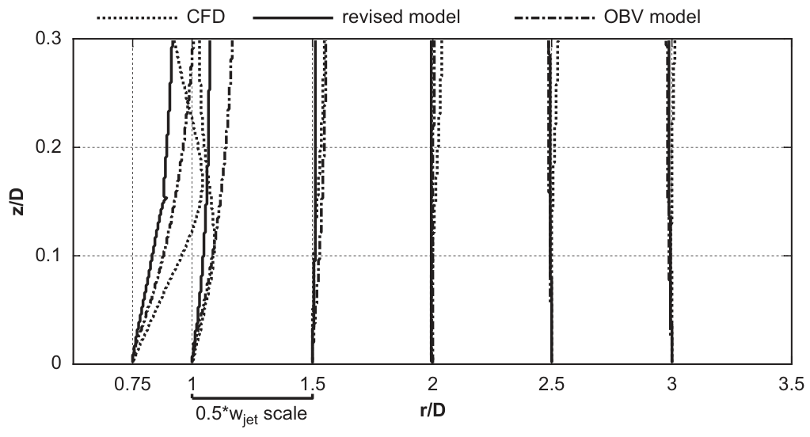

   **图 16** 竖向速度的竖向剖面。点线为 CFD，实线为修正模型，点划线为 OBV 模型；水平标尺为 0.5 倍喷口速度。

流动撞击地面时，大部分竖向动量转化为径向动量。因此，在核心区之外（:math:`r/D>1`），竖向速度很小。由于竖向速度形状函数存在较大偏差，两种经验模型的结果均不理想。不过，这些较小的竖向速度对实际工程应用可以忽略。

图 17、18 分别给出了 :math:`z/D=0.02,0.04,0.06,0.1,0.15,0.2` 处径向速度和竖向速度的径向剖面。随着高度增加，修正模型的估计精度下降，这可归因于径向速度径向形状函数的差别。由于低估了 :math:`u_m(z)`，原始 OBV 模型与 CFD 结果的差异随高度增加而扩大。如图 18 所示，修正模型较好地再现了 :math:`0<r/D<1` 范围内竖向速度沿径向的变化趋势，但低估了速度大小。

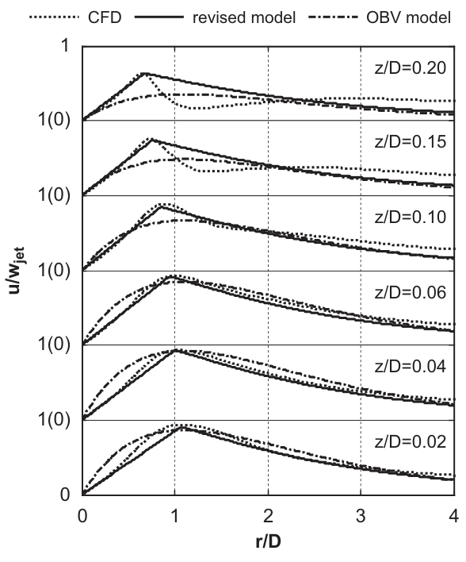

   **图 17** 径向速度的径向剖面。点线为 CFD，实线为修正模型，点划线为 OBV 模型；各条剖面对应图示高度。

.. figure:: ../../../wechat/assets/public-safe/ref-li2012-JWEIA/fig18-original.png
   :alt: 图 18 竖向速度的径向剖面。点线为 CFD，实线为修正模型，点划线为 OBV 模型；各条剖面对应图示高度。
   :align: center
   :width: 100%

   **图 18** 竖向速度的径向剖面。点线为 CFD，实线为修正模型，点划线为 OBV 模型；各条剖面对应图示高度。

5 结论
------

本文提出了一个更准确且更简洁的修正经验模型，用于描述下击暴流和冲击射流的三维轴对称稳态流。采用 RSM 开展详细的 CFD 模拟，验证模型的精度与有效性。主要发现总结如下：

1. 为提高新模型的易用性和精度，提出了一个仅含一个参数的径向速度竖向形状函数，即式 (5)。本文修正的径向速度径向形状函数，即式 (9)，比既有函数具有更好的表征能力。
2. 新模型具有坚实的物理基础：给定径向速度剖面后，通过质量守恒定律推导竖向速度剖面。
3. 通过引入 :math:`z_m(r)(\delta(r))`、:math:`r_m(z)`、:math:`u_{m,\mathrm{VS}}(z)` 和 :math:`u_{m,\mathrm{RS}}(r)` 的参数化函数，以及 :math:`z_m` 与 :math:`\delta` 的关系，修正模型能够适当描述边界层增长对径向速度的非线性效应。遗憾的是，这一非线性效应无法直接纳入竖向速度模型。
4. 与原始 OBV 模型相比，在 :math:`0.75<r/D<3` 和 :math:`0.02<z/D<0.2` 范围内，修正模型与 CFD 模拟、风洞试验结果更加一致，尤其是对更受关注的径向速度。
5. 模型的参数化形式允许灵活选择真实下击暴流或实验室冲击射流的尺度与强度，即具有雷诺数兼容性。
6. 在时间域内，将修正模型与移动速度结合，可在移动下击暴流经过时生成多点速度时程。
7. 下击暴流与冲击射流形状函数的最优参数仍需根据更多实测资料及风洞试验结果进一步研究。

参考文献
--------

Butler, K., Kareem, A., 2007. Physical and numerical modeling of downburst generated gust fronts. In: Proceedings of the Twelfth International Conference on Wind Engineering, Cairns, Australia.

Cao, S.Y., Nishi, A., Kikugawa, H., Matsuda, Y., 2002. Reproduction of wind velocity history in a multiple fan wind tunnel. Journal of Wind Engineering and Industrial Aerodynamics 90 (12–15), 1719–1729.

Chay, M.T., Albermani, F., Wilson, R., 2006. Numerical and analytical simulation of downburst wind loads. Engineering Structures 28 (2), 240–254.

Chay, M.T., Letchford, C.W., 2002. Pressure distributions on a cube in a simulated thunderstorm downburst—part A: stationary downburst observations. Journal of Wind Engineering and Industrial Aerodynamics 90 (7), 711–732.

Chen, H.C., Patel, V.C., 1988. Near-wall turbulence models for complex flows including separation. AIAA Journal 26 (6), 641–648.

Chen, L., Letchford, C.W., 2004. A deterministic-stochastic hybrid model of downbursts and its impact on a cantilevered structure. Engineering Structures 26 (5), 619–629.

Chen, Q., 1995. Comparison of different k-e models for indoor air flow computations. Numerical Heat Transfer, Part B: Fundamentals 28 (3), 353–369.

Choi, E.C.C., Mok, H.Y.B., Lee, T.C., 2007. Occurrence and significance of thunderstorms in Hong Kong. In: Proceedings of the twelfth International Conference on Wind Engineering. Cairns, Australia, pp. 663–670.

Choi, E.C., 1999. Extreme wind characteristics over Singapore—an area in the equatorial belt. Journal of Wind Engineering and Industrial Aerodynamics 83 (1–3), 61–69.

Choi, E.C., 2004. Field measurement and experimental study of wind speed profile during thunderstorms. Journal of Wind Engineering and Industrial Aerodynamics 92 (3–4), 275–290.

Fujita, T.T., 1985. The Downburst, Report of Projects NIMROD and JAWS. University of Chicago.

Hjelmfelt, M.R., 1988. Structure and life cycle of microburst outflows observed in Colorado. Journal of Applied Meteorology 27 (8), 900–927.

Holmes, J.D., 1999. Modelling of extreme thunderstorm winds for wind loading of structures and risk assessment. Proceedings of the tenth International Conference on Wind Engineering. Wind Engineering into the 21st Century. Rotterdam, Balkema.

Holmes, J.D., Oliver, S.E., 2000. An empirical model of a downburst. Engineering Structures 22 (9), 1167–1172.

Holmes, J.D., Hangan, H.M., Schroeder, J.L., Letchford, C.W., Orwig, K.D., 2008. A forensic study of the Lubbock–Reese downdraft of 2002. Wind and Structures 11 (2), 137–152.

Jarvi, L., Punkka, A., Schultz, D.M., Petaja, T., Hohti, H., Rinne, J., Pohja, T., Kulmala, M., Hari, P., Vesala, T., 2007. Micrometeorological observations of a microburst in southern Finland. Boundary-Layer Meteorology 125 (2), 343–359.

Kader, B.A., 1981. Temperature and concentration profiles in fully turbulent boundary layers. International Journal of Heat and Mass Transfer 24 (9), 1541–1544.

Kim, J., Hangan, H., 2007. Numerical simulations of impinging jets with application to downbursts. Journal of Wind Engineering and Industrial Aerodynamics 95 (4), 279–298.

Letchford, C.W., Mans, C., Chay, M.T., 2002. Thunderstorms—their importance in wind engineering (a case for the next generation wind tunnel). Journal of Wind Engineering and Industrial Aerodynamics 90 (12–15), 1415–1433.

Li, C., Xiao, Y.Q., Li, Q.S., Ou, J.P., 2009a. CFD simulation of impinging jet with application to stationary downburst. In: Proceedings of the Symposium of the 14th National Wind Engineering Conference, Beijing, China.

Li, C., Li, Q.S., Xiao, Y.Q., Ou, J.P., 2009b. Simulations of moving downbursts using CFD. The Seventh Asia-Pacific Conference on Wind Engineering. Taipei, Taiwan.

Mason, M.S., 2003. Pulsed Jet Simulation of Thunderstorm Downbursts. Texas Tech University, Master Thesis.

Mason, M.S., Wood, G.S., Fletcher, D.F., 2007. Impinging jet simulation of stationary downburst flow over topography. Wind and Structures 10 (5), 437–462.

Mason, M.S., Wood, G.S., Fletcher, D.F., 2009a. Numerical simulation of downburst winds. Journal of Wind Engineering and Industrial Aerodynamics 97 (11–12), 523–539.

Mason, M.S., Wood, G.S., Fletcher, D.F., 2009b. Influence of tilt and surface roughness on the outflow wind field of an impinging jet. Wind and Structures 12 (3), 179–204.

McCarthy, J., Wilson, J.W., Fujita, T.T., 1982. The joint airport weather studies project. Bulletin of the American Meteorological Society 63 (1), 15–22.

McConville, A.C., Sterling, M., Baker, C.J., 2009. The physical simulation of thunderstorm downbursts using an impinging jet. Wind and Structures 12 (2), 133–149.

Menter, F.R., 2002. CFD Best Practice Guidelines for CFD Code Validation for Reactor-Safety Applications, EC Project ECORA, Report EVOL-ECORA-D01, pp. 1–47.

Nicholls, M., Pielke, R., Meroney, R., 1993. Large eddy simulation of microburst winds flowing around a building. Journal of Wind Engineering and Industrial Aerodynamics 46, 229–237.

Orwig, K.D., Schroeder, J.L., 2007. Near-surface wind characteristics of extreme thunderstorm outflows. Journal of Wind Engineering and Industrial Aerodynamics 95 (7), 565–584.

Oseguera, R., Bowles, R., 1988. A simple, analytic 3-dimensional downburst model based on boundary layer stagnation flow. NASA Technical Memorandum, 100632.

Qin, L., Li, Y., Gao, S., 2006. The synoptic and climatic characteristic studies of thunderstorm winds in Beijing. Climatic and Environmental Research 11 (6), 754–762.

Sengupta, A., Sarkar, P.P., 2008. Experimental measurement and numerical simulation of an impinging jet with application to thunderstorm microburst winds. Journal of Wind Engineering and Industrial Aerodynamics 96 (3), 345–365.

Sherman, D.J., 1987. The passage of a weak thunderstorm downburst over an instrumented tower. Monthly Weather Review 115 (6), 1193–1205.

Versteeg, H.K., Malalasekera, W., 2007. An Introduction to Computational Fluid Dynamics: The Finite Volume Method. Prentice Hall.

Vicroy, D., 1991. A simple, analytical, axisymmetric microburst model for downdraft estimation. NASA Technical Memorandum, 104053.

Vicroy, D., 1992. Assessment of microburst models for downdraft estimation. Journal of Aircraft 29 (6), 1043–1048.

Wilcox, D.C. (1994). Turbulence Modelling for CFD, DCW Industries, Inc.

Wood, G.S., Kwok, K.C., Motteram, N.A., Fletcher, D.F., 2001. Physical and numerical modelling of thunderstorm downbursts. Journal of Wind Engineering and Industrial Aerodynamics 89 (6), 535–552.

Xu, Z., Hangan, H., Yu, P., 2008. Analytical solutions for a family of Gaussian impinging jets. Journal of Applied Mechanics 75 (2), 021019-12.

Xu, Z., Hangan, H., 2008. Scale, boundary and inlet condition effects on impinging jets. Journal of Wind Engineering and Industrial Aerodynamics 96 (12), 2383–2402.

Zhao, Y., Cao, S., Tamura, Y., Duan, Z., Ozono, S., 2009. Simulation of downburst and its loads with wind tunnel test. Journal of Vibration and Shock 28 (04), 1–3 (in Chinese).

完整引用
--------

收录信息见 :ref:`WOEAI 学术成果页对应条目 <ref-li2012-JWEIA>`。
