.. _paper-note-ref-li2013-RE:

考虑高攻角流动的垂直轴风机 2.5D 大涡模拟：论文精解
======================================================

精简版微信公众号文章：待发布

.. contents:: 本页目录
   :local:
   :depth: 2

论文信息
--------

**原文题名：** 2.5D large eddy simulation of vertical axis wind turbine in consideration of high angle of attack flow。

**作者：** Chao Li，Songye Zhu（通讯作者），You-lin Xu，Yiqing Xiao。

**作者单位：** 香港理工大学土木与结构工程系；哈尔滨工业大学深圳研究生院。

**期刊：** Renewable Energy，51（2013），317–330。DOI：`10.1016/j.renene.2012.09.011 <https://doi.org/10.1016/j.renene.2012.09.011>`_。

**稿件日期：** 2012 年 2 月 2 日收稿；2012 年 9 月 12 日录用。

**WOEAI 相关方向：** 海洋能源结构 / 一体化分析。本篇研究对象为直叶片垂直轴风机的气动模拟，是风机气动基础研究，不涉及漂浮平台或系泊系统验证。

摘要
----

近年来，人们重新关注垂直轴风机（vertical axis wind turbine，VAWT）。计算流体动力学（computational fluid dynamics，CFD）被视为研究 VAWT 气动特性的一种有前景的技术。其中，二维非定常雷诺平均 Navier–Stokes（unsteady Reynolds-averaged Navier–Stokes，URANS）方法得到普遍采用，尽管以往 VAWT 研究已经表明二维 URANS 的精度有限。本文研究三种 CFD 方法，即二维 URANS、2.5D URANS 和 2.5D 大涡模拟（large eddy simulation，LES），用于描述直叶片垂直轴风机（straight-bladed VAWT，SBVAWT）气动特性的可行性与精度，重点考察 2.5D LES 模拟高攻角（angle of attack，AOA）流动的能力。2.5D 模型与完整三维模型的区别在于，它只建立一定长度的叶片模型，并在计算域两端施加周期边界。本文通过单个静止翼型和不同转速下三叶片 SBVAWT 的气动模拟，系统考察这三种方法的应用。通过与其他研究者获得的风洞结果比较，评估这些方法预测气动力的能力，尤其关注失速后的高攻角流动。在两个算例中，三种方法中均以 2.5D LES 与试验结果的符合程度最好。对模拟流场的详细检查表明，2.5D LES 能在流动分离后产生更真实的三维涡扩散，从而更准确地预测静态或动态失速情况下的气动系数。值得注意的是，2.5D LES 不能捕捉 VAWT 中的叶尖涡和竖向流动发散效应，而一些研究者过去认为，这些效应是二维 URANS 高估 VAWT 功率的主要原因。在本文中，2.5D LES 获得明显改善的结果，意味着 URANS 精度较低主要源于其涡流建模的固有限制。总体而言，2.5D LES 在较低叶尖速比（tip speed ratio，TSR）下与试验结果吻合良好，而在较高叶尖速比下仅达到一般程度的吻合。与另外两种方法相比，2.5D LES 被认为是研究 VAWT 气动特性更有前景、更有效的 CFD 工具，尤其适用于与极低转速对应的自启动特性研究。

关键词
------

2.5D 大涡模拟；高攻角；直叶片垂直轴风机；计算流体动力学。

1 引言
------

化石能源资源的耗竭和全球变暖趋势，使低碳经济成为得到国际认可的可持续发展战略。在多种绿色可再生能源中，风能在全球范围内增长迅速，并将在未来经济中发挥越来越重要的作用。风机是将风的动能转化为电能的典型装置。虽然水平轴风机（horizontal axis wind turbine，HAWT）目前是商业风机的主流，但近年来垂直轴风机重新受到关注。与常见的 HAWT 相比，VAWT 有若干优点 [1,2]：（1）VAWT 可接受各个方向的来风，因此对风向不敏感；（2）VAWT 叶片承受的重力和惯性力在大小与方向上恒定，因而叶片寿命更长；（3）VAWT 对侧风和湍流较不敏感，因此小型 VAWT 可以安装在近地面、屋顶或城市区域，这些位置的风比开阔风电场更紊乱；（4）VAWT 通常比 HAWT 转速更低、更安静，因此造成的噪声问题较少。

与 HAWT 相比，VAWT 的研究和开发相对有限。例如，为提高发电效率、改善自启动特性并延长使用寿命，还需要开展更多 VAWT 研究与开发。已有一些工作优化了 VAWT 翼型叶片的特性，包括翼型截面、厚度和弯度、实度以及桨距角 [3–5]。研究者也考察了直叶片、旋链线弯曲叶片和螺旋扭曲叶片等不同构型 [6–9]。研究 VAWT 需要深入理解其复杂气动特性，例如动态失速和三维流动涡结构。风洞试验是研究气动与结构动力学的一种广泛认可的方法。转子叶片的气动力通常由布置在叶片表面的测压孔或安装在风机支臂上的应变片测量 [10–12]。然而，受现有测量仪器或方法限制，风洞结果往往过于简单，无法全面展示 VAWT 的复杂气动行为。此外，试验和测量复杂且成本较高，并且通常需要对数据进行后处理，以提高测量数据质量。

作为风工程研究中一种有前景的技术，CFD 在过去二十年中受到越来越多关注。与传统试验方法相比，CFD 不需要复杂的控制与测量系统，就能提供更多流场细节。对于系统分析，例如 VAWT 性能优化所需的参数研究，CFD 也提供了一种成本较低的解决途径。受计算资源和时间限制，大多数研究者在 VAWT 性能研究中采用二维 URANS 模拟。然而，与风洞试验相比，二维 URANS 往往高估功率系数，尽管它能近似再现实验功率系数的变化趋势 [11,13–15]。一些研究者将这一差异归因于实际 VAWT 中的叶尖损失或流动发散效应，而二维 URANS 模拟均未反映这两种效应。前者指叶尖涡的存在引起的气动力变化；后者指有限展长风机扫掠区域上下方流动发散受到限制所形成的有效阻塞。例如，Howell 等 [13] 采用重整化群（renormalization group，RNG） :math:`k-\varepsilon` 湍流模型，发现三维模拟比二维模拟更接近试验数据。他们认为，二维模拟无法捕捉实际风机中的叶尖涡效应。Mukinovi 等 [14] 同样发现，二维剪切应力输运（shear stress transport，SST） :math:`k-\omega` 模拟的峰值转矩明显高于三维结果，并将差异归因于三维模型中的有限展长和横向支撑阻力。McLaren [11] 提出采用有效上游速度和有效叶片高度，修正二维 URANS 模拟的切向力，使其与试验结果匹配。这些研究表明，二维 URANS 因未计入叶尖涡或流动发散而存在不足，并暗示，只要在复杂的全尺寸三维 VAWT 模型中恰当描述叶片有限展长，就能准确模拟 VAWT 流动。然而，以往忽视了一些关键因素，例如高攻角失速流动中的叶片气动特性，以及不同 CFD 湍流模型的能力，尽管人们普遍认识到，这些因素可能深刻影响功率效率与整体气动特性的模拟。

与飞机翼型叶片不同，VAWT 叶片经常经历超过失速角的高攻角，尤其是在低叶尖速比 :math:`\lambda<4` 下运行时 [16]。图 1 为三叶片 SBVAWT 的俯视图。每个叶片所感受到的流速是旋转速度 :math:`\Omega r` 与来流风速 :math:`u_\infty` 的矢量和。因此，合速度的大小 :math:`u_r` 和攻角 :math:`\alpha` 均发生变化，两者都取决于叶片方位角 :math:`\theta` 和叶尖速比 :math:`\lambda` 。叶尖速比定义为旋转速度 :math:`\Omega r` 与风速 :math:`u_\infty` 的比值。当叶片处于迎风方位，即 :math:`0^\circ\leq\theta\leq180^\circ` 时，速度 :math:`u_r` 和攻角 :math:`\alpha` 可近似表示为：

.. math::

   u_r=u_\infty\left(1+2\lambda\sin\theta+\lambda^2\right)^{0.5}\qquad (1)

.. math::

   \alpha=\tan^{-1}\left(\frac{\cos\theta}{\sin\theta+\lambda}\right)\qquad (2)

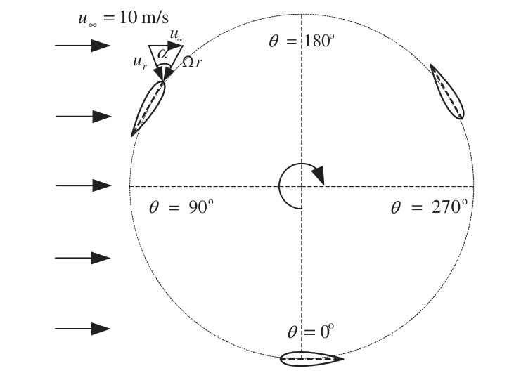

   **图 1** 三叶片 VAWT 的旋转示意图。 :math:`u_\infty` 为来流速度， :math:`u_r` 为叶片相对来流速度， :math:`\alpha` 为攻角， :math:`\theta` 为方位角。

在背风区域，即 :math:`180^\circ<\theta<360^\circ` ，翼型位于迎风区域形成的脱落尾流中，所感受到的流动受到扰动，使攻角更难确定。图 2 给出了根据式 (2) 估算的不同叶尖速比下攻角 :math:`\alpha` 随方位角 :math:`\theta` （ :math:`0^\circ\leq\theta\leq180^\circ` ）的变化。失速发生在较高攻角下。一般而言，VAWT 对称翼型的静态失速角介于 :math:`10^\circ` 和 :math:`15^\circ` 之间 [17]。如图 2 所示，当 :math:`\lambda<4` 时，翼型总会发生失速。这种叶尖速比在小型 VAWT 中很常见。尤其在启动过程中经常出现的极低叶尖速比下，最大攻角远远超过失速角。因此，评估 VAWT 性能必然要求良好再现高攻角流动。

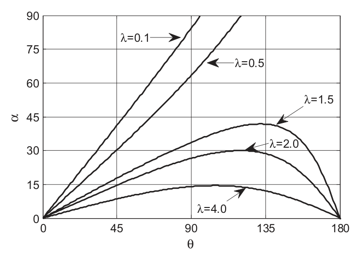

   **图 2** 不同叶尖速比下攻角的变化。横坐标为方位角 :math:`\theta` ，纵坐标为攻角 :math:`\alpha` 。

高攻角翼型流动具有三维、强分离和非定常特征，并伴随非线性升力变化 [18]。Cummings 等 [19] 指出，准确模拟高攻角流场涉及若干重要问题，例如湍流建模和计算域维度。然而，以往 VAWT 气动模拟很少谨慎处理这些问题。例如，VAWT 模拟广泛采用的 URANS 模型，在分离流中存在大尺度湍流的高攻角情况下，往往无法给出准确结果。另一方面，分离涡模拟（detached eddy simulation，DES）和 LES 虽然被认为是更先进、更强大的湍流模型，却很少见于过去的 VAWT CFD 研究。其次，二维 CFD 的某些潜在局限容易被忽视，例如二维 CFD 无法考虑叶片展向的流动差异。Sørensen 和 Michelsen [20] 发现，即使攻角仅略高于失速角，二维 Navier–Stokes 求解器仍会高估失速翼型的升力和阻力。应采用准三维或完整三维模拟，克服传统二维模型的不足。在准三维 CFD 方法中，将二维模型沿展向延伸足够长度，以真实再现三维分离涡。这种三维模拟并未建立完整展长，因此下文称之为 2.5D CFD 模拟，以区别于常规二维和三维模拟。Gao 等 [21] 对单个静止翼型周围流场开展了 2.5D LES，发现二维模型不足以预测较高攻角下翼型周围具有大尺度分离的非定常流动结构。此外，Travin 等 [22]、Bertagnolio 等 [23] 以及 IM 和 Zha [24] 采用 DES 方法模拟单个翼型的失速后流动；DES 本质上是 RANS 和 LES 的混合模型。2.5D DES 模型的结果明显优于 2.5D URANS 模型。

考虑上述原因，人们总是希望采用精细的完整三维 CFD 模拟，但其极高的计算成本阻碍了研究者和设计人员目前的广泛应用。对于 VAWT，人们仍在寻求高效、便捷且高保真的 CFD 模拟策略。有鉴于此，本文开展系统的 CFD 研究，考察二维 URANS、2.5D URANS 和 2.5D LES 预测单个静止翼型叶片与 SBVAWT 气动特性的可行性和精度。首先，采用三种方法模拟单个静止翼型的流场，重点研究高攻角下的失速流动。与风洞试验的比较清楚表明，在宽广攻角范围内，2.5D LES 的升阻力系数偏差最小。与二维 URANS 相比，2.5D URANS 的结果明显改善，但其高攻角模拟精度仍有限。其次，模拟三叶片 SBVAWT 在不同转速下的流场。三种方法中，2.5D LES 再次取得与试验结果最好的吻合，并最真实地描述了气动细节，尤其是在低转速下。与单个静止翼型的模拟不同，二维和 2.5D URANS 所模拟的叶片力仅存在较小差异。这表明，VAWT 流动具有旋转叶片动态失速的特征，其展向差异可以忽视，与静态失速流动十分不同。此外，无论二维还是 2.5D URANS，都不能恰当预测动态失速中的前缘分离。

2 单个翼型叶片的 2.5D LES
-------------------------

文献很少讨论攻角大于 :math:`45^\circ` 的翼型 CFD 模拟。然而，叶片在低叶尖速比下旋转时会遇到很高攻角，如图 2 所示。攻角从 :math:`0^\circ` 至 :math:`360^\circ` （对称翼型为 :math:`0^\circ` 至 :math:`180^\circ` ）的静止翼型气动数据，是双多流管（double-multiple streamtube，DMS）模型的基础输入；DMS 是工程实践中广泛采用的 VAWT 功率评估方法 [1]。本节考察并比较二维 URANS、2.5D URANS 和 2.5D LES 在全攻角范围内模拟单个静止 NACA0018 翼型的能力，重点关注不同 CFD 模拟策略的有效性。

2.1 单个静止翼型的 CFD 模拟
~~~~~~~~~~~~~~~~~~~~~~~~~~~

NACA0018 是 VAWT 常用叶片截面之一。代尔夫特理工大学开展了 NACA0018 翼型风洞试验，获得了全攻角范围内质量较好的气动数据 [4,25]。这些试验数据为检验各种 CFD 策略在极高攻角下的能力提供了良好机会。流场计算采用商业 CFD 软件 Fluent。Fluent 基于有限体积法（finite volume method，FVM），将计算域离散成若干小体积，并已在许多应用中得到验证。以下说明具体计算处理方法与算法。

2.1.1 网格几何与边界条件
^^^^^^^^^^^^^^^^^^^^^^^^

图 3 给出了单个 NACA0018 翼型 CFD 模型的几何与边界条件。远场边界设为速度入口，位于距离翼型 :math:`30c` 处，以避免波的反射，其中 :math:`c` 为翼型弦长。来流速度为 :math:`22.2\,\mathrm{m/s}` ，该速度与弦长共同给出 300,000 的雷诺数。

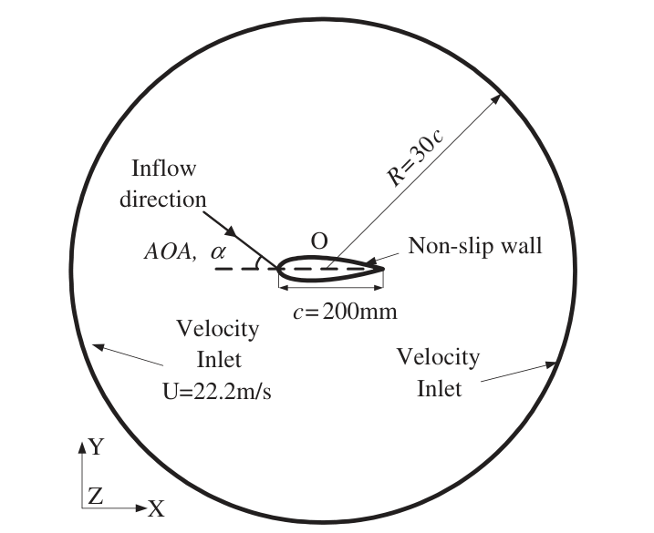

   **图 3** 单个静止 NACA0018 翼型的几何与边界条件。外圆为速度入口；翼型表面为无滑移壁面；弦长为 :math:`200\,\mathrm{mm}` ；来流方向与弦线夹角为攻角。

O 型和 C 型网格拓扑都能减小近壁网格的偏斜，并在高阶离散格式下较快收敛。本文采用 O 型网格，因为它能减少网格数量，避免远尾流中的高长宽比网格。为直接分辨层流底层，翼型表面第一层网格间距按 :math:`y^+<1` 确定。流向和横流向的网格增长率均限制在 1.08 以下，以保证数值稳定性。图 4 给出了二维和 2.5D 模型的最终网格。2.5D 模型与二维模型的区别在于，将模型沿展向延伸一定长度。在顶部和底部边界施加一对平移周期条件。2.5D 网格（图 4b）沿翼型壁面布置 280 个单元，沿壁面法向布置 120 个单元，沿展向均匀布置 40 个单元。单元数量通过网格加密研究确定。此外，对分块结构化四边形网格进行光顺，以减小偏斜并改善网格正交性。

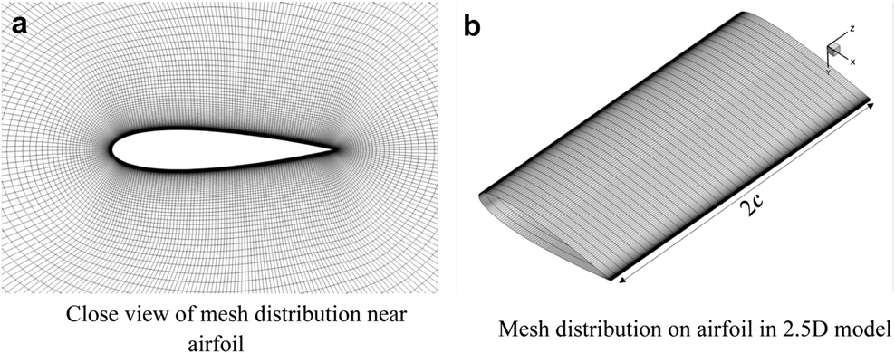

   **图 4** 单个静止 NACA0018 翼型的网格分布。（a）翼型附近网格的局部视图；（b）2.5D 模型的翼型网格分布，展向长度为 :math:`2c` 。

2.1.2 湍流模型
^^^^^^^^^^^^^^

不可压缩 Navier–Stokes 方程适合求解 VAWT 气动问题，因为合成流速通常低于 0.3 马赫。旋转 VAWT 可能发生静态或动态失速，两者均由涡分离主导，并涉及流动非定常性。因此，研究这类流动需要非定常流体求解器。

湍流模型的选择会影响计算结果及所需计算资源。RANS 模型因精度和效率适中而广泛用于湍流建模。在各种 RANS 模型中，SST 模型 [26] 通过分区混合函数结合 :math:`k-\omega` 与 :math:`k-\varepsilon` 模型。SST 被认为是一种适合模拟强逆压梯度和分离流动的有前景的方法 [27]。与 RANS 相比，LES 需要更多计算资源：它通过控制方程直接求解较大且依赖边界条件的涡，而通过亚格子模型计入较小且较均匀的涡的影响 [28]。不过，LES 保留了非定常大尺度相干结构，因此相较于 RANS 适用于更广泛的湍流流动。例如，Cummings 等 [19]、Gao 等 [21] 和 Li 等 [29] 证明 LES 是模拟非定常分离流的有效工具。Smagorinsky–Lilly 模型克服了原始 Smagorinsky 亚格子模型的局限，是最知名的 LES 模型之一 [30,31]。本文考察并比较采用 SST 模型的 URANS 方法和采用 Smagorinsky–Lilly 模型的 LES 方法。SST 模型同时用于二维与 2.5D 模拟，但 LES 仅给出 2.5D 结果，因为在 LES 中，大涡是通过直接数值模拟（direct numerical simulation，DNS）从三维 Navier–Stokes 方程中求解的，因此二维 LES 可能不合理。二维 LES 在不同情形下表现明显不一致。二维 LES 的局限超出本文范围，因此不在此讨论。此外，为避免任意调整转捩位置，所有湍流模型均采用完全湍流模式，因此未计入翼型前缘区域的层流和转捩效应。

2.1.3 模拟设置
^^^^^^^^^^^^^^

采用分离式方法求解离散的连续性与动量方程，并使用二阶隐式公式进行时间离散。压力—速度耦合采用 SIMPLEC 格式。在 LES 的计算时间步较小时，SIMPLEC 比 SIMPLE 收敛更快，并比算子分裂压力隐式（pressure-implicit with splitting of operators，PISO）格式更稳定 [32]。在 SST 模型中，压力和其他变量分别采用二阶迎风离散格式和三阶 MUSCL 离散格式。在 LES 模型中，动量的空间离散采用有界中心差分格式。因此，解在空间和时间上均具有二阶精度。为加快收敛，以 SST 流场的稳态解作为 LES 的初始条件。

时间步长是非定常流动模拟的关键参数。为准确获得失速后翼型的结果，Sørensen 等 [20] 和 Travin 等 [22] 分别建议无量纲时间步 :math:`\sigma=\Delta tU_\infty/c` 取 0.01 和 0.025。本文单翼型模拟采用 :math:`\sigma=0.0111` ，对应实际时间步 :math:`\Delta t=0.0001\,\mathrm{s}` 。流动在 1 s 后达到统计稳定，随后 2 s 采集翼型表面压力；根据自由来流速度和翼型弦长，该采样时长相当于 222 个流经时间。

2.2 结果与讨论
~~~~~~~~~~~~~~

为在计算精度和时间要求之间取得良好折中，首先采用二维模型，在 :math:`X-Y` 平面开展网格加密研究，以确定合理网格数量。图 5 比较了两种网格，即 :math:`280\times120` 和 :math:`366\times158` 的结果。总体上，两者吻合良好，仅在失速后攻角下略有差别，尽管两者在失速后条件下均明显偏离试验结果。因此，下文采用 :math:`280\times120` 的平面网格尺寸。

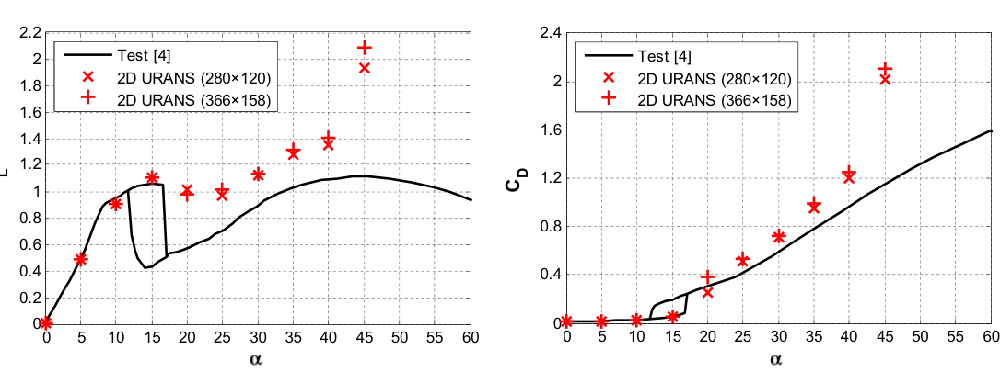

   **图 5** 通过升阻力系数比较网格无关性。左图为升力系数 :math:`C_L` ，右图为阻力系数 :math:`C_D` ；Test [4] 表示文献 [4] 的试验结果。

在 2.5D 模型中，翼型沿展向延伸，以再现三维湍流结构。过小的展向宽度会使流动实际上成为二维而非三维 [23,33]。低攻角下，相对较短的展向宽度，例如 :math:`0.074c` ，便足以获得与风洞数据相当的结果 [34]；而在高攻角流动中，需要大得多的宽度，才能捕捉更大的三维湍涡分离与脱落结构。根据 Johansen 等 [33] 和 Bertagnolio 等 [23]，本文 2.5D 模拟选取展向宽度 :math:`2c` 。为确定最经济的网格，通过网格敏感性研究确定展向网格尺寸。将二维 :math:`280\times120` 网格拉伸至固定宽度 :math:`2c` ，分别沿展向划分为 20、40 和 64 层。图 6 比较了 LES 模拟中三种不同的 2.5D 网格。可见，即使在低攻角下，20 层网格对升力的预测也较差；40 层和 64 层网格的结果几乎相同，表明 40 层网格能够反映三维流动结构。因此，本文的 2.5D CFD 模拟采用展向 40 层网格。

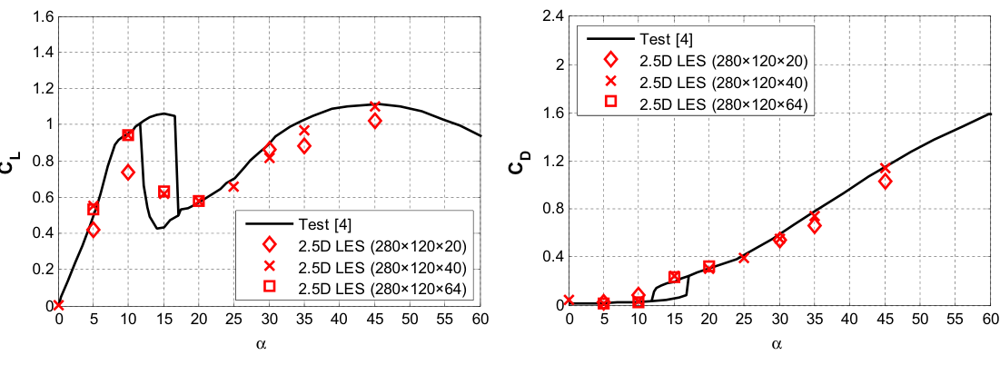

   **图 6** 通过升阻力系数比较 :math:`Z` 方向网格无关性。左、右分别为升力和阻力系数，比较 20、40、64 层展向网格。

本文的目标之一，是验证 2.5D LES 模拟 VAWT 气动特性的能力。如第 1 节所述，翼型经常遇到极高攻角流动，尤其在启动阶段。因此，采用上述 CFD 策略模拟 :math:`0^\circ` 至 :math:`140^\circ` 的攻角。如此高攻角的翼型 CFD 模拟在文献中很少报道，因为这种工况在一般气动或水动力运载工具应用中并不常见。

由于 2.5D LES 采用完全湍流模式，它无法准确描述低雷诺数光滑翼型可能出现的、带有层流分离泡的转捩流动。代尔夫特理工大学 [4,25] 对光滑和设置转捩带的 NACA0018 翼型均开展了风洞试验；后者贴有锯齿形胶带，以减弱或消除层流分离泡。图 7 比较了风洞试验和 2.5D LES 得到的升力系数。光滑翼型因层流分离，在 :math:`\alpha=8^\circ` 处出现一个“折点”，而设置转捩带的翼型没有这一现象。基于上述原因，模拟结果与设置转捩带翼型的试验更吻合，尽管 2.5D LES 并未建立胶带厚度模型。除 :math:`8^\circ` 附近的轻微偏差外，光滑与设置转捩带翼型的升力系数彼此吻合良好。因此，层流分离对本文所研究 VAWT 总功率估算的影响应当很小。

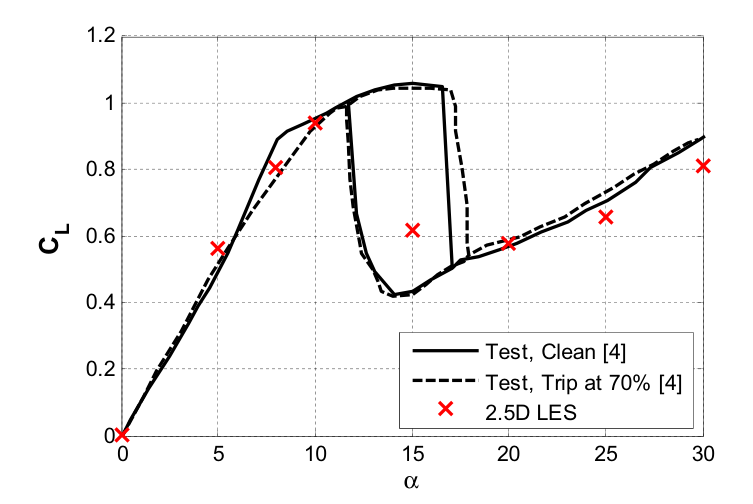

   **图 7** :math:`Re=300{,}000` 时升力系数的比较。Clean 为光滑翼型；Trip at 70% 为在 70% 弦长位置设置转捩带的翼型；红色叉号为 2.5D LES。

除 2.5D LES 外，本文还开展二维 URANS 和 2.5D URANS 模拟，并与 2.5D LES 比较，以进一步理解后者的能力。图 8 给出了所研究 NACA0018 翼型的平均升阻力系数，包括二维 URANS、2.5D URANS 和 2.5D LES 的结果，以及 Claessens [4] 的风洞试验结果。计算与试验的雷诺数均为 300,000，接近下一节研究的 VAWT 旋转流动雷诺数。失速始于 :math:`12^\circ` ，止于 :math:`17^\circ` 。在此过程中，分离从翼型后缘开始，随攻角增加向前缘移动，而升力几乎保持不变。风洞结果显示深度失速引起的滞回环，这可能由风洞试验中翼型截面的缓慢转动造成。在本文 CFD 模拟中，不同攻角的翼型均完全静止，因此没有观察到此类滞回环。这也可能解释 :math:`15^\circ` 攻角下 2.5D LES 与试验结果的差异。在较低的失速前攻角下，采用 SST 湍流模型的二维和 2.5D URANS 均与试验吻合良好；然而，在较高的失速后攻角下，二维 URANS 明显高估升力和阻力。虽然相较二维 URANS，2.5D URANS 在 :math:`90^\circ` 以内的升力预测明显改善，但其在 :math:`\alpha=90^\circ` 和 :math:`140^\circ` 时的阻力系数仍明显偏离试验结果。这些结果与 Cummings 等 [19] 的结论一致：RANS 模型能准确描述附着边界层流动，却无法模拟分离流中的大尺度湍流。因此，无论二维还是 2.5D URANS，当攻角大于 :math:`15^\circ` 时都不适合求解此类流动，而这种情况在 VAWT 以 :math:`\lambda<4` 运行时经常发生。与二维和 2.5D URANS 相比，2.5D LES 在 :math:`0^\circ` 至 :math:`140^\circ` 内与风洞结果吻合非常好。随着非定常分离尺度和流动不确定性的增大，其数值误差略有增加。

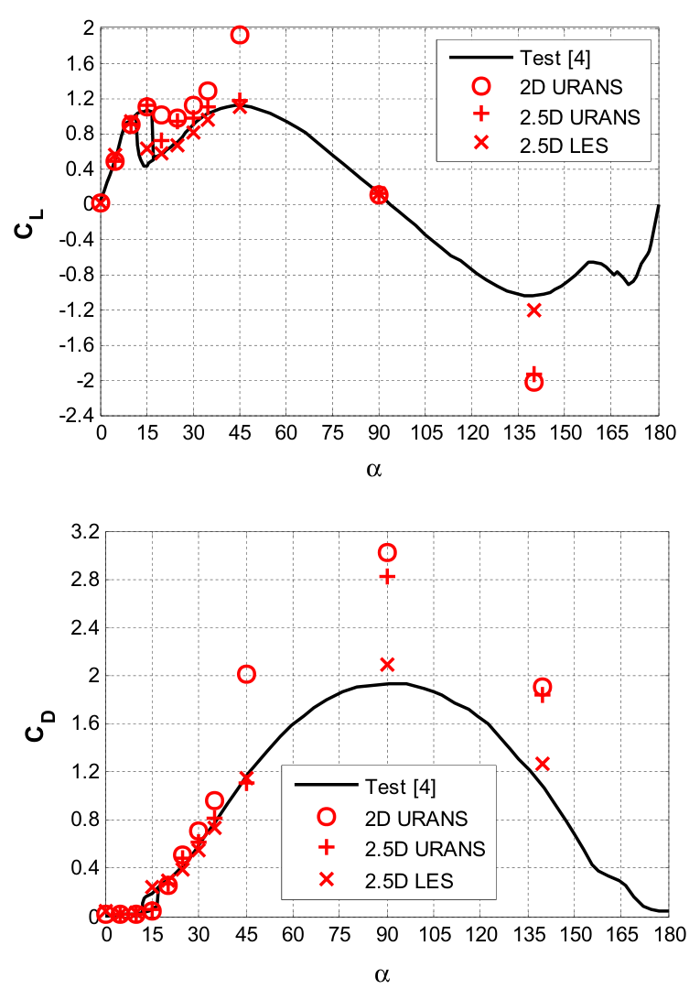

   **图 8** :math:`Re=300{,}000` 时 NACA0018 翼型的升阻力系数。上图为升力系数，下图为阻力系数；横坐标为攻角。

图 9 给出了 :math:`\alpha=45^\circ` 和 :math:`90^\circ` 时，二维 URANS、2.5D URANS 和 2.5D LES 在展向中间平面得到的瞬时涡量等值线。二维和 2.5D URANS 均产生较大且平滑的脱落涡，并抑制了涡向更小尺度扩散；2.5D LES 则再现了这些大分离泡的破碎。这与 Sørensen 等 [20] 在平板模拟中的观察一致。根据不可压缩涡量输运方程，实际流动中的涡量 :math:`\omega` 在壁面生成，并通过流体黏性沿三个方向扩散。然而，在二维流动中，涡量只能在平面内扩散，因此集中形成大尺度分离涡。另一方面，RANS 旨在通过雷诺时间平均处理来模拟湍流，其中被视为湍流脉动所输运能量的雷诺应力项并未直接求解，而是利用时均项建模。因此，URANS 只能再现较大的周期性脱落涡，并不令人意外。

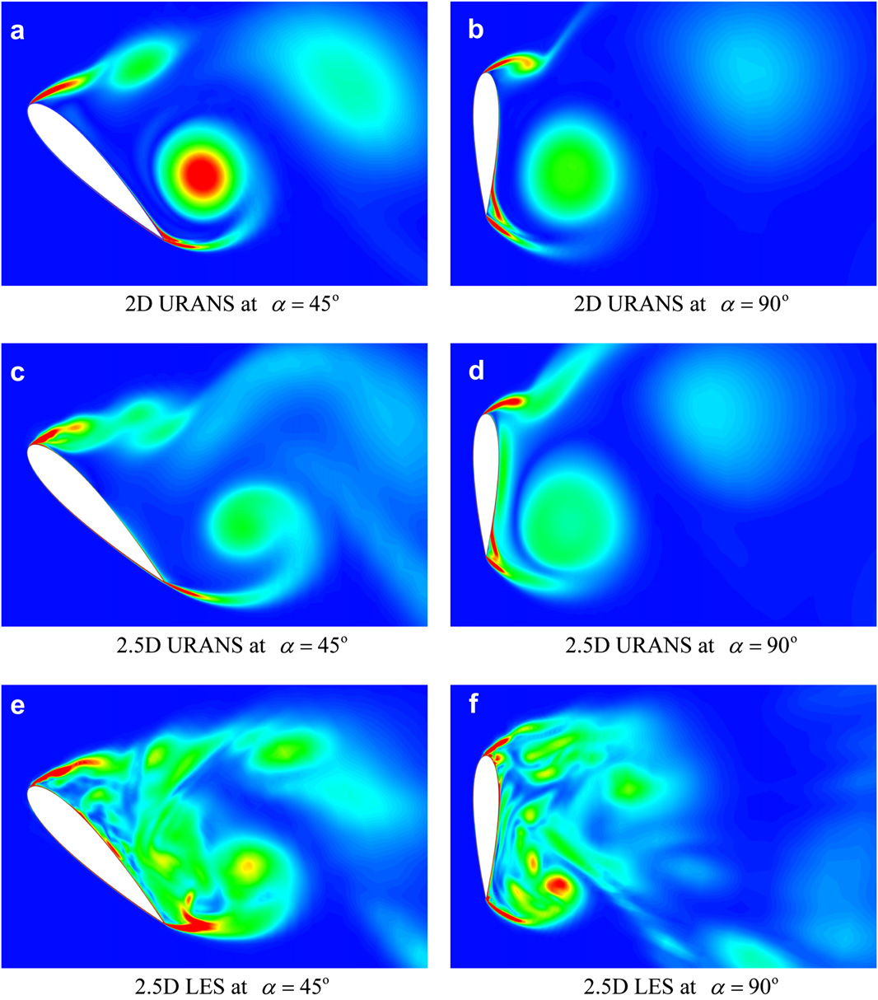

   **图 9** :math:`\alpha=45^\circ` 和 :math:`90^\circ` 时，二维 URANS、2.5D URANS 和 2.5D LES 在展向中间平面的瞬时涡量大小等值线比较。自上而下依次为三种方法；左、右列分别对应两个攻角。

为展示流动的三维性，采用 Q 方法 [35] 识别和可视化涡结构。图 10 给出了 2.5D URANS 和 LES 的 :math:`Q=1` 等值面。在这种强分离流动中，URANS 模拟仍近似二维，而 2.5D LES 能捕捉三维流动的基本形态。翼型表面的压力系数分布（图 11）也支持这些观察。由于计算域展向两端施加周期边界，平均压力实际的展向变化几乎可以忽视。在 :math:`\alpha=90^\circ` 时，二维和 2.5D URANS 中未能正确扩散的大涡使翼型背风面吸力过大，进而影响升阻力系数。

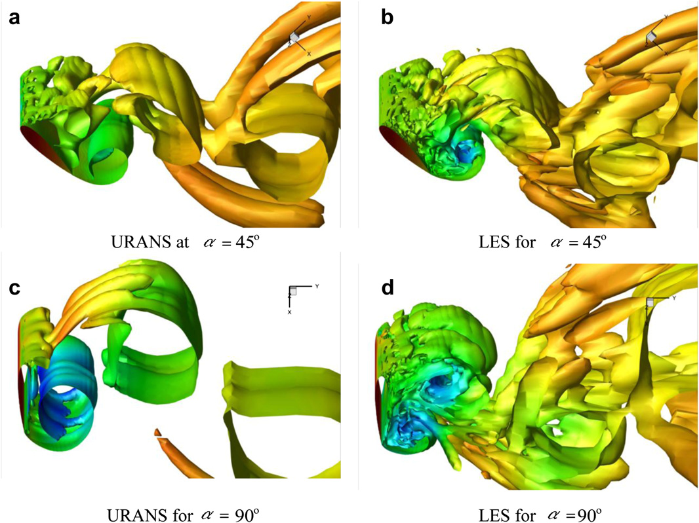

   **图 10** 2.5D URANS 与 LES 的 :math:`Q=1` 等值面比较，按压力着色。上排为 :math:`45^\circ` 攻角，下排为 :math:`90^\circ` 攻角；左列为 URANS，右列为 LES。

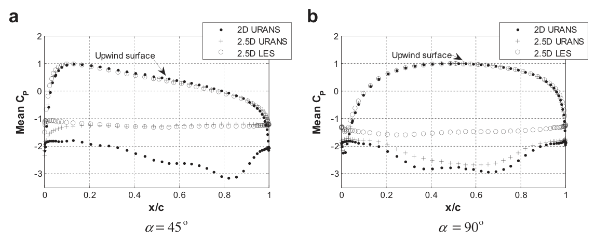

   **图 11** NACA0018 翼型壁面压力系数分布。（a） :math:`\alpha=45^\circ` ；（b） :math:`\alpha=90^\circ` 。横坐标为 :math:`x/c` ，纵坐标为平均压力系数；Upwind surface 表示迎风面。

总之，二维与 2.5D URANS 在高攻角流动模拟中的低精度表明，它们可能不适合作为 VAWT 气动研究的 CFD 工具。McLaren [11] 采用二维稳态 CFD 求解静止翼型气动特性，在 :math:`0^\circ` 至 :math:`90^\circ` 攻角范围内获得了可接受结果。然而，考虑到失速在物理上是非定常现象，且本文目标是再现旋转 VAWT 的非定常流动，稳态求解器并不适合研究 VAWT 气动特性。

3 三叶片 SBVAWT 的 2.5D LES
---------------------------

3.1 三叶片 SBVAWT 的说明
~~~~~~~~~~~~~~~~~~~~~~~~

McLaren（2011）在麦克马斯特大学开展了一系列三叶片 SBVAWT 风洞试验。叶片采用带圆钝后缘的 NACA0015 翼型。尤其是，通过精心设计的测量仪器和试验数据后处理，获得了作用于叶片的瞬态切向力与法向力。这些试验结果为验证 VAWT 气动 CFD 研究提供了宝贵依据。需要指出，第 2 节和第 3 节分别采用了不同翼型，即 NACA0018 和 NACA0015。这仅仅是因为单翼型与三叶片 VAWT 风洞结果的可获得性有限。NACA0018 和 NACA0015 均是 VAWT 广泛采用的叶片截面 [4,36,37]，并具有相似的气动特性。因此，前面基于 NACA0018 得到的结论，可为本节的 VAWT 性能评估提供深入认识。

3.2 CFD 模拟策略
~~~~~~~~~~~~~~~~

3.2.1 网格几何与边界条件
^^^^^^^^^^^^^^^^^^^^^^^^

图 12 给出了 CFD 模拟中 VAWT 模型的几何与流动条件，与 McLaren [11] 的试验设置相同。VAWT 半径为 :math:`R=1.4\,\mathrm{m}` 。恒定风速 :math:`U=10\,\mathrm{m/s}` 的速度入口位于风机前方 14 m，即 :math:`10R` 处。出口位于风机后方 33.6 m，即 :math:`24R` 处，以保证尾流充分发展。所施加的流出条件结合了出口平面法向上所有流动变量的零扩散通量，以及整体质量平衡修正。侧边界距风机中心 7 m，即 :math:`5R` ，以尽量减小阻塞效应。侧边界施加自由滑移壁面条件，假定法向速度分量及所有速度分量的法向梯度为零。计算域平面尺寸的确定原则是：在二维模拟中进一步扩大计算域，只引起流动形态和荷载的极小变化。与单个静止翼型的模拟类似，将二维网格沿竖向拉伸 0.82 m，获得 2.5D 数值 VAWT 模型，该长度对应 VAWT 叶片弦长的两倍（图 13）。顶部和底部边界采用平移周期条件。因此，2.5D 模型本质上代表具有无限长叶片的 VAWT，未计入有限展长或叶尖涡的影响。

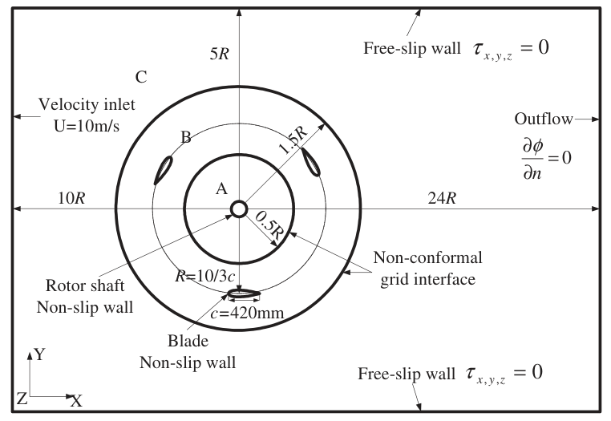

   **图 12** VAWT 流场模拟的几何与边界条件示意。Velocity inlet 为速度入口，Outflow 为流出边界，Free-slip wall 为自由滑移壁面，Non-slip wall 为无滑移壁面，Non-conformal grid interface 为非共形网格界面；Rotor shaft 和 Blade 分别为转轴与叶片。

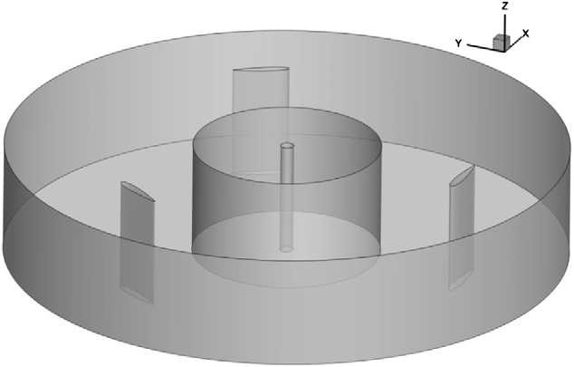

   **图 13** 2.5D 模型几何和界面边界示意图。

.. note::

   原文数值说明：本节将 0.82 m 称为两倍叶片弦长，但后文及图 12 给出的修正弦长为 420 mm，两者不完全相符。这里分别保留原文数值。

为增强叶片强度，McLaren [11] 在 VAWT 风洞试验中采用了后缘圆钝的修正 NACA0015 翼型。修正后叶片弦长为 420 mm，而不是标准 NACA0015 翼型的 450 mm。支臂安装位置距前缘 150 mm；若将叶片安装在弦长中点时定义为 :math:`0^\circ` 桨距角，则这使叶片具有 :math:`\beta=2.66^\circ` 的有效预设桨距角 [11]。本文 CFD 研究建立了相同叶片截面模型。为简化，未建立叶片支臂模型。

如图 12 所示，整个计算域分为 A、B 和 C 三个区域。内区 A 和外区 C 静止，区域 B 是旋转环区，通过施加滑移网格边界条件的两个非共形网格界面与另外两区分开。为避免界面处流动不连续，界面两侧节点间距之比限制在 2 以下。区域 A 中心还建立了直径 0.1 m 的转轴。2.5D 模型的几何、界面和边界见图 13。

系统地减小数值不确定性后，将单个静止翼型 CFD 模型所采用的最优网格配置迁移到 VAWT 模型，并适配新的边界，如图 14 所示。二维 VAWT 模型的总网格数为 131,690。在 2.5D 模拟中，将二维网格沿 :math:`Z` 方向拉伸 0.82 m、划分 40 层，得到 5,267,600 个网格。试验中的实际风机叶片长 3 m；若采用六面体型网格准确分辨三维风机计算域，则完整 VAWT 三维 CFD 模型的网格数量至少为当前 2.5D 模型的四倍。这种完整三维 CFD 模型计算量极大，模拟几个转动周期可能需要数月，且尚未计入流场初始化和收敛到周期解所需时间。

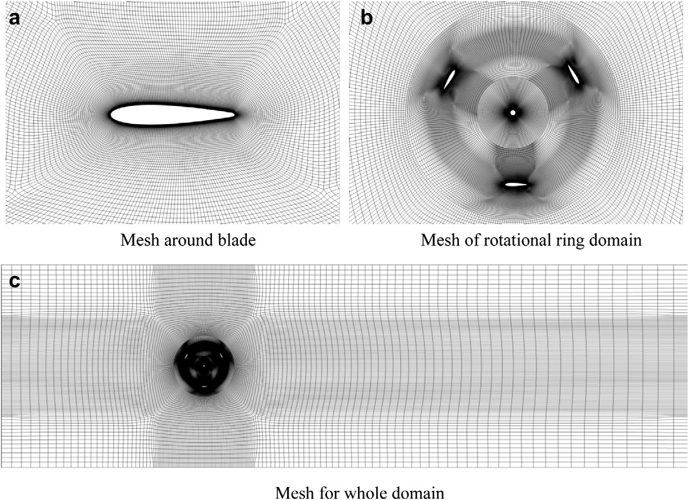

   **图 14** VAWT 流场模拟的网格分布。（a）叶片周围网格；（b）旋转环区网格；（c）整个计算域网格。

3.2.2 湍流模型与模拟设置
^^^^^^^^^^^^^^^^^^^^^^^^

与单个静止翼型模拟相同，本节考察并比较采用 SST 湍流模型的二维和 2.5D URANS，以及采用 Smagorinsky–Lilly 湍流模型的 2.5D LES。叶片动态失速影响 VAWT 的主要能量提取过程，因此确定时间步时应考虑幅值、频率和远场速度。在雷诺数 :math:`Re=10^5` 时，Gharali 等 [38] 建议：当折减频率 :math:`k=\Omega c/(2U_\infty)=0.026` 时取 :math:`\sigma=0.1` ；当 :math:`k=3.4` 时取 :math:`\sigma=0.01` 。本文折减频率为 :math:`k=0.1–0.3` ，物理时间步为 :math:`0.5^\circ\Omega^{-1}` ，相应无量纲时间步为 :math:`\sigma=0.02078` 。针对 :math:`\lambda=1.96` 工况，还采用更小的 :math:`0.25^\circ\Omega^{-1}` 时间步进行模拟，两种时间步的差异几乎可以忽视。因此，所采用的 :math:`0.5^\circ\Omega^{-1}` 时间步被认为足够小，可以获得与时间步大小无关的结果。为消除初始影响，共模拟六个转动周期。最后两个周期之间的数值结果差异小于 2%，表明模拟达到稳定状态。因此，下文给出的所有数据均为最后两个转动周期的平均值。

3.3 结果与讨论
~~~~~~~~~~~~~~

采用二维 URANS、2.5D URANS 和 2.5D LES 模拟风速为 :math:`10\,\mathrm{m/s}` 时运行的 VAWT 流动，并与 McLaren（2011）的试验结果比较。作用于叶片的合气动力分解为两个分量：垂直于弦线的法向力 :math:`F_N` ，以及平行于弦线的切向力 :math:`F_T` 。按照文献 [11]，切向与法向力系数定义为：

.. math::

   C_T=\frac{F_T}{0.5\rho U_\infty^2cH}\qquad (3)

.. math::

   C_N=\frac{F_N}{0.5\rho U_\infty^2cH}\qquad (4)

其中 :math:`H` 为叶片长度。应当说明，McLaren [11] 尝试根据安装在支臂上的应变片测量结果，推导叶片的气动切向力和法向力。测得的法向力实际是离心力和气动力的叠加。由于离心力随转速变化而波动，并且不同试验工况之间存在明显差异，难以从测量结果中准确分离气动法向力。McLaren [11] 调整了最终报告的试验法向力平均值，使试验结果与其二维数值模拟之间的平均气动法向力差异最小。因此，本文再次基于 2.5D LES 数据，对试验结果中的法向力采用类似处理。

图 15 比较了四个叶尖速比，即 :math:`\lambda=0.7` 、1.11、1.46 和 1.96 下的数值与试验切向、法向力系数。总体而言，与二维和 2.5D URANS 相比，2.5D LES 对试验切向力的预测更好，尤其是在迎风区域，即 :math:`0^\circ<\theta<180^\circ` 。低叶尖速比 :math:`\lambda=0.7` 时，2.5D LES 与试验结果的 :math:`C_T` 和 :math:`C_N` 在峰值大小和变化趋势上均只有很小差异。这类低叶尖速比经常出现在 VAWT 启动过程中。这一有前景的结果表明，2.5D LES 可成为评估 VAWT 自启动特性的准确有效方法。与其他研究者 [11,13,15] 的观察类似，本文二维和 2.5D URANS 往往明显高估迎风区域的 :math:`C_T` 幅值。这本质上是因为两种 URANS 方法在高攻角情况下高估了升力。较高叶尖速比 :math:`\lambda>1.4` 下，CFD 模拟与试验的差异相对增大，但 2.5D LES 对 :math:`C_T` 的预测仍优于二维和 2.5D URANS。对于法向力系数 :math:`C_N` ，所有 CFD 方法在曲线形状和某些主要数值上均给出了接近的近似。值得注意的是，当 :math:`\lambda=1.46` 、1.81 和 1.96 时，试验结果在背风区域 :math:`180^\circ<\theta<360^\circ` 出现第二个转矩峰值。三种 CFD 方法均未能再现这一气动特征，说明 CFD 对涡发展及其与尾流相互作用的建模能力有限。

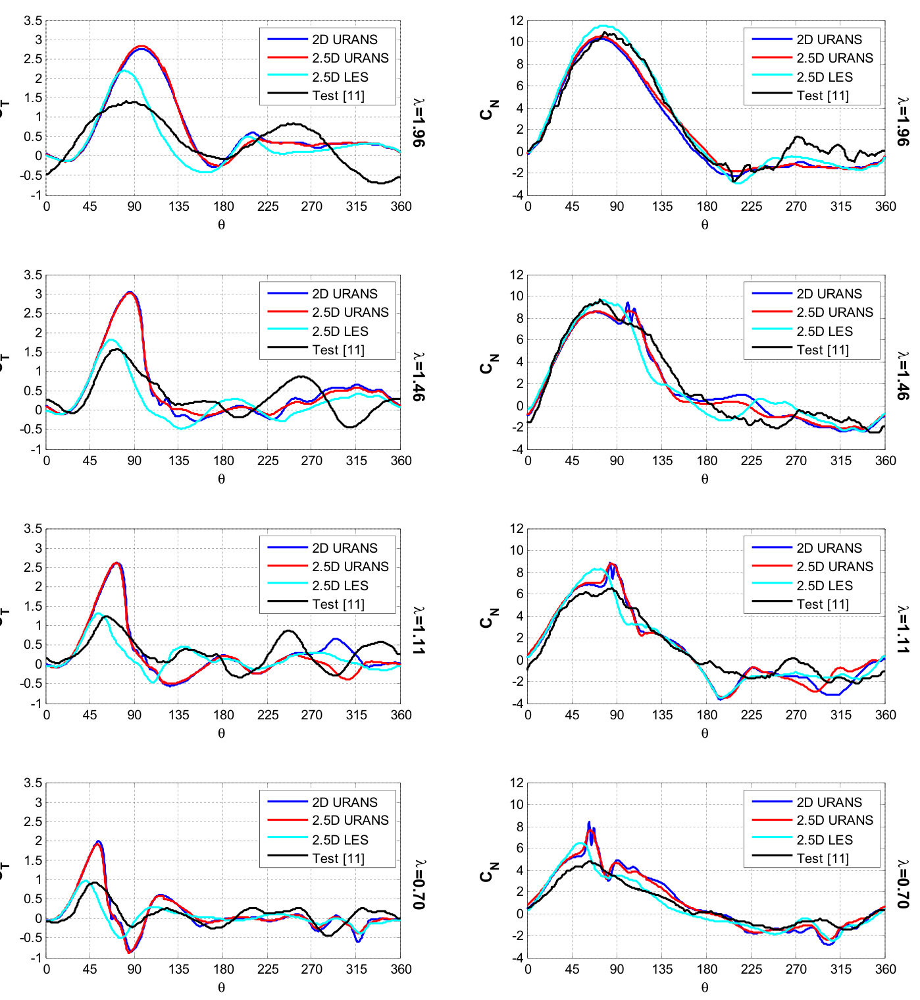

   **图 15** :math:`\lambda=0.70` 、1.11、1.46 和 1.96 时的数值与试验切向及法向力系数。左列为 :math:`C_T` ，右列为 :math:`C_N` ；原图从上到下的叶尖速比依次为 1.96、1.46、1.11 和 0.70；横坐标均为方位角。

风机一周所吸收的总功率 :math:`P` 可计算为：

.. math::

   P=\frac{NR\Omega}{2\pi}\int_0^{2\pi}F_T\,\mathrm{d}\theta\qquad (5)

其中 :math:`N` 为叶片数。风机功率系数 :math:`C_P` 定义为风机输出功率与来流可用功率的比值：

.. math::

   C_P=\frac{P}{0.5\rho U_\infty^3\,2RH}\qquad (6)

图 16 给出了风机功率系数 :math:`C_P` 随叶尖速比 :math:`\lambda` 的变化。同时给出了 McLaren [11] 风洞结果的平均值，以及对应 14.5% 误差的上下界。总体上，2.5D LES 不仅正确预测了 :math:`C_P` 的变化趋势，而且在数值大小上与风洞结果合理吻合。二维和 2.5D URANS 从 :math:`\lambda=1.32` 开始高估功率系数，这与其他研究者的结果一致。

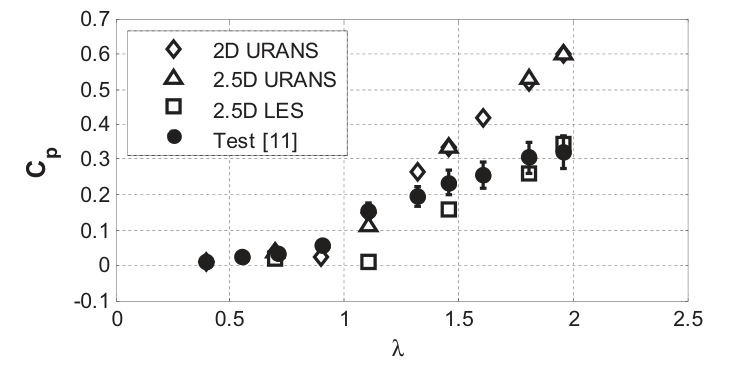

   **图 16** 功率系数随叶尖速比的变化。菱形、三角形和方形分别为二维 URANS、2.5D URANS 和 2.5D LES；实心圆及误差棒为试验结果。

图 17 和图 18 比较了迎风与背风区域的功率系数，有助于进一步理解模拟和试验的差异。由于叶片在迎风侧转动时产生最大切向力，迎风区域的功率系数远高于背风区域。迎风区域叶片从更稳定、含能更多的来流中提取更多功率。相比之下，背风区域叶片位于迎风叶片的尾流中，无法从复杂的背风侧流动中高效提取功率。

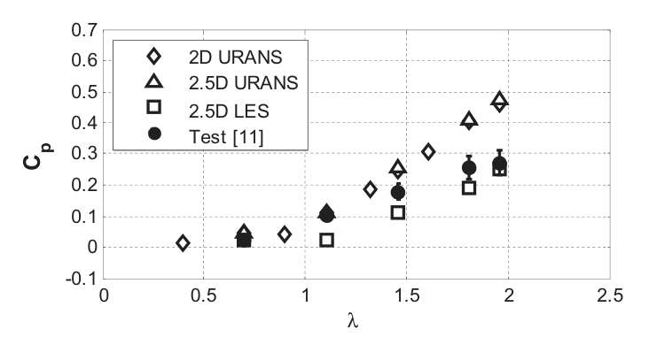

   **图 17** 迎风区域的功率系数。图例所示方法与图 16 相同。

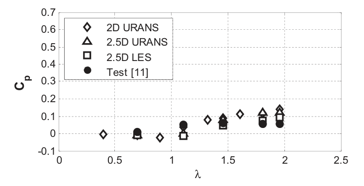

   **图 18** 背风区域的功率系数。图例所示方法与图 16 相同。

以往研究曾报道二维 URANS 高估功率系数。这一差异通常被归因于实际 VAWT 的叶尖涡或流动发散效应。本文结果表明，总体上，2.5D LES 比二维 URANS 更真实地预测 VAWT 气动行为。由于二维 URANS 和 2.5D LES 均不能恰当模拟叶尖涡或竖向流动发散，因此二维 URANS 的高估更可能源于其预测失速后升力的固有限制。结合单个静止翼型模拟的发现，URANS 无法真实再现高攻角下的大尺度分离，可能才是其与试验结果显著偏离的主要原因，而不是叶尖涡与竖向流动发散。Scheurich 等 [7] 也通过涡量输运模型说明了叶尖涡对输出功率的影响有限。

图 19 进一步展示了 2.5D URANS 和 LES 所得到的 VAWT 流动发展。根据 Sheldahl 等 [17]，雷诺数为 360,000 时，NACA0015 翼型的静态失速始于 :math:`\alpha=13^\circ` ；当 :math:`\lambda=1.96` 时，根据式 (2)，该攻角对应 :math:`\theta=36^\circ` 。如图 19 所示，动态失速使 VAWT 的失速出现时间推迟，因此直到 :math:`\theta=75^\circ` ，即对应 :math:`\alpha=25^\circ` 时，升力才下降。图中给出了 :math:`\lambda=1.96` 时一个叶片周围的一系列涡量大小与压力等值图，对应迎风区域不同方位角，包括 :math:`\theta=0^\circ` 、 :math:`36^\circ` 、 :math:`72^\circ` 、 :math:`90^\circ` 、 :math:`108^\circ` 、 :math:`126^\circ` 、 :math:`144^\circ` 、 :math:`162^\circ` 和 :math:`180^\circ` 。叶片从 :math:`0^\circ` 转至 :math:`72^\circ` 时，流动始终附着于叶片，升力和阻力随攻角增大而逐渐增加；这一阶段中，2.5D LES 与 URANS 所预测的涡场和压力场相似。随后，从 :math:`\theta=72^\circ` 开始，顺时针涡明显集中，继而从前缘区域脱落，逐渐沿翼型表面传播，引起压力变化。结果是升力开始明显降低，叶片进入失速状态。2.5D LES 与 2.5D URANS 的涡量场和压力场出现明显差异，解释了两种方法在迎风区域预测出不同峰值切向力和法向力的原因。2.5D LES 清楚再现了顺时针涡从前缘脱落并沿叶片内表面发展的现象，Simão Ferreira 等 [39] 的粒子图像测速（particle image velocimetry，PIV）试验也观察到了这一现象。2.5D URANS 未能捕捉高攻角下动态失速涡的出现，并推迟了叶片失速，因此高估升力和输出功率。

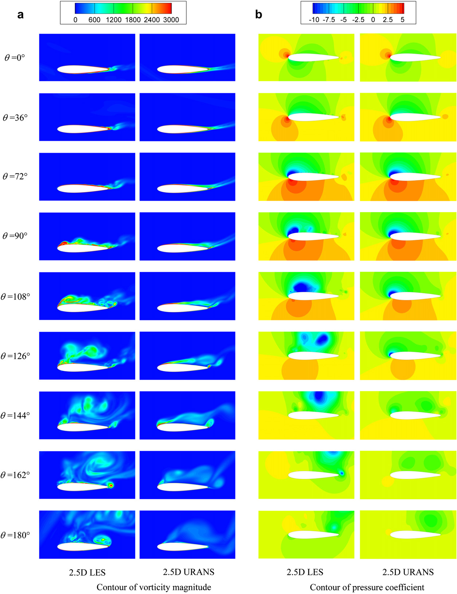

   **图 19** :math:`\lambda=1.96` 时，叶片在 :math:`0^\circ` 、 :math:`36^\circ` 、 :math:`72^\circ` 、 :math:`90^\circ` 、 :math:`108^\circ` 、 :math:`126^\circ` 、 :math:`144^\circ` 、 :math:`162^\circ` 和 :math:`180^\circ` 方位角处的瞬时涡量大小与压力系数等值图。（a）涡量大小等值图；（b）压力系数等值图。每组从左到右分别为 2.5D LES 和 2.5D URANS。

图 20 给出了 :math:`\lambda=1.96` 时 2.5D URANS 和 LES 的瞬时涡场。由于其对 Navier–Stokes 方程的固有处理方式，2.5D URANS 模拟的涡少于 2.5D LES。叶片发生动态失速时，迎风区域叶片脱落的涡对 VAWT 能量提取具有关键影响。如图 20 所示，动态失速中的分离涡呈柱状，导致显著的压力变化，但沿竖向的压力分布相对均匀。然而，在 2.5D URANS 中，静态失速的分离结构（见图 10a）会破碎成小涡，产生展向压力变化。这可能解释了以下现象：虽然二维与 2.5D URANS 对单翼型静态失速的预测差异很大，但在旋转 VAWT 叶片发生动态失速时，两者所预测的气动力较为接近。

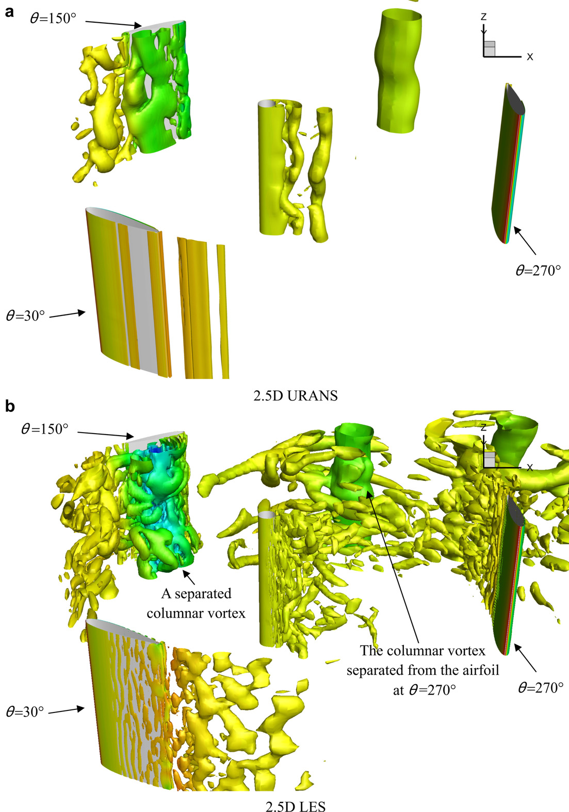

   **图 20** :math:`\lambda=1.96` 时，2.5D URANS 和 LES 结果中以 :math:`Q=1000` 等值面表示的涡结构。（a）2.5D URANS；（b）2.5D LES。图中标注分别指出一个脱落的柱状涡，以及在 :math:`\theta=270^\circ` 附近由翼型脱落的柱状涡。

4 结论
------

本文研究了 2.5D LES 在 SBVAWT 气动研究中的有效性。之所以称为 2.5D 方法，是因为只沿展向建立一小段翼型叶片，而不是构建整个 SBVAWT 的三维 CFD 模型。采用 2.5D LES 模拟单个静止翼型和运行中的三叶片 SBVAWT，并将结果与风洞试验、2.5D URANS 及二维 URANS 比较。比较表明，二维 Navier–Stokes 方程所描述的涡量扩散行为不准确，使二维 URANS 明显高估单翼型在失速后攻角下的升力与阻力。2.5D URANS 的结果略有改善，但仍受 URANS 模型模拟含大尺度分离的高攻角流动能力所限。由于高攻角在运行中的 SBVAWT 翼型叶片上十分常见，URANS 无法给出可接受的 SBVAWT 输出功率估计。相比之下，对于单个静止翼型和旋转 SBVAWT，2.5D LES 均更接近试验结果，并更真实地描述了气动细节。

研究者已认识到二维 URANS 在 VAWT 气动研究中的不足，但过去往往将其归因于二维模拟未考虑叶尖涡和竖向流动发散。然而，2.5D LES 预测明显改善，表明这两个因素可能不是二维 URANS 高估结果的主要机制。对气动细节的仔细检查发现，URANS 推迟了动态失速的发生，并高估迎风区域切向力；相比之下，具有适当展向长度的 2.5D LES 能良好再现这种动态流动形态。URANS 的这一固有限制解释了其在 VAWT 性能评估中相对较差的精度。

本文发现表明，2.5D LES 是探索 VAWT 气动特性更有前景、更高效的 CFD 工具。在三叶片 SBVAWT 模拟中，2.5D LES 在较低叶尖速比下与风洞测量吻合良好。因此，它可用于 VAWT 自启动特性研究，该问题主要关注低转速和高攻角。在高叶尖速比下，虽然 2.5D LES 的性能仍优于二维和 2.5D URANS，但它与试验结果仅达到一般程度的吻合。尤其是，本文三种 CFD 方法均未能良好再现高叶尖速比下背风区域的切向力。今后的 VAWT 气动研究仍需发展高保真 CFD 技术，准确模拟动态失速现象和背风区域强分离流动。

参考文献
--------

[1] Paraschivoiu I. Wind turbine design: with emphasis on darrieus concept. Montréal, Québec, Canada: Polytechnic International Press; 2002.

[2] Islam M, Ting DSK, Fartaj A. Aerodynamic models for Darrieus-type straight-bladed vertical axis wind turbines. Renew Sust Energ Rev 2008;12(4):1087–109.

[3] Roynarin W. Optimisation of vertical axis wind turbines. Northumbria University; 2004.

[4] Claessens MC. The design and testing of airfoils for application in small vertical axis wind turbines. Delft University of Technology; 2006.

[5] Hwang IS, Lee YH, Kim SJ. Optimization of cycloidal water turbine and the performance improvement by individual blade control. Appl Energ 2009;86(9):1532–40.

[6] Castelli MR, Benini E. Effect of blade inclination angle on a Darrieus wind turbine. J Turbomach 2012;134(3).

[7] Scheurich F, Fletcher TM, Brown RE. The influence of blade curvature and helical blade twist on the performance of a vertical-axis wind turbine. In: 48th AIAA aerospace sciences meeting including the new horizons forum and aerospace exposition; 2010 [Orlando, Florida, USA].

[8] Kirke BK. Tests on ducted and bare helical and straight blade Darrieus hydrokinetic turbines. Renew Energ 2011;36(11):3013–22.

[9] Worstell MH. Aerodynamic performance of the 17-metre-diameter Darrieus wind turbine. SAND78–1737. Sandia National Laboratories; 1978.

[10] Akins RE, Klimas PC, Croll RH. Pressure distributions on an operating vertical axis wind turbine blade element. In: Proceedings of the American solar energy society annual meeting, sixth Biennial wind energy conference; 1983. p. 455–62.

[11] McLaren KW. A numerical and experimental study of unsteady loading of high solidity vertical axis wind turbines. McMaster University; 2011.

[12] Oler JW, Strickland JH, Im BJ, Graham GH. Dynamic stall regulation of the Darrieus turbine. SAND83–7029. Sandia National Laboratories; 1983.

[13] Howell R, Qin N, Edwards J, Durrani N. Wind tunnel and numerical study of a small vertical axis wind turbine. Renew Energ 2010;35(2):412–22.

[14] Mukinovi M, Brenner G, Rahimi A. Analysis of vertical axis wind turbines, in numerical & experimental fluid mechanics VII. NNFM 2010;112:587–94.

[15] Castelli MR, Englaro A, Benini E. The Darrieus wind turbine: proposal for a new performance prediction model based on CFD. Energy 2011;36(8):4919–34.

[16] Simão Ferreira CJ, van Zuijlen A, Bijl H, van Bussel G, van Kuik G. Simulating dynamic stall in a two-dimensional vertical-axis wind turbine: verification and validation with particle image velocimetry data. Wind Energ 2010;13(1):1–17.

[17] Sheldahl RE, Klimas PC. Aerodynamic characteristics of seven symmetrical airfoil sections through 180-degree angle of attack for use in aerodynamic analysis of vertical axis wind turbines. SAND80–2114. Sandia National Laboratories; 1981.

[18] Rom J. High angle of attack aerodynamics. New York: Springer; 1992.

[19] Cummings RM, Forsythe JR, Morton SA, Squires KD. Computational challenges in high angle of attack flow prediction. Prog Aerosp Sci 2003;39(5):369–84.

[20] Sørensen NN, Michelsen JA. Drag prediction for blades at high angle of attack using CFD. J Sol Energ Eng 2004;126(Nov.):1011–6.

[21] Gao H, Hu H, Wang ZJ. Computational study of unsteady flows around dragonfly and smooth airfoils at low Reynolds numbers. In: 46th AIAA aerospace sciences meeting and exhibit. Reno: Nevada; 2008.

[22] Travin A, Shur M, Strelets M, Spalart PR. Physical and numerical upgrades in the detached-eddy simulation of complex turbulent flows, advances in LES of complex flows; 2004. p. 239–54.

[23] Bertagnolio F, Sørensen NN, Johansen J. Profile catalogue for airfoil sections based on 3D computations. Risø-R-1581(EN). Roskilde, Denmark: Risø National Laboratory; 2006.

[24] IM H, Zha G. Delayed detached eddy simulation of a stall flow over NACA0012 airfoil using high order scheme. In: 49th AIAA aerospace sciences meeting including the new horizons forum and aerospace exposition; 2011 [Orlando, Florida].

[25] Timmer WA. Two-dimensional low-Reynolds number wind tunnel results for airfoil NACA 0018. Wind Eng 2008;32(6):525–37.

[26] Menter FR. Two-equation eddy-viscosity turbulence models for engineering applications. AIAA J 1994;32(8):1598–605.

[27] Menter FR, Kuntz M, Langtry R. Ten years of industrial experience with the SST turbulence model. Turbulence Heat Mass Transfer 2003;4.

[28] Smagorinsky J. General circulation experiments with the primitive equations. I. The basic experiment. Mon Weather Rev 1963;91(3):99–164.

[29] Li C, Li QS, Huang SH, Fu JY, Xiao YQ. Large eddy simulation of wind loads on a long-span spatial lattice roof. Wind Struct 2010;13(1):57–82.

[30] Germano M, Piomelli U, Moin P, Cabot WH. A dynamic subgrid-scale eddy viscosity model. Phys Fluids A Fluid Dyn 1991;3:1760.

[31] Lilly DK. A proposed modification of the germano-subgrid-scale closure method. Phys Fluids A Fluid Dyn 1992;4(3):633–5.

[32] Fluent Inc. FLUENT6.3 user's guide, 2007.

[33] Johansen J, Sørensen NN. Application of a detached-eddy simulation model on airfoil flows, in IEA2000; 2000.

[34] Winkler J, Moreau S. LES of the trailing-edge flow and noise of a NACA6512-63 airfoil at zero angle of attack. Center for Turbulence Research; 2008. Proceedings of the Summer Program.

[35] Joeng J, Hussain F. On the identification of a vortex. J Fluid Mech 1995;285:69–94.

[36] Iida A, Kato K, Mizuno A. Numerical simulation of unsteady flow and aerodynamic performance of vertical axis wind turbines with Les. In: 16th Australasian fluid mechanics conference; 2007 [Crown Plaza, Gold Coast, Australia].

[37] Dai YM, Lam W. Numerical study of straight-bladed Darrieus-type tidal turbine. Proceedings of the institution of civil engineers. Energy 2009;162:67–76.

[38] Gharali K, Johnson DA. Numerical modeling of an S809 airfoil under dynamic stall, erosion and high reduced frequencies. Appl Energ 2011. http://dx.doi.org/10.1016/j.apenergy.2011.04.037.

[39] Simão Ferreira C, van Kuik G, van Bussel G, Scarano F. Visualization by PIV of dynamic stall on a vertical axis wind turbine. Exp Fluid 2009;46(1):97–108.

完整引用
--------

Li, C., Zhu, S., Xu, Y.-L., and Xiao, Y. (2013). 2.5D large eddy simulation of vertical axis wind turbine in consideration of high angle of attack flow. Renewable Energy, 51, 317–330. https://doi.org/10.1016/j.renene.2012.09.011。

收录信息见 :ref:`WOEAI 学术成果页对应条目 <ref-li2013-RE>`。
