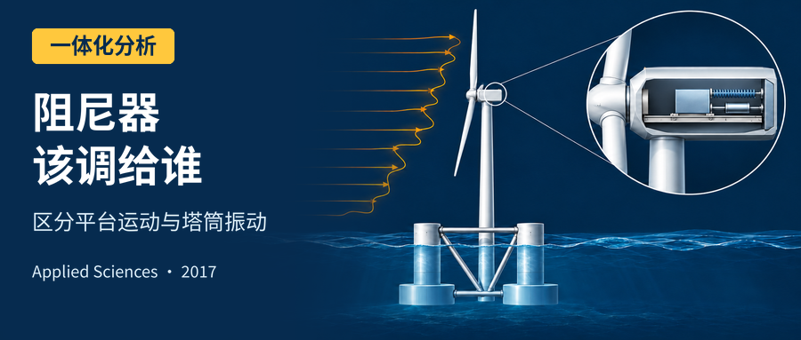
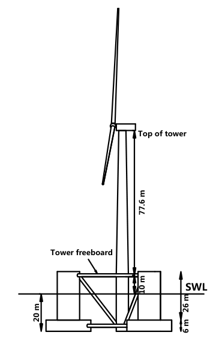
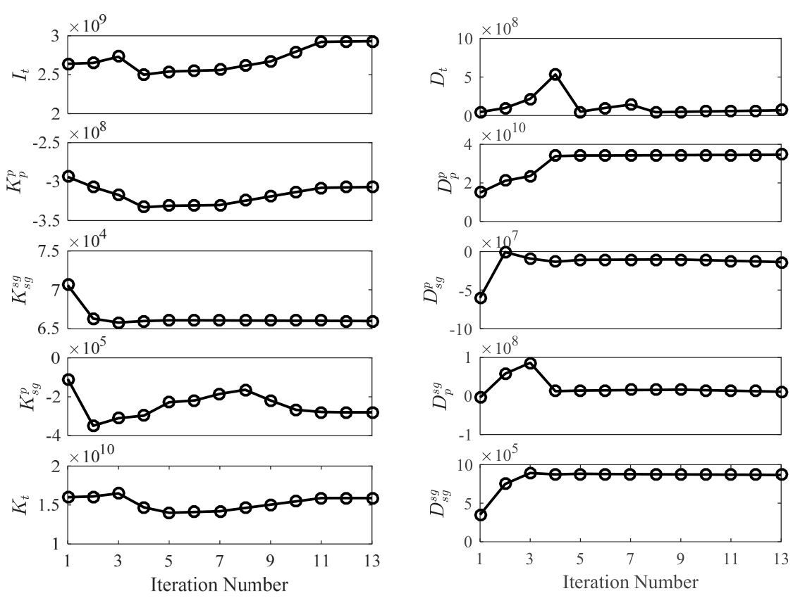
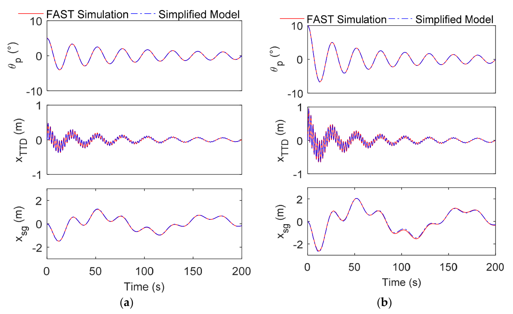
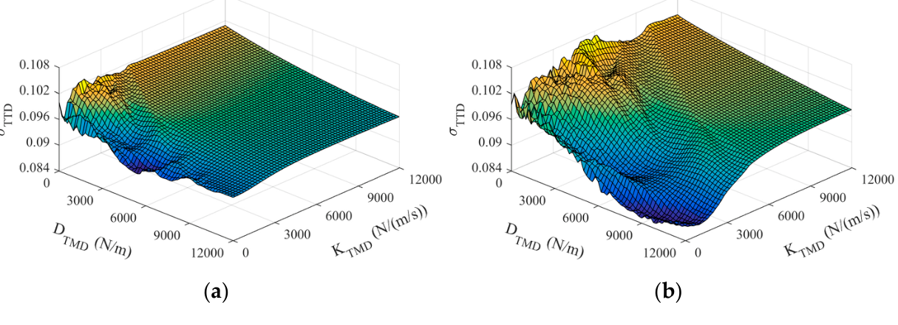
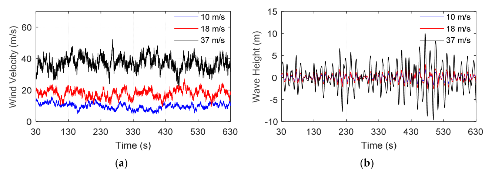
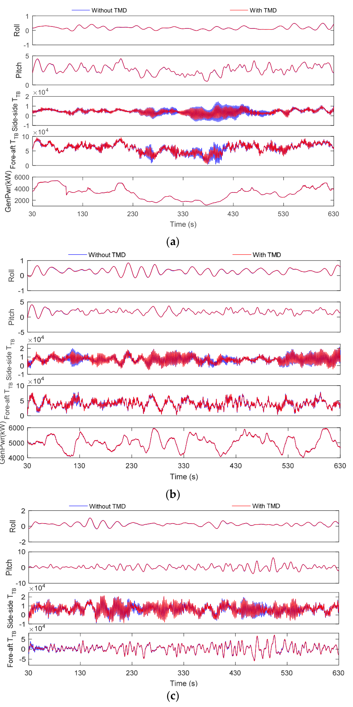

.. _paper-note-ref-li2017-AS:

半潜式海上漂浮风机的被动振动控制：论文精解
==============================================

精简版微信公众号文章：待发布

.. contents:: 本页目录
   :local:
   :depth: 2

论文信息
--------

**原文题名：** Passive Vibration Control of a Semi-Submersible Floating Offshore Wind Turbine。

**作者：** Chao Li，Tongyi Zhuang，Shengtao Zhou，Yiqing Xiao（通讯作者），Gang Hu。

**作者单位：** 哈尔滨工业大学深圳研究生院；香港科技大学土木与环境工程系。

**期刊：** Applied Sciences，2017，7，509。DOI：`10.3390/app7060509 <https://doi.org/10.3390/app7060509>`_。

**学术编辑：** Antonio Ficarella。**稿件日期：** 2017 年 3 月 20 日收稿；2017 年 5 月 9 日录用；2017 年 5 月 26 日发表。

**WOEAI 相关方向：** 海洋能源结构 / 一体化分析。

摘要
----

海上漂浮风机有潜力以商业化方式利用深水区域丰富的风能资源。与固定基础风机相比，浮式基础运动使海洋环境下风机的振动和荷载更加复杂。为减小风机响应，本文研究在机舱或塔筒中设置前后向调谐质量阻尼器（tuned mass damper，TMD），对半潜式海上风机实施被动控制。根据半潜式平台的运动特征，提出考虑平台纵摇和纵荡、塔筒倾斜以及 TMD 平移自由度的简化结构模型。识别十个未知参数后，采用纵摇自由衰减响应验证所确定模型的正确性。为避免局部极小值，同时采用穷举法和遗传算法优化 TMD 的质量、刚度与阻尼。在三种实际环境条件下评估六组优化后的 TMD 装置，并采用极值和疲劳响应减小率评价控制效果。结果发现，直接耗散塔筒振动能量的高刚度 TMD 总体表现稳定。与 Spar 型基础相似，机舱或塔筒中的 TMD 能够延长漂浮风机的使用寿命。

关键词
------

调谐质量阻尼器；半潜式；海上漂浮风机；被动振动控制。

1 引言
------

随着化石燃料的大量消耗，能源与环境污染问题日益突出。开发清洁可再生能源以替代传统化石能源，是全球迫切需求。在这一背景下，深水区域风能近年来受到世界各地关注。借鉴海上油气行业数十年的经验，人们提出了多种支承深水大型风机的浮式平台概念，包括 Spar、张力腿、驳船和半潜式平台。

不同于固定基础风机，波浪和风荷载引起的浮式平台旋转与平移耦合运动，会显著增大风机振动和荷载。因此，降低海上漂浮风机（floating offshore wind turbine，FOWT）的振动与荷载，对全寿命周期安全至关重要。减振方法之一是采用结构控制装置，这类装置已成功应用于建筑和桥梁等土木工程结构 [1]。此外，由于被动振动控制比主动控制更稳健、成本更低，它已广泛用于高层结构 [2,3] 和海洋平台 [4,5]。因此，被动控制也被认为有望抑制 FOWT 振动。Lackner 等 [6,7] 分别为驳船、Spar 和张力腿平台型漂浮风机建立三自由度（degree of freedom，DOF）简化结构模型，并采用遗传算法优化各类基础的 TMD 配置。他们还认为，主动控制装置比被动 TMD 能减小更多荷载。与其他浮式基础相比，驳船型漂浮风机的响应更大 [8]。以 ITI energy barge 5 MW FOWT 为例，He 等 [9] 指出，当质量比从 0.5% 变为 2% 时，振动响应最大抑制率从 20% 变为 50%。此外，Li 等 [10] 研究了 TMD 装置的主动控制策略，发现风机疲劳荷载和发电机误差均可有效减小。对于 Spar 型风机，Si 等 [11,12] 为海上风电代码比较协作（Offshore Code Comparison Collaboration，OC3）Hywind 风机建立五自由度动力模型，分别研究安装在机舱与平台中的 TMD 装置效果。Van-Nguyen Dinh 等 [13] 也研究了单个和多个 TMD 对 Spar 型 FOWT 的有效性与可行性，并认为 Spar 内 TMD 比机舱 TMD 更有效。

显然，TMD 装置能有效降低驳船型和 Spar 型 FOWT 的振动与荷载。然而，据作者所知，当时尚无研究报道半潜式基础 FOWT 的这一问题。不过，在已安装的少数全尺寸 FOWT 原型中，半潜式基础凭借适应 FOWT 运行工况的突出能力，占据了最多数量，例如葡萄牙近海的 2 MW WindFloat，以及日本外海的 2 MW Mirai 和 7 MW Shimpuu。虽然半潜式基础的结构系统比另外两种形式更复杂，但它的纵摇和横摇运动最小，这对风机正常运行很关键 [14]。

本文旨在研究优化 TMD 在半潜式 FOWT 中的潜在应用。针对其特点，依据达朗贝尔原理推导四自由度动力模型。识别未知参数后，采用公认的 FOWT 分析工具 FAST [15] 验证简化模型。为寻找优化的 TMD 配置，同时使用穷举法和遗传算法，以避免局部极小值。最后，通过气动—水动—伺服—弹性全耦合动力模型，评估六组优化 TMD 装置的性能。

2 半潜式 FOWT 的动力学建模
--------------------------

2.1 半潜式 FOWT 的简化动力模型
~~~~~~~~~~~~~~~~~~~~~~~~~~~~~~

半潜式基础正逐渐成为 FOWT 的主流。考虑资料的可获得性，本文选择 IEA-OC4 项目中的一个 5 MW FOWT 基准模型，即海上风电代码比较协作延续项目（Offshore Code Comparison Collaboration Continuation，OC4）的 DeepCwind 半潜式基础作为研究对象。IEA-OC4 项目由国际能源署（International Energy Agency，IEA）与多个国际研究机构联合开展，旨在验证不同 FOWT 分析工具的质量。在 OC4-DeepCwind 系统中，美国国家可再生能源实验室（National Renewable Energy Laboratory，NREL）设计并公开的 5 MW 海上风机 [16] 安装在该基础上。OC4-DeepCwind 模型 [17] 的参数和模型示意分别见表 1 和图 1。

.. list-table:: 表 1 OC4-DeepCwind 模型参数
   :header-rows: 1
   :class: longtable

   * - 项目
     - 数值
   * - 额定功率
     - 5 MW
   * - 转子配置
     - 上风向，3 叶片
   * - 切入、额定、切出风速
     - 3 m/s，11.4 m/s，25 m/s
   * - 海平面以上轮毂高度
     - 90 m
   * - 海平面以下总吃水
     - 20 m
   * - 平台质量（含压载）
     - :math:`1.3473\times10^7\,\mathrm{kg}`
   * - 海平面以上塔底高程
     - 10 m
   * - 塔筒与塔顶质量
     - 599,718 kg
   * - 塔筒高度
     - 77.6 m
   * - 系泊线数量
     - 3
   * - 海平面以下导缆点深度
     - 14 m
   * - 机舱尺寸
     - 18 m × 6 m × 6 m

   **图 1** DeepCwind 半潜式平台示意图。Top of tower 为塔顶；Tower freeboard 为塔筒干舷；SWL 为静水面。

为有效降低荷载，拟在 OC4-DeepCwind 系统中安装 TMD 装置。对于漂浮风机系统，TMD 可以安装在机舱、塔筒或平台中，运动方向可以是前后向或侧向。由于水平轴风机的前后向疲劳荷载远大于侧向荷载，本文重点研究安装在机舱或塔筒中的前后向 TMD，见图 2。为简化这一初步研究，采用刚度和阻尼恒定的理想 TMD 装置。此外，假定 TMD 轨道为直线且无摩擦。

.. figure:: ../../../wechat/assets/public-safe/ref-li2017-AS/fig02.jpg
   :alt: 图2 OC4-DeepCwind简化动力模型示意图
   :align: center
   :width: 80%

   **图 2** OC4-DeepCwind 简化动力模型示意图。图中给出平台纵荡、平台纵摇、塔筒倾斜与 TMD 平移及各刚体的加速度和几何位置。

为寻找 TMD 的最优参数，首先考虑在 FAST 框架内结合优化算法。然而，受现有计算资源限制，完成繁重优化过程所需的 FAST 计算时间不可接受。对于浮式系统，以往研究表明，系统大部分响应仅由少数自由度主导。因此，为高效获得 OC4-DeepCwind 模型的最优 TMD 配置，有必要建立自由度有限的简化数学模型，替代 FAST 中复杂的全耦合模型。例如，Lackner 等 [7] 为驳船型漂浮风机建立三自由度动力模型，包括平台纵摇、塔筒倾斜和 TMD 运动，其中阻尼系数和恢复刚度系数均视为线性。对于 OC3 项目的 Spar 型漂浮风机，Si 等 [11,12] 通过考虑平台纵荡、垂荡、纵摇、塔筒倾斜及 TMD 平移五个自由度，建立了精度更高的动力模型。

图 2 给出了 OC4-DeepCwind 简化动力模型示意。依据上述研究，建立高效动力模型所需的前提和假设如下：

1. 将半潜式 FOWT 建模为多体动力系统，其中平台、塔筒（含转子与机舱）及 TMD 均视为刚体。为与 FAST 程序一致，选择海平面（sea level，SL）与平台中心线交点作为输出分析参考点。以参考点 :math:`P` 为原点建立惯性坐标系。
2. 与 Spar 基础不同，半潜式基础的垂荡对纵摇影响可以忽视。因此，OC4-DeepCwind 简化动力模型仅采用平台纵荡、纵摇、塔筒倾斜与 TMD 运动四个自由度。此外，TMD 相对整个 FOWT 的质量较小，因此忽视其转动，只考虑平移。
3. 塔筒底部与基础铰接，基础与塔筒之间、TMD 与机舱之间的相互作用均以线性弹簧和线性阻尼器处理。
4. 由于仅用自由衰减运动识别模型参数并优化 TMD 参数，简化模型不考虑入射风、波浪荷载等外力。但是，模型充分考虑了水动力和系泊荷载的系统耦合效应。此外，即使在极端条件下，平台纵摇响应也不超过 :math:`10^\circ` 。全文采用两种常用小角度近似，即 :math:`\sin\theta\approx\theta` 和 :math:`\cos\theta\approx1` 。

根据上述假设，可采用达朗贝尔原理描述各刚体的整体动力学。达朗贝尔原理的要点是引入惯性力，将动力问题视为静力问题。如上所述，以 :math:`P` 点作为所有运动的原点，准静态平衡方程可写为：

.. math::

   \begin{aligned}
   \sum m_i\mathbf a_i&=\mathbf F,\\
   \sum \mathbf r_i\times m_i\mathbf a_i+I_i\boldsymbol\alpha_i&=\mathbf T.
   \end{aligned}\qquad (1)

其中， :math:`\mathbf F` 和 :math:`\mathbf T` 分别表示全部外力之和及全部外力对 :math:`P` 点的力矩之和。 :math:`m_i` 表示第 :math:`i` 个刚体，即平台、塔筒和 TMD 的质量， :math:`I_i` 表示惯性矩。 :math:`\mathbf a_i` 和 :math:`\boldsymbol\alpha_i` 分别是刚体 :math:`i` 的加速度矢量与角加速度。 :math:`\mathbf r_i` 为从 :math:`P` 点到刚体 :math:`i` 的位置矢量。 :math:`\sum m_i\mathbf a_i` 以及 :math:`\sum\mathbf r_i\times m_i\mathbf a_i+I_i\boldsymbol\alpha_i` 分别是惯性力与对 :math:`P` 点惯性力矩的矢量和。

式 (1) 左侧是与位移二阶导数有关的项，右侧则是其余力和力矩。因此，下一步主要任务是计算模型的全部力分量。

2.1.1 惯性力项
^^^^^^^^^^^^^^

首先，需要在所建坐标系中确定平台、塔筒和 TMD 装置的全部运动加速度分量。除平台纵荡加速度 :math:`\ddot x_{\mathrm{sg}}` 和纵摇加速度 :math:`\ddot\theta_p` 、塔筒一阶前后弯曲加速度 :math:`\ddot\theta_t` 、TMD 装置加速度 :math:`\ddot x_{\mathrm{TMD}}` 外，各刚体的切向加速度 :math:`a_t^t` 、 :math:`a_p^t` 、 :math:`a_{\mathrm{TMD}}^t` 和法向加速度 :math:`a_t^n` 、 :math:`a_p^n` 如图 2 所示，可用下式计算：

.. math::

   \begin{aligned}
   a_t^T&=\ddot\theta_tR_t+\ddot\theta_pH_c,\\
   a_p^T&=\ddot\theta_pR_p,\\
   a_{\mathrm{TMD}}^T&=\ddot\theta_tR_{\mathrm{TMD}}+\ddot\theta_pH_c,\\
   a_t^N&=R_t\dot\theta_t^2+H_c\dot\theta_p^2,\\
   a_p^N&=R_p\dot\theta_p^2.
   \end{aligned}\qquad (2)

其中， :math:`H_c` 表示塔筒底部与海平面之间的距离。

由于辐射效应的存在，惯性力项应考虑附加质量。附加质量系数 :math:`C_i^j(\infty)` 可由无限频率下的势流理论计算，附加质量 :math:`A_i^j(\infty)` 可由下式获得：

.. math::

   A_i^j(\infty)=\rho C_i^j(\infty)\qquad (3)

对于 OC4-DeepCwind，可从文献 [17] 获得附加质量数值。因此，可汇总并列出下列惯性力项：

.. math::

   \begin{aligned}
   M_{\mathrm{sg}}^{\mathrm{sg}}&=A_{\mathrm{sg}}^{\mathrm{sg}}+m_t+m_p+m_{\mathrm{TMD}},\\
   I_p^{\mathrm{sg}}&=A_p^{\mathrm{sg}}+(m_{\mathrm{twr}}+m_{\mathrm{TMD}})H_c-m_pR_p,\\
   I_t^{\mathrm{sg}}&=m_tR_t+m_{\mathrm{TMD}}R_{\mathrm{TMD}},\\
   M_{\mathrm{TMD}}^{\mathrm{sg}}&=m_{\mathrm{TMD}},\\
   M_{\mathrm{sg}}^p&=A_{\mathrm{sg}}^p-R_pm_p+(R_t+H_c)m_t+(R_{\mathrm{TMD}}+H_c)m_{\mathrm{TMD}},\\
   I_p^p&=A_p^p+I_p+m_t(R_t+H_c)H_c+m_{\mathrm{TMD}}(R_{\mathrm{TMD}}+H_c)H_c,\\
   I_t^p&=R_tm_tH_c+I_t+(R_{\mathrm{TMD}}+H_c)m_{\mathrm{TMD}}R_{\mathrm{TMD}},\\
   M_{\mathrm{TMD}}^p&=(R_{\mathrm{TMD}}+H_c)m_{\mathrm{TMD}},\\
   M_{\mathrm{sg}}^t&=R_tm_t+R_{\mathrm{TMD}}m_{\mathrm{TMD}},\\
   I_p^t&=R_t\times m_tH_c+R_{\mathrm{TMD}}m_{\mathrm{TMD}}H_c,\\
   I_t^t&=I_t+R_{\mathrm{TMD}}m_{\mathrm{TMD}}R_{\mathrm{TMD}},\\
   M_{\mathrm{TMD}}^t&=m_{\mathrm{TMD}}R_{\mathrm{TMD}},\\
   M_{\mathrm{sg}}^{\mathrm{TMD}}&=m_{\mathrm{TMD}},\\
   I_p^{\mathrm{TMD}}&=m_{\mathrm{TMD}}H_c,\\
   I_t^{\mathrm{TMD}}&=m_{\mathrm{TMD}}R_{\mathrm{TMD}},\\
   M_{\mathrm{TMD}}^{\mathrm{TMD}}&=m_{\mathrm{TMD}}.
   \end{aligned}\qquad (4)

平台和塔筒绕参考点 :math:`P` 旋转引起的向心力及力矩，用下列表达式计算：

.. math::

   \begin{aligned}
   F_{\mathrm{sg}}^{\mathrm{ctr}}&=m_tH_c\dot\theta_p^2\theta_p-m_pR_p\dot\theta_p^2\theta_p+m_tR_t\dot\theta_t^2\theta_t,\\
   T_p^{\mathrm{ctr}}&=-m_tH_c\dot\theta_p^2R_t(\theta_t-\theta_p)+m_tR_t\dot\theta_t^2H_c(\theta_t-\theta_p),\\
   T_t^{\mathrm{ctr}}&=-m_tH_c\dot\theta_p^2R_t(\theta_t-\theta_p).
   \end{aligned}\qquad (5)

由于 TMD 质量相对较小，本文不计其向心力。

2.1.2 重力项
^^^^^^^^^^^^

浮体始终受到重力作用，建模中也应体现。所有与重力相关的项可写为：

.. math::

   \begin{aligned}
   T_p^{\mathrm{gr}}&=-m_pgR_p\theta_p+m_tg(H_c\theta_p+R_t\theta_t)\\
   &\quad+m_{\mathrm{TMD}}g(H_c\theta_p+R_{\mathrm{TMD}}\theta_t+x_{\mathrm{TMD}}),\\
   T_t^{\mathrm{gr}}&=m_tgR_t\theta_t+m_{\mathrm{TMD}}gR_{\mathrm{TMD}}(\theta_tR_{\mathrm{TMD}}+x_{\mathrm{TMD}}),\\
   F_{\mathrm{TMD}}^{\mathrm{gr}}&=m_{\mathrm{TMD}}g\theta_t.
   \end{aligned}\qquad (6)

值得说明的是，FAST 配置中压载的纵摇和横摇附加刚度，实际上是重力项的投影。

2.1.3 平台恢复力项
^^^^^^^^^^^^^^^^^^

浮体在波浪中运动时，恢复力由静水与系泊分量组成。纵摇恢复力主要由静水压力控制，在转角较小时是线性的。然而，纵荡恢复力主要由非线性系泊系统提供。通过仅保留一阶项，实现系泊恢复力的线性化。因此，所有恢复力计算为：

.. math::

   \begin{aligned}
   F_{\mathrm{sg}}^{\mathrm{restore}}&=-K_{\mathrm{sg}}^{\mathrm{sg}}x_{\mathrm{sg}}-K_p^{\mathrm{sg}}\theta_p,\\
   T_p^{\mathrm{restore}}&=-K_{\mathrm{sg}}^px_{\mathrm{sg}}-K_p^p\theta_p.
   \end{aligned}\qquad (7)

除 :math:`K_p^p` 外，式 (7) 中其余恢复刚度分量主要来自系泊系统。沿用 FAST 中的设置与方案，根据准静态悬链线方程估计系泊刚度系数初值。此外，参考文献 [18]，可按下式计算静水恢复刚度：

.. math::

   \begin{aligned}
   K_p^{\mathrm{hydro}}&=\rho g\iint_{S_0}x^2\,\mathrm dS+\rho gV_0z_b,\\
   K_p^p&=K_p^{\mathrm{hydro}}+K_p^{\mathrm{mooring}}.
   \end{aligned}\qquad (8)

其中， :math:`\iint_{S_0}` 为在基础水线面上的面积分， :math:`V_0` 表示基础排水体积， :math:`z_b` 为浮心相对坐标原点的高度， :math:`K_p^{\mathrm{hydro}}` 为静水力产生的纵摇恢复系数， :math:`K_p^{\mathrm{mooring}}` 为系泊系统产生的纵摇恢复系数。

2.1.4 平台阻尼力项
^^^^^^^^^^^^^^^^^^

对于静水中的浮体，阻尼力主要由黏性阻尼和辐射阻尼两部分组成。根据 Morison 表达式 [19]，黏性阻尼力与流体质点和平台之间相对速度的平方成正比；在本问题中可计算为：

.. math::

   \begin{aligned}
   F_{\mathrm{sg}}^{\mathrm{viscous}}&=-\sum\frac12\rho C_d\int_0^{L_{\mathrm{Draft}}}|\dot x_{\mathrm{sg}}-h\dot\theta_p|(\dot x_{\mathrm{sg}}-h\dot\theta_p)\,\mathrm dh,\\
   T_p^{\mathrm{viscous}}&=-\sum\frac12\rho C_d\int_0^{L_{\mathrm{Draft}}}|\dot x_{\mathrm{sg}}-h\dot\theta_p|(\dot x_{\mathrm{sg}}-h\dot\theta_p)h\,\mathrm dh.
   \end{aligned}\qquad (9)

其中， :math:`C_d` 为平台构件的阻力系数，可从 FAST 配置文件获得； :math:`L_{\mathrm{Drift}}` 表示平台吃水； :math:`h` 表示积分位置至自由液面的距离。

通常，辐射阻尼项采用卷积积分形式表示 [18]：

.. math::

   F_j^{\mathrm{radiation}}=-\int_0^tK_{ij}(t-\tau)\dot q_j(\tau)\,\mathrm d\tau,\quad j=1,2,\ldots,6\qquad (10)

其中， :math:`F_j^{\mathrm{radiation}}` 为第 :math:`j` 个自由度的辐射阻尼力， :math:`K_{ij}` 为波浪辐射迟滞核的第 :math:`(i,j)` 个分量， :math:`\dot q_j` 为第 :math:`j` 个自由度的速度。

经过一系列尝试，发现这两种阻尼估算公式用于第 3 节的优化计算时，计算成本很高。此外，大多数模态的辐射阻尼项远小于黏性项。因此，参照以往研究 [12]，用下式简单近似总阻尼力：

.. math::

   \begin{aligned}
   F_{\mathrm{sg}}^{\mathrm{damp}}&=-D_{\mathrm{sg}}^{\mathrm{sg}}|\dot x_{\mathrm{sg}}|\dot x_{\mathrm{sg}}-D_p^{\mathrm{sg}}|\dot\theta_p|\dot\theta_p,\\
   T_p^{\mathrm{damp}}&=-D_{\mathrm{sg}}^p|\dot x_{\mathrm{sg}}|\dot x_{\mathrm{sg}}-D_p^p|\dot\theta_p|\dot\theta_p.
   \end{aligned}\qquad (11)

2.1.5 TMD 力项
^^^^^^^^^^^^^^

TMD 装置的外力 :math:`F_{\mathrm{TMD}}^{\mathrm{ex}}` 包含三部分：线性弹簧力、阻尼力与限位力。因此：

.. math::

   F_{\mathrm{TMD}}^{\mathrm{ex}}=-K_{\mathrm{TMD}}x_{\mathrm{TMD}}-D_{\mathrm{TMD}}\dot x_{\mathrm{TMD}}-F_{\mathrm{stop}}\qquad (12)

其中， :math:`K_{\mathrm{TMD}}` 和 :math:`D_{\mathrm{TMD}}` 分别为刚度与阻尼系数。由于机舱空间有限，当质量块碰到壁面时，TMD 装置受到限位力 :math:`F_{\mathrm{stop}}` 。根据 FAST 中集成的 TMD 模块 [20]， :math:`F_{\mathrm{stop}}` 为：

.. math::

   F_{\mathrm{stop}}=\begin{cases}
   0,&|x_{\mathrm{TMD}}|<L,\\
   -K_{\mathrm{stop}}\Delta x,&(x_{\mathrm{TMD}}\geq L\land\dot x_{\mathrm{TMD}}\leq0)\lor(x_{\mathrm{TMD}}\leq-L\land\dot x_{\mathrm{TMD}}\geq0),\\
   -K_{\mathrm{stop}}\Delta x-D_{\mathrm{stop}}\dot x_{\mathrm{TMD}},&(x_{\mathrm{TMD}}\geq L\land\dot x_{\mathrm{TMD}}>0)\lor(x_{\mathrm{TMD}}\leq-L\land\dot x_{\mathrm{TMD}}<0).
   \end{cases}\qquad (13)

其中， :math:`L` 表示 TMD 相对机舱坐标系原点的最大位移。根据 NREL-5 MW 的尺寸参数 [16]，本文采用 :math:`L=5\,\mathrm m` 。 :math:`K_{\mathrm{stop}}` 和 :math:`D_{\mathrm{stop}}` 分别为很大的常数刚度与阻尼系数。为与 Stewart [6] 的工作一致，取 :math:`K_{\mathrm{stop}}=5\times10^5\,\mathrm{N/m}` ， :math:`D_{\mathrm{stop}}=5\times10^5\,\mathrm{N/(m/s)}` ； :math:`\Delta x` 表示 TMD 位移超过限值的部分。

参照文献 [12,21]，将塔筒与基础之间的连接简化为铰接。塔筒一阶前后弯曲模态可等效为线性弹簧与阻尼器。因此，塔筒底部的附加弯矩为：

.. math::

   T_t=K_t(\theta_t-\theta_p)+D_t(\dot\theta_t-\dot\theta_p)\qquad (14)

为保证这一线性建模的精度，下一节将用 FAST 输出验证塔顶位移（tower top displacement，TTD）。

因此，将上述方程联立，可建立简化动力模型：

.. math::

   \begin{bmatrix}
   M_{\mathrm{sg}}^{\mathrm{sg}}&I_p^{\mathrm{sg}}&I_t^{\mathrm{sg}}&M_{\mathrm{TMD}}^{\mathrm{sg}}\\
   M_{\mathrm{sg}}^p&I_p^p&I_t^p&M_{\mathrm{TMD}}^p\\
   M_{\mathrm{sg}}^t&I_p^t&I_t^t&M_{\mathrm{TMD}}^t\\
   M_{\mathrm{sg}}^{\mathrm{TMD}}&I_p^{\mathrm{TMD}}&I_t^{\mathrm{TMD}}&M_{\mathrm{TMD}}^{\mathrm{TMD}}
   \end{bmatrix}
   \begin{bmatrix}\ddot x_{\mathrm{sg}}\\\ddot\theta_p\\\ddot\theta_t\\\ddot x_{\mathrm{TMD}}\end{bmatrix}
   =\begin{bmatrix}
   F_{\mathrm{sg}}^{\mathrm{restore}}+F_{\mathrm{sg}}^{\mathrm{damp}}+F_{\mathrm{sg}}^{\mathrm{ctr}}\\
   T_p^{\mathrm{gr}}+T_p^{\mathrm{restore}}+T_p^{\mathrm{damp}}+T_p^{\mathrm{ctr}}\\
   T_t^{\mathrm{gr}}+T_t^{\mathrm{ctr}}+T_t\\
   F_{\mathrm{TMD}}^{\mathrm{gr}}+F_{\mathrm{TMD}}^{\mathrm{ex}}
   \end{bmatrix}\qquad (15)

此外，根据文献 [16]，转子—机舱组件（rotor nacelle assembly，RNA）的重心偏离塔筒中心线约 0.4 m。这一偏离导致整个系统存在轻微初始倾斜，其大小可通过 FAST 中无扰动模型的模拟估算。静水中平台初始倾角为 :math:`\theta_0^{\mathrm{ptfm}}=-0.077^\circ` ，初始塔顶位移为 :math:`x_0^{\mathrm{TTD}}=-0.0167\,\mathrm m` 。考虑初始倾斜对 TMD 运动的影响，按下式修正 TMD 模型重力：

.. math::

   \begin{aligned}
   F_{\mathrm{TMD}}^{\mathrm{gr}}&=m_{\mathrm{TMD}}g(\theta_t+\theta_0^t),\\
   \theta_0^t&=\theta_0^p+\frac{x_0^{\mathrm{TTD}}}{H_{\mathrm{twr}}}.
   \end{aligned}\qquad (16)

其中， :math:`\theta_0^t` 表示静水中的塔筒初始倾角， :math:`H_{\mathrm{tower}}` 为塔筒高度。此外，为消除初始倾斜影响，在模型参数识别中对 FAST 相应输出作平移，使其均值为零。

.. note::

   原文符号说明：以上按原式保留。式 (4) 混用 :math:`m_{\mathrm{twr}}` 与 :math:`m_t` ；式 (9) 的积分上限为 :math:`L_{\mathrm{Draft}}` ，随后文字写作 :math:`L_{\mathrm{Drift}}` ；式 (16) 与说明文字分别采用 :math:`H_{\mathrm{twr}}` 和 :math:`H_{\mathrm{tower}}` 。式 (6) 的 :math:`T_t^{\mathrm{gr}}` 及式 (12)–(13) 的限位力符号也按原版转写，未以译者推导替换。此处是原文译述，不构成对这些公式作为实现代码的独立验证。

2.2 模型参数识别
~~~~~~~~~~~~~~~~

在将所提动力模型用于 TMD 参数优化之前，首先需要识别未知参数。模型总共有 11 个未知参数，但其中 :math:`K_p^{\mathrm{sg}}` 与 :math:`K_{\mathrm{sg}}^p` 因系泊刚度的对称性而简化为同一个参数。最终，需要适当识别和评估的十个参数为：

.. math::

   \mathbf Q=\left[I_t,K_p^p,K_{\mathrm{sg}}^{\mathrm{sg}},K_{\mathrm{sg}}^p,K_t,D_t,D_p^p,D_{\mathrm{sg}}^{\mathrm{sg}},D_{\mathrm{sg}}^p,D_p^{\mathrm{sg}}\right]\qquad (17)

由于塔筒和 RNA 被视为一个与平台铰接的刚体，其惯性矩 :math:`I_t` 需要在简化模型中重新识别。可由实际模型精确计算的参数列于表 2。

.. list-table:: 表 2 动力模型已知参数
   :header-rows: 1
   :class: longtable

   * - 参数
     - 数值
     - 参数
     - 数值
   * - :math:`m_p`
     - :math:`1.3661\times10^7\,\mathrm{kg}`
     - :math:`I_p`
     - :math:`9.4614\times10^9\,\mathrm{kg\cdot m^2}`
   * - :math:`m_t`
     - :math:`5.9911\times10^5\,\mathrm{kg}`
     - :math:`g`
     - :math:`9.806\,\mathrm{N/m^2}` （原文单位）
   * - :math:`R_p`
     - 13.46 m
     - :math:`A_{\mathrm{sg}}^{\mathrm{sg}}`
     - :math:`6.49\times10^6\,\mathrm{kg}`
   * - :math:`R_t`
     - 60.29 m
     - :math:`A_p^{\mathrm{sg}}`
     - :math:`-8.51\times10^7\,\mathrm{kg\cdot m^2}`
   * - :math:`H_c`
     - 10 m
     - :math:`A_{\mathrm{sg}}^p`
     - :math:`-8.51\times10^7\,\mathrm{kg\cdot m^2}`
   * - :math:`H_{\mathrm{twr}}`
     - 77.6 m
     - :math:`A_p^p`
     - :math:`7.21\times10^9\,\mathrm{kg\cdot m^2}`

本文将每根系泊线的竖向预张力等效为固定在导缆点处的质量。因此，表 2 中的平台质量、惯性矩和重心高度作了相应修正。

为高效实现参数识别，在 Matlab Simulink 中建立所提模型。识别过程采用结合梯度下降和 Gauss–Newton 方法优点的 Levenberg–Marquardt（LM）算法 [22]。LM 方法能有效寻找误差平方和（sum of squared errors，SSE）的最小值。所提模型与 FAST 输出之间的 SSE 定义为：

.. math::

   \mathrm{SSE}(\mathbf Q)=\frac12\sum_{j=1}^m\sum_{i=1}^n w_j\left[y_j(t_i)-f_j(t_i,\mathbf Q)\right]^2\qquad (18)

其中， :math:`w_i` 表示各变量权重。由于 TTD 的数值小于纵摇和纵荡运动，TTD、纵摇和纵荡的权重分别设为 10、1 和 1。 :math:`m` 为所选输出响应数量， :math:`n` 为数据采样数。 :math:`y_j(t_i)` 是 FAST 在 :math:`t_i` 时刻得到的第 :math:`j` 个响应， :math:`f_j(t_i,\mathbf Q)` 是采用参数向量 :math:`\mathbf Q` 的所提模型结果。

与文献 [12] 类似，由于所提模型不考虑风和波浪荷载，选择初始纵摇 :math:`5^\circ` 、TMD 不启用的自由衰减运动作为参数识别工况。以平台纵荡、纵摇和 TTD 作为与 FAST 结果拟合的比较目标。具体而言，在 FAST 模拟中，除平台纵荡、纵摇和塔筒一阶前后弯曲外，关闭其他所有自由度，运行 FAST 并记录响应时程。在简化模型中，关闭 TMD 自由度，并采用与 FAST 相同的条件运行。

参数识别过程中，初值会影响优化效率和趋向。为快速收敛，需要指定适当初值。以实际模型中 :math:`I_t` 的精确值作为其初值。恢复刚度系数 :math:`K_p^p` 、 :math:`K_p^{\mathrm{sg}}` 和 :math:`K_{\mathrm{sg}}^{\mathrm{sg}}` 的近似值，由悬链线准静态理论得到。此外， :math:`K_p^p` 中的静水刚度也需按式 (8) 计算。其余系数初值通过试错确定。表 3 汇总了初值与最终估计值，为简洁起见未列各参数单位。

.. list-table:: 表 3 未知参数初值与估计结果（原文省去单位）
   :header-rows: 1
   :class: longtable

   * - 参数
     - 初值
     - 估计值
     - 参数
     - 初值
     - 估计值
   * - :math:`I_t`
     - 2.6368 × 10⁹
     - 2.9359 × 10⁹
     - :math:`D_t`
     - 4.6000 × 10⁷
     - 6.9515 × 10⁷
   * - :math:`K_p^p`
     - −2.9330 × 10⁸
     - −3.0746 × 10⁸
     - :math:`D_p^p`
     - 1.5000 × 10¹⁰
     - 3.4079 × 10¹⁰
   * - :math:`K_{\mathrm{sg}}^{\mathrm{sg}}`
     - 7.0800 × 10⁴
     - 6.6026 × 10⁴
     - :math:`D_{\mathrm{sg}}^p`
     - −4.0000 × 10⁶
     - 8.7278 × 10⁶
   * - :math:`K_{\mathrm{sg}}^p`
     - −1.0800 × 10⁵
     - −2.4605 × 10⁵
     - :math:`D_p^{\mathrm{sg}}`
     - −6.0000 × 10⁷
     - −4.5968 × 10⁷
   * - :math:`K_t`
     - 1.6000 × 10¹⁰
     - 1.5944 × 10¹⁰
     - :math:`D_{\mathrm{sg}}^{\mathrm{sg}}`
     - 3.5000 × 10⁵
     - 1.0129 × 10⁶

图 3 给出了全部十个参数的估计迭代过程。可见， :math:`I_t` 、 :math:`K_p^p` 和 :math:`K_{\mathrm{sg}}^{\mathrm{sg}}` 的初值分别非常接近估计值，这在一定程度上说明所建模型的准确性。然而，由于系泊系统非线性较强， :math:`K_{\mathrm{sg}}^p` 的估计值明显偏离初值。

   **图 3** 参数识别的迭代过程。横坐标为迭代次数；十个子图分别给出各未知参数的更新。

为验证识别后的简化模型精度，图 4 给出了两种方法在 TMD 不启用时的自由衰减响应。图 4a 为平台初始纵摇 :math:`5^\circ` 时 OC4-DeepCwind 的纵荡—纵摇运动结果；图 4b 还给出了初始纵摇 :math:`10^\circ` 时的自由衰减运动。红色实线为 FAST 模拟，蓝色点划线为所提模型。检查六组曲线可见，简化模型预测的纵摇、纵荡与 TTD 和 FAST 模拟高度重合。

   **图 4** TMD 不启用时，简化模型与 FAST 模拟的响应比较：（a）平台初始纵摇 :math:`5^\circ` ；（b）平台初始纵摇 :math:`10^\circ` 。各组自上而下为平台纵摇、塔顶位移和平台纵荡，横坐标为时间。

为检查 TMD 启用时的模型性能，设计了有、无限位的验证工况。该试验中，TMD 质量为 :math:`1\times10^4\,\mathrm{kg}` ，弹簧和阻尼系数分别为 :math:`1000\,\mathrm{N/m}` 和 :math:`2000\,\mathrm{N/(m/s)}` ，其余参数均与前述定义相同。图 5 比较了简化模型与 FAST 的 :math:`5^\circ` 纵摇自由衰减运动。TMD 位移 :math:`x_{\mathrm{TMD}}` 清楚体现了机舱空间限制所引起的限位作用。对于无限位 TMD，由于前几个周期中行程更长、耗散能量更多，其振幅比有限位情况略快衰减。在两种情况下，简化模型的纵摇、纵荡与 TTD 都与 FAST 模拟十分接近。

.. figure:: ../../../wechat/assets/public-safe/ref-li2017-AS/fig05.png
   :alt: 图5 启用TMD时简化模型与FAST的5度纵摇自由衰减响应比较
   :align: center
   :width: 100%

   **图 5** TMD 启用时，简化模型与 FAST 的 :math:`5^\circ` 纵摇自由衰减响应比较：（a）无限位；（b）有限位。每组依次给出平台纵摇、塔顶位移、平台纵荡和 TMD 位移。

总之，四个工况均表明所建模型具有合理代表性。采用的假设和推导的方程能舍去次要影响，同时捕捉 OC4-DeepCwind 系统的主要动力特征。因此，基于这一简化高效模型优化 TMD 参数是可行的。

.. note::

   原文式 (18) 使用 :math:`w_j[y_j-f_j]^2` ，权重在残差平方的方括号之外；随后文字用 :math:`w_i` 指代权重。此处保留原式和说明中的下标差异。

3 TMD 参数优化
--------------

本文需要优化的 TMD 参数包括质量、弹簧系数和阻尼系数。TMD 安装位置固定在机舱内，或选择塔筒顶部。在有限自由度模型中，选取初始倾角 :math:`5^\circ` 的自由衰减工况开展优化。Stewart 等 [23] 指出，在实际应用中，TMD 是抑制塔筒振动、降低 FOWT 疲劳荷载的一种稳健方案。因此，以能反映系统疲劳行为的塔顶位移标准差 :math:`\sigma_{\mathrm{TTD}}` 作为目标函数。同时采用穷举法和遗传算法，以避免陷入局部极小值。

3.1 低刚度 TMD 的穷举法
~~~~~~~~~~~~~~~~~~~~~~~

根据以往高层建筑振动控制研究 [24]，TMD 最优质量约为结构质量的 1%–5%。因此，为全面研究 TMD 质量的影响，本文在 6000 kg 至 20,000 kg 范围内，以 2000 kg 为间隔选取质量。对于弹簧和阻尼系数，最直接但计算成本高的方法，是利用所建模型进行穷举搜索。考虑时间消耗和精度，对每个 TMD 质量，弹簧和阻尼系数搜索范围分别为 :math:`0–12{,}000\,\mathrm{N/m}` 和 :math:`0–12{,}000\,\mathrm{N/(m/s)}` ，两个变量的搜索间隔均为 100。表 4 给出八个 TMD 质量的最优结果。采用式 (19) 定义的减小率 :math:`\eta` 表征 TMD 性能。

.. math::

   \eta_{\sigma_{\mathrm{TTD}}}=\frac{\sigma_{\mathrm{TTD}}^{\mathrm{Baseline}}-\sigma_{\mathrm{TTD}}^{\mathrm{TMD}}}{\sigma_{\mathrm{TTD}}^{\mathrm{Baseline}}}\qquad (19)

可见， :math:`\sigma_{\mathrm{TTD}}` 随 TMD 质量增大而单调降低。当质量为 20,000 kg 时达到最小值，减小率为 14.23%。由图 4 和图 5 的 :math:`\theta_p` 与 :math:`x_{\mathrm{TTD}}` 曲线可知，OC4-DeepCwind 系统纵摇固有频率约为 0.0378 Hz。低刚度 TMD 的频率 :math:`f_n` 接近纵摇频率，振动能量耗散集中在这一频带。然而，所有阻尼比均大于 1，处于过阻尼状态。

.. list-table:: 表 4 穷举法得到的弹簧与阻尼系数最优结果
   :header-rows: 1
   :class: longtable

   * - 质量（kg）
     - 最优弹簧系数（N/m）
     - 最优阻尼系数（N/(m/s)）
     - :math:`f_n` （Hz）
     - :math:`\xi`
     - :math:`\sigma_{\mathrm{TTD}}` （m）
     - 减小率
   * - 6000
     - 200
     - 3400
     - 0.02906
     - 155.2%
     - 0.09318
     - 5.86%
   * - 8000
     - 100
     - 3900
     - 0.01779
     - 218.0%
     - 0.09176
     - 7.29%
   * - 10,000
     - 300
     - 5200
     - 0.02757
     - 150.1%
     - 0.09045
     - 8.61%
   * - 12,000
     - 200
     - 6200
     - 0.02055
     - 200.1%
     - 0.08923
     - 9.85%
   * - 14,000
     - 100
     - 7100
     - 0.01345
     - 300.0%
     - 0.08808
     - 11.01%
   * - 16,000
     - 500
     - 7900
     - 0.02813
     - 139.7%
     - 0.08669
     - 12.41%
   * - 18,000
     - 0
     - 8600
     - 0
     - —
     - 0.08586
     - 13.25%
   * - 20,000
     - 800
     - 10,100
     - 0.03183
     - 126.3%
     - 0.08489
     - 14.23%

为展示 TMD 参数的整体变化趋势，图 6 给出了质量分别为 10,000 kg 和 20,000 kg 时 :math:`\sigma_{\mathrm{TTD}}` 的三维曲面。值得注意的是，曲面分为两个区域，即低刚度的粗糙区与高刚度的光滑区。粗糙区的不规则变化可能由 TMD 运动限位引起。在较低刚度范围内，TMD 质量块可能碰撞机舱壁面，使系统动力学和响应更加复杂。在较高刚度范围，质量块可以在限位范围内运动，不发生碰撞。此外，可推断光滑区中应存在一个最小 :math:`\sigma_{\mathrm{TTD}}` 值。因此，需要另一种方法在这一无限区域内寻找最优解。

   **图 6** 不同 TMD 质量下 :math:`\sigma_{\mathrm{TTD}}` 的三维曲面：（a）10,000 kg；（b）20,000 kg。两个水平轴为 TMD 弹簧和阻尼系数。

3.2 高刚度 TMD 的遗传算法
~~~~~~~~~~~~~~~~~~~~~~~~~

遗传算法（genetic algorithm，GA）是一种受自然生物进化启发的随机全局优化和搜索方法 [25]，已广泛应用于实际工程问题。对于具体优化问题，首先用类似染色体的简单数据结构编码个体群。随后，在逐代迭代中，包含高适应度基因和新生随机信息的新个体群逐渐演化。选择、重组和变异等算子能够保证新种群的多样性和优越性。与自然适应类似，这一进化过程最终产生最适应环境，即满足适应度准则的个体。Stewart [26] 和 Si 等 [12] 已证明遗传算法优化 TMD 参数的可行性。本文每代种群规模为 50，交叉比例为 0.8，收敛准则为最佳适应度的平均相对变化小于 :math:`1\times10^{-6}` 。最终，高刚度范围内的优化结果列于表 5。

.. list-table:: 表 5 遗传算法优化结果
   :header-rows: 1
   :class: longtable

   * - 质量（kg）
     - 最优弹簧系数（N/m）
     - 最优阻尼系数（N/(m/s)）
     - :math:`f_n` （Hz）
     - :math:`\xi`
     - :math:`\sigma_{\mathrm{TTD}}` （m）
     - 减小率
   * - 6000
     - 43,207
     - 1580
     - 0.4271
     - 4.907%
     - 0.08838
     - 10.71%
   * - 8000
     - 56,970
     - 2419
     - 0.4247
     - 5.665%
     - 0.08824
     - 10.85%
   * - 10,000
     - 70,429
     - 3367
     - 0.4224
     - 6.344%
     - 0.08825
     - 10.84%
   * - 12,000
     - 83,596
     - 4410
     - 0.4201
     - 6.962%
     - 0.08834
     - 10.75%
   * - 14,000
     - 96,477
     - 5534
     - 0.4178
     - 7.529%
     - 0.08850
     - 10.58%
   * - 16,000
     - 109,078
     - 6720
     - 0.4156
     - 8.043%
     - 0.08868
     - 10.40%
   * - 18,000
     - 121,406
     - 7984
     - 0.4133
     - 8.540%
     - 0.08890
     - 10.18%
   * - 20,000
     - 133,467
     - 9293
     - 0.4111
     - 8.993%
     - 0.08914
     - 9.94%

根据图 4 和图 5 中的 TTD 位移，安装 10,000 kg TMD 的 5 MW 风机，其塔筒一阶前后弯曲模态频率约为 0.43 Hz。表 5 中优化 TMD 的频率与风机前后向固有频率吻合良好。此外，频率逐渐降低是 TMD 质量增加所致。八个质量对应的减小率彼此较接近，说明高刚度 TMD 的性能更稳定。

4 优化 TMD 的性能验证与分析
---------------------------

结合上述两种优化算法的结果，选择 8000 kg、10,000 kg 和 20,000 kg 三个质量，以及分别对应的低刚度和高刚度两组参数，验证实际海洋环境中的控制效果。验证在 FAST 程序中进行，它是 FOWT 动力学的全非线性模拟器，并启用系统全部自由度。

为便于与以往研究 [7,11] 比较，本文采用相同环境荷载条件，见表 6。所选三种条件近似对应额定运行、最大风速运行和自存状态。随机风场与波浪场分别采用 Kaimal 谱和 JONSWAP 谱生成。每种荷载条件的总模拟时长为 630 s，仅记录最后 600 s 用于分析。所有工况的时间步均为 0.05 s，足够小，可获得与时间步无关的解。为消除随机种子的影响，每个工况最终统计结果取三组随机环境场的平均。

.. list-table:: 表 6 实际环境荷载条件
   :header-rows: 1
   :class: longtable

   * - 工况
     - 额定运行
     - 最大风速运行
     - 自存
   * - 轮毂平均风速（m/s）
     - 10
     - 18
     - 37
   * - 湍流强度
     - 18%
     - 15%
     - 11%
   * - 粗糙度系数
     - 0.14
     - 0.14
     - 0.11
   * - 有义波高（m）
     - 2.3
     - 3.7
     - 13.8
   * - 入射波浪谱峰周期（s）
     - 14
     - 14
     - 19

图 7 绘出了三种工况的风和波浪时程样本。显然，所生成的环境荷载基本捕捉了表 6 预设的特征。

   **图 7** 环境荷载条件的时程样本：（a）风速；（b）波高。蓝、红、黑线分别对应轮毂平均风速 10、18 和 37 m/s 的工况。

与文献 [12,27] 类似，为评价 TMD 控制器性能，以响应第 95 百分位数表示极值，以短期损伤等效荷载（damage equivalent load，DEL）[28] 衡量疲劳荷载。不同 TMD 参数的响应减小率 :math:`\eta` 见表 7。如式 (19) 所定义，正减小率表示 TMD 能减小风机系统响应，负值则相反。

.. list-table:: 表 7 不同 TMD 装置的响应减小率
   :header-rows: 1
   :class: longtable

   * - 工况
     - 评价指标
     - 低刚度8000 kg
     - 低刚度10,000 kg
     - 低刚度20,000 kg
     - 高刚度8000 kg
     - 高刚度10,000 kg
     - 高刚度20,000 kg
   * - 10 m/s
     - 纵摇第95百分位数
     - -0.88%
     - -1.25%
     - -2.88%
     - -0.37%
     - -0.59%
     - -1.55%
   * - 10 m/s
     - 横摇第95百分位数
     - -0.45%
     - -0.68%
     - -1.17%
     - -0.50%
     - -0.64%
     - -0.92%
   * - 10 m/s
     - 前后向塔底弯矩第95百分位数
     - -1.04%
     - -1.30%
     - -2.71%
     - -0.83%
     - -1.06%
     - -2.00%
   * - 10 m/s
     - 侧向塔底弯矩DEL
     - 24.09%
     - 29.20%
     - 37.86%
     - 29.84%
     - 32.78%
     - 39.32%
   * - 10 m/s
     - 前后向塔底弯矩DEL
     - 1.54%
     - 1.48%
     - 2.39%
     - 2.51%
     - 3.77%
     - 7.78%
   * - 18 m/s
     - 纵摇第95百分位数
     - -0.81%
     - -0.89%
     - -0.57%
     - -0.60%
     - -0.75%
     - -1.41%
   * - 18 m/s
     - 横摇第95百分位数
     - 0.12%
     - 0.02%
     - -1.17%
     - 0.36%
     - 0.33%
     - -0.52%
   * - 18 m/s
     - 前后向塔底弯矩第95百分位数
     - -1.25%
     - -1.51%
     - -3.18%
     - -0.48%
     - -0.54%
     - -1.71%
   * - 18 m/s
     - 侧向塔底弯矩DEL
     - 4.25%
     - 6.79%
     - 18.50%
     - 1.16%
     - 3.08%
     - 15.32%
   * - 18 m/s
     - 前后向塔底弯矩DEL
     - -1.26%
     - -1.40%
     - -3.62%
     - 1.58%
     - 1.43%
     - 0.18%
   * - 37 m/s
     - 纵摇第95百分位数
     - 0.04%
     - 0.09%
     - 0.70%
     - 0.24%
     - 0.39%
     - 0.63%
   * - 37 m/s
     - 横摇第95百分位数
     - -0.41%
     - -0.57%
     - -1.05%
     - -0.41%
     - -0.55%
     - -1.04%
   * - 37 m/s
     - 前后向塔底弯矩第95百分位数
     - 0.12%
     - 0.99%
     - 1.60%
     - -1.05%
     - -1.46%
     - -2.97%
   * - 37 m/s
     - 侧向塔底弯矩DEL
     - -1.82%
     - -1.80%
     - -2.27%
     - -1.39%
     - -1.48%
     - -1.67%
   * - 37 m/s
     - 前后向塔底弯矩DEL
     - -1.40%
     - -1.90%
     - -4.62%
     - -0.23%
     - -0.55%
     - -1.97%

由于 TMD 参数是通过最小化纵摇自由衰减运动中的塔顶位移标准差得到的，低刚度 TMD 通过耗散平台纵摇运动能量来减小 :math:`\sigma_{\mathrm{TTD}}` ，而高刚度 TMD 耗散塔筒振动能量。然而，在实际环境中，平台纵摇运动频率主要由入射波浪谱控制。表 6 中运行工况的入射波浪谱峰周期为 14 s，远小于 OC4-DeepCwind 的纵摇固有周期 26.8 s [29]。另一方面，风机塔筒固有频率高得多，其振动主要由宽频风谱激发。由表 7 可见，无论考察极值还是疲劳指标，高刚度 TMD 的减小率几乎都大于低刚度 TMD。此外，低刚度 TMD 会频繁撞击限位壁面，可能提高维护成本。因此，不推荐在 FOWT 中采用低刚度 TMD。

对于平台纵摇和横摇运动，多数工况下 TMD 的控制效果为负。减小率绝对值较小，并随 TMD 质量增大而增大。这可由质量比和 TMD 位置解释。首先，20,000 kg TMD 与整个系统的质量比为 0.14%，远小于建筑结构控制中的经验值。然而，同样 TMD 与 5 MW 风机的质量比为 3.33%。因此，本文 TMD 对平台运动影响可忽视，并不令人意外。其次，当风机倾斜时，安装在机舱中的 TMD 重力会加剧系统倾斜。

前后向和侧向塔底弯矩 :math:`T_{\mathrm{TB}}` 的 DEL 表示疲劳荷载。在两种运行工况（10 m/s 和 180 m/s，原文如此）下，TMD 能显著减小 DEL。随着 TMD 质量增加，控制效果也逐渐改善。与侧向相比，前后向减小率更低，但前后向绝对弯矩为侧向的数倍。与标准差类似，时程的短期 DEL 在一定程度上能反映偏离均值的波动水平。因此，优化 TMD 参数时采用 :math:`\sigma_{\mathrm{TTD}}` 为目标函数，DEL 得以降低是合理的。总体而言，TMD 在 OC4-DeepCwind 中的主要作用，是吸收中等风浪条件引起的能量，减小疲劳荷载。

.. note::

   原文数据差异：上一段原文写作 180 m/s，表 6、表 7 及图 8 均为 18 m/s。表 7 中 37 m/s 自存工况的全部疲劳 DEL 减小率均为负；18 m/s 工况下，低刚度 TMD 的前后向 DEL 减小率也为负。因此，原文对疲劳减小的概括不能解释为全部工况、全部方向均有改善。

据上述讨论，为 OC4-DeepCwind 的实际应用选择质量 20,000 kg、弹簧系数 :math:`133{,}467\,\mathrm{N/m}` 、阻尼系数 :math:`9293\,\mathrm{N/(m/s)}` 的 TMD。图 8 给出了平台纵摇和横摇，以及前后向和侧向塔底弯矩 :math:`T_{\mathrm{TB}}` 的时程。三种荷载条件下，有 TMD 与无 TMD 的响应分别以红、蓝线表示。时域结果也验证了统计结果：平台运动几乎重合，而塔底弯矩可观察到控制效果。与 Si 等 [12] 的结果类似，5 MW FOWT 在 10 m/s 和 18 m/s 风速下的发电功率时程表明，TMD 对发电的干扰可忽视。

   **图 8** 三种荷载条件下有、无 TMD 的响应时程：（a）10 m/s；（b）18 m/s；（c）37 m/s。图中 Roll 为横摇，Pitch 为纵摇，Side-side 和 Fore-aft 分别为侧向与前后向，GenPwr 为发电功率；蓝线为无 TMD，红线为有 TMD。

图 9 比较了无控制响应与所选 TMD 控制响应的功率谱密度，展示了频域减振效果。由于 TMD 调谐在风机前后向固有频率 :math:`f\approx0.43\,\mathrm{Hz}` 附近，塔底弯矩的控制通常最有效，这对延长 FOWT 使用寿命很关键。

.. figure:: ../../../wechat/assets/public-safe/ref-li2017-AS/fig09.png
   :alt: 图9 额定运行工况有无TMD时塔底弯矩功率谱密度
   :align: center
   :width: 100%

   **图 9** 额定运行工况下，有、无 TMD 时塔底弯矩的功率谱密度：（a）侧向；（b）前后向。横坐标为频率，蓝、红线分别为无 TMD 和有 TMD。

此外，为揭示 TMD 对不同浮式基础的性能，表 8 列出了文献 [11] 中采用相同环境条件的 Spar 型 5 MW FOWT，即 OC3-Hywind 的模拟结果，并与半潜式 OC4-DeepCwind 比较。TMD 同样安装在机舱，参数为 :math:`m=20{,}000\,\mathrm{kg}` 、 :math:`k=16{,}4231\,\mathrm{N/m}` （原文写法）及 :math:`d=20{,}889\,\mathrm{N/(m/s)}` ，与本文 20,000 kg 的高刚度 TMD 类似。Spar 与半潜式平台之间一个值得注意的区别，是纵摇静水刚度；换言之，Spar 的小角度稳性比半潜式差。在相同实际荷载下，OC3-Hywind 的纵摇响应预计大于 OC4-DeepCwind。不过，两种基础的响应减小率呈现相似变化趋势。对于额定和极端风速下的塔底弯矩 DEL，TMD 对 OC4-DeepCwind 的控制效果优于 OC3-Hywind；在最大运行风速下，OC3-Hywind 上的 TMD 能减小更多疲劳荷载。

.. note::

   原文第 4 节末段排版中插入了完整图 9 图题“额定运行工况下有无 TMD 的塔底弯矩功率谱密度：（a）侧向；（b）前后向”。该图题已在图 9 下完整译出，此处恢复其前后句的连续阅读。原文 Spar 弹簧系数排为 16,4231 N/m，未将其静默改写为其他数值。表 8 中 OC4-DeepCwind 在 37 m/s 下的横摇与两项 DEL 减小率为正，与表 7 对应项的负号不一致；两表均按原文保留。

.. list-table:: 表 8 Spar 与半潜式基础的 TMD 性能比较
   :header-rows: 1
   :class: longtable

   * - 工况
     - 评价指标
     - OC3-Hywind（Spar）
     - OC4-DeepCwind（半潜式）
   * - 10 m/s
     - 纵摇第95百分位数
     - -2.08%
     - -1.55%
   * - 10 m/s
     - 横摇第95百分位数
     - -1.67%
     - -0.92%
   * - 10 m/s
     - 前后向塔底弯矩第95百分位数
     - -2.00%
     - -2.00%
   * - 10 m/s
     - 侧向塔底弯矩DEL
     - 32.18%
     - 39.32%
   * - 10 m/s
     - 前后向塔底弯矩DEL
     - 6.35%
     - 7.78%
   * - 18 m/s
     - 纵摇第95百分位数
     - -1.04%
     - -1.41%
   * - 18 m/s
     - 横摇第95百分位数
     - 6.58%
     - -0.52%
   * - 18 m/s
     - 前后向塔底弯矩第95百分位数
     - -3.25%
     - -1.71%
   * - 18 m/s
     - 侧向塔底弯矩DEL
     - 21.24%
     - 15.32%
   * - 18 m/s
     - 前后向塔底弯矩DEL
     - 3.35%
     - 0.18%
   * - 37 m/s
     - 纵摇第95百分位数
     - 4.41%
     - 0.63%
   * - 37 m/s
     - 横摇第95百分位数
     - -0.30%
     - 1.04%
   * - 37 m/s
     - 前后向塔底弯矩第95百分位数
     - -0.77%
     - -2.97%
   * - 37 m/s
     - 侧向塔底弯矩DEL
     - 0.18%
     - 1.67%
   * - 37 m/s
     - 前后向塔底弯矩DEL
     - 1.22%
     - 1.97%

5 结论
------

为高效寻找半潜式 OC4-DeepCwind 风机的最优 TMD，本文提出简化多刚体动力模型，仅考虑平台纵摇、纵荡、塔筒倾斜和 TMD 平移。动力模型推导包含惯性力与重力、水动力与系泊产生的恢复力和阻尼力，以及 TMD 力。通过 Levenberg–Marquardt 算法识别十个未知参数后，采用纵摇自由衰减运动验证简化模型精度。为获得全局优化 TMD 参数，首先用穷举法判断目标函数的主要变化，在复杂的低刚度区域确定一组最优参数。此外，遗传算法有助于高效寻找较高刚度范围的最优解。

根据实际环境条件下的表现，低刚度 TMD 主要耗散平台纵摇振动能量，高刚度 TMD 则吸收塔筒振动能量。然而，平台纵摇运动周期大多由入射波浪谱决定。因此，推荐实际应用采用表现更稳定的高刚度 TMD。在三种环境条件下，TMD 确实有助于降低疲劳荷载，但可能略微恶化极值荷载，即第 95 百分位数。与 Spar 型漂浮风机相比，响应减小率表明 TMD 在半潜式漂浮风机上的应用同样有前景。

.. note::

   上段保留原文结论。其“三种环境条件”下减小疲劳荷载的概括，与表 7 自存工况的负减小率及表 7、表 8 的符号差异并不完全一致，不能据此宣称所有环境条件都能改善疲劳。

符号与缩写
----------

.. list-table:: 符号表
   :header-rows: 1
   :class: longtable

   * - 符号
     - 含义
   * - :math:`a_i^t`
     - 质点 i 的切向加速度
   * - :math:`a_i^n`
     - 质点 i 的法向加速度
   * - :math:`A_i^j`
     - 自由度 i 相对于自由度 j 的等效附加质量
   * - :math:`D_i^j`
     - 自由度 i 相对于自由度 j 的等效阻尼系数
   * - :math:`F_i^j`
     - 自由度 j 的影响对自由度 i 产生的广义力
   * - :math:`I_i^j`
     - 自由度 i 相对于自由度 j 的广义惯性矩
   * - :math:`K_i^j`
     - 自由度 i 相对于自由度 j 的等效刚度系数
   * - :math:`M_i^j`
     - 自由度 i 相对于自由度 j 的广义质量
   * - :math:`R_i`
     - P 点与质点 i 重心之间的竖向距离
   * - :math:`T_i^j`
     - 自由度 j 的影响对自由度 i 产生的广义力矩
   * - :math:`x_i`
     - 自由度 i 的位移
   * - :math:`\theta_i`
     - 自由度 i 的转角

.. list-table:: 缩写表
   :header-rows: 1
   :class: longtable

   * - 缩写
     - 含义
   * - crt
     - 向心效应（原文缩写表写作 crt，正文公式为 ctr）
   * - damp
     - 水动力阻尼效应
   * - DEL
     - 损伤等效荷载
   * - ex
     - TMD 上的外部作用
   * - gr
     - 重力效应
   * - LM
     - Levenberg–Marquardt 算法
   * - p
     - 平台纵摇运动自由度
   * - restore
     - 静水恢复效应
   * - sg
     - 平台纵荡运动自由度
   * - t
     - 塔筒前后弯曲自由度
   * - TMD
     - TMD 运动自由度
   * - TTD
     - 塔顶位移

参考文献
--------

[1] Spencer, B.F.; Nagarajaiah, S. State of the art of structural control. J. Struct. Eng. 2003, 129, 845–856. https://doi.org/10.1061/(ASCE)0733-9445(2003)129:7(845).

[2] Liang, S.G.; Li, Q.S.; Qu, W.L. Control of 3-D coupled responses of wind-excited tall buildings by a spatially placed TLCD system. Wind Struct. 2000, 3, 193–207. https://doi.org/10.12989/was.2000.3.3.193.

[3] Colwell, S.; Basu, B. Tuned liquid column dampers in offshore wind turbines for structural control. Eng. Struct. 2009, 31, 358–368. https://doi.org/10.1016/j.engstruct.2008.09.001.

[4] Liu, K.; Liang, H.; Ou, J. Numerical investigation of a tuned heave plate energy-harvesting system of a semi-submersible platform. Energies 2016, 9, 82. https://doi.org/10.3390/en9020082.

[5] Lee, H.H.; Juang, H.H. Experimental study on the vibration mitigation of offshore tension leg platform system with UWTLCD. Smart Struct. Syst. 2012, 9, 71–104. https://doi.org/10.12989/sss.2012.9.1.071.

[6] Stewart, G.; Lackner, M. Offshore wind turbine load reduction employing optimal passive tuned mass damping systems. IEEE Trans. Control Syst. Technol. 2013, 21, 1090–1104. https://doi.org/10.1109/TCST.2013.2260825.

[7] Lackner, M.A.; Rotea, M.A. Structural control of floating wind turbines. Mechatronics 2011, 21, 704–719. https://doi.org/10.1016/j.mechatronics.2010.11.007.

[8] Jonkman, J.; Matha, D. A quantitative comparison of the responses of three floating platforms. In Proceedings of the European Offshore Wind 2009 Conference and Exhibition, Stockholm, Sweden, 14–16 September 2009.

[9] He, E.M.; Hu, Y.Q.; Zhang, Y. Optimization design of tuned mass damper for vibration suppression of a barge-type offshore floating wind turbine. J. Eng. Marit. Environ. 2017, 231, 302–315. https://doi.org/10.1177/1475090216642466.

[10] Li, X.; Gao, H. Load mitigation for a floating wind turbine via generalized h-infinity structural control. IEEE Trans. Ind. Electron. 2016, 63, 332–342. https://doi.org/10.1109/TIE.2015.2465894.

[11] Si, Y.; Karimi, H.R.; Gao, H. Modeling and parameter analysis of the OC3-hywind floating wind turbine with a tuned mass damper in nacelle. J. Appl. Math. 2013, 2013, 1–10. https://doi.org/10.1155/2013/679071.

[12] Si, Y.; Karimi, H.R.; Gao, H. Modelling and optimization of a passive structural control design for a spar-type floating wind turbine. Eng. Struct. 2014, 69, 168–182. https://doi.org/10.1016/j.engstruct.2014.03.011.

[13] Dinh, V.; Basu, B. Passive control of floating offshore wind turbine nacelle and spar vibrations by multiple tuned mass dampers. Struct. Control Health Monit. 2015, 22, 152–176. https://doi.org/10.1002/stc.1666.

[14] Roddier, D.; Cermelli, C.; Aubault, A.; Weinstein, A. WindFloat: A floating foundation for offshore wind turbines. J. Renew. Sustain. Energy 2010, 2, 033104. https://doi.org/10.1063/1.3435339.

[15] Jonkman, J.M. Dynamics of offshore floating wind turbines-model development and verification. Wind Energy 2009, 12, 459–492. https://doi.org/10.1002/we.347.

[16] Butterfield, W.; Jonkman, J.; Musial, W.; Scott, G. Definition of a 5-MW Reference Wind Turbine for Offshore System Development; Technical Report NREL/TP-500-38060; National Renewable Energy Laboratory: Golden, CO, USA, 2009.

[17] Robertson, A.; Jonkman, J.; Masciola, M.; Song, H.; Goupee, A.; Coulling, A.; Luan, C. Definition of the Semisubmersible Floating System for Phase II of OC4; Technical Report NREL/TP-5000-60601; National Renewable Energy Laboratory: Golden, CO, USA, 2014.

[18] Jonkman, J.M. Dynamics Modeling and Loads Analysis of an Offshore Floating Wind Turbine; Technical Report, NREL/TP-500-41958; National Renewable Energy Laboratory: Golden, CO, USA, 2007.

[19] Morison, J.R.; Obrien, M.P.; Johnson, J.W.; Schaaf, S.A. The force exerted by surface waves on piles. Trans. Am. Inst. Min. Metall. Eng. 1950, 189, 149–154. https://doi.org/10.2118/950149-G.

[20] La Cava, W.; Lackner, M.A. Theory Manual for the Tuned Mass Damper Module in FAST v8; University of Massachusetts Amherst: Amherst, MA, USA, 2015.

[21] Stewart, G.M.; Lackner, M.A. The effect of actuator dynamics on active structural control of offshore wind turbines. Eng. Struct. 2011, 33, 1807–1816. https://doi.org/10.1016/j.engstruct.2011.02.020.

[22] Gavin, H.P. The Levenberg-Marquardt Method for Nonlinear Least Squares Curve-Fitting Problems. Available online: http://people.duke.edu/~hpgavin/ce281/lm.pdf (accessed on 19 February 2017).

[23] Stewart, G.M.; Lackner, M.A. The impact of passive tuned mass dampers and wind–Wave misalignment on offshore wind turbine loads. Eng. Struct. 2014, 73, 54–61. https://doi.org/10.1016/j.engstruct.2014.04.045.

[24] Tsai, H.; Lin, G. Optimum tuned-mass dampers for minimizing steady-state response of support-excited and damped systems. Earthq. Eng. Struct. Dyn. 1993, 22, 957–973. https://doi.org/10.1002/eqe.4290221104.

[25] Chipperfield, A.J.; Fleming, P.J. The MATLAB genetic algorithm toolbox. In Proceedings of the IEE Colloquium on Applied Control Techniques Using MATLAB, London, UK, 24 January 1995.

[26] Stewart, G.M. Load Reduction of Floating Wind Turbines Using Tuned Mass Dampers; University of Massachusetts Amherst: Amherst, MA, USA, 2012.

[27] Lackner, M.A.; Rotea, M.A. Passive structural control of offshore wind turbines. Wind Energy 2011, 14, 373–388. https://doi.org/10.1002/we.426.

[28] Hayman, G. Mlife Theory Manual for Version 1.00; National Renewable Energy Laboratory: Golden, CO, USA, 2012.

[29] Coulling, A.J.; Goupee, A.J.; Robertson, A.N.; Jonkman, J.M.; Dagher, H.J. Validation of a FAST semi-submersible floating wind turbine numerical model with DeepCwind test data. J. Renew. Sustain. Energy 2013, 5, 023116. https://doi.org/10.1063/1.4796197.

完整引用
--------

Li, C., Zhuang, T., Zhou, S., Xiao, Y., and Hu, G. (2017). Passive Vibration Control of a Semi-Submersible Floating Offshore Wind Turbine. Applied Sciences, 7(6), 509. https://doi.org/10.3390/app7060509。

收录信息见 :ref:`WOEAI 学术成果页对应条目 <ref-li2017-AS>`。
