.. _paper-note-ref-li2017-BS:

入流条件对山地／城市风环境模拟的影响：论文精解
============================================================

精简版微信公众号文章：待发布

.. contents:: 本页目录
   :local:
   :depth: 2

论文信息
--------

原文题名：Effects of inflow conditions on mountainous/urban wind environment simulation。

作者：Chao Li；Shengtao Zhou；Yiqing Xiao（通讯作者）；Qin Huang；Lixiao Li；P.W. Chan。

作者单位：哈尔滨工业大学深圳研究生院，中国深圳；深圳大学土木工程学院，中国深圳；香港天文台，中国香港九龙。

期刊：Building Simulation，2017，10：573–588。
DOI：https://doi.org/10.1007/s12273-017-0348-1。

收稿：2016 年 10 月 8 日；修回：2016 年 12 月 6 日；录用：2016 年 12 月 20 日。

摘要
----

入流条件在风环境的计算流体动力学（Computational Fluid Dynamics, CFD）模拟中起关键作用。本文以香港九龙湾沿海城区的微尺度风气候为研究对象，采用两种广泛使用的入流条件确定方法检验其表现。一种方法将速度剖面拟合为经验形式，即对数律或指数律，下文称为拟合经验剖面（Fitted Empirical Profile, FEP）方法。另一种方法对上游区域预模拟得到的出流速度及湍流特性进行插值，下文称为插值多尺度剖面（Interpolated Multiscale Profile, IMP）方法。将这一山地／城市区域的地理信息系统（GIS）数据数字化并简化为 CFD 几何模型。按照已发表的 CFD 最佳实践指南（BPG），审慎设置数值算法、计算域尺寸、网格系统和边界条件。利用两个气象站一年的足尺风测数据验证后发现，两种入流条件导致明显不同的结果。由于对地形／建筑遮挡效应考虑较少，FEP 方法倾向于预测更高风速。随着风速阈值提高、更多热力影响被排除，IMP 结果与实测数据的一致性逐渐提高。最后，将经过验证的模拟结果用于两个气象站的空间代表性评估，同时采用点面一致性指标和以点为中心的半方差。结果表明，气象站在 400 m 范围内具有良好的代表性。

关键词
------

城市风环境模拟；计算流体动力学；入流条件；拟合经验剖面；插值多尺度剖面；空间代表性。

1 引言
------

随着城市化加快，近年来城市风环境受到越来越多的研究关注。它涉及气候变化以及能源、健康、安全、交通和老龄化等广泛社会挑战（Blocken 2015）。近期，城市风环境分析已成功用于行人风舒适性评估、污染物扩散预测、风荷载确定和建筑自然通风分析等领域，提供了有价值的信息。以 Navier–Stokes 方程为基础的数值模拟方法 CFD，已经成为风环境研究的主要工具之一。与现场实测和风洞试验相比，CFD 成本较低、易于实施且能提供丰富信息，因此可能是风环境设计中最有吸引力的方法之一（Chen 2004）。随着计算能力迅速发展，城市尺度风环境 CFD 模拟的性能显著提高。然而，CFD 结果对输入条件敏感，不同参数设置可能导致完全不同的结果，降低其可靠性。为保证城市风环境模拟质量，若干综合性的 CFD 最佳实践指南（Franke et al. 2004, 2007；Tominaga et al. 2008；Blocken and Gualtieri 2012）说明了建模和计算设置。

在这些配置中，入流条件是容易引入不确定性的因素之一，因此，如何为城市风环境模拟确定合理入流条件值得更多关注。目前广泛使用的方法是将速度剖面拟合为经验形式，即对数律或指数律，本文称为 FEP 方法。García-Sánchez et al. (2014) 和 Gorlé et al. (2015) 的入流不确定性量化研究，系统考察了 FEP 的三个关键变量：参考高度处的入流速度大小、方向，以及空气动力学粗糙度。结果表明，与入流速度大小相比，空气动力学粗糙度对测点速度的影响相对较小。然而，采用 FEP 时，可通过归一化消除速度大小的影响，而入流风向通常在整个模拟中固定。因此，正如多数 BPG 建议的那样，入口边界条件的基本要求应包括：恰当估计上游粗糙度类别，并用适当经验表达式描述速度与湍流量（Blocken 2015）。

首先，在验证理想化风洞算例时，采用 FEP 方法很直接。Ramponi et al. (2015) 在典型城市形态室外通风 CFD 模拟中，采用拟合实测剖面的对数平均风速剖面。Hang et al. (2013) 评估不同风向下典型城市环境的自然通风，采用经验幂律速度剖面。其次，FEP 也被用于真实实测风事件。对于非均匀周边环境与地形混合的真实地形和城区，可基于形态学（Lettau 1969；Kondo and Yamazawa 1986；Bottema 1995）或气象观测（Dolman 1986；Gao and Bian 2004）估计粗糙度。日本建筑学会（AIJ）组织的工作组对新潟实际城区风环境开展 CFD 模拟（Yoshie et al. 2007），风洞与 CFD 均采用幂律 FEP 入流。Blocken 团队（Blocken and Persoon 2009；van Hooff and Blocken 2010；Blocken et al. 2012；Janssen et al. 2013；Toparlar et al. 2015）研究了阿姆斯特丹 Arena 足球场、埃因霍温大学校园和鹿特丹 Bergpolder Zuid 等真实城区的风环境，所有算例均采用 FEP 定义入流速度与湍流。值得指出，FEP 的明显困难在于估计上游粗糙度，以及合理表达相应的湍流量。

此外，由于上游地形的干扰效应，城区真实风剖面可能已不再服从对数律或指数律（Yoshie et al. 2006）。若采用 FEP，需要扩展中心区域以模拟周边建筑干扰，并在计算域上游增加平坦段，确保入流充分发展。然而，经验对数律与幂律剖面不再适用于以下情形：

1. 在一个整体计算域中，用高密度网格模拟大范围山地／城区风流，需要难以承受的计算资源。
2. 再现局地经历雷暴或台风等风速、风向显著变化的随机风事件或既往风事件。

为克服计算能力限制，Wang et al. (2017) 提出将城市建成区外围建模为多孔介质，而完整解析目标建筑区域的方法。为考虑入流风的动态行为，Mirzaei and Carmeliet (2013) 提出一种新型圆柱计算域，可在同一计算域内整合随机风的多个方向与速度大小。不过，近年来研究最广泛的估计方法，是将较高层级多尺度模拟结果中的速度和湍流特性插值到当前层级，本文称之为 IMP 方法。在多数 IMP 应用中，中尺度数值天气预报（NWP）模型提供的风场和入流条件，以单向嵌套方式与 CFD 模拟的局部城区耦合。例如，为研究北京建成区街道尺度气流与扩散，将天气研究与预报模型（WRF）生成的速度及位温插值到 CFD 域边界（Liu et al. 2012；Miao et al. 2013）。为评估东京城区通风气流与温度场，将中尺度模型的流动量插值至 CFD 域边界，并判定各边界网格单元属于入流还是出流（Ashie and Kono 2011）。除采用 WRF 确定的入流条件外，Zajaczkowski et al. (2011) 还添加体力模型，在 CFD 域内部点同化 WRF 剖面数据。

基于 BPG，已有许多城市风环境 CFD 算例成功开展。与实测吻合的模拟结果表明，CFD 在风环境分析中具有诸多独特优势（Blocken and Persoon 2009；Janssen et al. 2013；Toparlar et al. 2015）。但这些研究较少关注入流条件的确定，而这是该领域的重要问题。本文研究的香港九龙湾沿海城区属于山地城市区域，近年来周边快速城市化，因此需要重新评估其中两个气象站的空间代表性。在此背景下，本文首先讨论入流条件对于复杂城市风环境 CFD 模拟的重要性；随后分别采用 FEP 和 IMP 确定入口条件，并利用反映问题完整复杂性的实测资料验证；最后将经验证的模拟结果用于量化两个气象站的代表性。

2 九龙湾沿海城区的风气候与观测
------------------------------

九龙湾沿海城区位于香港中东部，北侧和东侧为复杂地形所环绕（见图 1）。北侧山体高达 550 m，东侧山体高度为 258 m。作为香港市区的重要组成部分，九龙湾沿海城区西侧及东北侧拥有大量高层建筑。多数建筑位于沿海平坦地带或依山坡建设。由于其独特的地形和天气条件，九龙湾沿海城区是香港主要风区之一。

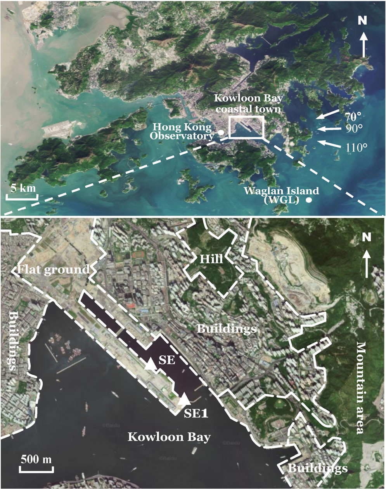

   **图 1** 九龙湾沿海城区与气象站的位置。上图为区域位置，下图为局部地形与建筑；Hong Kong Observatory 为香港天文台，Waglan Island 为横澜岛，flat ground、hill、mountain area 和 buildings 分别为平地、山丘、山地区域与建筑。

2.1 风气候
~~~~~~~~~~

为说明该区域风气候，这里给出香港天文台提供的周边气象站资料。图 1 标出了城区周围气象站的位置。香港天文台站和横澜岛站的风速测量高度分别为离地 42.3 m 与 26.9 m。

图 2(a) 给出香港天文台 1981–2010 年的风向玫瑰图，由此可以看出东风是该区域的盛行风。图 2(b) 为横澜岛台风条件下最大阵风的风向玫瑰图。横澜岛站周边平坦、东风方向无遮挡，是香港重要的风况指示站，因此这里同时给出该站 2003–2013 年记录的 52 场台风的风向玫瑰图。

显然，最大阵风主要来自东、东北偏东和东南偏东方向。因此，本文选择 :math:`70^\circ`、:math:`90^\circ` 和 :math:`110^\circ` 三个风向。这里 :math:`0^\circ` 表示北风，:math:`90^\circ` 表示东风，其他方向依此类推。

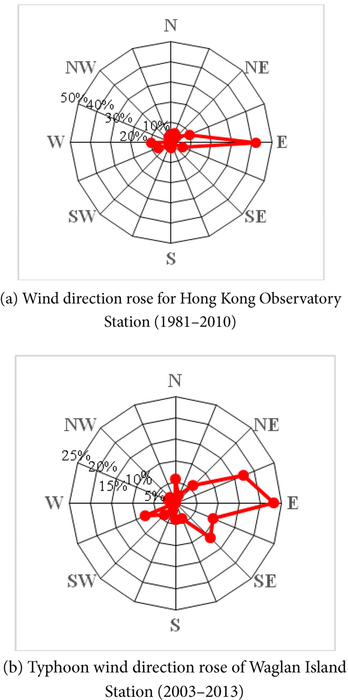

   **图 2** 九龙湾沿海城区周围风向出现频率分布。（a）香港天文台站 1981–2010 年风向玫瑰图；（b）横澜岛站 2003–2013 年台风风向玫瑰图。

2.2 用于 CFD 模拟的三个辅助气象站
~~~~~~~~~~~~~~~~~~~~~~~~~~~~~~~~~~~~~~~~~~~~

首先，WGL 站位于远离障碍物的岛屿上，处于盛行风的上游方向。虽然它位于目标区域之外，但非常适合作为确定入流风速和风向的参考站。其次，如图 1 放大图所示，位于目标区域平地上的 SE、SE1 站被选作 CFD 模拟结果的验证站。

每个站配置两个风杯，如图 3 所示。SE、SE1 和 WGL 站测量高度分别为离地 12.9 m、15.9 m 和 26.9 m。测量数据包括一分钟平均风速、一分钟平均风向以及一分钟内最大阵风风速。表 1 汇总三个辅助气象站的信息。

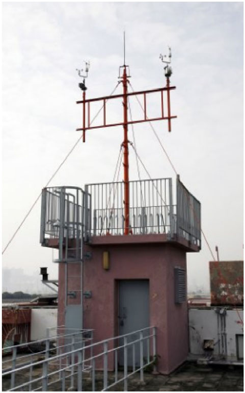

   **图 3** 气象站的风速仪。

.. list-table:: 表 1 三个辅助气象站的信息
   :header-rows: 1

   * - 气象站
     - 位置
     - 风速仪高度
     - 用途
   * - SE
     - 目标区内
     - 离地 12.9 m
     - 验证
   * - SE1
     - 目标区内
     - 离地 15.9 m
     - 验证
   * - WGL
     - 目标区外、上游无遮挡岛屿
     - 离地 26.9 m（平均海平面以上 82.7 m）
     - 入流参考

3 数值与网格配置
----------------

采用通用有限体积 CFD 软件 Fluent 模拟城市区域上方三维不可压缩、中性层结的大气边界层（ABL）。按照计算风工程（CWE）最佳实践指南（Franke et al. 2004；Franke 2006；Franke et al. 2007；Tominaga et al. 2008），审慎配置计算设置、几何、计算域、网格及边界条件。以下各节详细讨论这些设置。

3.1 计算设置
~~~~~~~~~~~~

对九龙湾沿海城区巨大而复杂的风场离散，需要数千万网格单元才能保证建模精度。若要再现真实非定常风事件，不仅需要非定常湍流模型，还必须预先准备时空相关且随时空变化的入流条件。然而，以本文所处阶段的计算能力，在城市尺度模型中模拟真实非定常风事件尚不可行。此外，稳态雷诺平均 Navier–Stokes（RANS）方法一直是城市风环境 CFD 模拟中最常用的方法，因为多数 BPG 主要针对稳态 RANS，关于非定常 RANS（URANS）、大涡模拟（LES）和混合 URANS/LES 的指导非常有限。因此，作为折中，本文仅求解稳态 RANS 方程，以模拟 ABL 中统计稳态的流动与扩散现象。

与标准 :math:`k\text{–}\varepsilon` 湍流模型相比，realizable :math:`k\text{–}\varepsilon` 模型引入新的湍流黏度表达式和耗散率输运方程，在包含分离与回流的流动中表现更好（Shih et al. 1995）。与七方程非线性雷诺应力模型相比，两方程 realizable :math:`k\text{–}\varepsilon` 模型在畸变四面体网格上收敛更加稳定、高效（Franke et al. 2004）。因此，考虑综合性能，本文采用 realizable :math:`k\text{–}\varepsilon` 模型。

此外，采用 SIMPLE 算法处理压力与速度耦合，并引入偏斜度修正技术，减轻高度畸变四面体网格带来的收敛困难。对流项、黏性项离散及压力插值均采用二阶格式。除了确保残差维持在较低水平，即 x、y、z 动量为 :math:`10^{-5}`，:math:`k` 和 :math:`\varepsilon` 为 :math:`10^{-4}`，连续性为 :math:`10^{-3}`，迭代收敛标准还要求关注位置的速度达到恒定或周期状态。在后处理阶段，对所有输出流动变量在稳定迭代步上取平均。

对于受壁面约束的流动，近壁流动处理明显影响外区平均速度场与湍流。借助边界层中的三棱柱网格，最终网格第一层高度约为 0.05 m。考虑钝体流动的复杂性，相应 :math:`y^+` 约在 5 至 5000 之间。因此，结合两层模型与壁面函数的增强壁面处理，适合本文壁面区域 :math:`y^+` 跨越多个层次的情况。

计算域侧边界和顶部采用自由滑移条件，即法向速度分量和全部速度分量的法向梯度均为零。出口平面附近的地形与建筑限制了风的充分发展，因此选择比自由出流条件更合理的零表压压力出口。入流条件处理将在后续章节重点讨论。

3.2 几何建模与计算域
~~~~~~~~~~~~~~~~~~~~

受计算能力与高质量网格要求限制，当前既不可能也无必要模拟城市中每栋建筑、设施和地形的全部细节。划分网格前进行了几何特征简化与清理。模型简化遵循两个原则：（1）小于最小表面网格尺寸的几何细节予以忽略，本算例为 5 m；（2）若某一几何特征导致畸变网格，则进行简化，但不应显著影响原有气流。此外，为考虑山地地形对风场的影响，还借助 GIS 数据库建立地形模型。完成的城市模型见图 4。

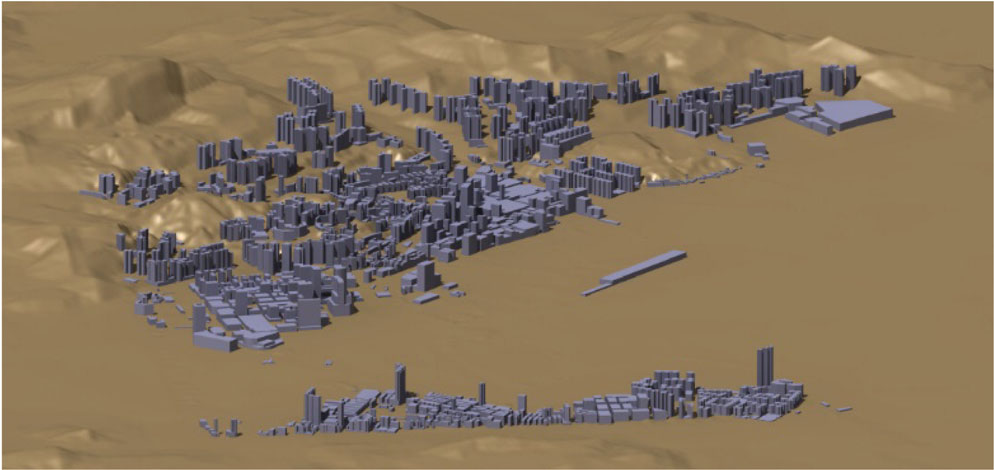

   **图 4** 九龙湾沿海城区的建筑与地形几何模型。

类似风洞试验，计算域横截面尺寸应满足阻塞比小于 3% 的要求，以减小侧边界和顶边界对气流的影响。阻塞比定义为障碍物迎风投影面积与计算域横截面积之比。入口边界与城市模型之间距离应尽量短，以避免产生非预期的流向梯度；城市模型下游计算域则应足够长，使尾流充分发展，这有助于收敛（Janssen et al. 2013）。根据 Franke et al. (2007) 的指南，计算域尺寸见图 5(a)、(b)，其中 :math:`H` 为建筑最大高度。:math:`90^\circ` 风向的具体计算域尺寸见图 5(c)，计算域高度为 1125 m。图中三角形为实测站，圆形为 CFD 模型附加监测点。其他风向的计算域遵循同样规则，为简洁起见未在图中展示。

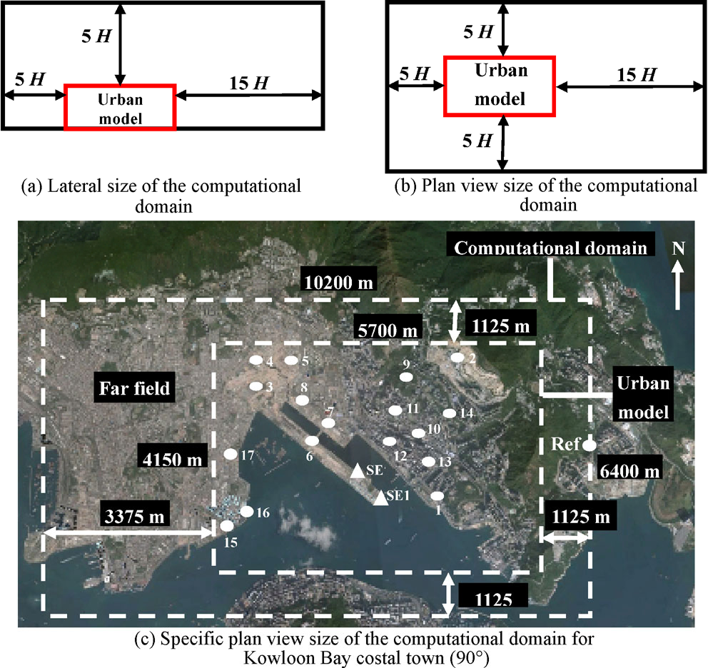

   **图 5** 计算域尺寸。（a）侧视尺寸；（b）平面尺寸；（c）九龙湾沿海城区 90° 风向具体平面尺寸。Urban model 为城市模型，far field 为远场，Ref 为参考点；三角形为实测站，圆形为附加监测点。

3.3 网格敏感性分析
~~~~~~~~~~~~~~~~~~

van Hooff and Blocken (2010) 提出的高质量网格生成方法，通过沿竖向和水平方向拉伸几何横截面，采用六面体与三棱柱网格离散城市风场。据作者所知，这种方法仅适用于平坦地形，且需要大量人工调整。对于包含大量建筑的山地城市区域，难以采用这一方法。因此，本文采用更自动化、可实施的混合网格方案，可组合六面体、四面体和三棱柱单元。如图 6 所示，大部分计算网格为六面体，建筑边界覆盖数层棱柱网格，其间用四面体填充，以适应复杂几何。网格通过 ICEM CFD 划分。

许多指南（Franke et al. 2007；Tominaga et al. 2008）建议，必须在平行于壁面和地表的方向布置边界层单元，即棱柱网格。Fothergill et al. (2002) 也指出，带棱柱单元的四面体网格结果优于纯四面体网格。关于边界层单元层数，Franke et al. (2004) 建议，在风舒适性分析中，1.5 m 高度以下至少应设三至四层。网格分辨率高度依赖具体问题，应结合网格敏感性分析和计算能力确定。如表 2 所列，本文采用三套网格方案开展敏感性分析。

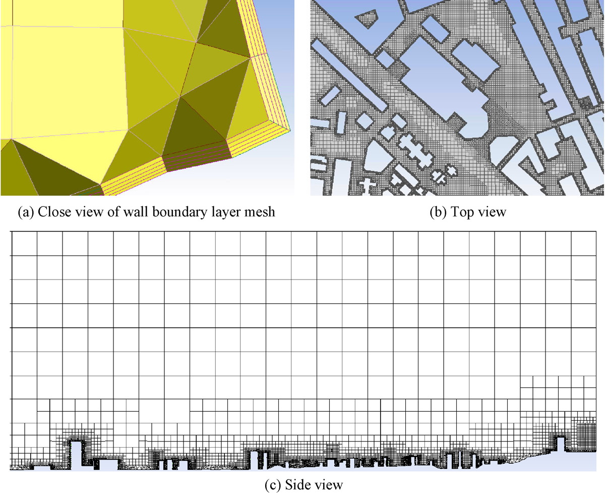

   **图 6** 计算网格。（a）壁面边界层网格局部；（b）俯视图；（c）侧视图。

.. list-table:: 表 2 网格方案
   :header-rows: 1

   * - 方案
     - 单元数
     - 建筑网格（m）
     - 地形网格（m）
     - 远场网格（m）
     - 边界层初始高度（m）
     - 边界层层数
   * - 1
     - 5712 万
     - 5
     - 30
     - 120
     - 0.05
     - 10
   * - 2
     - 4559 万
     - 5
     - 35
     - 120
     - 0.05
     - 5
   * - 3
     - 2921 万
     - 8
     - 40
     - 150
     - 0.05
     - 5

网格敏感性分析比较不同方案监测点的风速比，其定义为

.. math::

   K_i=\frac U{U_{\mathrm{ref}}} \qquad (1)

其中 :math:`K_i` 为网格方案 :math:`i` 的风速比，:math:`U` 为监测点风速，:math:`U_{\mathrm{ref}}` 为参考风速。如图 5 所示，参考点位于入口中部，文中此处给出的高度为离地 82.7 m。

比较结果见图 7。方案 1 与方案 2 的差异，比方案 2 与方案 3 的差异更明显。方案 2 与方案 3 的风速比偏差大多在 20% 以内；方案 2 与方案 1 的情况则相反。

这表明方案 2 与方案 3 的计算精度相近，而单元更多的方案 1 可能具有最佳精度。结合现有计算能力，后续模拟采用方案 1。:math:`90^\circ` 风向总网格数为 5712 万，:math:`70^\circ` 和 :math:`110^\circ` 风向略有不同。

需要注意，方案 1 与方案 2、3 的主要差别是边界层网格。这表明边界层网格数量对模拟结果有明显影响，适当增加其层数有助于提高精度。因此，开展此类风环境模拟时，建议在检查网格分辨率敏感性后，继续研究边界层网格对结果的影响。

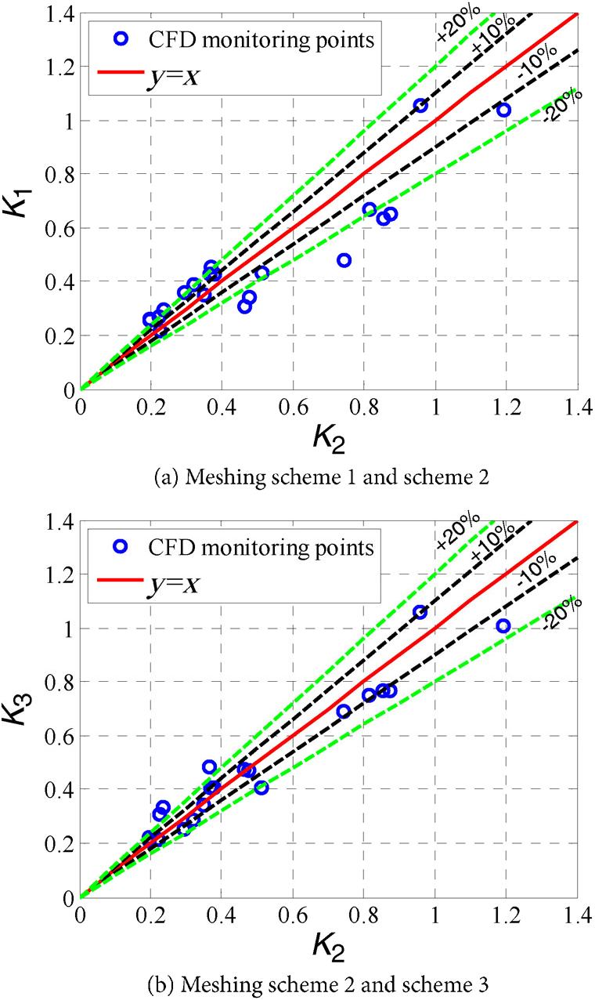

   **图 7** 网格敏感性分析结果。（a）方案 1 与 2；（b）方案 2 与 3。蓝色圆点为 CFD 监测点，红线为 y=x，虚线为 ±10% 和 ±20% 偏差。

4 入流条件的确定
----------------

要确定山地／城区的入流条件，必须清楚了解上游区域的地貌分布。本节讨论入流条件的重要性及其确定方法。

4.1 山地／城区入流条件的复杂性
~~~~~~~~~~~~~~~~~~~~~~~~~~~~~~

地形变化会直接影响风剖面的发展。如图 8 所示，边界层风最初来自平坦地形，在本算例中即海面。到达粗糙地形 I 后，剖面下部形成减速并适应新地形的风速分布，上部则保持不变。随后，尚未在地形 I 上充分发展的剖面，又必须适应粗糙地形 II。最终，在粗糙地形影响下，稳定的对数剖面演变为难以用解析方式描述的不稳定复杂剖面（Li and He 2013）。

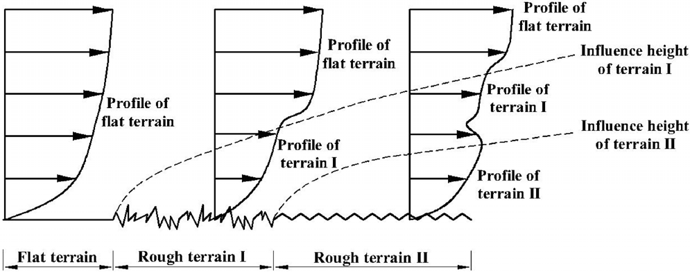

   **图 8** 不同地形类型中的风剖面变化。气流从平坦地形依次进入粗糙地形 I、II；虚线分别标示地形 I、II 的影响高度。

本算例九龙湾沿海城区上游复杂周边环境见图 9。上游大部分为山地，其中分布三个建筑群，南侧和东侧为南海。

.. figure:: ../../../wechat/assets/public-safe/ref-li2017-BS/fig09-original.png
   :alt: 图 9 上游区域的周边环境及上游计算域内风剖面的发展过程。（a）复杂周边环境；（b）沿图示线的风剖面发展。Hilltop I–III 为山顶 I–III，buildings 为建筑，sea 为海面，flat ground 为平地。原图分图说明称“蓝线”，正文称虚线。
   :align: center
   :width: 100%

   **图 9** 上游区域的周边环境及上游计算域内风剖面的发展过程。（a）复杂周边环境；（b）沿图示线的风剖面发展。Hilltop I–III 为山顶 I–III，buildings 为建筑，sea 为海面，flat ground 为平地。原图分图说明称“蓝线”，正文称虚线。

为解释真实风剖面在上游计算域的发展过程，图 9(b) 给出沿图 9(a) 虚线从 CFD 模拟提取的剖面。来自东侧海面的入口风采用对数律是合理的；经过山地后，剖面发生明显变化。在山体迎风侧，剖面下部平均风速显著增加，在山顶达到峰值；在背风侧，由于流动分离，风速降低。这些趋势与其他研究者对三维山丘风流特性的研究基本一致（Liu et al. 2016）。气流与山丘、建筑作用后，在图 9(b) 的山顶 III 尾流区形成复杂剖面。显然，若不直接模拟上游环境，就难以确定这种复杂入流条件。

4.2 确定入流条件的方法
~~~~~~~~~~~~~~~~~~~~~~

图 10 列出风环境 CFD 模拟中两类入流条件确定方法。

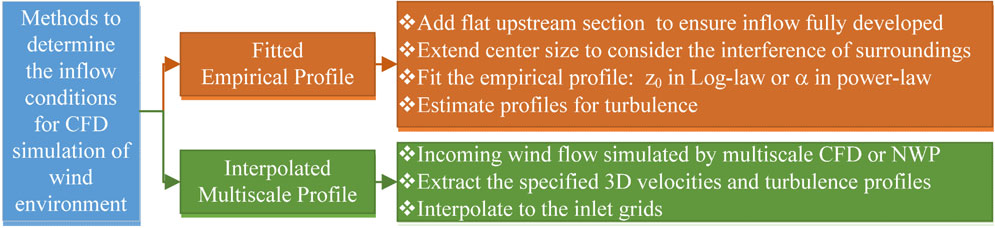

   **图 10** 两种入流确定方法的比较。FEP：增加平坦上游段以使入流充分发展，扩大中心区域以考虑周边干扰，拟合经验剖面中的对数律粗糙度长度或幂律指数，估计湍流剖面。IMP：用多尺度 CFD 或 NWP 模拟入流，提取指定三维速度与湍流剖面，再插值到入口网格。

传统上，风环境 CFD 模拟的入口条件采用与实体边界层风洞相同的方法确定。服从对数律或幂律的入流风剖面，多根据地形暴露类别和研究者经验确定。此外，需在计算域上游增加平坦段，确保入流经过足够距离发展（Tominaga and Stathopoulos 2013）。中心区域尺寸也需扩大，以计入周边建筑和山丘干扰。本文将通过经验律拟合生成的入流条件称为 FEP。

本文强调的另一种方法，通过插值多尺度模拟结果生成入流条件，称为 IMP。前文已指出，为考虑山地／城区入口条件的复杂性，需要开展相同或更大尺度的 CFD，甚至 NWP 模拟。对于已经发生的雷暴或台风事件，能够模拟数十米至数千公里尺度的 WRF 等中尺度 NWP 系统，是合理选择。中尺度 NWP 可利用观测和分析资料重现大气现象，数据同化系统会使模拟结果逐步接近真实事件。Yamada and Koike (2011) 将 NWP 与 CFD 之间升尺度、降尺度耦合方法归纳为四类。不过，对于固定方位角的稳态模拟，上一级模拟更适合采用 RANS CFD。最后，可提取指定的三维速度和湍流剖面，本文为 :math:`k` 与 :math:`\varepsilon`，再插值到下一级入口网格。

本文将同时采用 IMP 与 FEP 方法，并检验它们的表现。

4.3 入流条件确定的数值模型
~~~~~~~~~~~~~~~~~~~~~~~~~~

4.3.1 插值多尺度剖面（IMP）方法
^^^^^^^^^^^^^^^^^^^^^^^^^^^^^^^

本文 IMP 模拟使用多尺度 CFD 技术，而不是 NWP 技术。由于东风是盛行风，为 IMP 建立了图 11 所示、尺度相近的上游计算模型。如图 9 所示，上游计算域入口位于海面，其风剖面可按 Richards and Hoxey (1993) 给定：

.. math::

   U(z)=\frac{u^*_{\mathrm{ABL}}}{\kappa}\ln\!\left(\frac{z+z_0}{z_0}\right) \qquad (2)

其中 :math:`U(z)` 为距地高度 :math:`z` 处的风速，:math:`\kappa=0.42` 为 Karman 常数；调整摩擦速度 :math:`u^*_{\mathrm{ABL}}`，使 :math:`U(10)=10\,\mathrm{m/s}`。根据更新的 Davenport 粗糙度分类（Wieringa 1992），粗糙度长度 :math:`z_0` 设为 0.0002 m。总网格数为 2425 万，最小网格尺寸为 6 m，计算设置与第 3 节一致。

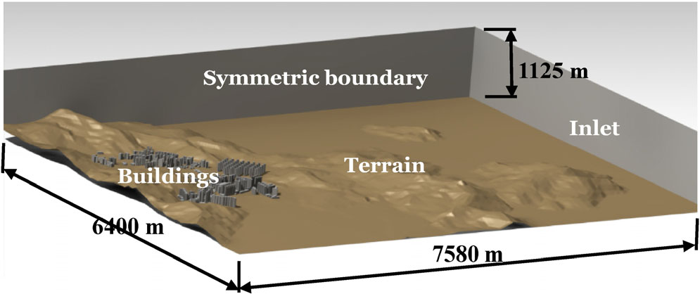

   **图 11** IMP 的上游区域计算模型（90°）。Symmetric boundary 为对称边界，inlet 为入口，buildings 为建筑，terrain 为地形；图示平面尺寸为 6400 m×7580 m，高度为 1125 m。

为模拟水平均匀 ABL，根据作者之前的研究（Li et al. 2015），用式 (3)–(5) 描述入口湍流特性；该研究已证明这些入流条件具有自保持性。

.. math::

   I(z)=\begin{cases}0.1(z_b/z_G)^{-\alpha-0.05},&z\leq z_b,\\0.1(z/z_G)^{-\alpha-0.05},&z_b<z\leq z_G,\end{cases} \qquad (3)

.. math::

   k=0.7\left(U(z)I(z)\right)^2 \qquad (4)

.. math::

   \varepsilon=\frac{u^*_{\mathrm{ABL}} C_\mu^{0.5}k}{\kappa(z+z_0)} \qquad (5)

其中 :math:`I(z)` 为湍流强度；根据 AIJ 建筑荷载规范（Architectural Institute of Japan 1996），截断高度 :math:`z_b=5\,\mathrm m`、梯度高度 :math:`z_G=250\,\mathrm m`、粗糙度指数 :math:`\alpha=0.1`。:math:`k` 为湍动能，单位 :math:`\mathrm{m^2/s^2}`；:math:`\varepsilon` 为耗散率；:math:`C_\mu=0.09` 为 :math:`k\text{–}\varepsilon` 模型常数。

上游区域模拟收敛后，提取出口平面的三维速度及湍流信息（:math:`k` 与 :math:`\varepsilon`），并导入图 12 所示 IMP 模型的传递平面。由于这两个平面的网格不完全共形，采用反距离插值实现信息传递。该方法根据源点与目标面单元中心之间距离的倒数确定权重，为传递平面上每个单元面赋值。

4.3.2 拟合经验剖面（FEP）方法
^^^^^^^^^^^^^^^^^^^^^^^^^^^^^

如图 12 所示，FEP 模型相对于 IMP 模型增加了 1125 m 长的上游平坦段，计算域具体尺寸与图 5 一致。FEP 入口平面的风剖面和湍流剖面可按式 (2)–(5) 确定。必须指出，在这种复杂地形中估计暴露类别和粗糙度长度 :math:`z_0` 是一项主要挑战。本文对 IMP 模拟中相同位置的风剖面沿展向平均，再进行最小二乘对数曲线拟合，得到 :math:`z_0`。:math:`70^\circ`、:math:`90^\circ` 和 :math:`110^\circ` 风向的 FEP 拟合入口粗糙度长度分别为 2.176 m、1.180 m 和 1.250 m。

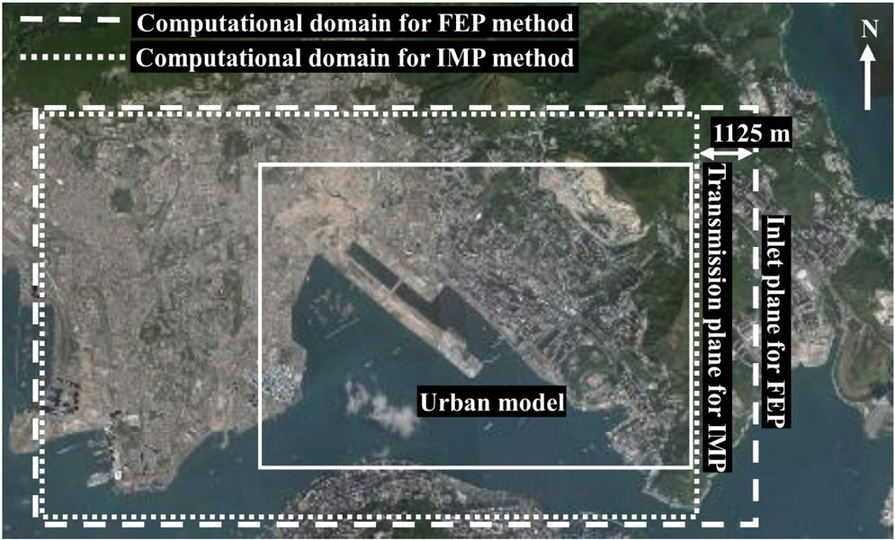

   **图 12** FEP／IMP 模型的计算域（90° 风）。图示区分两种计算域边界、IMP 传递平面与 FEP 入口平面，后者增加 1125 m 上游段。

4.3.3 风剖面的比较
^^^^^^^^^^^^^^^^^^

综上，IMP 模型风剖面完全依赖上游区域模拟传递的信息，FEP 模型则仅按式 (2)–(5) 确定。为展示两种方法生成入流条件的明显差别，图 13 给出三个风向下建筑前方截面的风速比 :math:`U/U_{\mathrm{ref}}` 云图；该截面与 IMP 传递平面位置一致。:math:`U_{\mathrm{ref}}` 为入口高度 82.7 m 处的参考风速。由于各风向截面位置不同，图中的山体形状也不同。IMP 结果中可见不规则低风速区域，其影响高度可达平均海平面以上 600 m；FEP 则给出层状低风速区域，影响范围相对有限。

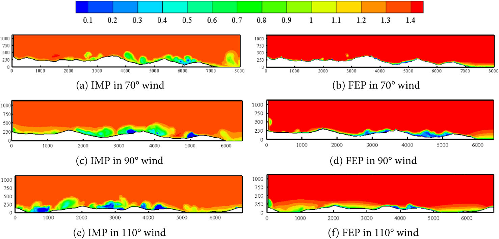

   **图 13** 建筑前方入口截面的风速比云图。（a）、（c）、（e）分别为 70°、90°、110° 的 IMP；（b）、（d）、（f）分别为对应 FEP。

5 应用：气象站空间代表性分析
----------------------------

CFD 模拟结果可作为城市风环境数据库，用于行人风舒适性评估、污染物扩散预测、建筑自然通风分析等。本文将模拟结果用于 SE、SE1 站的空间代表性分析，以回答一个问题：风速仪能够代表多大空间范围内的风环境？

一般而言，观测代表性评估常用两类指标：点面一致性指标和空间异质性指标。点面一致性描述某点测得的条件在多大程度上反映一个面域上的实际条件，例如平均值（Schmid and Lloyd 1999）。若两者之差小于给定阈值，可认为该观测点在这一区域具有代表性，其表达式为

.. math::

   \Delta=\left|\frac{\eta_c-\overline\eta}{\overline\eta}\right|\leq\delta \qquad (6)

其中 :math:`\eta_c` 为观测点测值，:math:`\overline\eta` 为区域平均值；:math:`\delta` 为偏差，通常 10% 可被接受（Schmid and Lloyd 1999）。点面一致性直观、易用，但仅评估与区域平均值的差异，缺少区域内部变化的描述。作为空间异质性指标，半方差被广泛用于描述空间区域内的变异（Janis and Robeson 2004；Garrigues et al. 2006；Chen et al. 2012）。针对特定位置的空间变异分析，修正概念“以点为中心的半方差”更适用（Burcsu et al. 2001；Janis and Robeson 2004），其定义为

.. math::

   \gamma_c(h)=\frac1{2N(h)}\sum_{(i,c)\mid h_{ic}=h}(\eta_i-\eta_c)^2 \qquad (7)

其中 :math:`\gamma_c(h)` 为距中心点，即观测站，向外 :math:`h` 处的半方差；:math:`N(h)` 为距中心点 :math:`h` 的点数；:math:`\eta_i` 为这些点中第 :math:`i` 点的目标变量值。较小的以点为中心的半方差，表示周围点与观测站吻合良好，反之亦然。然而，据作者所知，气象站空间代表性尚无公认的半方差阈值。

本文同时使用这两类指标，基于 CFD 结果重新评估 SE、SE1 站空间代表性。为方便起见，以 SE 或 SE1 站为中心，沿向外辐射方向提取模拟风速比数据；半径从 5 m 至 1715 m，间隔为 30 m。由于 SE 与 SE1 站用于观测湾区风，剔除建成区内或离建筑过近的数据，本算例界限为 30 m。所选点见图 14。不同距站距离的点面一致性和以点为中心的半方差，可分别由式 (6)、(7) 计算。

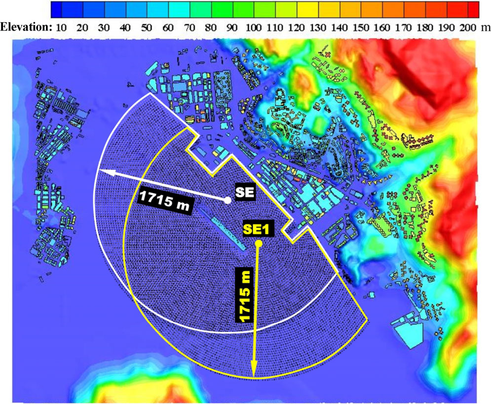

   **图 14** CFD 模型中用于代表性分析的选点。色标为高程；白色与黄色边界分别以 SE、SE1 为中心，半径上限为 1715 m。

6 结果
------

通过上游区域预模拟确定城市风场入流条件后，需要验证这些条件在复杂城区风环境研究中是否可行、可靠。最后给出代表性分析结果。

6.1 CFD 模拟结果
~~~~~~~~~~~~~~~~

图 15 给出三个风向下离地 15 m 高度的风速比 :math:`U_{15\mathrm m}/U_{\mathrm{inlet},15\mathrm m}` 云图，比较 IMP 与 FEP 模型结果。:math:`U_{\mathrm{inlet},15\mathrm m}` 表示各方法入口 15 m 高度风速，即背景风速。图中可见两种模型结果有明显差别。总体上，FEP 预测的风速比高于 IMP。:math:`70^\circ` 风向下，SE、SE1 站位于建筑尾流区，IMP 预测的风速仅约为背景风的 40%，而 FEP 在两站均预测接近背景风的 80%。:math:`90^\circ` 与 :math:`110^\circ` 风向下，周边遮挡作用减弱，两种模型均给出更高的两站风速比。但 FEP 仍倾向于明显高估，约为背景风的 100%，而 IMP 为约 70%。

.. figure:: ../../../wechat/assets/public-safe/ref-li2017-BS/fig15-original.png
   :alt: 图 15 风速比 U_15m/U_inlet,15m 云图。（a）、（c）、（e）为三个风向的 IMP；（b）、（d）、（f）为相应 FEP。Valley I–III 表示山谷 I–III，箭头标示气流路径。
   :align: center
   :width: 100%

   **图 15** 风速比 U_15m/U_inlet,15m 云图。（a）、（c）、（e）为三个风向的 IMP；（b）、（d）、（f）为相应 FEP。Valley I–III 表示山谷 I–III，箭头标示气流路径。

图 15 还表明，山谷来风是城市通风的重要来源。城区内有三条山谷，走势为东北向，与 :math:`70^\circ` 风向基本一致。IMP 模型预测，在 :math:`70^\circ` 风向下，由于山谷 I 前方障碍较少，气流能以较高速度穿过建成区；相反，山谷 II、III 来风受一组高层建筑阻挡，转向近乎垂直于原方向的路径，风速逐渐下降。:math:`90^\circ` 风向的通风路径类似，主要区别是山谷 I、II 来风进入城区中央的一条骨干道路。:math:`110^\circ` 风向的图中看不到明显通风通道，但在城区较高位置，即平均海平面以上 60 m，发现一条通风路径。该气流仍来自山谷 I，却偏离原方向，转而沿盛行风方向流动。与 IMP 相比，FEP 预测了额外通风路径。在 :math:`70^\circ` 与 :math:`90^\circ` 风向下，山谷 I 来风分为两股：一股穿过建成区直达海湾，另一股沿骨干道路进入城市核心区。FEP 似乎也预测了更强的山谷 III 来风；即使被建筑群阻挡，仍有一部分气流沿原方向直行，以相对较高速度到达海湾。

6.2 CFD 结果与实测资料的验证
~~~~~~~~~~~~~~~~~~~~~~~~~~~~

为验证模型，比较 SE、SE1 站实测和模拟风速比 :math:`U_m/U_{\mathrm{ref},m}` 与 :math:`U_{\mathrm{CFD}}/U_{\mathrm{ref},\mathrm{CFD}}`。:math:`U_m` 和 :math:`U_{\mathrm{CFD}}` 分别为实测、CFD 模拟风速；:math:`U_{\mathrm{ref},m}` 为 WGL 站平均海平面以上 82.7 m 处的实测平均风速；:math:`U_{\mathrm{ref},\mathrm{CFD}}` 为 CFD 入口平均海平面以上 82.7 m 处的平均风速。如第 2 节所述，WGL 站位于孤立岛屿，足以为东风提供可信参考。由于该站不受干扰且位于目标区上游，采用其海拔 82.7 m 处同步实测风速作为 :math:`U_{\mathrm{ref},m}`。

译注：第 3.3 节将 CFD 参考点的 82.7 m 称为“离地高度”，此处及表 1 则明确区分 WGL 离地 26.9 m 与海拔 82.7 m。全文保留这项高度基准差异，不擅自替作者统一。

为验证模型，需要选择足够长采样时段的实测资料（Schatzmann and Leitl 2011）。Franke et al. (2004) 还指出，实测数据平均时间不应超过 30 分钟，因为气象条件可能在这一时段内发生变化。SE、SE1 与 WGL 均为固定气象站，本文具备一年资料；原文此处引用第 2.3 节，而实际站点介绍为第 2.2 节。本算例对数据取 10 分钟平均，获得平均风速。对于给定模拟风向 :math:`\varphi`，仅选用 WGL 站风向在 :math:`[\varphi-5^\circ,\varphi+5^\circ]` 范围内的数据。由于 WGL 距 SE、SE1 较远，考虑气流从 WGL 到两站的传播时滞 :math:`\Delta t`。也就是说，WGL 在时刻 :math:`t` 的风速，对应 SE 或 SE1 在 :math:`t+\Delta t` 的风速。:math:`\Delta t` 近似为传播距离与 WGL 风速之比。

在 ABL 下部，地表与空气相互作用主要有机械和热力两种形式。机械作用来自风对地面的摩擦，可用水平物理量摩擦速度 :math:`u^*_{\mathrm{ABL}}` 表征。热力作用与地表向空气的热辐射和传热有关，促使空气竖向运动，即对流。本文只考虑机械作用，因此所选实测资料应尽可能接近 CFD 的中性大气和等温条件。通量 Richardson 数通常用于评估大气稳定度（Pardyjak et al. 2002；Chu et al. 2007；Chan 2008；Schatzmann and Leitl 2011），计算需要可靠的风速、气压、温度等竖向气象资料。遗憾的是，本文不具备这些资料。一个粗略办法是设定风速阈值，尝试剔除受热力作用影响的数据（Blocken and Persoon 2009；Blocken et al. 2015），其假设是强风时局地热力影响较弱。阈值可能影响验证结果，因此本文比较 :math:`U_{\mathrm{ref},m}>5`、:math:`>10`、:math:`>15` 与 :math:`>20\,\mathrm{m/s}` 四种阈值，结果见图 16。表 3 给出了经 5、10、15、20 m/s 阈值筛选后的记录样本数。

.. figure:: ../../../wechat/assets/public-safe/ref-li2017-BS/fig16-original.png
   :alt: 图 16 FEP 与 IMP 模型验证结果。（a）风速比对比；（b）四个阈值下风速比平均相对误差。四种柱色对应不同阈值筛选的实测资料，实线与虚线分别为两种 CFD 方法。
   :align: center
   :width: 100%

   **图 16** FEP 与 IMP 模型验证结果。（a）风速比对比；（b）四个阈值下风速比平均相对误差。四种柱色对应不同阈值筛选的实测资料，实线与虚线分别为两种 CFD 方法。

.. list-table:: 表 3 筛选后的记录样本数量
   :header-rows: 1

   * - 阈值
     - 70°
     - 90°
     - 110°
     - 合计
   * - 5 m/s
     - 2489
     - 857
     - 185
     - 3531
   * - 10 m/s
     - 843
     - 241
     - 49
     - 1133
   * - 15 m/s
     - 20
     - 20
     - 17
     - 57
   * - 20 m/s
     - 4
     - 13
     - 16
     - 33

如第 6.1 节所述，由于未直接考虑入口处建筑与地形的遮挡效应，FEP 倾向于给出比 IMP 更高的风速比；在 :math:`110^\circ` 风向下高出 45%，图 16(a) 清楚展示了这一点。该图也表明，随着阈值提高，实测风速比呈下降趋势，与上述假设一致。低风速时，机械诱发和热力诱发的湍流共同组成空气运动；强风时，热力诱发湍流减弱，机械诱发湍流成为主要形式，这可能解释风速比的下降趋势。

图 16(b) 给出四个阈值下风速比平均相对误差。阈值为 5 m/s 时，FEP 与实测比 IMP 更一致：平均相对误差仅 12%，IMP 则接近 20%。但随着阈值提高，FEP 误差迅速增大，在 20 m/s 阈值时达到 37%。相反，IMP 平均误差对阈值不太敏感，始终维持在合理水平；阈值为 15 m/s 和 20 m/s 时，相对误差降至 10% 以下。

总体而言，用现场实测验证中性 ABL 的 CFD 模拟时，提高风速阈值是筛除热力影响资料的一种有效办法。此外，建议检查模拟结果对风速阈值的敏感性，这有助于定性评估模拟可靠性。本文验证表明，与常规 FEP 相比，IMP 倾向于提供更可行、可靠的模拟结果。后续讨论均基于 IMP 结果。

6.3 气象站空间代表性分析
~~~~~~~~~~~~~~~~~~~~~~~~

根据上述验证，可合理认为，采用 IMP 入流条件得到的 SE、SE1 周边 CFD 结果可用于空间代表性分析。因此，以下分析均基于 IMP 模型结果。

图 17 给出空间代表性分析结果。在 :math:`70^\circ` 风向下，从 SE 站向外 1200 m 范围内，点面一致性指标低于 10%，以点为中心的半方差也稳定在较低水平；超过这一范围，两项指标迅速增长，表明 SE 能代表该区域风速。对于 SE1，虽然整个范围内点面一致性均低于阈值，但半方差在超过 845 m 后快速增长，因此保守地认为 SE1 的代表范围为 845 m。SE 的代表区域更大，但多数距离上 SE1 的指标低于 SE，说明 SE1 风速与其所属区域更一致。在 :math:`90^\circ` 风向下，图 17(c) 显示两站点面一致性指标快速上升；SE 在 635 m 处超出阈值并继续升高，SE1 在 575 m 处达到 12% 峰值后下降。图 17(d) 显示，在 1000 m 范围内，两站半方差趋势相似；超过 400 m 后才开始快速增长。综合判断，SE、SE1 均在 400 m 范围内具有代表性。SE 指标幅值低于 SE1，与所属区域更一致。在 :math:`110^\circ` 风向下，两站点面一致性趋势十分相似：600 m 内很小，此后迅速增长，分别在 SE 的 1235 m 和 SE1 的 1355 m 处达到阈值。半方差方面，SE 的 545 m 内、SE1 的 425 m 内均稳定在较低水平。结合图 17(e)、(f)，可认为 SE 在 545 m 内、SE1 在 425 m 内具有代表性。在 1000 m 以内，SE 半方差明显低于 SE1，说明 SE 风速与其所属区域更一致。表 4 汇总分析结果。

.. figure:: ../../../wechat/assets/public-safe/ref-li2017-BS/fig17-original.png
   :alt: 图 17 三个风向下的点面一致性指标与以点为中心的半方差。左列为点面指标，右列为半方差；从上到下依次为 70°、90°、110°。红色实线为 SE，黑色空心点为 SE1；点面指标中的蓝线为 10% 阈值。
   :align: center
   :width: 100%

   **图 17** 三个风向下的点面一致性指标与以点为中心的半方差。左列为点面指标，右列为半方差；从上到下依次为 70°、90°、110°。红色实线为 SE，黑色空心点为 SE1；点面指标中的蓝线为 10% 阈值。

.. list-table:: 表 4 空间代表性分析结果
   :header-rows: 1

   * - 风向
     - 观测站
     - 代表范围（m）
     - 代表性优选站
   * - 70°
     - SE
     - 1200
     - SE1
   * - 70°
     - SE1
     - 845
     - SE1
   * - 90°
     - SE
     - 400
     - SE
   * - 90°
     - SE1
     - 400
     - SE
   * - 110°
     - SE
     - 545
     - SE
   * - 110°
     - SE1
     - 425
     - SE

综上，点面一致性与以点为中心的半方差，对测风站空间代表性给出了明显不同的结果。本算例中，点面一致性往往预测比半方差更宽的代表范围。为保守起见，采用较小范围。需要指出的一个局限是，空间代表性分析缺乏明确的半方差阈值，可能使评估带有主观性。

7 结论与讨论
------------

以香港九龙湾沿海城区风环境模拟为背景，本文提出两种确定山地／城区入流条件的途径，并与现场资料比较，验证其精度。主要结论如下：

1. 实测验证表明，与 FEP 相比，IMP 入流条件有助于获得更合理的预测。IMP 与多尺度 CFD 结合，为建筑、山丘、海面混合复杂区域的入流不确定性提供了成本可承受、可应用的方法，并使高密度网格局地风环境模拟成为可能。
2. 随着风速阈值增加，更多热力诱发湍流的影响被排除，实测风速比相应呈下降趋势。由于 CFD 仅模拟机械湍流，IMP 结果随阈值升高而更加一致。因此，在利用实测定性评估中性 ABL 的 CFD 结果可靠性时，建议在保证风样本充足的前提下采用较高风速阈值。
3. 与风洞试验相比，CFD 模拟风速场的细节层次不受限制，为评估风速仪的气象代表性提供所需数据。本文计算了点面一致性与以点为中心的半方差两种代表性指标。结果表明，尽管受到建筑／地形遮挡，九龙湾气象站在 400 m 范围内仍具有良好的代表性。

各种先进模拟技术的发展始终伴随精度与计算效率之间的矛盾，风环境模拟的入流处理等 CWE 问题也不例外。IMP 明显增加计算资源消耗，但也能提供更高精度，并为复杂风事件模拟带来更多可能。本文及其他研究表明，风环境模拟的发展方向在于 CFD–CFD 和 NWP–CFD 多尺度模拟。CFD–CFD 为复杂风环境提供兼具较高精度和可承受计算需求的方案；NWP–CFD 则能将大气天气系统与近地微风环境结合。与 MM5、WRF 等 NWP 耦合后，有可能重现城区中风速、风向明显变化的复杂随机风事件，例如雷暴或台风。

从长期看，以 IMP 和多尺度模拟为基础，为城市建立可长期使用的全风向风环境数据库，是可行且必要的。这样的数据库能够高效确定任意目标区域的边界条件或风剖面，还可及时为行人风舒适性评估、污染物扩散预测、建筑自然通风、城市规划及风灾防范等提供指导信息。

不过，未来仍有若干问题和挑战需要解决：（1）所有多尺度模拟都存在由尺度间不恰当数据插值引出的复杂问题。经时间、空间插值后，IMP 难以始终满足 Navier–Stokes 方程并维持整个 CFD 域的质量守恒。（2）当前模拟限于中性大气条件，真实大气并非总是中性，热力过程是影响城市风环境的重要因素，因此未来应考虑热耦合场。（3）风流具有瞬态和随机特性，未来宜将合成的小尺度高频速度，与上一级模拟得到的大尺度低频速度结合；生成随时空变化的入流条件，应能考虑 ABL 流动的湍流分量。

参考文献
--------

Architectural Institute of Japan (1996). AIJ Recommendations for Loads on Buildings. Tokyo: Architectural Institute of Japan.

Ashie Y, Kono T (2011). Urban-scale CFD analysis in support of a climate-sensitive design for the Tokyo Bay area. International Journal of Climatology, 31: 174–188.

Blocken B (2015). Computational Fluid Dynamics for urban physics: Importance, scales, possibilities, limitations and ten tips and tricks towards accurate and reliable simulations. Building and Environment, 91: 219–245.

Blocken B, Gualtieri C (2012). Ten iterative steps for model development and evaluation applied to Computational Fluid Dynamics for Environmental Fluid Mechanics. Environmental Modelling & Software, 33: 1–22.

Blocken B, Janssen WD, van Hooff T (2012). CFD simulation for pedestrian wind comfort and wind safety in urban areas: General decision framework and case study for the Eindhoven University campus. Environmental Modelling & Software, 30: 15–34.

Blocken B, Persoon J (2009). Pedestrian wind comfort around a large football stadium in an urban environment: CFD simulation, validation and application of the new Dutch wind nuisance standard. Journal of Wind Engineering and Industrial Aerodynamics, 97: 255–270.

Blocken B, van der Hout A, Dekker J, Weiler O (2015). CFD simulation of wind flow over natural complex terrain: Case study with validation by field measurements for Ria de Ferrol, Galicia, Spain. Journal of Wind Engineering and Industrial Aerodynamics, 147: 43–57.

Bottema M (1995). Aerodynamic roughness parameters for homogeneous building groups—Part 2: Results document SUB-MESO 23. Nantes, France: Ecole Central de Nantes.

Burcsu TK, Robeson SM, Meretsky VJ (2001). Identifying the distance of vegetative edge effects using Landsat TM data and geostatistical methods. Geocarto International, 16(4): 61–70.

Chan PW (2008). Determination of Richardson number profile from remote sensing data and its aviation application. IOP Conference Series: Earth and Environmental Science, 2008(1): 012043.

Chen B, Coops NC, Fu D, Margolis HA, Amiro BD, Black TA, Arain MA, Barr AG, Bourque CPA, Flanagan LB, Lafleur PM, McCaughey JH, Wofsy SC (2012). Characterizing spatial representativeness of flux tower eddy-covariance measurements across the Canadian Carbon Program Network using remote sensing and footprint analysis. Remote Sensing of Environment, 124: 742–755.

Chen QY (2004). Using computational tools to factor wind into architectural environment design. Energy and Buildings, 36: 1197–1209.

Chu YH, Su CL, Larsen MF, Chao CK (2007). First measurements of neutral wind and turbulence in the mesosphere and lower thermosphere over Taiwan with a chemical release experiment. Journal of Geophysical Research: Space Physics, 112: A02301.

Dolman AJ (1986). Estimates of roughness length and zero plane displacement for a foliated and non-foliated oak canopy. Agricultural and Forest Meteorology, 36: 241–248.

Fothergill CE, Roberts PT, Packwood AR (2002). Flow and dispersion around storage tanks—A comparison between numerical and wind tunnel simulations. Wind and Structures, 5: 89–100.

Franke J (2006). Recommendations of the COST action C14 on the use of CFD in predicting pedestrian wind environment. Paper presented at the 4th International Symposium on Computational Wind Engineering, Yokohama, Japan.

Franke J, Hirsch C, Jensen AG, Krüs HW, Schatzmann M, Westbury PS, Miles SD, Wisse JA, Wright NG (2004). Recommendations on the use of CFD in wind engineering. In: Proceedings of the International Conference on Urban Wind Engineering and Building Aerodynamics. COST action C14, Impact of Wind And Storm on City Life Built Environment, SintGenesius-Rode, Belgium.

Franke J, Hellsten A, Schlünzen H, Carissimo B (2007). Best practice guideline for the CFD simulation of flows in the urban environment. Brussels: COST Office.

Gao Z, Bian L (2004). Estimation of aerodynamic roughness length and displacement height of an urban surface from single-level sonic anemometer data. Australian Meteorological Magazine, 53(1): 21–28.

García-Sánchez C, Philips DA, Gorlé C (2014). Quantifying inflow uncertainties for CFD simulations of the flow in downtown Oklahoma City. Building and Environment, 78: 118–129.

Garrigues S, Allard D, Baret F, Weiss M (2006). Quantifying spatial heterogeneity at the landscape scale using variogram models. Remote Sensing of Environment, 103(1): 81–96.

Gorlé C, Garcia-Sanchez C, Iaccarino G (2015). Quantifying inflow and RANS turbulence model form uncertainties for wind engineering flows. Journal of Wind Engineering and Industrial Aerodynamics, 144: 202–212.

Hang J, Luo Z, Sandberg M, Gong J (2013). Natural ventilation assessment in typical open and semi-open urban environments under various wind directions. Building and Environment, 70: 318–333.

Janis MJ, Robeson SM (2004). Determining the spatial representativeness of air-temperature records using variogram-nugget time series. Physical Geography, 25: 513–530.

Janssen WD, Blocken B, van Hooff T (2013). Pedestrian wind comfort around buildings: Comparison of wind comfort criteria based on whole-flow field data for a complex case study. Building and Environment, 59: 547–562.

Kondo J, Yamazawa H (1986). Aerodynamic roughness over an inhomogeneous ground surface. Boundary-Layer Meteorology, 35: 331–348.

Lettau H (1969). Note on aerodynamic roughness-parameter estimation on the basis of roughness-element description. Journal of Applied Meteorology, 8: 828–832.

Li ZW, He DX (2013). Reviews of fluid dynamics researches in wind energy engineering. Advances in Mechanics, 43: 472–525. (in Chinese)

Li C, Xiao YQ, L AB (2015). Revisiting the CFD modeling horizontally homogenous atmospheric boundary layer. Paper presented at the 14th International Conference on Wind Engineering, Porto Alegre, Brazil.

Liu YS, Miao SG, Zhang CL, Cui GX, Zhang ZS (2012). Study on micro-atmospheric environment by coupling large eddy simulation with mesoscale model. Journal of Wind Engineering and Industrial Aerodynamics, 107–108: 106–117.

Liu Z, Ishihara T, Tanaka T, He X (2016). LES study of turbulent flow fields over a smooth 3-D hill and a smooth 2-D ridge. Journal of Wind Engineering and Industrial Aerodynamics, 153: 1–12.

Miao Y, Liu S, Chen B, Zhang B, Wang S, Li S (2013). Simulating urban flow and dispersion in Beijing by coupling a CFD model with the WRF model. Advances in Atmospheric Sciences, 30: 1663–1678.

Mirzaei PA, Carmeliet J (2013). Dynamical computational fluid dynamics modeling of the stochastic wind for application of urban studies. Building and Environment, 70: 161–170.

Pardyjak ER, Monti P, Fernando HJS (2002). Flux Richardson number measurements in stable atmospheric shear flows. Journal of Fluid Mechanics, 459: 307–316.

Ramponi R, Blocken B, de Coo L, Janssen WD (2015). CFD simulation of outdoor ventilation of generic urban configurations with different urban densities and equal and unequal street widths. Building and Environment, 92: 152–166.

Richards PJ, Hoxey RP (1993). Appropriate boundary conditions for computational wind engineering models using the k–ε turbulence model. Journal of Wind Engineering and Industrial Aerodynamics, 46–47: 145–153.

Schatzmann M, Leitl B (2011). Issues with validation of urban flow and dispersion CFD models. Journal of Wind Engineering and Industrial Aerodynamics, 99: 169–186.

Schmid HP, Lloyd CR (1999). Spatial representativeness and the location bias of flux footprints over inhomogeneous areas. Agricultural and Forest Meteorology, 93: 195–209.

Shih T, Liou WW, Shabbir A, Yang Z, Zhu J (1995). A new k–ε eddy viscosity model for high reynolds number turbulent flows. Computers & Fluids, 24: 227–238.

Tominaga Y, Mochida A, Yoshie R, Kataoka H, Nozu T, Yoshikawa M, Shirasawa T (2008). AIJ guidelines for practical applications of CFD to pedestrian wind environment around buildings. Journal of Wind Engineering and Industrial Aerodynamics, 96: 1749–1761.

Tominaga Y, Stathopoulos T (2013). CFD simulation of near-field pollutant dispersion in the urban environment: A review of current modeling techniques. Atmospheric Environment, 79: 716–730.

Toparlar Y, Blocken B, Vos P, van Heijst GJF, Janssen WD, van Hooff T, Montazeri H, Timmermans HJP (2015). CFD simulation and validation of urban microclimate: A case study for Bergpolder Zuid, Rotterdam. Building and Environment, 83: 79–90.

van Hooff T, Blocken B (2010). Coupled urban wind flow and indoor natural ventilation modelling on a high-resolution grid: A case study for the Amsterdam ArenA stadium. Environmental Modelling & Software, 25: 51–65.

Wang X, Li Y, Hang J (2017). A combined fully-resolved and porous approach for building cluster wind flows. Building Simulation, 10: 97–109.

Wieringa J (1992). Updating the Davenport roughness classification. Journal of Wind Engineering and Industrial Aerodynamics, 41: 357–368.

Yamada T, Koike K (2011). Downscaling mesoscale meteorological models for computational wind engineering applications. Journal of Wind Engineering and Industrial Aerodynamics, 99: 199–216.

Yoshie R, Mochida A, Tominaga Y (2006). CFD prediction of wind environment around a high-rise building located in an urban area. In: Proceedings of the 4h International Symposium on Computational Wind Engineering, Yokohama, Japan.

Yoshie R, Mochida A, Tominaga Y, Kataoka H, Harimoto K, Nozu T, Shirasawa T (2007). Cooperative project for CFD prediction of pedestrian wind environment in the Architectural Institute of Japan. Journal of Wind Engineering and Industrial Aerodynamics, 95: 1551–1578.

Zajaczkowski FJ, Haupt SE, Schmehl KJ (2011). A preliminary study of assimilating numerical weather prediction data into computational fluid dynamics models for wind prediction. Journal of Wind Engineering and Industrial Aerodynamics, 99: 320–329.

完整引用
--------

收录信息见 :ref:`WOEAI 学术成果页对应条目 <ref-li2017-BS>`。
