.. _paper-note-ref-li2018-AE:

通过计算流体动力学优化 H 型垂直轴风机叶片桨距：论文精解
=========================================================

精简版微信公众号文章：待发布

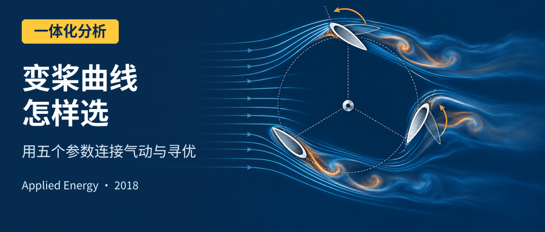

.. contents:: 本页目录
   :local:
   :depth: 2

论文信息
--------

**原文题名：** Optimization of blade pitch in H-rotor vertical axis wind turbines through computational fluid dynamics simulations。

**作者：** Chao Li，Yiqing Xiao，You-lin Xu，Yi-xin Peng，Gang Hu，Songye Zhu（通讯作者）。

**作者单位：** 哈尔滨工业大学深圳研究生院；香港理工大学土木与环境工程系；香港科技大学土木与环境工程系。

**期刊：** Applied Energy，212（2018），1107–1125。DOI：`10.1016/j.apenergy.2017.12.035 <https://doi.org/10.1016/j.apenergy.2017.12.035>`_。

**稿件日期：** 2017 年 7 月 11 日收稿；2017 年 12 月 4 日修回；2017 年 12 月 5 日录用；2018 年 1 月 6 日在线发表。

**WOEAI 相关方向：** 海洋能源结构 / 一体化分析。本篇属于风机气动与控制关联基础研究，不涉及漂浮平台或系泊系统验证。

.. note::

   本页完整覆盖所提供的 19 页主论文，保留正文对附录与补充动画的提及；按本轮确定的范围，不包含外部 MATLAB 附录代码或视频资料。

研究要点
--------

- 考虑叶片气动特性，对 VAWT 桨距控制进行参数化。
- 参数化提高了桨距控制的优化效率。
- 开发了高效的变桨控制优化平台。
- 最优桨距控制有效提高了 VAWT 的平均功率系数。

关键词
------

叶片桨距；垂直轴风机；主动控制；计算流体动力学（CFD）；遗传算法。

摘要
----

叶片桨距控制是现代水平轴风机运行中发展成熟且应用广泛的方法。然而，其在垂直轴风机（vertical axis wind turbine，VAWT）中的应用，受到作用机制尚不清晰的限制。通过深入分析叶片桨距与 VAWT 输出功率的关系，本文建立一种通用表达式，用五个控制参数表示最优叶片桨距控制的解空间。随后，构建由遗传算法和计算流体动力学（computational fluid dynamics，CFD）模拟模块组成的变桨自动优化平台（variable blade pitch automatic optimization platform，VBPAOP），寻找能使风机功率最大化的最优桨距。由于计算效率较高，采用二维非定常 CFD 模型作为性能评价工具，并在用于优化前通过风洞试验验证其精度。结果表明，在较宽的叶尖速比（tip speed ratio，TSR）范围内，优化桨距使两种不同弦长 VAWT 模型的平均功率系数分别增加 0.177 和 0.317。低于额定叶尖速比时，所提出的最优桨距控制推迟乃至避免了失速引起的转矩损失。高于额定叶尖速比时，由于迎风侧尾流速度提高，背风区域的能量提取得到改善。

1 引言
------

由于多种新方法能够推进效率极限 [1–6]，垂直轴风机再次成为有前景的能量转换装置。为提高 VAWT 的效率与竞争力，研究者投入大量工作，深入理解其复杂气动行为：当叶片遭遇攻角动态变化的流动时，可能涉及失速前、动态失速和深度失速 [7,8]，以及叶片—尾流相互作用 [9,10]。对这些气动效应开展高保真模拟，是优化 VAWT 性能的基础 [11–14]。虽然叶片桨距控制在现代水平轴风机（horizontal axis wind turbine，HAWT）中的能力已得到展示，但其对 VAWT 的有效性尚未充分证明 [15]，VAWT 的最优桨距控制规律仍不清楚 [16]。随着主动与被动变桨装置的发展 [17–22]，已有报道指出桨距控制可改善自启动能力、最大化输出功率，并减小 VAWT 结构振动。不过，大多数研究集中于固定桨距 [23–27] 或谐波桨距的叠加 [22,28–36]；针对全方位角范围实时最优主动变桨控制的研究有限。事实上，研究使 H 型 VAWT 输出功率最大化的叶片桨距控制，不仅有助于理解桨距的机制和影响，也有利于实际主动与被动变桨控制的参数优化。

符号表
~~~~~~

.. list-table:: 符号与定义
   :header-rows: 1
   :widths: 1 1

   * - 符号
     - 定义
   * - :math:`A`
     - 正弦桨距曲线幅值
   * - :math:`a`
     - 诱导因子
   * - :math:`c`
     - 叶片弦长
   * - :math:`C_P`
     - 功率系数
   * - :math:`C_T,C_N`
     - 切向力系数、法向力系数
   * - :math:`F_T,F_N`
     - 切向力、法向力
   * - :math:`g(\cdot)`
     - 描述桨距角的隐函数
   * - :math:`H`
     - 叶片高度
   * - :math:`k`
     - 转子折减频率
   * - :math:`N`
     - 叶片数
   * - :math:`r`
     - 转子半径
   * - :math:`r_1,r_2`
     - 可调比例，表示迎风与背风区域控制点所占百分比
   * - :math:`T`
     - 转子旋转周期
   * - :math:`\Delta t`
     - 时间步长
   * - :math:`V_{\mathrm{in}}`
     - 来流风速
   * - :math:`V_e`
     - 背风区域平衡流速
   * - :math:`W`
     - 叶片所遇合成相对速度
   * - :math:`\alpha`
     - 攻角，合速度方向与弦线之间的夹角
   * - :math:`\beta`
     - 桨距角，切向方向与弦线之间的夹角
   * - :math:`\varphi`
     - 流入角，合速度方向与切向方向之间的夹角
   * - :math:`\lambda`
     - 叶尖速比
   * - :math:`\theta`
     - 转子方位角
   * - :math:`\rho`
     - 空气密度
   * - :math:`\tau`
     - 无量纲时间步长
   * - :math:`\omega`
     - 转子角速度
   * - :math:`\Omega`
     - 转子旋转频率

利用双多流管（double–multiple stream tube，DMST）模型，可以解析求出各流管或方位角位置产生最大转矩的最优桨距角 [33,37]。然而，所得解析解存在潜在问题和不足。首先，DMST 过度简化，使解的精度较低。其次，DMST 不考虑相邻流管的气动干扰，所得最优桨距不连续。考虑这两点，本文采用 CFD 模拟，这是一种数值求解风机叶片周围湍流动态本质的先进方法 [38–40]。与 DMST 不同，CFD 需要逐一评估采用不同单周期桨距变化策略的 VAWT 性能，因此搜索最优变桨曲线需要迭代。考虑 CFD 的高计算成本及所需大量试算，有必要建立设计变量数量有限的合理表达式，并发展高效优化算法。

用谐波函数叠加构造主动控制叶片的桨距变化曲线，是一种简单而常见的方法 [22,28–36]，曲线函数仅需一两个可调变量，例如正弦函数的幅值与相位。然而，谐波桨距曲线叠加缺少灵活性和气动原理支撑，所能实现的效率提升通常有限。另一种方法是 Hwang 等 [17] 在 :math:`[0,2\pi]` 内均匀选取 12 个方位角位置的可调桨距角，以形成变化曲线。但这种方法优化效率较低，需要人为逐步缩小控制点桨距角约束范围，才能加快收敛。现有表达方法精度和效率低，主要是因为未考虑变桨背后的气动机制。迫切需要一种综合桨距曲线表达方法，以有限变量充分覆盖最优解空间。此外，研究者已采用多种成熟优化算法搜索最优桨距，包括遗传算法（genetic algorithm，GA）[17,29,34]、模因算法 [19]、穷举法 [37] 和暴力优化 [41]。

考虑上述问题，本文为叶片桨距主动控制的 H 型 VAWT 开发了一套集成高保真 CFD 模拟的详细优化平台。通过深入分析叶片桨距与发电之间的内在关系，建立等效通用桨距公式。所提公式考虑五个控制变量。随后，将 GA 与经过验证的 CFD 模型结合，在宽叶尖速比范围内确定理想调节参数。此外，还研究叶片弦长对最优桨距的影响。

2 优化方法
----------

2.1 叶片桨距控制与输出功率的关系机制
~~~~~~~~~~~~~~~~~~~~~~~~~~~~~~~~~~~~

升力型风机可通过提高叶片升力、降低阻力来增加输出功率。因此，对给定叶片翼型，尽可能提高升力是最大化功率的合理途径。旋转叶片的升力定义为垂直于叶片合速度方向的力分量。在实践中，气动力系数通常根据不同攻角的试验结果列表；攻角（angle of attack，AOA）记为 :math:`\alpha` ，表示合速度与叶片弦线之间的夹角。分析叶片攻角、升力与输出功率之间的简单关系可知，旋转叶片攻角主要决定升力型风机的输出功率。

HAWT 中的合速度方向沿叶片径向变化，可依据叶素动量理论，利用诱导因子、叶尖速比和叶素径向坐标确定。然而，在一个旋转周期内，叶片上每个固定点遇到的合速度方向相对稳定。扭转叶片设计可以补偿合速度方向沿径向的变化。因此，如果不考虑风切变和湍流，HAWT 转子可保持不变攻角 [42]。HAWT 的桨距控制规律简单明确。事实上，这正是大多数旨在维持 HAWT 最大或额定输出功率的桨距控制技术的基本原理 [43]。

相比之下，人们对 VAWT 桨距控制原理仍缺乏充分理解。主要原因是 VAWT 叶片在一个旋转周期内所遇攻角显著变化。图 1 给出了旋转 H 型 VAWT 示意。 :math:`V_{\mathrm{in}}` 为来流速度， :math:`a` 为诱导因子， :math:`\omega` 为转子角速度， :math:`r` 为转子半径， :math:`\omega r` 为叶片切向速度， :math:`W` 为叶片遇到的相对流速。来流、叶片与转子平面之间的相对角度定义如下：流入角 :math:`\varphi` 为转子平面上合速度 :math:`W` 与切向速度 :math:`\omega r` 的夹角；桨距角 :math:`\beta` 为切向速度方向与弦线的夹角。本文规定，当叶片后缘向旋转中心转动时，桨距角为正。因此：

.. math::

   \varphi=\alpha+\beta\qquad (1)

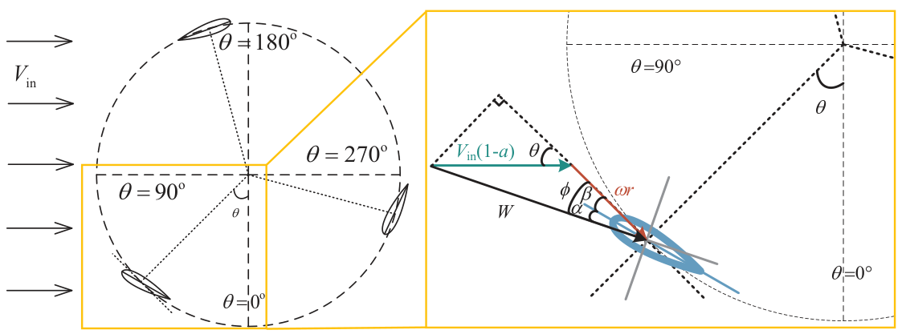

   **图 1** VAWT 流动角度示意图。图中放大了合速度、旋转切向速度、来流速度及攻角、流入角和桨距角之间的关系。

许多研究者 [16,35,41] 认为，通过避免叶片失速，并将有效攻角 :math:`\alpha` 维持在失速前边缘，可使 VAWT 性能最大化。因此，式 (1) 表明，确定最优桨距 :math:`\beta` 控制策略，需要准确描述 :math:`\varphi` 。

2.2 最优桨距的通用等效表达式
~~~~~~~~~~~~~~~~~~~~~~~~~~~~

采用叶素动量理论和 DMST 模型，可以较准确地估计流入角 :math:`\varphi` [44]。图 1 给出了流入角与速度分量分解之间的关系。在迎风区域，可根据合速度 :math:`W` 的两个相互垂直分量之比，计算局部流入角：

.. math::

   \tan\varphi_u=\frac{[1-a_u(\theta)]V_{\mathrm{in}}\sin\theta}{[1-a_u(\theta)]V_{\mathrm{in}}\cos\theta+\omega r}
   =\frac{\sin\theta}{\cos\theta+\lambda/[1-a_u(\theta)]},\quad 0\leq\varphi_u\leq\pi\qquad (2)

其中， :math:`\lambda=\omega r/V_{\mathrm{in}}` 为叶尖速比， :math:`a_u` 为迎风区域诱导因子。在背风区域， :math:`\varphi` 的表达式为：

.. math::

   \tan\varphi_d=\frac{[1-a_d(\theta)]V_e\sin\theta}{[1-a_d(\theta)]V_e\cos\theta+\omega r}
   =\frac{\sin\theta}{\cos\theta+\lambda/\{[1-a_d(\theta)][1-2a_u(\theta)]\}},\quad-\pi\leq\varphi_d\leq0\qquad (3)

其中， :math:`a_d` 为背风区域诱导因子， :math:`V_e=[1-2a_u(\theta)]V_{\mathrm{in}}` 为背风区域的“平衡”来流速度 [45]。注意，本文的流入角 :math:`\varphi` 与攻角 :math:`\alpha` 均在 :math:`[-\pi,\pi]` 范围内。

式 (2) 和式 (3) 表明， :math:`\varphi` 由叶尖速比、方位角 :math:`\theta` 及诱导因子 :math:`a_u` 、 :math:`a_d` 决定。若已知最优攻角 :math:`\alpha_{\mathrm{optm}}(\theta)` ，最优桨距 :math:`\beta_{\mathrm{optm}}(\theta)` 为：

.. math::

   \beta_{\mathrm{optm}}(\theta)=\varphi(\theta)-\alpha_{\mathrm{optm}}(\theta)\qquad (4)

确定 :math:`\beta_{\mathrm{optm}}(\theta)` 的困难主要来自以下三个方面。

1. 诱导因子 :math:`a` 依赖许多其他因素，包括方位角、流动雷诺数、翼型形状、实度和桨距角。DMST 模型的主要目标，是求解每个流管的 :math:`a` 。由于 :math:`a` 与 :math:`\beta` 耦合，并随方位角变化，在确定 :math:`\beta_{\mathrm{optm}}(\theta)` 前难以求得 :math:`a` 。此外，按照现代湍流理论，诱导因子是应由动量理论等效推导的隐含参数。因此，DMST 得到的简化 :math:`a` 解，不足以准确代表真实气动特性。
2. 对常用翼型，产生最大升力的攻角通常出现在静态失速之前。然而，VAWT 叶片旋转伴随攻角快速且显著变化，可能诱发叶片周围称为动态失速的非线性非定常气动现象。该现象使动态升阻力特征出现滞回 [46,47]。此外，叶片周围流动雷诺数随入流速度和转速变化。因此，由翼型静态气动特性确定的最优攻角存在固有不足。
3. 叶片流入角 :math:`\varphi` 在迎风和背风区域交界处改变符号，即图 2 中 :math:`\theta=0^\circ` 和 :math:`180^\circ` 处。为获得沿旋转方向的切向力，对应最大升力的最优攻角也应在这两个方位角改变符号。然而，实际中不可能实现桨距突变 [33]，且突变会破坏叶片表面附着的流动状态。

为克服这些困难，本文引入三项简化措施，获得最优桨距控制的通用表达式。

1. 引入等效诱导因子 :math:`\widetilde a_u` 和 :math:`\widetilde a_d` ，对任意给定 :math:`\lambda` ，分别假定它们在迎风和背风区域为常数，以简化诱导因子的复杂性。在合理范围内搜索其最优值，并定义迎风和背风区域的等效叶尖速比：

.. math::

   \widetilde\lambda_u=\frac{\lambda}{1-\widetilde a_u},\qquad
   \widetilde\lambda_d=\frac{\lambda}{(1-\widetilde a_d)(1-2\widetilde a_u)}\qquad (5)

2. 为解决第二个困难，引入考虑雷诺数和动态失速影响的等效最优攻角 :math:`\widetilde\alpha_{\mathrm{optm}}` 。不过，该最优攻角并不等于原始静态失速前攻角。将其与式 (2)、(3)、(5) 代入式 (4)，得到 :math:`\beta_{\mathrm{optm}}(\theta)` 的初步表达式：

.. math::

   \beta_{\mathrm{optm}}(\theta)=\begin{cases}
   \tan^{-1}\left(\dfrac{\sin\theta}{\cos\theta+\widetilde\lambda_u}\right)-\widetilde\alpha_{\mathrm{optm}},&0<\theta<\pi\quad\text{（迎风）},\\
   \tan^{-1}\left(\dfrac{\sin\theta}{\cos\theta+\widetilde\lambda_d}\right)+\widetilde\alpha_{\mathrm{optm}},&\pi<\theta<2\pi\quad\text{（背风）}.
   \end{cases}\qquad (6)

3. 如图 2 所示，式 (6) 给出一条不连续曲线，在 :math:`\theta=0^\circ` 和 :math:`180^\circ` 处有两个阶跃，因而不能实际采用。为消除突变，引入三次样条曲线拟合技术，它在相连控制点，即节点处具有较高光滑性 [48]。将式 (6) 的初步桨距曲线离散为点，舍去 :math:`0^\circ` 和 :math:`180^\circ` 附近的点，再拟合其余控制点，即可得到光滑样条。两个可调比例 :math:`r_1` 、 :math:`r_2` 分别表示迎风和背风区域所使用控制点的百分比（图 2）。因此，两个比例使桨距控制曲线相对于式 (6) 的拟合程度具有一定灵活性。

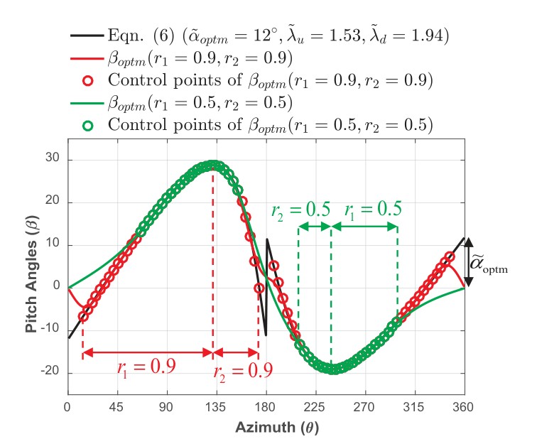

   **图 2** 不同 :math:`r_1` 和 :math:`r_2` 的桨距拟合曲线。黑线对应式 (6)，红、绿线对应不同控制点保留比例的光滑曲线，圆点为控制点。

经过这些简化，得到新的通用最优叶片桨距控制公式，其隐式表达为：

.. math::

   \beta_{\mathrm{optm}}(\theta)=g(\widetilde\alpha_{\mathrm{optm}},\widetilde\lambda_u,\widetilde\lambda_d,r_1,r_2,\theta)\qquad (7)

其中， :math:`g` 为隐函数。式 (7) 表示 :math:`\beta_{\mathrm{optm}}(\theta)` 是方位角 :math:`\theta` 的函数，并依赖另外五个新引入的参数。例如，取初值 :math:`\widetilde\alpha_{\mathrm{optm}}=12^\circ` 、 :math:`\widetilde\lambda_u=1.53` 、 :math:`\widetilde\lambda_d=1.94` ，其中等效最优攻角近似等于 NACA0018 的静态失速角，则图 2 黑线就是式 (6) 定义的初步曲线。 :math:`\theta=0^\circ` 和 :math:`180^\circ` 处的阶跃大小为 :math:`2\widetilde\alpha_{\mathrm{optm}}` 。红、绿曲线分别表示 :math:`r_1=r_2=0.9` 与 :math:`r_1=r_2=0.5` 时由式 (7) 定义的光滑桨距控制曲线。作者编写了 MATLAB 代码，按式 (7) 生成桨距控制候选曲线；原文说明代码见附录 A。

式 (7) 的五个控制参数，即 :math:`\widetilde\lambda_u` 、 :math:`\widetilde\lambda_d` 、 :math:`\widetilde\alpha_{\mathrm{optm}}` 、 :math:`r_1` 、 :math:`r_2` ，通过下一节的优化平台逐工况确定。

2.3 变桨自动优化平台
~~~~~~~~~~~~~~~~~~~~

确定式 (7) 所描述的最优叶片桨距，可写成以下优化问题：

.. math::

   \begin{aligned}
   &\max C_P=f(\beta),\\
   \mathrm{s.t.}\quad &1.\quad\beta=g(\widetilde\alpha_{\mathrm{optm}},\widetilde\lambda_u,\widetilde\lambda_d,r_1,r_2),\\
   &2.\quad0^\circ\leq\widetilde\alpha_{\mathrm{optm}}\leq\alpha_{\mathrm{StaticStall}}+5^\circ,\\
   &3.\quad0.5\lambda\leq\widetilde\lambda_u\leq2\lambda,\\
   &4.\quad0.5\lambda\leq\widetilde\lambda_d\leq4\lambda,\\
   &5.\quad0.05\leq r_1,r_2\leq0.95,\\
   &6.\quad\beta(0)=\beta(2\pi)=0.
   \end{aligned}\qquad (8)

约束 1 仅用五个调节参数表示候选桨距控制曲线。约束 2 将 :math:`\widetilde\alpha_{\mathrm{optm}}` 限制在 :math:`0^\circ` 至静态失速角加 :math:`5^\circ` 。对 :math:`\widetilde\lambda_u` 和 :math:`\widetilde\lambda_d` 的约束 3、4，旨在充分覆盖 :math:`\alpha_u` 和 :math:`\alpha_d` 的范围（原文符号如此）。约束 5 调节三次样条曲线的拟合程度，将范围取为 :math:`[0.05,0.95]` ，以避免曲线未拟合或过拟合。约束 6 保证迎风和背风区域桨距曲线的周期性与对称性。

图 3 给出了所开发 VBPAOP 的流程。该平台在 Linux 中建立，用于完成式 (8) 的优化。VBPAOP 包含两个模块：控制优化过程的 GA 模块，以及评价单个工况性能的 CFD 模拟模块。GA 是受自然进化启发的随机全局优化方法，最终得到最适合环境，即符合适应度准则的个体 [49]。Hwang 等 [17] 和 Ma 等 [29] 也采用 GA 寻找 VAWT 最优桨距控制，但本文提出的控制策略不同于以往方法。GA 参数见表 1。为实现高效率，这些参数经过仔细选择和测试。其中，代沟控制每代被替换的种群比例。

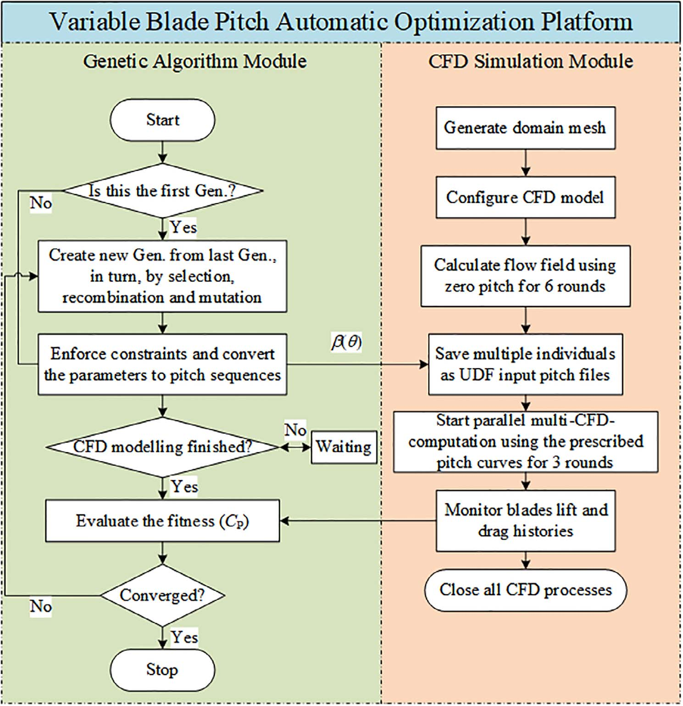

   **图 3** 变桨自动优化平台流程图。左侧为遗传算法模块：开始，判断是否第一代；原图的 Yes 分支向下进入“通过选择、重组和变异，由上一代建立新一代”，No 分支向左绕过该节点，直接进入“施加约束并将参数转为桨距序列”；等待 CFD 完成；评价适应度 :math:`C_P` ；判断收敛，收敛后停止，否则进入下一代。右侧为 CFD 模块：生成计算域网格，配置 CFD 模型，以零桨距计算六周初始流场；将多个个体保存为 UDF 桨距输入文件；按规定曲线并行计算三周；监测叶片升阻力时程；关闭全部 CFD 进程。

.. note::

   图 3 的首代判断分支按原图连线翻译。Yes 通向“由上一代建立新一代”，与“是否第一代”的通常程序逻辑可能不一致；此处不替作者调换 Yes/No，也不据该图保证实现正确。

.. list-table:: 表 1 遗传算法参数
   :header-rows: 1
   :widths: 1 1

   * - 参数
     - 设置
   * - 个体数
     - 20
   * - 最大代数
     - 50
   * - 代沟
     - 0.8
   * - 变量数
     - 5
   * - 二进制编码精度
     - 12

为缩短优化时间，CFD 模块必须高效评估大量变桨候选方案。如图 3 所示，预先准备零桨距 VAWT 旋转六周后获得的初始流场。随后对每条候选桨距曲线模拟三周，利用最后一个稳定周期的结果确定相应风机功率效率。

对于 VBPAOP 优化过程中的某一代，持续检查全部 CFD 线程状态，直到它们全部结束。所有适应度评估完成后，GA 才进入下一代。通常，涉及 CFD 的优化需要大量计算资源。因此，采用一台装有四颗 10 核 Intel Xeon CPU 的高性能工作站。在 GA 第一代中，40 个 CPU 线程全部用于计算 20 条桨距曲线。后续各代由于代沟为 0.8，使用 32 个 CPU 线程同时模拟 16 个个体。对给定叶尖速比，需要完成 50 代、总计 804 次模拟，才能得到最优桨距曲线，相应实际计算时间约 145 h。

3 CFD 模型
----------

CFD 模拟结果的精度依赖于合理建立的数值模型，这需要实践经验，并充分理解所建模的气动特性。Balduzzi 等 [50] 结合数值和试验，评估二维 CFD 模拟 H 型 VAWT 的有效性。他们认为，尽管存在简化，二维 CFD 仍能准确描述转子周围流场的整体性能。我们以往研究 [7] 发现，二维非定常雷诺平均 Navier–Stokes（unsteady Reynolds-averaged Navier–Stokes，URANS）模型高估结果的主要机制，可能并非三维效应；采用大涡模拟（large eddy simulation，LES）的准二维模拟可与三维试验结果较好吻合。因此，考虑优化问题的高计算成本，本文采用二维模型，假定叶尖涡、竖向流动发散及与附属结构相互作用等三维流动细节可忽视。

通过查阅 VAWT CFD 模拟关键问题的文献 [51–57]，谨慎确定 CFD 设置。以下小节详细说明这些设置。

3.1 模型几何与边界条件
~~~~~~~~~~~~~~~~~~~~~~

两种 VAWT 模型的主要参数见表 2。NACA0018 是 VAWT 常用叶片截面。支臂安装位置距前缘为弦长 :math:`c` 的 35.75%。为研究实度对最优桨距的影响，考虑两种叶片弦长，对应实度为 0.15 和 0.03（原文正文如此）。

.. list-table:: 表 2 两种 H 型 VAWT 模型的几何参数
   :header-rows: 1
   :widths: 1 1 1

   * - 参数
     - 模型 1
     - 模型 2
   * - 翼型
     - NACA0018
     - NACA0018
   * - 叶片数
     - 3
     - 3
   * - 叶片形状
     - 直叶片
     - 直叶片
   * - 支撑臂安装位置
     - 距前缘 35.75% 弦长
     - 距前缘 35.75% 弦长
   * - 转子半径（mm）
     - 1000
     - 1000
   * - 主轴直径（mm）
     - 50
     - 50
   * - 弦长（mm）
     - 100
     - 200
   * - 实度
     - 0.15
     - 0.3

.. note::

   原文第 3.1 节正文写实度 0.03，而表 2 对应 200 mm 弦长的数值为 0.3。本页保留两处原文信息；后续模型对应关系按原表呈现，不把 0.03 当作已核实的模型参数。

图 4 给出了 VAWT 模型的几何与流动条件，与以往试验 [58] 相似。整个二维计算域流向与横流向尺寸分别为 :math:`28r` 和 :math:`15r` 。计算域尺寸按以下原则确定：继续扩大计算域，只引起流动形态和荷载极小变化。流场分为六个区域，即 A、B1–B3、C 和 D。A、D 静止，C 和 B1–B3 为旋转区域，并通过非共形网格界面与另外两区分开。C 区转速由给定叶尖速比和来流速度确定。B1–B3 是叶片周围的圆形可旋转子域，用于控制叶片桨距角。因此，B1–B3 继承 C 区的转速，同时还能按规定桨距曲线自转。这些变桨运动通过用户自定义函数（user-defined function，UDF）实现，UDF 也并行计算，以加快求解。为避免界面处流动不连续，两侧节点间距之比限制在 2 以下。此外，由于 B、C 区界面可能暂时出现网格重叠或错位，采用强制内部区域匹配程序改善连续性。还建立了 A 区中心转轴模型。

入口位于风机中心前方 5 m，即 :math:`5r` ，施加不含脉动的均匀 :math:`4.1\,\mathrm{m/s}` 来流。出口位于风机中心后方 23 m，即 :math:`23r` ，以保证尾流充分发展和整体质量平衡。为尽量减小转子阻塞效应，距中心 7.5 m，即 :math:`7.5r` 的侧边界采用自由滑移条件，假定速度分量的法向分量与法向梯度为零。

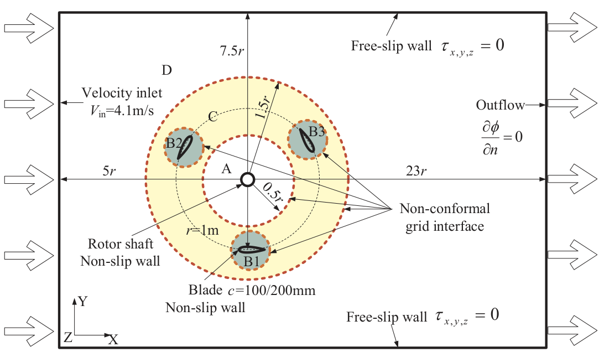

   **图 4** CFD 计算域尺寸与边界条件。Velocity inlet 为速度入口，Outflow 为流出边界；侧面为自由滑移壁面，叶片与转轴为无滑移壁面，虚线圆为非共形网格界面。

3.2 四边形网格
~~~~~~~~~~~~~~

图 5 给出了整个计算域的网格，全部由分块结构化四边形单元组成，并经过光顺，以减小偏斜、改善正交性。整体和局部网格显示，叶片附近和尾流区域布置了大量网格。O 型网格 [30,59] 与 B1–B3 圆形区域良好匹配，能减小近壁网格偏斜，并在采用高阶离散格式时保持数值稳定。原文图 4c、d 所指的网格中，叶片壁面周围为 280 个单元。通过试算调整叶片第一层网格间距，使大多数工况满足 :math:`y^+\approx1` 。尤其在 :math:`\mathrm{TSR}=4.94` 、相对叶片合速度最高时，最大 :math:`y^+` 仍小于 5。此外，各方向网格增长率均限制在 1.1 以下，以保证数值稳定。经过网格加密研究，二维 VAWT 模型最终采用 108,886 个单元。

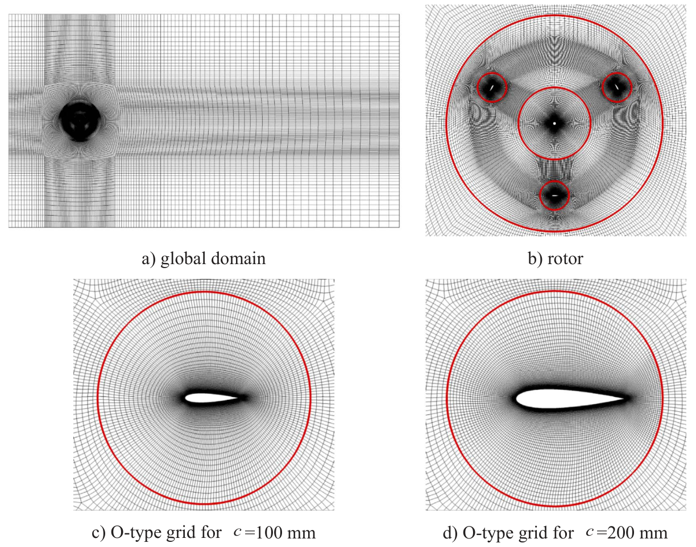

   **图 5** 网格分布示意图。（a）整个计算域；（b）转子；（c） :math:`c=100\,\mathrm{mm}` 的 O 型网格；（d） :math:`c=200\,\mathrm{mm}` 的 O 型网格。

.. note::

   上一段原文引用“图 4c、d”，但该页对应的 O 型网格分图实际编号为图 5c、d；图 4 是计算域示意。此处保留原引文并说明对应关系。

3.3 湍流模型
~~~~~~~~~~~~

分离涡模拟（detached eddy simulation，DES）模型可在高雷诺数壁面约束流动中取得精度与效率的良好折中。外部分离流由大尺度湍涡主导，采用 LES 保证精度；边界层内部采用非定常 RANS 建模，提高效率 [60]。DES 的计算成本低于 LES，但高于 RANS。本文在 DES 中采用剪切应力输运（shear stress transport，SST）模型 [61]，它通过分区混合函数结合 :math:`k-\omega` 和 :math:`k-\varepsilon` 模型。为克服早期 DES 的“模型应力亏损”（modeled stress depletion，MSD）缺点，引入采用修正长度尺度的延迟 DES（delayed DES，DDES）[62]：当壁面平行网格间距小于边界层厚度、却不足以支撑 LES 时，保证整个边界层区域保持 RANS 模型。由于动态失速频繁出现并伴随大尺度分离，DDES 对避免 MSD 导致的“网格诱导分离”十分关键 [63]。此外，基于 SST :math:`k-\omega` 的 DES 对高攻角翼型流动 [64] 以及 VAWT 叶片动态失速流动 [65,66] 的预测能力，已得到系统展示。因此，本文二维 CFD 将 SST :math:`k-\omega` 与 DDES 方法结合。

为比较，还评估另外三种常见 RANS 湍流模型，即重整化群（renormalization group，RNG） :math:`k-\varepsilon` 、SST :math:`k-\omega` ，以及结合尺度自适应模拟（scale-adaptive simulation，SAS）的 SST 模型，以展示 DDES-SST 模拟 VAWT 气动力的优势。

3.4 求解器设置
~~~~~~~~~~~~~~

采用有限体积法求解非定常不可压缩 Navier–Stokes 方程。压力与速度方程解耦采用 SIMPLEC（SIMPLE-Consistent）算法。与 SIMPLE 相比，SIMPLEC 对相对简单的问题可采用较大的欠松弛系数，因此收敛更快。此外，PISO 通常适合较大时间步的瞬态问题。考虑 DES 湍流建模需要较小时间步，SIMPLEC 更稳定且计算成本更低。压力、动量和其他变量分别采用二阶迎风、有界中心差分和三阶 MUSCL 格式。为保证稳定性，非定常项采用有界二阶隐式格式。总体上，解在时间和空间上均至少达到二阶精度。

时间步对旋转湍流模拟十分关键，其中包括翼型动态失速和涡分离。考虑转子频率与远场速度，常采用折减频率 :math:`k=\Omega c/(2V_{\mathrm{in}})` 来衡量无量纲时间步 :math:`\tau=\Delta tV_{\mathrm{in}}/c` [67]，其中 :math:`\Omega` 为旋转频率。本文不同叶尖速比的 :math:`k` 为 0.04–0.5。选取 :math:`0.5^\circ` 角步长，相应无量纲时间步 :math:`\tau` 为 :math:`[0.009,0.11]` ，与已有翼型动态失速研究 [67] 的数值设置相当。此外，通过下一节的系统比较验证 CFD 结果收敛性。

3.5 网格收敛研究
~~~~~~~~~~~~~~~~

本文考虑较宽的叶尖速比和桨距范围。选择较高叶尖速比 3.97、零桨距的工况作为代表性验证模型，因为该工况涉及失速和涡分离等较复杂流动结构。功率系数 :math:`C_P` 是叶片切向力系数 :math:`C_T` 的积分或平均，是 VAWT 最重要的性能指标之一。因此，同时比较 :math:`C_P` 和 :math:`C_T` 变化曲线，检验网格数、时间步、每步迭代次数及总模拟时间的收敛性。按照 McLaren [68]，切向和法向力系数定义为：

.. math::

   C_T=\frac{F_T}{0.5\rho V_{\mathrm{in}}^2cH}\qquad (9)

.. math::

   C_N=\frac{F_N}{0.5\rho V_{\mathrm{in}}^2cH}\qquad (10)

VAWT 的功率系数为：

.. math::

   C_P=\frac{Nc\omega}{2V_{\mathrm{in}}}\overline{C_T}\qquad (11)

其中， :math:`N` 为叶片数。注意，下文全部数据均为最后一个旋转周期内三片叶片的平均值。

为验证网格收敛性，采用最终网格一半的网格尺寸生成对照工况，总网格数为 253,525。如图 6 所示，较细网格的切向力系数曲线和功率系数与所采用网格接近，整体功率系数差异仅为 0.003。

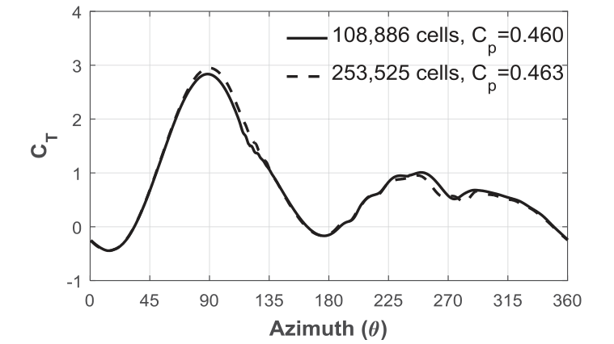

   **图 6** 网格数量对切向力的影响。比较 108,886 与 253,525 个单元，功率系数分别为 0.460 与 0.463；横坐标为方位角。

还开展类似收敛研究，考察时间步影响（图 7）。 :math:`\Delta t=T/360` 与 :math:`\Delta t=T/720` 分别表现为明显误差和很小误差，因此后续采用后者。此外，每步迭代不足不能保证解充分收敛。图 8 给出每步 5、10、20 次迭代的结果，最终因精度令人满意而采用每步 10 次。

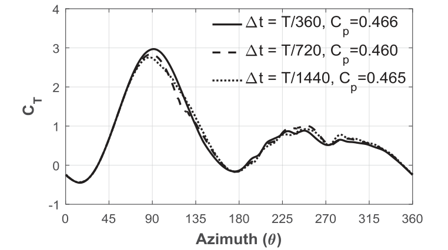

   **图 7** 时间步大小对切向力的影响。三种时间步为 :math:`T/360` 、 :math:`T/720` 、 :math:`T/1440` ； :math:`T` 为转子周期。

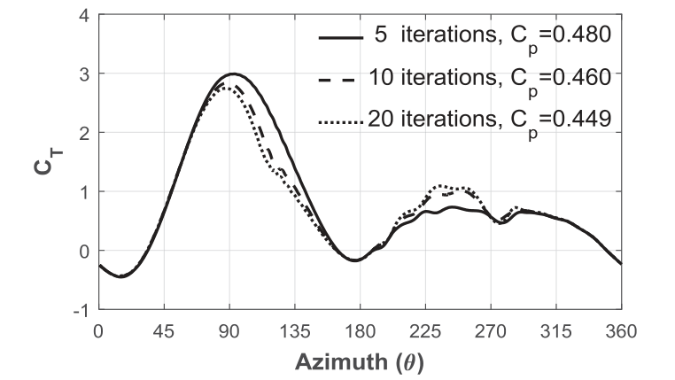

   **图 8** 每个时间步迭代次数对切向力的影响。比较每步 5、10、20 次迭代。

二维 CFD 模型阻塞比为 :math:`2/15\approx13.3\%` 。另模拟一个更宽、阻塞比为 :math:`1/15` 的计算域，以检验阻塞比影响。图 9 比较表明，所采用的 :math:`2/15` 阻塞比可用于风机性能评价。事实上，不同于物理风洞的无滑移壁面，数值域两侧（图 4）为无剪应力滑移壁面。这些滑移边界可以降低对阻塞比的要求。

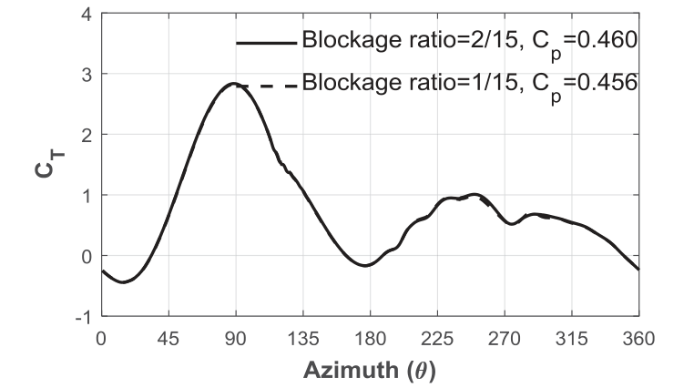

   **图 9** 阻塞比对切向力的影响。实线与虚线分别为阻塞比 :math:`2/15` 和 :math:`1/15` 。

在模拟变桨 VAWT 前，先模拟零桨距风机，获得初始周期流动。图 10a 表明，模拟六周足以获得稳定流场。随后，将零桨距 VAWT 第六周所得周期流场作为不同变桨工况的初始化输入，减少 VBPAOP 性能评估的收敛时间。图 10b 表明，第二周和第三周切向力吻合较好，说明变桨 VAWT 模拟三周足以获得准确解。第一周切向力中的两个尖峰，由 :math:`\theta=120^\circ` 和 :math:`240^\circ` 处桨距角的急剧变化引起。

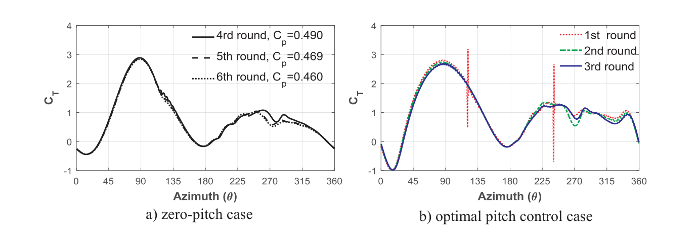

   **图 10** 总模拟时间对切向力的影响。（a）零桨距；（b）最优桨距控制。分别比较初始化后期周次和变桨前三周。

3.6 验证
~~~~~~~~

香港科技大学风洞针对相同配置的 VAWT，即表 2 的模型 1，开展了一系列试验 [58]。每片叶片的上下支臂各放置一个力传感器，以测量叶片气动力。相应功率系数通过对整周切向力积分计算。试验细节见文献 [58]。通过与试验结果比较验证 CFD 模拟。

图 11 中不同湍流模型的比较表明，SST :math:`k-\omega` 、SST-SAS 和 DDES-SST 结果相似，而 RNG :math:`k-\varepsilon` 低估切向力。所采用 DDES-SST 在湍流分解与再现方面优于 RANS 模型。

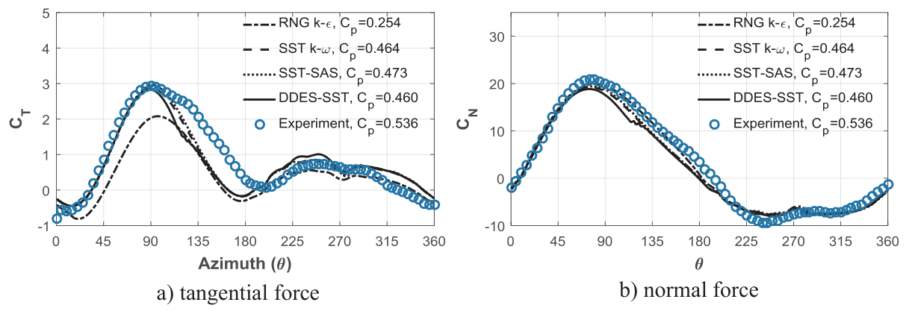

   **图 11** 不同湍流模型对叶片力的影响， :math:`\lambda=3.97` 。（a）切向力；（b）法向力。圆点为试验，曲线为不同湍流模型。

图 12 综合比较了不同叶尖速比下的气动力系数，以展示 CFD 再现 VAWT 流动动力学的整体精度。由于数据采集通道数量有限，切向力和法向力在不同试验组分别测量。因此，左右两列的叶尖速比因试验条件不同而略有差异。总体上，力的变化在定性和定量上均得到良好再现。然而，CFD 曲线存在不规则波纹，尤其在低叶尖速比下。这些波纹主要发生在叶片失速阶段，此时表面压力由流动分离控制。我们以往研究 [7] 表明，2.5D 或三维 CFD 可通过展向充分平均随机涡力，消除这些不规则变化。在高叶尖速比下，CFD 预测切向力更早下降。

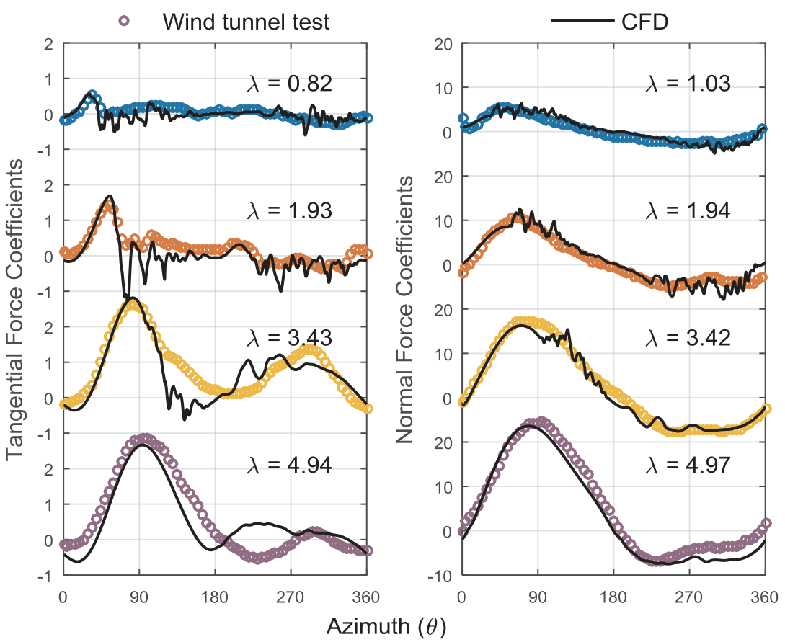

   **图 12** 多个叶尖速比下数值与试验切向及法向力系数比较。左列切向、右列法向；空心点为风洞试验，实线为 CFD。两列因分组测量而采用略有差异的叶尖速比。

图 13 比较了试验和 CFD 的功率系数。总体上，二维 CFD 较好再现了变化趋势，但低估 VAWT 总功率系数。预测误差处于可接受范围。虽然三维和 2.5D LES 可能进一步改善与试验的吻合 [58]，但其计算成本过高，本文优化问题难以承担。

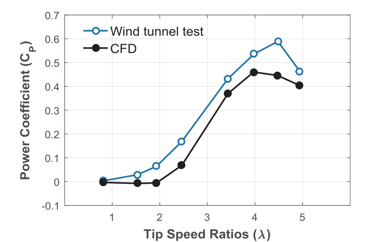

   **图 13** 随叶尖速比变化的数值与试验功率系数。蓝色空心点为风洞试验，黑色实心点为 CFD。

这一比较验证，经过仔细设计的二维 CFD 模型及数值格式能够捕捉 VAWT 叶片气动力的主要特征。最终 CFD 参数汇总于表 3。

.. list-table:: 表 3 VBPAOP 中 CFD 模型的关键参数
   :header-rows: 1
   :widths: 1 1

   * - 参数
     - 设置
   * - 网格单元数
     - 108886
   * - 湍流模型
     - DDES-SST
   * - 时间步长
     - :math:`T/720`
   * - 每时间步迭代次数
     - 10
   * - 初始化旋转周数
     - 6
   * - 性能评价旋转周数
     - 3

4 结果与讨论
------------

4.1 面向输出功率的优化叶片桨距
~~~~~~~~~~~~~~~~~~~~~~~~~~~~~~

采用 VBPAOP 对表 2 中两种弦长，即 :math:`c=100\,\mathrm{mm}` 和 :math:`200\,\mathrm{mm}` 的 VAWT 优化桨距，考察八个叶尖速比： :math:`\lambda=0.82` 、1.53、1.93、2.46、3.43、3.97、4.47 和 4.94，与零桨距风洞试验所用值相同。得到的 16 条优化桨距曲线见图 14。优化曲线有助于改善低叶尖速比的自启动能力（图 14a），并对高叶尖速比下额定发电功率最大化至关重要（图 14b）。

在低叶尖速比 0.82–2.46 下（图 14a），优化桨距峰值随叶尖速比增大而减小。这与式 (2)、(3) 的流入角变化及第 2.2 节的等效表达一致。除叶尖速比 0.82 外，高实度模型（ :math:`c=200\,\mathrm{mm}` ）的 :math:`\beta_{\mathrm{optm}}` 峰值小于低实度模型（ :math:`c=100\,\mathrm{mm}` ）。图 14a 的八条曲线近似关于 :math:`\theta=180^\circ` 反对称，可由迎风和背风区域叶片运动的反对称性解释。此外，100 mm 的实线比 200 mm 的点划线表现出更好的反对称性，因为更高实度使迎风区域提取更多能量，迎风与背风区域的来流速度差异随之增大。

在高叶尖速比 3.43–4.94 下（图 14b），100 mm 弦长的四条实线在迎风区域大致重合，在背风区域则无明确变化规律。200 mm 的虚线优化曲线也有类似现象。如前所述，叶片流入角在 :math:`\theta=0^\circ` 和 :math:`180^\circ` 改变符号。减去最优 :math:`\alpha_{\mathrm{optm}}` 后，图 14b 优化桨距在这两个位置迅速改变符号。高叶尖速比下相似的最优桨距曲线，使在高风速范围采用单条固定最优曲线实施被动变桨成为可能，为实际应用提供了有前景的方向。

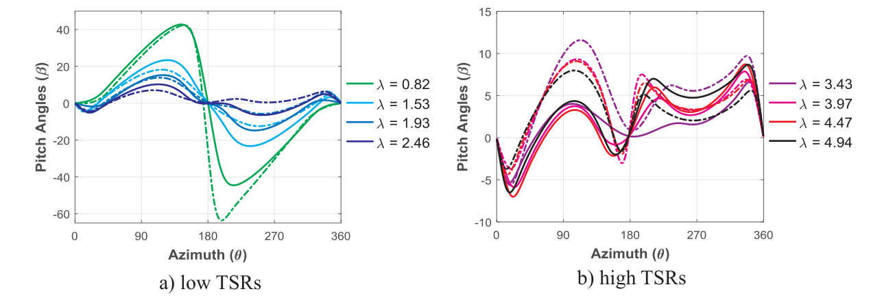

   **图 14** 最优桨距曲线，实线为 :math:`c=100\,\mathrm{mm}` ，点划线为 :math:`c=200\,\mathrm{mm}` 。（a）低叶尖速比；（b）高叶尖速比。

结合这些特征，可以提出用于实际运行的主动—被动混合桨距控制策略。在启动阶段，开启主动变桨，通过消耗有限外部功率提高自启动能力。在理想运行区间内，开启被动统一变桨控制，可以不消耗外部功率而使 VAWT 以最大 :math:`C_P` 运行。

图 15 比较零桨距与最优桨距的切向力，以展示功率改善。对于八个叶尖速比，并列绘出 100 mm 与 200 mm 弦长的 :math:`C_T` 曲线。绿色与红色阴影分别表示最优桨距控制带来的切向力增加和减少。

在低叶尖速比下，负切向力系数使零桨距 VAWT 难以自启动。与零桨距相比，最优桨距可明显提高迎风和背风区域的正转矩。在相同叶尖速比下，高实度、200 mm 弦长 VAWT 的迎风切向力系数较大，意味着提取更多能量。

在高叶尖速比下，优化桨距产生的迎风转矩与零桨距模型非常接近，甚至略低。但优化后的背风转矩明显提高，且增量随叶尖速比逐渐增大。

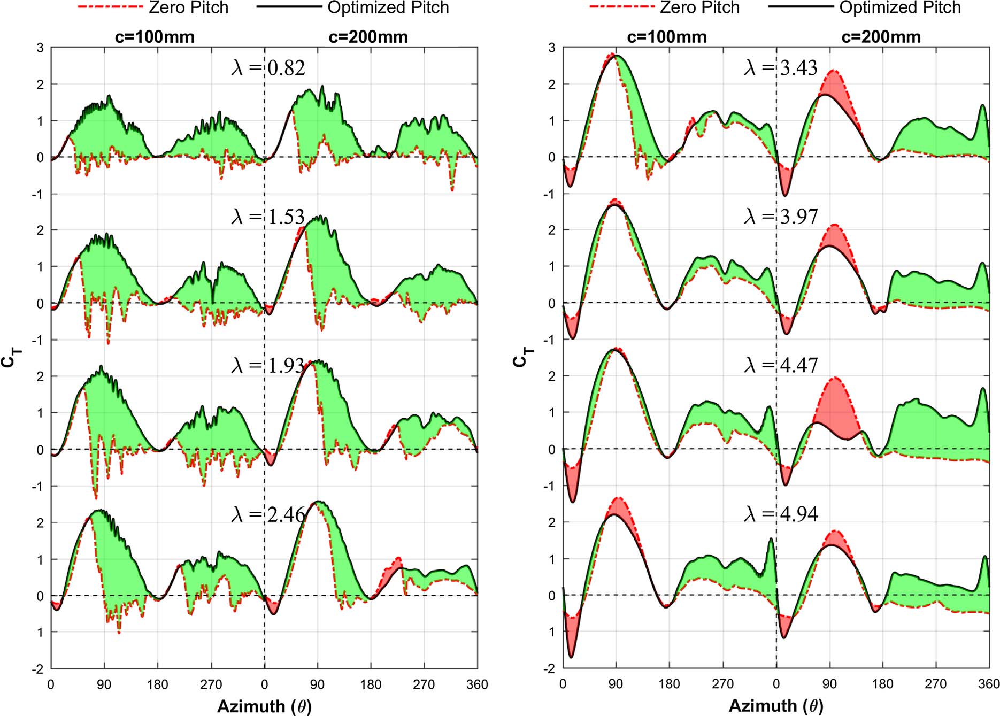

   **图 15** 多个叶尖速比下最优桨距与零桨距的切向力。（a）低叶尖速比；（b）高叶尖速比。各组并列给出 100 mm 与 200 mm 弦长；绿色阴影为优化后增加的切向力，红色阴影为减少部分。

图 16 给出了零桨距和最优控制桨距的四条 :math:`C_P-\lambda` 曲线。采用本文最优桨距，两种 VAWT 均取得明显增量。每条曲线由一个峰值 :math:`C_P` 点分为上升段与下降段。图 17 以堆叠柱状图表示迎风、背风 :math:`C_P` 的绝对增量，每根柱的正向高度表示总增量。结合图 15 可见，在上升段，即 100 mm 模型的 :math:`\lambda=0.82–3.43` 和 200 mm 模型的 :math:`\lambda=0.82–2.46` ，迎风区域的 :math:`C_P` 改善大于背风区域。但在下降段，即 100 mm 模型的 :math:`\lambda=3.97–4.94` 和 200 mm 模型的 :math:`\lambda=3.43–4.94` ，迎风改善很小甚至为负，背风改善则明显增加。功率系数增量统计见表 4。200 mm 模型的平均绝对增量明显大于 100 mm 模型。100 mm 模型最大绝对增量出现在上升段 :math:`\lambda=2.46` ；200 mm 模型则出现在下降段 :math:`\lambda=4.47` （原文此段数值）。

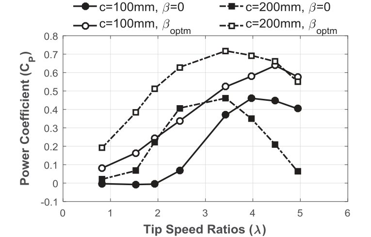

   **图 16** 零桨距和最优桨距控制的功率系数。圆点为 100 mm 弦长，方点为 200 mm 弦长；空心点为最优桨距，实心点为零桨距。

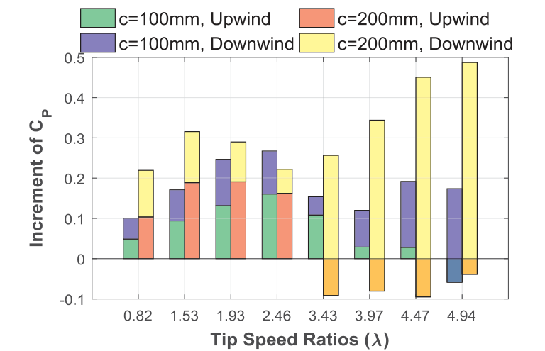

   **图 17** 功率系数增量。每个叶尖速比处分别给出两种弦长；各柱区分迎风和背风贡献，负值部分表示该区域性能降低。

.. list-table:: 表 4 优化变桨相对零桨距工况的增益
   :header-rows: 1
   :widths: 1 1 1

   * - 指标
     - 弦长 100 mm
     - 弦长 200 mm
   * - 平均功率系数增量
     - 0.177
     - 0.317
   * - 最大功率系数增量
     - 0.271
     - 0.487
   * - 最大增量对应叶尖速比
     - 2.46
     - 4.94
   * - 优化后的最大功率系数
     - 0.638
     - 0.718
   * - 最大功率系数对应叶尖速比
     - 4.47
     - 3.43

.. note::

   原文第 4.1 节将 200 mm 模型最大绝对增量对应的叶尖速比写为 4.47；表 4 及第 5 节结论则为 4.94，对应增量 0.487。此处均按原文保留，不静默统一。

特别地，两种 VAWT 模型最大功率系数分别为 0.638 和 0.718，对应 :math:`\lambda=4.47` 和 3.43。两者都超过了 59.3% 的 Betz 极限；这一极限约一百年前依据质量与动量守恒为 HAWT 推导而来。不过，对于“主动变桨 VAWT 可能超过 Betz 极限”的结果，解释时必须非常谨慎，尤其是尚无试验证明 VAWT 效率高于大型商业 HAWT。这一现象可能由以下两个原因共同造成。首先，Newman [69] 指出，将致动盘理论用于 VAWT 时，由于叶片每周可两次从来流提取能量，Betz 极限可提高至 64%。另一项近期理论研究 [70] 也表明，主动变桨 VAWT 可通过将法向力转化为动能，获得超过 Betz 极限的功率系数。从理论上说，可能存在超越 HAWT Betz 极限的理想 VAWT 最优变桨策略。其次，由于湍流建模的根本局限，CFD 难以精确预测包含分离与涡脱落的翼型边界层发展，以及二次尾流结构 [71–73]。这些数值误差可能在背风区域被部分放大。因此，数值模拟的不足也可能使最大功率系数被高估。

考虑到以往多项研究已广泛展示 CFD 模拟 VAWT 的有效性，且本文已十分谨慎地处理数值设置，下文将通过流场分析进一步解释结果及其合理性。整体改善令人鼓舞且具有指导性，尤其在低叶尖速比下。效率提高至或超过 Betz 极限，在一定程度上体现了所提方法的有效性。事实上，旋转叶片与来流之间的复杂相互作用尚未完全理解。今后需要开展主动变桨 VAWT 试验，提供有说服力的验证。

图 18 给出不同叶尖速比与实度下五个优化关键参数，它们依据第 2.2 节简化表达式确定最优曲线。由于五个参数对最优曲线的影响高度耦合，不能总结出简单变化趋势。如图 18a 所示， :math:`\widetilde\alpha_{\mathrm{optm}}` 最大约为 :math:`14^\circ` ，主要分布在 :math:`[8^\circ,12^\circ]` 。根据 NACA0018 试验 [74]，这些等效最优攻角均可避免深度失速。位于失速角前缘的 :math:`\widetilde\alpha_{\mathrm{optm}}` 能使叶片升力最大。此外，100 mm 模型在 :math:`\lambda=0.82–3.43` 范围内的总体变化趋势，与 Kozak [41] 的 DMST 预测一致。但文献 [41] 未给出高叶尖速比结果，因为 DMST 在高实度、高叶尖速比工况下存在不足 [75]。

图 18b 给出等效叶尖速比与实际值之比。除少数较高迎风叶尖速比工况外，比值通常大于 1，这可由式 (5) 中的诱导因子解释。由于迎风转子阻塞效应，可见 :math:`\widetilde\lambda_d>\widetilde\lambda_u` 。就实度影响而言，200 mm 模型的诱导因子大于 100 mm 模型 [44]。因此，在背风区域，所有叶尖速比下高实度模型的 :math:`\widetilde\lambda_d` 均大于低实度模型。在迎风区域，低叶尖速比时高实度的 :math:`\widetilde\lambda_u` 略大，高叶尖速比时则相反。

图 18c 给出两个曲线拟合因子 :math:`r_1` 、 :math:`r_2` 。 :math:`r_1` 主要位于 :math:`[0.7,0.95]` 。为使 :math:`\theta=180^\circ` 处的桨距角平滑过渡， :math:`r_2` 通常小于 :math:`r_1` 。

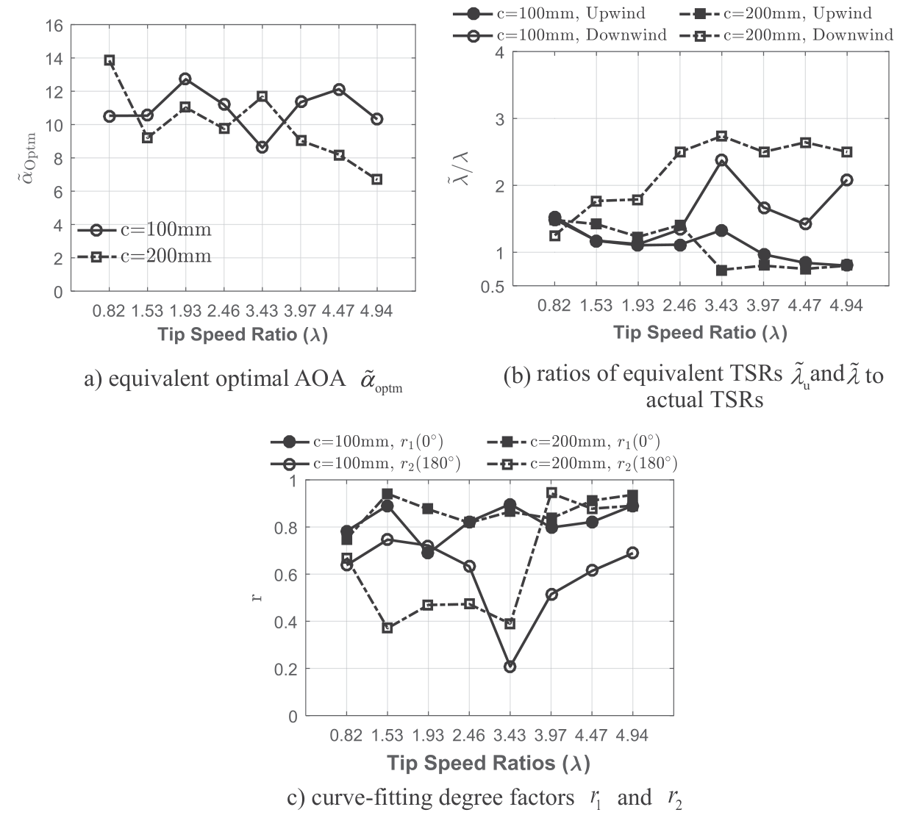

   **图 18** 叶片桨距曲线的优化调节参数。（a）等效最优攻角；（b）迎风与背风等效叶尖速比和实际值之比；（c）曲线拟合程度因子 :math:`r_1` 、 :math:`r_2` 。

4.2 与优化正弦桨距的比较
~~~~~~~~~~~~~~~~~~~~~~~~

借助连杆机构，正弦桨距易于在实际 H 型 VAWT 上实现，因此许多研究将其作为变桨方法 [22,35,76]。为展示新变桨表达式的改进，在 VBPAOP 框架内，也对 :math:`c=200\,\mathrm{mm}` 工况的正弦桨距进行优化。优化问题定义为：

.. math::

   \begin{aligned}
   &\max C_P=f(\beta),\\
   \mathrm{s.t.}\quad&1.\quad\beta=A\sin\theta,\\
   &2.\quad0^\circ\leq A\leq\max(\varphi)+5^\circ.
   \end{aligned}\qquad (12)

其中，正弦函数幅值 :math:`A` 是唯一待确定变量。考虑式 (4) 和某些不确定性，将其范围限制为 :math:`[0^\circ,\max(\varphi)+5^\circ]` 。结果表明，总计 10 代、包含 164 个试算个体，足以得到收敛解。图 19 比较零桨距、正弦桨距和最优桨距的功率系数。首先应注意，在较高四个叶尖速比下，所有非零幅值的优化正弦桨距，发电功率都低于零桨距。以往研究 [35,76] 也发现，正弦桨距无法改善高叶尖速比下的发电。对于较低四个叶尖速比，虽然优化正弦桨距相较零桨距也明显提高功率系数，但本文得到的最优桨距产生的功率最高。

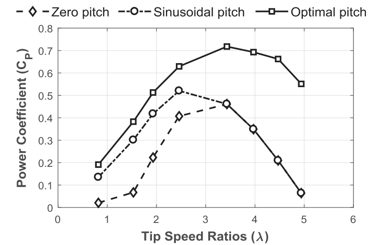

   **图 19** 零桨距、正弦桨距和最优桨距的功率系数。菱形、圆形和方形分别表示三种方案。

图 20 详细比较正弦与最优方案的桨距角和切向力系数。式 (8) 得到的最优桨距基于叶片气动机制构造，而式 (12) 的优化正弦桨距来自缺乏科学依据的经验近似。优化曲线趋势相似，但峰值及其对应方位角明显不同。因此，通过避免叶片深度失速，最优桨距在迎风和背风区域均产生更大的切向气动力。浅绿色阴影表示最优桨距情况下切向力系数的增加。

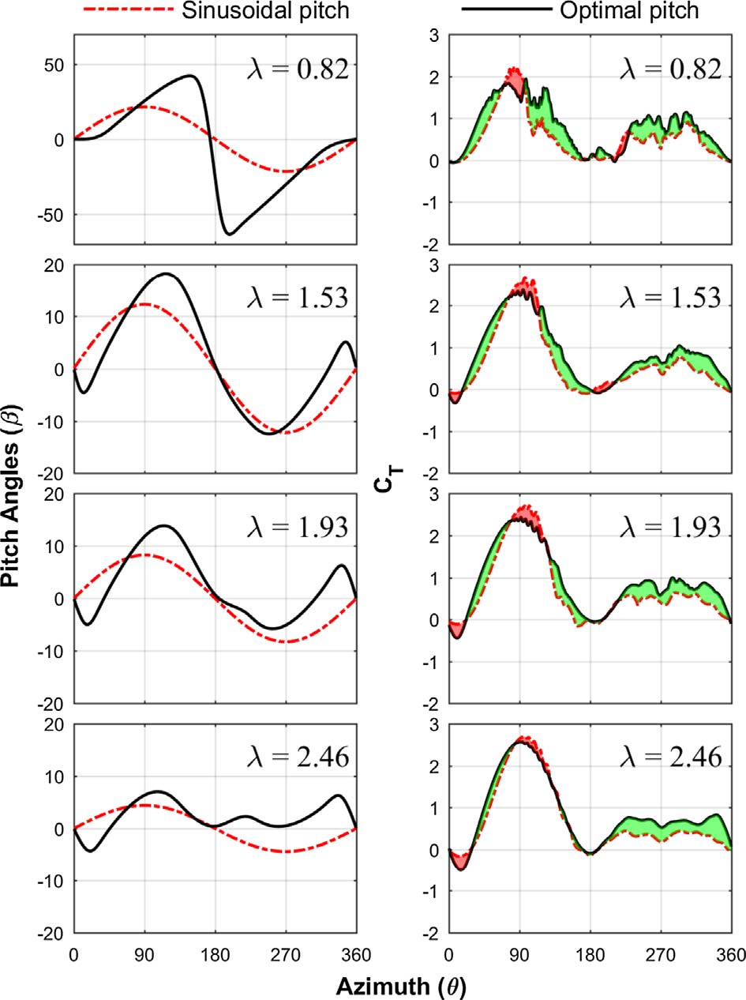

   **图 20** 正弦与最优桨距的比较。左列为桨距角，右列为切向力系数；红色点划线为正弦桨距，黑色实线为最优桨距，绿色为切向力增量。

4.3 流场分析
~~~~~~~~~~~~

流动可视化有助于理解变桨控制气动机制。通过八个叶片方位角，即 :math:`0^\circ` 、 :math:`45^\circ` 、 :math:`90^\circ` 、 :math:`135^\circ` 、 :math:`180^\circ` 、 :math:`225^\circ` 、 :math:`270^\circ` 和 :math:`315^\circ` 的表压静压与涡量大小等值图，展示两个代表工况。图 21 和图 22 分别给出 100 mm 模型在叶尖速比 0.82，以及 200 mm 模型在叶尖速比 3.43 时的流场。原文另以补充数据提供动画视频。这些图并列比较零桨距与最优控制结果。在表压静压图中，以虚线描出零桨距翼型，便于与动态桨距比较。可清楚观察桨距调整的大小和方向，表明 CFD 与桨距 UDF 的结合成功实现了最优变桨控制。

叶尖速比 0.82 的分析有助于理解最优桨距如何改善低速性能和自启动能力。Amet 等 [77] 与 Sagharichi 等 [77] 指出（原文两处引用编号相同），H 型 VAWT 的低叶尖速比叶片行为由深度失速主导。如图 21 的涡量图所示，零桨距叶片除 :math:`\theta=0^\circ` 外，在所有方位角均发生深度失速。从 :math:`\theta=30^\circ` 开始，逐渐增大的涡从前缘沿顺时针方向分离，并从后缘沿逆时针方向分离。大尺度分离使叶片进入深度失速，有效攻角脱离能提供稳定而较大升力的范围，而升力正是产生功率的力。相比之下，考虑式 (4)，最优桨距 :math:`\beta_{\mathrm{optm}}` 的确定以尽可能在整个周期将有效攻角维持于失速前边缘为前提。图 21 的压力和涡量图显示，相较零桨距，最优控制的脱落涡尺度更小，确认其可防止叶片失速。

在迎风区域，通过使叶片前缘向转子外侧偏转，将攻角减小至失速角以下。因此，最优桨距的分离涡可重新附着，并沿叶片内表面发展至 :math:`\theta=90^\circ` 。而零桨距有效攻角从 :math:`\theta=30^\circ` 起超过失速角，分离涡完全脱离表面。图 15 也支持这一现象：优化桨距切向力（黑色实线）持续增加至 :math:`90^\circ` ；零桨距（红色虚线）则早在 :math:`30^\circ` 就开始下降。

在背风区域，变桨使叶片前缘向转子中心偏转，减缓有效攻角快速增长。另一益处是迎风叶片涡脱落推迟且减少，使尾流速度衰减相对缓慢。由于迎风尾流对背风流动结构影响较弱，背风压力、涡量图以及切向力与迎风区域大致对称。然而，零桨距迎风侧涡更早分离，背风叶片明显受到尾流影响，在 :math:`\theta\in[180^\circ,210^\circ]` 范围内获得负切向力。

低叶尖速比下整体攻角较高，因此最优变桨本质上是通过推迟、减弱乃至避免失速，将有效攻角维持在接近最大升力对应值的位置，提高发电性能。

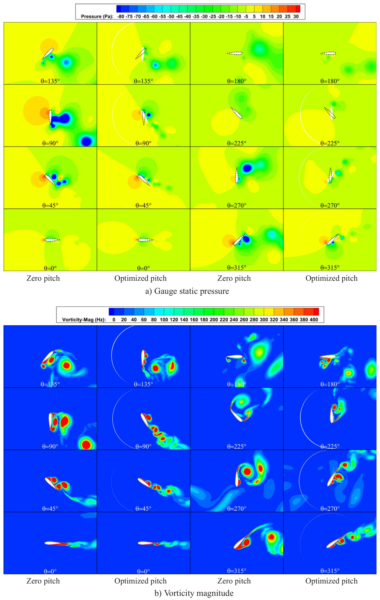

   **图 21** :math:`\mathrm{TSR}=0.82` 、 :math:`c=100\,\mathrm{mm}` 时叶片周围瞬时等值图。（a）表压静压；（b）涡量大小。每对列分别为零桨距和优化桨距；各行、列组合给出八个方位角。

如图 16 所示，对于零桨距和最优桨距，200 mm 模型均在最佳叶尖速比 3.43 达到最大功率系数。最佳叶尖速比及相应 :math:`C_P` 对确定风机最大或额定容量十分重要，因此选择这一流场，识别优化桨距提高最大功率的物理机制。不考虑桨距变化时，式 (2)、(3) 表明攻角随叶尖速比增加逐渐降低。在叶尖速比 3.43 下，若诱导因子 :math:`a=0.1` ，最大攻角约 :math:`15^\circ` ，高于静态失速角 :math:`12^\circ` 。然而，图 22 的叶片附近没有明显脱落涡，说明动态失速滞回效应使叶片在低得多的叶尖速比下也能避免大尺度分离。

检查图 22a 的前半周可见，零桨距和变桨的叶片迎风面、背风面分别出现正、负压区，产生沿同一旋转方向的有利升力。由图 15b 可知，前半周两种方案的切向力相当。然而，后半周的功率提取出现很大差异。背风区域的明显改善，是最优桨距提高高叶尖速比 VAWT 性能的主要原因。其物理机制可从两方面解释：

首先，后半周尾流复杂，零桨距叶片两侧压力分布更对称，不同于前半周，从而限制正升力产生。相比之下，轻微调整桨距使叶片周围出现与迎风区域相似的压力分布，如图 22 所示，表明即使受复杂尾流影响，变桨也得到充分优化，能够在背风区域发电。

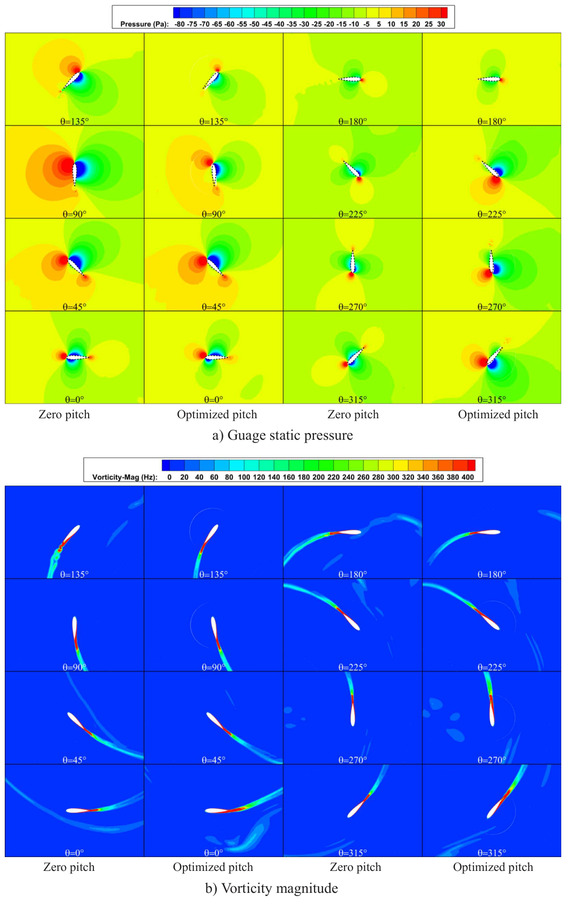

   **图 22** :math:`\mathrm{TSR}=3.43` 、 :math:`c=200\,\mathrm{mm}` 时叶片周围瞬时等值图。（a）表压静压；（b）涡量大小。每对列比较零桨距与优化桨距。

其次，对 :math:`90^\circ` 、 :math:`135^\circ` 和 :math:`180^\circ` 方位角的综合比较表明，变桨可抑制零桨距叶片后缘出现的轻微分离。图 22 还显示，这些轻微分离造成的压力和涡量差异可忽视，但在图 23 的瞬时流向 :math:`X` 速度图中，可见迎风叶片后方存在较大速度亏损。因此，如图 23 比较，零桨距转子包围区域的 :math:`X` 速度明显低于最优桨距。此外，图 24 定量比较穿过转子的 :math:`x=0` 截面平均 :math:`X` 速度剖面；速度在最后三周平均，并用 :math:`V_{\mathrm{in}}` 归一化。事实上，在提取相近能量时，零桨距的动量亏损明显大于最优桨距。考虑到叶片转到背风区域时可再次利用迎风尾流中的减速气流，这一明显差异解释了背风切向力的大幅提高。

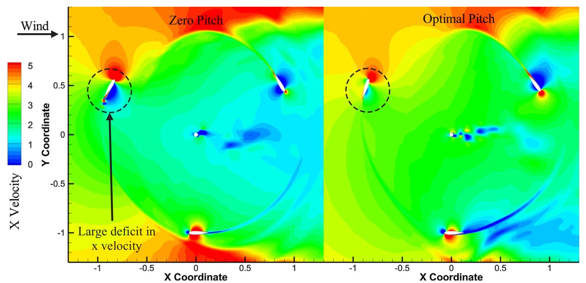

   **图 23** :math:`\mathrm{TSR}=3.43` 、 :math:`c=200\,\mathrm{mm}` 时，零桨距与最优桨距的瞬时流向速度等值图。左图零桨距，右图最优桨距；箭头标注左图迎风叶片后方较大的 :math:`X` 速度亏损，色标为 :math:`X` 方向速度。

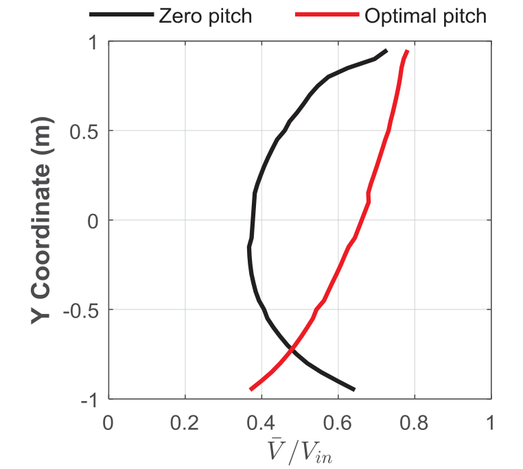

   **图 24** 穿过转子的 :math:`x=0` 截面平均 :math:`X` 速度剖面比较。黑线零桨距，红线最优桨距；横轴为来流速度归一化的平均流向速度，纵轴为 :math:`Y` 坐标。

本质上，高叶尖速比下整体攻角较低，最优桨距主要通过维持各方位角的有效攻角，以及抑制迎风区域轻微分离造成的速度耗散，提高总输出功率；这可能为背风周期保留更多能量。

4.4 遗传算法效率
~~~~~~~~~~~~~~~~

由于具有变异和交叉操作，GA 能避免局部极大值并寻找全局最优结果。为展示 VBPAOP 所生成候选曲线的多样性，图 25 绘出了叶尖速比 3.43 工况的全部 804 条候选桨距曲线。这些随机曲线充分覆盖式 (8) 预定义范围的可能性。图 26 给出优化过程中不同代的 26 个最佳候选。优化初期收敛迅速，随后各代的暂时最优曲线与最终曲线差异逐渐减小。

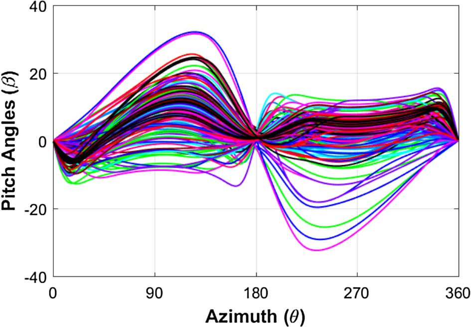

   **图 25** :math:`c=200\,\mathrm{mm}` 、 :math:`\mathrm{TSR}=3.43` 时 VBPAOP 生成的全部候选桨距曲线。

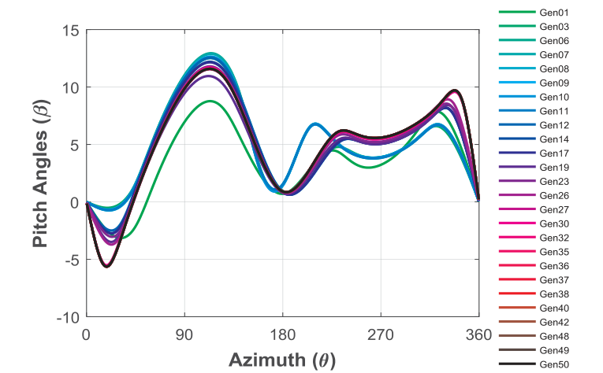

   **图 26** :math:`\mathrm{TSR}=3.43` 时，50 代中的全部暂时最佳适应度桨距曲线。图例 Gen 表示产生相应最佳曲线的代数。

图 27 给出八个叶尖速比下 :math:`C_P` 的收敛历程。由于 GA 初始染色体完全随机产生、没有人为干预，第一代 :math:`C_P` 为最终最优值的 73%–98%。各工况呈现相似趋势：大多数情况下，优化前半程 :math:`C_P` 迅速提高，后半程改善小得多。这些收敛历程表明，采用 50 代足以得到充分优化的结果。

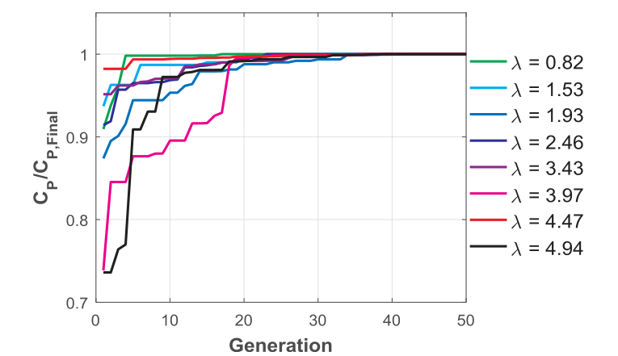

   **图 27** 优化收敛历程。纵轴为各代功率系数与最终值之比，横轴为代数；各曲线对应一个叶尖速比。

5 结论
------

以最大化 H 型 VAWT 发电为目标，本文提出并实现了获得最优桨距曲线的优化方法。与文献中以往相关工作相比，本文方法具有以下新意与优点。

1. 候选桨距曲线根据 VAWT 叶片气动机制以及流入角、攻角、桨距角关系进行参数化。考虑更多变化细节，并采用三次样条光滑技术，克服过渡区 :math:`\theta=0^\circ` 和 :math:`180^\circ` 处的突变；以往研究通常忽视该问题或未作光滑处理。
2. 采用先进 CFD 工具评价性能，使优化结果更可靠。通过与零桨距和正弦变桨工况比较，验证了其在峰值输出功率方面的有效性。
3. 优化问题只需确定五个变量，优化效率大幅提高。初始化和演化无需人为干预，普通工作站上每个优化工况约需 145 h，对实际应用而言可行且可接受。
4. 本文清楚展示了 VBPAOP 的性能与收敛性。

为评估叶尖速比与实度对最优桨距的影响，在宽叶尖速比范围研究两种不同弦长 VAWT。根据所开发 VBPAOP 的优化与 CFD 联合研究，得到以下结论。

1. 相比零桨距，两种弦长分别为 100 mm、200 mm 的模型，在八个叶尖速比下的平均 :math:`C_P` 分别增加 0.177、0.317。两种模型的最大 :math:`C_P` 分别为 0.638（ :math:`\lambda=4.47` ）和 0.718（ :math:`\lambda=3.43` ）；最大增量分别为 0.271（ :math:`\lambda=2.46` ）和 0.487（ :math:`\lambda=4.94` ）。
2. 低叶尖速比 :math:`\lambda\in0.82–2.46` 时，优化桨距曲线近似关于 :math:`\theta=180^\circ` 反对称。迎风与背风区域的桨距峰值随叶尖速比增大而降低。
3. 高叶尖速比 :math:`\lambda\in3.43–4.94` 时，不同叶尖速比的最优曲线大致重合。较高转速使迎风叶片对背风叶片产生强烈影响，从而形成不对称最优曲线。
4. 更长弦长使实度和阻塞效应增大。因此，较长弦长在低叶尖速比时减小优化桨距最大值，在高叶尖速比时则使其增大。
5. 切向力曲线以及压力、涡量等值图揭示了最优变桨的气动机制。当低叶尖速比下叶片气动由深度或动态失速主导时，即 100 mm 模型 :math:`\lambda\leq3.97` 、200 mm 模型 :math:`\lambda\leq3.43` ，优化桨距通过避免或推迟失速，提高迎风和背风区域切向力。当高叶尖速比下即使零桨距也不失速时，即 100 mm 模型 :math:`\lambda>3.97` 、200 mm 模型 :math:`\lambda>3.43` ，优化桨距抑制迎风区域轻微分离引起的速度耗散，为背风周期保留更多能量或速度。

由于 CFD 模拟的固有限制，作者正准备开展风洞试验，验证最优变桨策略的实际性能。在 H 型 VAWT 模型上精确实现预定义桨距曲线，必然涉及很大挑战。

参考文献
--------

原文参考文献按原编号保留，以便核查正文的引用链。

[1] Aslam Bhutta MM, Hayat N, Farooq AU, Ali Z, Jamil SR, Hussain Z. Vertical axis wind turbine – a review of various configurations and design techniques. Renew Sustain Energy Rev 2012;16(4):1926–39.

[2] Chong W, Muzammil WK, Wong K, Wang C, Gwani M, Chu Y, et al. Cross axis wind turbine: pushing the limit of wind turbine technology with complementary design. Appl Energy 2017.

[3] Govind B. Increasing the operational capability of a horizontal axis wind turbine by its integration with a vertical axis wind turbine. Appl Energy 2017;199(Supplement C):479–94.

[4] Wang Z, Zhuang M. Leading-edge serrations for performance improvement on a vertical-axis wind turbine at low tip-speed-ratios. Appl Energy 2017.

[5] Kumbernuss J, Jian C, Wang J, Yang HX, Fu WN. A novel magnetic levitated bearing system for Vertical Axis Wind Turbines (VAWT). Appl Energy 2012;90(1):148–53.

[6] Chen J, Liu P, Xu H, Chen L, Yang M, Yang L. A detailed investigation of a novel vertical axis Darrieus wind rotor with two sets of blades. J Renew Sustain Energy 2017;9(0133071).

[7] Li C, Zhu S, Xu Y, Xiao Y. 2.5D large eddy simulation of vertical axis wind turbine in consideration of high angle of attack flow. Renew Energy 2013;51:317–30.

[8] McLaren K, Tullis S, Ziada S. Computational fluid dynamics simulation of the aerodynamics of a high solidity, small-scale vertical axis wind turbine. Wind Energy 2012;15(3):349–61.

[9] Peng HY, Lam HF. Turbulence effects on the wake characteristics and aerodynamic performance of a straight-bladed vertical axis wind turbine by wind tunnel tests and large eddy simulations. Energy 2016;109:557–68.

[10] Scheurich F, Fletcher TM, Brown RE. Simulating the aerodynamic performance and wake dynamics of a vertical-axis wind turbine. Wind Energy 2011;14(2):159–77.

[11] Chehouri A, Younes R, Ilinca A, Perron J. Review of performance optimization techniques applied to wind turbines. Appl Energy 2015;142:361–88.

[12] Bedon G, Schmidt Paulsen U, Aagaard Madsen H, Belloni F, Raciti Castelli M, Benini E. Computational assessment of the DeepWind aerodynamic performance with different blade and airfoil configurations. Appl Energy 2017;185:1100–8.

[13] Baños R, Manzano-Agugliaro F, Montoya FG, Gil C, Alcayde A, Gómez J. Optimization methods applied to renewable and sustainable energy: a review. Renew Sustain Energy Rev 2011;15(4):1753–66.

[14] Chen J, Yang H, Yang M, Xu H. The effect of the opening ratio and location on the performance of a novel vertical axis Darrieus turbine. Energy 2015;89(Supplement C):819–34.

[15] Gretton GI. The hydrodynamic analysis of a vertical axis tidal current turbine. The University of Edinburgh; 2009.

[16] Kirke BK, Lazauskas L. Limitations of fixed pitch Darrieus hydrokinetic turbines and the challenge of variable pitch. Renew Energy 2011;36(3):893–7.

[17] Hwang IS, Lee YH, Kim SJ. Optimization of cycloidal water turbine and the performance improvement by individual blade control. Appl Energy 2009;86(9):1532–40.

[18] Zeiner-Gundersen DH. A novel flexible foil vertical axis turbine for river, ocean, and tidal applications. Appl Energy 2015;151:60–6.

[19] Lazauskas L, Kirke BK. Modeling passive variable pitch cross flow hydrokinetic turbines to maximize performance and smooth operation. Renew Energy 2012;45:41–50.

[20] Kiwata T, Yamada T, Kita T, Takata S, Komatsu N, Kimura S. Performance of a vertical axis wind turbine with variable-pitch straight blades utilizing a linkage mechanism. J Environ Eng 2010;5(1):213–25.

[21] Benedict M, Lakshminarayan V, Pino J, Chopra I. Fundamental understanding of the physics of a small-scale vertical axis wind turbine with dynamic blade pitching: an experimental and computational approach. In: 54th AIAA/ASME/ASCE/AHS/ASC structures, structural dynamics, and materials conference; 2013: April 8-11, Boston, Massachusetts.

[22] Jain P, Abhishek A. Performance prediction and fundamental understanding of small scale vertical axis wind turbine with variable amplitude blade pitching. Renew Energy 2016;97:97–113.

[23] Rezaeiha A, Kalkman I, Blocken B. Effect of pitch angle on power performance and aerodynamics of a vertical axis wind turbine. Appl Energy 2017;197:132–50.

[24] Gosselin R, Dumas G, Boudreau M. Parametric study of H-Darrieus vertical-axis turbines using CFD simulations. J Renew Sustain Energy 2016;8(5). p. 053301 (22 pp.)-053301 (22 pp.).

[25] Islam M, Fartaj A, Carriveau R. Analysis of the design parameters related to a fixed-pitch straight-bladed vertical axis wind turbine. Wind Eng 2008;32(5):491–507.

[26] Li Q, Maeda T, Kamada Y, Murata J, Yamamoto M, Ogasawara T, Shimizu K, Kogaki T. Study on power performance for straight-bladed vertical axis wind turbine by field and wind tunnel test. Renew Energy 2016;90(Supplement C):291–300.

[27] Lee Y, Lim H. Numerical study of the aerodynamic performance of a 500 W Darrieus-type vertical-axis wind turbine. Renew Energy 2015;83:407–15.

[28] Sagharichi A, Maghrebi MJ, ArabGolarcheh A. Variable pitch blades: an approach for improving performance of Darrieus wind turbine. J Renew Sustain Energy 2016;8(5):053305.

[29] Ma Y, Zhang L, Zhang Z, Han D. Optimization of blade motion of vertical axis turbine. China Ocean Eng 2016;30(2):297–308.

[30] Paillard B, Astolfi JA, Hauville F. URANSE simulation of an active variable-pitch cross-flow Darrieus tidal turbine: Sinusoidal pitch function investigation. Int J Mar Energy 2015;11:9–26.

[31] Soraghan CE, Leithead WE, Yue H, Feuchtwang J. Double multiple streamtube model for variable pitch vertical axis wind turbines. In: 31st AIAA applied aerodynamics conference; 2013: (AIAA 2013-2802).

[32] Paillard B, Hauville F, Astolfi JA. Simulating variable pitch crossflow water turbines: a coupled unsteady ONERA-EDLIN model and streamtube model. Renew Energy 2013;52:209–17.

[33] Staelens Y, Saeed F, Paraschivoiu I. A straight-bladed variable-pitch VAWT concept for improved power generation. In: Proceedings of the 22nd ASME wind energy symposium held in conjunction with the 41st aerospace sciences meeting & exhibit; 2003. p. 2003-0524.

[34] Paraschivoiu I, Trifu O, Saeed F. H-darrieus wind turbine with blade pitch control. Int J Rotating Mach 2009. Article ID 505343.

[35] Benedict M, Lakshminarayan V, Pino J, Chopra I. Aerodynamics of a small-scale vertical-axis wind turbine with dynamic blade pitching. AIAA J 2016;54(3):924–35.

[36] Zhao Z, Qian S, Shen W, Wang T, Xu B. Study on variable pitch strategy in H-type wind turbine considering effect of small angle of attack. J Renew Sustain Energy 2017.

[37] Peng Y, Xu Y. Optimal pitch for enhancing power efficiency of straight bladed vertical axis wind turbines. In: The 6th international conference on structural health monitoring of intelligent infrastructure; 2013: Hong Kong, 9-11 December.

[38] Jin X, Zhao G, Gao K, Ju W. Darrieus vertical axis wind turbine: Basic research methods. Renew Sustain Energy Rev 2015;42:212–25.

[39] Tchakoua P, Wamkeue R, Ouhrouche M, Tameghe T, Ekemb G. A new approach for modeling darrieus-type vertical axis wind turbine rotors using electrical equivalent circuit analogy: basis of theoretical formulations and model development. Energies 2015;8(10):10684–717.

[40] Chen J, Yang H, Yang M, Xu H, Hu Z. A comprehensive review of the theoretical approaches for the airfoil design of lift-type vertical axis wind turbine. Renew Sustain Energy Rev 2015;51:1709–20.

[41] Kozak P. Blade pitch optimization methods for vertical-axis wind turbines. Illinois Institute of Technology; 2016.

[42] Burton T, Sharpe D. Wind energy handbook. Chichester[etc.]: John Wiley & Sons; 2004.

[43] Laks JH, Pao LY, Wright AD. Control of wind turbines: past, present, and future. In: Proceedings of the American control conference. St. Louis, MO, USA: IEEE; 2009. p. 2096–2103.

[44] Paraschivoiu I. Wind turbine design: with emphasis on darrieus concept. Montréal, Québec, Canada: Polytechnic International Press; 2002.

[45] Homicz GF. Numerical simulation of VAWT stochastic aerodynamic loads produced by atmospheric turbulence VAWT-SAL Code; 1991.

[46] Wang S, Ingham DB, Ma L, Pourkashanian M, Tao Z. Numerical investigations on dynamic stall of low Reynolds number flow around oscillating airfoils. Comput Fluids 2010;39(9):1529–41.

[47] Buchner A, Lohry MW, Martinelli L, Soria J, Smits AJ. Dynamic stall in vertical axis wind turbines: comparing experiments and computations. J Wind Eng Ind Aerodyn 2015;146:163–71.

[48] Bartels RH, Beatty JC, Barsky BA. An introduction to splines for use in computer graphics and geometric modeling. Morgan Kaufmann; 1995.

[49] Chipperfield AJ, Fleming PJ. The MATLAB genetic algorithm toolbox. In: IEE colloquium on applied control techniques using MATLAB; 1995.

[50] Bianchini A, Balduzzi F, Bachant P, Ferrara G, Ferrari L. Effectiveness of two-dimensional CFD simulations for Darrieus VAWTs: a combined numerical and experimental assessment. Energy Convers Manage 2017;136:318–28.

[51] Castelli MR, Englaro A, Benini E. The Darrieus wind turbine: Proposal for a new performance prediction model based on CFD. Energy 2011;36(8):4919–34.

[52] Almohammadi KM, Ingham DB, Ma L, Pourkashan M. Computational fluid dynamics (CFD) mesh independency techniques for a straight blade vertical axis wind turbine. Energy 2013;58:483–93.

[53] Balduzzi F, Bianchini A, Maleci R, Ferrara G, Ferrari L. Critical issues in the CFD simulation of Darrieus wind turbines. Renew Energy 2016;85:419–35.

[54] Chen J, Chen L, Xu H, Yang H, Ye C, Liu D. Performance improvement of a vertical axis wind turbine by comprehensive assessment of an airfoil family. Energy 2016;114:318–31.

[55] Balduzzi F, Bianchini A, Ferrara G, Ferrari L. Dimensionless numbers for the assessment of mesh and timestep requirements in CFD simulations of Darrieus wind turbines. Energy 2016;97:246–61.

[56] Balduzzi F, Bianchini A, Carnevale EA, Ferrari L, Magnani S. Feasibility analysis of a Darrieus vertical-axis wind turbine installation in the rooftop of a building. Appl Energy 2012;97:921–9.

[57] Danao LA, Edwards J, Eboibi O, Howell R. A numerical investigation into the influence of unsteady wind on the performance and aerodynamics of a vertical axis wind turbine. Appl Energy 2014;116:111–24.

[58] Peng Y, Xu Y, Zhan S. Wind tunnel tests and numerical simulation of time-varying aerodynamic forces on straight blades of a vertical axis wind turbine. In: 8th international colloquium on bluff body aerodynamics and applications. Boston, Massachusetts, USA: Northeastern University; 2016 June 7-11.

[59] Lohry MW, Martinelli L. Unsteady Reynolds-averaged Navier-Stokes simulation of crossflow rotors, scaling, and blockage effects. AIAA J 2016;54(12):3828–39.

[60] Li Y, Paik K, Xing T, Carrica PM. Dynamic overset CFD simulations of wind turbine aerodynamics. Renew Energy 2012;37(1):285–98.

[61] Menter FR. Two-equation eddy-viscosity turbulence models for engineering applications. AIAA J 1994;32(8):1598–605.

[62] Spalart PR, Deck S, Shur ML, Squires KD, Strelets MK, Travin A. A new version of detached-eddy simulation, resistant to ambiguous grid densities. Theor Comput Fluid Dyn 2006;20(3):181–95.

[63] Wang S, Ingham DB, Ma L, Pourkashanian M, Tao Z. Turbulence modeling of deep dynamic stall at relatively low Reynolds number. J Fluids Struct 2012;33:191–209.

[64] Sorensen NN, Bechmann A, Zahle F. 3D CFD computations of transitional flows using DES and a correlation based transition model. Wind Energy 2011;14(1):77–90.

[65] Chen W, Chen C, Huang C, Hwang C. Power output analysis and optimization of two straight-bladed vertical-axis wind turbines. Appl Energy 2017;185:223–32.

[66] Lei H, Zhou D, Bao Y, Li Y, Han Z. Three-dimensional Improved Delayed Detached Eddy Simulation of a two-bladed vertical axis wind turbine. Energy Convers Manage 2017;133:235–48.

[67] Gharali K, Johnson DA. Numerical modeling of an S809 airfoil under dynamic stall, erosion and high reduced frequencies. Appl Energy 2012;93:45–52.

[68] McLaren KW. A numerical and experimental study of unsteady loading of high solidity vertical axis wind turbines. McMaster University; 2011.

[69] Newman BG. Actuator-disc theory for vertical-axis wind turbines. J Wind Eng Ind Aerodyn 1983;15(1):347–55.

[70] Lecanu P, Breard J, Mouaze D. Simplified theory of an active lift turbine with controlled displacement. < hal-01300531v2 > ; 2016.

[71] Lam HF, Peng HY. Study of wake characteristics of a vertical axis wind turbine by two- and three-dimensional computational fluid dynamics simulations. Renew Energy 2016;90:386–98.

[72] Abdelsalam AM, Boopathi K, Gomathinayagam S, Hari Krishnan Kumar SS, Ramalingam V. Experimental and numerical studies on the wake behavior of a horizontal axis wind turbine. J Wind Eng Ind Aerodyn 2014; 128(Supplement C): p. 54–65.

[73] Menter FR. Turbulence modeling for engineering flows. Technical Paper, Ansys Inc.; 2011. p. 1–25.

[74] Timmer WA. Two-dimensional low-Reynolds number wind tunnel results for airfoil NACA 0018. Wind Eng 2008;32(6):525–37.

[75] Islam M, Ting DSK, Fartaj A. Aerodynamic models for Darrieus-type straight-bladed vertical axis wind turbines. Renew Sustain Energy Rev 2008;12(4):1087–109.

[76] Elkhoury M, Kiwata T, Aoun E. Experimental and numerical investigation of a three-dimensional vertical-axis wind turbine with variable-pitch. J Wind Eng Ind Aerodyn 2015;139:111–23.

[77] Amet E, Maitre T, Pellone C, Achard JL. 2D numerical simulations of blade-vortex interaction in a Darrieus turbine. J Fluids Eng-Trans ASME 2009;131(11):15.

完整论文引用
------------

Li C, Xiao Y, Xu YL, Peng YX, Hu G, Zhu S. Optimization of blade pitch in H-rotor vertical axis wind turbines through computational fluid dynamics simulations. Applied Energy, 2018, 212: 1107–1125. DOI: 10.1016/j.apenergy.2017.12.035。

相关论文条目：:ref:`H型垂直轴风机桨距优化 <ref-li2018-AE>`。
