.. _paper-note-ref-li2020-JWEIA:

采用扩展冠层阻力模型模拟粗糙地表上水平齐次大气边界层的 RANS 方法：论文精解
========================================================================================

精简版微信公众号文章：待发布

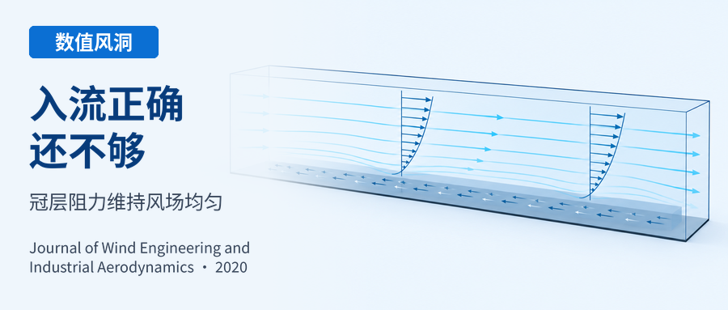

.. contents:: 本页目录
   :local:
   :depth: 2

论文信息
--------

**原文题名：** RANS simulation of horizontal homogeneous atmospheric boundary layer over rough terrains by an enriched canopy drag model。

**作者：** Chao Li，Jinghan Wang，Gang Hu，Lixiao Li，Yiqing Xiao（通讯作者）。

**作者单位：** 哈尔滨工业大学（深圳）土木与环境工程学院；深圳大学土木工程学院。

**期刊：** Journal of Wind Engineering and Industrial Aerodynamics，206（2020），104281。DOI：`10.1016/j.jweia.2020.104281 <https://doi.org/10.1016/j.jweia.2020.104281>`_。

**稿件日期：** 2019 年 11 月 26 日收稿；2020 年 6 月 23 日收到修订稿并录用。所提供原版的在线发表日期排为“xxxx”，不据此补写日期。

**WOEAI 相关方向：** 工程结构抗风 / 数值风洞。

摘要
----

大气边界层（atmospheric boundary layer，ABL）由地球表面障碍物，例如地形、植被、建筑物等引起的摩擦作用产生。受这一物理机制启发，本文提出扩展冠层阻力（enriched canopy drag，ECD）模型，在计算流体动力学中实现水平齐次 ABL 流动。该模型能更灵活地再现各类实际粗糙地表的作用，而不限于植被类型。采用多目标进化算法，确定所提 ECD 模型适当的近地阻力及其作用高度。此外，采用进化算法，使入口条件与下游目标位置之间的平均风速和湍动能（turbulence kinetic energy，TKE）差异最小。基于剪切应力输运 :math:`k-\omega` 湍流模型，针对乡村、郊区和城市地表，开展一组采用对数律和幂律入口流动的模拟，以说明 ECD 模型的有效性。结果表明，所提 ECD 模型能够以数值方式再现地表粗糙度，改善平均速度与 TKE 的流向齐次性，并适用于不同网格分辨率、近壁处理方法、标准 :math:`k-\varepsilon` 湍流模型及模拟维度。

关键词
------

粗糙地面；冠层阻力模型；水平齐次大气边界层；RANS；优化算法。

符号表
------

原文符号表位于引言开始后的第 2 页。为避免打断跨页段落，完整表格在此列出；符号与重复定义按原文保留。

.. list-table:: 原文符号表
   :header-rows: 1
   :class: longtable

   * - 符号
     - 含义
   * - :math:`a`
     - 叶面积密度
   * - :math:`C_d`
     - 阻力系数
   * - :math:`C_d^*(z)`
     - ECD 模型综合阻力系数
   * - :math:`e_u`
     - 速度无量纲误差的平均绝对值
   * - :math:`e_k`
     - 湍动能无量纲误差的平均绝对值
   * - :math:`e_\chi^{\mathrm{abs}}`
     - 流动变量的平均绝对差
   * - :math:`e_u^{\mathrm{abs}}`
     - 平均速度的平均绝对差
   * - :math:`e_k^{\mathrm{abs}}`
     - 湍动能的平均绝对差
   * - :math:`f`
     - 科里奥利参数
   * - :math:`h_s`
     - ECD 模型作用高度
   * - :math:`I_u(z)`
     - 湍流强度
   * - :math:`k`
     - 湍动能
   * - :math:`k_{\mathrm{mp}}`
     - 监测位置湍动能
   * - :math:`k_{\mathrm{in}}`
     - 入口边界湍动能
   * - :math:`\bar p`
     - 雷诺平均压力
   * - :math:`p'`
     - 脉动压力
   * - :math:`S_u`
     - :math:`x` 动量方程源项
   * - :math:`S_k`
     - 湍动能输运方程源项
   * - :math:`S_\varepsilon`
     - 湍流耗散率输运方程源项
   * - :math:`S_{ij}`
     - 平均变形率张量
   * - :math:`s_{ij}'`
     - 脉动变形率张量
   * - :math:`|\mathbf u|`
     - 速度矢量大小
   * - :math:`U`
     - 流向平均速度
   * - :math:`u`
     - 流向瞬时速度
   * - :math:`U_{\mathrm{mp}}`
     - 监测位置平均速度
   * - :math:`U_{\mathrm{in}}`
     - 入口边界平均速度
   * - :math:`u_*`
     - 摩阻速度
   * - :math:`u_r`
     - 10 m 高度的参考风速
   * - :math:`u'`
     - 流向脉动速度
   * - :math:`w`
     - 竖向瞬时速度
   * - :math:`W`
     - 竖向平均速度
   * - :math:`w'`
     - 竖向脉动速度
   * - :math:`z_0`
     - 空气动力粗糙度长度
   * - :math:`\alpha`
     - 粗糙度指数
   * - :math:`\beta_p,\beta_d,c_\varepsilon`
     - 经典冠层模型常数
   * - :math:`\delta`
     - 实际大气边界层高度
   * - :math:`\delta_{ij}`
     - Dirac 符号
   * - :math:`\varepsilon`
     - 湍流耗散率
   * - :math:`\eta,p`
     - 经验系数
   * - :math:`\mu`
     - 空气分子黏度
   * - :math:`\mu_t`
     - 湍流黏度
   * - :math:`\rho`
     - 空气密度
   * - :math:`-\rho\overline{u_i' u_j'}`
     - 雷诺应力张量
   * - :math:`\sigma_u`
     - 流向速度均方根值
   * - :math:`\sigma_w`
     - 竖向速度均方根值
   * - :math:`\phi`
     - 深圳纬度
   * - :math:`\chi`
     - 流动变量
   * - :math:`\omega`
     - 比湍流耗散率

1 引言
------

在计算流体动力学（computational fluid dynamics，CFD）中生成水平齐次大气边界层（horizontally homogeneous atmospheric boundary layer，HHABL），对于准确研究建筑、结构的风效应以及污染物扩散至关重要。HHABL 意味着所有流动变量的水平方向梯度，包括流向和展向梯度，均为零（Yang et al., 2009；Richards and Norris, 2015）。一些研究者指出（Blocken et al., 2007；Parente et al., 2011a；Vasaturo et al., 2018；Richards and Norris, 2019），在 CFD 中实现 HHABL 流动，意味着内部流动特性与入口、顶部和壁面边界条件完全一致，否则风流会产生水平非齐次性。

指定适当的入流条件，是实现 HHABL 最直接的方法。采用对数律入流速度剖面时，已有两种主要的 TKE 剖面：常数和变化的 TKE 剖面。第一类的代表由 Richard and Hoxey（1993）提出，并吸引了一些后续研究（Hargreaves and Wright, 2007；Gorlé et al., 2009；Yang et al., 2009）。然而，这类不随高度变化的 TKE 剖面与现场实测及风洞试验数据不相容。为克服这一不足，Yang et al.（2009）基于标准 :math:`k-\varepsilon` 模型提出变化的 TKE 入流剖面，并用 ABL 风洞实测数据拟合。然而，为再现风洞尺度的中性平衡 ABL，这一方法采用由风洞实测推导的修正湍流模型常数，对不同算例可能引起非预期的流动。最近，Yang et al.（2017）将该方法扩展至 SST :math:`k-\omega` 模型，分别针对对数律和幂律速度提出两组入流边界条件及模型常数。Richards and Norris（2015）强调适当入流边界条件的重要性，提出一组用于 CFD 模拟 HHABL 的入流条件，无须额外修改顶边界；顶边界也是需要认真处理的另一项条件。

计算域顶边界条件也受到广泛研究。Richards et al.（1993；2019）指出，顶边界条件对流动特性的流向梯度有显著影响，可以通过在上边界设置适当剪应力加以控制。O Sullivan et al.（2011）定量分析了顶边界不一致所引起的流向梯度，分别针对 Richards and Hoxey（1993）和 Yang et al.（2009）的入流条件，推导出两组一致条件，以获得水平齐次 ABL。

另一方面，寻找通用且一致的粗糙壁面条件同样重要，例如行人高度的 ABL 流动基本上受到地球粗糙表面的阻滞。换言之，竖向风切变剖面主要由复杂地形、植被和建筑物等地面障碍物产生的阻力形成，这些障碍物构成地表粗糙度。目前尚无十分合适的通用入流条件，因此，相比为每个算例修改湍流模型，提高下垫面粗糙度和地形的模拟精度更为合理。受这一问题启发，本文尝试寻找灵活的模型，模拟粗糙壁面对 ABL 流动的作用。根据已有研究（Aboshosha et al., 2015；Vasaturo et al., 2018），CFD 中实现粗糙地表上 HHABL 的途径，可分为纯物理和纯数值两大类。

纯物理方法通常重建风洞中布置的粗糙元，主要用于 LES 再现高粗糙度表面，而不只是实现 ABL 特性的水平齐次性（Nozawa and Tamura, 2001；Nozawa and Tamura, 2002；Yang et al., 2009）。虽然这一方法完全符合近地 ABL 的物理实际，但大量计算网格增加了计算资源需求，限制了它在复杂地形上稳态或非稳态流动中的应用（Abdi and Bitsuamlak, 2014；Aboshosha et al., 2015）。

纯数值方法通常用于雷诺平均 Navier–Stokes（Reynolds-averaged Navier–Stokes，RANS）模拟，以数值方式修改壁面函数或 Navier–Stokes（NS）方程。Blocken et al.（2007）详细研究了适当壁面函数对于 CFD 再现水平齐次 ABL 的重要性。按照他们的建议，Peralta et al.（2014）将 Richards and Hoxey（1993）的入流条件用于复杂地形 ABL 模拟时，修改了标准壁面函数，并获得良好结果。Parente et al.（2011a；2011b）重新定义壁面函数常数和无量纲壁面距离，消除标准壁面函数对网格分辨率的限制。他们还为标准 :math:`k-\varepsilon` 模型的 TKE 与湍流耗散率输运方程推导残差源项，这属于纯数值方法的另一分支。随后，Balogh et al.（2012）在 OpenFOAM 中实现该方法，并将其用于复杂地形流动模拟。最近，Balogh and Parente（2015）将 TKE 剖面扩展为四参数形式。采用这些残差源项后，模拟与风洞试验的一致性优于其以往工作。然而，残差源项基于平衡假设推导，并依赖入流条件的形式，因而应用受到限制。Hu et al.（2013）与 Yan et al.（2015）也为 TKE 和耗散率输运方程提出类似残差源项，存在同样限制。除残差源项策略外，Cai et al.（2014）提出动态过程，在整个边界层计算域内加入体力。Cindori and Franjo（2018）在 :math:`x` 动量方程中加入风源项，迭代调整下游剪应力剖面。加入这些源项后，平坦和复杂地形上的 ABL 流动均表现出良好齐次性。然而，这些策略与实际 ABL 由地面以上有限高度的粗糙元产生的物理机制并不一致。此外，在 ABL 全高度施加源项，实际是在施加驱动流动的额外作用力；虽然模拟流动能由此获得水平齐次性，但牺牲了保真性。

除上述方法外，所谓冠层阻力模型已广泛用于模拟植被乃至城市建筑等地表粗糙度（Martilli and Santiago, 2007；Santiago et al., 2008, 2013；Blocken et al., 2016；Ip and Bene, 2016；Liu et al., 2016；Moradpour et al., 2018）。这些模型把阻力效应视为 ABL 流动中的多孔障碍物，并将阻力引入流动运动（Kang et al., 2017；Wang et al., 2018）。在这一背景下，本文通过提出冠层阻力模型，尝试再现 ABL 生成的物理机制，实现模拟 ABL 的水平齐次性；相较广泛使用的冠层阻力模型，该模型具有更高灵活性。模型作为动量方程源项加入近壁区域，而不是整个计算域高度（Hu et al., 2013；Yan et al., 2015；Cindori and Franjo, 2018），因而更高效，也更符合 ABL 生成的物理机制。由于无须生成复杂壁面边界，高粗糙度表面的计算模型易于建立。换言之，通过在 CFD 模拟中施加适当近地阻力，可以实现任意 HHABL，而无须额外修改湍流模型常数和入流条件。

本文结构如下：第 2 节详细介绍所提扩展冠层阻力模型及基于优化过程的参数标定；第 3 节给出采用 SST :math:`k-\omega` 模型的二维 CFD 模拟设置；第 4 节采用优化的 ECD 模型，结合对数律和幂律入流条件下的误差分析，揭示模拟 ABL 结果及其机制；第 5 节将模型扩展至标准 :math:`k-\varepsilon` 湍流模型、不同入流风速及三维计算域，讨论其通用性。

2 用于 HHABL 模拟的适当近地阻力
-------------------------------

实际 ABL 流动由地球表面障碍物引起的摩擦逐渐形成。本文旨在以数值方式再现这一物理机制，即通过施加适当近地阻力，在 CFD 模拟中实现任意 HHABL。本节详细说明基于扩展冠层模型确定适当近地阻力的过程。

2.1 粗糙地表风流的扩展冠层阻力模型
~~~~~~~~~~~~~~~~~~~~~~~~~~~~~~~~~~

CFD 模拟可通过冠层模型计入粗糙地表近地阻力的作用（Liu et al., 2016）。针对 :math:`k-\varepsilon` 湍流模型推导的一种广泛使用的冠层模型（Martilli and Santiago, 2007；Mochida and Lun, 2008；Amorim et al., 2010），见式 (1)–(3)。将这三个源项加入作用区域的 NS 方程，即可实现粗糙表面对风场的阻力效应。

.. math::

   S_u=-C_d\,a\,|\mathbf u|U \qquad (1)

.. math::

   S_k=C_d\,a\left(\beta_p|\mathbf u|^3-\beta_d|\mathbf u|k\right) \qquad (2)

.. math::

   S_\varepsilon=C_d\,a\left(c_\varepsilon\beta_p|\mathbf u|^3\frac\varepsilon k-c_\varepsilon\beta_d|\mathbf u|\varepsilon\right) \qquad (3)

其中，:math:`S_u` 表示粗糙冠层引起的黏性阻力造成的风速损失；:math:`S_k` 和 :math:`S_\varepsilon` 表示粗糙冠层引起的湍流生成与耗散之间的平衡。:math:`|\mathbf u|` 为速度矢量大小，:math:`U` 为流向平均速度。:math:`k` 和 :math:`\varepsilon` 分别为湍动能及其耗散率。:math:`\beta_p=1.0`、:math:`\beta_d=4.0` 和 :math:`c_\varepsilon=1.5` 为模型常数（Amorim et al., 2010）。:math:`C_d` 为阻力系数，:math:`a` 为叶面积密度（leaf area density，LAD）。:math:`C_d` 在覆盖较稀疏时通常等于 0.1，较密集时等于 2.0（Martilli and Santiago, 2007；Santiago and Coceal et al., 2013；Kang et al., 2017），根据现场实测也可能更大。LAD :math:`a` 定义为单位层体积内叶片单面总面积，单位为 :math:`\mathrm{m^{-1}}` （Oshio et al., 2015），反映植被覆盖密度，需逐例确定。实际上，决定冠层阻塞能力的是这两个参数的乘积。

本文拟在 CFD 冠层模型与实际粗糙地表之间建立关系，而不限于植被覆盖。在这一背景下，原模型中定义的 LAD :math:`a` 不再具有意义，可为简化而去除。因此，重新定义单位为 :math:`\mathrm{m^{-1}}` 的综合阻力系数 :math:`C_d^*`，以保证量纲一致；它本身反映地表粗糙度，与地表覆盖类型无关。此外，为提高原冠层模型的灵活性，将综合阻力系数改为随离地高度 :math:`z` 变化，即 :math:`C_d^*(z)`。最终，通过扩充原冠层模型的能力，得到所谓扩展冠层阻力（ECD）模型：

.. math::

   S_u=-C_d^*(z)|\mathbf u|U \qquad (4)

将式 (4) 代入二维稳态不可压缩湍流的雷诺平均 NS 方程，得到：

.. math::

   \begin{cases}\dfrac{\partial(UU)}{\partial x}+\dfrac{\partial(UW)}{\partial z}+\dfrac1\rho\left[\dfrac{\partial(\rho\overline{u' u'})}{\partial x}+\dfrac{\partial(\rho\overline{u' w'})}{\partial z}\right]=-\dfrac1\rho\dfrac{\partial\bar p}{\partial x}+\dfrac\mu\rho\left(\dfrac{\partial^2U}{\partial x^2}+\dfrac{\partial^2U}{\partial z^2}\right)+S_u,\\\dfrac{\partial(WU)}{\partial x}+\dfrac{\partial(WW)}{\partial z}+\dfrac1\rho\left[\dfrac{\partial(\rho\overline{u' w'})}{\partial x}+\dfrac{\partial(\rho\overline{w' w'})}{\partial z}\right]=-\dfrac1\rho\dfrac{\partial\bar p}{\partial z}+\dfrac\mu\rho\left(\dfrac{\partial^2W}{\partial x^2}+\dfrac{\partial^2W}{\partial z^2}\right).\end{cases} \qquad (5)

其中，:math:`u=U+u'` 和 :math:`w=W+w'` 分别为 :math:`x` 与 :math:`z` 方向速度分量；:math:`U,W` 为平均速度，:math:`u',w'` 为脉动部分；:math:`\overline{(\cdot)}` 表示雷诺平均算子；:math:`p`、:math:`\rho` 和 :math:`\mu` 分别为压力、空气密度和分子黏度。

为解决封闭问题，Boussinesq 湍流黏性假设将雷诺应力张量与湍流黏度及平均应变率联系起来：

.. math::

   -\rho\overline{u_i' u_j'}=2\mu_tS_{ij}-\frac23\rho k\delta_{ij} \qquad (6)

其中，雷诺应力张量、平均变形率张量及 Dirac 符号分别为：

.. math::

   -\rho\overline{u_i'u_j'}=
   \begin{bmatrix}-\rho\overline{u'u'}&-\rho\overline{u'w'}\\-\rho\overline{u'w'}&-\rho\overline{w'w'}\end{bmatrix},
   \quad S_{ij}=\begin{bmatrix}\dfrac{\partial U}{\partial x}&\dfrac12\left(\dfrac{\partial U}{\partial z}+\dfrac{\partial W}{\partial x}\right)\\\dfrac12\left(\dfrac{\partial W}{\partial x}+\dfrac{\partial U}{\partial z}\right)&\dfrac{\partial W}{\partial z}\end{bmatrix},
   \quad\delta_{ij}=\begin{cases}1,&i=j,\\0,&i\ne j.\end{cases}

:math:`\mu_t` 为湍流黏度。

一般而言，RANS 两方程湍流模型中的 TKE 输运方程表示为：

.. math::

   \operatorname{div}(\rho k\mathbf U)=-\rho\overline{u_i' u_j'}\cdot S_{ij}+\operatorname{div}\left(-\overline{p'\mathbf u'}+2\mu\overline{\mathbf u' s_{ij}'}-\frac\rho2\overline{u_i'\cdot u_i' u_j'}\right)-2\mu\overline{s_{ij}'\cdot s_{ij}'} \qquad (7)

其中，平均速度矢量 :math:`\mathbf U=[U\ W]^\mathsf T`，脉动速度 :math:`\mathbf u'=[u'\ w']^\mathsf T`；:math:`s_{ij}'` 为变形率的脉动分量。式 (7) 右侧第一项 :math:`-\rho\overline{u_i'u_j'}S_{ij}` 为 TKE 生成率，表示雷诺应力通过平均变形率向 TKE 的能量转换（Pope, 2001）。第二项分别表示脉动压力、黏性应力及雷诺应力对 TKE 的输运，第三项表示 TKE 耗散率。

实际上，在二维稳态 HHABL 模拟框架中，平均速度以流向 :math:`x` 分量为主，并沿竖向 :math:`z` 变化。此外，由于竖向平均速度 :math:`W=0`，流向平均速度梯度 :math:`\partial U/\partial x=0`，式 (5) 表示的边界层方程中仅保留雷诺剪应力 :math:`-\rho\overline{u'w'}` （Pope, 2001）。因此，式 (6) 的假设可简化为 :math:`-\rho\overline{u'w'}=\mu_t\partial U/\partial z`，TKE 生成项简化为 :math:`\mu_t(\partial U/\partial z)^2`。

因此，将 ECD 模型，即式 (4)，作为源项加入式 (5) 后，增大的平均应变率 :math:`\partial U/\partial z` 会使雷诺应力发生变化。根据式 (7)，雷诺应力与平均应变率对 TKE 生成有正贡献。换言之，在动量方程中加入源项，也会影响 TKE 生成。因此，为得到简洁且通用、不仅适用于 RANS 湍流模型的 ECD 模型，本文不采用式 (2)、(3) 中 TKE 及其耗散率的源项。不采用这两项的一个原因，是式 (1) 和 (3) 给出的三个源项之间的相互作用难以预测；把它们加入 ECD 模型会使优化过程复杂且难以收敛。此外，仅含动量源项的 ECD 模型更通用，因为进一步的目标是将它用于粗糙下垫面 ABL 流动的大涡模拟，其中大部分湍流仅由动量方程支配。

2.2 确定适当阻力系数的优化过程
~~~~~~~~~~~~~~~~~~~~~~~~~~~~~~

HHABL 的 RANS 模拟通常忽略展向变化，主要关注流向和竖向。如 Juretić and Kozmar（2013）与 Cindori and Franjo（2018）所示，二维模拟使用的边界条件在三维模拟中能获得类似结果。因此，如图 1 上部所示，采用二维计算域模拟高 1.2 m 的实验室尺度 ABL，计算域流向 :math:`x` 长 12 m、竖向 :math:`z` 高 1.8 m。为使 ABL 特性在计算域中自维持，仅在具有有限作用高度 :math:`h_s` 的灰色区域施加近地 ECD 模型，正如实际障碍物仅在地表附近影响 ABL 流动。

.. figure:: ../../../wechat/assets/public-safe/ref-li2020-JWEIA/fig01-original.jpeg
   :alt: 图 1 决策变量示意图。上部为计算域与下游监测位置，下部放大近地阻力区，给出作用高度和五个综合阻力系数离散值。
   :align: center
   :width: 100%

   **图 1** 决策变量示意图。上部为计算域与下游监测位置，下部放大近地阻力区，给出作用高度和五个综合阻力系数离散值。

寻找式 (4) 中适当的 :math:`C_d^*(z)` 和 :math:`h_s`，使 CFD 计算域内任意地表暴露类别下的 HHABL 得以维持，是复杂的隐式问题。然而，从另一角度，可将其视为优化问题，目标函数是使入口与下游位置的流动特性差异最小。采用 RANS 模拟湍流时，速度与 TKE 都是 ABL 风的重要特征。因此，目标函数包含平均风速和 TKE 相对误差两部分。大多数关注建筑和结构风效应的计算风工程（computational wind engineering，CWE）算例，研究区域通常位于计算域沿流向约三分之一处，以保证来流和尾流充分发展（Franke et al., 2007）。因此，为度量流动特性沿流向的变化，根据下游监测位置 :math:`x=4\,\mathrm m` （图 1）处剖面计算目标误差，定义为：

.. math::

   (e_u,e_k)=\left(\overline{\left|\frac{U_{\mathrm{mp}}-U_{\mathrm{in}}}{U_{\mathrm{in}}}\right|}^{\,z},\ \overline{\left|\frac{k_{\mathrm{mp}}-k_{\mathrm{in}}}{k_{\mathrm{in}}}\right|}^{\,z}\right) \qquad (8)

其中，:math:`e_u` 和 :math:`e_k` 分别为速度与 TKE 无量纲误差的平均绝对值。下标 mp 表示下游监测位置，in 表示入口边界。:math:`\overline{|\cdot|}^{\,z}` 表示对等间距采样点处变量进行平均。

除目标函数外，该问题的决策变量包括式 (4) 中 ECD 模型的数值及其作用高度 :math:`h_s`。连续的 :math:`C_d^*(z)` 由作用高度以下五个均匀分布高度处的离散值 :math:`C_d^*(z_i)` 重建，:math:`i=1,2,3,4,5`。选择五个高度离散 :math:`C_d^*(z_i)`，是计算效率与精度之间的折中。更多的 :math:`C_d^*(z_i)` 会增加计算成本，也可能带来收敛问题。中间 CFD 网格上的 :math:`C_d^*(z)` 通过样条技术插值，使光滑曲线通过优化的离散点。因此，如图 1 所示，共需优化六个沿流向 :math:`x` 保持不变的决策变量。

根据以上讨论，采用近地 ECD 模型实现 HHABL 的多目标优化问题可概括为：

.. math::

   \min(e_u,e_k)=\min\left\{f_1[h_s,C_d^*(z_i)],f_2[h_s,C_d^*(z_i)]\right\},
   \qquad \text{约束条件：}\quad0.02\delta\le h_s\le0.2\delta,\quad0\le C_d^*(z_i)\le5.0\ (i=1,2,3,4,5).

本文采用非支配排序遗传算法（NSGA-II）（Deb et al., 2002）寻找最优解，该算法被认为是最高效的多目标进化算法之一（Yu et al., 2015）。NSGA-II 主要依赖特定的种群排序方法和精英选择过程，利用模拟二进制交叉（SBX）（Deb and Agrawal, 1995）及多项式变异算子产生新一代，最终得到收敛且具有多样性的解集。排序基于个体的支配关系与拥挤距离。最终解集，即 Pareto 前沿，包含多个不存在相互支配关系的解。换言之，最终解是最优结果，用户可根据需求选择。对于本文的优化问题，Pareto 前沿包含一组 CFD 算例，每个算例采用一组特定的最优 :math:`C_d^*(z)` 计算，并给出独特的 TKE 与平均速度目标误差。

整个优化过程的流程图见图 2。

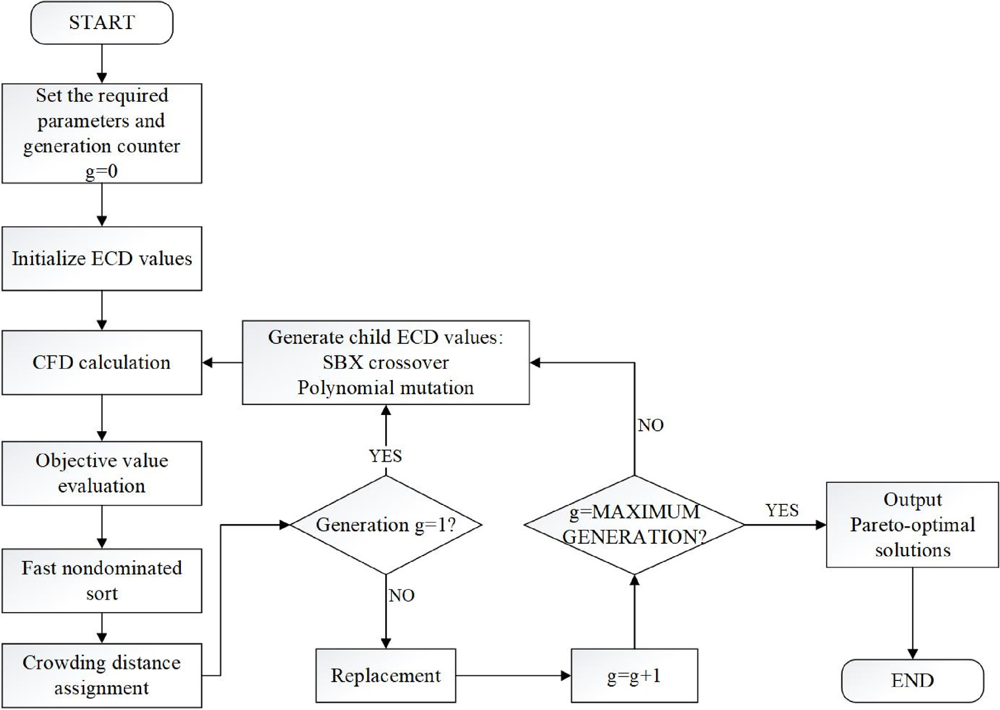

   **图 2** 扩展冠层阻力模型的优化流程图。依次设置参数与代数、初始化 ECD、计算 CFD 和目标值、快速非支配排序、分配拥挤距离；经替换、SBX 交叉和多项式变异迭代，最终输出 Pareto 最优解。

3 CFD 策略
----------

3.1 SST k–ω 湍流封闭
~~~~~~~~~~~~~~~~~~~~

在数值计算中，两方程 RANS 湍流模型广泛用于求解粗糙地表影响下的 ABL 流动（Wang et al., 2018）。此外，HHABL 模拟中的三维模型可简化为以流向流动为主的二维平面模型（Pope, 2001；Juretić and Kozmar, 2013）。因此，式 (4) 可简化为 :math:`S_u=-C_d^*(z)U_{\mathrm{in}}^2(z)`。将该 ECD 模型作为源项加入 RANS 两方程湍流封闭的二维平面 :math:`x` 动量方程，得到：

.. math::

   \frac{\partial(UU)}{\partial x}+\frac{\partial(UW)}{\partial z}=-\frac1\rho\frac{\partial\bar p}{\partial x}+\frac1\rho\frac\partial{\partial z}\left[(\mu+\mu_t)\frac{\partial U}{\partial z}\right]+S_u \qquad (9)

本文 CWE 算例关注建筑和结构风效应，因此采用 Menter（1994）发展的剪切应力输运（SST） :math:`k-\omega` 湍流模型模拟 ABL 流动；该模型在定义湍流黏度 :math:`\mu_t` 时计入湍流剪应力输运。这类两方程 RANS 模型模拟钝体绕流更准确可靠（Hu et al., 2013；Yang et al., 2017）。

SST :math:`k-\omega` 模型的湍流黏度定义为：

.. math::

   \mu_t=\frac{\rho k}{\omega}\left(\max\left[\frac1{\alpha^*},\frac{SF_2}{\alpha_1\omega}\right]\right)^{-1} \qquad (10)

其中，:math:`S=\sqrt{2S_{ij}S_{ij}}` 为式 (6) 定义的平均应变率张量的模。系数 :math:`\alpha^*=\alpha_\infty^*[(\alpha_0^*+Re_t/R_k)/(1+Re_t/R_k)]` 用于衰减湍流黏度，实现低雷诺数修正；高雷诺数流动中 :math:`\alpha^*=1`。:math:`F_2=\tanh(\phi_2^2)`，其中 :math:`\phi_2=\max[2\sqrt{k}/(0.09\omega z),500\mu/(\rho z^2\omega)]`，:math:`z` 为至最近表面的距离。:math:`\alpha_1` 为模型常数，默认值 0.31（Fluent, 2006）。

将上述湍流黏性假设代入式 (7)，TKE 与比湍流耗散率 :math:`\omega` 的输运方程表示为（Fluent, 2006）：

.. math::

   \frac{\partial(\rho kU)}{\partial x}+\frac{\partial(\rho kW)}{\partial z}=\frac\partial{\partial z}\left[\left(\mu+\frac{\mu_t}{\sigma_k}\right)\frac{\partial k}{\partial z}\right]+G_k-Y_k \qquad (11)

.. math::

   \frac{\partial(\rho\omega U)}{\partial x}+\frac{\partial(\rho\omega W)}{\partial z}=\frac\partial{\partial z}\left[\left(\mu+\frac{\mu_t}{\sigma_\omega}\right)\frac{\partial\omega}{\partial z}\right]+G_\omega-Y_\omega+D_\omega \qquad (12)

其中，Fluent（2006）给出的模型常数默认值为 :math:`\sigma_k=2.0`、:math:`\sigma_\omega=2.0`。TKE 生成项为 :math:`G_k=\min(\mu_tS^2,10\rho\beta^*k\omega)`，耗散项为 :math:`Y_k=\rho\beta^*k\omega`，其中 :math:`\beta^*` 等于 1.0。比耗散率生成项为 :math:`G_\omega=\alpha_\infty\rho S^2`，:math:`\alpha_\infty=0.52`。比耗散率耗散项为 :math:`Y_\omega=\rho\beta_i\omega^2`，其中 :math:`\beta_i=F_1\beta_{i,1}+(1-F_1)\beta_{i,2}`，模型常数 :math:`\beta_{i,1}=0.075`、:math:`\beta_{i,2}=0.0828`。:math:`F_1` 为混合函数。交叉扩散项为 :math:`D_\omega=2(1-F_1)\rho\sigma_{\omega,2}(\partial k/\partial x_j)(\partial\omega/\partial x_j)` （Fluent, 2006）。所提 ECD 模型不含 TKE 和比湍流耗散率源项，因此式 (11)、(12) 中不加入用户定义源项。

.. note::

   原文公式与常数按原版保留。本段将 :math:`\beta^*` 写为 1.0，交叉扩散项也采用原文所印形式；这里不以其他 SST 实现中的常数或公式替代，不能把译文视为对求解器实现的独立验证。

本文采用稳态、双精度、基于压力的求解器。压力采用二阶离散，动量、TKE 和比湍流耗散率输运方程采用 QUICK 格式。速度—压力耦合采用 SIMPLEC 算法，全部方程的收敛监测残差标准均为 :math:`10^{-6}`。

3.2 边界条件
~~~~~~~~~~~~

采用两组入流条件作为目标：ESDU 数据库（ESDU, 85020）提供的对数律剖面，以及广泛用作半经验入流条件的幂律剖面。入流条件的详细参数见表 1。

.. list-table:: 表 1 两类入流条件
   :header-rows: 1
   :class: longtable

   * - 入流条件
     - 对数律
     - 幂律
   * - 平均速度
     - :math:`U(z)=\frac{u_*}{\kappa}\left[\ln\left(\frac{z+z_0}{z_0}\right)+34.5\frac{fz}{u_*}\right]`
     - :math:`u(z)=u_0(z/\delta)^\alpha`
   * - 湍动能
     - :math:`k(z)=\frac{\sigma_u^2}{2}\left[1+\left(\frac{\sigma_w}{\sigma_u}\right)^2\right]`
     - :math:`k(z)=\frac32[U(z)I(z)]^2`
   * - 比湍流耗散率
     - :math:`\omega(z)=\frac1{\sqrt{\beta^*}}\frac{\partial U(z)}{\partial z}`
     - :math:`\omega(z)=\frac\alpha{\sqrt{\beta^*}}\frac{U(z)}z`

对于对数律入流条件，风速均方根值计算如下：

.. math::

   \sigma_u=u_*\frac{7.5\eta[0.538+0.09\ln(z/z_0)]^p}{1+0.156\ln[u_*/(fz_0)]},\qquad\frac{\sigma_w}{\sigma_u}=1-0.45\cos^4\left(\frac\pi2\frac z\delta\right) \qquad (13)

其中，:math:`z_0` 为空气动力粗糙度长度；科里奥利参数 :math:`f=2\Omega\sin\phi`，:math:`\Omega=72.9\times10^{-6}`，:math:`\phi=22.52^\circ` 为深圳纬度；经验系数 :math:`p=\eta^{16}`，:math:`\eta=1-6fz/u_*`；摩阻速度 :math:`u_*=u_r(10)/[2.5\ln(10/z_0)]`；:math:`\delta=u_*/(6f)` 为实际 ABL 高度。以 :math:`z=10\,\mathrm m` 处风速作为参考值。

对于幂律入流条件，AIJ（2004）给出的湍流强度为：

.. math::

   I_u(z)=0.1(z/\delta)^{-\alpha-0.05},\qquad z\le\delta \qquad (14)

不失一般性，本文模拟了三种 :math:`z_0` （Cai et al., 2014；Cindori and Franjo, 2018；ESDU, 85020）以及三种 :math:`\alpha` （Architectural Institute Of Japan, 2004）的粗糙地表。采用两组入流条件，标准粗糙地面上方 10 m 处参考风速为 :math:`u_r(10)=10\,\mathrm{m/s}`。参数及工况列于表 2。

.. list-table:: 表 2 ABL 入流剖面参数
   :header-rows: 1
   :class: longtable

   * - 地表类别
     - 对数律 :math:`z_0` （m）
     - 对数律 :math:`u_*` （m/s）
     - 对数律缩尺比
     - 对数律 :math:`\delta` （m）
     - 幂律 :math:`\alpha`
     - 幂律缩尺比
     - 幂律 :math:`\delta` （m）
   * - 乡村
     - 0.1
     - 0.7486
     - 1:1800
     - 2200
     - 0.15
     - 1:290
     - 350
   * - 郊区
     - 0.3
     - 0.8132
     - 1:2000
     - 2400
     - 0.20
     - 1:375
     - 450
   * - 城市
     - 1.0
     - 0.8983
     - 1:2250
     - 2700
     - 0.35
     - 1:540
     - 650

为严格考察近地阻力对流场的影响，无滑移壁面边界的粗糙高度设为零，确保流场不受粗糙壁面函数影响。出口采用流出边界条件，顶面采用对称边界条件。入口为速度入口，通过用户定义函数按表 2 参数指定。

3.3 网格方案与网格无关性分析
~~~~~~~~~~~~~~~~~~~~~~~~~~~~

采用表 3 的三种网格方案验证数值结果的网格无关性。全部方案均沿流向均匀布置网格，沿竖向按指数拉伸，并满足 :math:`z_{\mathrm{wall}}^+=\rho u_*z/\mu\le1`。中等网格方案见图 3。

.. list-table:: 表 3 网格无关性分析的网格方案
   :header-rows: 1
   :class: longtable

   * - 网格参数
     - :math:`N_x`
     - :math:`N_z`
     - :math:`\Delta z_{\mathrm{wall}}` （m）
     - 增长因子
   * - 粗
     - 300
     - 140
     - :math:`3\times10^{-5}`
     - 1.09
   * - 中等
     - 450
     - 162
     - :math:`3\times10^{-5}`
     - 1.07
   * - 细
     - 600
     - 200
     - :math:`3\times10^{-5}`
     - 1.06

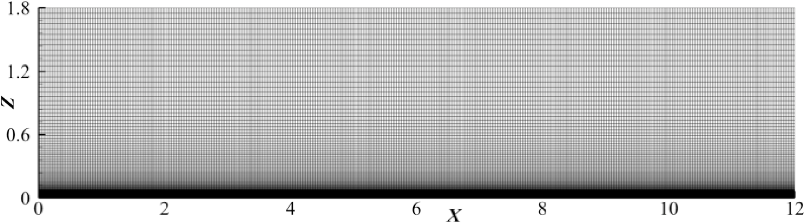

   **图 3** 中等网格方案。

为检验所提方法的网格无关性，在郊区地表的对数律和幂律入流条件下，将中等网格获得的最优阻力用于粗、细网格方案。

优化过程最终给出一组最优解，用户可针对不同目的选择最佳结果。本文应用对象是建筑和结构风效应，关注平均特性。因此，为满足不同需求，对数律入流采用 TKE 误差最小的工况，因为 Pareto 前沿上的平均速度误差都足够小；幂律入流则采用速度误差最小的工况。

如图 4 和图 5 所示，对于郊区地表上的对数律与幂律入流，三种网格方案在监测位置的平均速度剖面均吻合良好。此外，近地区域 TKE 剖面的差异几乎可以忽略。另外两类粗糙地表流动也具有类似趋势，验证了所提 ECD 模型模拟 ABL 流动的网格无关性。

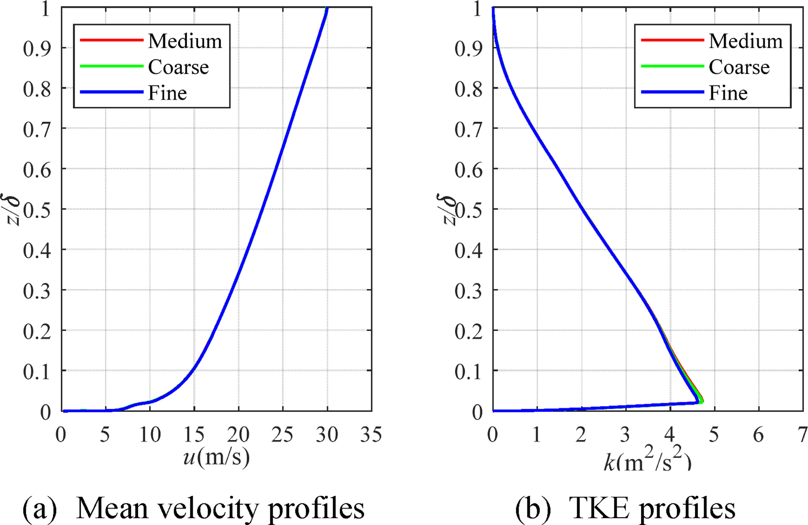

   **图 4** 采用对数律入流条件的网格无关性研究流动特性。（a）平均速度剖面；（b）TKE 剖面。

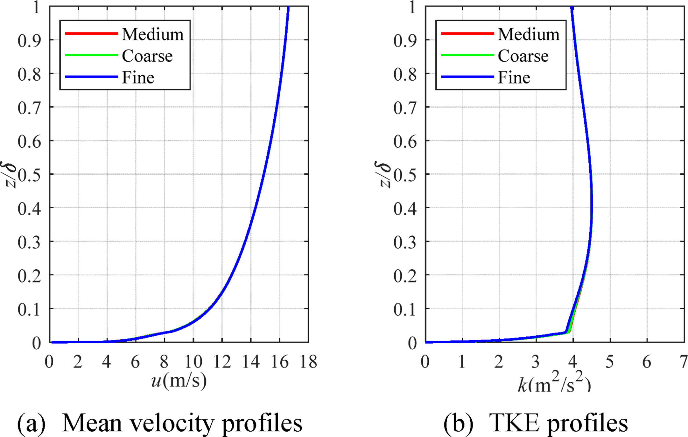

   **图 5** 采用幂律入流条件的网格无关性研究流动特性。（a）平均速度剖面；（b）TKE 剖面。

4 结果
------

4.1 Pareto 最优解
~~~~~~~~~~~~~~~~~~~~~~~~

一般而言，多目标进化算法有两个性能指标：（1）向 Pareto 最优集收敛；（2）Pareto 最优集的多样性（Deb et al., 2002）。然而，本文难以预先判断平均速度与 TKE 误差两个目标函数之间的内部关系，因此解析 Pareto 最优解并不确定。为此，优化过程中设置下界 :math:`10^{-4}` （Yu et al., 2015），判断优化过程是否收敛。当每代两个目标函数的平均值低于 :math:`10^{-4}` 时，认为优化过程收敛。

图 6 给出了对数律和幂律入流工况中两个目标平均误差的演变。两类工况趋势相似，三种地表工况的平均误差在 30 代后保持不变。优化过程收敛后，后续各代的解均匀分布，以获得良好多样性，如图 7 所示。采用高性能 Intel Xeon 工作站的 36 个 CPU 线程，完成整个优化过程最快约需 29 h，全部工况平均约需 37 h；其中 CFD 模拟占总时间的 91%，多目标优化过程占其余部分。经典双目标优化问题通常需要上百代才能收敛（Deb et al., 2002；Yu et al., 2015），相比之下，上述结果说明当前优化过程能高效求解所提 ECD 模型。

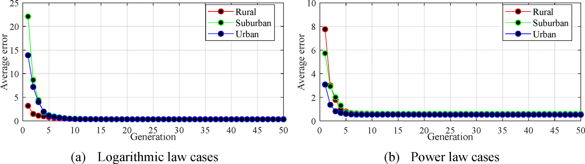

   **图 6** 各代平均误差的分布。（a）对数律工况；（b）幂律工况。

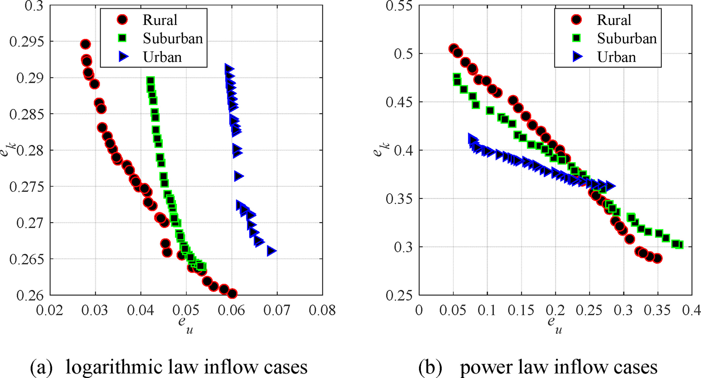

   **图 7** Pareto 最优解。（a）对数律入流；（b）幂律入流。

如图 7 所示，全部工况最终的 Pareto 解通过折中平均速度和 TKE 目标误差，表现出令人满意的多样性，也验证了所采用多目标优化算法的可靠性。

此外，对数律入流工况中 :math:`u` 和 :math:`k` 的总体相对误差显著低于幂律工况。这是因为对数律平均速度由流体力学边界层理论推导，而该理论也是 CFD 控制方程的基础。幂律风剖面则源于工程实践，理论背景较少。因此，以往几乎所有 HHABL 研究均采用对数律入流条件，并不令人意外（Yang et al., 2009；O Sullivan and Archer et al., 2011；Parente and Gorlé et al., 2011a；Parente and Gorlé et al., 2011b；Hu et al., 2013；Balogh and Parente, 2015；Richards and Norris, 2015；Yan et al., 2015）。

.. note::

   本节按原文保留 :math:`10^{-4}` 收敛表述。原文未在这段说明中另行定义“平均误差变化量”；后文报告的最终剖面相对误差仍为百分数量级，故不将这里改写成全部剖面误差均降至 :math:`10^{-4}` 的性能结论。

4.2 对数律入流条件下的 ABL
~~~~~~~~~~~~~~~~~~~~~~~~~~

由于对数律入流工况的总体平均速度误差较小，本节选择并讨论 TKE 误差最小的工况。

图 8 给出了乡村、郊区和城市地表在对数律入流条件下得到的综合阻力系数 :math:`C_d^*(z)`。符号表示最优离散值 :math:`C_d^*(z_i)`。作用高度 :math:`h_s` 与地面之间为 ECD 模型实际施加区域。不同工况的优化高度 :math:`h_s` 为 ABL 高度 :math:`\delta` 的 0.02–0.03 倍，与地球表面建筑物、植被等粗糙元的实际高度相当。三类粗糙地表的作用高度彼此接近，但随粗糙度长度逐渐增加。综合阻力系数剖面均呈随高度增加而减小、随粗糙度长度增加而增大的类似趋势。与由 RANS 结果计算的阻力系数（Santiago et al., 2008）相比，虽然两类系数在不同框架下获得，难以直接比较，但其数量级接近、竖向分布类似。在 ECD 模型中，:math:`C_d^*(z)` 增大会直接加强对风流的扰动，即近地区域平均速度减小、TKE 增加，见图 9 和图 10。这些现象均表明，所获得的近地 ECD 与实际地表粗糙度具有一致性。

.. figure:: ../../../wechat/assets/public-safe/ref-li2020-JWEIA/fig08-original.jpeg
   :alt: 图 8 对数律入流条件下的最优综合冠层阻力系数。符号表示综合冠层阻力系数离散值：红色星号对应乡村、绿色空心方框对应郊区、蓝色叉号对应城市。原文有关颜色的说明请结合网络版彩色图理解。
   :align: center
   :width: 100%

   **图 8** 对数律入流条件下的最优综合冠层阻力系数。符号表示综合冠层阻力系数离散值：红色星号对应乡村、绿色空心方框对应郊区、蓝色叉号对应城市。原文有关颜色的说明请结合网络版彩色图理解。

图 9 和图 10 比较了不同粗糙地表在对数律入流条件下优化后的平均速度与 TKE 剖面。未作任何修正时，图 9 中边界层高度 :math:`0.15\delta` 以下平均速度存在较大偏差；在 ECD 模型作用下，速度剖面取得了显著的水平齐次性。在 :math:`0.15\delta` 以上区域，三类地表中两种方法的结果几乎相同。这表明近地 ECD 对上部区域流动影响有限，符合地球 ABL 的生成机制。定量而言，采用式 (8) 计算有、无 ECD 工况的目标误差，乡村、郊区和城市地表采用 ECD 时平均速度误差分别为 5.6%、4.8% 和 7.0%，未采用 ECD 时分别为 15.7%、25.8% 和 43%。这些结果表明 ECD 工况有明显改善。

.. figure:: ../../../wechat/assets/public-safe/ref-li2020-JWEIA/fig09-original.jpeg
   :alt: 图 9 对数律入流条件下的平均速度剖面。Inflow 表示目标或入口剖面；With ECD、Without ECD 分别表示有、无 ECD 模型的工况。
   :align: center
   :width: 100%

   **图 9** 对数律入流条件下的平均速度剖面。Inflow 表示目标或入口剖面；With ECD、Without ECD 分别表示有、无 ECD 模型的工况。

图 10 比较了有、无 ECD 模型时的入口与下游监测位置 TKE 剖面。施加优化的近地 ECD 模型后，下游监测位置剖面与目标吻合良好，尤其是贴近地面的下部区域。乡村、郊区和城市地表采用 ECD 时，TKE 目标误差分别为 26.1%、27.0% 和 26.8%；未采用 ECD 时分别为 37.2%、39.3% 和 42.6%，说明齐次性明显改善。还可发现，虽然阻力仅施加于 :math:`x` 动量方程、且位于 :math:`0.025\delta` 以下，ECD 对 TKE 场的影响区域却延伸至约 :math:`0.4\delta`。这是因为作为 :math:`x` 动量源项的 ECD，增大平均速度剖面的剪切变形，即平均应变率 :math:`S_{ij}`，从而增大雷诺应力（Pope, 2001），最终提高影响区内的 TKE。此外，上部区域 TKE 略高于入口值，这归因于不适当入流边界条件引起的 TKE 沿流向发展（Richards and Norris, 2015），且超出 ECD 模型影响范围。

.. figure:: ../../../wechat/assets/public-safe/ref-li2020-JWEIA/fig10-original.jpeg
   :alt: 图 10 对数律入流条件下的湍动能剖面。
   :align: center
   :width: 100%

   **图 10** 对数律入流条件下的湍动能剖面。

以往研究（Hu et al., 2013；Cai et al., 2014；Yan et al., 2015；Cindori and Franjo, 2018）在整个计算域施加阻力或源项。相比之下，所提 ECD 仅作用于近地区域，更符合 ABL 物理实际。速度场等值图见图 11。全部工况的上部区域均呈现良好水平齐次性；近壁区域中，三类地表采用 ECD 的工况均明显更好。

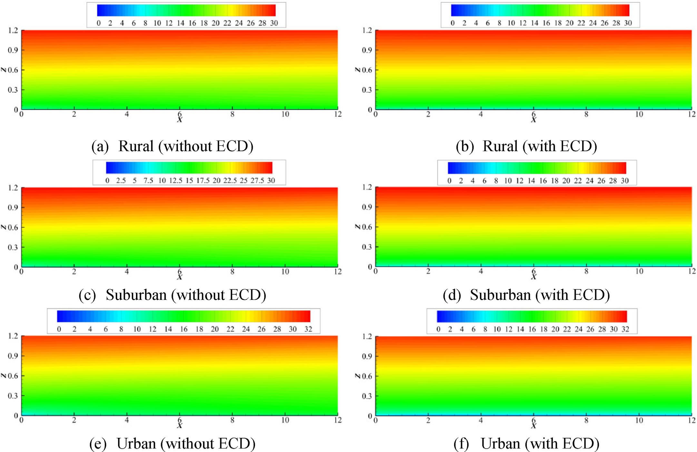

   **图 11** 对数律入流条件下的平均速度等值图。

图 12 表明，ECD 明显改善近壁区域 TKE，使其沿流向几乎不变。应当指出，有、无 ECD 的上部区域 TKE 均存在发展。这可能由若干原因引起，并超出 ECD 模型的影响范围。本文 ABL 流动由沿流向的压力梯度驱动；这种 HHABL 需要适当的 CFD 入流条件才能达到平衡，处于平衡状态时流动不会沿流向发展（Richards and Norris, 2015）。然而，这些适当入流条件虽然可能足以实现数值 HHABL，却不能代表所有实际入流条件，例如广泛采用的对数律和幂律条件。考虑到数值 ABL 与实际 ABL 之间固有的差异，ECD 是进一步协调这些差异的一种可行且实用的措施。此外，顶边界条件不一致（Oshio et al., 2015；Richards and Norris, 2019）也会导致 TKE 沿流向发展。

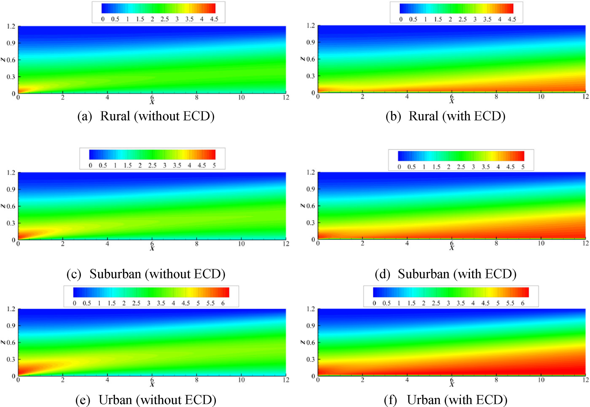

   **图 12** 对数律入流条件下的湍动能等值图。

4.3 幂律入流条件下的 ABL
~~~~~~~~~~~~~~~~~~~~~~~~

本节讨论平均速度误差最小的结果。如果要求更高 TKE 精度，例如模拟污染物扩散（Cai et al., 2014；Bazdidi-Tehrani et al., 2016），用户可选择 TKE 误差最小的结果。

图 13 给出了乡村、郊区和城市地表在幂律入流条件下获得的最优综合阻力系数 :math:`C_d^*(z)`。不同工况的作用高度 :math:`h_s` 为 ABL 高度 :math:`\delta` 的 0.03–0.05 倍，也与地表粗糙元实际高度相当。与对数律工况类似，乡村与郊区的作用高度十分接近，城市地表最大。幂律条件下三类地表的作用高度均大于对数律工况。

综合阻力系数剖面中，郊区形状与其余两类地表略有不同，而另外两类地表趋势类似。实际上，更多算例分析表明，只要总体分布与作用高度 :math:`h_s` 合理，ECD 作用区内 :math:`C_d^*(z)` 形状的微小变化，对流动特性的影响可以忽略。

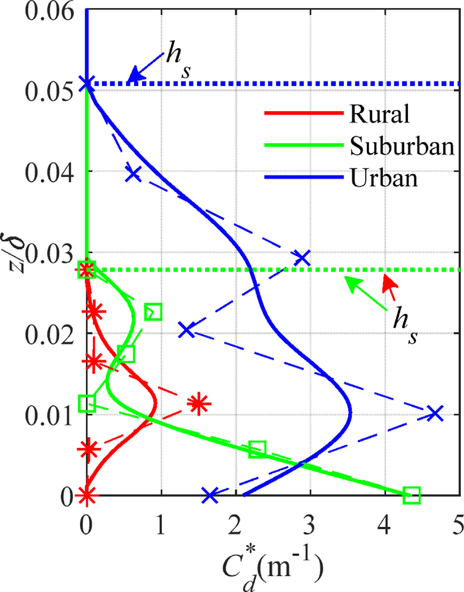

   **图 13** 幂律入流条件下的最优近地阻力系数剖面。符号表示综合冠层阻力系数离散值：红色星号对应乡村、绿色空心方框对应郊区、蓝色叉号对应城市。原文有关颜色的说明请结合网络版彩色图理解。

图 14 和图 15 比较了不同地表在幂律入流条件下的平均速度与 TKE 剖面。如图 14 所示，未采用 ECD 时，:math:`0.2\delta` 以下速度存在较大偏差，乡村、郊区和城市的平均速度目标误差分别为 15.5%、25.6% 和 71.4%；采用 ECD 后，误差分别明显降至 5.1%、10.9% 和 9.8%。在 :math:`0.2\delta` 以上区域，近地 ECD 也改善了速度与入口的一致性，表明模型适用于幂律入流工况。

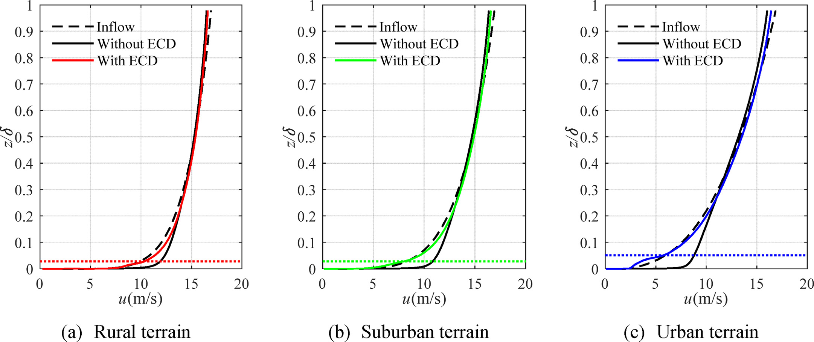

   **图 14** 幂律入流剖面下的平均速度剖面。

如图 15 所示，虽然 TKE 剖面改善不如对数律条件，但乡村、郊区和城市地表的 TKE 误差仍由 56.2%、56.3% 和 56.6%，分别降至 50.5%、44.0% 和 39.8%。与对数律工况相似，这些改善表明，仅含 :math:`x` 动量源项的 ECD 模型可以增大平均速度剖面的剪切变形，从而增大雷诺应力（Pope, 2001），最终提高影响区内 TKE。表 1 中用于幂律入流的 TKE 剖面是假定的，可能不适用于实际 ABL，因此 TKE 剖面改善相对较弱可以理解。此外，有、无 ECD 的上部区域 TKE 剖面相同，也说明近地阻力对上部区域影响有限，与实际粗糙元的物理作用一致。

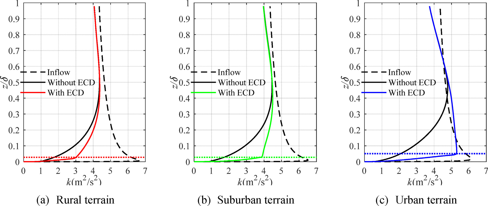

   **图 15** 幂律入流剖面下的湍动能剖面。

平均速度场等值图见图 16。ECD 工况在近壁区域，即 :math:`0.15\delta` 以下，可获得可接受的水平齐次性。图 17 为 TKE 场等值图，显示 ECD 工况的近壁 TKE 沿流向维持良好。此外，高粗糙度城市地表的 TKE 齐次性改善更明显。因此，可采用该模型改善近壁齐次性，这对关注行人风环境的 CWE 算例很重要。上部区域平均速度与 TKE 仍沿流向衰减，可能源于入口与顶边界条件不一致（O Sullivan and Archer et al., 2011；Richards and Norris, 2019），不受 ECD 模型影响。

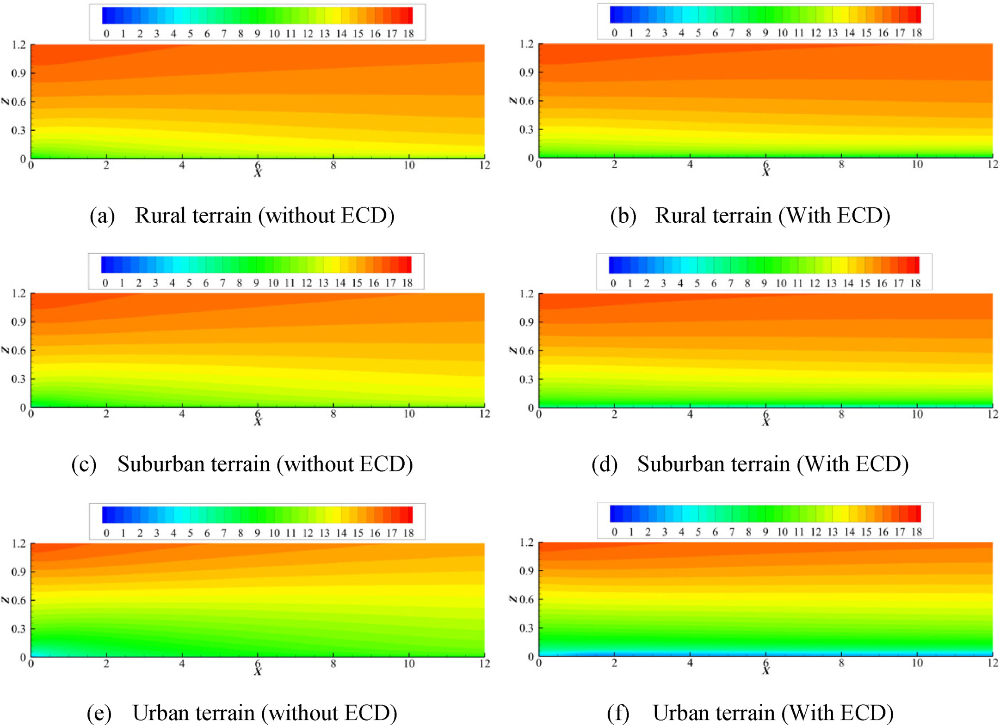

   **图 16** 幂律入流条件下的平均速度等值图。

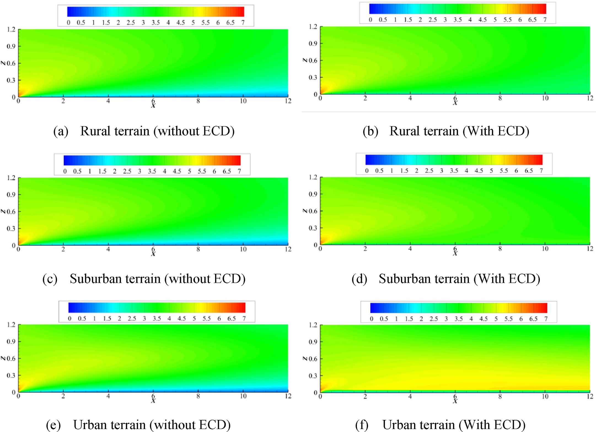

   **图 17** 幂律入流条件下的 TKE 等值图。

.. note::

   本节关于幂律作用高度范围及三类地表均高于对数律的描述按原文保留；表 4 的幂律 :math:`h_s/\delta` 列实际为 0.022、0.023、0.051，并非各项都位于文中所述 0.03–0.05，也并非各项均严格大于对应对数律值。不要将这一范围当作统一标定规则。

4.4 定量误差分析
~~~~~~~~~~~~~~~~

为定量评价优化的近地 ECD 对流动的改善，计算下游监测位置与入口边界之间的平均绝对差：

.. math::

   e_\chi^{\mathrm{abs}}=\overline{|\chi_{\mathrm{mp}}-\chi_{\mathrm{in}}|}^{\,z} \qquad (15)

其中，:math:`\chi` 表示平均速度或 TKE，上标 abs 表示绝对值。

计算网格沿竖向并非均匀分布，且近壁区域很密，因此在边界层高度以下采用 120 个均匀分布点，计算平均速度和 TKE 的平均绝对差。无量纲值列于表 4，其中 :math:`e_u^{\mathrm{abs}}` 除以参考风速 :math:`u_r`，:math:`e_k^{\mathrm{abs}}` 除以 :math:`u_r^2`。无量纲误差表明，近地 ECD 能显著改善对数律与幂律入流的平均速度水平齐次性，尤其是高粗糙度表面。对于 TKE，近地 ECD 在对数律工况下更有效。

.. list-table:: 表 4 有、无 ECD 模型的结果比较
   :header-rows: 1
   :class: longtable

   * - 地表
     - 入流律
     - :math:`h_s/\delta`
     - 无ECD :math:`e_u^{\mathrm{abs}}/u_r`
     - 有ECD :math:`e_u^{\mathrm{abs}}/u_r`
     - 无ECD :math:`e_k^{\mathrm{abs}}/u_r^2`
     - 有ECD :math:`e_k^{\mathrm{abs}}/u_r^2`
   * - 乡村
     - 对数律
     - 0.020
     - 2.51%
     - 0.91%
     - 0.32%
     - 0.18%
   * - 郊区
     - 对数律
     - 0.023
     - 3.56%
     - 0.92%
     - 0.45%
     - 0.23%
   * - 城市
     - 对数律
     - 0.023
     - 5.12%
     - 1.23%
     - 0.66%
     - 0.32%
   * - 乡村
     - 幂律
     - 0.022
     - 3.72%
     - 1.98%
     - 0.89%
     - 0.72%
   * - 郊区
     - 幂律
     - 0.023
     - 4.62%
     - 2.02%
     - 0.85%
     - 0.57%
   * - 城市
     - 幂律
     - 0.051
     - 6.71%
     - 2.31%
     - 0.79%
     - 0.32%

此外，图 18 给出了有、无 ECD 工况之间的误差比。最优近地 ECD 显然：（1）对对数律入流更有效；（2）对平均速度更有效；（3）对较粗糙地表更有效。

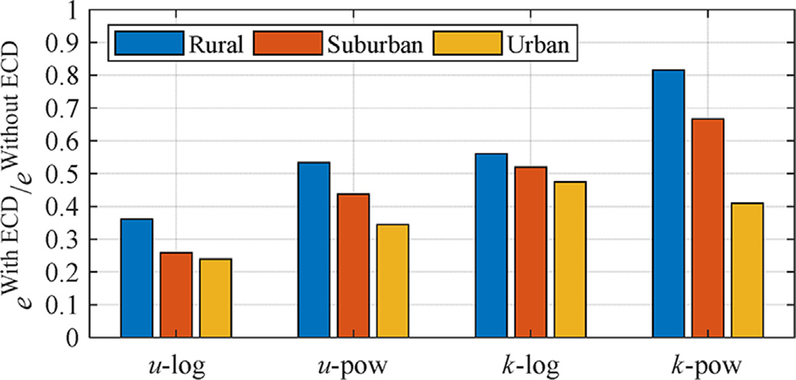

   **图 18** 流动特性的定量改善。纵坐标为有 ECD 与无 ECD 的误差比；u-log、u-pow、k-log、k-pow 分别为两类入流的平均速度和 TKE 指标。

5 扩展冠层阻力模型通用性的进一步讨论
------------------------------------

根据式 (4)，ECD 以适用于所有冠层流动的通用形式设计，不依赖湍流模型，综合阻力系数 :math:`C_d^*(z)` 也与流速大小无关。因此，本节采用上一节对数律入流条件下优化得到的近地阻力，研究其对标准 :math:`k-\varepsilon` 湍流模型及不同参考入流速度的适应性。此外，验证所得 ECD 力在三维计算模型中的适用性。

5.1 标准 k–ε 湍流模型
~~~~~~~~~~~~~~~~~~~~~

优化的近地阻力仅作为 :math:`x` 动量源项加入，因此检验其对其他湍流模型的适应性具有意义。过去十年，模拟 HHABL 最广泛采用的 RANS 模型是标准 :math:`k-\varepsilon` 湍流封闭（Yang et al., 2009；Cai et al., 2014；Yan et al., 2015）；本文也采用该模型检验优化 ECD 的适应性。此外，采用 CWE 中常见的增强壁面处理（enhanced wall treatment，EWT）和标准壁面函数（standard wall function，SWF），考察近壁处理对 HHABL 模拟的影响。标准 :math:`k-\varepsilon` 模型可选择不同壁面处理，而 SST :math:`k-\omega` 模型采用 EWT（Fluent, 2006）。

SWF 仅使用半经验公式，连接壁面与完全湍流区域之间受黏性影响的区域（Fluent, 2006；Blocken et al., 2007）。相比之下，EWT 是结合双层模型与增强壁面函数的近壁建模方法，能一直分辨到壁面的黏性影响区（Fluent, 2006）。因此，EWT 要求近壁区域采用较细网格，采用 EWT 的湍流封闭也更准确（Hu et al., 2013；Yang et al., 2017）。

EWT 工况采用与第 3.3 节中等网格相同的计算网格。采用 SWF 时，将贴壁单元高度增至 0.002 m，以满足 :math:`z_{\mathrm{wall}}^+\approx30\text{–}300` 的条件。两类工况的竖向增长因子与流向网格间距保持不变。此外，与前述工况相同，两种壁面函数的粗糙高度均为零。

采用此前在 :math:`u_r(10)=10\,\mathrm{m/s}` 下优化的 :math:`C_d^*(z)`，以标准 :math:`k-\varepsilon` 模型模拟 ABL 流动。三类地表的平均速度与 TKE 剖面比较见图 19 和图 20。如图 19 所示，尽管紧邻壁面的区域有轻微差异，由 SST :math:`k-\omega` 模型优化得到的近地阻力，在标准 :math:`k-\varepsilon` 模型中仍能显著改善平均速度水平齐次性。图 20 中的 TKE 剖面也明显改善。绿线与蓝线之间的小差异还说明，优化 ECD 对 EWT 和 SWF 两种壁面处理均适用。

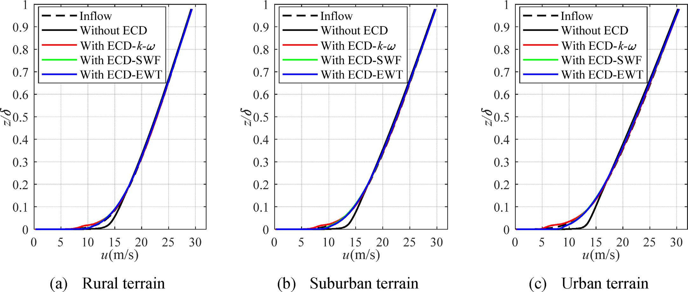

   **图 19** 对数律入流条件下的平均速度。

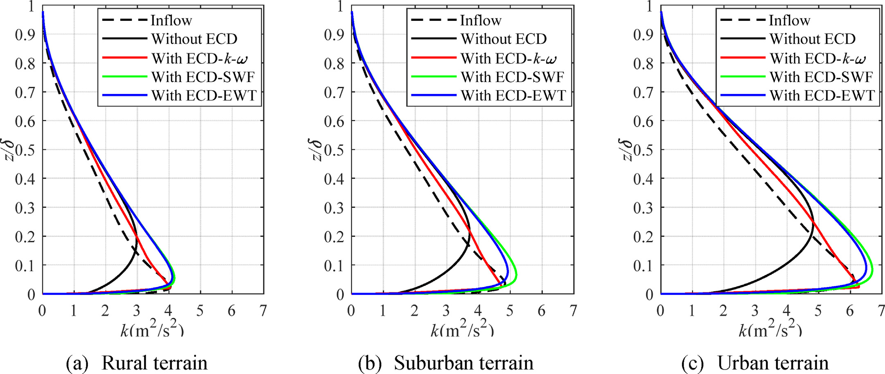

   **图 20** 对数律入流条件下的湍动能。

5.2 不同参考风速
~~~~~~~~~~~~~~~~

ECD 模型中的近地阻力由综合阻力系数 :math:`C_d^*(z)` 及局部流向速度 :math:`|\mathbf u|` 和 :math:`U` 描述。因此，本小节首先在乡村、郊区和城市地表的对数律入流条件下，分别针对 :math:`u_r(10)=5\,\mathrm{m/s}` 和 :math:`20\,\mathrm{m/s}` 优化 ECD。这些工况的优化过程与第 4.2 节相同。随后，利用此前在 :math:`u_r(10)=10\,\mathrm{m/s}` 对数律条件下优化得到的 :math:`C_d^*(z)`，检验模型模拟任意参考风速 HHABL 的可行性。计算域与第 3 节相同，网格采用表 3 的中等方案。

优化后的平均速度与 TKE 剖面见图 21–24。如图 21 和图 23 所示，最优 ECD 均明显改善下游监测位置的平均速度剖面齐次性。图 22 和图 24 中的 TKE 剖面也与目标吻合良好。这些结果验证了所提 ECD 模型在任意入流风速下实现 HHABL 的能力。

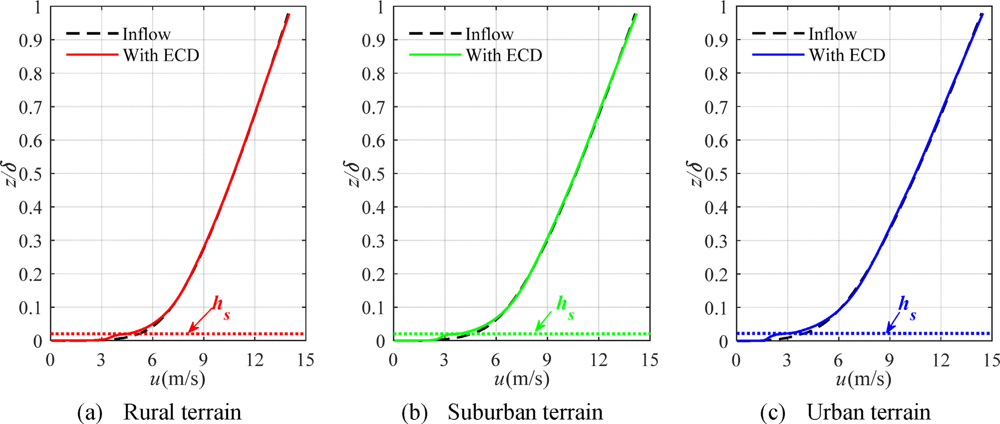

   **图 21** :math:`u_r(10)=5\,\mathrm{m/s}` 时，对数律入流条件下优化的平均速度剖面。

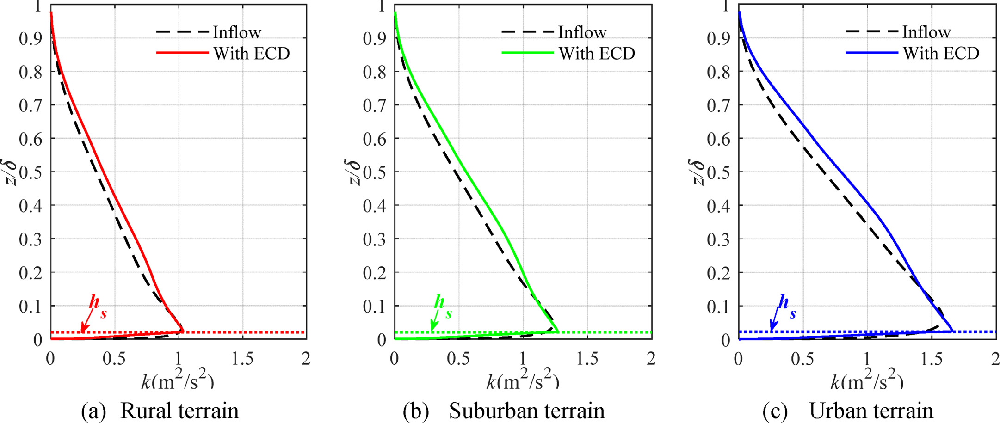

   **图 22** :math:`u_r(10)=5\,\mathrm{m/s}` 时，对数律入流条件下优化的 TKE 剖面。

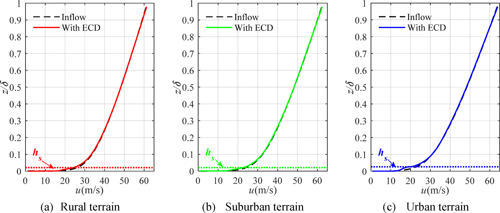

   **图 23** :math:`u_r(10)=20\,\mathrm{m/s}` 时，对数律入流条件下优化的平均速度剖面。

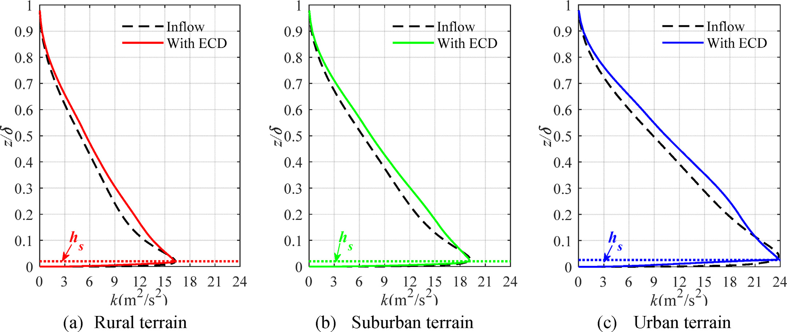

   **图 24** :math:`u_r(10)=20\,\mathrm{m/s}` 时，对数律入流条件下优化的 TKE 剖面。

这些工况的最优作用高度 :math:`h_s^u` 也列于表 5。采用 :math:`e_h=(h_s^u-h_s^{10})/h_s^{10}` 定量评价不同入流风速之间的偏差，上标 u 表示参考风速，:math:`h_s^{10}` 来自第 4.2 节。

.. list-table:: 表 5 不同入流风速的作用高度比较
   :header-rows: 1
   :class: longtable

   * - :math:`u_r(10)`
     - 乡村 :math:`h_s^u/\delta`
     - 乡村 :math:`e_h`
     - 郊区 :math:`h_s^u/\delta`
     - 郊区 :math:`e_h`
     - 城市 :math:`h_s^u/\delta`
     - 城市 :math:`e_h`
   * - 10 m/s
     - 0.0215
     - 0
     - 0.0227
     - 0
     - 0.0239
     - 0
   * - 5 m/s
     - 0.0215
     - 0
     - 0.0215
     - −5.29%
     - 0.0239
     - 0
   * - 20 m/s
     - 0.0204
     - −5.11%
     - 0.0215
     - −5.29%
     - 0.0278
     - 16.32%

由表 5 可见，各作用高度处于相同数量级。偏差最大的城市工况中，当前网格方案下 :math:`h_s^{20}` 仅比 :math:`h_s^{10}` 多三层网格；郊区工况的 :math:`h_s^{20}` 和 :math:`h_s^5` 则仅比 :math:`h_s^{10}` 少一层网格。因此，作用高度对入流风速及边界层高度的依赖较小。

此外，为检验所提 ECD 模型模拟任意参考风速 HHABL 的通用性，将第 4.2 节在 :math:`u_r(10)=10\,\mathrm{m/s}` 下优化得到的 :math:`C_d^*(z)`，用于 :math:`u_r(10)=5\,\mathrm{m/s}` 和 20 m/s 的工况。图 25–28 分别给出了这两种参考风速下对数律工况的平均速度与 TKE 剖面。图 25 所示较低入流风速工况中，综合阻力系数能有效维持平均速度场；图 27 所示较高风速工况中，其阻力作用略大于维持速度剖面所需程度，导致近地区域速度偏小。另一方面，图 26 和图 28 表明，这些阻力分别在两种参考风速工况的近地区域产生不足和过量的 TKE。这说明，不含 TKE 源项的 ECD 模型表现出对入流雷诺数的依赖。

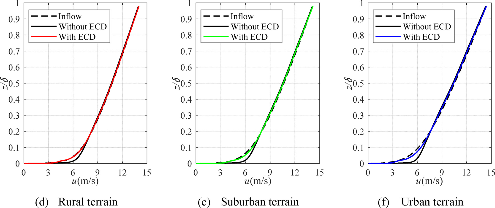

   **图 25** :math:`u_r(10)=5\,\mathrm{m/s}` 时，对数律入流条件下的平均速度。

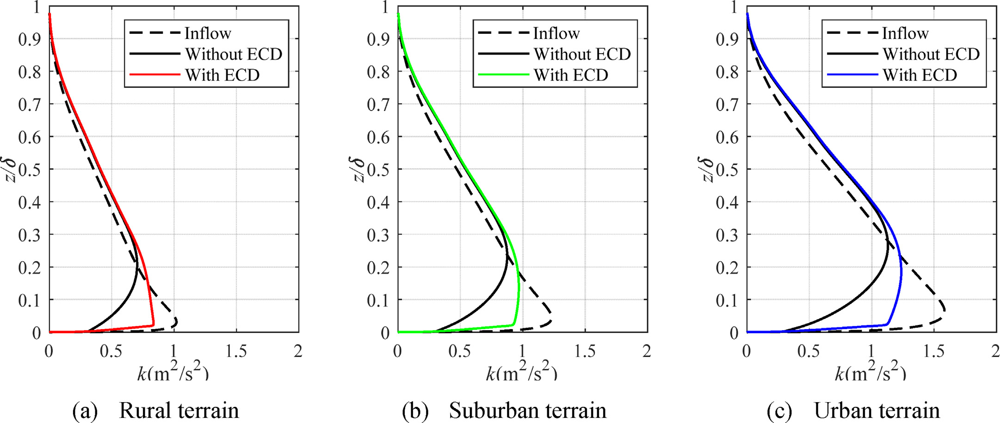

   **图 26** :math:`u_r(10)=5\,\mathrm{m/s}` 时，对数律入流条件下的湍动能。

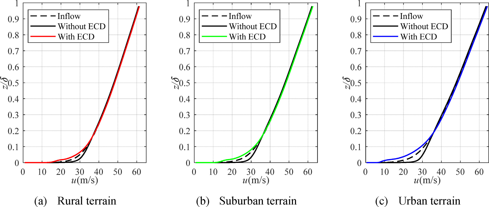

   **图 27** :math:`u_r(10)=20\,\mathrm{m/s}` 时，对数律入流条件下的平均速度。

.. figure:: ../../../wechat/assets/public-safe/ref-li2020-JWEIA/fig28-original.jpeg
   :alt: 图 28 u_r(10)=20\,\mathrm{m/s} 时，对数律入流条件下的湍动能。
   :align: center
   :width: 100%

   **图 28** :math:`u_r(10)=20\,\mathrm{m/s}` 时，对数律入流条件下的湍动能。

.. note::

   “重新优化后不同风速均可改善”与“把 10 m/s 优化系数直接迁移到其他风速”是两组不同检验。后一组仍出现近地 TKE 不足或过量，不应从前一组结果推出无需重新标定的任意风速通用性。

5.3 三维模拟
~~~~~~~~~~~~

本节建立三维计算模型，验证二维模拟得到的 ECD 在三维模拟中的适应性。流向与竖向网格划分与表 3 的中等方案相同。展向计算域宽 1.8 m，均匀划分为 67 个网格，计算域示意见图 31。提取展向中部的流向平面，展示入口剖面的发展。

图 29 和图 30 给出了入口与监测截面展向中心线上的平均速度与 TKE 剖面，可见三维结果均与二维结果（图 9、10）一致。图 31–33 中平均速度和 TKE 等值图也与二维结果相同。这些现象验证了第 3.1 节的简化，说明所提 ECD 可直接用于三维模拟。

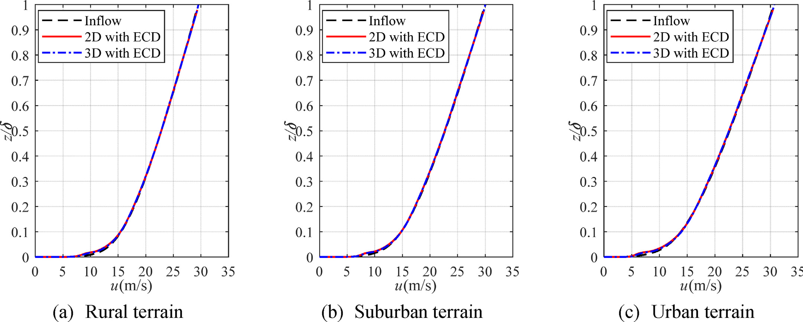

   **图 29** 三维工况中对数律入流条件下的平均速度。

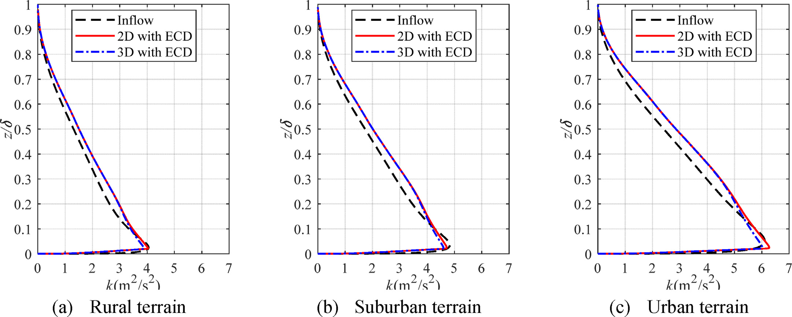

   **图 30** 三维工况中对数律入流条件下的湍动能。

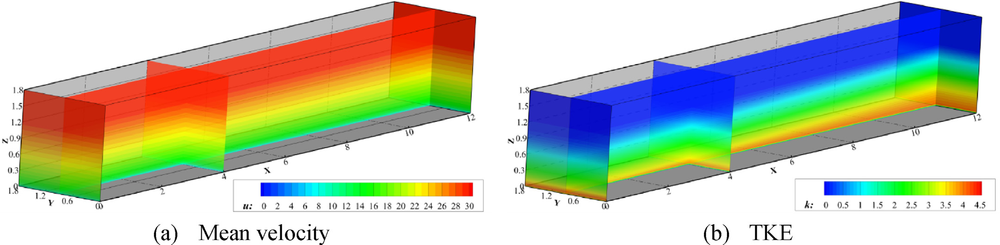

   **图 31** 乡村地表三维工况中对数律入流条件下的等值图。（a）平均速度；（b）TKE。

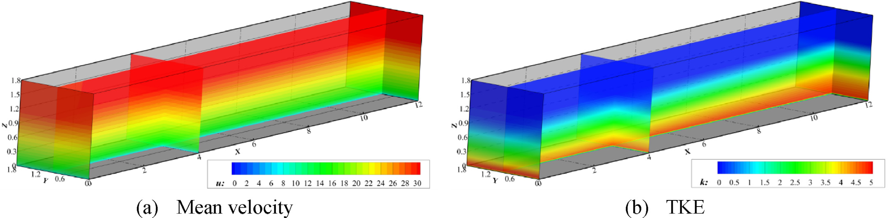

   **图 32** 郊区地表三维工况中对数律入流条件下的等值图。（a）平均速度；（b）TKE。

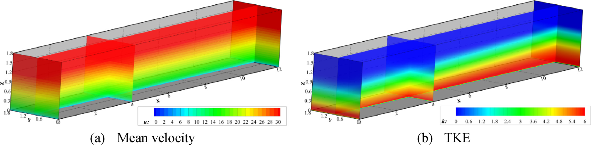

   **图 33** 城市地表三维工况中对数律入流条件下的等值图。（a）平均速度；（b）TKE。

6 结论
------

本文旨在解决计算风工程的一个关键问题，即再现粗糙地表上的大气边界层，并使其特性沿风向保持不变。本文扩展了广泛使用的冠层阻力模型，以模拟不限于植被类型的地表粗糙度作用。采用多目标进化算法 NSGA-II，优化 ECD 中待定参数。在 ECD 作用下，数值结果的近壁平均速度具有良好齐次性，TKE 也明显改善。本研究结论如下：

1. 所提 ECD 与优化算法结合，能对从乡村到城市地表的对数律和幂律风流生成 HHABL。总体而言，模型对 RANS 湍流模型、近壁处理、网格分辨率及计算域维度不敏感，证明了其适用性。
2. 所提 ECD 有助于生成和维持接近物理实际的数值 ABL。其作用高度 :math:`h_s` 仅为边界层高度的 0.02–0.05 倍，与实际地表粗糙元高度相当。
3. 当前方法只需对原模拟作很少修改即可实现 HHABL，例如不限制 RANS 模型经验常数和各项边界条件，且无须在 :math:`h_s` 以上流场加入额外源项。

需要指出，所提模型仍有一些不足需要进一步研究。ECD 参数 :math:`C_d^*(z_i)` 和 :math:`h_s` 必须在应用前通过专门优化过程确定；若能获得这些未知参数的经验或理论估算方法，将更加方便。由于当前 ECD 仅作用于动量方程，TKE 对湍流模型和入流风速特别敏感。进一步检验在 TKE 方程中加入式 (2) 源项的作用具有意义。也可以尝试不等于五的 :math:`C_d^*(z_i)` 优化变量数量。此外，未来还应研究当前模型在实尺度模拟中实现 HHABL 的能力。

参考文献
--------

Abdi, D.S., Bitsuamlak, G.T., 2014. Numerical evaluation of the effect of multiple roughness changes. Wind Struct. 19 (6), 585–601.

Aboshosha, H., Bitsuamlak, G., Damatty, A.E., 2015. LES of ABL flow in the built-environment using roughness modeled by fractal surfaces. Sustain. Cities Soc. 19, 46–60.

Amorim, J.H., Rodrigues, V., Borrego, C., Costa, A.M., 2010. A CFD analysis of the vegetative canopy effect on urban air pollutants dispersion. In: Local Air Quality and its Interactions with Vegetation. Antwerp, Belgium.

Architectural Institute Of Japan, 2004. AIJ Recommendations for Loads on Buildings.

Balogh, M., Parente, A., 2015. Realistic boundary conditions for the simulation of atmospheric boundary layer flows using an improved k-ε model. J. Wind Eng. Ind. Aerod. 144, 183–190.

Balogh, M., Parente, A., Benocci, C., 2012. RANS simulation of ABL flow over complex terrains applying an Enhanced k-ε model and wall function formulation: implementation and comparison for fluent and OpenFOAM. J. Wind Eng. Ind. Aerod. 104–106, 360–368.

Bazdidi-Tehrani, F., Kiamansouri, M., Jadidi, M., 2016. Inflow turbulence generation techniques for large eddy simulation of flow and dispersion around a model building in a turbulent atmospheric boundary layer. J. Build. Perform. Simulat. 6 (9), 680–698.

Blocken, B., Stathopoulos, T., Carmeliet, J., 2007. CFD simulation of the atmospheric boundary layer: wall function problems. Atmos. Environ. 41 (2), 238–252.

Blocken, B., Stathopoulos, T., van Beeck, J.P.A.J., 2016. Pedestrian-level wind conditions around buildings: review of wind-tunnel and CFD techniques and their accuracy for wind comfort assessment. Build. Environ. 100, 50–81.

Cai, Xuhui, Huo, Qing, Kang, Ling, Song, Yu, 2014. Equilibrium atmospheric boundary-layer flow: computational fluid dynamics simulation with balanced forces. Boundary-Layer Meteorol. 152 (3), 349–366.

Cindori, Mihael, Franjo, Juretić, et al., 2018. Steady RANS model of the homogeneous atmospheric boundary layer. J. Wind Eng. Ind. Aerod. 173, 289–301.

Deb, K., Agrawal, R.B., 1995. Simulated binary crossover for continuous search space. Complex Syst. 9, 115–148.

Deb, K., Pratap, A., Agarwal, S., Meyarivan, T., 2002. A fast and elitist multiobjective genetic algorithm: NSGA-II. IEEE Trans. Evol. Comput. 6 (2), 182–197.

ESDU (85020). Part II: Single Point Data for Strong Winds (Neutral Atmosphere).

Fluent, I., 2006. Fluent 6.3 User’s Guide. I. Fluent, Lebanon.

Franke, J., Hellsten, A., Schlonzen, K.H., 2007. Best Practice Guideline for CFD Simulation of Flows in the Urban Environment.

Gorlé, C., van Beeck, J., Rambaud, P., Van Tendeloo, G., 2009. CFD modelling of small particle dispersion: the influence of the turbulence kinetic energy in the atmospheric boundary layer. Atmos. Environ. 43 (3), 673–681.

Hargreaves, D.M., Wright, N.G., 2007. On the use of the k–ε model in commercial CFD software to model the neutral atmospheric boundary layer. J. Wind Eng. Ind. Aerod. 95 (5), 355–369.

Hu, P., Li, Y., Cai, C.S., Liao, H., Xu, G.J., 2013. Numerical simulation of the neutral equilibrium atmospheric boundary layer using the SST k-ω turbulence model. Wind Struct. 17 (1), 87–105.

Íp, V., Bene, L., 2016. RANS solver for microscale pollution dispersion problems in areas with vegetation: development and validation. Arxiv Preprint Arxiv:1609.03427.

Juretić, F., Kozmar, H., 2013. Computational modeling of the neutrally stratified atmospheric boundary layer flow using the standard k–ε turbulence model. J. Wind Eng. Ind. Aerod. 115, 112–120.

Kang, G., Kim, J., Kim, D., Choi, W., Park, S., 2017. Development of a computational fluid dynamics model with tree drag parameterizations: application to pedestrian wind comfort in an urban area. Build. Environ. 124, 209–218.

Liu, Z., Ishihara, T., He, X., Niu, H., 2016. LES study on the turbulent flow fields over complex terrain covered by vegetation canopy. J. Wind Eng. Ind. Aerod. 155, 60–73.

Martilli, A., Santiago, J.L., 2007. CFD simulation of airflow over a regular array of cubes. Part II: analysis of spatial average properties. Boundary-Layer Meteorol. (22), 635–654.

Menter, F.R., 1994. Two-equation eddy-viscosity turbulence models for engineering applications. AIAA J. 32 (8), 1598–1605.

Mochida, A., Lun, I.Y.F., 2008. Prediction of wind environment and thermal comfort at pedestrian level in urban area. J. Wind Eng. Ind. Aerod. 96 (10-11), 1498–1527.

Moradpour, M., Afshin, H., Farhanieh, B., 2018. A numerical study of reactive pollutant dispersion in street canyons with green roofs. Build. Simulat. 11 (1), 125–138.

Nozawa, K., Tamura, T., 2001. Simulation of Rough-Wall Turbulent Boundary Layer for LES Inflow Data. TSFP DIGITAL LIBRARY ONLINE.

Nozawa, K., Tamura, T., 2002. Large eddy simulation of the flow around a low-rise building immersed in a rough-wall turbulent boundary layer. J. Wind Eng. Ind. Aerod. 90 (10), 1151–1162.

O Sullivan, J.P., Archer, R.A., Flay, R.G.J., 2011. Consistent boundary conditions for flows within the atmospheric boundary layer. J. Wind Eng. Ind. Aerod. 99 (1), 65–77.

Oshio, H., Asawa, T., Hoyano, A., Miyasaka, S., 2015. Estimation of the leaf area density distribution of individual trees using high-resolution and multi-return airborne LiDAR data. Rem. Sens. Environ. 166, 116–125.

Parente, A., Gorlé, C., van Beeck, J., Benocci, C., 2011a. A comprehensive modelling approach for the neutral atmospheric boundary layer: consistent inflow conditions, wall function and turbulence model. Boundary-Layer Meteorol. 140 (3), 411–428.

Parente, A., Gorlé, C., van Beeck, J., Benocci, C., 2011b. Improved k–ε model and wall function formulation for the RANS simulation of ABL flows. J. Wind Eng. Ind. Aerod. 99 (4), 267–278.

Peralta, C., Nugusse, H., Kokilavani, S.P., Schmidt, J., Stoevesandt, B., 2014. Validation of the simple Foam (RANS) solver for the atmospheric boundary layer in complex terrain. In: ITM Web of Conferences, EDP Sciences, vol. 2.

Pope, S.B., 2001. Turbulent Flows.

Richards, P.J., Hoxey, R.P., 1993. Appropriate engineering boundary conditions for computational wind models using the k-ε turbulence model. J. Wind Eng. Ind. Aerod. (46&47), 145–153.

Richards, P.J., Norris, S.E., 2015. Appropriate boundary conditions for a pressure driven boundary layer. J. Wind Eng. Ind. Aerod. 142, 43–52.

Richards, P.J., Norris, S.E., 2019. Appropriate boundary conditions for computational wind engineering: still an issue after 25 years. J. Wind Eng. Ind. Aerod. 190, 245–255.

Santiago, J.L., Coceal, O., Martilli, A., 2013. How to parametrize urban-canopy drag to reproduce wind-direction effects within the canopy. Boundary-Layer Meteorol. 149 (1), 43–63.

Santiago, J.L., Coceal, O., Martilli, A., Belcher, S.E., 2008. Variation of the sectional drag coefficient of a group of buildings with packing density. Boundary-Layer Meteorol. 128 (3), 445–457.

Vasaturo, R., Kalkman, I., Blocken, B., van Wesemael, P.J.V., 2018. Large eddy simulation of the neutral atmospheric boundary layer: performance evaluation of three inflow methods for terrains with different roughness. J. Wind Eng. Ind. Aerod. 173, 241–261.

Wang, C., Li, Q., Wang, Z., 2018. Quantifying the impact of urban trees on passive pollutant dispersion using a coupled large-eddy simulation–Lagrangian stochastic model. Build. Environ. 145, 33–49.

Yan, B.W., Li, Q.S., He, Y.C., Chan, P.W., 2015. RANS simulation of neutral atmospheric boundary layer flows over complex terrain by proper imposition of boundary conditions and modification on the k-ε model. Environ. Fluid Mech. 16 (1), 1–23.

Yang, Y., Gu, M., Chen, S., Jin, X., 2009. New inflow boundary conditions for modelling the neutral equilibrium atmospheric boundary layer in computational wind engineering. J. Wind Eng. Ind. Aerod. 97 (2), 88–95.

Yang, Y., Xie, Z., Gu, M., 2017. Consistent inflow boundary conditions for modelling the neutral equilibrium atmospheric boundary layer for the SST k-omega model. Wind Struct. 24 (5), 465–480.

Yu, W., Li, B., Jia, H., Zhang, M., Wang, D., 2015. Application of multi-objective genetic algorithm to optimize energy efficiency and thermal comfort in building design. Energy Build. 88, 135–143.

完整引用
--------

Li, C., Wang, J., Hu, G., Li, L., and Xiao, Y. (2020). RANS simulation of horizontal homogeneous atmospheric boundary layer over rough terrains by an enriched canopy drag model. Journal of Wind Engineering and Industrial Aerodynamics, 206, 104281. https://doi.org/10.1016/j.jweia.2020.104281。

收录信息见 :ref:`WOEAI 学术成果页对应条目 <ref-li2020-JWEIA>`。
