.. _paper-note-ref-tang2024-POF:

基于 Swin-Transformer 的风场超分辨率重建：论文精解
====================================================================================

精简版微信公众号文章：待发布

.. contents:: 本页目录
   :local:
   :depth: 2

论文信息
--------

**论文题名：** Super-resolution reconstruction of wind fields with a swin-transformer-based deep learning framework。

**作者：** Lingxiao Tang（唐凌霄）、Chao Li（李朝）、Zihan Zhao（赵子涵）、Yiqing Xiao（肖仪清）、Shenpeng Chen（陈申鹏）。

**通讯作者：** Zihan Zhao（赵子涵）。

**作者单位：** 哈尔滨工业大学土木与环境工程学院；广东省土木工程智能与韧性结构重点实验室；深圳职业技术大学建筑工程学院；深圳国家气候观象台。

**期刊：** Physics of Fluids，36，125110（2024）。

**收稿、录用与发表：** 2024 年 9 月 3 日收稿，11 月 5 日录用，12 月 2 日在线发表。

**DOI：** `10.1063/5.0237112 <https://doi.org/10.1063/5.0237112>`_。

.. note::

   本页按原文顺序提供完整科学正文精解，保留全部 13 个编号公式、26 幅原图、5 张可编辑表及 57 条参考文献，省略致谢、作者声明与数据可用性等出版性尾节。本文的真实气象算例是 WRF 27 km 到 3 km 的风场重建，不是百米级建筑绕流、实测风场验证或风荷载计算。原文的公式、正文和表格有若干不一致，相关位置分别保留并注明，不据猜测修补算法。

摘要
----

通过超分辨率（super-resolution，SR）技术，人们期待利用深度学习方法快速模拟高分辨率大气湍流。近年来，Swin-Transformer 的移位窗口注意力机制，相比常规注意力机制有明显改进。该方法将注意力计算限制在局部邻域，使计算量与序列长度呈线性关系。然而，其原始架构面向分类、检测和分割任务，与湍流超分辨率任务不匹配。本文重新设计层级结构，并引入新的相对位置表示方法，以促进湍流风场的超分辨率处理。将通道打乱的感知损失纳入损失函数，指导权重参数更新。采用理想化二维湍流和现实边界层风两个实验算例验证性能。结果表明，所提方法在风矢量重建方面显著优于既有的超分辨率卷积神经网络、深度统计降尺度方法和区域气候模式模拟器。不论是均方误差、平均绝对误差、平均绝对百分比误差等逐点指标，还是结构相似性指标和概率密度函数等感知指标，其数值均低于另外三种网络。重建风矢量与目标高分辨率结果接近。本研究有助于推动移位窗口注意力机制在风场超分辨率中的应用。

.. note::

   摘要“其数值均低于”的表述按原文保留，但原文式 (13)、结果与结论实际以更高的 SSIM 为较好表现，PDF 则比较分布形状是否接近参考，不存在本文定义的统一“越低越好”PDF 指标。本文所谓现实边界层风数据来自 WRF 模拟，并非独立现场实测。

I 引言
--------

高分辨率行星边界层（PBL）风的重建，对土木工程 [1]、气象服务 [2] 和风能利用 [3,4] 都十分重要。随着计算机科学及参数化方案的发展，高分辨率湍流计算已成为可能 [5]。数值模拟已是预测近地面风演化的一种常用方法 [6]。在各类中尺度气象模式中，天气研究与预报（WRF）模式广泛用于气象研究 [7]。理论上，采用足够多的网格即可通过 WRF 获得高分辨率风场。然而，下垫面城市组成的非均匀分布，以及湍流混沌动力学性质 [8]，使参数化方案、时间步长等配置的选择面临困难。为准确计算中尺度环流，WRF 计算域的水平范围至少需达到数十千米，输出分辨率提高时计算工作量也会急剧增加 [9,10]。因此，有必要探索其他方法。近期研究越来越关注气象中的超分辨率技术，以满足上述需求 [11,12]。

超分辨率最初用于图像处理，现已成为计算机视觉的经典任务：输入低分辨率图像，输出高分辨率图像。受采集设备、通信带宽 [13] 和人员安全 [14,15] 等条件限制，获得的图像往往含有噪声，难以满足不同下游任务的需要。超分辨率将模糊、低分辨率且细节粗糙的图像转化为高分辨率图像 [16,17]，呈现更明确的细节，改善整体视觉感知 [15,18]。依据 Jiang 等 [14]，现有方法大致分为基于插值、基于重建和基于机器学习三类。插值法以邻近像素估计缺失信息，借助多项式或插值函数生成高分辨率图像；计算相对高效、使用方便，但原图质量差时会放大噪声，放大倍数提高后也容易过度平滑 [14,19]。基于重建的方法将超分辨率视为优化问题，通过保真项与正则化项提高图像质量和清晰度 [3,14]；面对严重模糊或高频细节时，仍存在计算复杂度高、处理时间长等困难。近年来，深度学习为图像超分辨率提供了新思路，在相关任务中表现突出 [18]。Dong 等 [20] 首先将深度学习用于单图像超分辨率，提出 SRCNN，效果优于先前的人工设计模型；随后又重新设计结构，提出性能和计算速度更好的 FSRCNN [21]。Ledig 等 [22] 将生成对抗网络用于单图像超分辨率，生成高质量、逼真的图像。其他具有较高精度和较快响应的网络还包括 HGSRCNN [23]、ESRT [17] 和 FA-GAN [14]。

.. note::

   上述方法名与文献编号按原文保留。原文将 ESRT 指向文献 [17]，但文献 [17] 实际列为 Ledig 等的生成对抗超分辨率论文；其题名与文献 [22] 相同，而所列页码不同。这里不重新分配引文或合并参考文献。

WRF 输出的风矢量可以与红、绿、蓝三通道图像作类比。计算机视觉领域的成功，使 PBL 风超分辨率受到广泛关注 [2,24–26]，并有望缓解前述 WRF 计算限制。相比双三次或双线性插值等传统方法，深度学习可更高效地恢复高分辨率风数据，减少计算时间和资源需求 [2,27]。常用的卷积神经网络（CNN）通常包含卷积、池化与上采样层 [24]，通过滤波器共享处理数据维数问题，广泛用于超分辨率分析。采用 U-Net 架构的 DeepRU [28] 专门用于近地面风场降尺度，加入位势高度和地表粗糙度等大气变量还可改善性能。针对传统时间—长度—速度（TVL）方法的不足，Wu 等 [29] 结合 SRCNN 与 SRGAN，重建不同风向下高层建筑的高分辨率风，能够提取大部分风信息，并优于 TVL 方法。考虑湍流风时空耦合，Liu 等 [30] 提出静态卷积神经网络（SCNN）与多时间路径卷积神经网络（MTPC），从低分辨率数据重建高分辨率数据；对受迫各向同性湍流与各向异性通道流，结果接近直接数值模拟（DNS）。Zhang 等 [31] 结合 SRCNN 与 U-Net 的特点，提出 SRUnet 处理二维湍流，将不同尺度特征融合时的简单边缘裁剪改为双三次插值，使二维圆柱绕流重建收敛更快、精度更高。

近年来，更高效的 Transformer 架构受到关注。Transformer [32] 最初是为机器翻译设计的序列到序列模型，注意力机制使其能够提取长期依赖并同时处理数据。它在自然语言处理 [33]、计算机视觉 [34]、音频处理 [35] 和语音识别 [36] 等任务中取得突出表现。由于信息提取能力较强，基于 Transformer 的网络也开始用于风工程 [37]。Xu 等 [38] 提出湍流超分辨率 Transformer（SRTT），在复杂配置的各向同性和各向异性湍流中验证其效果。Dang 等 [39] 提出湍流神经 Transformer（TNT），预测三维粗网格风场中的湍流，并采用三维位置嵌入和时间互自注意力，促进局部窗口内的时空交互。尽管已有这些研究，风场超分辨率仍面临挑战：专用 Transformer 网络的研究处于初期，不同场景的算例验证有限；常规注意力在稠密网格下还需大量计算资源。为此，本文提出以 Swin-Transformer 为骨干的湍流风场超分辨率网络 WTSR-ST。

下文第 II 节介绍 WTSR-ST 框架及用于比较的三种网络；第 III 节说明理想和非理想模型框架的数据来源、训练配置与评价指标；第 IV 节给出各网络训练和测试结果；第 V 节进行总结与讨论。

II 方法
----------

第 II.A 节介绍新提出的 WTSR-ST，第 II.B 节介绍以往研究中用于超分辨率重建的比较方法。

II.A.1 基于 Swin-Transformer 的超分辨率框架
--------------------------------------------------------------------

Swin-Transformer [40,41] 采用窗口注意力、窗口移位与层级结构，以较高计算效率提取全局特征，已在图像分类 [42] 和目标检测 [43] 中展示较好的能力。如图 1 所示，本文以其为骨干，重新设计层级结构并引入新的相对位置表示。低分辨率风速分量首先通过特征嵌入模块，转换到高维表示空间；随后通过三个阶段的窗口注意力得分计算，在不同层级提取特征；最后将特征转换到高分辨率数据的维度空间，经输出头生成结果。图 1 绿色矩形内的特征嵌入模块包括两层全连接层（FC）和一层 LayerNorm。第一层 FC 将输入转换到高维空间，第二层用于特征预处理。同时，把计算域网格的空间信息纳入高维特征，位置编码方法见第 II.A.2 节。图 2 的窗口划分把整个特征图分成多个互不重叠的小窗口，将注意力得分限制在窗口内计算。图 1 蓝色矩形为 Swin-Transformer 块，右上方数字表示各阶段的迭代次数。每个块包含窗口多头自注意力（W-MSA）与移位窗口多头自注意力（SW-MSA）。对于长度 :math:`h`、宽度 :math:`w`、窗口尺寸 :math:`M^{\prime}` 的图像块，MSA 与 W-MSA 的计算复杂度分别为：

.. figure:: ../../../wechat/assets/public-safe/ref-tang2024-POF/fig01.jpg
   :alt: 论文图 1 WTSR-ST 框架包含特征嵌入、Swin-Transformer 处理和输出头等关键组成部分。h 和 w 分别表示低分辨率输入的长度和宽度，H 和 W 分别表示高分辨率输出的长度和宽度；SDPM 表示空间解耦位置模块，C 为隐藏层维度，MLP 表示多层感知机。实线表示 WTSR-ST 的主要流程，虚线给出各模块的相关说明。
   :align: center
   :width: 100%

   **图 1** WTSR-ST 框架包含特征嵌入、Swin-Transformer 处理和输出头等关键组成部分。h 和 w 分别表示低分辨率输入的长度和宽度，H 和 W 分别表示高分辨率输出的长度和宽度；SDPM 表示空间解耦位置模块，C 为隐藏层维度，MLP 表示多层感知机。实线表示 WTSR-ST 的主要流程，虚线给出各模块的相关说明。

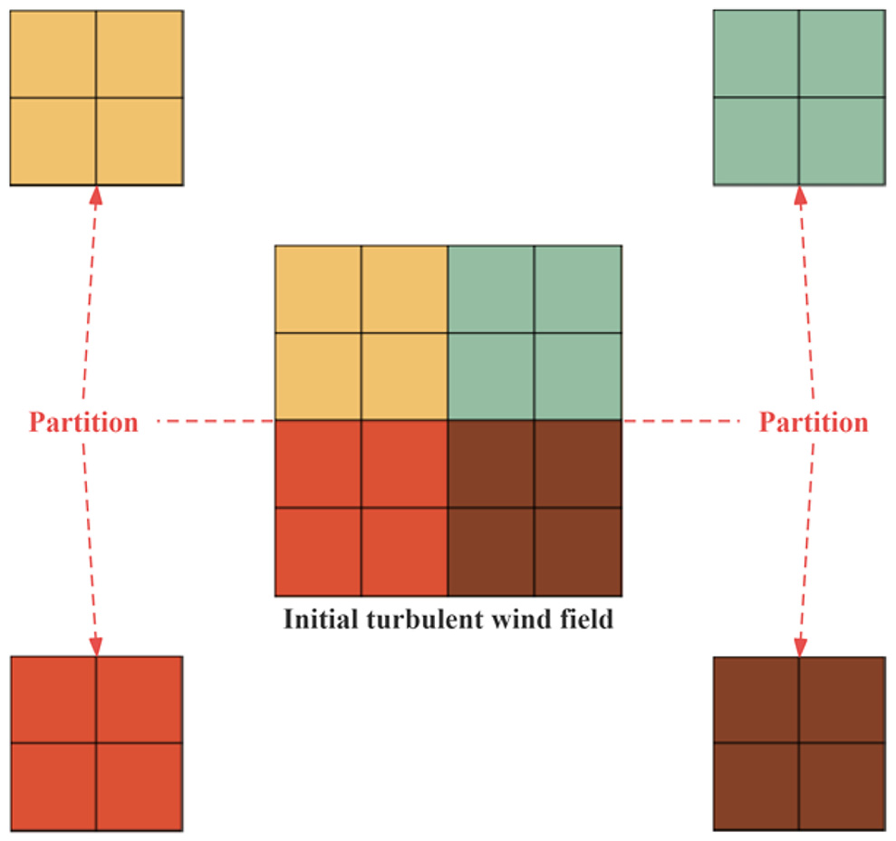

   **图 2** 窗口划分操作的示意图。

.. math::

   \Omega(\mathrm{MSA})=4hwC^2+2(hw)^2C \qquad (1)

.. math::

   \Omega(\mathrm{W-MSA})=4hwC^2+2(M^{\prime})^2hwC \qquad (2)

当窗口小于图像块尺寸时，W-MSA 的窗口相关项比全局 MSA 中的对应项小。将注意力计算限制在局部窗口，使全局二次复杂度降为局部线性规模，降低计算成本和 GPU 内存占用。本文在不同阶段采用不同窗口尺寸，并交替使用普通窗口和移位窗口，扩大感受野、加强不同窗口之间的交互，提高对风场不同部分的理解。与常规 Transformer [32] 类似，给定查询、键和值的矩阵表示 :math:`Q,K,V\in\mathbb{R}^{M\times D_k}`，WTSR-ST 使用以下缩放点积注意力：

.. math::

   \operatorname{Attention}(Q,K,V)=\operatorname{softmax}\left(\frac{QK^{\mathsf T}}{\sqrt{D_k}}\right)V \qquad (3)

其中 :math:`M` 是 :math:`Q,K,V` 矩阵的长度， :math:`D_k` 为每个注意力头中这些矩阵的维度。模块还结合多层感知机与 LayerNorm，以改善性能。

图 3 展示图像块合并模块，其中 :math:`C` 表示数据维度。基本做法是将相邻小块合并为大块，减小特征图的空间维度，同时把特征维度增加为四倍；随后通过 LayerNorm 和全连接层，将特征维度减半，提高网络表达能力。WTSR-ST 的输出头由像素重排（pixel shuffle）[44] 与 CNN 组成，将上一层提取的特征转换为最终高分辨率结果。

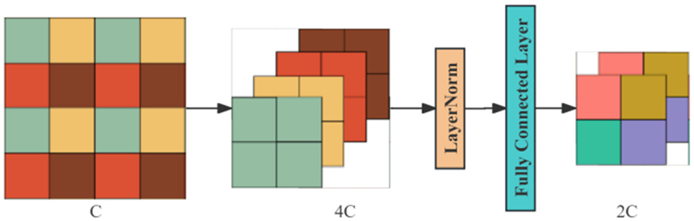

   **图 3** 图块合并模块的说明。C 表示数据维度。

II.A.2 空间解耦位置模块
------------------------------

下垫面对近地面湍流影响很大，但基于注意力的网络缺乏感知局部粗糙元影响的内置机制 [45]。Vaswani 等 [32] 的位置编码原本面向文本序列；相较于一维文本，风速矢量具有混沌特征，因此需要适合位置相关细节的编码。本文以不同方向的空间编码替换原三角函数方法，称为空间解耦位置模块（原正文缩写 SCDM）。其依据是分布式表示适合提取数据分布内在特征的观点 [46]。该模块计算不同方向相对于预定参考点的空间得分，包含相对坐标和距离信息，以多维方式描述空间相关性。相对距离先乘以系数，再进行指数运算，原文称该处理经过重复试验验证。式 (4) 的 :math:`D_{ij}` 用于嵌入相对距离信息，确定水平和竖向分量中的空间得分，使其在分布式表示中解耦；再按式 (5) 融合子表示，获得最终位置编码。

.. math::

   D_{ij}=\operatorname{Exp}\left(\frac{\operatorname{Sqrt}(w_i\times h_j)\times d_m}{-2\ln(100\,000)}\right) \qquad (4)

.. math::

   E_{ij}=\begin{cases}\dfrac{\sin(D_{ij}\times h_i)}{2},&\text{if }i\text{ is odd},\\\dfrac{\cos(D_{ij}\times h_i)}{2},&\text{if }i\text{ is even}\end{cases}+\begin{cases}\dfrac{\sin(D_{ij}\times w_j)}{2},&\text{if }j\text{ is odd},\\\dfrac{\cos(D_{ij}\times w_j)}{2},&\text{if }j\text{ is even}\end{cases} \qquad (5)

其中 :math:`i,j` 分别表示相对于参考点的第 :math:`i` 行和第 :math:`j` 列； :math:`d_m` 为数据通道数； :math:`D_{ij}` 是点 :math:`(i,j)` 的相对距离偏差因子； :math:`E_{ij}` 为该点的空间相关性得分。采用 t 分布随机邻域嵌入（t-SNE）将位置编码投影到二维空间，便于观察解耦情况。图 4 中红色区域为水平编码，黑色区域为竖向编码；原文认为二者充分解耦，有助于网络学习特征。

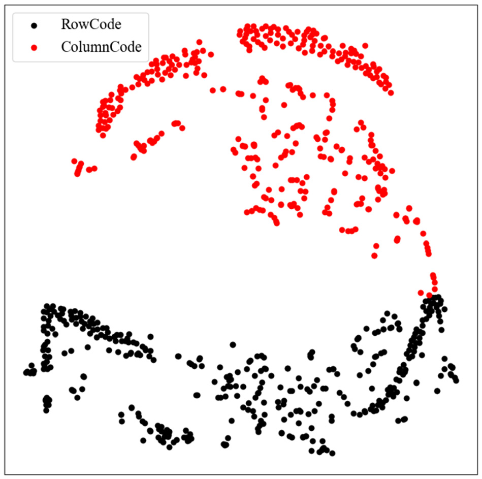

   **图 4** 采用 t-SNE 对解耦位置编码进行可视化。

.. note::

   图 1 将空间解耦位置模块缩写为 SDPM，正文则写 SCDM，本页按各自出处保留。式 (4) 的根号内为坐标乘积，负分母为 −2 ln(100000)，不是通常的欧氏距离式；式 (4) 与式 (5) 的坐标下标也按原式保留，不将其替换为标准正弦位置编码。

II.B.1 比较模型：SRCNN
----------------------------------

SRCNN（Dong 等 [20]）是较早用于单图像超分辨率的深度学习网络，能够建立低、高分辨率数据之间的端到端映射，推理速度较快，精度较好。其结构包括三个卷积层：第一层从输入中初步提取特征；第二层将特征映射到高分辨率空间；第三层生成高分辨率输出。相比传统插值，SRCNN 更善于重建高频细节，并可同时处理多通道，适用于多种视觉问题。但浅层结构限制了复杂细节的学习能力，处理真实气象数据时，抑制噪声和减轻失真的效果较弱。

II.B.2 比较模型：DeepSD
------------------------------------

DeepSD（Vandal 等 [47]）是 SRCNN 的改进形式，用于重建高分辨率气候变量。其架构堆叠多个三层 SRCNN，每级把输入空间维度扩大两倍，并把高程作为额外输入。训练时，各 SRCNN 级使用相应的数据—标签对独立训练，使网络理解多个尺度的空间模式，同时减轻误差传播和梯度消失；但由于每级均需单独优化，整体训练时间明显增加。推理时组合各级权重，前一级输出直接作为后一级输入。先前日降水预测结果显示，该方法的统计误差较低，与目标高分辨率数据的相关性更接近。

II.B.3 比较模型：RCM-emulator
------------------------------------------------

RCM-emulator（Doury 等 [48]）利用 U-Net 学习高分辨率变量与对应低分辨率变量之间的关系。U-Net 擅长处理网格数据，适合风速分量。其结构分为编码器和解码器：每层编码器从前一层输出中提取更深层特征，并通过最大池化将特征图的空间维度减半；随后由多个解码层处理编码信息，各层通过跳跃连接引入相应编码器特征，再扩大空间维度；最后由若干 CNN 层生成输出变量。相较于较早的方法，它具有较好的重建精度与特征提取能力，可用较少计算资源对全球气候模式（GCM）输出进行降尺度。

III 训练准备
----------------

第 III.A 节说明两类原始湍流风数据来源，第 III.B 节介绍理想与非理想模型框架的配置及评价指标。

III.A.1 原始数据：简化二维湍流
--------------------------------------

采用不可压缩 Navier–Stokes（N–S）方程生成二维风流数据。这一简化近似可用于描述具有较丰富物理过程的大气流动，基于伽利略不变的应力及 Cauchy 应力张量的各向同性流体假设 [49,50]。参照 Frerix 等 [51] 的设置，采用 JAX-CFD 中的可微分求解器求解输运方程。速度场 :math:`\mathbf{u}` 和压力场 :math:`p` 所满足的 N–S 方程写为：

.. math::

   \frac{\partial\mathbf{u}}{\partial t}+\mathbf{u}\nabla\mathbf{u}-\nu\nabla^2\mathbf{u}+\nabla p-\mathbf{F}=0 \qquad (6)

流体黏度 :math:`\nu` 取 0.02。外力 :math:`\mathbf{F}` 对应带线性阻尼的 Kolmogorov 流，其正弦平均速度剖面构成单向剪切的二维流动 [52]：

.. math::

   \mathbf{F}=\sin(kx)\hat{\mathbf{x}}-\alpha\mathbf{u} \qquad (7)

.. note::

   原式的正弦相位坐标与强迫方向均写为 x。若按通常坐标含义理解，该正弦项在下述周期不可压缩设置中是可吸收入压力的纯梯度，与通常驱动剪切的横向 Kolmogorov 强迫不同。这是字面公式的物理一致性与复现疑点，不代表已经确认实际训练代码有误，也不排除初始流场的瞬态演化。本页保留原式，强迫方向、相位坐标及实际实现需以原代码或作者说明核实，不擅自改为 sin(ky)。

波数 :math:`k=2`，阻尼系数 :math:`\alpha=0.1`。

求解式 (6) 得到 :math:`64\times64` 离散网格的风场，作为理想模型框架的高分辨率数据；对应低分辨率数据为 :math:`8\times8` 网格，生成方法见第 III.B.1 节。计算域为 :math:`[0,2\pi]^2`，采用周期边界条件。共 36000 个独立样本随机划分为训练集（80%）、验证集（10%）和测试集（10%）。考虑长度 :math:`T=10` 的轨迹，相邻两个时间步间隔为 :math:`0.18\,\mathrm{s}`。

III.A.2 原始数据：WRF 模式
--------------------------------------

采用 WRF 4.0 重现持续三个月的历史天气，配置见表 I。图 5 的 D01、D02、D03 采用单向嵌套，网格尺度按 1:3 比例从 27 km 依次细化至 9 km、3 km。采用随地形变化的静力气压坐标，设 40 个非均匀竖向层；离地 1 km 以下的底部 21 个 sigma 层加密，以描述 PBL 演化。提取离地 100 m 处插值得到的风矢量，用于训练和测试。

采用欧洲中期天气预报中心（ECMWF）的 ERA5 逐小时单层数据进行气象初始化。正文写明，三个计算域均从 2016 年 8 月 1 日 0000 UTC 开始，至 10 月 31 日 2400 UTC 结束，总计 92 天，每 10 分钟保存一次瞬时结果。按蒲福风级，这些昼夜循环数据涵盖轻风至烈风条件。数值模型设置重启动计算，以应对求解发散、停电等不确定中断因素。为平衡精度与速度，超分辨率区域取北纬 21.829°–23.5594°、东经 113.302°–115.178°。其他参数化方案见表 I。训练、验证和测试的划分比例与第 III.A.1 节相同。

.. list-table:: 表 I 中尺度 WRF 模式采用的数值方案
   :header-rows: 1
   :class: longtable

   * - 配置
     - D01
     - D02
     - D03
     - 原表跨域合并值
   * - 水平网格尺度
     - 27 km
     - 9 km
     - 3 km
     - —
   * - 水平网格数（XY）
     - 130 × 130
     - 145 × 169
     - 214 × 229
     - —
   * - 竖向配置
     - —
     - —
     - —
     - 随地形静力气压坐标，40 个 sigma 层
   * - PBL 方案
     - —
     - —
     - —
     - Mellor–Yamada–Janjic（Eta）TKE 方案
   * - 微物理
     - —
     - —
     - —
     - Goddard 方案
   * - 地表层
     - —
     - —
     - —
     - Monin–Obukhov（MYJ）；修正 Monin–Obukhov（YSU）
   * - 陆面
     - —
     - —
     - —
     - 统一 Noah 陆面模式
   * - 积云
     - —
     - —
     - —
     - Kain–Fritsch 方案，用于“两个计算域”（原表措辞）
   * - 再分析数据
     - —
     - —
     - —
     - ERA5
   * - 长波辐射
     - —
     - —
     - —
     - 快速辐射传输模式（RRTM）
   * - 计算时段（UTC）
     - —
     - —
     - —
     - 2016-08-01 00:00 至 2016-10-30 24:00

.. figure:: ../../../wechat/assets/public-safe/ref-tang2024-POF/fig05.jpg
   :alt: 论文图 5 中国广东省 WRF 嵌套计算域（D01、D02 和 D03）的空间范围。红色矩形标出用于超分辨率重建的计算域。
   :align: center
   :width: 100%

   **图 5** 中国广东省 WRF 嵌套计算域（D01、D02 和 D03）的空间范围。红色矩形标出用于超分辨率重建的计算域。

.. note::

   表 I 原本合并的单元格在末列呈现，“—”不是零或缺测。表中结束日期为 10 月 30 日，正文则为 10 月 31 日及 92 天，两者并列保留。地表层列出两种方案但未逐域分配；积云项说“两个计算域”，与三个域的列头不一致，不据此推定具体配置。

III.B.1 理想模型框架
----------------------------

理想模型框架中，粗、细网格风场的特征具有较强时空一致性 [6]。任务只需建立风场超分辨率的数学表示，可用于评估深度学习网络理解混沌特征的能力。高分辨率数据由第 III.A.1 节的不可压缩 N–S 方程求解；低分辨率数据参照既有研究 [6,48,53]，对 N–S 解实施插值操作得到。

III.B.2 非理想模型框架
------------------------------

相比之下，同一区域由 WRF 在不同分辨率下计算的湍流风，其对应关系并非完全可预期，某些情况下相关性较低 [48]。数据—标签对允许存在时空不一致 [6]，更接近现实情形。这些不一致与气象系统本性及物理参数化差别有关 [54]。本框架使用前述 D01 和 D03 的 WRF 数据，风场分辨率分别为 27 km 和 3 km，任务是建立二者之间的数学映射。为保证处理区域相同，原文将低分辨率数组设为 :math:`8\times8`，高分辨率数组设为 :math:`64\times64`。

.. note::

   数组边长的 8 倍变化与 27 km/3 km 的 9 倍物理网格尺度变化是不同表述；原文没有完整展开两者的裁剪、对齐或重采样关系，本页不补造实现。理想模型框架在本节写插值，结论另写平均池化，两处也分别保留。

III.B.3 训练配置与评价指标
----------------------------------

受 Ledig 等 [22] 的感知损失启发，本文在送入 VGG16 [55] 前打乱特征维度，增强感知损失。VGG16 由 16 层构成，能够提取不同层级特征。比较经过多次卷积提取的深层特征，可在高维空间衡量重建风场与目标风场的差异；通道整合的感知损失使 VGG16 提取更细致的特征。将其与内容损失结合，指导优化器更新权重，得到：

.. math::

   l_{SR}=l_c+kl_p \qquad (8)

.. math::

   l_c=\frac{1}{HW}\sum_{i=1}^{H}\sum_{j=1}^{W}(I_{i,j}-R_{i,j})^2 \qquad (9)

其中 :math:`l_c` 为式 (9) 的内容损失， :math:`l_p` 为通道整合的感知损失， :math:`k` 是感知损失的缩放因子，本文取 :math:`k=0.02`。 :math:`I_{i,j}` 与 :math:`R_{i,j}` 分别表示重建结果和参考高分辨率风。

训练从数据预处理开始，包括剔除错误数据和归一化。原文给出的归一化公式为：

.. math::

   X=\frac{X-X_{\min}}{X-X_{\max}} \qquad (10)

其中 :math:`X_{\min}` 和 :math:`X_{\max}` 分别为风场中的最小、最大风速。处理后的数据进入网络进行多轮训练；各轮通过反向传播调整权重，减小损失、提高预测精度。优化采用 Adam [56]， :math:`\beta_1=0.9`。经过网格搜索调参，理想框架采用学习率 :math:`2.5\times10^{-4}`、300 轮训练，非理想框架采用 :math:`8.0\times10^{-4}`、500 轮训练。达到 50 轮后，每隔 25 轮将学习率降为前一数值的 95%。每个批次向 GPU 输入 72 个数据，以提高效率和稳定性。训练与测试使用 Intel i7-13700k CPU、144 GB DDR5 内存和单块 NVIDIA RTX3090 GPU（24 GB DDR6x 显存），系统为 Windows 10、Python 3.9、PyTorch 1.12.0。

.. note::

   式 (10) 分母在原文确实为 X−Xmax，左侧也未另设归一化变量符号。该式在最大值处存在零分母问题，与常见 min–max 归一化表达式不同；本页保留原式并提示疑点，不声称实际代码按此实现，也不自行改为 Xmax−Xmin。式 (8) 的 k 为损失权重，与式 (7) 的波数 k 含义不同。

采用均方误差（MSE）、平均绝对误差（MAE）、平均绝对百分比误差（MAPE）、结构相似性指标（SSIM）和概率密度函数（PDF）评价统计性能。MSE 使用误差平方，对离群值敏感，有助于识别并关注较大误差；MAE 对离群值相对不敏感，更易直观理解；MAPE 着重衡量重建输出与目标数据的相对误差。SSIM [57] 综合亮度、对比度和结构信息比较图像质量，原文说明取 1 表示特征相同，取 −1 表示属性完全不同。PDF 通过核密度估计（KDE）近似，采用较平滑且理论性质较好的高斯核，带宽固定为 0.5，代码使用 scikit-learn 实现。评价指标表达式如下：

.. math::

   \operatorname{MAE}(I,R)=\frac{1}{n}\sum_{i=1}^{H}\sum_{j=1}^{W}\left|I_{i,j}-R_{i,j}\right| \qquad (11)

.. math::

   \operatorname{MAPE}(I,R)=\frac{1}{HW}\sum_{i=1}^{H}\sum_{j=1}^{W}\left|\frac{I_{i,j}-R_{i,j}}{I_{i,j}}\right|\times100\% \qquad (12)

.. math::

   \operatorname{SSIM}(I,R)=\frac{(2\mu_I\mu_R+c_1)(2\sigma_{IR}+c_2)}{(\mu_I^2+\mu_R^2+c_1)(\sigma_I^2+\sigma_R^2+c_2)} \qquad (13)

其中 :math:`c_1=(0.01L)^2`、 :math:`c_2=(0.03L)^2`， :math:`L` 为风矢量的取值范围。

.. note::

   式 (11) 的归一化因子 n 未在邻近文字中明确定义；式 (12) 的分母为重建值 I，而非参考值 R，原文未说明零值处理。本页不替换分母或补充未给出的实现。PDF 是汇总速度样本的分布比较，并不是由这些图直接给出的速度梯度、能谱或全部时空相关性检验。

IV.A 结果：敏感性分析
--------------------------

在深入分析结果特征前，首先对主要参数进行敏感性分析，结果见表 II。

选择对两类算例影响较大的学习率、训练轮数和输入分辨率作为三个关键超参数，每个参数取大、中、小三个水平，以展示变化规律。学习率过大会导致模型发散，破坏梯度下降过程；过小则收敛慢，在相同轮数下损失较高。训练轮数不足会造成欠训练，过多则增加过拟合风险。输入分辨率的敏感性通过双线性插值调整输入尺寸来考察。尽管输入分辨率变化有一定影响，模型整体仍表现较稳健；输入提供更多风场信息，有助于学习高低分辨率之间的数学映射。考虑网络参数较多，后续采用选出的最佳超参数设置。

.. list-table:: 表 II 两类框架在不同参数设置下的比较
   :header-rows: 1
   :class: longtable

   * - 框架
     - 参数量
     - 粗网格边长
     - 细网格边长
     - 训练轮数
     - 学习率
     - 训练结果
     - 测试结果
   * - 理想模型
     - 1.64 × 10^7
     - 8
     - 64
     - 300
     - 2.5 × 10^-3
     - 1.029
     - 1.031
   * - 理想模型
     - 1.64 × 10^7
     - 8
     - 64
     - 300
     - 2.5 × 10^-4
     - 0.00050
     - 0.00087
   * - 理想模型
     - 1.64 × 10^7
     - 8
     - 64
     - 300
     - 2.5 × 10^-5
     - 0.00990
     - 0.01000
   * - 理想模型
     - 1.64 × 10^7
     - 8
     - 64
     - 150
     - 2.5 × 10^-4
     - 0.00101
     - 0.00133
   * - 理想模型
     - 1.64 × 10^7
     - 8
     - 64
     - 350
     - 2.5 × 10^-4
     - 0.00048
     - 0.00090
   * - 理想模型
     - 1.64 × 10^7
     - 4
     - 64
     - 300
     - 2.5 × 10^-4
     - 0.00144
     - 0.00663
   * - 理想模型
     - 1.64 × 10^7
     - 16
     - 64
     - 300
     - 2.5 × 10^-4
     - 0.00019
     - 0.00021
   * - 非理想模型
     - 1.64 × 10^7
     - 8
     - 64
     - 500
     - 8.0 × 10^-3
     - 0.802
     - 1.545
   * - 非理想模型
     - 1.64 × 10^7
     - 8
     - 64
     - 500
     - 8.0 × 10^-4
     - 0.094
     - 0.123
   * - 非理想模型
     - 1.64 × 10^7
     - 8
     - 64
     - 500
     - 8.0 × 10^-5
     - 0.105
     - 0.133
   * - 非理想模型
     - 1.64 × 10^7
     - 8
     - 64
     - 350
     - 8.0 × 10^-4
     - 0.127
     - 0.154
   * - 非理想模型
     - 1.64 × 10^7
     - 8
     - 64
     - 550
     - 8.0 × 10^-4
     - 0.104
     - 0.135
   * - 非理想模型
     - 1.64 × 10^7
     - 4
     - 64
     - 500
     - 8.0 × 10^-4
     - 0.106
     - 0.138
   * - 非理想模型
     - 1.64 × 10^7
     - 16
     - 64
     - 500
     - 8.0 × 10^-4
     - 0.095
     - 0.124

.. note::

   表 II 的“训练结果／测试结果”列未在表头明确命名指标，本页不擅自标为 MSE。选定非理想行的测试结果为 0.123，而表 IV 的两分量测试 MSE 为 0.134、0.135，原文未给出两处汇总口径的对应解释。

IV.B.1 理想模型框架：训练结果
------------------------------------

图 6、7 展示各网络重建的代表性风场及误差。 :math:`U_x` 和 :math:`U_y` 为两个风速分量，数值正负表示方向，绝对值表示大小；各列下方注记对应其主要内容。粗、细网格风场具有较强时空一致性，符合理想框架的设置；细网格呈现更多细节和混沌特征。各深度学习网络均能重现二维湍流总体形态，但未计算注意力得分的部分网络出现明显细节丢失、边界粗糙，尤其在涡中心附近，两分量均偏离目标。WTSR-ST 与参考高分辨率场吻合较好，在所选网络中表现最佳。

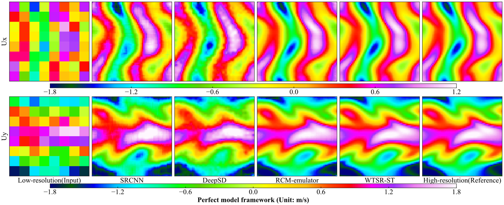

   **图 6** 训练阶段由 SRCNN、DeepSD、RCM-emulator 和 WTSR-ST 生成的二维湍流超分辨率重建结果的可视化评价。风场空间分辨率由 8 × 8 提高至 64 × 64。

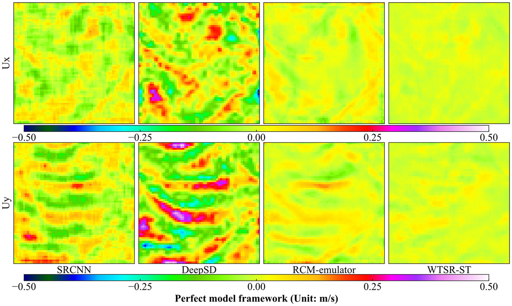

   **图 7** 训练阶段重建二维湍流的风速误差图。

接下来采用逐点统计指标作全面评价，见图 8。箱体上下边界为上、下四分位数，橙色实线为中位数，绿色三角形为均值。由于存在少量重建较差的数据，均值持续高于中位数，原文认为离群数据的总体影响可忽略。图 8(a)、(d) 显示 WTSR-ST 的表现较好，正文称其 MSE、MAE 比另外三种网络低数个数量级，并给出 :math:`U_x,U_y` 的 MSE 分别为 0.00012、0.00014，MAE 为 0.00777、0.00828。WTSR-ST 箱体较矮，指标分布比其他网络集中；MAPE 分别为 13.438%、10.603%，也较低。详细统计值见表 III，两分量的误差差异较小，表明该算例下性能较稳定。

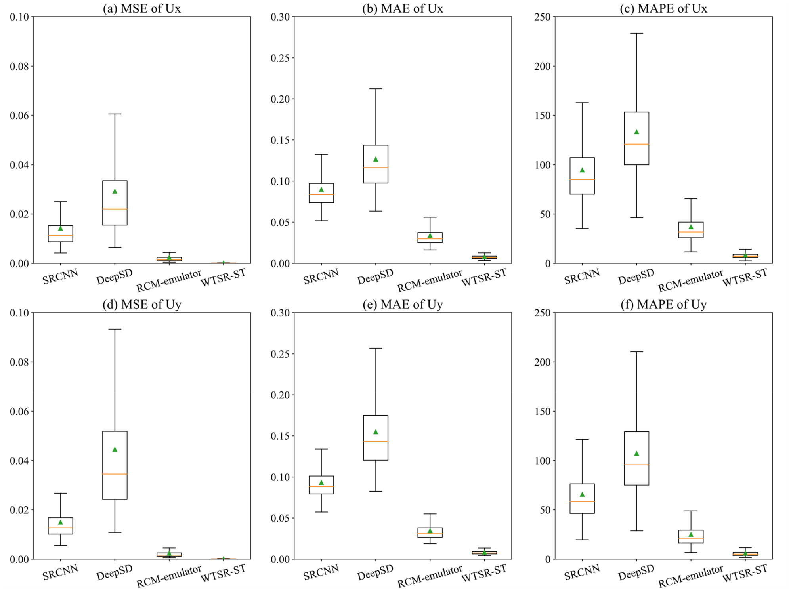

   **图 8** 训练阶段二维湍流超分辨率重建结果的统计评价。绿色实心三角形表示均值，橙色实线表示中位数。

.. note::

   原文将统计均值汇列于表 III，但图中 MAPE 均值位置与表中数值也有不一致。例如图 8(c) 的 SRCNN 绿色均值三角低于 100 刻度，表 III 对应训练 Ux 的 MAPE 却为 175.312%。两处分别明确标作均值，差异不能简单归为四舍五入；原文没有充分说明统计口径。本页保留图、表原值，不以读图估计替换表值，也不猜测离群值剔除或聚合规则。

.. note::

   正文这里的 MSE 0.00012、0.00014，与表 III 训练行的 0.00048、0.00052 不一致，不能互换。正文“低数个数量级”也不是表 III 中所有网络、所有指标比较都成立的统一结论。下表完整保留原始各值，不选择性替换。

气象风场重建不仅关注逐点误差，还关注整体特征。图 9 比较预测与参考风场的结构相似性，数值也列于表 III。WTSR-ST 在两个分量均获得 0.999 的 SSIM，较好保留结构细节和流动形态。另三种网络的表现相对较差，两个分量之间也有差异，SRCNN 的 :math:`U_y` SSIM 比 :math:`U_x` 高 0.05。

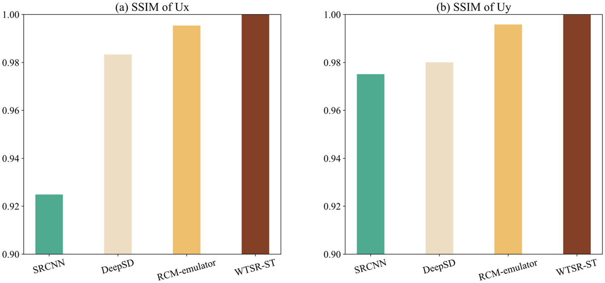

   **图 9** 训练阶段二维湍流超分辨率重建结果的结构相似性评价。（a）Ux 分量的 SSIM；（b）Uy 分量的 SSIM。

进一步用图 10 的 PDF 比较考察速度梯度间歇性，原文如此表述。PDF 汇总所有样本，即所有时刻、风场全部空间点。四种网络均在分布中央高估概率，而在两侧低估；WTSR-ST 的两分量 PDF 与参考分布最接近。

   **图 10** 训练阶段二维湍流超分辨率重建结果的概率密度函数（PDF）。绿色为 SRCNN，红色为 DeepSD，紫色为 RCM-emulator，蓝色为本文提出的 WTSR-ST，黑色为目标高分辨率结果。（a）Ux 分量的 PDF；（b）Uy 分量的 PDF。

.. note::

   以上颜色按原图注翻译；原图内 High-resolution(reference) 图例线呈暗红／棕红色，与图注所称黑色不完全一致，辨认以图例文字为准。DeepSD 为鲜红色。

.. list-table:: 表 III 理想模型框架的统计评价指标比较
   :header-rows: 1
   :class: longtable

   * - 数据集
     - 样本数
     - 网络
     - MSE Ux
     - MSE Uy
     - MAE Ux
     - MAE Uy
     - MAPE Ux（%）
     - MAPE Uy（%）
     - SSIM Ux
     - SSIM Uy
   * - 训练
     - 28800
     - SRCNN
     - 0.01415
     - 0.01488
     - 0.08986
     - 0.09314
     - 175.312
     - 107.011
     - 0.925
     - 0.975
   * - 训练
     - 28800
     - DeepSD
     - 0.02920
     - 0.04456
     - 0.12463
     - 0.15278
     - 237.126
     - 177.150
     - 0.983
     - 0.980
   * - 训练
     - 28800
     - RCM-emulator
     - 0.00238
     - 0.00241
     - 0.03369
     - 0.03443
     - 59.462
     - 33.797
     - 0.995
     - 0.996
   * - 训练
     - 28800
     - WTSR-ST
     - 0.00048
     - 0.00052
     - 0.00777
     - 0.00828
     - 13.438
     - 10.603
     - 0.999
     - 0.999
   * - 测试
     - 3600
     - SRCNN
     - 0.01581
     - 0.01658
     - 0.09563
     - 0.09914
     - 134.673
     - 108.032
     - 0.921
     - 0.970
   * - 测试
     - 3600
     - DeepSD
     - 0.02979
     - 0.04534
     - 0.12639
     - 0.15442
     - 271.063
     - 150.795
     - 0.983
     - 0.980
   * - 测试
     - 3600
     - RCM-emulator
     - 0.00338
     - 0.00363
     - 0.03958
     - 0.04196
     - 102.745
     - 39.857
     - 0.995
     - 0.995
   * - 测试
     - 3600
     - WTSR-ST
     - 0.00085
     - 0.00089
     - 0.00857
     - 0.00921
     - 20.787
     - 8.996
     - 0.999
     - 0.999

.. note::

   表 III 的原题写“Qualitative comparisons”，虽表内为定量数值仍保留其出处。上文称 PDF 用于考察速度梯度间歇性，但图 10 实际展示速度分量的概率分布；接近这些 PDF 不能等同于已验证速度梯度 PDF、湍流能谱或时空相关性。

IV.B.2 理想模型框架：测试结果
------------------------------------

本节使用训练完成的权重进行推理，测试数据未参与训练。图 11 给出代表性重建风场，图 12 给出相应误差。不同网络生成的高分辨率场总体能够重现二维湍流形态。缺乏全局依赖提取时，仍出现与训练阶段类似的细节丢失和不规则边界，涡中心附近尤其明显；WTSR-ST 则较好保留细节，使边界平滑且接近参考。

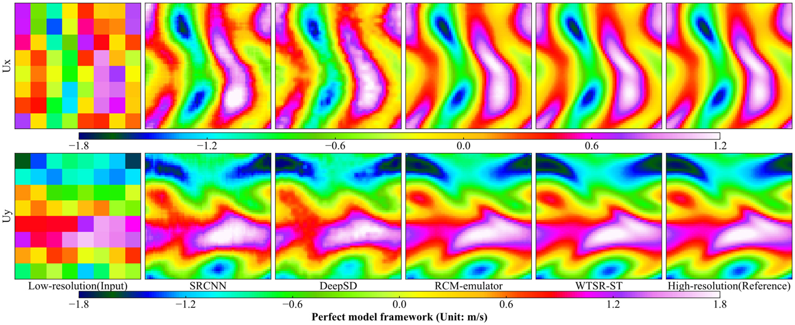

   **图 11** 测试阶段由 SRCNN、DeepSD、RCM-emulator 和 WTSR-ST 生成的二维湍流超分辨率重建结果的可视化评价。风场空间分辨率由 8 × 8 提高至 64 × 64。

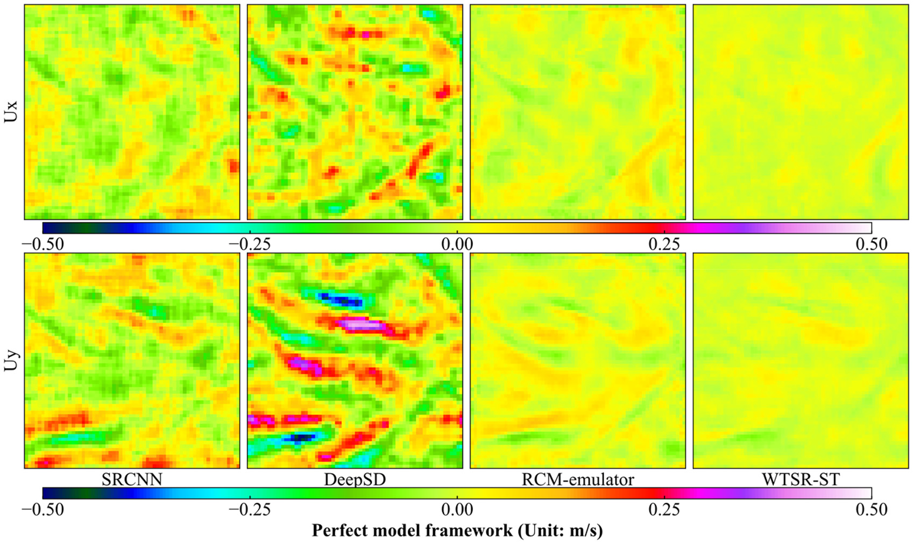

   **图 12** 测试阶段重建二维湍流的风速误差图。

图 13 为逐点评价指标的箱线图，均值列于表 III。统计误差上升表明测试集表现不及训练集。正文写 WTSR-ST 的 MSE 变为 0.00048（ :math:`U_x`）和 0.00052（ :math:`U_y`），分别增加 29.41% 和 28.57%；MAE 变为 0.00857、0.00921，仍优于其他网络的最低值；MAPE 为 20.787%、8.996%。相较于其他网络，WTSR-ST 两分量的箱体较矮、位置较低，表现出较好的稳定性与整体性能。

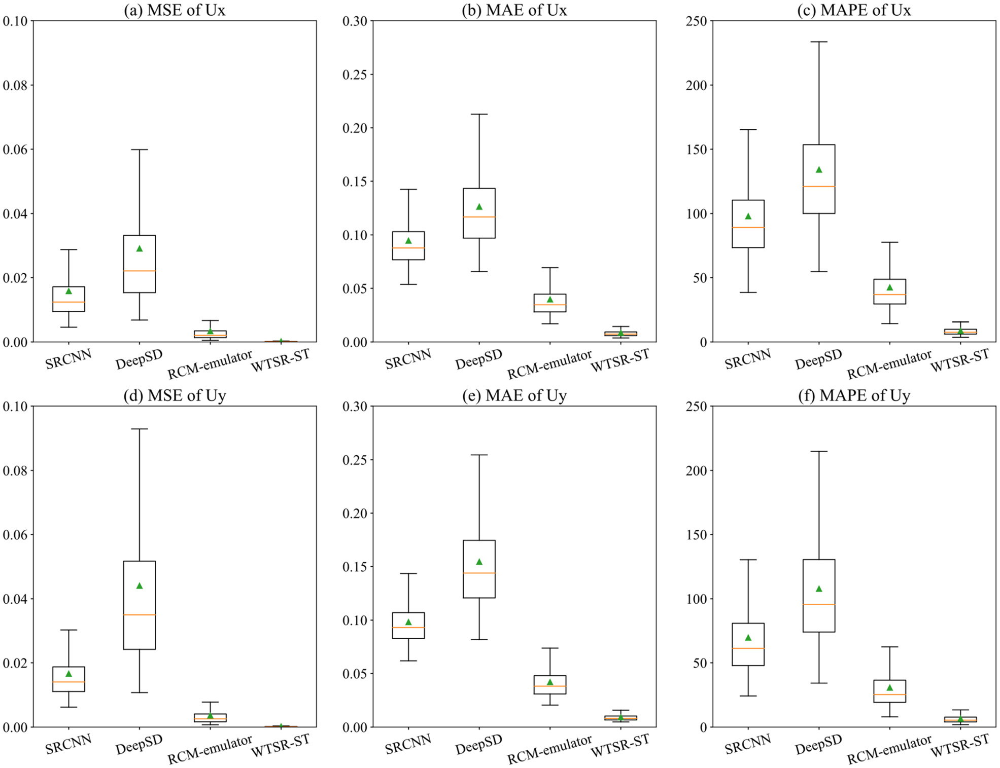

   **图 13** 测试阶段二维湍流超分辨率重建结果的统计评价。绿色三角形表示均值，橙色线表示中位数。

.. note::

   原文将图 13 的均值汇列于表 III；鉴于图 8 已出现 MAPE 图表均值差异，测试图 13 的统计口径同样需要核查，不能不加说明地假定图中位置与表中数值来自完全相同的聚合过程。此处保留原图与原表，不由图形反推替代数值。

.. note::

   本段正文测试 MSE 与表 III 测试行 0.00085、0.00089 不一致。按表 III 的训练值到测试值计算，增幅约为 77.08%、71.15%；按正文前述训练值到正文测试值计算，增幅为 300.00%、271.43%，均不能得到原文 29.41%、28.57%。这些复算仅用于指出源内不一致，不作为替代原文的实验结果。

图 14 的结构相似性结果及表 III 表明，由于二维湍流结构相对简单，测试 SSIM 未明显降低，WTSR-ST 两分量仍为 0.999，重建场的结构特征接近参考高分辨率场。图 15 展示两分量的 PDF。各网络仍倾向于高估速度分布中央的概率、低估两侧概率，其中 WTSR-ST 的两分量 PDF 最接近参考。

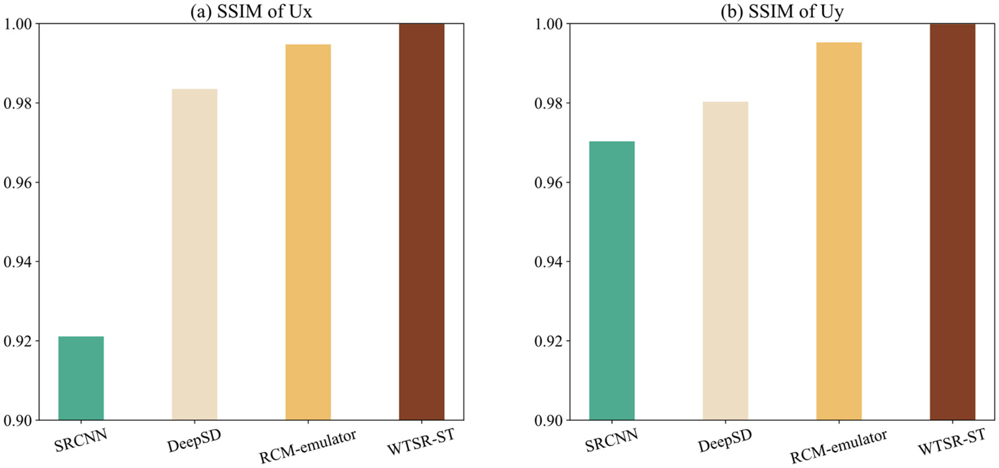

   **图 14** 测试阶段二维湍流超分辨率重建结果的结构相似性评价。（a）Ux 分量的 SSIM；（b）Uy 分量的 SSIM。

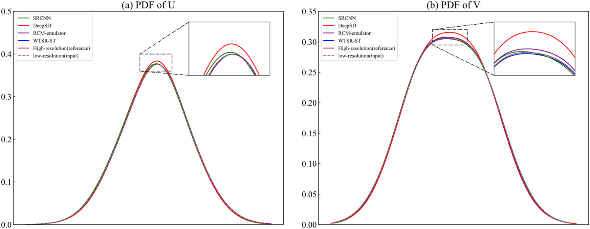

   **图 15** 测试阶段二维湍流超分辨率重建结果的概率密度函数（PDF）。绿色为 SRCNN，红色为 DeepSD，紫色为 RCM-emulator，蓝色为本文提出的 WTSR-ST，黑色为目标高分辨率结果。（a）Ux 分量的 PDF；（b）Uy 分量的 PDF。

.. note::

   图 15 与图 10 类似：原图注称参考线为黑色，图内 High-resolution(reference) 图例线则呈暗红／棕红色。以上保留原图注译文，读图以图例文字识别参考曲线；不修改线条颜色或曲线含义。

IV.C.1 非理想模型框架：训练结果
--------------------------------------

使用第 III.B.2 节的 WRF 风场训练网络，建立低、高分辨率风场之间的对应。图 16、17 给出代表性风速图及误差图。3 km 风场比 27 km 风场有更多细节，包含更细的空间变化、更复杂的流动形态，例如小涡及局部阵风。但两种分辨率模拟的时空差异增加了训练难度，需要网络自动识别有利信息。WTSR-ST 的表现不及理想框架，但在细节保真度和风场物理特征方面仍有优势。SRCNN 与 DeepSD 偏离高分辨率参考较明显，RCM-emulator 在两个分量图的下部均低估风速。原文据此认为这三种网络不适于实际应用。

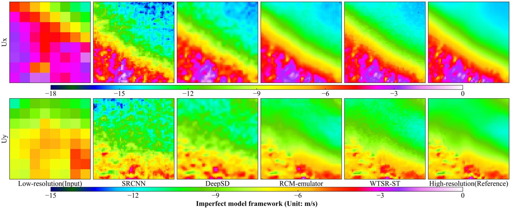

   **图 16** 训练阶段由 SRCNN、DeepSD、RCM-emulator 和 WTSR-ST 生成的 WRF 模拟风场重建结果的可视化评价。风场空间分辨率由 27 km 提高至 3 km。

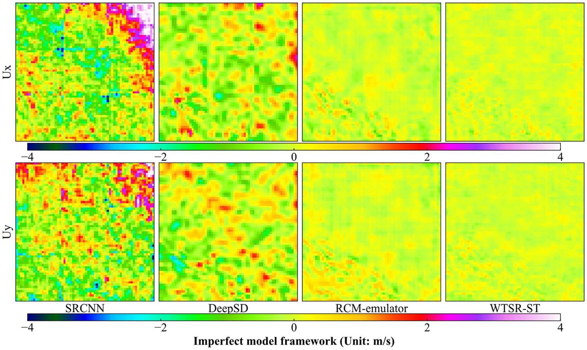

   **图 17** 训练阶段重建 WRF 模拟风场的风速误差图。

.. note::

   这里的“实际应用”判断来自本文的特定 WRF 数据与训练比较，不应推广成三种网络在所有气象地区、训练方案或任务上均不可用。本文也未给出现场风速实测验证。

图 18 展示两分量的评价指标箱线图，均值见表 IV。中位数与均值趋势相似，原文未逐一叙述中位数。相较于理想框架，WRF 数据的误差明显增加：WTSR-ST 两分量 MSE 均为 0.094，MAE 分别为 0.226、0.228，MAPE 分别为 27.890%、35.103%。这些值在所比较网络中仍最低。WTSR-ST 的箱体最靠近横轴且高度较小，显示该比较条件下结果较集中。

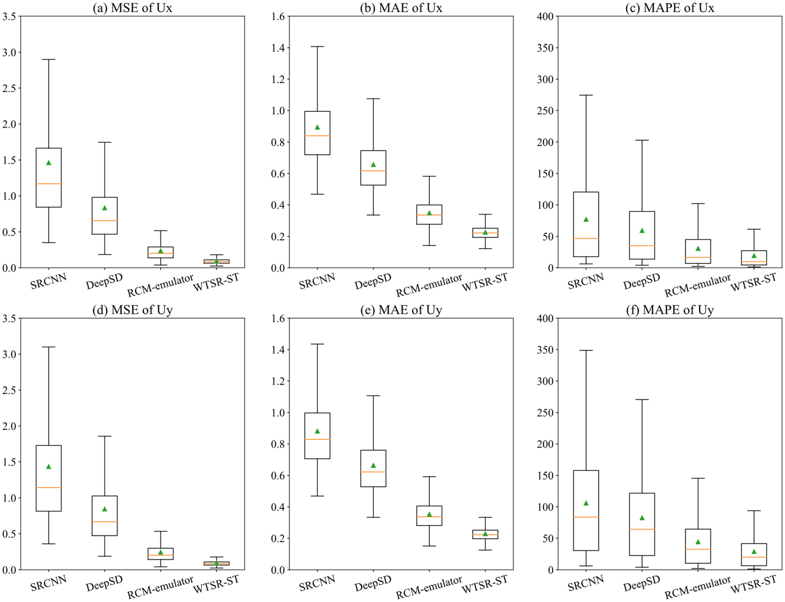

   **图 18** 训练阶段 WRF 模拟风场重建结果的统计评价。绿色三角形表示均值，橙色线表示中位数。

.. note::

   图 18 与表 IV 也存在 MAPE 均值口径疑点。例如图 18(c) 的 SRCNN 绿色均值三角低于 100，而表 IV 对应训练 Ux 的 MAPE 为 113.481%。原文将二者均标作平均值，但未解释差异。本页不以视觉估计改写表值，也不补造统一统计口径。

.. list-table:: 表 IV 非理想模型框架的统计评价指标比较
   :header-rows: 1
   :class: longtable

   * - 数据集
     - 样本数
     - 网络
     - MSE Ux
     - MSE Uy
     - MAE Ux
     - MAE Uy
     - MAPE Ux（%）
     - MAPE Uy（%）
     - SSIM Ux
     - SSIM Uy
   * - 训练
     - 21636
     - SRCNN
     - 1.463
     - 1.434
     - 0.893
     - 0.882
     - 113.481
     - 133.433
     - 0.803
     - 0.804
   * - 训练
     - 21636
     - DeepSD
     - 0.833
     - 0.845
     - 0.656
     - 0.663
     - 84.517
     - 101.720
     - 0.890
     - 0.886
   * - 训练
     - 21636
     - RCM-emulator
     - 0.238
     - 0.243
     - 0.348
     - 0.353
     - 43.240
     - 54.420
     - 0.969
     - 0.963
   * - 训练
     - 21636
     - WTSR-ST
     - 0.094
     - 0.094
     - 0.226
     - 0.228
     - 27.890
     - 35.103
     - 0.987
     - 0.986
   * - 测试
     - 2706
     - SRCNN
     - 1.514
     - 1.514
     - 0.907
     - 0.894
     - 110.789
     - 138.564
     - 0.796
     - 0.796
   * - 测试
     - 2706
     - DeepSD
     - 0.870
     - 0.879
     - 0.670
     - 0.675
     - 85.198
     - 107.128
     - 0.884
     - 0.880
   * - 测试
     - 2706
     - RCM-emulator
     - 0.275
     - 0.281
     - 0.371
     - 0.376
     - 45.253
     - 57.339
     - 0.965
     - 0.959
   * - 测试
     - 2706
     - WTSR-ST
     - 0.134
     - 0.135
     - 0.269
     - 0.272
     - 32.023
     - 41.177
     - 0.982
     - 0.982

.. note::

   表 IV 训练样本数为 21636，测试样本数为 2706，本页按表保留，不从 92 天、10 分钟间隔反推并替换；原文未完整解释样本整理过程。MSE、MAE 表头没有物理单位，本页不擅自添加单位或将其当作百分比。

图 19 比较两分量的 SSIM，对应均值见表 IV。WTSR-ST 的 :math:`U_x,U_y` 分别为 0.987、0.986，优于其他网络。SRCNN 和 DeepSD 的结果处于 0.803–0.890，反映重建风相对参考含有较多噪声与特征差异。RCM-emulator 比前两者明显改善，但仍低于 WTSR-ST。WTSR-ST 对不同方向风速分量的重建较稳定，两分量结果的变异较小。

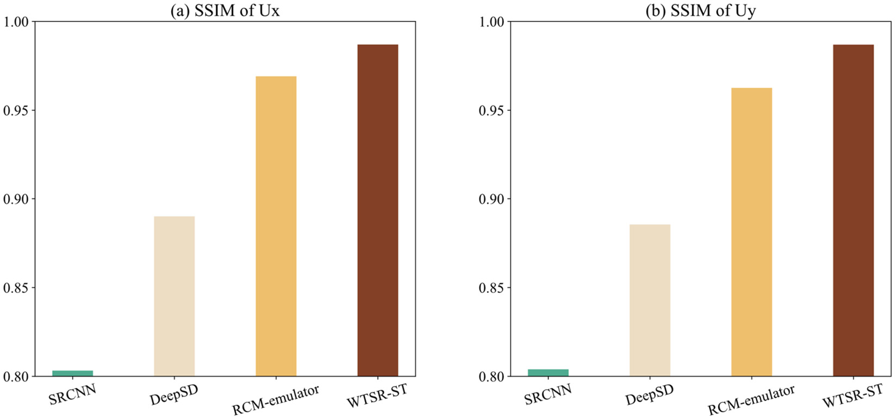

   **图 19** 训练阶段 WRF 模拟风场重建结果的结构相似性评价。（a）Ux 分量的 SSIM；（b）Uy 分量的 SSIM。

图 20 展示各网络的 PDF。与理想框架不同，低分辨率输入与高分辨率参考的 PDF 本身并不重合；相对于高分辨率数据，低分辨率分布在中央明显高估、两侧低估概率。经深度学习处理后，27 km 数据逐渐接近 3 km 数据的分布特征。SRCNN 效果最弱，DeepSD 和 RCM-emulator 居中，WTSR-ST 最接近参考。逐点指标与分布比较共同支持 WTSR-ST 在本文 WRF 风场超分辨率任务中的可行性及相对优势。

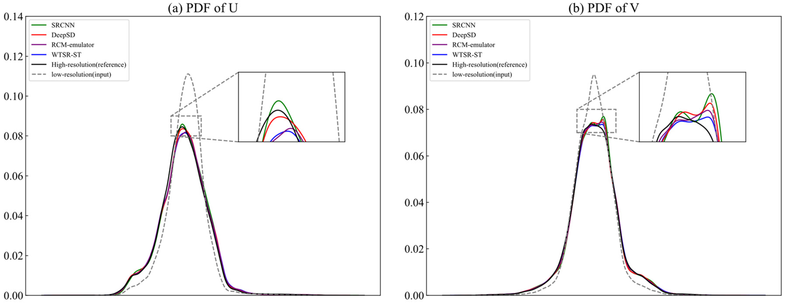

   **图 20** 训练阶段 WRF 模拟风场重建结果的概率密度函数（PDF）。绿色为 SRCNN，红色为 DeepSD，紫色为 RCM-emulator，蓝色为本文提出的 WTSR-ST，黑色为目标高分辨率结果。（a）Ux 分量的 PDF；（b）Uy 分量的 PDF。

IV.C.2 非理想模型框架：测试结果
--------------------------------------

训练完成后，需要检验权重对未见数据的适用能力。图 21、22 比较代表性重建场和误差。对于未参与训练的 WRF 风场，SRCNN 与 DeepSD 难以准确重建涡中心，偏离高分辨率参考明显；RCM-emulator 稍好，但仍难以表现细节，尤其是涡边界。相比之下，WTSR-ST 的高分辨率结果在物理形态上较合理，原文此处写为“准确重现 27 km 分辨率风场”。

.. figure:: ../../../wechat/assets/public-safe/ref-tang2024-POF/fig21.jpg
   :alt: 论文图 21 测试阶段由 SRCNN、DeepSD、RCM-emulator 和 WTSR-ST 生成的 WRF 模拟风场重建结果的可视化评价。风场空间分辨率由 27 km 提高至 3 km。
   :align: center
   :width: 100%

   **图 21** 测试阶段由 SRCNN、DeepSD、RCM-emulator 和 WTSR-ST 生成的 WRF 模拟风场重建结果的可视化评价。风场空间分辨率由 27 km 提高至 3 km。

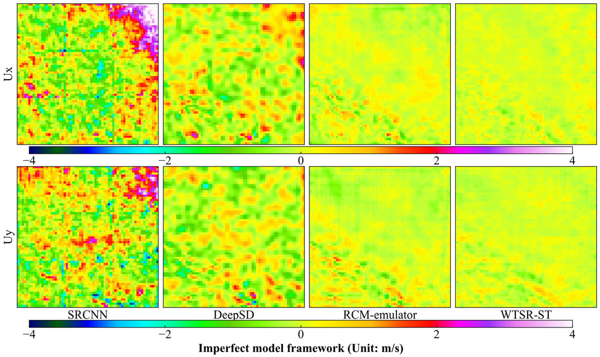

   **图 22** 测试阶段重建 WRF 模拟风场的风速误差图。

.. note::

   此处原文“27 km”与同节任务及图 21 的 27 km→3 km 重建目标不一致。这里明确指出文字差异，不将低分辨率输入误写为高分辨率参考目标。

图 23 给出两分量逐点统计结果，均值见表 IV。原文比较箱体和均值相对于训练阶段的变化后，认为 WTSR-ST 更稳定。其测试 MSE 为 0.134、0.135，MAE 为 0.269、0.272，MAPE 为 32.023%、41.177%。在本文所选网络和测试数据中，WTSR-ST 的逐点风场重建表现较好。

.. figure:: ../../../wechat/assets/public-safe/ref-tang2024-POF/fig23.jpg
   :alt: 论文图 23 测试阶段 WRF 模拟风场重建结果的统计评价。绿色三角形表示均值，橙色线表示中位数。
   :align: center
   :width: 100%

   **图 23** 测试阶段 WRF 模拟风场重建结果的统计评价。绿色三角形表示均值，橙色线表示中位数。

.. note::

   原文将图 23 的均值汇列于表 IV；图 18 已见的 MAPE 图表差异说明，测试图 23 同样应纳入统计口径核查。这里保留原图和表 IV，不把两种呈现无条件当作同一组已核实均值。

图 24 给出 SSIM 柱状图，均值见表 IV。尽管测试结果较训练阶段稍差，WTSR-ST 仍优于另外三种网络，两分量 SSIM 均为 0.982。图 25 的 PDF 比较与前述趋势相似：27 km WRF 速度分布相对高分辨率参考，在中央高估概率、两侧低估；经过网络处理，WTSR-ST 的分布最接近高分辨率参考，其余三种网络仍存在较明显差异。这些结果说明，该网络不仅能处理二维湍流，也在气象风场超分辨率中表现出潜力。

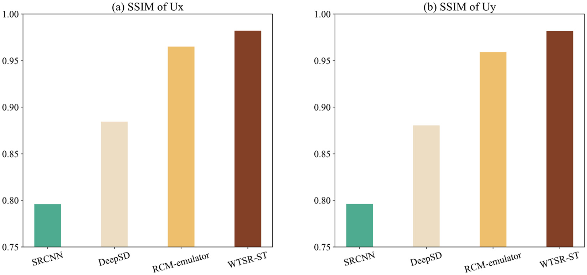

   **图 24** 测试阶段 WRF 模拟风场重建结果的结构相似性评价。（a）Ux 分量的 SSIM；（b）Uy 分量的 SSIM。

.. figure:: ../../../wechat/assets/public-safe/ref-tang2024-POF/fig25.jpg
   :alt: 论文图 25 测试阶段 WRF 模拟风场重建结果的概率密度函数（PDF）。绿色为 SRCNN，红色为 DeepSD，紫色为 RCM-emulator，蓝色为本文提出的 WTSR-ST，黑色为目标高分辨率结果。（a）Ux 分量的 PDF；（b）Uy 分量的 PDF。
   :align: center
   :width: 100%

   **图 25** 测试阶段 WRF 模拟风场重建结果的概率密度函数（PDF）。绿色为 SRCNN，红色为 DeepSD，紫色为 RCM-emulator，蓝色为本文提出的 WTSR-ST，黑色为目标高分辨率结果。（a）Ux 分量的 PDF；（b）Uy 分量的 PDF。

IV.D 湍动能重建
--------------------

湍动能（TKE）反映湍涡相关能量，直接影响混合与动量传递。相较于重建速度场，TKE 可更直接展示湍流能量分布，对评价模型物理特征的保持能力很重要。本文从 WRF 输出文件中提取各网格点 TKE，作为训练深度学习模型的输入，采用与前述速度场相同的训练配置。表 V 显示，重建 TKE 的训练和测试 MSE 分别为 0.00336、0.00381，MAE 为 0.207、0.247，正文所称 MAPE 为 11.812%、14.524%。原文据此认为 TKE 重建精度较高。图 26 比较预测与参考高分辨率 TKE；与速度场类似，高低分辨率数据之间存在信息差异，但训练和测试结果均有较高相关性。原文认为，速度和 TKE 的重建结果共同反映了网络保持现实物理特征的一致性。

.. list-table:: 表 V 重建 TKE 的 MSE 值（原表题）
   :header-rows: 1
   :class: longtable

   * - 指标
     - 训练集
     - 测试集
   * - MSE
     - 0.00336
     - 0.00381
   * - MAE
     - 0.207
     - 0.247
   * - SMAPE
     - 11.812%
     - 14.524%

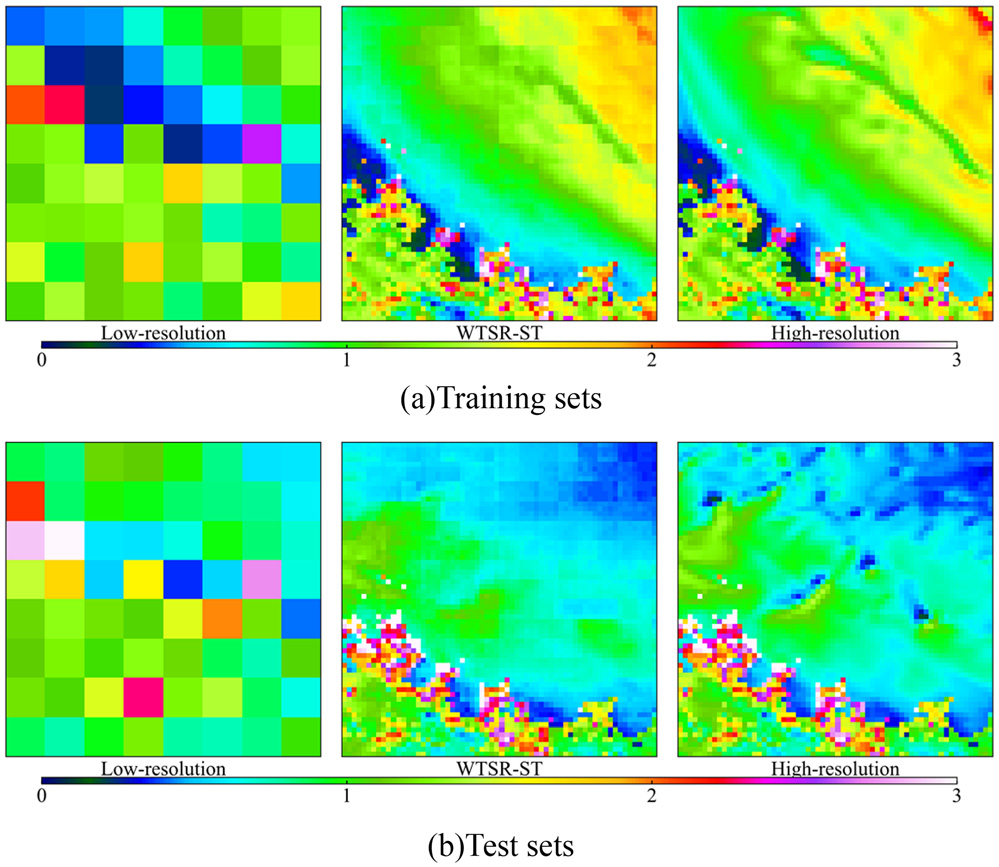

   **图 26** 重建结果与参考高分辨率结果的湍动能（TKE）比较，单位为 m²/s²。

.. note::

   本节是直接以 WRF 的 TKE 变量另外训练重建，不是由重建速度自行恢复全部湍流统计，也不是守恒、能谱或动力学闭合验证。表 V 的百分比指标名为 SMAPE，正文却称 MAPE，且没有单独给出 SMAPE 定义。若 MSE 与 MAE 来自同一尺度和同一组误差，通常有 MAE 不大于 MSE 的平方根；这里两组数字均不满足，原文未交代不同尺度或聚合方式。故保留原值并标注不一致，不据此宣称已复现定量精度。图 26 标注 TKE 单位 m²/s²，表 V 本身未给出归一化或单位。

V 总结与讨论
--------------

计算能力和流体动力学的发展，使高分辨率风场成为可能，但仍需大量处理时间与存储资源。本文提出以 Swin-Transformer 为骨干的 WTSR-ST，改进位置编码和层级结构，并在训练中加入感知损失以指导权重更新，目标是高效重建高分辨率 PBL 风场。通过理想与非理想模型框架检验其表现，并与 SRCNN、DeepSD 和 RCM-emulator 比较。三种逐点误差指标用于评估各重建风速分量的偏差，SSIM 与 PDF 提供额外的整体感知评价；原文还将 PDF 描述为表征小尺度重建效果的指标。

理想框架侧重验证风矢量超分辨率能力，数据—标签对来自同一来源，以保持时空一致。高分辨率风场由 JAX-CFD 求解二维湍流获得，原文在总结中写低分辨率数据由平均池化操作生成。网络无需同时处理潜在不一致，只需学习超分辨率映射，图 10、15 的 PDF 形状也体现了这一点。原文称 MSA 与 W-MSA 的结合有助于提取长程特征，使 WTSR-ST 获得更低的 MSE、MAE、MAPE、更高的 SSIM，以及更接近参考场的 PDF，尤其在高速区域的特征提取上优于另外三种网络。测试数据上另外三种网络的性能下降更明显，原文据此判断 WTSR-ST 具有更好的稳健性。

.. note::

   本段保留总结中的“平均池化”及“MSA 与 W-MSA”措辞：方法节低分辨率生成写插值，注意力块则写 W-MSA 与 SW-MSA。仅凭本文不能判定这些文字差异对应何种实际代码实现。

非理想框架用于评估 WTSR-ST 对 WRF 风场的处理能力。低、高分辨率场来自嵌套模拟；图 20 中 3 km 和 27 km 数据的 PDF 不重合，因此训练需要自动区分冗余信息与有利信息，学习从外层 D01 到内层 D03 的映射。所有网络的性能均下降，原文将其解释为输入中的冗余信息影响了有效特征学习。借助注意力机制，WTSR-ST 仍获得相对较好的结果：逐点误差更低、SSIM 更高、PDF 更接近高分辨率参考，在测试数据中也保持了较好的重建能力。

本研究仍有限制。讨论只覆盖 27 km 到 3 km 的超分辨率，仍处于千米尺度，距离替代 WRF–CFD 嵌套模拟的最终目标很远。超分辨率还应从空间维度扩展至时间维度，将气象风场空间分辨率提高到百米、时间分辨率提高到秒级，是值得进一步研究的问题。此外，本文只考虑平均风矢量，尚未覆盖湍流、风切变和大气稳定度等气象因素的复杂变化。还需要纳入这些因素的更多算例，确认网络的可靠性。

.. note::

   结论中这项限制与前面的 TKE 变量重建同时保留：补充一个 TKE 映射实验，不等于已经解决完整湍流、风切变及稳定度变化，也不构成跨地区、跨季节或外部实测泛化验证。

参考文献
--------

1. C. Aldereguía Sánchez, F. Tubino, A. Bagnara, and G. Piccardo, “Experimental simulation of thunderstorm profiles in an atmospheric boundary layer wind tunnel,” Appl. Sci. 13(14), 8064–8077 (2023).

2. K. Stengel, A. Glaws, D. Hettinger, and R. N. King, “Adversarial super-resolution of climatological wind and solar data,” Proc. Natl. Acad. Sci. U. S. A. 117(29), 16805–16815 (2020).

3. K. Panthi and G. V. Iungo, “Quantification of wind turbine energy loss due to leading-edge erosion through infrared-camera imaging, numerical simulations, and assessment against SCADA and meteorological data,” Wind Energy 26(3), 266–282 (2023).

4. M. Jankauskas, A. Serackis, R. Pomornacki, V. K. Hyunh, M. Šapurov, and A. Baškys, “Short-term wind energy forecasting with advanced recurrent neural network models: A comparative study,” in Proceedings of the 10th Jubilee Workshop on Advances in Information, Electronic and Electrical Engineering (AIEEE) (IEEE, 2023), pp. 1–5.

5. Z. H. Zhao, Y. Q. Xiao, C. Li, J. H. Wang, and G. Hu, “New consideration of lateral boundary treatment for meso- and micro-scale nested PBL simulations over complex terrain,” Atmos. Res. 254, 105507 (2021).

6. M. Van der Meer, S. De Roda Husman, and S. Lhermitte, “Deep learning regional climate model emulators: A comparison of two downscaling training frameworks,” J. Adv. Model. Earth Syst. 15(6), e2022MS003593 (2023).

7. Y. X. Zhang, S. Y. Cao, L. Zhao, and J. X. Cao, “A case application of WRF-UCM models to the simulation of urban wind speed profiles in a typhoon,” J. Wind Eng. Ind. Aerodyn. 220, 104874 (2022).

8. M. Z. Yousif, L. Q. Yu, and H. C. Lim, “Super-resolution reconstruction of turbulent flow fields at various Reynolds numbers based on generative adversarial networks,” Phys. Fluids 34(1), 015130 (2022).

9. A. Martilli, “Current research and future challenges in urban mesoscale modeling,” Int. J. Climatol. 27(14), 1909–1918 (2007).

10. K. K. Dayal, G. Bellon, J. E. Cater, M. J. Kingan, and R. N. Sharma, “High-resolution mesoscale wind-resource assessment of Fiji using the Weather Research and Forecasting (WRF) model,” Energy 232, 121047 (2021).

11. R. Onishi, D. Sugiyama, and K. Matsuda, “Super-resolution simulation for real-time prediction of urban micrometeorology,” Sola 15, 178–182 (2019).

12. Y. Yasuda, R. Onishi, Y. Hirokawa, D. Kolomenskiy, and D. Sugiyama, “Super-resolution of near-surface temperature utilizing physical quantities for real-time prediction of urban micrometeorology,” Build. Environ. 209, 108597 (2022).

13. Z. S. Lu, J. C. Li, H. Liu, C. Y. Huang, L. L. Zhang, and T. Y. Zeng “Transformer for single image super-resolution,” in Proceedings of the IEEE/CVF Conference on Computer Vision and Pattern Recognition (IEEE, 2022), pp. 457–466.

14. M. F. Jiang, M. H. Zhi, L. Y. Wei, X. C. Yang, J. C. Zhang, Y. M. Li, P. Wang, J. H. Huang, and G. Yang, “FA-GAN: Fused attentive generative adversarial networks for MRI image super-resolution,” Comput. Med. Imaging Graph. 92, 101969 (2021).

15. D. C. Lepcha, B. Goyal, A. Dogra, and V. Goyal, “Image super-resolution: A comprehensive review, recent trends, challenges and applications,” Inf. Fusion 91, 230–260 (2023).

16. J. Y. Liang, J. Z. Cao, G. L. Sun, K. Zhang, L. Van Gool, and R. Timofte, “SwinIR: Image restoration using swin transformer,” in Proceedings of the IEEE/CVF International Conference on Computer Vision (IEEE, 2021), pp. 1833–1844.

17. C. Ledig, L. Theis, F. Huszár, J. Caballero, A. Cunningham, A. Acosta, A. Aitken, A. Tejani, J. Totz, Z. Wang, and W. Shi, “Photo-realistic single image super-resolution using a generative adversarial network,” in Proceedings of the IEEE Conference on Computer Vision and Pattern Recognition (IEEE, 2017), pp. 105–114.

18. Z. H. Wang, J. Chen, and S. C. H. Hoi, “Deep learning for image super-resolution: A survey,” IEEE Trans. Pattern Anal. Mach. Intell. 43(10), 3365–3387 (2021).

19. F. Zhou, W. M. Yang, and Q. M. Liao, “Interpolation-based image super-resolution using multisurface fitting,” IEEE Trans. Image Process. 21(7), 3312–3318 (2012).

20. C. Dong, C. C. Loy, K. M. He, and X. O. Tang, “Image super-resolution using deep convolutional networks,” IEEE Trans. Pattern Anal. Mach. Intell. 38(2), 295–307 (2016).

21. C. Dong, C. C. Loy, and X. O. Tang, “Accelerating the super-resolution convolutional neural network,” in Computer Vision–ECCV 2016: 14th European Conference, Amsterdam, The Netherlands, October 11–14, 2016, Proceedings, Part II (IEEE, 2016), pp. 391–407.

22. C. Ledig, L. Theis, F. Huszár, J. Caballero, A. Cunningham, A. Acosta, A. Aitken, A. Tejani, J. Totz, Z. Wang, and W. Shi, “Photo-realistic single image super-resolution using a generative adversarial network,” in Proceedings of the IEEE Conference on Computer Vision and Pattern Recognition (IEEE, 2017), pp. 4681–4690.

23. C. W. Tian, Y. N. Zhang, W. M. Zuo, C. W. Lin, D. Zhang, and Y. X. Yuan, “A heterogeneous group CNN for image super-resolution,” IEEE Trans. Neural Networks Learn. Syst. 35, 6507–6519 (2022).

24. K. Fukami, K. Fukagata, and K. Taira, “Super-resolution analysis via machine learning: A survey for fluid flows,” Theor. Comput. Fluid Dyn. 37(4), 421–444 (2023).

25. N. Takano and G. Alaghband, “SRGAN: Training dataset matters,” arXiv preprint arXiv:1903.09922 (2019).

26. J. X. Cheng, J. Liu, Q. M. Kuang, Z. Xu, C. K. Shen, W. Liu, and K. Zhou, “DeepDT: Generative adversarial network for high-resolution climate prediction,” IEEE Geosci. Remote Sens. Lett. 19, 1–5 (2022).

27. H. Yin, “Comparison and analysis of various deep learning models for super-resolution reconstruction of turbulent flows,” J. Phys. Conf. Ser. 2634(1), 012046 (2023).

28. K. Höhlein, M. Kern, T. Hewson, and R. Westermann, “A comparative study of convolutional neural network models for wind field downscaling,” Meteorol. Appl. 27(6), e1961 (2020).

29. H. K. Wu, Y. R. Chen, P. X. Xie, D. Zhou, T. Tamura, K. Zhang, S. Y. Cao, and Y. Cao, “Sparse-measurement-based peak wind pressure evaluation by super-resolution convolutional neural networks,” J. Wind Eng. Ind. Aerodyn. 242, 105574 (2023).

30. B. Liu, J. P. Tang, H. B. Huang, and X. Y. Lu, “Deep learning methods for super-resolution reconstruction of turbulent flows,” Phys. Fluids 32(2), 025105 (2020).

31. J. S. Zhang, J. Liu, and Z. W. Huang, “Improved deep learning method for accurate flow field reconstruction from sparse data,” Ocean Eng. 280, 114902 (2023).

32. A. Vaswani, N. Shazeer, N. Parmar, J. Uszkoreit, L. Jones, A. N. Gomez, and I. Polosukhin, “Attention is all you need,” Adv. Neural Inf. Process. Syst. 30, 5998–6008 (2017).

33. L. Floridi and M. Chiriatti, “GPT-3: Its nature, scope, limits, and consequences,” Minds Mach. 30(4), 681–694 (2020).

34. A. Dosovitskiy, L. Beyer, A. Kolesnikov, D. Weissenborn, X. Zhai, T. Unterthiner, M. Dehghani, M. Minderer, G. Heigold, S. Gelly, J. Uszkoreit, and N. Houlsby, “An image is worth 16x16 words: Transformers for image recognition at scale,” in Proceedings of the International Conference on Learning Representations (IEEE, 2021), p. 11929.

35. P. Verma and J. Berger, “Audio transformers: Transformer architectures for large scale audio understanding,” in 2021 IEEE Workshop on Applications of Signal Processing to Audio and Acoustics, October 17–20, 2021 arXiv:2105.00335 (2021).

36. L. H. Dong, S. Xu, and B. Xu, “Speech-transformer: A no-recurrence sequence-to-sequence model for speech recognition,” in IEEE International Conference on Acoustics, Speech and Signal Processing (IEEE, 2018), pp. 5884–5888.

37. W. Zhang, Y. Y. Jiang, J. Y. Dong, X. J. Song, R. B. Pang, B. Y. Guoan, and H. Yu, “A deep learning method for real-time bias correction of wind field forecasts in the Western North Pacific,” Atmos. Res. 284, 106586 (2023).

38. Q. Xu, Z. J. Zhuang, Y. C. Pan, and B. H. Wen, “Super-resolution reconstruction of turbulent flows with a transformer-based deep learning framework,” Phys. Fluids 35(5), 055130 (2023).

39. Y. C. Dang, Z. Y. Hu, M. Cranmer, M. Eickenberg, and S. Ho, “TNT: Vision transformer for turbulence simulations,” arXiv:2207.04616 (2022).

40. Z. Liu, Y. T. Lin, Y. Cao, H. Hu, Y. X. Wei, Z. Zhang, S. Lin, and B. N. Guo, “Swin transformer: Hierarchical vision transformer using shifted windows,” in Proceedings of the IEEE/CVF International Conference on Computer Vision (IEEE, 2021), pp. 10012–10022.

41. Z. Liu, H. Hu, Y. T. Lin, Z. L. Yao, Z. D. Xie, Y. X. Wei, J. Ning, Y. Cao, Z. Zhang, L. Dong, F. R. Wei, and B. Guo, “Swin transformer v2: Scaling up capacity and resolution,” in Proceedings of the IEEE/CVF Conference on Computer Vision and Pattern Recognition (IEEE, 2022), pp. 12009–12019.

42. X. Huang, M. J. Dong, J. Y. Li, and X. Guo, “A 3-D-swin transformer-based hierarchical contrastive learning method for hyperspectral image classification,” IEEE Trans. Geosci. Remote Sens. 60, 1–15 (2022).

43. H. Gong, T. K. Mu, Q. X. Li, H. S. Dai, C. L. Li, Z. P. He, W. J. Wang, F. Han, A. Tuniyazi, H. Y. Li, X. C. Lang, Z. Y. Li, and B. Wang, “Swin-transformer-enabled YOLOv5 with attention mechanism for small object detection on satellite images,” Remote Sens. 14(12), 2861 (2022).

44. W. Z. Shi, J. Caballero, F. Huszár, J. Totz, A. P. Aitken, R. Bishop, D. Rueckert, and Z. Wang, “Real-time single image and video super-resolution using an efficient sub-pixel convolutional neural network,” in Proceedings of the IEEE Conference on Computer Vision and Pattern Recognition (IEEE, 2016), pp. 1874–1883.

45. H. X. Gao, G. Hu, D. Q. Zhang, W. J. Jiang, H. H. Ren, and W. L. Chen, “Prediction of wind fields in mountains at multiple elevations using deep learning models,” Appl. Energy 353, 122099 (2024).

46. R. Pascanu, G. Montufar, and Y. Bengio, “On the number of response regions of deep feed forward networks with piece-wise linear activations,” arXiv:1312.6098 (2013).

47. T. Vandal, E. Kodra, S. Ganguly, A. Michaelis, R. Nemani, and A. R. Ganguly, “DeepSD: Generating high resolution climate change projections through single image super-resolution,” in Proceedings of the 23rd ACM SIGKDD International Conference on Knowledge Discovery and Data Mining (ACM, 2017), pp. 1663–1672.

48. A. Doury, S. Somot, S. Gadat, A. Ribes, and L. Corre, “Regional climate model emulator based on deep learning: Concept and first evaluation of a novel hybrid downscaling approach,” Clim. Dyn. 60(5), 1751–1779 (2023).

49. R. Temam, Navier-Stokes Equations: Theory and Numerical Analysis (American Mathematical Society, 2001), Vol. 343.

50. P. K. Wang, C. C. Chueh, and C. K. Wang, “A numerical study of flow fields of lobed hailstones falling in air,” Atmos. Res. 160, 1–14 (2015).

51. T. Frerix, D. Kochkov, J. Smith, D. Cremers, M. Brenner, and S. Hoyer, “Variational data assimilation with a learned inverse observation operator,” in Proceedings of the 38th International Conference on Machine Learning (ICML, 2021), pp. 3449–3458.

52. E. D. Fylladitakis, “Kolmogorov flow: Seven decades of history,” J. Appl. Math. Phys. 06(11), 2227 (2018).

53. R. Klaver, R. Haarsma, P. L. Vidale, and W. Hazeleger, “Effective resolution in high resolution global atmospheric models for climate studies,” Atmos. Sci. Lett. 21(4), e952 (2020).

54. A. S. Moya-Álvarez, D. Martínez-Castro, S. Kumar, R. Estevan, and Y. Silva, “Response of the WRF model to different resolutions in the rainfall forecast over the complex Peruvian orography,” Theor. Appl. Climatol. 137, 2993–3007 (2019).

55. K. Simonyan and A. Zisserman, “Very deep convolutional networks for large-scale image recognition,” arXiv:1409.1556 (2014).

56. D. P. Kingma and J. Ba, “Adam: A method for stochastic optimization,” arXiv:1412.6980 (2014).

57. Z. Wang, A. C. Bovik, H. R. Sheikh, and E. P. Simoncelli, “Image quality assessment: From error visibility to structural similarity,” IEEE Trans. Image Process. 13(4), 600–612 (2004).

完整引用
--------

收录信息见 :ref:`WOEAI 学术成果页对应条目 <ref-tang2024-POF>`。
