.. _paper-note-ref-wang2023-JWEIA:

合成体力法生成湍流大气边界层的大涡模拟：论文精解
================================================================

精简版微信公众号文章：待发布

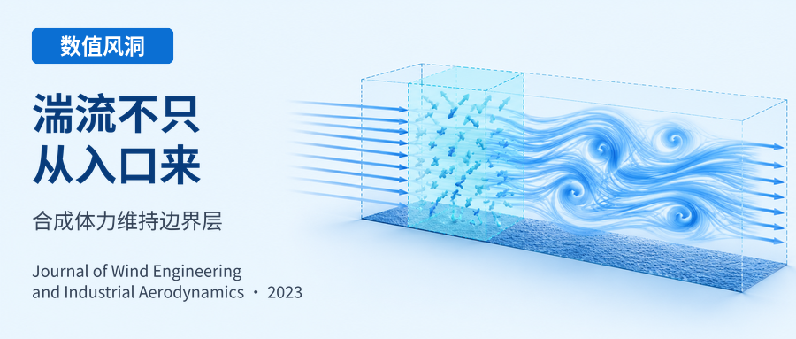

.. contents:: 本文目录
   :local:
   :depth: 3

论文信息
--------

**原文题名：** Large eddy simulation of turbulent atmospheric boundary layer flow based on a synthetic volume forcing method

**作者：** Jinghan Wang，Chao Li（通讯作者），Shenghong Huang，Qingxing Zheng，Yiqing Xiao，Jinping Ou。

**作者单位：** 哈尔滨工业大学（深圳）；中国科学技术大学近代力学系、中国科学院材料力学行为和设计重点实验室；深圳市建筑设计研究总院有限公司；哈尔滨工业大学（深圳）土木工程智能结构体系深圳市重点实验室。

**期刊：** Journal of Wind Engineering & Industrial Aerodynamics，233（2023），105326。

**DOI：** https://doi.org/10.1016/j.jweia.2023.105326

**收稿与录用：** 2022 年 7 月 16 日收稿，2023 年 1 月 19 日收到修订稿，2023 年 1 月 22 日录用。

**研究方向：** 工程结构抗风 / 数值风洞。

**译文说明：** 本文按原文顺序完整翻译科学正文、公式、表格、图题和参考文献。图像均来自原论文，表格为可编辑文本。原文式（1）与式（7）的求导对应、Q 判据符号以及若干算例参数存在内部不一致，均在相应位置保留并说明；未根据通常写法替作者更改。结论属于本文三种粗糙地表的空域 LES 检验，不是建筑风荷载验证。

摘要
----

合成随机 Fourier 方法原理简洁、计算效率高，是一种常用的入流湍流生成（ITG）方法。然而，该方法的湍流速度很难满足 Navier–Stokes（NS）方程，通常会导致入流湍流场重新发展，以及下游区域湍流能量的衰减。为克服这些问题，本研究提出一种合成体力（synthetic volume forcing，SVF）方法，依据合成随机 Fourier 方法构造体积力。体积力作为 NS 方程的源项，可以直接向平均流输入湍流能量，从而生成指定的湍流大气边界层（ABL）流动。采用大涡模拟（LES）模型，分别用 ITG 和 SVF 方法模拟乡村、郊区与城市地表上的湍流 ABL 流动。结果表明，SVF 算例的湍流 ABL 流动满足预先给定的平均风速、湍流强度和风速谱。ITG 与 SVF 算例的验证表明，后者的湍流场与无散条件及动量方程所描述的流动动力学相容，沿流向具有较好的自保持能力，且不会产生异常的压力脉动。

**关键词：** 粗糙表面；大气边界层；合成随机 Fourier 方法；大涡模拟；体力方法。

1 引言
------

随着超级计算机技术快速发展，数字风洞正成为土木工程抗风设计的重要辅助方法。在数字风洞中，合理而准确地再现真实 ABL 流动的脉动信息至关重要，因为这直接关系到建筑物和结构风力及风致振动的评估。数字风洞利用计算流体力学（CFD）技术数值求解控制方程，生成湍流 ABL 流动。因此，模拟结果的精度与网格分辨率、边界条件、初始化条件、时间步长和离散格式有关。内部 ABL 流动的湍流特征对入流边界条件尤其敏感，使用 LES 湍流模型时更是如此，特别是其中的来流湍流信息。已有大量 ITG 方法研究，可将其分为前驱方法和合成方法（Wu，2017；Dhamankar 等，2018）。

前驱方法通常包含两个计算域：一个辅助域用于发展稳定的 ABL 流场，另一个主域用于评估建筑物和结构的风致力。一般将辅助域内充分发展的 ABL 流场提取为二维平面数据，再映射至主域入口边界。这种方法的固有优势是，湍流 ABL 场由 NS 方程自发求解生成，无需人为施加脉动。在这种情况下，湍流 ABL 的脉动特征可以在整个主域中保持。根据辅助域中采用的技术，前驱方法又可分为前驱数据库法和循环法（Thordal 等，2020）。前驱数据库法通常复制物理风洞的粗糙元布置，发展湍流 ABL 场，例如 Thordal 等（2020）和 Liu 等（2016）的研究。与此同时，循环再标度方法（Lund 等，1998）沿流向构造准周期边界条件，生成平板湍流边界层，从而缩短辅助域。Nozawa 和 Tamura（2001）重新考虑标度参数，对该方法加以修改，以生成高度粗糙壁面上的湍流边界层，以及低层建筑周围的流动（Nozawa 和 Tamura，2002）。

虽然前驱方法可以生成充分发展的湍流 ABL 流场，但由于需要独立的模拟过程，其效率低于合成 ITG 方法。合成 ITG 方法通过合成来流脉动速度生成入流，主要可分为五类：谱表示法（Dhamankar 等，2018）、合成随机 Fourier 方法（Smirnov 等，2001；Huang 等，2010；Castro 和 Paz，2013；Aboshosha 等，2015；Yu 等，2018）、数字滤波法（Klein 等，2003；Xie 和 Castro，2009；Dhamankar 等，2014；Lamberti 等，2018）、本征正交分解法（Druault 等，2004、2005；Johansson 和 Andersson，2004）以及合成涡方法（Jarrin 等，2006；Luo 等，2017；Oh 等，2019）。更详细的介绍可参见 Wu（2017）和 Dhamankar 等（2018）的文章。

作为常用的合成随机 Fourier 方法之一，Smirnov 等（2001）提出的随机流生成（RFG）方法，可以生成满足 Gaussian 谱的无散、非均匀各向异性流场。在这一过程的基础上，Huang 等（2010）通过指定与给定能谱相对应的波数分布，提出离散合成随机流生成（DSRFG）算法，以生成湍流 ABL 流动。Zhang 等（2015）将该方法用于高层建筑分区脱体涡模拟的湍流入流条件，所得风致力与试验数据吻合较好。为生成满足所需时间与空间相关性的湍流入流，Castro 和 Paz（2013）在合成脉动速度时引入了相应的相关性调节参数。Aboshosha 等（2015）指出，DSRFG 方法的风速谱和空间相关性偏离目标，并将其改进为一致离散随机流生成（CDRFG）方法。他们通过修改风速谱的分布并引入调节因子，生成满足目标谱和相干函数的湍流 ABL 流动。随后，CDRFG 方法被经常用于生成湍流来流（Elshaer 等，2016、2017；Adamek 等，2017；Yang 等，2020）。近来，Yu 等（2018）通过引入随机相位，将 RFG 方法的速度表达式简化为余弦项，提出窄带合成 RFG 方法。Feng 等（2019）将其用于高层建筑风效应 LES 的湍流入流条件。然而，在空计算域中，来流湍流特征不能沿流向保持，必须进行迭代调整。这也是合成 ITG 方法的主要缺点：人为生成的随机数很难与 CFD 求解过程中的二阶非线性 NS 方程相容（Dhamankar 等，2018）。这种不一致可能导致入口后的湍流重新发展，以满足控制方程（Wang 和 Chen，2020），其湍流特性也可能随之重构。

为加快来流湍流的重新发展与适应过程，研究者发展了体力方法。Spille-Kohoff 和 Kaltenbach（2001）依据 Reynolds 剪应力构造一组体力项，并将其加入 NS 方程。这些体力项与比例积分控制器结合，动态调整下游湍流性质，有助于缩短基于 RFG 方法生成的入流湍流所需的适应距离。随后，Keating 等（2004）通过模拟壁面约束流动，分析了体力方法的参数，并将其扩展到混合 RANS/LES 模型中的高 Reynolds 数槽道流模拟（Keating 和 Piomelli，2006）。Laraufie 等（2011）用 Reynolds 正应力代替剪应力，构造 Spille-Kohoff 和 Kaltenbach（2001）方法中的体力项，与合成涡方法结合模拟空间发展的湍流边界层，并分析了相关参数。Haywood 和 Sescu（2018）实现了并行前驱方法（Stevens 等，2014），在辅助域中分别施加体力项调整平均风速和 Reynolds 剪应力。不同 Reynolds 数湍流边界层的 LES 结果，与给定的平均风速和 Reynolds 应力吻合较好。de Laage De Meux 等（2015）提出各向异性线性体力方法，用于在 LES 中模拟满足给定平均速度和湍流应力的均匀各向异性湍流场。Schmidt 和 Breuer（2017）在对翼型周围可压缩边界层进行 LES 时，向 NS 方程加入额外源项，调整数字滤波方法合成的湍流入流。

可以看出，上述体力方法通过向流场输入湍流能量，作为合成入流湍流的补偿调整手段，通常使合成 ITG 方法的使用更为复杂。不过，Golubev 等（2011）提出了一种基于 RFG 方法的体积力合成扰动方法，在 NS 方程中向特定范围加入源项，可以直接生成指定的阵风场，但其湍流谱只能满足 Gaussian 谱模型。Kazarina 等（2017）对该方法进行了修改，用于生成满足任意所需谱模型的翼型上游湍流场；然而，该方法能否用于高 Reynolds 数 ABL 流动尚不清楚。最近，Tangermann 和 Klein（2020）构造受控体积力，将其加入 NS 方程生成湍流，但生成的湍流特征与目标存在较大偏差，因此采用比例积分微分策略动态调整下游流场。

总的来说，合成 Fourier 方法能够生成满足任意指定湍流特征的来流，但由于与 NS 方程不一致，湍流场会发生不稳定的调整。已有体力方法能够与 NS 方程相容，却仍缺乏生成指定湍流性质的通用性。受 Golubev 等（2011）和 Kazarina 等（2017）工作的启发，本文提出一种基于随机 Fourier 方法的合成体力方法。该方法直接向平均流场输入湍流能量，通过将体积力加入 NS 方程，生成满足指定风场特征的湍流 ABL 流场。它保留了合成随机 Fourier 方法的高效率，同时避免合成 ITG 方法中湍流来流的不稳定性。

本文安排如下：第 2 节详细介绍 CDRFG ITG 方法和提出的合成体力方法；第 3 节给出三维 CFD 模拟设置，以及用于粗糙地表的简化增强冠层阻力（SECD）模型；第 4 节讨论 SVF 方法的参数研究；第 5 节详细比较 CDRFG ITG 与 SVF 方法。

2 合成随机 Fourier 方法
-----------------------

2.1 CDRFG ITG 方法简述
~~~~~~~~~~~~~~~~~~~~~~

CDRFG 方法（Aboshosha 等，2015）属于合成随机 Fourier 入流湍流生成方法，其脉动速度由具有随机频率的 Fourier 模态叠加而成，形式见式（1）。CDRFG ITG 方法的主要优点是，生成的湍流来流满足目标相干函数。

.. math::

   u_i(x_j,t)=\sum_{m=1}^{M}\sum_{n=1}^{N}\left[p_i^{m,n}\sin\left(k_j^{m,n}\tilde x_j^{m,n}+\omega_{m,n}t\right)+q_i^{m,n}\cos\left(k_j^{m,n}\tilde x_j^{m,n}+\omega_{m,n}t\right)\right] \qquad (1)

其中， :math:`u_i` 分别表示纵向速度分量 u（i=1）、横向速度分量 v（i=2）和竖向速度分量 w（i=3）。M 为谱分段数量，N 为各分段中的随机频率数量。 :math:`k_j^{m,n}` 是每个频率分段的随机波数，均匀分布在指定半径的波数空间球面上。 :math:`\omega_{m,n}=2\pi f_{m,n}` 为各分段的随机圆频率， :math:`f_{m,n}` 服从 :math:`N(f_m,\Delta f)` 分布。 :math:`\tilde x_j=x_i/L_j^m` 为无量纲空间坐标，分别对应纵向 x（j=1）、横向 y（j=2）和竖向 z（j=3）。 :math:`L_j^m` 是 CDRFG ITG 方法的特征参数，由式（2）计算。

译注：上段无量纲坐标的原式分子写作 :math:`x_i`，分母和左端为 j 下标，保留原文的下标差异。

.. math::

   L_j^m=\frac{U_{av}}{\gamma C_j f_m} \qquad (2)

其中， :math:`U_{av}` 为平均风速， :math:`f_m` 为目标谱第 m 段的频率。 :math:`\gamma` 为式（3）确定的调节因子，用于提高生成的 ABL 流场相干结构与指定目标的一致性。 :math:`C_j` 为 j 方向的相干衰减常数。

.. math::

   \gamma=\begin{cases}3.7\left(\dfrac{C_jD}{L_u}\right)^{-3.0},&\dfrac{C_jD}{L_u}<6.0,\\2.1,&\dfrac{C_jD}{L_u}\geq6.0,\end{cases} \qquad (3)

其中，D 为随算例而变化的特征长度， :math:`L_u` 为纵向湍流积分长度。 :math:`p_i^{m,n}` 和 :math:`q_i^{m,n}` 为 i 方向的随机幅值，由式（4）计算。

.. math::

   \begin{cases}p_i^{m,n}=\operatorname{sign}(r_i^{m,n})\sqrt{\dfrac1N S_i^m\Delta f\dfrac{(r_i^{m,n})^2}{1+(r_i^{m,n})^2}},\\q_i^{m,n}=\operatorname{sign}(r_i^{m,n})\sqrt{\dfrac1N S_i^m\Delta f\dfrac{1}{1+(r_i^{m,n})^2}},\end{cases} \qquad (4)

其中， :math:`\Delta f` 为频率分段长度， :math:`S_i^m` 为 i 方向第 m 段的谱， :math:`r_i^{m,n}\sim N(0,1)` 为第 m 段的随机数。

2.2 合成体力方法
~~~~~~~~~~~~~~~~

CDRFG ITG 方法的上述优势对于评估高层建筑的风致振动十分重要，而且其源代码已经公开，因此被广泛用于生成高层建筑周围的湍流 ABL 流动（Adamek 等，2017；Elshaer 等，2017；Yang 等，2020）。然而，作者在用该方法生成 ABL 流场的湍流入流边界条件时发现两个问题：其一，如图 18（a）所示，模拟中出现不真实的压力脉动和明显的压力梯度；其二，如图 19（a）所示，随着来流湍流发展，湍流涡受到滤除，意味着湍流能量耗散。压力脉动归因于 ITG 方法入口边界质量通量的不平衡（Kim 等，2013；Zhang 等，2022），而湍流能量减少则由来流速度与 NS 方程不一致导致（Wang 和 Chen，2020）。

向 NS 方程加入体积力能够高效地模拟湍流风场（Golubev 等，2011；Laraufie 等，2011；Kazarina 等，2017；Tangermann 和 Klein，2020），因此本文提出合成体力（SVF）方法，以处理不真实的压力脉动与湍流能量减少问题。依据 Newton 第二定律，该方法的基本思想是构造体积力，作为 NS 方程右端源项。体积力可以直接向平均流输入湍流能量，从而生成指定的湍流 ABL 流动。SVF 方法的原理如下。

首先，基于有限体积法（FVM）的 CFD 模拟，其最小求解单元为图 1 所示的离散控制体积（CV）。一个 CV 内不可压缩流体的运动满足式（5）的动量守恒方程。该方程的物理意义是，流体微元动量随时间的变化，等于作用于该微元的压力、黏性力与外部体积力之和。因此，可以构造适当的外部体积力，使流体动量发生变化，从而生成特定的湍流。由此依据 Newton 第二定律计算体积力，表达式见式（6）和式（7）。

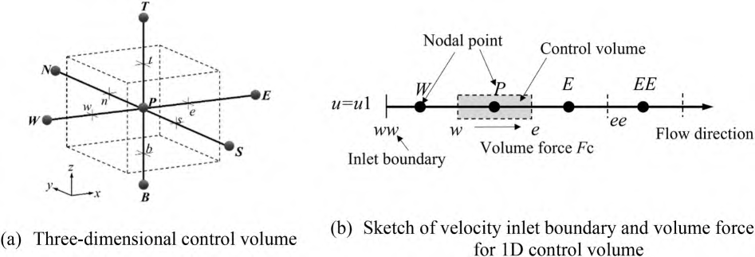

   **图 1** 有限体积法中节点 P 周围的控制体积。

.. math::

   \frac{\partial(\rho u_i)}{\partial t}+\operatorname{div}(\rho u_i\mathbf u)=-\frac{\partial p}{\partial x_i}+\operatorname{div}(\mu\mathbin{\bullet}\operatorname{grad}u_i)+F_{c,i} \qquad (5)

.. math::

   F_{c,i}=m_ca_i=\rho V_c\frac{\mathrm du_i(x_j,t)}{\mathrm dt} \qquad (6)

.. math::

   \begin{aligned}a_i(x_j,t)=\sum_{m=1}^{M}\sum_{n=1}^{N}\Big[&-p_i^{m,n}\omega_{n,m}\sin\left(k_j^{m,n}\tilde x_j^{m,n}+\omega_{n,m}t\right)\\&+q_i^{m,n}\omega_{n,m}\cos\left(k_j^{m,n}\tilde x_j^{m,n}+\omega_{n,m}t\right)\Big]\end{aligned} \qquad (7)

其中， :math:`a_i` 为流体沿 i 方向随时间变化的加速度， :math:`u_i` 为 CDRFG ITG 方法中对应的脉动速度； :math:`m_c` 为一个网格单元所含流体微元的质量， :math:`\rho` 为空气密度， :math:`V_c` 为局部网格单元体积。 :math:`p_i^{m,n}`、 :math:`q_i^{m,n}`、 :math:`k_j^{m,n}` 和 :math:`\tilde x_j^{m,n}` 与式（1）相同，根据目标平均风速、湍流强度、风速谱和湍流积分长度尺度计算。因此，可以认为，将式（6）、（7）计算的体积力作为额外源项加入 NS 方程，即可直接生成指定的湍流风场。

译注：这里忠实保留两个源内疑点。式（7）印刷的正弦、余弦及系数排列，并不是对式（1）印刷表达式直接求时间导数所得；圆频率下标也由式（1）的 m,n 改为 n,m。另一个问题是，式（5）的微分形式源项量纲与式（6）所写单元总力 :math:`\rho V_c a_i` 不同，原文未在此写出体积归一化步骤。上述差异不能据译文确定实际代码实现，故不代作者修正公式。

其次，将体积力作为源项加入某个指定计算区域内的 NS 方程。该区域称为体力作用区，在流向占有一定长度，并覆盖计算域的整个宽度和高度。SVF 方法的详细步骤如下。

* 提取计算域内某个指定表面的网格面心空间坐标，依据式（7）生成随时间变化的加速度序列。
* 确定体力作用区的纵向长度 :math:`l_f`，这一参数对下游湍流特征有显著影响。
* 按照坐标匹配原则，将第 1 步生成的加速度加入作用区内计算网格的单元中心，并计算体积力。坐标匹配时忽略纵向坐标；对于结构网格，横向和竖向坐标逐一匹配；对于非结构网格，按照最小距离原则匹配。
* 在入口边界施加平均风速剖面，与体积力扰动结合，最终生成目标湍流 ABL 流动。方法示意见图 2。

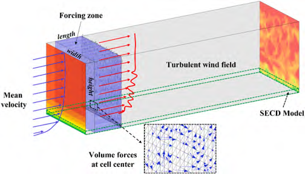

   **图 2** 合成体力方法示意。附加的 SECD 为简化增强冠层阻力模型，详见第 3.3 节。

此外，SVF 方法由 CDRFG ITG 方法推导而来，两者具有以下相同点和区别。

* 决定生成 ABL 流动特征的参数，在 SVF 和 ITG 方法中相同。
* 两种方法在 CFD 求解过程中体现出不同机制。SVF 方法的体积力可以灵活作用于内部计算域 CV 的节点，而 CDRFG ITG 方法的合成速度则固定在入口边界。
* 两种方法对内部计算网格数值结果的影响不同。采用 FVM 模拟湍流时，CFD 过程的离散误差与离散 NS 方程的截断误差、计算模型的网格分辨率有关。在空间离散中，CV 界面上流动变量 :math:`\varphi` 的值由节点变量插值得到。以图 1（a）所示的一维流动为例，入口边界的固定风速只能影响少数相邻网格节点的解，且结果精度受离散格式影响。因此，随着模拟进行，离散误差和数值累积误差逐渐影响下游节点的结果，而这些节点并不由入口边界条件直接求解。相比之下，体积力作用于 CV 节点，会直接影响该节点的解以及上下游节点的插值结果。
* ITG 方法的合成速度与离散 NS 方程不一致，通常导致入口后的湍流场重构（Wang 和 Chen，2020）以及湍流能量减少（Bervida 等，2020；J. Chen 等，2022；Zhang 等，2022）。此外，对于不可压缩湍流 ABL 流动，ITG 方法入口边界的质量通量不平衡，可能引起显著的压力脉动和流向压力梯度（Kim 等，2013；Bervida 等，2020；Zhang 等，2022）。SVF 方法则直接由右端包含体积力的 NS 方程，即式（5），求解各速度分量，意味着生成的湍流场本身与 NS 方程一致，不会发生上述重构。

译注：原文第三项将一维示意指为图 1（a），实际一维图位于图 1（b）。本段关于“不会重构”的论断为作者对所提方法的解释，不等于消除了所有离散、低频或空间相关性误差，后文仍保留相应结果与限制。

3 CFD 模拟设置
---------------

3.1 控制方程
~~~~~~~~~~~~

对于不可压缩流体，加入额外体积力后的滤波非定常 NS 方程如下：

.. math::

   \frac{\partial\tilde u_i}{\partial x_i}=0 \qquad (8)

.. math::

   \rho\frac{\partial\tilde u_i}{\partial t}+\rho\frac{\partial(\tilde u_i\tilde u_j)}{\partial x_j}=-\frac{\partial\tilde p}{\partial x_i}+\mu\frac{\partial^2\tilde u_i}{\partial x_j\partial x_j}-\rho\frac{\partial\tilde\tau_{ij}}{\partial x_j}+F_{c,i} \qquad (9)

其中， :math:`\tilde u_i` 和 :math:`\tilde p` 分别为滤波速度与压力； :math:`\tilde\tau_{ij}=\widetilde{u_i u_j}-\tilde u_i\tilde u_j` 为滤波产生的亚格子尺度（SGS）湍流应力，波浪线表示滤波算子； :math:`\mu` 为分子黏度。 :math:`\tilde\tau_{ij}` 表示未解析涡之间相互作用造成的对流动量输运，其值未知，因此需要特定模型闭合。 :math:`F_{c,i}` 为第 2.2 节提出的 i 方向合成体积力。采用 Boussinesq 假设，亚格子应力计算为：

.. math::

   \tilde\tau_{ij}=-2\tilde\mu_{SGS}\tilde S_{ij}+\frac13\tau_{kk}\delta_{ij} \qquad (10)

其中， :math:`\tilde S_{ij}=\tfrac12(\partial\tilde u_i/\partial x_j+\partial\tilde u_j/\partial x_i)` 为滤波后的应变率张量， :math:`\tilde\mu_{SGS}` 为亚格子涡黏度，可表示为：

.. math::

   \tilde\mu_{SGS}=\rho(C_{SGS}\Delta)^2|\tilde S| \qquad (11)

其中， :math:`C_{SGS}` 为 Smagorinsky 常数，通过式（12）至式（14）动态计算； :math:`\Delta=V_c^{1/3}` 为局部网格尺度，即滤波截断宽度， :math:`|\tilde S|=\sqrt{2\tilde S_{ij}\tilde S_{ij}}` 为已解析尺度涡的平均应变率。动态模型表达式如下（Germano 等，1991；Lilly，1992）：

.. math::

   L_{ij}-\frac13L_{kk}\delta_{ij}=C_{SGS}M_{ij} \qquad (12)

.. math::

   M_{ij}=-2\Delta_2^2|\widetilde{\tilde S}|\widetilde{\tilde S}_{ij}+2\Delta_1^2\widetilde{|\tilde S|\tilde S_{ij}} \qquad (13)

.. math::

   C_{SGS}=\frac{\langle L_{ij}M_{ij}\rangle}{\langle M_{ij}M_{ij}\rangle} \qquad (14)

其中， :math:`\Delta_1` 和 :math:`\Delta_2` 分别为两次滤波的宽度， :math:`\widetilde{\tilde S}_{ij}` 表示经历两次滤波的已解析尺度涡应变率张量， :math:`|\widetilde{\tilde S}|=\sqrt{2\widetilde{\tilde S}_{ij}\widetilde{\tilde S}_{ij}}`。原文此处说明平均运算时缺少相应符号，式（14）的尖括号表示平均。本研究使用 ANSYS Fluent 中的动态 Smagorinsky–Lilly 模型。

译注：上述亚格子应力、黏度以及 :math:`C_{SGS}` 的一次、二次出现均照录原式；式（9）、（10）的密度归一化和式（11）、（12）的系数约定并未在原文统一说明，不用其他文献的常见写法替换。

3.2 目标风特性
~~~~~~~~~~~~~~

目标平均风速和湍流强度剖面采用 Engineering Sciences Data Unit（ESDU，1985）85020 给出的风统计模型。三种粗糙地表的全尺度参数列于表 1，目标风剖面见图 3。平均风速及三个方向的湍流强度分别按式（15）至式（18）计算。

.. list-table:: 表 1 三类粗糙地表的全尺度参数
   :header-rows: 1

   * - 地表类型
     - :math:`z_0` (m)
     - :math:`u_*` (m/s)
     - :math:`u_{10}` (m/s)
   * - 乡村
     - 0.1
     - 0.8686
     - 10.00
   * - 郊区
     - 0.3
     - 0.9436
     - 8.27
   * - 城市
     - 1.0
     - 1.0423
     - 6.00

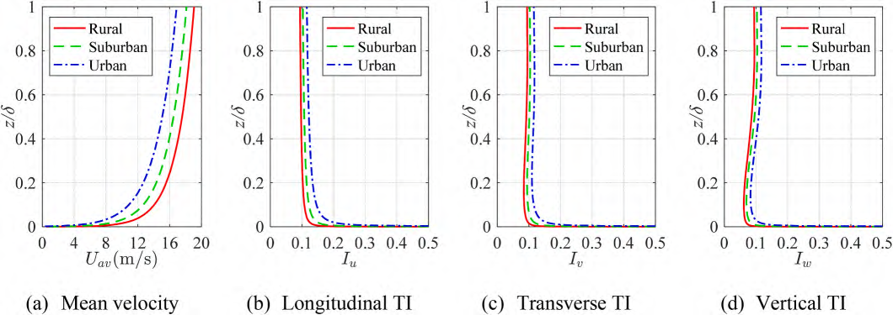

   **图 3** 目标风剖面。

.. math::

   U_{av}(z)=\frac{u_*}{\kappa}\left[\ln\left(\frac{z+z_0}{z_0}\right)+34.5\frac{f_cz}{u_*}\right] \qquad (15)

.. math::

   I_u(z)=\frac{\sigma_u}{U_{av}}=\frac{u_*}{U_{av}}\cdot\frac{7.5\eta[0.538+0.09\ln(z/z_0)^p]}{1+0.156\ln[u_*/(f_cz_0)]} \qquad (16)

.. math::

   I_v(z)=\frac{\sigma_v}{\sigma_u}\cdot I_u=\left[1-0.22\cos^4\left(\frac\pi2\cdot\frac z\delta\right)\right]\cdot I_u \qquad (17)

.. math::

   I_w(z)=\frac{\sigma_w}{\sigma_u}\cdot I_u=\left[1-0.45\cos^4\left(\frac\pi2\cdot\frac z\delta\right)\right]\cdot I_u \qquad (18)

其中， :math:`U_{av}` 为平均风速（m/s）， :math:`z_0` 为空气动力粗糙度长度， :math:`u_*=u_{10}/[2.5\ln(10/z_0)]` 为摩擦速度（m/s）， :math:`\kappa=0.4` 为 von Kármán 常数， :math:`f_c=2\Omega\sin\varphi` 为 Coriolis 参数； :math:`\Omega=72.9\times10^{-6}` 为地球自转角速度， :math:`\varphi=22.52^\circ` 为纬度。 :math:`\eta=1-6f_cz/u_*`， :math:`p=\eta^{16}`； :math:`\delta` 为边界层高度； :math:`I_u`、 :math:`I_v`、 :math:`I_w` 分别为 x、y、z 方向的湍流强度。 :math:`\sigma_u`、 :math:`\sigma_v` 和 :math:`\sigma_w` 分别为三个方向脉动速度的均方根值。

SVF 方法由 CDRFG ITG 方法发展而来，后者在满足式（19）的各向异性 von Kármán 谱方面具有较好的稳健性（ESDU，1985），因此本文也将该谱模型作为 SVF 方法生成加速度的目标。此外，von Kármán 谱已被证明更适合描述真实 ABL 流动的能量分布（Huang 等，2010）。

.. math::

   \begin{cases}S_u(f)=\dfrac{4\sigma_u^2L_u/U_{av}}{(1+70.8n_u^2)^{5/6}},\\S_i(f)=\dfrac{(4\sigma_i^2L_i/U_{av})(1+755.2n_i^2)}{(1+283.2n_i^2)^{11/6}},\end{cases} \qquad (19)

其中，下标 u 表示纵向，i=v、w 分别表示横向和竖向。 :math:`n_i=fL_i/U_{av}` 为各方向的无量纲频率， :math:`L_i` 为相应方向的湍流积分长度尺度，f 为频率。

3.3 简化增强冠层阻力模型
~~~~~~~~~~~~~~~~~~~~~~~~

Li 等（2020）提出的增强冠层阻力（ECD）模型可以有效模拟粗糙地表。该方法需要利用多目标遗传算法逐个算例优化阻力系数，对于三维 LES 而言较为复杂。前期研究表明，只要总体分布及作用高度合理，作用区内阻力系数剖面形状的细微变化对结果影响不大。因此，本文采用折线形式简化 ECD 模型，称为简化增强冠层阻力（SECD）模型。原 ECD 模型的阻力系数分布见图 4，简化模型见图 5，其表达式为：

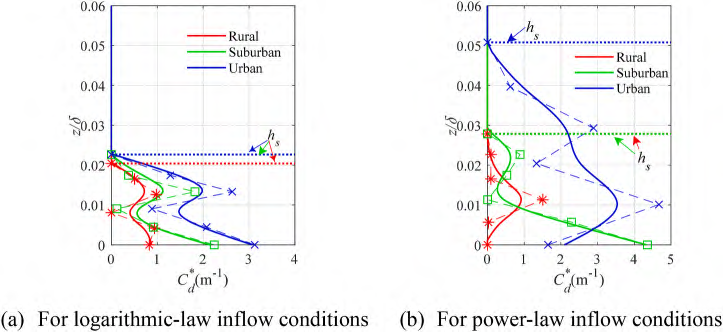

   **图 4** ECD 模型的阻力系数分布（Li 等，2020）。

.. math::

   C_d^{LES}=\begin{cases}C_d^*,&0\leq z\leq h_t,\\C_d^*\dfrac{h_s-z}{h_s-h_t},&h_t<z\leq h_s,\end{cases} \qquad (20)

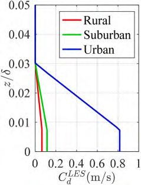

   **图 5** SECD 模型简化阻力系数的分布。

其中， :math:`C_d^*` 由试算确定，乡村、郊区和城市地表分别取 0.07、0.11 和 0.82 m⁻¹。依据前期研究所得平均值，作用高度取 :math:`h_s=0.03\delta`，截断高度取 :math:`h_t=0.0075\delta`。SECD 模型仅向纵向动量方程加入阻力源项：

.. math::

   S_u^{LES}=-\rho C_d^{LES}\cdot|U|\cdot U_{av} \qquad (21)

其中， :math:`|U|` 为入流平均风速的大小， :math:`U_{av}` 为纵向平均风速。

译注：图 5 的原图横轴把阻力系数单位标为 m/s，与本节给出的 m⁻¹ 不一致，保留原图。第 3.4 节又将施加 SECD 的范围写为 :math:`z\leq0.00075\delta`，第 4.4 节称其作用高度为 :math:`0.0075\delta`，均与本节 :math:`h_s=0.03\delta` 不同。三个位置的原数值均保留，不能据此确定代码中实际使用的高度。

3.4 计算域与数值设置
~~~~~~~~~~~~~~~~~~~~

基于三类粗糙地表湍流 ABL 的 LES 结果，详细比较 SVF 与 ITG 方法。由于两种方法作用方式不同，采用两组具有不同入流边界条件的计算模型：ITG 算例施加合成脉动速度边界条件，SVF 算例采用目标平均风速剖面；其余边界条件相同，标于图 6（a）、（b）。顶部采用对称边界，两侧采用周期边界，下游设置出口边界，地面为无滑移壁面。计算域尺寸为 :math:`10\delta\times3\delta\times3\delta`，模型边界层高度 :math:`\delta=1.2\,\mathrm m`，长度缩尺比约为 1:550。内部数据监测位置距入口为计算域长度的三分之一（Franke 等，2007），即 :math:`x=4\,\mathrm m`。

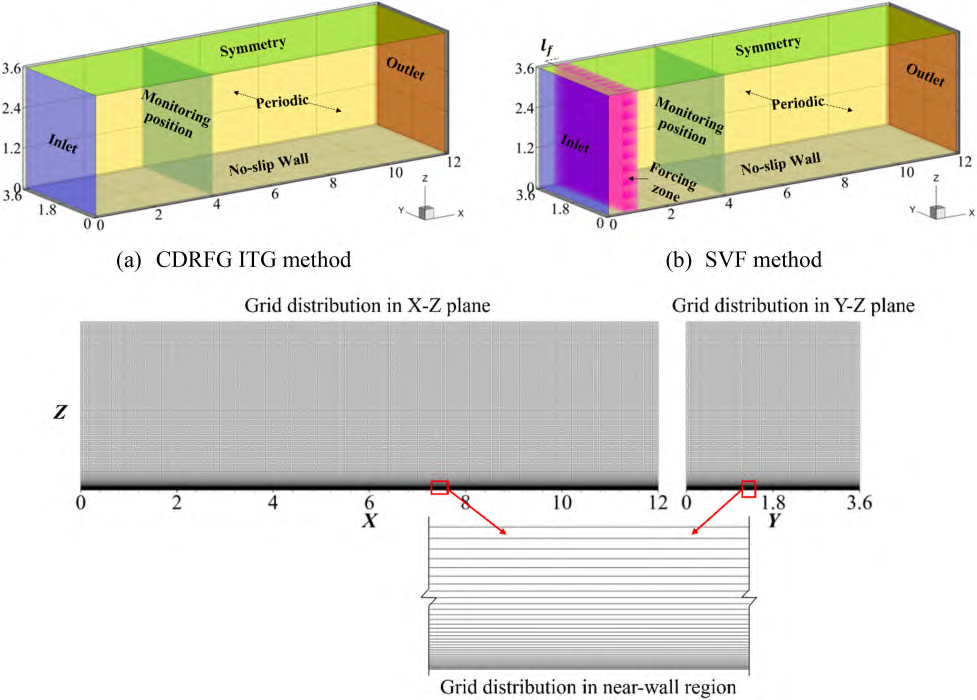

   **图 6** 计算模型与网格方案。

鉴于 Aboshosha 等（2015）已对 ITG 方法进行网格无关性研究，本文只对 SVF 方法采用两种网格方案进行检验。纵向与横向网格均匀分布，竖向网格按指数增长。近壁面第一层网格满足 :math:`z^+=\rho u_*\Delta z_{wall}/\mu<1`。网格方案列于表 2；图 6（c）展示 MG 方案纵向和横向的网格分布。

.. list-table:: 表 2 网格无关性分析的网格方案
   :header-rows: 1

   * - 方案
     - :math:`\Delta x` (m)
     - :math:`N_x`
     - :math:`\Delta y` (m)
     - :math:`N_y`
     - :math:`\Delta z_{wall}`
     - :math:`N_z`
     - 增长率
     - 网格总量（百万）
   * - MG
     - 0.05
     - 240
     - 0.05
     - 72
     - 0.0001
     - 105
     - 1.13
     - 1.81
   * - FG
     - 0.04
     - 300
     - 0.04
     - 90
     - 0.0001
     - 150
     - 1.08
     - 4.05

所有模拟均采用 ANSYS Fluent，体积力和冠层阻力通过用户自定义函数（UDF）实现。SECD 源项加入近地面 :math:`z\leq0.00075\delta` 网格的纵向动量方程，以模拟水平匀质粗糙地表；SVF 体积力则加入其余网格的纵向动量方程；横向与竖向体积力施加于作用区内全部网格。求解器采用瞬态、双精度、基于压力的算法，时间离散采用有界二阶隐式格式，压力速度耦合采用 SIMPLEC 算法；压力采用二阶格式，动量采用有界中心差分。MG 和 FG 网格的时间步长分别为 0.001 s 和 0.0005 s，两种网格均满足 Courant–Friedrichs–Lewy 条件 :math:`\mathrm{CFL}=u\Delta t/\Delta x<1`。总模拟时长为 10 s，取 5–10 s 的结果进行统计分析。

译注：上段 FG 时间步长按正文保留为 0.0005 s；表 5 的 SVF-G 行却列为 0.001 s。这是源内参数冲突，不据译文任选其一作为复现实测设置。

此外，SVF 方法合成体积力与 ITG 方法合成入口脉动速度使用相同参数：最大频率设为 500 Hz，谱分段数 M=500，每段随机频率数量 N=10，最小频率取 :math:`f_{min}=f_{max}/(2M)`。

4 合成体力方法的参数研究
------------------------

如图 2 所示，合成体积力持续作用于体力作用区内。作用区的横向和竖向尺寸与计算域相同，纵向长度 :math:`l_f` 对湍流强度有重要影响，需要仔细确定。本节首先根据城市地表湍流 ABL 流场的 LES 结果，通过试算确定作用区长度 :math:`l_f`；随后分析该长度对目标湍流性质的独立性。第三部分分析 SVF 方法对网格分辨率、时间步长和初始随机数的独立性，最后验证提出的 SECD 模型。

4.1 SVF 方法的体力作用区长度
~~~~~~~~~~~~~~~~~~~~~~~~~~~~

针对城市地表湍流 ABL 流动，设置五个具有不同 :math:`l_f` 的 LES 算例，参数列于表 3（L1–L5）。体力作用区起点距入口边界 0.5 m。为定量评估生成的 ABL 流动特征与目标的吻合程度，依据式（22）计算平均风速与湍流强度的平均绝对相对误差（MARE）。

.. list-table:: 表 3 确定 SVF 体力作用区长度的算例
   :header-rows: 1

   * - 算例
     - 地表及参数
     - :math:`l_f`
     - 网格
     - :math:`\Delta t` (s)
     - 初始随机数
   * - L1
     - 城市；z₀=1.0 m；C*d=0.82 m⁻¹
     - 0.4δ
     - MG
     - 1×10⁻³
     - INI1
   * - L2
     - 城市；z₀=1.0 m；C*d=0.82 m⁻¹
     - 0.8δ
     - MG
     - 1×10⁻³
     - INI1
   * - L3
     - 城市；z₀=1.0 m；C*d=0.82 m⁻¹
     - 1.0δ
     - MG
     - 1×10⁻³
     - INI1
   * - L4
     - 城市；z₀=1.0 m；C*d=0.82 m⁻¹
     - 1.3δ
     - MG
     - 1×10⁻³
     - INI1
   * - L5
     - 城市；z₀=1.0 m；C*d=0.82 m⁻¹
     - 1.7δ
     - MG
     - 1×10⁻³
     - INI1

.. math::

   \begin{cases}e_{vel}=\overline{\left|\dfrac{U_{SVF}-U_{tar}}{U_{tar}}\right|}^{z},\\e_{turb,i}=\overline{\left|\dfrac{I_{SVF,i}-I_{tar,i}}{I_{tar,i}}\right|}^{z},\end{cases} \qquad (22)

其中，下标 vel 和 turb 分别表示平均风速与湍流强度； :math:`i=u,v,w` 分别表示纵向、横向和竖向的湍流强度误差。上横线及上标 z 表示沿竖向进行平均。

根据 L1–L5 算例的 LES 结果，图 7 比较了下游监测位置的平均风速。图 7（a）显示，各算例平均风速剖面与目标均较吻合。此外，虽然 L5 的 MARE 大于其他算例，但图 7（b）中的误差均小于 17%，说明生成的平均风速与目标具有较好的吻合程度。近地面平均风速的竖向分布反映粗糙表面对上方 ABL 流动的影响，因此，这些平均风速结果说明 SECD 模型可以生成粗糙地表上的近地面风场。另外，上部区域平均风速剖面接近目标，表明作用区长度对平均风特征影响较小。这些结果也验证了 SVF 方法向平均风场输入脉动分量，而平均流主要受入口指定的平均风速控制。

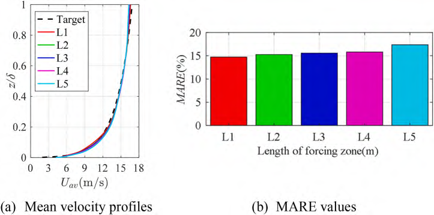

   **图 7** 不同 SVF 算例的平均风速比较。L1、L2、L3、L4、L5 的作用区长度依原图题分别为 0.4δ、0.8δ、1.3δ、1.3δ、1.7δ。L3 与表 3 的差异见正文说明。

图 8 比较五个算例三个方向的湍流强度。纵向与横向湍流强度剖面的形状与目标一致，但图 8（c）的竖向湍流强度在壁面为零，与经验值不符。这是使用无滑移壁面边界条件的结果。无滑移壁面处各速度分量为零，即 u=v=w=0；本文邻壁第一层计算网格的高度满足 :math:`y^+\leq1`，使这些网格中的流动受流体黏性主导。因此，这部分流动由 ANSYS Fluent 的近壁处理模拟，平行于壁面的剪应力以及速度分量 u、v 不为零（Versteeg 和 Malalasekera，2007；Wang 和 Chen，2020），从而有 :math:`I_u\ne0` 和 :math:`I_v\ne0`。但相同网格中的竖向应力与速度为零，因此 :math:`I_w=0`。此外，L5 的纵向湍流强度大于目标，L4 在上部区域则几乎与目标相同。所有算例近地面纵向湍流强度都高于目标，这是因为 SECD 模型降低了该区域的平均风速，从而增大了湍流强度。三个方向的湍流强度均随 :math:`l_f` 增大而增大； :math:`l_f=0.4\delta` 的 L1 最小， :math:`l_f=1.7\delta` 的 L5 最大。L4 的纵向湍流强度 MARE 最小，约为 20%；由于近地面区域的差异，所有算例的竖向 MARE 均超过 30%。虽然 L5 的横向湍流强度 MARE 最小，但 L2–L4 的相应误差均低于 20%，而 L5 的纵向和竖向 MARE 均大于 :math:`l_f=1.3\delta` 的 L4。

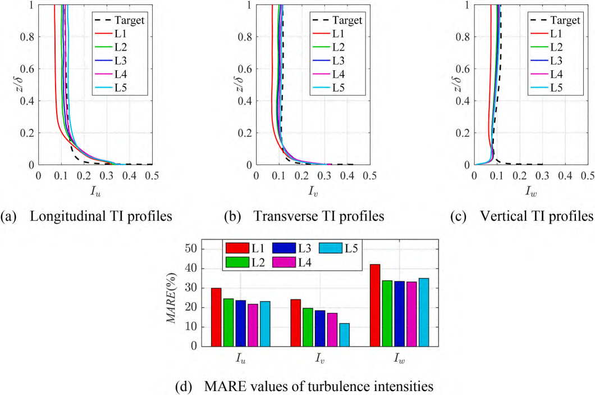

   **图 8** 不同 SVF 算例的湍流强度比较。L1、L2、L3、L4、L5 的作用区长度依原图题分别为 0.4δ、0.8δ、1.3δ、1.3δ、1.7δ。L3 与表 3 的差异见正文说明。

进一步地，图 9 给出 L1–L5 算例的纵向、横向和竖向风速谱，以评估湍流能量分布。在监测截面的横向中心线上选取两个高度采样： :math:`z/\delta=0.05` 代表近地面区域， :math:`z/\delta=0.5` 代表湍流核心区域。比较 :math:`z/\delta=0.05` 处三个方向的风速谱可知， :math:`l_f` 对近地面风速谱影响较小，该区域主要受 SECD 模型对平均风速的阻力效应支配。此外，所有算例的纵向谱均高于目标，是因为该区域湍流强度较大；根据 :math:`\sigma^2=\int_{-\infty}^{\infty}S(f)\,\mathrm df`，这会直接影响湍流能量。竖向与横向风速谱则与目标较吻合。与此同时， :math:`z/\delta=0.5` 处的结果显示，湍流能量随 :math:`l_f` 增大而增加。除 L1 存在明显偏差外，其他算例在 2–30 Hz 范围内与目标谱吻合较好，表明 SVF 方法能够直接影响大尺度涡所包含的湍流能量。可以看到，高频范围的能量下降很快，这与已有研究一致（Lamberti 等，2018；Bervida 等，2020；Melaku 和 Bitsuamlak，2021；L. Chen 等，2022）。这一现象主要归因于有限的网格分辨率：在采用合成入流湍流生成方法的 LES 中，小于计算网格的涡被滤除，其运动由 SGS 模型表示（Potsis 和 Stathopoulos，2022）。此外，本文求解器的截断误差为二阶精度，数值误差也影响已解析尺度运动的保持。通过加密网格并采用高阶离散格式，可以改善这一问题。但作者认为，截断频率远高于建筑物和结构的自振频率，因此对 SVF 方法应用的限制较小。

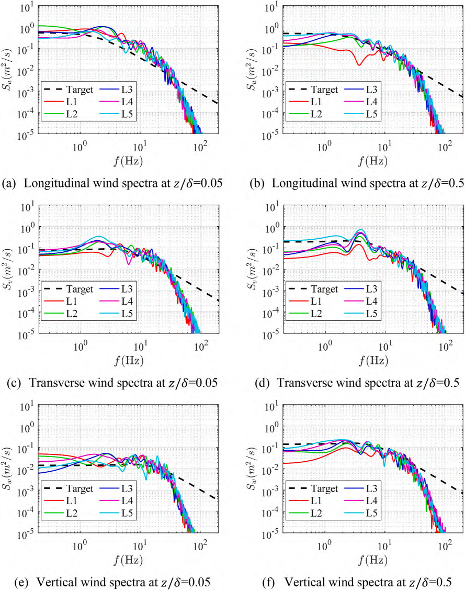

   **图 9** 不同 SVF 算例湍流 ABL 三个方向的风速谱比较。L1、L2、L3、L4、L5 的作用区长度依原图题分别为 0.4δ、0.8δ、1.3δ、1.3δ、1.7δ。L3 与表 3 的差异见正文说明。

图题校核：图 7、8、9 的原文图题将 L3 和 L4 都写成 :math:`l_f=1.3\delta`，而表 3 的 L3 明确为 :math:`1.0\delta`。这里保留原图题和原表，不据图题改写算例设置。正文“全部小于 17%”也按原文保留；图 7 的 L5 柱值贴近或略高于该界限，不从图估读出更精确的数值。

综上，在 SECD 模型作用下，城市地表湍流 ABL 的近地面平均风速与目标吻合较好。当 :math:`l_f=1.3\delta` 时，SVF 方法在下游监测位置生成的纵向、横向和竖向湍流强度误差能够同时控制在可接受范围内。三个方向的风速谱也在特定频率范围内吻合各向异性 von Kármán 谱，这一范围是钝体计算风工程（CWE）所关注的。因此，可以认为 SVF 与 SECD 模型结合，能够有效生成城市地表上的湍流 ABL 流动。

4.2 对目标湍流性质的敏感性
~~~~~~~~~~~~~~~~~~~~~~~~~~

采用四种作用区长度，以 SVF 方法模拟乡村与郊区地表上的湍流 ABL 流动，验证作用区长度对目标湍流统计量的独立性。LES 算例参数列于表 4。

.. list-table:: 表 4 SVF 方法对湍流性质的敏感性分析算例
   :header-rows: 1

   * - 算例
     - 地表
     - :math:`z_0` (m)
     - :math:`C_d^*` (m⁻¹)
     - :math:`l_f`
   * - R-L1
     - 乡村
     - 0.1
     - 0.07
     - 0.4δ
   * - R-L2
     - 乡村
     - 0.1
     - 0.07
     - 0.8δ
   * - R-L4
     - 乡村
     - 0.1
     - 0.07
     - 1.3δ
   * - R-L5
     - 乡村
     - 0.1
     - 0.07
     - 1.7δ
   * - S-L1
     - 郊区
     - 0.3
     - 0.11
     - 0.4δ
   * - S-L2
     - 郊区
     - 0.3
     - 0.11
     - 0.8δ
   * - S-L4
     - 郊区
     - 0.3
     - 0.11
     - 1.3δ
   * - S-L5
     - 郊区
     - 0.3
     - 0.11
     - 1.7δ

表注：原表左右并列的乡村/郊区各4行展开为8行；未增删算例。

图 10 和图 11 分别比较乡村与郊区地表监测位置的平均风速和湍流强度。所有算例的平均风速均接近目标，MARE 小于 10%，验证了作用区长度对平均风场的影响可以忽略。

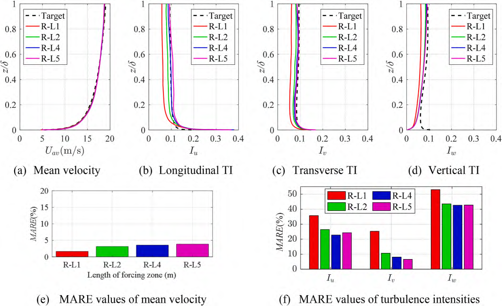

   **图 10** 不同作用区长度下乡村地表算例的平均风速和湍流强度比较。L1、L2、L4、L5 分别对应 0.4δ、0.8δ、1.3δ、1.7δ。

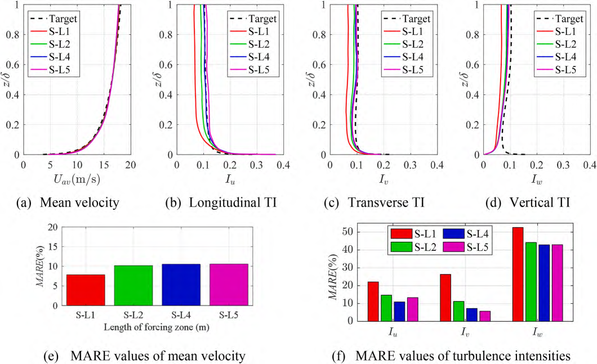

   **图 11** 不同作用区长度下郊区地表算例的平均风速和湍流强度比较。L1、L2、L4、L5 分别对应 0.4δ、0.8δ、1.3δ、1.7δ。

译注：上一段“MARE 小于 10%”为原文表述；图 11 的郊区部分柱值略高于 10%，与该总括性表述不完全一致，故不将 10% 作为所有郊区算例均满足的严格上界。

此外，两类地表的湍流强度剖面与城市地表的结果类似，即湍流强度随 :math:`l_f` 增大而增加。对于 :math:`l_f=1.3\delta` 的 R-L4 与 S-L4 算例，纵向和横向湍流强度的 MARE 最小，也与城市地表的结果一致。

为进一步评估 :math:`l_f` 对不同目标风速谱的影响，图 12 比较乡村和郊区地表在 :math:`z/\delta=0.5` 处的纵向、横向及竖向风速谱。可以明显看出，湍流能量随 :math:`l_f` 增大而增加，与城市地表算例的结果相同。

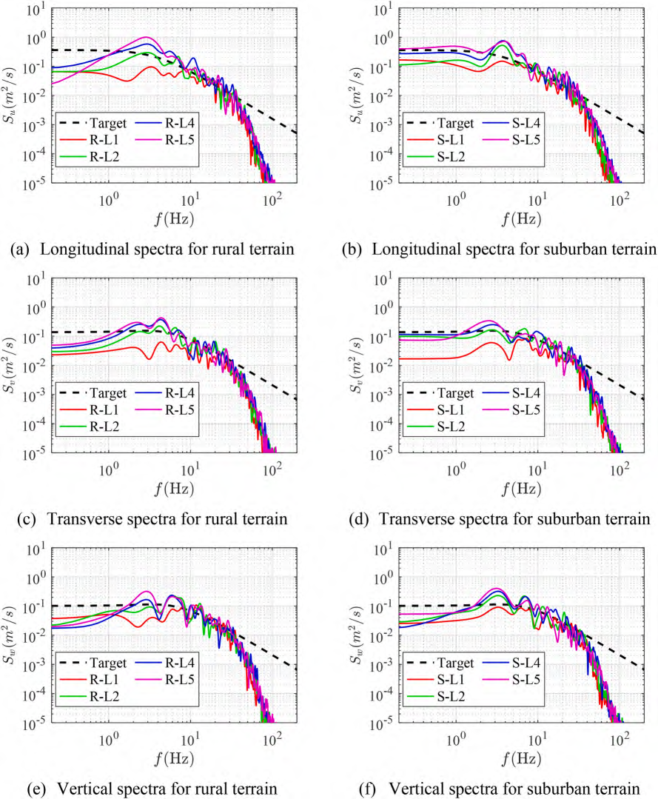

   **图 12** 不同作用区长度下 z/δ=0.5 处的风速谱比较。L1、L2、L4、L5 分别对应 0.4δ、0.8δ、1.3δ、1.7δ。

综上，虽然 :math:`l_f=1.3\delta` 是通过试算确定的，但对于 SVF 方法生成乡村、郊区和城市地表上的湍流 ABL 流场，该取值具有通用性，能够在指定位置得到误差可接受的平均风速以及纵向、横向和竖向湍流强度。

译注：原文这里的“通用性”对应本文检验的三类地表和监测位置，不是对任意目标谱、网格、缩尺比或复杂地形的普遍证明。

4.3 独立性分析
~~~~~~~~~~~~~~

根据第 4.1 节结果，即 :math:`l_f=1.3\delta`，本节分析 SVF 方法对网格分辨率、时间步长和初始随机数的独立性。全部 LES 算例及参数列于表 5，其中 U-L4 对应第 4.1 节的 L4。

.. list-table:: 表 5 SVF 方法独立性分析算例参数（保留原表冲突）
   :header-rows: 1

   * - 算例
     - 地表及参数
     - :math:`l_f`
     - 网格
     - :math:`\Delta t` (s)
     - 初始随机数
   * - U-L4
     - 城市；z₀=1.0 m；C*d=0.82 m⁻¹
     - 0.4δ
     - MG
     - 1×10⁻³
     - INI1
   * - SVF-G
     - 城市；z₀=1.0 m；C*d=0.82 m⁻¹
     - 1.3δ
     - FG
     - 1×10⁻³
     - INI1
   * - SVG-T
     - 城市；z₀=1.0 m；C*d=0.82 m⁻¹
     - 1.3δ
     - MG
     - 5×10⁻⁴
     - INI1
   * - SVG-N
     - 城市；z₀=1.0 m；C*d=0.82 m⁻¹
     - 1.3δ
     - MG
     - 1×10⁻³
     - INI2

表格校核：表 5 的 U-L4 作用区长度原印为 :math:`0.4\delta`，与本节文字及表 3 的 L4= :math:`1.3\delta` 冲突；SVF-G 的时间步长原印为 0.001 s，与第 3.4 节 FG=0.0005 s 不同。“SVG-T”和“SVG-N”也保留原表拼写。不得把这些值默改成推测的正确设置。

4.3.1 网格独立性分析
^^^^^^^^^^^^^^^^^^^^

本节用更细网格的 SVF 模型模拟城市地表湍流 ABL 流动，以检验 SVF 方法对网格分辨率的独立性。如图 13（a）所示，MG 与 FG 两种网格的平均风速剖面几乎相同。纵向湍流强度剖面在两种网格下也吻合较好，FG 算例的横向和竖向剖面则有所改善。统计剖面的良好一致性表明，所提出的 SVF 方法具有网格独立性。

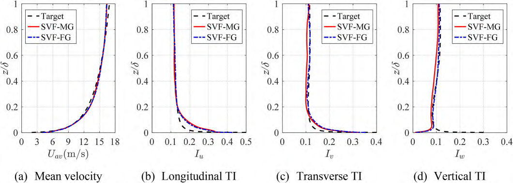

   **图 13** SVF 方法的网格独立性分析。SVF-MG 对应表 5 的 U-L4，SVF-FG 对应 SVF-G。

4.3.2 时间步长独立性分析
^^^^^^^^^^^^^^^^^^^^^^^^

SVF 方法基于瞬时风速的时间导数提出，因此有必要检验其对模拟时间步长的独立性。比较时间步长分别为 :math:`\Delta t=1\times10^{-3}\,\mathrm s` 和 :math:`5\times10^{-4}\,\mathrm s` 的两个算例，流动统计量见图 14。结果显示，两个算例的平均风速和湍流强度剖面均与目标吻合较好，表明 SVF 方法不依赖于计算时间步长。

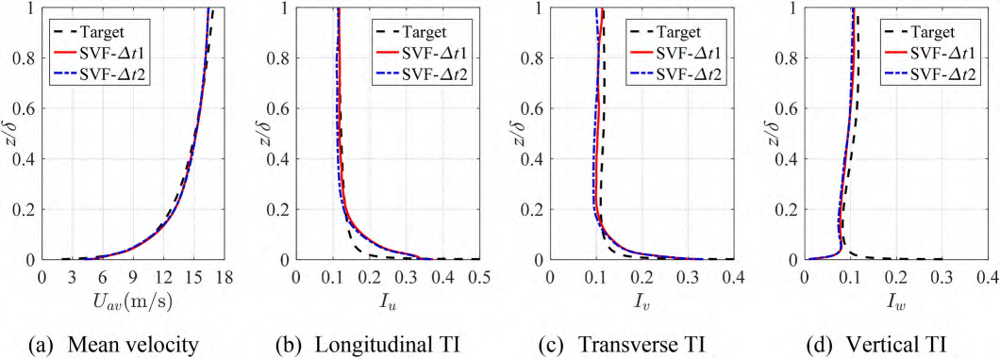

   **图 14** SVF 方法的时间步长独立性分析。SVF-Δt1 对应表 5 的 U-L4，SVF-Δt2 对应 SVG-T。

4.3.3 初始随机场独立性分析
^^^^^^^^^^^^^^^^^^^^^^^^^^

需要注意，合成随机 Fourier 方法生成的脉动速度，其随机性依赖于随机数以及各谱段中的随机频率分布。根据 CDRFG 原理可以推知，只要随机数服从对应的正态分布，生成的湍流就能满足指定目标（Aboshosha 等，2015）。虽然 SVF 方法直接生成时间加速度，它也应独立于初始随机数。基于 MG 网格和两组初始场，图 15 比较生成湍流场的统计剖面。两组平均风速与湍流强度均与目标吻合较好，说明 SVF 方法不依赖于随机数的具体取值，而取决于其分布形式。

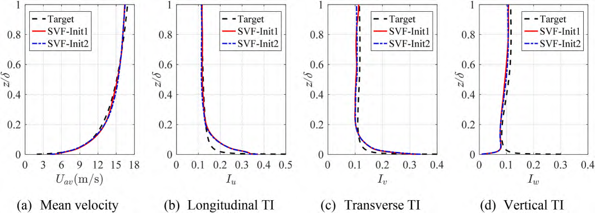

   **图 15** SVF 方法的初始随机场独立性分析。SVF-Init1 对应表 5 的 U-L4，SVF-Init2 对应 SVG-N。

译注：三项“独立性”结论分别建立在本文两种网格、两个时间步长及两个初始随机场的比较之上；不是对任意离散精度或随机场的无条件保证。

4.4 SECD 模型验证
~~~~~~~~~~~~~~~~~

依据前面各节得到的 SVF 作用区长度 :math:`l_f=1.3\delta`，在近地面不采用 SECD 模型，生成乡村、郊区和城市地表的湍流 ABL 流动。将其与采用 SECD 的算例比较，以明确 SECD 模型的作用。

图 16 和图 17 比较平均风速以及三个方向的湍流强度。所有算例的平均风速剖面均明显改善，尤其是近地面区域。乡村、郊区和城市地表的总体 MARE 分别从 6.3%、14.66% 和 35.24% 降至 3.57%、10.53% 和 15.8%。这些结果验证了 SECD 模型改善近地面平均风速水平均匀性的有效性。

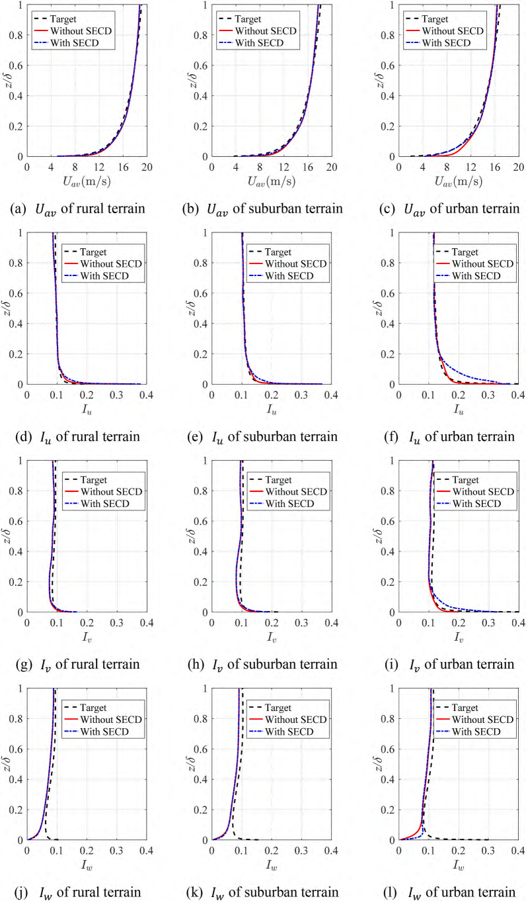

   **图 16** 不同粗糙地表湍流 ABL 的风统计剖面。

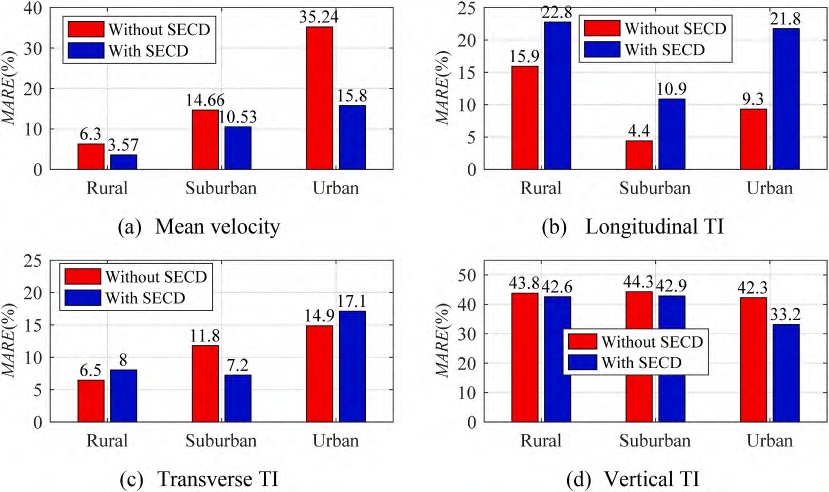

   **图 17** 不同粗糙地表湍流 ABL 的风统计量 MARE。

虽然 SECD 模型改善了平均风速，但近地面纵向湍流强度同时增大，而且随着阻力系数增加而增强。这是 SECD 模型与 SVF 方法共同作用不可避免的结果。尽管 SECD 的作用高度仅为 :math:`0.0075\delta`，其图 16（a）至（c）显示其影响高度延伸到距地面约 :math:`0.2\delta`。一方面，阻力降低了平均风速；另一方面，SVF 体积力使脉动速度的均方根值增加，因此湍流强度上升。随着粗糙度增大，阻力和脉动速度均方根值均增大，导致更高的湍流强度。由于冠层阻力只加入纵向动量方程，对横向和竖向湍流强度的影响很小。

综上，在采用 SECD 模型的湍流 ABL 中，近地面平均风速显著改善，三个方向的湍流强度误差也可以接受。因此，SECD 模型可用于模拟粗糙地表上的湍流 ABL 流动。

译注：本节 :math:`0.0075\delta` 的作用高度沿用原文，与第 3.3 节的截断高度相同，而不等于该节所列完整作用高度 :math:`h_s=0.03\delta`。图 17 同时显示，纵向湍流强度误差在加入 SECD 后增大，故“改善平均风速”不应被改写为“所有湍流统计量都改善”。

5 ITG 与 SVF 方法的比较研究
---------------------------

本节详细分析 CDRFG ITG 与 SVF 方法生成的湍流场瞬时性质和统计性质，分别比较乡村、郊区与城市地表的湍流 ABL 流动结果。采集并分析数据监测位置在 5–10 s 期间的模拟速度时程。

5.1 压力等值图与流动结构
~~~~~~~~~~~~~~~~~~~~~~~~

为展示湍流 ABL 场中的压力脉动，图 18 给出乡村、郊区与城市地表湍流 ABL 流动 XZ 截面的 :math:`C'_p` 等值图。 :math:`C'_p` 按式（23）定义，为 5–10 s 期间动压系数的标准差（STD）。ITG 算例的图（a）、（c）、（e）显示，明显的压力脉动沿流向增大，主要由入口质量通量不平衡，以及来流速度与 NS 方程不一致导致，可能给建筑物带来不合理的风荷载（Zhang 等，2022）。然而，SVF 算例在体力作用区外的压力脉动相对较小，表明其湍流 ABL 流动满足无散条件和动量方程（Kim 等，2013；Patruno 和 de Miranda，2020；Potsis 和 Stathopoulos，2022；Zhang 等，2022）。因此，体力作用区可以设置在距钝体较近的位置，而不产生异常的压力分布。

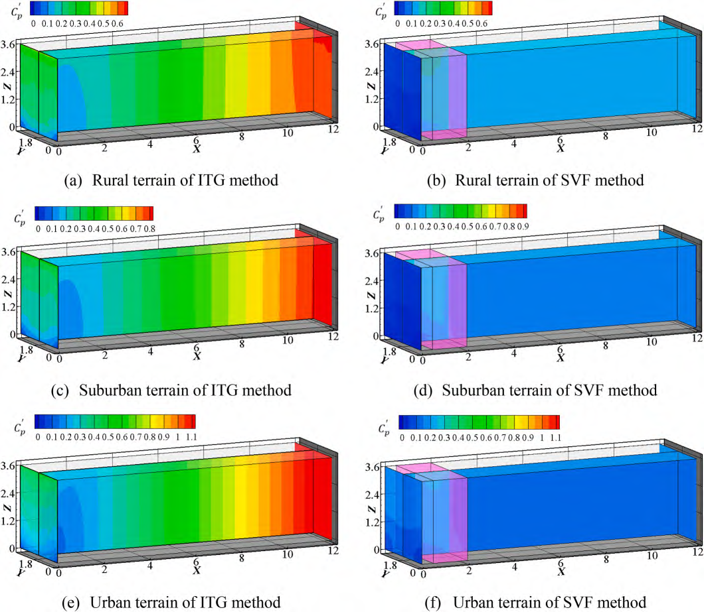

   **图 18** 不同地表湍流 ABL 的压力系数标准差等值图。

.. math::

   C'_p=\sqrt{\frac1N\sum_{\tau=t_0}^{\tau=t}[p(\tau)-\bar p]^2}\bigg/\left(\frac12\rho U_{ref}^2\right) \qquad (23)

其中， :math:`p(\tau)` 为时刻 :math:`\tau` 的瞬时动压， :math:`\bar p` 为时间区间 :math:`[t_0,t]` 内的平均压力；N 为统计时间步数， :math:`\rho` 为空气密度， :math:`U_{ref}` 为参考高度 :math:`z=\delta` 处的入流平均风速。

图 19 给出第二不变量 :math:`Q=\tfrac12[\|\Omega\|^2+\|S\|^2]` 的等值面，以 10 s 时的速度大小着色，用于展示湍流 ABL 的涡结构。 :math:`\|\Omega\|^2` 为湍流场的旋转率， :math:`\|S\|^2` 为应变率。Q 判据的正值等值面表示湍流旋转强度超过湍流应变（Dubief 和 Delcayre，2000；Castro 和 Paz，2013）。图 19（a）、（c）、（e）清楚显示，ITG 算例中的涡沿纵向受到明显滤除，而 SVF 算例的涡结构更密集，在下游区域保持较好。这说明 SVF 方法能够更准确地再现小尺度涡。此外，涡受到滤除意味着湍流能量衰减，也说明 SVF 方法能够直接生成与 NS 方程一致、沿流向具有较好自保持能力的湍流。LES 模型的一项限制，是空间滤波效应导致其依赖网格分辨率；粗网格会显著滤除涡结构，影响模拟精度。因此，这一现象说明，与 ITG 方法相比，SVF 方法对网格的依赖较小，有助于提高 LES 模拟建筑物周围湍流 ABL 场的效率。

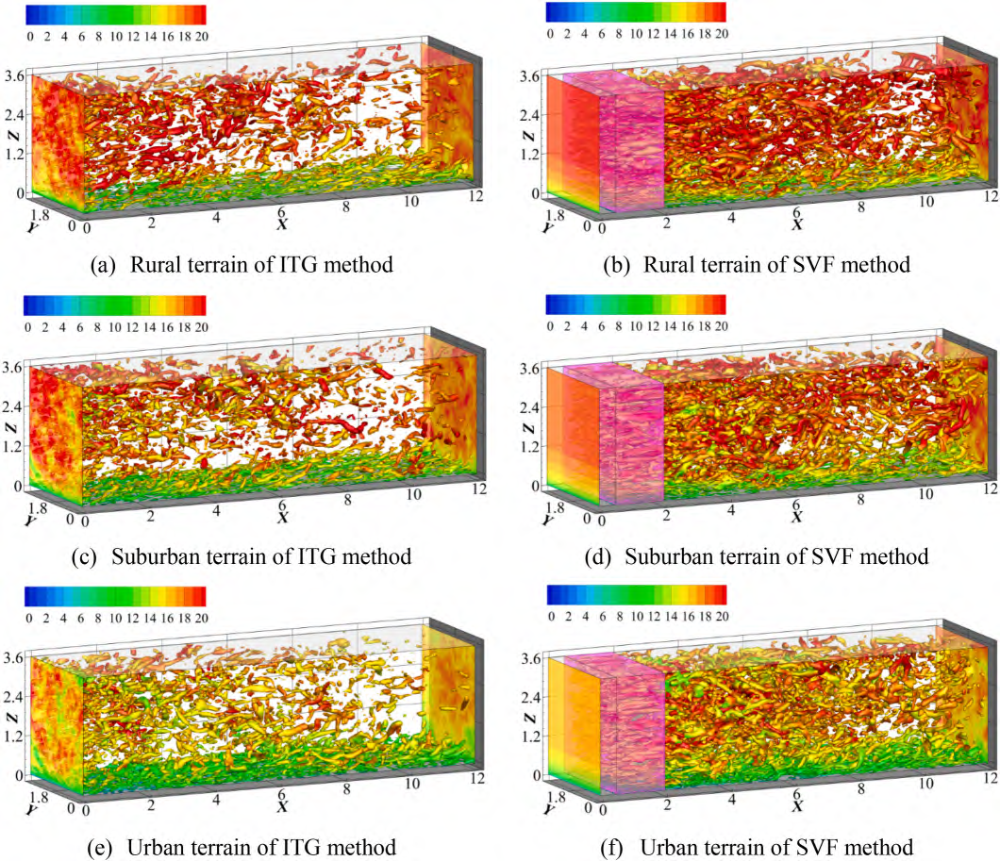

   **图 19** 不同地表湍流 ABL 的涡结构比较，Q=200；涡面按 10 s 时瞬时风速（m/s）着色。

译注：原文 Q 表达式明确印为两项相加，与紧接的“旋转强度超过应变”解释不相容。这里保留该加号及原文解释，不默改成常见的相减形式。图中的 Q=200 也为原图标注，不能仅据本文确定实际后处理使用的公式。本节关于作用区可接近建筑物、提高建筑风场模拟效率的文字属于作者提出的应用前景，本文未展示建筑模型的风压验证算例。

5.2 统计特征剖面
~~~~~~~~~~~~~~~~

根据 ITG 与 SVF 算例的 LES 结果，图 20 比较监测位置的平均风速。在 SECD 模型作用下，两者均与目标吻合较好。虽然城市地表 SVF 算例在上部区域的平均风速略高于 ITG 算例和目标，但 MARE 小于 20%，其余所有算例则小于 15%。结果表明，SECD 模型能够在 LES 中有效再现不同粗糙地表的特征，而且不依赖于湍流 ABL 的生成方法。

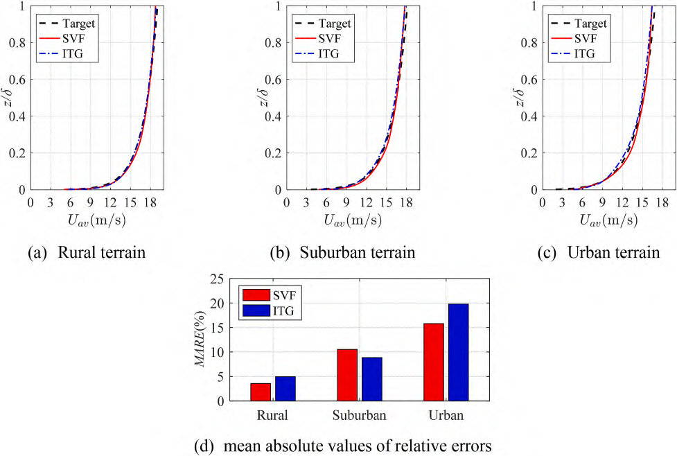

   **图 20** 不同地表湍流 ABL 的平均风速比较。

图 21 给出 ITG 和 SVF 算例监测位置三个方向的湍流强度剖面，图 22 列出相应 MARE。由图 21 可知，各算例近地面的纵向湍流强度均大于目标，且偏差随 :math:`z_0` 增大而增大。这是该区域 SECD 模型的阻力作用所致；城市地表 ITG 算例的影响高度达到 :math:`0.4\delta`，而 SVF 算例的最大影响高度为 :math:`0.2\delta`。这一现象可从两种方法的 NS 方程求解机制解释。ITG 方法的入流速度施加于入口边界，不能直接影响内部 CV 的速度值，也不满足 NS 方程。因此，内部湍流在 SECD 模型作用下会重构，导致湍流强度不同于入流条件。SVF 方法的体积力则作为离散 NS 方程的源项，直接参与方程求解并生成湍流。因此，生成的湍流与离散 NS 方程一致，流动结构不会重构。另外，SECD 模型同样作为 NS 方程的源项，与 SVF 方法的体积力具有更好的相容性。

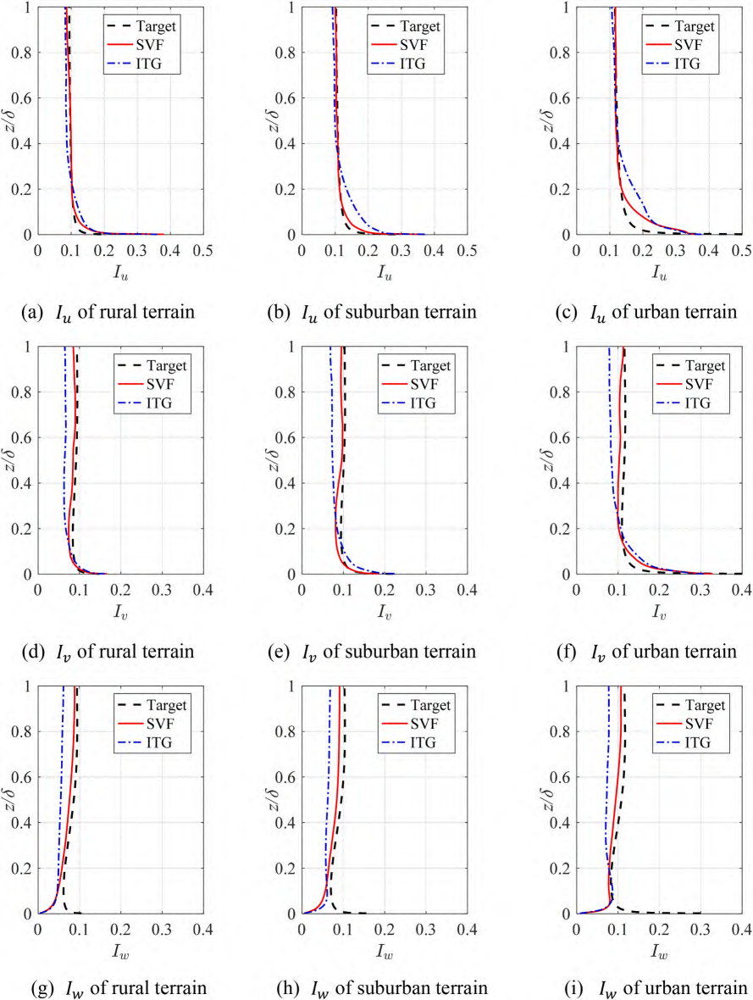

   **图 21** 不同地表湍流 ABL 三个方向的湍流强度剖面比较。

尽管 ITG 算例近地面区域的偏差较大，但各算例在上部区域的纵向湍流强度剖面相似，几乎与目标重合。图 22（a）的 MARE 表明，SVF 算例的误差明显小于 ITG 算例。与 ITG 相比，SVF 算例上部区域的横向和竖向湍流强度也更接近目标。ITG 算例近地面的湍流强度大于目标，这是流场重构的结果。图 22 的相应 MARE 还表明，SVF 算例的纵向与横向湍流强度误差均低于 25%，且小于 ITG 算例。虽然 SVF 算例的竖向湍流强度 MARE 为 30%–42%，仍小于 ITG 算例。

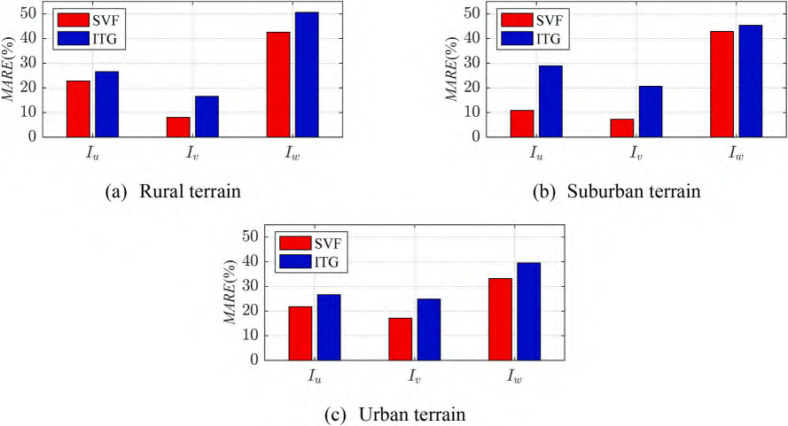

   **图 22** 不同地表湍流 ABL 的湍流强度 MARE 比较。

5.3 脉动速度与风速谱
~~~~~~~~~~~~~~~~~~~~

图 23 给出乡村地表湍流 ABL 在 :math:`z/\delta=0.05` 和 :math:`z/\delta=0.5` 处三个方向的风速谱，其中“Target”表示 von Kármán 谱。在近地面区域，即 :math:`z/\delta=0.05`，SVF 与 ITG 算例的纵向和横向谱均与 von Kármán 谱一致。竖向谱低于目标，因为该区域湍流强度较小，符合风速谱与脉动速度均方根的关系 :math:`\sigma_i^2=\int_0^\infty S_i(f)\,\mathrm df`。在上部区域，即 :math:`z/\delta=0.5`，SVF 算例的纵向、横向和竖向风速谱在 3–30 Hz 范围内与目标吻合较好。然而，ITG 算例的横向和竖向谱与目标存在差异，原因是来流湍流与 NS 方程不一致。虽然上部区域较大的网格尺寸增强了对脉动速度的滤波效应，ITG 算例的截断频率仍小于 SVF 算例。这表明，SVF 方法受网格尺寸的影响小于 ITG 方法，也进一步解释了图 19 中两种方法涡结构形态的差别。

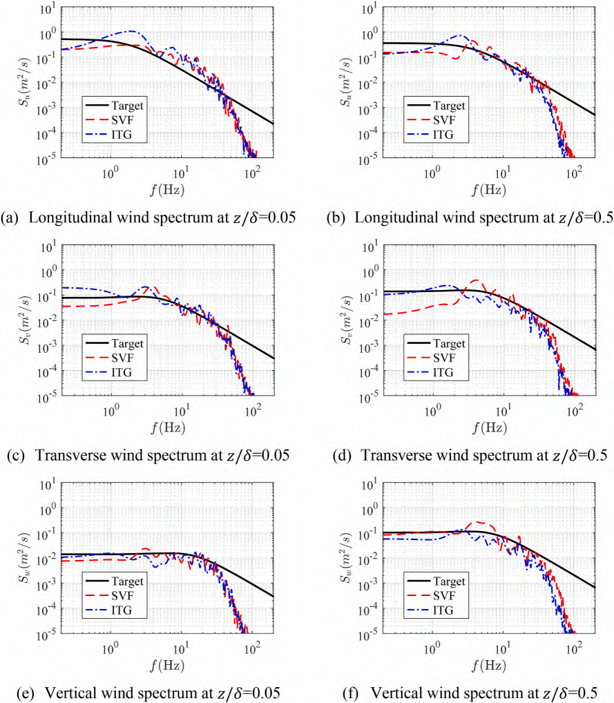

   **图 23** 乡村地表湍流 ABL 的风速谱。

图 24 和图 25 分别比较郊区与城市地表湍流 ABL 三个方向的风速谱。在这两类地表上，ITG 与 SVF 均能生成满足各向异性 von Kármán 谱的湍流 ABL 流动。SVF 方法的时间加速度由 ITG 方法的脉动速度导出，因此两种方法的谱分布相似，只是 ITG 的截断频率较低，其原因与纵向风速谱的分析相同。这些结果验证了 SVF 方法在生成粗糙地表湍流 ABL 流动时对网格的依赖较小，显示出高效模拟大体量建筑周围湍流、准确评估建筑表面脉动风压的潜力。

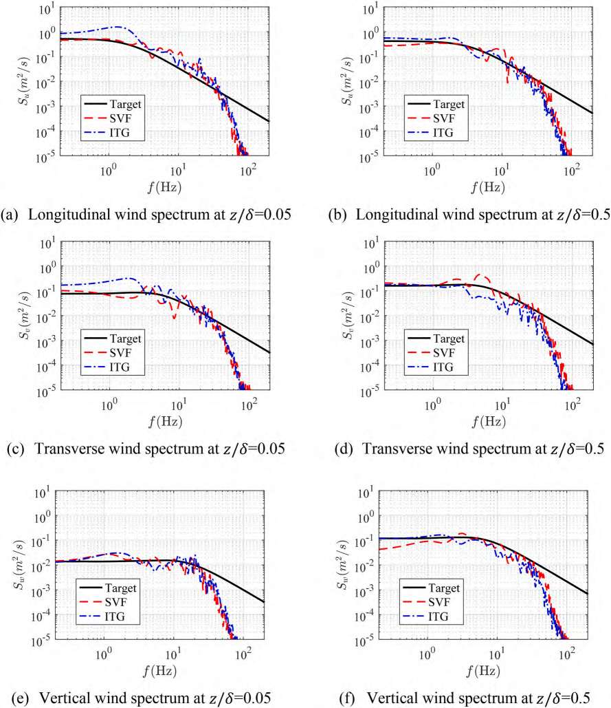

   **图 24** 乡村地表湍流 ABL 的风速谱（原图题如此；正文实际将本图用于郊区，见相邻说明）。

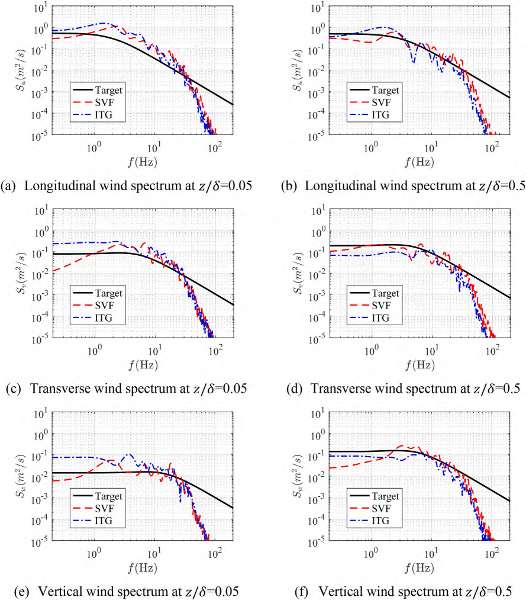

   **图 25** 城市地表湍流 ABL 的风速谱。

图题校核：图 24 的原图题把地表写为 rural（乡村），但正文在此明确将图 24、25 分别用于郊区、城市；图 23 已用于乡村。保留原图题的乡村用词并指出差异，不把其解释为额外的第四类算例。

5.4 积分长度尺度与空间相关性
~~~~~~~~~~~~~~~~~~~~~~~~~~~~

CDRFG ITG 和 SVF 方法均未将满足某个特定湍流积分长度尺度作为控制要求，因此图 26 仅比较三个速度分量沿纵向的湍流积分长度尺度。这些长度尺度依据 Taylor 冻结假设，将积分时间尺度乘以局部时间平均速度求得。图中可见，ITG 算例的 :math:`L_{uu}` 剖面相对较大，而各算例的 :math:`L_{uv}`、 :math:`L_{uw}` 剖面相似、彼此接近。在进一步研究中，值得在 SVF 体积力生成过程考虑湍流积分长度尺度，以改善方法性能。

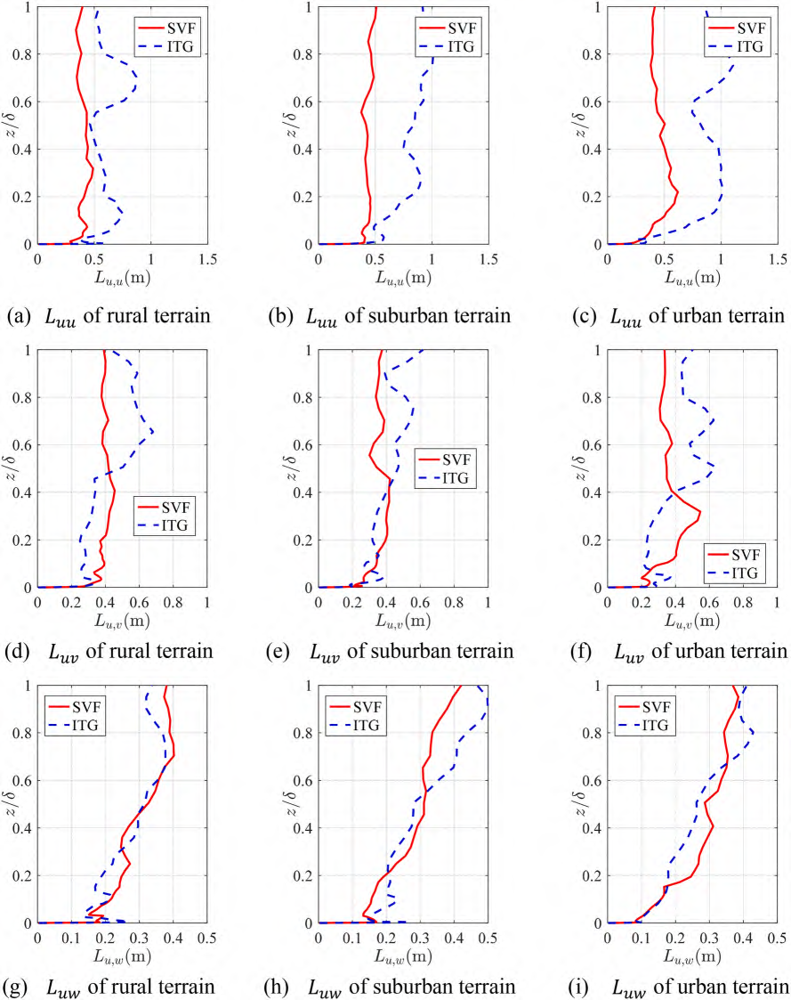

   **图 26** 沿纵向的湍流积分尺度比较。

根据 SVF 和 ITG 结果计算下游监测位置的空间相关系数，并在图 27 中比较，其中“Hemon and Santi”表示式（24）给出的空间相关性（Hémon 和 Santi，2007）。图 27 显示，SVF 和 ITG 算例沿横向的空间相关系数均偏离式（24）。原因在于，两种方法都通过调节式（2）的特征参数 :math:`L_j^m` 近似满足空间相关性。ITG 算例的入流湍流结构经过重构后偏离目标；对于 SVF 算例， :math:`L_j^m` 直接影响体积力，可能造成不理想的湍流空间相关性。为提高所提 SVF 方法的性能，这一问题值得进一步研究。

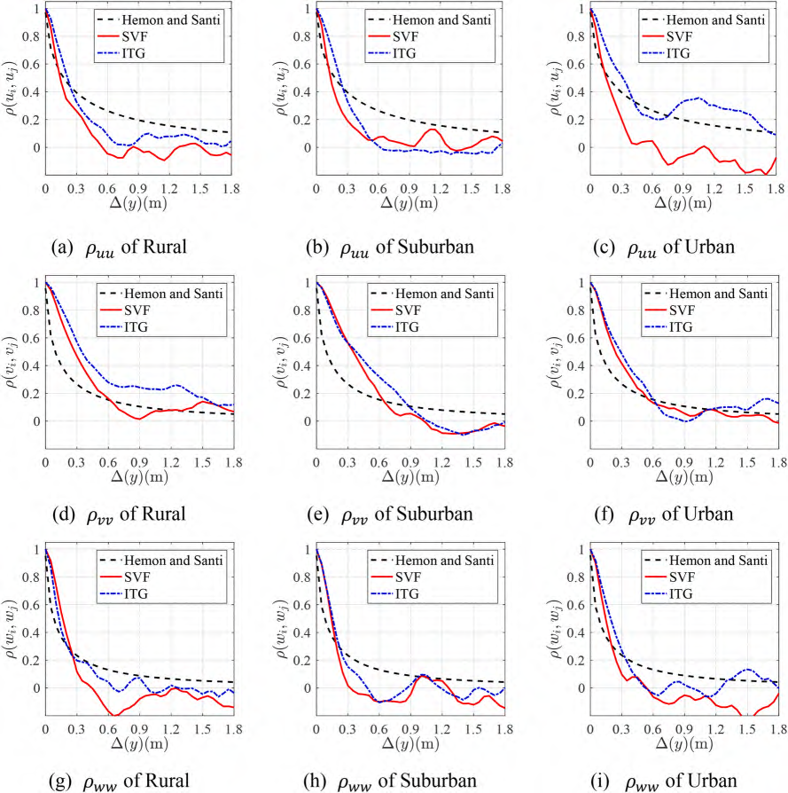

   **图 27** z/δ=0.5 处的空间相关系数比较。

.. math::

   Sc_{ij}=\sum_l\sqrt{S_{u,y_i}^{t}(f_l)S_{u,y_j}^{t}(f_l)}\,\mathrm{Coh}_{u}^{y}(f_l) \qquad (24)

其中， :math:`\mathrm{Coh}_u^y(f_l)=\exp[-C_u^y|y_i-y_j|f_l/U_{av}]\Delta f` 为空间相干函数， :math:`C_u^y` 为衰减系数， :math:`S_{u,y_i}^{t}` 为第 i 点的目标 von Kármán 谱。

译注：式（24）后原文将 :math:`\Delta f` 乘在名为“空间相干函数”的表达式末尾，本文保留这一位置，不将其移入或移出求和式。

6 结论
------

本文提出合成体力方法，用于生成粗糙地表上的湍流 ABL 流动。粗糙表面的影响通过简化增强冠层阻力模型实现。依据 Newton 第二运动定律，SVF 方法构造作用于体力作用区控制体积中心的体积力，其加速度为合成随机 Fourier 入流湍流生成方法中脉动速度的时间导数。SVF 体积力作为动量方程源项，直接向平均流场输入湍流能量，生成指定的湍流 ABL 流动。

采用 SVF 和 CDRFG ITG 方法，对乡村、郊区与城市地表上的湍流 ABL 流动开展 LES，可得以下结论。

* 根据 FVM 原理，SVF 方法的体积力作用于流体控制体积，然后通过直接求解离散 NS 方程得到速度场和压力场。该方法克服了合成随机 Fourier ITG 方法的来流脉动速度不能满足 NS 方程的问题，生成的湍流风场稳定，沿流向具有较好的自保持能力。不同粗糙地表上再现的湍流 ABL 流动，满足指定平均风速、湍流强度，以及特定频率范围内的各向异性 von Kármán 谱。
* 与合成随机 Fourier ITG 方法相比，SVF 方法的 LES 结果对网格分辨率依赖较小，呈现丰富的小尺度涡，意味着沿流向的湍流能量衰减较小。此外，SVF 方法在体积力作用区下游的压力脉动很小，消除了合成随机 Fourier ITG 方法不真实的压力梯度。
* 对于采用 SVF 方法模拟不同地表湍流 ABL 流动的情形，体力作用区长度取模拟边界层高度的 1.3 倍是适当的。

需要指出，所提出的 SVF 方法仍有一些不足，需要进一步研究。本文生成时间加速度时忽略了纵向坐标，导致作用区内沿纵向使用相同源项，可能影响生成的湍流风特征。考虑作用区内全部空间坐标将更加准确，也可能有助于改善低频范围的湍流能量。同时，从原理上说，作用区可以灵活地布置在距建筑物和结构很近的位置，而不引起非物理压力分布和流场重构。为在数字风洞中灵活评估建筑风荷载，进一步研究缩短计算域纵向长度、提高计算效率，具有实际意义。

译者范围说明：上列结论按原文保留。其证据为三类地表空域、给定缩尺和有限网格/时间步组合；竖向湍流强度仍有 30%–42% 的误差，积分尺度未作目标约束，空间相关性与低频能量仍待改善。本文不能据此宣称任意工况精确、无须网格检验，或建筑表面风压已经验证。

参考文献
--------

以下按原文次序保留全部参考文献，原文未编号。

Aboshosha, H., Elshaer, A., Bitsuamlak, G.T., El Damatty, A., 2015. Consistent inflow turbulence generator for LES evaluation of wind-induced responses for tall buildings. J. Wind Eng. Ind. Aerod. 142, 198–216.

Adamek, K., Vasan, N., Elshaer, A., English, E., Bitsuamlak, G., 2017. Pedestrian level wind assessment through city development: a study of the financial district in Toronto. Sustain. Cities Soc. 35, 178–190.

Bervida, M., Patruno, L., Stanič, S., de Miranda, S., 2020. Synthetic generation of the atmospheric boundary layer for wind loading assessment using spectral methods. J. Wind Eng. Ind. Aerod. 196, 104040.

Castro, H.G., Paz, R.R., 2013. A time and space correlated turbulence synthesis method for Large Eddy Simulations. J. Comput. Phys. 235, 742–763.

Chen, J., Elshaer, A., Aboshosha, H., Pedro, G., 2022. Calibrated consistent flow generator for tall building aerodynamics using large eddy simulation. Results Eng 16, 100634.

Chen, L., Li, C., Wang, J., Hu, G., Zheng, Q., Zhou, Q., Xiao, Y., 2022. Consistency improved random flow generation method for large eddy simulation of atmospheric boundary layer. J. Wind Eng. Ind. Aerod. 229, 105147.

de Laage De Meux, B., Audebert, B., Manceau, R., Perrin, R., 2015. Anisotropic linear forcing for synthetic turbulence generation in large eddy simulation and hybrid RANS/LES modeling. Phys. Fluids 1–36, 035115.

Dhamankar, N.S., Blaisdell, G.A., Lyrintzis, A.S., 2018. Overview of turbulent inflow boundary conditions for large-eddy simulations. AIAA J. 56, 1317–1334.

Dhamankar, N.S., Martha, C.S., Situ, Y., Aikens, K.M., Blaisdell, G.A., Lyrintzis, A.S., Li, Z., 2014. Digital Filter-Based Turbulent Inflow Generation for Jet Aeroacoustics on Non-uniform Structured Grids. National Harbor, Maryland.

Druault, P., Lardeau, S., Bonnet, J.P., Coiffet, F., Delville, J., Lamballais, E., Largeau, J.F., Perret, L., 2004. Generation of three-dimensional turbulent inlet conditions for large-eddy simulation. AIAA J. 42, 447–456.

Druault, P., Largeau, J.F., Coiffet, F., Delville, J., Bonnet, J.P., Lardeau, S., 2005. Numerical investigations of turbulent inflow condition generation for LES. J. Fluids Eng., Transact. ASME 127, 945–948.

Dubief, Y., Delcayre, F., 2000. On coherent-vortex identification in turbulence. J. Turbul. 1, 11.

Elshaer, A., Aboshosha, H., Bitsuamlak, G., El Damatty, A., Dagnew, A., 2016. LES evaluation of wind-induced responses for an isolated and a surrounded tall building. Eng. Struct. 115, 179–195.

Elshaer, A., Bitsuamlak, G., El Damatty, A., 2017. Enhancing wind performance of tall buildings using corner aerodynamic optimization. Eng. Struct. 136, 133–148.

ESDU, 1985. Item 85020. Part II: Single Point Data for Strong Winds (Neutral Atmosphere).

Feng, C., Gu, M., Zheng, D., 2019. Numerical simulation of wind effects on super high-rise buildings considering wind veering with height based on CFD. J. Fluid Struct. 91, 102715.

Franke, J., Hellsten, A., Schlonzen, K.H., 2007. Best Practice Guideline for CFD Simulation of Flows in the Urban Environment. Cambrideg, UK.

Germano, M., Piomelli, U., Moin, P., Cabot, W.H., 1991. A dynamic subgrid-scale eddy viscosity model. Phys. Fluids 3, 1760–1765.

Golubev, V., Nguyen, L., Brodnick, J., Visbal, M., 2011. New Approach to Modeling Airfoil Interaction with Upstream Turbulence (Honolulu, Hawaii).

Haywood, J.S., Sescu, A., 2018. A control forced concurrent precursor method for LES inflow. Flow, Turbul. Combust. 102, 849–864.

Hémon, P., Santi, F., 2007. Simulation of a spatially correlated turbulent velocity field using biorthogonal decomposition. J. Wind Eng. Ind. Aerod. 95, 21–29.

Huang, S.H., Li, Q.S., Wu, J.R., 2010. A general inflow turbulence generator for large eddy simulation. J. Wind Eng. Ind. Aerod. 98, 600–617.

Jarrin, N., Benhamadouche, S., Laurence, D., Prosser, R., 2006. A synthetic-eddy-method for generating inflow conditions for large-eddy simulations. Int. J. Heat Fluid Flow 27, 585–593.

Johansson, P.S., Andersson, H.I., 2004. Generation of inflow data for inhomogeneous turbulence. Theor. Comput. Fluid Dynam. 371–389.

Kazarina, M., Parikh, S., Nguyen, L.D., Golubev, V.V., Visbal, M.R., 2017. A Volume-Force Synthetic Turbulence Approach for Modeling Unsteady Fluid-Structure Interactions (Denver, Colorado).

Keating, A., Piomelli, U., 2006. A dynamic stochastic forcing method as a wall-layer model for large-eddy simulation. J. Turbul. 7, 1–24.

Keating, A., Piomelli, U., Balaras, E., Kaltenbach, H., 2004. A priori and a posteriori tests of inflow conditions for large-eddy simulation. Phys. Fluids 16, 4696.

Kim, Y., Castro, I.P., Xie, Z., 2013. Divergence-free turbulence inflow conditions for large-eddy simulations with incompressible flow solvers. Comput. Fluids 84, 56–68.

Klein, M., Sadiki, A., Janicka, J., 2003. A digital filter based generation of inflow data for spatially developing direct numerical or large eddy simulations. J. Comput. Phys. 186, 652–665.

Lamberti, G., García-Sánchez, C., Sousa, J., Gorlé, C., 2018. Optimizing turbulent inflow conditions for large-eddy simulations of the atmospheric boundary layer. J. Wind Eng. Ind. Aerod. 177, 32–44.

Laraufie, R., Deck, S., Sagaut, P., 2011. A dynamic forcing method for unsteady turbulent inflow conditions. J. Comput. Phys. 8647–8663.

Li, C., Wang, J., Hu, G., Li, L., Xiao, Y., 2020. RANS simulation of horizontal homogeneous atmospheric boundary layer over rough terrains by an enriched canopy drag model. J. Wind Eng. Ind. Aerod. 206, 104281.

Lilly, D.K., 1992. A proposed modification of the germano subgrid-scale closure model. Phys. Fluids 4, 633–635.

Liu, Z., Ishihara, T., He, X., Niu, H., 2016. LES study on the turbulent flow fields over complex terrain covered by vegetation canopy. J. Wind Eng. Ind. Aerod. 155, 60–73.

Lund, T.S., Wu, X., Squires, K.D., 1998. Generation of turbulent inflow data for spatially-developing boundary layer simulations. J. Comput. Phys. 140, 233–258.

Luo, Y., Liu, H., Huang, Q., Xue, H., Lin, K., 2017. A multi-scale synthetic eddy method for generating inflow data for LES. Comput. Fluids 156, 103–112.

Melaku, A.F., Bitsuamlak, G.T., 2021. A divergence-free inflow turbulence generator using spectral representation method for large-eddy simulation of ABL flows. J. Wind Eng. Ind. Aerod. 212, 104580.

Nozawa, K., Tamura, T., 2001. Simulation of Rough-Wall Turbulent Boundary Layer for LES Inflow Data.

Nozawa, K., Tamura, T., 2002. Large eddy simulation of the flow around a low-rise building immersed in a rough-wall turbulent boundary layer. J. Wind Eng. Ind. Aerod. 90, 1151–1162.

Oh, G., Noh, K.M., Park, H., Choi, J., 2019. Extended synthetic eddy method to generate inflow data for turbulent thermal boundary layer. Int. J. Heat Mass Tran. 134, 1261–1267.

Patruno, L., de Miranda, S., 2020. Unsteady inflow conditions: a variationally based solution to the insurgence of pressure fluctuations. Comput. Methods Appl. Mech. Eng. 363, 112894.

Potsis, T., Stathopoulos, T., 2022. A novel computational approach for an improved expression of the spectral content in the lower atmospheric boundary layer. BUILDINGS-BASEL 12, 788.

Schmidt, S., Breuer, M., 2017. Source term based synthetic turbulence inflow generator for eddy-resolving predictions of an airfoil flow including a laminar separation bubble. Comput. Fluids 146, 1–22.

Smirnov, A., Shi, S., Celik, I., 2001. Random flow generation technique for large eddy simulations and particle-dynamics modeling. J. Fluids Eng.-Trans. ASME. 123, 359–371.

Spille-Kohoff, A., Kaltenbach, H.J., 2001. Generation of Turbulent Inflow Data with A Prescribed Shear-Stress Profile (Berlin, Germany).

Stevens, R.J.A.M., Graham, J., Meneveau, C., 2014. A concurrent precursor inflow method for Large Eddy Simulations and applications to finite length wind farms. Renew. Energy 68, 46–50.

Tangermann, E., Klein, M., 2020. Controlled synthetic freestream turbulence intensity introduced by a local volume force. Fluid 5, 130.

Thordal, M.S., Bennetsen, J.C., Capra, S., Koss, H.H.H., 2020. Engineering approach for a CFD inflow condition using the precursor database method. J. Wind Eng. Ind. Aerod. 203, 104210.

Versteeg, H.K., Malalasekera, W., 2007. An Introduction to Computational Fluid Dynamics: the Finite, Volume Method second ed. Prentice Hall.

Wang, Y., Chen, X., 2020. Simulation of approaching boundary layer flow and wind loads on high-rise buildings by wall-modeled LES. J. Wind Eng. Ind. Aerod. 207, 104410.

Wu, X., 2017. Inflow turbulence generation methods. Annu. Rev. Fluid Mech. 23–49.

Xie, Z., Castro, I.P., 2009. Large-eddy simulation for flow and dispersion in urban streets. Atmos. Environ. 43, 2174–2185.

Yang, Q., Zhou, T., Yan, B., Van Phuc, P., Hu, W., 2020. LES study of turbulent flow fields over hilly terrains-Comparisons of inflow turbulence generation methods and SGS models. J. Wind Eng. Ind. Aerod. 204, 104230.

Yu, Y., Yang, Y., Xie, Z., 2018. A new inflow turbulence generator for large eddy simulation evaluation of wind effects on a standard high-rise building. Build. Environ. 138, 300–313.

Zhang, Y., Cao, S., Cao, J., 2022. An improved consistent inflow turbulence generator for LES evaluation of wind effects on buildings. Build. Environ. 223, 109459.

Zhang, Y., Habashi, W.G., Khurram, R.A., 2015. Predicting wind-induced vibrations of high-rise buildings using unsteady CFD and modal analysis. J. Wind Eng. Ind. Aerod. 136, 165–179.
