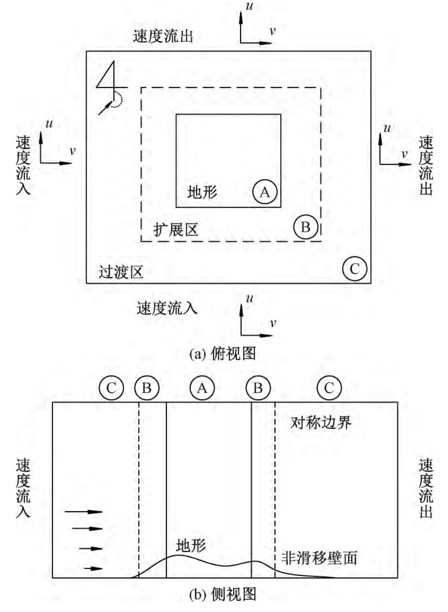
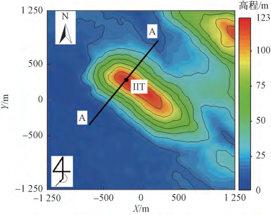
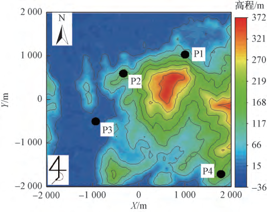
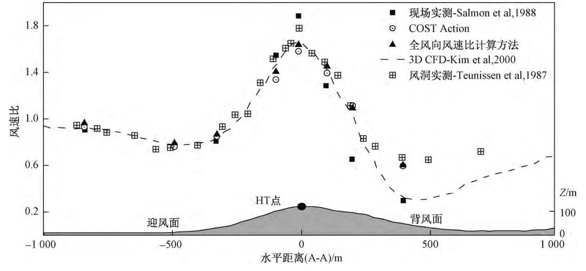
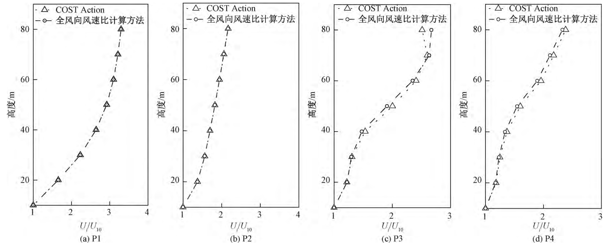

.. _paper-note-ref-xiao2018-KXJSYGC:

复杂地形全风向风速比计算：论文精解
==================================

精简版微信公众号文章：待发布

.. contents:: 本页目录
   :local:
   :depth: 2

论文信息
--------

**题名：** 复杂地形下基于计算流体动力学的风速比计算。

**作者：** 肖凯\ :sup:`1`、赵子涵\ :sup:`2`、罗啸宇\ :sup:`1`、李朝\ :sup:`2,*`、钟继\ :sup:`2`、肖仪清\ :sup:`2`。

**作者单位：** 1. 广东电网公司电力科学研究院，广州 510080；2. 哈尔滨工业大学（深圳）土木与环境工程学院，深圳 518055。星号表示通信作者李朝。

**期刊：** 《科学技术与工程》，2018 年 11 月，第 18 卷第 33 期，1–6 页。**收到日期：** 2018 年 7 月 16 日。

**英文题名：** Computational Fluid Dynamic Approach to Calculate Wind Speed Ratio over Complex Terrain。

**WOEAI 相关方向：** 工程结构抗风 / 数值风洞。

本页完整整理中文原文，保留公式、图表、段落、引用及限制；末页英文摘要按原顺序另译。原始公式与文字的疑点用独立校核注指出，不将编辑判断写成作者勘误。

摘要
----

为解决复杂地形环境中，输电塔线风荷载计算的地形修正系数选取问题，基于计算流体动力学（computational fluid dynamic，CFD）方法，提出了一种以无量纲风速比为输出的数值计算方法。该方法参考 COST Action 732 建议的风环境模拟指导准则，对 CFD 中复杂地形的计算域选取、边界条件定义方式作出改进，使其能够适用于大规模批量计算。围绕 Askervein 山丘及中国沿海地区的一处复杂地形，结合部分风洞试验、现场实测及参考 COST Action 732 准则获得的风速比数据，验证了数值模拟方法的合理性。结果表明，采用该风速比计算方法，能准确考虑地形、地貌对输电塔线工作高度范围内的风加速比及风剖面造成的影响，该方法的实施为复杂地形风速比数据库的建立、输电塔线的防风加固及风致灾损事故分析奠定基础。

关键词
------

输电塔线；复杂地形；计算流体动力学；风速比。

引言
----

中国地形环境分布复杂，山地地貌约占总面积的 70% [1]，使得输电线路的架设环境趋于复杂。受地形、地貌影响，大气边界层内风的分离、绕流等现象使得极端天气下，输电线路的倒塔断线事故时有发生。其原因主要为，一方面输电线塔的轻质高柔、低阻尼特性使得其抗风能力较差，另一方面地形环境的复杂性导致真实风场分布难以确定。中国输电线路设计规范在计算风荷载时，针对山峰、山坡位置，采用简化修正系数来考虑地形对风荷载计算的影响。但该修正方法主要针对二维简化后的山地地形，并不能真实考虑三维山体及峡谷风效应对风场的影响。灾害天气发生后，实现破坏或缺陷杆塔的替换、加固，必须考虑真实地形、地貌对输电线路风荷载计算的影响。

目前，获取复杂地形环境中的风场分布主要包括现场实测、风洞试验及数值模拟三种手段。综合考虑时间、经济成本，数值模拟手段以其省时、经济、高效的特点在计算风工程领域得到了广泛的应用 [2–4]。山地地形的坡度、高度，植被及遮挡效应都会影响流经该区域的风场分布情况。这种地形环境对风场的影响可以用风速比（wind speed ratio，WSR）来表示。计算流体动力学（computational fluid dynamic，CFD）能够模拟气流在复杂地形环境中产生的加速、分离、环绕等现象，并计算风速比在复杂区域的分布情况，目前已被风能评估、电力设计、城规设计等单位采用。然而，采用 CFD 模拟需要经过地形建模、网格绘制、边界条件定义、求解参数设置及后处理等程序，步骤烦琐，效率低下。采用传统定义的速度入口、侧面对称及零梯度流出边界虽能较为合理地获得流场的计算结果，但需要针对不同风向创建相应的计算域，人工干预多。

现基于 WSR 数据库思想，提出了一种适用于复杂地形的全风向风速比计算方法。该方法参照数值天气预报中，全球模式到区域模式的嵌套边界定义方式，将 CFD 计算域侧面边界取为速度入口（出口），忽略对称壁面及零梯度出口条件的影响，以提高不同风向的计算效率。结合 Askervin 山丘及中国东南沿海的一处复杂地形，对比了与传统 CFD 边界定义方法下，计算结果的差异，并结合部分实测及风洞试验数据验证了风速比一体化计算方法的可行性。

1 全风向风速比计算方法
----------------------

采用 CFD 方法求解实际问题的过程，从某种意义上说，就是将边界线或边界面上的数据，外推扩展到计算域内部的过程。因此，提供符合物理实际且适定的边界条件极其重要 [5]。如在采用 CFD 方法进行城市风环境模拟时，欧盟推出了最佳实践指南 COST Action 732 [6]，对计算域的入口、出口的位置及边界条件的定义方法给出了相应的建议，该指南同样适用于复杂地形的风场模拟。然而，与城市风环境模拟不同，输电线路在复杂地形中分布范围广，连续挡距长，极端天气下（如台风）的风攻角变化明显。为实现复杂地形风场的大规模、多批次求解运算，参考数值天气预报模式中多层嵌套区域边界的定义方法，将指定风向下，地形在 CFD 中的求解边界定义如图 1 所示。其中，假设待求解区域为 A，CFD 的求解域由地形 A、扩展区 B 及过渡区 C 构成。为避免求解结果异常并保证计算精度，施加 B、C 区域以保证流场发展。区域 B 的地形分布与实际地形高程保持一致，区域 C 地形的高程参照负指数率衰减，从实际地形过渡到平坦位置。CFD 计算域边界在侧面全部定义为速度入口（出口），流入、流出方向和实际保持一致。CFD 求解不同风工况可通过控制 :math:`u,v` 速度分量来变更边界的流入、流出方向。该方法能够在不改变计算域网格文件的前提下，实现计算风向的变换，具有较高的效率。

   **图 1** CFD 计算域及边界定义说明（The illustration of computational fluid dynamic domain and boundary condition）。（a）俯视图；（b）侧视图。A 为地形区，B 为扩展区，C 为过渡区；侧面按速度分量指定流入或流出，顶部为对称边界，底部为非滑移壁面。:math:`u,v` 箭头表示速度分量方向。

该方法以目前全球数字高程地形为基础，结合 ICEMCFD 及通用 Fluent 软件的运行脚本，依次实现目标区域经纬度高程信息转换、连续地形曲面及规则化粗糙边界条件生成、空间网格的绘制、流域的计算及结果的后处理。最终结果以 WSR［式（1）］表征地形高程及地表粗糙度对风速分布的影响，建立目标区域中包含经纬度坐标、空间高度及来流风向信息的风速比数据库。

.. math::

   S_{\mathrm{WSR}}=
   \frac{U_{\mathrm{CFD}}(x,y,z_{10})}{U_{\mathrm{CFD\_b}}(z_{10})}
   \qquad (1)

式（1）中，:math:`U_{\mathrm{CFD\_b}}(z_{10})` 表示 CFD 计算域边界距地 10 m 高度处的来流参考风速；:math:`U_{\mathrm{CFD}}(x,y,z_{10})` 表示 CFD 计算域内部距地 10 m 高度处的风速计算结果。

2 数值模拟方案
--------------

2.1 CFD 湍流闭合方案
~~~~~~~~~~~~~~~~~~~~

忽略连续方程、动量方程中的二阶雷诺应力项，采用的雷诺时均控制方程（稳态）可表示为式（2）和式（3）。

.. math::

   \frac{\partial u_i}{\partial x_i}=0 \qquad (2)

.. math::

   \frac{\partial}{\partial x_j}(\rho u_i u_j)
   =-\frac{\partial p}{\partial x_i}
   +\frac{\partial}{\partial x_j}
   \left(\mu\frac{\partial u_i}{\partial x_j}-\rho\overline{u_i'u_j'}\right)
   +S_u \qquad (3)

式中，:math:`u_i,u_j` 分别为速度矢量在空间 :math:`x_i,x_j` 方向的分量，具有张量表达形式，:math:`\rho,\mu` 分别为空气的密度和动力黏度系数。

选取适应性较强的 SST :math:`k-\omega` 模型 [4] 来处理方程中新增的雷诺应力项 :math:`-\rho\overline{u_i'u_j'}`。该模型综合考虑了 :math:`k-\omega` 和 :math:`k-\varepsilon` 模型在壁面边界层内外计算的优点；通过引入混合函数，可以较好地描述流体流动的分离现象。地表植被对流场的影响参照 Pattanapol 等 [7] 的研究结果，即将植被视为拖曳源项（:math:`S_u`）施加在动量控制方程中，其具体表达形式为

.. math::

   S_u=-C_d A\lvert U\rvert u_i \qquad (4)

式（4）中，:math:`C_d` 表示拖曳系数，多数情况下取 0.1–0.3；:math:`A` 表示叶面积指数，m²·m⁻³，合理 :math:`A` 的取值会随高度发生变化；:math:`\lvert U\rvert=(u_i u_j)^{0.5}`，表示空间平均风速。

.. note::

   原文校核：本节开头称“忽略……二阶雷诺应力项”，但式（3）仍包含该项，后文也明确用 SST 模型闭合。本页保留两处原文，不把该句改写成已经删除雷诺应力。原文称 :math:`A` 为“叶面积指数”，所给单位却为 m²·m⁻³；:math:`\lvert U\rvert` 的原始表达使用 :math:`u_i u_j` 而不是同下标收缩。式（4）也未显式写入密度因子。这些均忠实转写，不自行补成另一套控制方程。

控制方程，式（2）、式（3）离散采用交错网格，并结合适用于低速不可压流体的压力基求解器对离散后的方程求解。压力速度之间的解耦采用收敛速度更快的 SIMPLEC 算法。压力的空间离散采用二阶迎风格式。动量的空间离散采用精度更高且具有守恒特性的 QUICK 格式，以减少假扩散的影响。

2.2 边界条件设置
~~~~~~~~~~~~~~~~

参照中国风荷载规范中采用的指数率风剖面形式，CFD 模拟域来流边界入口（出口）可表示为式（5）。

.. math::

   U(z)=U_{10}(z/z_{10})^{\alpha} \qquad (5)

.. math::

   I_z(z)=I_{10}\left(\frac{z}{10}\right)^{-\alpha} \qquad (6)

式中，A、B 类场地时，地面粗糙度指数 :math:`\alpha` 可分别取 0.12、0.15；梯度风高度 :math:`z_G` 可分别取 300 m、350 m。10 m 高度处，名义湍流度 :math:`I_{10}` 在 A 类和 B 类场地中分别取 0.12、0.14。

计算域顶部考虑为对称边界，地表采用非滑移壁面。湍动能 :math:`k` 和耗散率 :math:`\omega` 的选取分别参考 Ferziger 等 [8] 和郭文星 [9] 的讨论。其中湍动能系数取为 0.75，其原因是风速分量对计算结果的贡献不一致，主风向的贡献最大。

3 计算对象选取
--------------

地形复杂程度是影响 CFD 计算效果的一个重要因素。根据地形复杂度指标的判断 [10]，挑选了地形起伏及褶皱程度区别明显的两处地形，分别采用全风向风速比计算方法（方法 1）、COST Action 732 建议的计算域划分方法（方法 2），验证计算结果的合理性。结合计算域内最高点高度 :math:`H_{\mathrm{max}}`，对比实验的计算域长度及边界定义如表 1 所示。其中，地形网格划分均采用结构化六面体网格，水平间距取 20 m，首层网格高度为 0.3 m，竖向增长比为 1.15。

.. list-table:: 表 1 对比试验模型参数汇总（The parameters set up of validated experiment model）
   :header-rows: 1
   :widths: 12 25 13 15 35

   * - 方法
     - 扩展＋过渡区长度
     - 顶面边界
     - 底面边界
     - 侧面边界
   * - 方法 1
     - :math:`(5+5)H_{\mathrm{max}}`
     - 对称
     - 非滑移
     - 速度入口（出口）
   * - 方法 2
     - :math:`(5+15)H_{\mathrm{max}}`
     - 对称
     - 非滑移
     - 速度入口＋零梯度出口

3.1 Askervein 山丘
~~~~~~~~~~~~~~~~~~

该地形位于苏格兰外赫布里底群岛沿海地区，整体形状呈椭圆形，长轴、短轴分别为 2 km、1 km。由于地形分布相对简单，山丘周边布置了大量测点用以验证数值模拟及风洞试验方法的可靠性 [11]。该地形的高程分布如图 2 所示。其中，以山丘最高点 HT 点为中心（椭圆近似焦点），垂直于椭圆长轴的 AA 截面共布置了 8 个实测点。Askervein 山丘周边的地貌分布较为简单，主要包括草地、低矮树木及平坦石块，相对符合中国风荷载规范对 A 类地面粗糙度类别的要求。围绕该地形，分别采用本文提到的全风向风速比计算方法、COST Action 732 准则建议的计算域及边界选取方法，创建 :math:`\theta=210^\circ` 风向角下的 CFD 计算域。

   **图 2** Askervein 山丘地形高程分布（The topographic distribution of Askervein Hill）。HT 表示山顶位置，A–A 线为提取截面；水平坐标 :math:`X,Y` 及高程色标均以 m 为单位，N 为北向。

3.2 沿海某复杂地形
~~~~~~~~~~~~~~~~~~

该地形位于中国东南沿海地区，地形起伏较为复杂，其高程分布云图如图 3 所示。按照地形分布范围内已建输电塔，挑选 4 处位置（P1–P4），验证风速比计算结果的可靠性。该地地表覆盖植被主要由郁密度大于 30% 的天然林、人工林及水田构成，符合 B 类地面粗糙度类别的要求。参照表 1 所述方法，依次创建 :math:`\theta=270^\circ` 风向角下对应的 CFD 计算域。按照来流风向划分，P3 位于山谷，P1、P2、P4 分别位于山脚。

   **图 3** 中国东南沿海某复杂地形高程分布（The topographic distribution of one complex terrain located in southeast of China）。黑点标记 P1–P4，水平坐标及高程色标单位为 m，N 为北向。

4 结果分析
----------

为进一步评估全风向风速比方法的计算结果与 COST Action 732 计算准则下的结果差异，分别比较了不同位置测点处的风速比及归一化风剖面分布结果。其中，针对 Askervein 山丘，参照了公开发表的实测数据 [12]、风洞及数值模拟 [13] 风速比结果。而对沿海某地的一处复杂地形，由于缺少实测数据，现着重比较了两种模拟手段在迎风面、背风面位置处的计算结果。

4.1 测点位置的 WSR 计算对比
~~~~~~~~~~~~~~~~~~~~~~~~~~~~~~~~~~~~

距地 10 m 高度处，Askervein 山丘的风速比提取结果如图 4 所示。迎风面、山顶部位由于受地形隆起的影响，存在明显的风加速区，较平坦地形而言，风速比最大要略大于 1.8。由于地形背风面存在流场分离效应，风速比呈现出折减效应，最低减到 0.3（背风面山脚）。需要强调的是，现仅关心真实地形环境下，风速比对风荷载修正系数的影响，尽管背风坡的风速比存在折减效应，但其流场分离会对脉动风特性产生影响，进而导致输电线塔风振响应的随机性增大 [14]，该影响仍不容忽视。

进一步比较风速比计算结果可知，采用本文所述全风向风速比计算方法得到结果在迎风面风加速区与实测及风洞试验结果基本保持一致。比较山顶风速比最大位置（HT 点），可知采用数值模拟手段得到的结果均低于实测值及风洞试验值。但采用本文所述方法获得的风速比最大值与 Kim 等 [13] 实施的 CFD 模拟及 COST Action 732 准则建议选取的计算模型结果十分接近。背风面风速比计算结果的离散性较大，但本文所得结果较接近风洞试验值。其原因可能为数值模拟的湍流闭合方案和简化的来流风剖面变化形式均会影响背风面分离区的流场计算效果。

   **图 4** Askervein 山丘的风速比计算结果对比（风向角 :math:`\theta=210^\circ`）。横轴为 A–A 截面的水平距离（m），左纵轴为风速比，右纵轴为地形高程 :math:`Z` （m）。图例分别为现场实测（Salmon et al., 1988）、COST Action、全风向风速比计算方法、3D CFD（Kim et al., 2000）和风洞实测（Teunissen et al., 1987）；灰色地形标出迎风面、HT 点和背风面。

.. note::

   原文“最大略大于 1.8、最低减到 0.3”是图 4 多组结果的范围描述，不等于本文方法同时达到这两个极值；本文方法的山顶值低于现场与风洞结果。图例所称“风洞实测—Teunissen et al., 1987”按图保留，参考文献 [11] 列为 Taylor 和 Teunissen 的项目总览，不在此补造另一条来源。

4.2 归一化风剖面对比
~~~~~~~~~~~~~~~~~~~~

针对中国东南沿海地区某复杂地形，依次提取 P1–P4 位置（图 3）处，输电线塔工作高度范围内的风剖面计算结果。以距地 10 m 高度流场计算结果为参考，不同计算方法下，五处位置的归一化风剖面对比如图 5 所示。显然，受地形分布影响，不同位置处输电塔工作高度范围内的风剖面形式变化明显，经验的指数率风剖面变化形式不再适用。P1、P2 位置由于处在山地边缘，:math:`\theta=270^\circ` 风向角下，不同计算手段得到的结果趋于一致。而 P3、P4 位置分别处在上游山体尾流区及侧面山坡上，同样风向角下，不同位置的风剖面计算结果受周围地形影响较大，在 40 m 高度附近存在较为明显的风折减效应。尽管两种计算方法下 P3、P4 风剖面存在一定的差异，但其竖向变化特征几乎保持一致。显然，采用本文提到的全风向风速比计算方法能够准确地揭示出受地形影响的风剖面变化特性。

   **图 5** P1–P4 位置处归一化风剖面计算结果（风向角 :math:`\theta=270^\circ`）。（a）P1；（b）P2；（c）P3；（d）P4。横轴为 :math:`U_i/U_{10}`，纵轴为高度（m）；三角形为 COST Action 方法，圆形为全风向风速比计算方法。各图横轴范围不同。

.. note::

   数量校核：原文第 4.2 节写“五处位置”，但同段点名 P1–P4，图 3 与图 5 也只有四处。本页保留原句，同时明确图中实际展示四点，没有补出第五点。

5 结论
------

基于通用 CFD 软件 Fluent 和经验来流风剖面形式，本文探讨了全风向风速比计算方法在复杂地形风场计算的适应性。通过对比 Askervein 山丘和我国东南沿海地区某复杂地形的风速比及归一化风剖面，验证了全风向风速比计算方法的可靠性。主要得到以下结论。

1) 对于复杂地形的风场计算，所述方法得到的风速比及归一化风剖面计算结果，与 COSAT Action 732 建议的计算域选取方法相比，整体误差不大。
2) 基于 CFD 的全风向风速比计算方法在不需要重新选取计算域的前提下，通过调整侧面边界的风速分量实现计算风向的调整，能降低数据存储量，适合批量重复计算。
3) 受地形起伏影响，风剖面已不再满足经验分布形式，且在迎风面及山顶附近具有明显的风加速效应，该变化在输电线塔的防风加固、致灾分析中不能忽略。
4) 受分析地形崎岖度及海拔高度影响，计算域扩展区及过渡区长度的选取仍需进一步讨论。

参考文献
--------

[1] 赵松乔. 我国山地环境的自然特点及开发利用. 山地学报，1983；1(3): 3–11. Zhao Songqiao. Physical feature of China’s mountain environment and economic problem of its utilization. Mountain Research, 1983; 1(3): 3–11.

[2] Bitsuamlak G T, Stathopoulos T, Bédard C. Numerical evaluation of wind flow over complex terrain. Journal of Aerospace Engineering, 2004; 17(4): 135–145.

[3] 杨易，顾明，金新阳，等. 风环境数值模拟中模拟植被的数学模型与应用. 同济大学学报（自然科学版），2010；38(9): 1266–1270. Yang Yi, Gu Ming, Jin Xinyang, et al. Tree canopy model for wind environment simulation and its application. Journal of Tongji University (Natural Science), 2010; 38(9): 1266–1270.

[4] 肖仪清，李朝，欧进萍，等. 复杂地形风能评估的 CFD 方法. 华南理工大学学报（自然科学版），2009；37(9): 30–35. Xiao Yiqing, Li Chao, Ou Jinping, et al. CFD approach to evaluation of wind energy in complex terrain. Journal of South China University of Technology (Natural Science Edition), 2009; 37(9): 30–35.

[5] 王福军. 计算流体动力学分析：CFD 软件原理与应用. 北京：清华大学出版社，2004: 150–157. Wang Fujun. Analysis of computational fluid dynamics: Theory and application. Beijing: Tsinghua University Press, 2004: 150–157.

[6] Franke J, Hellsten A, Schlunzen K H, et al. The COST 732 best practice guideline for CFD simulation of flows in the urban environment: A summary. International Journal of Environment and Pollution, 2011; 44(1–4): 419–427.

[7] Pattanapol W, Wakes S J, Hilton M J, et al. Modeling of surface roughness for flow over a complex vegetated surface. Proceedings of World Academy of Science, Engineering and Technology Volume, 2007; 1(8): 94–102.

[8] Ferziger J H, Peric M. Computational methods for fluid dynamics (3rd ed). Heidelberg: Verlag Berlin Heidelberg Press, 2002: 66–68.

[9] 郭文星. 复杂山地地形风场 CFD 多尺度数值模拟. 哈尔滨：哈尔滨工业大学，2010. Guo Wenxing. CFD multi-scale simulation of wind flow over hilly terrain. Harbin: Harbin Institute of Technology, 2010.

[10] 卢华兴，刘学军，汤国安. 地形复杂度的多因子综合评价方法. 山地学报，2012；30(5): 616–621. Lu Huaxing, Liu Xuejun, Tang Guoan. Terrain complexity assessment based on multivariate analysis. Mountain Research, 2012; 30(5): 616–621.

[11] Taylor P A, Teunissen H W. The askervein hill project: Overview and background data. Boundary-Layer Meteorology, 1987; 39(1–2): 15–39.

[12] Salmon J R, Bowen A J, Hoff A M, et al. The askervein hill project: Mean wind variations at fixed heights above ground. Boundary-Layer Meteorology, 1988; 43(3): 247–271.

[13] Kim H G, Patel V C, Lee C M. Numerical simulation of wind flow over hilly terrain. Journal of Wind Engineering and Industrial Aerodynamics, 2000; 87(1): 45–60.

[14] 李正良，韩枫，张春涛，等. 山地风场中特高压输电塔线体系动力可靠度研究. 振动与冲击，2012；31(20): 1–6. Li Zhengliang, Han Feng, Zhang Chuntao, et al. Dynamic reliability of a UHV transmission tower-line coupled system in hilly terrain wind field. Journal of Vibration and Shock, 2012; 31(20): 1–6.

英文题名与摘要译文
------------------

**英文题名：** Computational Fluid Dynamic Approach to Calculate Wind Speed Ratio over Complex Terrain。

**作者：** XIAO Kai、ZHAO Zi-han、LUO Xiao-yu、LI Chao、ZHONG Ji、XIAO Yi-qing；李朝为通信作者，单位对应关系见首页信息。

为在输电塔线体系设计中正确考虑地形影响，提出一种以风速比为输出、基于计算流体动力学（CFD）的数值模拟方法。以 CFD 模拟最佳实践指南 COST Action 732 为参考，讨论地形计算域和边界条件的适当选取。该方法旨在利用超级计算机的发展实现多批次计算。采用国际合作项目 Askervein Hill 检验计算表现。进一步引入位于中国南海地区、起伏更为复杂的地形，以区分改进计算方法与传统 COST Action 732 建议方法的结果。风速比和归一化风剖面的比较均表明，这种随风向变化的高效计算方法表现良好。本文所述方法的实现，为建立复杂地形风速比数据库以及极端天气条件下结构加固奠定基础。

**关键词：** 输电塔线；复杂地形；计算流体动力学；风速比。

完整引用
--------

肖凯，赵子涵，罗啸宇，李朝，钟继，肖仪清. 复杂地形下基于计算流体动力学的风速比计算 [J]. 科学技术与工程，2018，18(33): 1–6。

收录信息见 :ref:`WOEAI 学术成果页对应条目 <ref-xiao2018-KXJSYGC>`。
