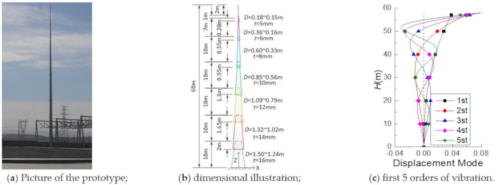
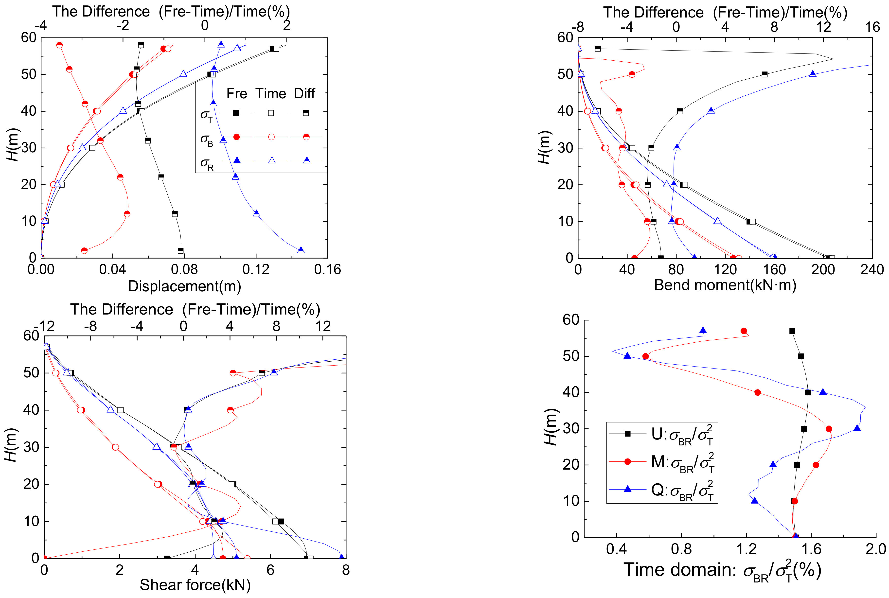
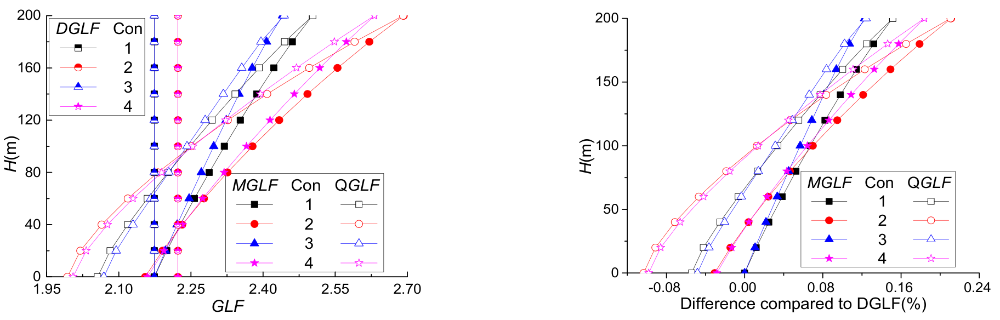

.. _paper-note-ref-yang2022-AS:

基于风致响应的高层与高耸结构等效静力风荷载：论文精解
======================================================

精简版微信公众号文章：待发布

论文信息
--------

- **原题**：Research on Equivalent Static Load of High-Rise/Towering Structures Based on Wind-Induced Responses
- **作者**：Junhui Yang、Junfeng Zhang、Chao Li；Chao Li 为原文明示的通信作者。
- **单位**：1. 郑州大学土木工程学院，郑州 450001；2. 哈尔滨工业大学（深圳）土木与环境工程学院，深圳 518055。
- **期刊**：Applied Sciences，2022，12(8)，3729；2022 年 4 月 7 日发表。
- **收稿与录用**：2022 年 3 月 2 日收稿，2022 年 3 月 30 日录用。
- **DOI**：`10.3390/app12083729 <https://doi.org/10.3390/app12083729>`_。
- **研究方向**：结构风工程 / 结构抗风。

.. contents:: 本页目录
   :local:
   :depth: 2

导读
----

用一个由顶点位移或基底弯矩确定的阵风荷载因子，能否覆盖结构任意高度的弯矩和剪力？本文从随机振动理论出发，将背景、共振及其耦合响应分开，再通过对应位置的影响函数构造等效静力风荷载。研究包含一个 60 m 避雷针的时频域对照算例，以及一个 200 m 高层建筑的四组参数比较。文中“约 22%”是指定建筑算例中顶部弯矩阵风荷载因子相对位移因子的差别，不是所有高层结构的设计放大系数。

本文完整精解原科学正文，保留 30 个编号公式、2 张原表、3 幅完整原图及 38 条参考文献；按项目范围省略作者贡献、基金、伦理与利益声明等出版尾节。新提供的 12 页出版社版本补齐了原 13 页副本缺少的图 1(c) 和图 2 面板；式 (19) 的版本排印差异另行说明。原稿若干公式的共轭符号、耦合量记号、指标单位以及正文参数趋势存在不一致，均就近说明，不用通常教科书形式静默改写原式。

摘要
----

能够代表高层建筑和高耸结构所有真实极限状态的等效静力风荷载评估方法，在风工程领域尚未完全确定。本文基于随机振动理论，采用振动分解方法研究高层建筑和高耸结构的风致响应及等效静力风荷载。首先，在时域和频域中研究结构的平均风致响应、背景响应、共振响应以及背景与共振的耦合响应。其次，提出一种适用于结构任意高度处风致位移、弯矩和剪力响应的新阵风荷载因子（gust load factor，GLF）评估方法，并以一座典型高层建筑为例，与既有研究结果比较，以验证本文方法的有效性。结果表明：对于高层建筑和高耸结构，耦合分量占总脉动响应的比例小于 2%，其影响可以忽略；基于弯矩的阵风荷载因子（MGLF）和基于剪力的阵风荷载因子（QGLF）随高度显著增加，传统 GLF 方法低估了最大风作用效应。

**关键词**：时域方法；频域方法；背景与共振耦合分量；风致动力响应；等效静力风荷载。

1 引言
------

风荷载是工程设计中必须考虑的荷载之一。对高层建筑[1,2]、桥梁[3,4]、圆柱形结构[5,6]、风机[7–9]、铁路接触网[10]、缆索[11,12]及输电塔[13]等高柔性、低阻尼、轻质量结构而言，风振响应十分敏感，容易遭受风振灾害。确定其风振响应和等效风荷载，是结构风工程的核心问题之一。此外，结构风致响应是等效静力风荷载研究的基础。过去，结构风荷载主要通过风速仪直接确定。20 世纪 60 年代，Davenport A.G.[14,15]首次将随机振动理论引入高层建筑顺风向风振响应分析，将结构总脉动响应分为背景和共振分量，并提出基于一阶位移响应的阵风荷载因子法（GLF），用于计算结构等效静力风荷载。Zhang Xiangting[16]认为，结构等效脉动风荷载可由一阶脉动位移响应的惯性力来评估，继而提出惯性风荷载法（IWL），该方法已被中国规范采用。Kasperski 等[17,18]提出了准确评估高刚度低层建筑背景响应的方法，即荷载–响应相关法（LRC）。Zhou Yin 等[19,20]提出基底弯矩阵风荷载因子法（MGLF），兼具 LRC 和 IWL 的优点，并已被美国规范采用。此后，Holmes、Gu Ming、Xie Zhuangning、Lin Yongjun、Ke Shitang 等[21–29]提出了相应的等效静力风荷载评估方法。上述方法都以峰值位移、峰值内力等关键位置响应为等效依据，而未考虑其他位置。然而，随着建筑形状和高度的发展，仅考虑一阶振型已不能保证结构安全。另一方面，随着风振响应计算理论的进步，不仅可考虑风振高阶模态，也可计入背景与共振耦合分量，因此仍有必要研究等效静力风荷载。

结构风致响应的主要研究方法包括理论分析、现场实测、风洞试验和数值模拟[1,2,5,7,30]，理论分析又可分为时域和频域两类。时域方法的优点是应用范围广，能够获得位移、弯矩和剪力的动力响应，并可考虑材料非线性；缺点是计算耗时。作者将文中所讨论频域方法的优点概括为概念清晰、计算成本较低，并指出其不考虑非线性问题。事实上，随着计算机硬件和频域计算理论的发展，时域方法的不足正逐渐得到克服，频域结果也越来越准确。Gu Ming 等[31]基于频域中的非定常荷载试验，提出了考虑高阶模态与模态间耦合项的顺风向响应分析方法。Li Shouke 等[32]将模态加速度法与随机动力学双输入单输出系统原理结合，推导了考虑背景、共振以及背景–共振耦合分量的精细化风致响应评估方法。Zou Lianghao 等[33]结合中国规范，提出考虑二阶模态的高层建筑风振响应简化评估方法。Zhang Junfeng 等[34]分析了时域中背景与共振风响应的划分，并建立了时域中背景–共振耦合分量的计算方法。

本文给出结构风振响应的背景分量、共振分量以及背景–共振耦合分量在时域和频域中的计算方法，并提出针对结构任意位置的等效静力风荷载评估方法。该方法结合传统 MGLF 法和 IWL 法的优点，直接由结构各位置的风致位移、弯矩和剪力响应获取该位置的等效静力风荷载，而不只考虑某一特定位置的响应，从而准确获得任意位置的等效静力风荷载，使结果更为合理。本文还以一座高层建筑为例验证方法精度，为等效静力风荷载研究提供参考。

.. note::

   本节关于规范采用情况是原论文的历史叙述，不是对当前规范适用版本的核验。文献[31]题名实际为大跨度屋盖抖振响应，原引言却用于顺风向分析背景；文献[9]为建筑形状比较而列在风机引用组中，均保留原始引用，不作重新归配。

2 结构风致响应评估方法的精细化
--------------------------------

对多自由度结构，风荷载作用下的基本运动方程为

.. math::

   [M]\ddot Y(z,t)+[C]\dot Y(z,t)+[K]Y(z,t)=P(z,t) \qquad (1)

式中， :math:`[M]` 、 :math:`[C]` 和 :math:`[K]` 分别为结构质量矩阵、阻尼矩阵和刚度矩阵； :math:`P(z,t)` 为节点 :math:`z` 处的脉动风荷载时程； :math:`\ddot Y(z,t)` 、 :math:`\dot Y(z,t)` 和 :math:`Y(z,t)` 分别为加速度、速度和总脉动位移时程。

将上述结构动力平衡方程解耦，可得到以广义坐标表示的 :math:`N` 个相互独立方程。对振型作质量归一化后，有

.. math::

   \ddot q_j(t)+2\zeta_j\omega_j\dot q_j(t)+\omega_j^2q_j(t)=F_j(t) \qquad (2)

.. math::

   Y(z,t)=\sum_{j=1}^{N}\phi_j(z)q_j(t) \qquad (3)

.. math::

   F_j(t)=\sum_{i=1}^{N}P(z_i,t)\phi_{ji}=\sum_{i=1}^{N}\rho C_D(z)A_i\overline U(z_i)u(z,t)\phi_{ji} \qquad (4)

式中， :math:`q_j(t)` 为第 :math:`j` 阶模态广义坐标时程； :math:`\zeta_j` 为第 :math:`j` 阶模态阻尼比； :math:`\omega_j` 为第 :math:`j` 阶固有圆频率； :math:`F_j(t)` 为第 :math:`j` 阶广义荷载； :math:`\phi_{ji}` 为第 :math:`j` 阶振型中第 :math:`i` 个节点的位移分量； :math:`\rho` 为空气密度，通常取 :math:`1.25\,\mathrm{kg/m^3}` ； :math:`C_D` 为准定常风压系数； :math:`A_i` 为第 :math:`i` 个节点迎风面积； :math:`\overline U(z_i)` 为 :math:`z_i` 高度处来流平均风速； :math:`u(z_i,t)` 为该高度处的来流脉动风速时程。

.. note::

   式 (4) 原式将脉动速度写作 :math:`u(z,t)` ，其后定义写作 :math:`u(z_i,t)` ；本页保留这一节点记号差异。

2.1 频域中的完整三分量表达式
~~~~~~~~~~~~~~~~~~~~~~~~~~~~

高层建筑在风荷载下的平均响应为

.. math::

   \overline r(z)=\int_0^H\overline P(z')i(z,z')\,dz' \qquad (5)

其中， :math:`\overline P(z')` 为 :math:`z'` 高度处的平均风荷载； :math:`i(z,z')` 为影响函数，包括位移、弯矩和剪力影响函数，表示在 :math:`z'` 位置施加单位荷载时， :math:`z` 位置产生的响应[23]。

频域方法因物理概念清晰、计算快速，广泛用于结构风振响应分析。当一个空间点的风速达到最大值时，一定范围内另一点的风速通常并不同时达到最大值，因此空间两点风速之间存在一定的空间相关性[35]。由式 (4)，结构广义风荷载互谱 :math:`S_{F_iF_j}(f)` 可写为

.. math::

   S_{F_iF_j}(f)=\sum_{k=1}^{N}\sum_{l=1}^{N}\phi_{ik}\phi_{jl}\rho^2C_D^2A_k\overline U_kA_l\overline U_lR_XR_Z\sqrt{S_{u_k}(f)S_{u_l}(f)} \qquad (6)

其中， :math:`R_X` 和 :math:`R_Z` 分别为水平与竖向相干函数； :math:`\overline U_i` 为第 :math:`i` 个节点的平均风速； :math:`S_{u_i}(f)` 为脉动风速谱。

根据式 (2)，若已知广义风荷载互谱 :math:`S_{F_iF_j}(f)` ，则广义坐标 :math:`q_j` 的总脉动响应谱 :math:`S_{q_j}(f)` 可表示为式 (7)；再利用模态叠加原理，即式 (3)，可得到结构节点 :math:`i` 的响应谱 :math:`S_{y_i}(f)` ，见式 (8)。

.. math::

   S_{q_j}(f)=\sum_{i=1}^{N}S_{F_iF_j}(f)H_i^*(f)H_j(f) \qquad (7)

.. math::

   S_{y_i}(f)=\sum_{j=1}^{N}\sum_{k=1}^{N}\phi_{ji}\phi_{ki}H_j^*(f)H_k(f)S_{F_jF_k}(f) \qquad (8)

.. math::

   H_k(f)=\frac{1}{K_k^*}\frac{1}{1-(f/f_k)^2+\mathrm i2\zeta_k(f/f_k)} \qquad (9)

其中， :math:`H_k(f)` 为第 :math:`k` 阶模态的复频响函数， :math:`H_j^*(f)` 为 :math:`H_j(f)` 的共轭。将式 (8) 中的振型位移 :math:`\phi` 替换为弯矩或剪力，即可得到相应的弯矩和剪力响应谱。

.. math::

   \sigma_{Ti}=\left(\int_0^\infty\left|S_{y_i}(f)\right|\,df\right)^{1/2} \qquad (10)

由式 (10) 可计算总脉动响应 :math:`\sigma_{Ti}` ，它包括背景分量 :math:`\sigma_B` 、共振分量 :math:`\sigma_R` 和背景–共振耦合分量 :math:`\sigma_{BR}` 。由于 :math:`\sigma_T` 的计算较复杂，研究者常先确定各分量，再按式 (11) 计算 :math:`\sigma_T` 。各分量的表达式如下。

.. math::

   \sigma_{Ti}=\left(\sigma_{Bi}^2+\sigma_{Ri}^2+\sigma_{BRi}^2\right)^{1/2} \qquad (11)

.. math::

   \widehat\sigma_{Bi}=g_u\left(\int_0^\infty\int_0^H\int_0^H\int_0^W\int_0^W\overline{p(x_1,z_1,f)p(x_2,z_2,f)}i(z_i,z_1)i(z_i,z_2)\,dx_1dx_2dz_1dz_2df\right)^{1/2} \qquad (12)

.. math::

   \widehat\sigma_{Ri}=g_R\left(\int_0^\infty\sum_{j=1}^{N}\sum_{k=1}^{N}\phi_{ji}\phi_{ki}S_{F_jF_k}(f)\left[H_j^*(f)-\frac{1}{k_j^*}\right]\left[H_k^*(f)-\frac{1}{k_k^*}\right]\,df\right)^{1/2} \qquad (13)

.. math::

   \widehat\sigma_{BRi}=2\rho_{BR}\left(\int_0^\infty\sum_{j=1}^{N}\sum_{k=1}^{N}\phi_{ji}\phi_{ki}S_{F_jF_k}(f)\left[\frac{1}{k_j^*}H_k^*(f)+\frac{1}{k_k^*}H_j^*(f)-\frac{2}{k_j^*k_k^*}\right]\,df\right)^{1/2} \qquad (14)

.. math::

   \overline{p(x_1,z_1,f)p(x_2,z_2,f)}=(\rho C_D\overline U_H)^2\left(\frac{z_1}{H}\right)^\alpha\left(\frac{z_2}{H}\right)^\alpha R_ZR_XS_u(f) \qquad (15)

.. math::

   g_R=\sqrt{2\ln(f_1T)}+\frac{0.5772}{\sqrt{2\ln(f_1T)}} \qquad (16)

.. math::

   \rho_{BR}=\sigma_{BR}^2/(\sigma_B\sigma_R) \qquad (17)

式中， :math:`\overline{p(x_1,z_1,f)p(x_2,z_2,f)}` 为结构表面 :math:`(x_1,z_1)` 与 :math:`(x_2,z_2)` 两点的脉动风压互谱； :math:`g_u` 为风速峰值因子，通常取 3.5； :math:`g_R` 为共振响应峰值因子； :math:`\rho_{BR}` 为背景与共振耦合响应的互相关系数[32]。

.. note::

   式 (10)–(11) 用标准差型量表示总响应，而式 (12)–(14) 带帽并引入峰值因子。式 (13) 中两个频响项均印有共轭星号，式 (14) 也按原式保留；它与式 (8) 中一个共轭、一个非共轭的写法不同。 :math:`K_j^*` 与 :math:`k_j^*` 的大小写也依各原式保留。这里是对原式的忠实转写，不能将未经确认的排印形式作为独立复现已验证的算法。

上述方程即为结构风响应在频域中的完整三分量表达式。可见， :math:`\sigma_R` 和 :math:`\sigma_{BR}` 的表达式较复杂，不便于工程应用。高层建筑和高耸结构等高柔结构的固有频率分布较稀疏，其风振响应主要与前几阶模态有关，因此可忽略各模态之间的耦合项以及背景与共振耦合项，简化这类建筑的计算。此时，结构总脉动响应可写为

.. math::

   \sigma_T=\left(\sigma_B^2+\sum_j^n\sigma_{Rj}^2\right)^{1/2} \qquad (18)

.. math::

   \sigma_{Rj}=g_R\left(S_{F_j}(f_j)\int_0^\infty|H_j(f)|^2\,df\right)^{1/2}=g_R\frac{1}{K_j^*}\left(S_{F_j}(f_j)\frac{\pi f_j}{4\zeta_j}\right)^{1/2}\varphi_j \qquad (19)

.. note::

   式 (19) 的频响模平方沿用已留存 13 页版本的清晰上标 :math:`|H_j(f)|^2` 。新补充的 12 页版本在同一位置将数字 2 排在竖线后的基线附近，并非清晰的平方上标；两版存在排印差异，这里不把新排版另解释为乘 2 或下标 2，也不声称已经核实作者的最终算法实现。左侧等式中的积分表达式未带 :math:`\varphi_j` ，右侧闭式表达式却带该因子；本页保留原形式。模态数 :math:`n` 为简化后的保留阶数，不能因为后面的建筑算例采用一阶影响函数，就把这里的一般求和删除。

2.2 时域中的完整三分量表达式
~~~~~~~~~~~~~~~~~~~~~~~~~~~~

直接求解上述动力平衡方程可以得到 :math:`Y(z,t)` 。由背景和共振响应的概念与发展可知，这两类响应可由下式计算：

.. math::

   Y_B(z,t)=P(z,t)/[K] \qquad (20)

.. math::

   Y_R(z,t)=Y(z,t)-Y_B(z,t) \qquad (21)

得到 :math:`Y(z,t)` 、 :math:`Y_B(z,t)` 和 :math:`Y_R(z,t)` 后，可计算各响应的方差 :math:`\sigma_Y^2` 、 :math:`\sigma_B^2` 和 :math:`\sigma_R^2` 。需要注意，结构固有频率附近也必然存在耦合效应，因为 :math:`Y_B(z,t)` 和 :math:`Y_R(z,t)` 都含有该频率的分量[34]。

.. math::

   \sigma_{BR}=\sigma_T^2-\sigma_B^2-\sigma_R^2 \qquad (22)

至此，已阐明时域风响应中结构背景分量、共振分量和背景–共振耦合分量的评估方法。时域计算可直接给出位移、弯矩和剪力等动力响应。

.. note::

   式 (22) 左侧是 :math:`\sigma_{BR}` 而非其平方，右侧则为三个方差之差；式 (11) 和 (17) 中又采用 :math:`\sigma_{BR}^2` 。图 2 的耦合比例轴实际为 :math:`\sigma_{BR}/\sigma_T^2` ，并非 :math:`\sigma_{BR}/\sigma_T` 。这些原文记号不统一，需区分方差贡献与响应幅值。式 (20) 的“除以刚度矩阵”也保留原写法，不将矩阵运算误解为逐元素相除。

2.3 完整三分量的时域–频域结果对比
~~~~~~~~~~~~~~~~~~~~~~~~~~~~~~~~~~

本节研究单杆避雷针结构的风致振动响应，用于比较频域和时域方法，研究量包括位移、弯矩和剪力。避雷针是典型高耸结构，固有频率较小、风振效应显著，常引发工程事故[36]。本节避雷针的物理参数为：总高 60 m，塔尖高 2 m，塔身高 58 m；由七段变壁厚薄壁钢管组成，直径由 1.5 m 缩小至 0.15 m，壁厚由 16 mm 减小至 5 mm；材料为 Q345 钢，钢管采用插接加法兰连接。钢管尺寸见图 1(b)。在 ANSYS 有限元软件中采用 Beam188 单元模拟，下部六段钢管各划分为 5 个单元，上部每段等效为 1 个单元，模型共 31 个单元。为简化计算，不计塔尖及钢管搭接区，钢筒仅在接口处连接且按刚接处理。结构 X 方向前五阶振型见图 1(c)，频率分别为 0.75、2.09、4.31、7.46 和 11.66 Hz。模拟只分析顺风向风致响应。

   **图 1 避雷针几何参数和有限元模型。（a）原型照片；（b）尺寸示意；（c）前五阶振型。**

避雷针位于 B 类场地，基本风速 :math:`U_{10}=35.8\,\mathrm{m/s}` ，风剖面幂指数 :math:`\alpha=0.15` ，湍流强度 :math:`I_{10}=0.14` ，空气密度 :math:`\rho=1.25\,\mathrm{kg/m^3}` 。截面阻力系数 :math:`C_D` 按荷载规范[37]取 0.6；采用 Davenport 风谱，Davenport 相干函数的指数衰减系数为 :math:`C_Z=7` 、 :math:`C_X=8` 。采用谐波叠加法模拟脉动风荷载时程，其他参数按规范选取。模拟采用 Rayleigh 阻尼，模态阻尼比取 :math:`\zeta=0.01` 。

图 2 给出频域和时域方法得到的位移、弯矩和剪力曲线（原文此处依次列为 :math:`\sigma_T` 、 :math:`\sigma_B` 和 :math:`\sigma_R` ），以及时域方法得到的耦合分量占总脉动响应的比例。图中两种方法得到的 :math:`\sigma_T` 吻合较好，塔顶位移、基底弯矩和基底剪力偏差均在 1.5% 以内。对于位移和弯矩响应，频域法得到的背景响应较时域法更小，共振响应则更大。各变量的 :math:`\sigma_{BR}` 占总脉动响应的比例都小于 2%，因此忽略 :math:`\sigma_{BR}` 对总脉动响应的影响较小。

   **图 2 时域/频域结果与耦合分量比例对比，依次为位移、弯矩、剪力及耦合分量占总脉动响应方差的比例。**

.. note::

   上段原文把“位移、弯矩和剪力”与 :math:`\sigma_T` 、 :math:`\sigma_B` 、 :math:`\sigma_R` 用 respectively 相连，但此前三个下标实际表示总响应、背景和共振，二者不是同一分类。译文保留并指出该措辞问题；“小于2%”的图上口径也应结合前述耦合量记号差异阅读。

3 任意结构响应的等效静力风荷载评估方法
--------------------------------------

理论分析
~~~~~~~~

与以往研究一致，对于高层建筑和高耸结构，本文仍假定结构等效静力风荷载等于平均风荷载与阵风荷载因子的乘积，可表示为

.. math::

   \widehat P(z)=G_{LF}(z)\cdot\overline P(z) \qquad (23)

.. math::

   GLF(z)=1+\frac{\sigma_T(z)}{\overline r(z)}=1+\sqrt{\frac{\sigma_B(z)^2}{\overline r(z)^2}+\sum_i^n\frac{\sigma_{Ri}(z)^2}{\overline r(z)^2}}=1+\sqrt{G_B(z)^2+\sum_i^nG_{Ri}(z)^2} \qquad (24)

.. math::

   \sigma_B(z)=g_u\left(\int_0^\infty\int_0^H\int_0^H\int_0^W\int_0^W\overline{p(x_1,z_1,f)p(x_2,z_2,f)}i(z,z_1)i(z,z_2)\,dx_1dx_2dz_1dz_2df\right)^{1/2} \qquad (25)

.. math::

   \sigma_{Rj}(z)=\int_0^H\widehat P_{Rj}(z')i(z,z')\,dz' \qquad (26)

.. math::

   \begin{aligned}\widehat P_{Rj}(z)&=m(z)(2\pi f_j)^2\sigma_{YRj}\varphi_j(z)\\&=g_R\left(S_{F_j}(f_j)\frac{\pi f_j}{4\zeta_j}\right)^{1/2}\varphi_j(z)\\&=g_R\left(\sum_{k=1}^{N}\sum_{l=1}^{N}\phi_{ik}\phi_{jl}\rho^2C_D^2A_k\overline U_kA_l\overline U_lR_XR_Z\sqrt{S_u(f_j)S_u(f_j)}\frac{\pi f_j}{4\zeta_j}\right)^{1/2}\varphi_j(z)\end{aligned} \qquad (27)

式中， :math:`\widehat P_{Rj}(z)` 为结构 :math:`z` 高度处的第 :math:`j` 阶模态共振等效风荷载，其值等于该阶模态共振位移引起的惯性力[38]。

由式 (25) 和式 (26) 可分别得到背景响应 :math:`\sigma_B(z)` 与共振响应 :math:`\sigma_R(z)` ，将其代入 GLF 表达式，即式 (24)，便可得到结构任意位置的 :math:`G_B(z)` 和 :math:`G_R(z)` 。

结构任意位置在风荷载下的背景阵风荷载因子 :math:`G_B(z)` 为

.. math::

   \begin{aligned}G_B(z)&=\frac{\sigma_B(z)}{\overline r(z)}\\&=\frac{g_B\sqrt{\int_0^\infty\int_0^H\int_0^H\int_0^W\int_0^W\overline{p(x_1,z_1,f)p(x_2,z_2,f)}i(z,z_1)i(z,z_2)\,dx_1dx_2dz_1dz_2df}}{\int_0^H\overline P(z')i(z,z')\,dz'}\\&=\frac{2g_BI_HH^\alpha}{\int_0^h z'^{2\alpha}i(z,z')\,dz'+\int_h^H z'^{2\alpha}i(z,z')\,dz'}\sqrt{\int_0^\infty S_u^*(f)|K_Z(\alpha,z,f)|^2|J_X(f)|^2\,df}\end{aligned} \qquad (28)

.. math::

   \begin{aligned}|K_Z(\alpha,z,f)|^2&=\int_0^z\int_0^z z_1^\alpha z_2^\alpha R_Z(z_1,z_2,f)i(z,z_1)i(z,z_2)\,dz_1dz_2\\&\quad+\int_0^z\int_z^H z_1^\alpha z_2^\alpha R_Z(z_1,z_2,f)i(z,z_1)i(z,z_2)\,dz_1dz_2\\&\quad+\int_z^H\int_0^z z_1^\alpha z_2^\alpha R_Z(z_1,z_2,f)i(z,z_1)i(z,z_2)\,dz_1dz_2\\&\quad+\int_z^H\int_z^H z_1^\alpha z_2^\alpha R_Z(z_1,z_2,f)i(z,z_1)i(z,z_2)\,dz_1dz_2\end{aligned} \qquad (29)

按照基于位移的阵风荷载因子（DGLF）方法，Davenport[15]将结构力谱中关于高度 :math:`z` 的积分项定义为竖向联合接受函数。为了使上述表达式在形式上与 DGLF 法一致，本文也借鉴这一思想，将关于高度 :math:`z` 的积分项定义为一个新函数，即式 (29)，区别在于这里采用四个积分项。

结构任意位置各类响应在风荷载下的第 :math:`j` 阶模态共振阵风荷载因子 :math:`G_{Rj}(z)` 为

.. math::

   \begin{aligned}G_{Rj}(z)&=\frac{\sigma_{Rj}(z)}{\overline r(z)}=\frac{\int_0^H\widehat P_{Rj}(z')i(z,z')\,dz'}{\int_0^H\overline P(z')i(z,z')\,dz'}\\&=\frac{g_R\int_0^H\left(\sum_{k=1}^{N}\sum_{l=1}^{N}\phi_{ik}\phi_{jl}\rho^2C_D^2A_k\overline U_kA_l\overline U_lR_XR_Z\sqrt{S_u(f_j)S_u(f_j)}\frac{\pi f_j}{4\zeta_j}\right)^{1/2}\varphi_j(z)i(z,z')\,dz'}{\frac12\rho\overline U_H^2C_DW\int_0^H\left(\frac{z'}{H}\right)^{2\alpha}i(z,z')\,dz'}\end{aligned} \qquad (30)

根据式 (28) 和式 (30)， :math:`G_B(z)` 与 :math:`G_R(z)` 可由高度 :math:`z` 和影响函数 :math:`i(z,z')` 确定。

.. note::

   式 (27)、(30) 的双重求和保留原式 :math:`\phi_{ik}\phi_{jl}` 及两个相同的 :math:`S_u(f_j)` ，不擅自更换模态/节点下标。式 (30) 在对 :math:`z'` 积分时仍写 :math:`\varphi_j(z)` ，亦照录。式 (28) 从此前的 :math:`g_u` 改用 :math:`g_B` ，引入 :math:`I_H` 、 :math:`S_u^*(f)` 、 :math:`J_X(f)` 和积分分界 :math:`h` ，本段并未逐项补充其定义；式 (29) 则以 :math:`z` 为分界。未提供的细节不由本页填入，更不据此声称已独立复现全部积分。

4 算例与分析
------------

Yin Zhou[20]采用一座高层建筑说明其基底弯矩阵风荷载因子法（MGLF）的正确性。以下使用本文方法计算同一结构的 GLF、 :math:`G_B` 与 :math:`G_{Rj}` 。结构物理参数为：尺寸 :math:`H\times W\times D=200\times50\times40\,\mathrm m` ，固有频率 :math:`f_1=0.22\,\mathrm{Hz}` ，阻尼比 :math:`\xi=0.01` ，一阶振型 :math:`\varphi_1(z)=(z/H)^\beta` ，质量分布 :math:`m(z)=m_0(1-\lambda(z/H))` ， :math:`m_0=5.5\times10^5\,\mathrm{kg/m}` ，截面阻力系数 :math:`C_D=1.3` 。风环境参数为：基本风速 :math:`\overline U_{10}=30\,\mathrm{m/s}` ，风剖面幂指数 :math:`\alpha=0.15` ，湍流强度 :math:`I_{10}=0.2` ；采用 Davenport 风谱，相干函数参数为 :math:`C_X=C_Z=11.5` 。分别调整振型指数 :math:`\beta` 和质量折减系数 :math:`\lambda` ，得到表 1 的四种工况。

.. list-table:: 表 1 四种工况的参数值[20]
   :header-rows: 1

   * - 工况
     - 振型指数 β
     - 质量折减系数 λ
   * - 1
     - 1.0
     - 0.0
   * - 2
     - 1.6
     - 0.0
   * - 3
     - 1.0
     - 0.2
   * - 4
     - 1.6
     - 0.2

Zhou Yin（2001）采用 Davenport 的 DGLF 法，以及 QGLF 法和其提出的 MGLF 法，计算了 GLF、 :math:`G_B` 与 :math:`G_{R1}` 。DGLF 法直接采用线性一阶振型，即振型指数 :math:`\beta=1` ，当然，该方法在 :math:`\beta\ne1` 时也可得到结果，但 DGLF 法本身不能考虑结构质量沿高度的折减。因此，Zhou 用 DGLF 法只能得到上述四种工况之一的结果。MGLF 法也将结构 :math:`\sigma_T` 分为两部分： :math:`\sigma_B` 直接根据风荷载和影响函数计算， :math:`\sigma_R` 则采用可区分 :math:`\beta` 与 :math:`\lambda` 影响的间接方法计算，因此四种工况结果不同，具体结果见文献[20]。

根据式 (24)、(28) 和 (29)，可计算任意位置的 GLF、 :math:`G_B` 与 :math:`G_{Rj}` ；高度取 0 或 :math:`H` 时，也可得到相应位置的 GLF、 :math:`G_B` 与 :math:`G_{R1}` ，结果见表 2。括号内数值表示相对于 Zhou Yin[20]结果的比值。可见，本文方法得到的基底弯矩 GLF 与 Zhou Yin[20]完全相同。基底剪力 GLF 与顶部位移 GLF 略有差别，但最大偏差仅 0.6%，说明二者一致。本文得到的基底弯矩 GLF 和顶部位移 GLF 表达式与 Zhou Yin[20]相同，结果偏差可能来自数值积分。不同积分步长和积分上限会使积分结果略有差别，而 Zhou Yin[20]没有给出这些参数的具体值。该建筑一阶频率为 :math:`f_1=0.22\,\mathrm{Hz}` ；本文采用梯形积分公式，频率积分步长 :math:`df=1/1000\,\mathrm{Hz}` ，积分上限 :math:`f_{MAX}=6\,\mathrm{Hz}` 。还取 :math:`f_{MAX}=1、3、9\,\mathrm{Hz}` 及 :math:`df=1/500、1/2000\,\mathrm{Hz}` 进行验证，以保证计算精度。结果表明，与 :math:`df=1/1000\,\mathrm{Hz}` 相比，取 :math:`df=1/500\,\mathrm{Hz}` 时 :math:`G_B` 略减小，取 :math:`df=1/2000\,\mathrm{Hz}` 时不再改变；与 :math:`f_{MAX}=6\,\mathrm{Hz}` 相比，取 1 Hz 和 3 Hz 时 :math:`G_B` 略减小，取 9 Hz 时不再改变，说明所用 :math:`df` 和 :math:`f_{MAX}` 合理。

.. list-table:: 表 2 本文得到的特征位置 GLF
   :header-rows: 1

   * - 工况
     - 响应类型
     - 背景因子 GYB / GMB / GQB
     - 共振因子 GYR / GMR / GQR
     - DGLF / MGLF / QGLF
   * - 1
     - 顶部位移
     - 0.6520 (1.000)
     - 0.9761 (0.998)
     - 2.1738 (0.999)
   * - 1
     - 基底弯矩
     - 0.6520 (1.000)
     - 0.9761 (1.000)
     - 2.1738 (1.000)
   * - 1
     - 基底剪力
     - 0.6560 (0.994)
     - 0.8275 (1.002)
     - 2.0560 (1.000)
   * - 2
     - 顶部位移
     - 0.6591
     - 1.0302
     - 2.2230
   * - 2
     - 基底弯矩
     - 0.6520 (1.000)
     - 0.9532 (1.000)
     - 2.1549 (1.000)
   * - 2
     - 基底剪力
     - 0.6560 (0.994)
     - 0.7460 (1.003)
     - 1.9934 (0.999)
   * - 3
     - 顶部位移
     - 0.6520
     - 0.9761
     - 2.1738
   * - 3
     - 基底弯矩
     - 0.6520 (1.000)
     - 0.9761 (1.000)
     - 2.1738 (1.000)
   * - 3
     - 基底剪力
     - 0.6560 (0.994)
     - 0.8438 (1.001)
     - 2.0688 (0.999)
   * - 4
     - 顶部位移
     - 0.6591
     - 1.0302
     - 2.2230
   * - 4
     - 基底弯矩
     - 0.6520 (1.000)
     - 0.9589 (1.000)
     - 2.1596 (1.000)
   * - 4
     - 基底剪力
     - 0.6560 (0.994)
     - 0.7612 (1.002)
     - 2.0049 (1.000)

表注：将原表横向三组响应展开为12行，保留36个因子值和27个括号内对照比值；括号为相对于文献[20]的比值，不是标准差。工况2–4的顶部位移原表未给括号，不自行补数。

四种工况下通过既有方法得到的顶部位移 GLF 及其分量 :math:`G_{YB}` 和 :math:`G_{YR}` ，均为工况 1 的结果。由于本文方法在计算位移响应时可计入 :math:`\beta` 和 :math:`\lambda` 的影响，因此各工况可得到不同结果，故不再对比工况 2、3 和 4 的这些值。

从表 2 可见，各工况的顶部位移 GLF 不小于基底弯矩 GLF，最大差异约 3.1%；基底弯矩 GLF 大于基底剪力 GLF，最大差异为 7.5%。基底弯矩与剪力的 :math:`\sigma_B` 直接由荷载和影响函数，即式 (25)，确定，其中不含参数 :math:`\beta` 和 :math:`\lambda` ，因此弯矩和剪力的 :math:`G_B` 不受这两参数影响，四工况取值不变。此外，基底弯矩的 :math:`G_B` 略小于基底剪力的 :math:`G_B` 。位移影响函数根据一阶振型假定得到，因此 :math:`G_{YB}` 随 :math:`\beta` 增大而增大。基底弯矩与剪力的 :math:`\sigma_R` 由共振位移惯性力 :math:`\widehat P_R(z')` 和影响函数，即式 (26)，确定； :math:`\widehat P_R(z')` 含 :math:`\beta` 与 :math:`\lambda` 的影响，故各工况的 :math:`\sigma_R` 不相同，且两种内力的 :math:`G_R` 都随 :math:`\beta` 增大而减小。对于位移的 :math:`\sigma_R` ，虽然 :math:`\widehat P_R(z')` 和影响函数均包含 :math:`\beta` 与 :math:`\lambda` ，但 :math:`\lambda` 可消去，因此 :math:`G_{YR}` 不受 :math:`\lambda` 影响，只随 :math:`\beta` 增大而增大。 :math:`G_{MR}` 随 :math:`\beta` 增大而减小，而 :math:`\lambda` 从 0 增至 0.2 时保持不变或增大，主要是因为 :math:`\beta=1` 时 :math:`\lambda` 可近似消去。仅考虑一阶振型时，基底剪力的 :math:`G_{QR}` 随 :math:`\beta` 增大而减小，随 :math:`\lambda` 增大而增大。

以上述高层建筑为例，计算不同工况下结构任意位置各响应的 GLF，并以 DGLF 为基准，给出各工况 MGLF 和 QGLF 相对 DGLF 的差异，结果见图 3。

   **图 3 本文方法得到的 GLF 及其差异率。左图为各高度GLF，右图为相对DGLF的差别。**

由图 3 可知，随建筑高度增加，四种工况的 MGLF 和 QGLF 显著增大，而 DGLF 沿高度保持不变。这主要是因为本文采用基于一阶振型的影响函数计算 DGLF，使总脉动响应与平均响应均具有一阶振型的形式；对于 MGLF 和 QGLF，其增长速率随 :math:`\beta` 增大而增大，随 :math:`\lambda` 增大而减小。同一工况下，MGLF 大于 QGLF 和 DGLF，仅在基底处 DGLF 略大于 MGLF，差别在 3% 以内。因此，如果结构设计以 DGLF 或 QGLF 确定等效风荷载，可能低估结构弯矩响应；采用 MGLF 计算等效风荷载更为重要，因为这样设计偏于安全，也与高耸结构常以弯矩为控制参数的思路相符。同一工况下，基底 QGLF 最小；随高度增加，QGLF 逐渐增大，高于 100 m 后各工况的 QGLF 均大于 DGLF。随着高度增大，MGLF 与 QGLF 的差别逐渐缩小，至顶部趋于一致，且 MGLF 大于 DGLF。MGLF 与 DGLF 的差别则随高度逐渐增大；原文将 MGLF 和 QGLF 相对 DGLF 的最大偏差表述为约 22%，最大偏差发生在结构顶部。因此，仅基于基底弯矩 GLF 设计风荷载，会显著低估结构风效应。

.. note::

   图 3 右横轴标有“%”，刻度却是约 −0.08 至 0.24；正文把顶部差异解释为约 22%。本页保留原图和文字，不将 0.22 同时解释成 0.22% 和 22%。此外，表 2 及前一段显示基底弯矩/剪力共振因子随 :math:`\beta` 增大而下降、随 :math:`\lambda` 增大可上升；后面结论 (2) 的整体趋势表述不同，须区分高度分布、增长率与基底值，不能把一句概括当作所有位置的单调规律。

5 结论
------

本文基于随机振动理论和准定常气动力理论提出等效静力风荷载评估方法，并研究了在时域与频域中分析风振背景响应、共振响应及二者耦合分量的方法。主要结论如下：

1. 时域和频域方法得到的位移与弯矩响应吻合较好，结构基底剪力响应偏差略大，但总脉动响应偏差在 1.5% 以内；各响应中 :math:`\sigma_{BR}` 占总脉动响应的比例在 2% 以内，因此忽略 :math:`\sigma_{BR}` 对总脉动响应的影响较小。
2. 本文新方法得到的 MGLF 和 QGLF 随高度显著增加，而传统 GLF 方法低估最大风效应。DGLF 随高度保持常数，结构顶部 MGLF 比 DGLF 约大 22%；此时，若只考虑 DGLF 或基底 MGLF，将显著低估结构风效应。DGLF、MGLF 与 QGLF 均随 :math:`\beta` 增大而增大，MGLF 和 QGLF 随 :math:`\lambda` 增大而减小。
3. 通过高层建筑算例比较本文 GLF 与传统阵风荷载因子法的差别，验证了本文方法的有效性。该方法考虑结构高阶振型和完整风致响应，包括位移、弯矩和剪力，具有较广的适用范围。

.. note::

   上述结论保留作者原意，但其定量支持来自本文避雷针和高层建筑算例；“小于2%”“偏差1.5%以内”与“约22%”不是跨结构通用误差界或设计修正系数。没有使用原始计算程序重新验证这些结果，也不将顺风向准定常框架扩称横风、扭转或非线性失稳的完整验证。

参考文献
--------

[1] Longarini, N.; Cabras, L.; Zucca, M.; Chapain, S.; Aly, A.M. Structural Improvements for Tall Buildings under Wind Loads: Comparative Study. Shock Vib. 2017, 2017, 2031248. https://doi.org/10.1155/2017/2031248.

[2] Chapain, S.; Aly, A.M. Vibration attenuation in high-rise buildings to achieve system-level performance under multiple hazards. Eng. Struct. 2019, 197, 109352. https://doi.org/10.1016/j.engstruct.2019.109352.

[3] Scanlan, R. The action of flexible bridges under wind, II: Buffeting theory. J. Sound Vib. 1978, 60, 201–211. https://doi.org/10.1016/S0022-460X(78)80029-7.

[4] Su, Y.; Di, J.; Li, S.; Jian, B.; Liu, J. Buffeting Response Prediction of Long-Span Bridges Based on Different Wind Tunnel Test Techniques. Appl. Sci. 2022, 12, 3171. https://doi.org/10.3390/app12063171.

[5] Brownjohn, J.; Carden, E.; Goddard, C.; Oudin, G. Real-time performance monitoring of tuned mass damper system for a 183m reinforced concrete chimney. J. Wind Eng. Ind. Aerodyn. 2010, 98, 169–179. https://doi.org/10.1016/j.jweia.2009.10.013.

[6] Gao, D.; Chen, G.; Chen, W.; Huang, Y.; Li, H. Active control of circular cylinder flow with windward suction and leeward blowing. Exp. Fluids 2019, 60, 26. https://doi.org/10.1007/s00348-018-2676-z.

[7] Bernuzzi, C.; Crespi, P.; Montuori, R.; Nastri, E.; Simoncelli, M.; Stochino, F.; Zucca, M. Resonance of steel wind turbines: Problems and solutions. Structures 2021, 32, 65–75. https://doi.org/10.1016/j.istruc.2021.02.053.

[8] Rahman, M.; Ong, Z.C.; Chong, W.T.; Julai, S.; Khoo, S.Y. Performance enhancement of wind turbine systems with vibration control: A review. Renew. Sustain. Energy Rev. 2015, 51, 43–54. https://doi.org/10.1016/j.rser.2015.05.078.

[9] Sari, D.P.; Cho, K.-P. Performance Comparison of Different Building Shapes Using a Wind Tunnel and a Computational Model. Buildings 2022, 12, 144. https://doi.org/10.3390/buildings12020144.

[10] Song, Y.; Zhang, M.; Øiseth, O.; Rønnquist, A. Wind deflection analysis of railway catenary under crosswind based on non-linear finite element model and wind tunnel test. Mech. Mach. Theory 2021, 168, 104608. https://doi.org/10.1016/j.mechmachtheory.2021.104608.

[11] Gao, D.; Chen, W.; Zhang, R.; Huang, Y.; Li, H. Multi-modal vortex- and rain–wind-induced vibrations of an inclined flexible cable. Mech. Syst. Signal Process. 2019, 11, 8245–8258. https://doi.org/10.1016/j.ymssp.2018.08.057.

[12] Chen, W.-L.; Zhang, Q.-Q.; Li, H.; Hui, L. An experimental investigation on vortex induced vibration of a flexible inclined cable under a shear flow. J. Fluids Struct. 2015, 54, 297–311. https://doi.org/10.1016/j.jfluidstructs.2014.11.007.

[13] Zhong, Y.; Li, S.; Jin, W.; Yan, Z.; Liu, X.; Li, Y. Frequency Domain Analysis of Alongwind Response and Study of Wind Loads for Transmission Tower Subjected to Downbursts. Buildings 2022, 12, 148. https://doi.org/10.3390/buildings12020148.

[14] Davenport, A.G. The Application of Statistical Concepts to the Wind Loading of Structures. Proc. Inst. Civ. Eng. 1961, 19, 449– 472. https://doi.org/10.1680/iicep.1961.11304.

[15] Davenport, A.G. Gust Loading Factors. J. Struct. Div. 1967, 93, 11–34. https://doi.org/10.1061/JSDEAG.0001692.

[16] Zhang, X. Wind Load Theory and Wind-Resistance Design Manual for Engineering Structures; Tongji University Press: Shanghai, China, 1990; pp. 92–98.

[17] Kasperski, M.; Niemann, H.-J. The L.R.C. (load-response-correlation)-method a general method of estimating unfavourable wind load distributions for linear and non-linear structural behaviour. J. Wind Eng. Ind. Aerodyn. 1992, 43, 1753–1763. https://doi.org/10.1016/0167-6105(92)90588-2.

[18] Kasperski, M. Design wind loads for low-rise buildings: A critical review of wind load specifications for industrial buildings. J. Wind Eng. Ind. Aerodyn. 1996, 61, 169–179. https://doi.org/10.1016/0167-6105(96)00051-7.

[19] Zhou, Y. Theoretical and Experimental Study of High-Rise Building Static Equivalent Wind Loads and Response; Tongji University: Shanghai, China, 2001.

[20] Zhou, Y.; Kareen, A. Gust loading factor: A new model. ASCE J. Struct. Eng. 2001, 127, 168–175. https://doi.org/10.1061/(ASCE)0733-9445(2001)127:2(168).

[21] Holmes, J. Effective static load distributions in wind engineering. J. Wind Eng. Ind. Aerodyn. 2002, 90, 91–109. https://doi.org/10.1016/S0167-6105(01)00164-7.

[22] Holmes, J.D. Wind Loading of Structure; Spon Press: London, UK, 2001.

[23] Gu, M.; Ye, F. Characteristics of wind induced responses and equivalent static wind loads of tall building. Eng. Mech. 2006, 23, 93–98. https://doi.org/10.1016/S1872-2040(06)60046-7.

[24] Ye, F.; Gu, M. Along-wind background response and background equivalent wind loads of tall buildings. J. Build. Struct. 2002, 23, 58–60. https://doi.org/10.1007/s11769-002-0073-1.

[25] Xie, Z.N.; Fang, X.D.; Ni, Z.H. Equivalent static wind liads on tall building the extended load response correlation (ELRC) approach. J. Vib. Eng. 2008, 21, 398–403. https://doi.org/10.1145/1360612.1360700.

[26] Lin, Y.; Lin, C.; Lin, X.; Zhang, J.; Song, J. Research on equivalent static load of high-rise buildings based on wind-induced responses. J. Southwest Jiaotong Univ. 2019, 54, 137–144.

[27] Ke, S.; Ge, Y. Refined research on wind-induced response of roof structure of a large museum based on consistent coupled method. J. Build. Struct. 2012, 33, 111–117.

[28] Cao, S.; Ke, S.; Zhang, W.; Zhao, L.; Ge, Y.; Cheng, X. Load–response correlation-based equivalent static wind loads for large cooling towers. Adv. Struct. Eng. 2019, 22, 2464–2475. https://doi.org/10.1177/1369433219844336.

[29] Zhang, J.-F.; Ge, Y.-J.; Zhao, L.; Zhu, B. Wind induced dynamic responses on hyperbolic cooling tower shells and the equivalent static wind load. J. Wind Eng. Ind. Aerodyn. 2017, 169, 280–289. https://doi.org/10.1016/j.jweia.2017.08.002.

[30] Solari, G. Wind Loading of Structures: Framework, Phenomena, Tools and Codification. Structures 2017, 12, 265–285. https://doi.org/10.1016/j.istruc.2017.09.008.

[31] Gu, M.; Zhou, X.; Huang, P. A study on wind-induced buffeting responses of large-span roof structures. China Civ. Eng. J. 2006, 39, 37–42. https://doi.org/10.1016/S1872-1508(06)60035-1.

[32] Li, S.K.; Li, S.Y.; Fang, X.L.; Sun, H.X.; Li, H.L. Refined study on wind-induced response of structure by stochastic wind load. Eng. Mech. 2015, 32, 111–115. https://doi.org/10.6052/j.issn.1000-4750.2014.05.S002.

[33] Zou, L.; Shi, T.; Liang, S.; Song, J.; Li, F. Simplified calculation of along-wind dynamic responses of high-rise buildings considering second mode. J. Build. Struct. 2018, 39, 18–25. https://doi.org/10.14006/j.jzjgxb.2018.08.003.

[34] Zhang, J.; Liu, Q.; Yang, J.; Tu, B. A method of separating the background and resonant components of wind dynamic effects in time domain. J. Disaster Prev. Mitig. Eng. 2020, 40, 365–371.

[35] Zeng, J.; Li, M.; Li, S. Spatial correlation of downwind pulsating wind loads in rectangular high-rise buildings. J. Harbin Inst. Technol. 2017, 49, 150–155.

[36] Yu, P. Research on Wind Vibration Response of Substation Lightning Rod Structure Downwind; Zhengzhou University: Zhengzhou, China, 2018.

[37] Ministry of Housing and Urban-Rural Development of the People’s Republic of China. GB 50009-2012. Code for Structural Loading of Buildings; China Construction Industry Press: Beijing, China, 2012.

[38] Gu, M.; Ye, F. Along-wind equivalent wind loads and responses on tall buildings. J. Wind. Eng. 2001, 89, 609–612.

原文出处
--------

:ref:`Yang, J.; Zhang, J.; Li, C. Research on Equivalent Static Load of High-Rise/Towering Structures Based on Wind-Induced Responses. Applied Sciences, 2022, 12(8), 3729. <ref-yang2022-AS>`
