.. _paper-note-ref-zhang2023-ES:

用有限位移重构输电钢格构塔动力风力：论文精解
================================================================

精简版微信公众号文章：待发布

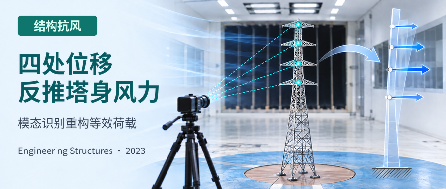

本页依据19页出版社论文，完整精解科学正文与柔度法附录，保留全部62个编号公式、33幅原图、5张表和42条参考文献；按项目范围省略作者贡献、利益冲突、数据可用性和致谢等声明性尾节。

.. contents:: 本页目录
   :local:
   :depth: 3

论文信息
----------------

**原文题名：** Reconstruction of dynamic wind forces on a transmission steel lattice tower using aeroelastic wind tunnel test data。

**作者：** Wentong Zhang、Chao Li（通讯作者）、Gaixia Liu、Yiqing Xiao（通讯作者）。

**单位：** 哈尔滨工业大学（深圳）土木与环境工程学院；哈尔滨工业大学（深圳）实验与创新实践教育中心。单位名称按论文发表时来源保留。

**期刊与年份：** Engineering Structures，275（2023），115167。

**DOI：** `10.1016/j.engstruct.2022.115167 <https://doi.org/10.1016/j.engstruct.2022.115167>`_。

**收稿与出版：** 2022年4月6日收稿，7月16日修回，10月17日录用；2022年11月11日在线发表。

**WOEAI 相关方向：** 工程结构抗风 / 结构抗风。

摘要
----------------

本文提出一种利用有限结构位移估计钢格构塔动力风力的方法，将模态状态空间系统模型与基于Kalman滤波的算法相结合。为便于应用，以等效集中力作为反演对象，表征格构塔上的分布风力。采用相应的等效悬臂杆模型，其刚度矩阵通过修正柔度法估计。依据模态叠加原理，利用识别出的输入模态风力，在物理空间重构动力风力。文中详细设计了动力风力重构方案，选取一座典型输电钢格构塔并开展气弹风洞试验。通过数值模拟与风洞试验，研究所提方案的性能和有效性。结果表明，重构动力风力能够产生与实际相当的动力响应，并对测量噪声影响表现出稳健性。虽然模态力识别对结构固有频率的建模误差较敏感，但可依据所识别模态力功率谱的变化判断这种影响。所提反演方法可作为利用有限响应测量评估钢格构塔动力风力的工具。

**关键词：** 钢格构塔；动力风力重构；等效悬臂杆模型；Kalman滤波；气弹风洞试验。

1 引言
----------------

现代社会对电力和信息通信的需求迅速增长。此类资源网络一旦中断，会造成严重经济与社会后果，因此保障其安全运行十分重要。钢格构塔广泛服务于这类基础设施工程，但由于自重轻、阻尼低，对风环境敏感。近年来，塔结构风致破坏事件屡有报道[1,2]。龙卷风、飓风及其相关事件等恶劣天气引起的灾害也在增加[3]。部分灾害与人们对强风下结构性能认识有限、重视不足有关[4]。因此，研究这类结构的风荷载，是其抗风设计与安全评估的关键。

目前，风洞试验被认为是研究结构风荷载最可靠的途径[5]，但钢格构结构上的风力很难直接测量。此外，由于存在限制与不确定性，结构实际行为可能不同于试验预测。考虑到位移、加速度等动力响应比力更易准确测量，工程领域数十年来一直在尝试间接识别外力[6,7]。自Simonian[8,9]早期将动态规划滤波用于风工程反问题以来，已有多种从结构响应识别风力的方法。

一条路径是直接在物理空间中利用结构响应识别时变风力。Chen和Li[10]假定相邻层风力相关，将一般统计平均算法、最小二乘准则和迭代求解结合，用于估计高层建筑风荷载。Law等[11]提出正则化方法，从结构位移或应变响应识别风力，并在一座50 m高拉线桅杆上作数值应用。不过，这类方法仍预先假定风力分布，并遵循准定常假设。另一条路径是在模态坐标中估计输入模态风力，再依据模态叠加原理重构风荷载。Kazemi Amiri和Bucher[12,13]提出用于推导脉冲响应矩阵的新公式，以识别模态风荷载，并利用现场试验数据研究了一座9.1 m高拉线桅杆。Xue等[14]采用最小方差无偏估计，利用有限结构加速度响应识别高层建筑未知风力。在模态空间中进行识别，不需要预先假设动力风荷载的相关性和分布。

Tuan等[15]最初采用基于Kalman滤波的估计器求解导热反问题。Chen和Lee[16]用类似估计器对多层剪切型结构的输入风荷载进行数值估计，但要求测得所有自由度的完整位移和／或速度，实践中通常难以实现。Zhi和Yu[17]降低系统阶次，并结合模态叠加原理，将该估计器扩展到利用有限结构响应识别高层建筑风力。其中，递推最小二乘估计部分的遗忘因子仍按经验选为常数；稳健、自适应的遗忘因子可进一步改善其应用[18,19]。Hwang等[20,21]也基于Kalman滤波提出实用逆方法，估计单自由度和多自由度系统的模态风荷载，并利用风洞数据应用于一座210 m高烟囱。结合本征正交分解（POD），Zhi等[22,23]进一步扩展该估计器，同步评估高层建筑风致响应与未知输入风荷载。

目前，自立式钢格构塔风荷载研究主要依据风洞试验，利用高频测力天平（HFFB）测量缩尺模型支座力。研究者主要用刚性分段模型评估气动系数[24,25,26]，也有研究根据整塔模型试验在频域中研究广义风力[27,28]。然而，风力空间分布及相关性无法明确体现，计算的结构响应可能与实际情况存在差别。相比之下，这类塔风力的间接估计在文献中较少见。Xiong等[29,30]基于虚拟激励法，从自立式输电格构塔位移响应谱推导风力谱。据本文作者了解，当时尚无其他已发表的系统、适用的研究框架识别此类结构上的时变风力。因此开展这一研究具有价值，有助于理解自立式格构塔在强风中的行为。

直接针对格构塔识别时变风力较困难。为使反演可行，本文选择等效集中力，而不是空间分布风力，作为反演对象。利用有限结构响应，采用Kalman滤波与自适应递推最小二乘估计器相结合的稳健算法（KF-ARLSE），估计输入模态风力，再依据模态叠加原理重构风力。本研究重点不是发展新理论，而是探索自立式钢格构塔风力识别。

本文主要内容安排如下：第2节介绍自立式钢格构塔动力风力重构框架，包括等效悬臂杆模型、模态状态空间系统、KF-ARLSE和叠加重构风荷载；第3节先介绍典型输电塔及等效模型，通过数值模拟验证所提风力重构方案，并考察测量噪声与建模误差影响；第4节介绍输电钢格构塔气弹风洞试验，开展运行模态分析；第5节利用气弹风洞数据重构动力风力，并与风洞结果比较验证；第6节给出结论。

2 自立式钢格构塔动力风力重构框架
----------------------------------

2.1 等效悬臂杆模型
~~~~~~~~~~~~~~~~~~~~~~

本文采用多集中质量（MLM）模型简化并模拟自立式钢格构塔。如图1，沿高度划分 :math:`N` 个分段，将各段自重集中于其代表高度。位于 :math:`z_i` 的第 :math:`i` 个集中质量 :math:`m_i`，通过抗弯刚度均匀为 :math:`EI_i` 的杆件，与下方相邻集中质量 :math:`m_{i+1}` 连接。原文将这一杆件称为“rigid rod”。因此，分布风力转换为集中力 :math:`F_{X,i}`、 :math:`F_{Y,i}\ (i=1,2,\ldots,N)`，作用在等效悬臂杆各集中质量上。总体坐标系X、Y轴分别平行、垂直于横担所在平面。本文分别考虑等效模型在X、Y两个水平方向的动力作用。

.. figure:: ../../../wechat/assets/public-safe/ref-zhang2023-ES/fig-1.png
   :alt: 图1 多集中质量模型（MLM）及其等效风荷载示意图。
   :align: center
   :width: 100%

   图1 多集中质量模型（MLM）及其等效风荷载示意图。

图中主要标注：Distributed wind load：分布风荷载；Equivalent wind load：等效风荷载；Equivalent：等效；(a) Actual Model：（a）实际模型；(b) Equivalent Model：（b）等效模型；m\_i：第 i 个集中质量；EI\_i：第 i 段抗弯刚度；z\_i：第 i 个集中质量的标高；F\_Xi, F\_Yi：第 i 个集中质量处沿 X、Y 轴的等效风力。

确定格构塔分段方案时，应考虑结构布置与基本振型，尽可能相近地逼近质量和刚度分布。MLM质量矩阵为对角矩阵 :math:`\mathbf M=\operatorname{diag}[m_1,m_2,\ldots,m_N]`，各 :math:`m_i` 可直接根据物理模型确定。通常可通过结构柔度矩阵求逆得到MLM刚度矩阵 :math:`\mathbf K` [31]，但不同分段策略可能使其动力特性偏离原模型，实际结构识别模态参数也可能不同于数值模型。因此，受结构损伤识别柔度方法[32]启发，本文采用修正逆方法求解 :math:`\mathbf K`。这样，确定刚度时可要求降阶模型与实际结构的基本模态振动参数一致。修正柔度法的详细表达见附录。

2.2 结构动力方程
~~~~~~~~~~~~~~~~~~~~

受风时，结构动力荷载向量 :math:`\mathbf F(t)` 可分为三个部分：

.. math::

   \boldsymbol{F}(t)=\overline{\boldsymbol{F}}_w+\widetilde{\boldsymbol{F}}_w(t)-\boldsymbol{F}_s(t) \qquad (1)

其中， :math:`\overline{\mathbf F}_w` 为平均风力向量， :math:`\widetilde{\mathbf F}_w(t)` 为脉动风力向量， :math:`\mathbf F_s(t)` 为流固相互作用引起的运动诱导力向量。可以将 :math:`\mathbf F_s(t)` 表示为气动阻尼力[34]，即 :math:`\mathbf F_s(t)=\mathbf C_a\dot{\widetilde{\mathbf x}}(t)`，其中 :math:`\mathbf C_a` 为主要气动阻尼矩阵， :math:`\dot{\widetilde{\mathbf x}}(t)` 为结构速度向量。因此，总阻尼矩阵 :math:`\mathbf C=\mathbf C_s+\mathbf C_a`， :math:`\mathbf C_s` 为结构自身阻尼矩阵。

结构动力方程为：

.. math::

   \boldsymbol{M}\ddot{\widetilde{\boldsymbol{x}}}(t)+\boldsymbol{C}\dot{\widetilde{\boldsymbol{x}}}(t)+\boldsymbol{K}\widetilde{\boldsymbol{x}}(t)=\widetilde{\boldsymbol{F}}_w(t) \qquad (2)

其中， :math:`\ddot{\widetilde{\mathbf x}}(t)`、 :math:`\widetilde{\mathbf x}(t)` 分别为加速度与位移向量。

变换到模态坐标后，式(2)可写为：

.. math::

   \ddot q_i(t)+2\xi_i\omega_i\dot q_i(t)+\omega_i^2q_i(t)=F_i(t)\quad(i=1,2,\ldots,N) \qquad (3)

其中， :math:`q_i`、 :math:`\xi_i`、 :math:`\omega_i` 和 :math:`F_i(t)` 分别为第 :math:`i` 阶模态位移、阻尼比、圆频率和模态力。 :math:`\xi_i` 包含结构阻尼比与气动阻尼比。

2.3 结构动力风荷载重构
~~~~~~~~~~~~~~~~~~~~~~~~~~

2.3.1 模态坐标中的状态空间模型
^^^^^^^^^^^^^^^^^^^^^^^^^^^^^^^^^^^^

式(3)的连续时间状态空间方程可表示为：

.. math::

   \begin{bmatrix}\dot q_i(t)\\\ddot q_i(t)\end{bmatrix}=\begin{bmatrix}0&1\\-\omega_i^2&-2\xi_i\omega_i\end{bmatrix}\begin{bmatrix}q_i(t)\\\dot q_i(t)\end{bmatrix}+\begin{bmatrix}0\\1\end{bmatrix}F_i(t) \qquad (4)

定义：

.. math::

   \boldsymbol{X}_i(t)=\begin{bmatrix}q_i(t)&\dot q_i(t)\end{bmatrix}^{T} \qquad (5)

.. math::

   \boldsymbol{A}_i=\begin{bmatrix}0&1\\-\omega_i^2&-2\xi_i\omega_i\end{bmatrix} \qquad (6)

.. math::

   \boldsymbol{B}_i=\begin{bmatrix}0&1\end{bmatrix}^{T} \qquad (7)

式(4)可转换为：

.. math::

   \dot{\boldsymbol{X}}_i(t)=\boldsymbol{A}_i\boldsymbol{X}_i(t)+\boldsymbol{B}_iF_i(t) \qquad (8)

令采样时间参数为 :math:`\Delta t`，考虑系统噪声 :math:`w_i(k)` 的离散时间状态空间模型为：

.. math::

   \boldsymbol{X}_i(k+1)=\boldsymbol\Psi_i\boldsymbol{X}_i(k)+\boldsymbol\Gamma_i[F_i(k)+w_i(k)] \qquad (9)

.. note::

   原文此处称 :math:`\Delta t` 为sampling rate（采样率），但紧接着使用 :math:`k\Delta t` 作为时间，并在式(10)、(11)中作为时间步长。本页保留符号与全部原式，按其实际用法说明，不将 :math:`\Delta t` 当作以Hz计的频率。

其中， :math:`k` 为时间索引， :math:`\mathbf X_i(k)=\mathbf X_i(k\Delta t)`， :math:`F_i(k)=F_i(k\Delta t)`； :math:`\mathbf\Psi_i`、 :math:`\mathbf\Gamma_i` 分别为 :math:`2\times2` 状态转移矩阵和 :math:`2\times1` 过程噪声矩阵，可由下式求得：

.. math::

   \boldsymbol\Psi_i=\exp(\boldsymbol{A}_i\Delta t) \qquad (10)

.. math::

   \boldsymbol\Gamma_i=\int_{k\Delta t}^{(k+1)\Delta t}\exp\{\boldsymbol{A}_i[(k+1)\Delta t-\tau]\}\boldsymbol{B}_i\,d\tau \qquad (11)

相应地，含测量噪声 :math:`v_i(k)` 的离散测量方程为：

.. math::

   \boldsymbol{Z}_i(k)=\boldsymbol{H}_i\boldsymbol{X}_i(k)+v_i(k) \qquad (12)

其中， :math:`Z_i(k)` 表示第 :math:`i` 阶模态的测量响应； :math:`\mathbf H_i` 为指示测量对象的选择矩阵。对应 :math:`\mathbf X_i(k)`，本文只测量模态位移 :math:`q_i(k)`，因此 :math:`\mathbf H_i=[1\ \ 0]`。

此外，假定 :math:`w_i(k)` 与 :math:`v_i(k)` 为互不相关、零均值的白噪声，其协方差分别为 :math:`Q_i` 与 :math:`R_i`。

2.3.2 输入模态力反演
^^^^^^^^^^^^^^^^^^^^^^^^^^

KF-ARLSE已用于具有完整响应测量的力估计[18,19]，但实践中很难获得完整响应。本文依据离散状态方程(9)、(12)，采用KF-ARLSE从模态响应估计未知输入模态力。

算法包括两步，为简洁起见只给出最终表达式。第一步为离散Kalman滤波，其方程为：

.. math::

   \overline{\boldsymbol{X}}_i(k/k-1)=\boldsymbol\Psi_i\overline{\boldsymbol{X}}_i(k-1) \qquad (13)

.. math::

   \boldsymbol{P}_i(k/k-1)=\boldsymbol\Psi_i\boldsymbol{P}_i(k-1)\boldsymbol\Psi_i^{T}+\boldsymbol\Gamma_i \boldsymbol{Q}_i\boldsymbol\Gamma_i^{T} \qquad (14)

.. math::

   \boldsymbol{S}_i(k)=\mathbf H_i\boldsymbol{P}_i(k/k-1)\mathbf H_i^{T}+R_i \qquad (15)

.. math::

   \boldsymbol{G}_i(k)=\boldsymbol{P}_i(k/k-1)\mathbf H_i^{T}\boldsymbol{S}_i^{-1}(k) \qquad (16)

.. math::

   \boldsymbol{P}_i(k)=[\boldsymbol{I}-\boldsymbol{G}_i(k)\mathbf H_i]\boldsymbol{P}_i(k/k-1) \qquad (17)

.. math::

   \overline{\mathbf Z}_i(k)=\mathbf Z_i(k)-\mathbf H_i\overline{\boldsymbol{X}}(k/k-1) \qquad (18)

.. math::

   \overline X_i(k)=\overline X(k/k-1)+G_i(k)\overline{\mathrm{Z}}_i(k) \qquad (19)

其中， :math:`\overline{\mathbf X}_i(k)` 为更新状态估计， :math:`\overline{\mathbf X}_i(k/k-1)` 为状态预测； :math:`\mathbf P_i(k/k-1)` 为状态预测协方差， :math:`\mathbf P_i(k)` 为更新状态协方差； :math:`S_i(k)` 为残差新息协方差， :math:`\mathbf G_i(k)` 为Kalman增益， :math:`\overline Z_i(k)` 为残差新息。

.. note::

   式(18)、(19)右端预测状态原文使用没有 :math:`i` 下标的 :math:`\overline{\mathbf X}`，其余相关表达使用带下标状态。本页保留原式，不暗中补齐下标。

第二步为递推最小二乘估计器。求解输入模态力的起始时程时，其方程为：

.. math::

   B_{si}(k)=\mathrm{H}_i[\Psi_i M_{si}(k-1)+I]\Gamma_i \qquad (20)

.. math::

   M_{si}(k)=[I-G_i(k)\mathrm{H}_i][\psi_i M_{si}(k-1)+I] \qquad (21)

.. math::

   \begin{aligned}G_{si}(k)&=\lambda^{-1}(k)P_{si}(k-1)[B_{si}(k)]^{T}\\&\quad\cdot\{B_{si}(k)\lambda^{-1}(k)P_{si}(k-1)[B_{si}(k)]^{T}+S_i(k)\}^{-1}\end{aligned} \qquad (22)

.. math::

   P_{si}(k)=[I-G_{si}(k)B_{si}(k)]\lambda^{-1}(k)P_{si}(k-1) \qquad (23)

.. math::

   \widehat F_i(k)=\widehat F_i(k-1)+G_{si}(k)[\overline{\mathrm{Z}}_i(k)-B_{si}(k)\widehat F_i(k-1)] \qquad (24)

.. note::

   式(20)状态转移符号写大写 :math:`\Psi_i`，式(21)相应位置却印为小写 :math:`\psi_i`。此处分别照录并保留源内记号差别，不能据此声称已复原作者算法代码。

其中， :math:`\mathbf B_{s i}(k)` 和 :math:`\mathbf M_{s i}(k)` 为灵敏度矩阵； :math:`\mathbf G_{s i}(k)` 为更新估计输入力的修正增益； :math:`\mathbf P_{s i}(k)` 为估计输入力误差协方差； :math:`\widehat F_i(k)` 为估计的输入模态力。

将测量噪声标准差 :math:`\sigma_i` 作为可接受阈值，自适应遗忘因子 :math:`\lambda(k)` 由下式确定：

.. math::

   \lambda(k)=\begin{cases}1,&|\overline Z_i(k)|,\sigma_i\\\dfrac{\sigma_i}{|\overline Z_i(k)|},&|\overline Z_i(k)|,\sigma_i\end{cases} \qquad (25)

.. note::

   原文式(25)两行分支条件均印成 :math:`|\overline Z_i(k)|,\sigma_i`，可见的是逗号而非不等号，因此无法仅按该排印表达确定各分支的适用区间。本页保留原式；阈值判别需要核对作者实现或进一步说明，不擅自补为小于等于／大于。

2.3.3 依据模态叠加原理重构动力风力
^^^^^^^^^^^^^^^^^^^^^^^^^^^^^^^^^^^^^^^^

给定观测自由度的有限响应 :math:`\widetilde{\mathbf x}_{p\times1}`，前 :math:`s` 阶振动模态的模态位移响应 :math:`\mathbf q^*_{s\times1}` 可近似为：

.. math::

   \left\{\begin{aligned}q^*_{s\times1}&=\varphi^+_{p\times s}\widetilde{x}_{p\times1}\\q^*_{s\times1}&=\varphi^{-1}_{p\times s}\widetilde{x}_{p\times1},\ \text{if }p=s\end{aligned}\right. \qquad (26)

其中， :math:`\boldsymbol\varphi_{p\times s}` 为 :math:`N\times N` 振型矩阵 :math:`\boldsymbol\varphi_{N\times N}` 的 :math:`p\times s` 子矩阵； :math:`\boldsymbol\varphi^+_{p\times s}` 为该振型子矩阵的伪逆，即：

.. math::

   \boldsymbol\varphi^{+}_{p\times s}=[\boldsymbol\varphi^{T}_{p\times s}\boldsymbol\varphi_{p\times s}]^{-1}\boldsymbol\varphi^{T}_{p\times s} \qquad (27)

实际中，所考虑模态应至少覆盖主导结构动力响应的模态。利用估计的 :math:`\mathbf q^*_{s\times1}`，可由KF-ARLSE估计前 :math:`s` 阶模态输入力 :math:`\widehat F_i(k)\ (i=1,2,\ldots,s)`。

在质量归一化条件下，可推导得到：

.. math::

   \Theta_{N\times N}=[\varphi^{T}_{N\times N}]^{-1}=M\varphi_{N\times N} \qquad (28)

进而，考虑前 :math:`s` 阶模态贡献，脉动风荷载向量可近似表示为：

.. math::

   \widehat{\widetilde F}_{N\times1}=\Theta_{N\times s}[\widehat F_1,\widehat F_2,\ldots,\widehat F_s]^{T} \qquad (29)

其中， :math:`\boldsymbol\Theta_{N\times s}` 为 :math:`\boldsymbol\Theta_{N\times N}` 前 :math:`s` 列组成的 :math:`N\times s` 子矩阵。重构脉动风力并非结构上的实际输入力，本质上是模态力经幅值调制后的叠加；参与模态数增加时，估计风力会更接近真实值。

2.4 动力风力重构方案
~~~~~~~~~~~~~~~~~~~~~~~~

图2为自立式格构塔动力风力重构框架。本研究将结构参数视为建立模态状态空间模型的先验信息，包括前 :math:`s` 阶模态的固有频率、阻尼比和振型。因此，为获得可靠结构信息，首先应建立有限元（FEM）模型，制定合理塔体分段方案和测量方案。测量内容包括风场与结构动力响应两部分。

.. figure:: ../../../wechat/assets/public-safe/ref-zhang2023-ES/fig-2.png
   :alt: 图2 钢格构塔风荷载重构框架。
   :align: center
   :width: 100%

   图2 钢格构塔风荷载重构框架。

图中主要标注：FEM modeling：有限元建模；Modal analysis：模态分析；Verification and modification of vibration：振动特性的验证与修正；Modal parameters identification：模态参数识别；Damping ratios of fundamental modes：基本模态的阻尼比；Determination of Rayleigh damping model：确定瑞利阻尼模型；Field measurement strategy：现场测量方案；Selection of sensor locations：选择传感器位置；Observation of wind field and structural displacement：观测风场与结构位移；Fluctuating displacement：脉动位移；Mean displacement：平均位移；Profile of mean wind velocity：平均风速剖面；Equivalent multi-lumped masses model：等效多集中质量模型；Selection of vibrational modes：选择振动模态；Modal response approximation：模态响应近似；Establishment of state-space system in modal coordinate：在模态坐标下建立状态空间系统；Input modal force inversing：输入模态力反演；Reconstruction of structural fluctuating wind forces：结构脉动风力重构；Segment strategy of transmission tower：输电塔分段方案；Mass concentration for segments：各段质量集中处理；Determination of equivalent stiffness：确定等效刚度；Estimation of structural mean wind forces：估计结构平均风力；Estimation of total wind forces：估计总风力。

材料性质、边界条件等不确定性会使数值模型与实际模型存在差别。节点连接和地基土刚度也影响FEM模型与实际钢格构结构的一致性[33]。应根据试验或测量数据识别出的动力参数修正和更新数值模型。所建立的等效悬臂杆模型，为风力重构过程中的模型修正提供了方便途径。

在模态空间执行KF-ARLSE，可通过模态响应识别输入模态风力，再依据模态叠加原理重构脉动风力。此外，需要依据更新后的等效模型重构动力响应，以检验重构动力风力。

受篇幅限制，本文没有确定结构平均风力向量 :math:`\overline{\mathbf F}_w`。直接依据 :math:`\overline{\mathbf F}_w=\mathbf K\overline{\mathbf x}` 求解，其中 :math:`\overline{\mathbf x}` 为平均位移向量，通常会因测量不完整和模型不确定性而成为病态问题。实践中，可依据准定常理论，利用平均风场测量评估平均风力，最终重构总风力。

.. note::

   这里说明了组合平均风力的可行路径，但本篇反演和验证对象是脉动风力；不能将其写成已经完整反演了平均荷载或每个杆件的真实时变受力。

3 数值验证
----------------

3.1 研究对象与结构模型
~~~~~~~~~~~~~~~~~~~~~~~~~~

3.1.1 输电塔及其有限元模型
^^^^^^^^^^^^^^^^^^^^^^^^^^^^^^^^

本文研究中国南方220 kV高压输电线路工程采用的一座典型输电塔。如图3，该塔由角钢建成，高42.5 m，具有四层横担。除辅助构件L45×5外，其余构件截面均列于图3；构件采用螺栓连接。

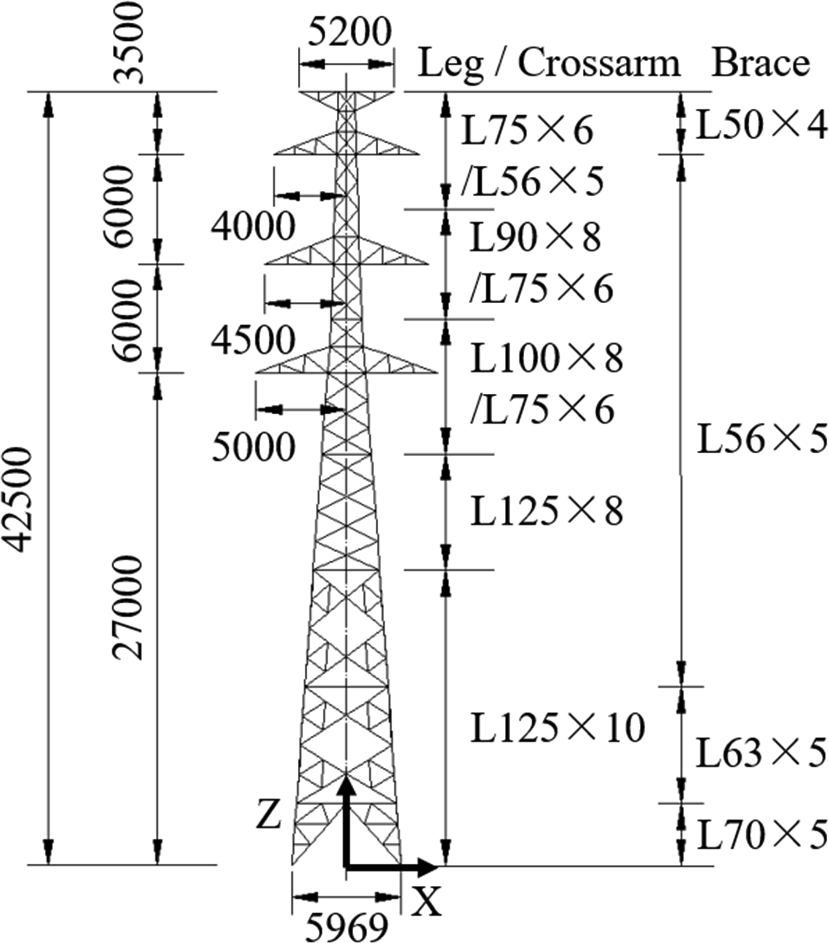

   图3 输电塔示意图（单位：mm）。

图中主要标注：Leg / Crossarm：主材／横担；Brace：斜材；L75×6 等：角钢截面规格；X / Z：X 轴／Z 轴；42500：总高度42500 mm。

采用结构分析软件Sap2000建立该塔FEM模型（图4），全模型包含1076个L形截面框架单元和418个节点。构件间全部连接均按刚接建模，塔脚完全固定。钢材预期弹性模量为 :math:`206.0\,\mathrm{GPa}`，泊松比为0.3；材料密度设为 :math:`\delta_m\times7805\,\mathrm{kg/m^3}`，其中 :math:`\delta_m=1.21`，用来统一考虑节点连接与其他附件的附加质量。基本模态动力特性见图5。

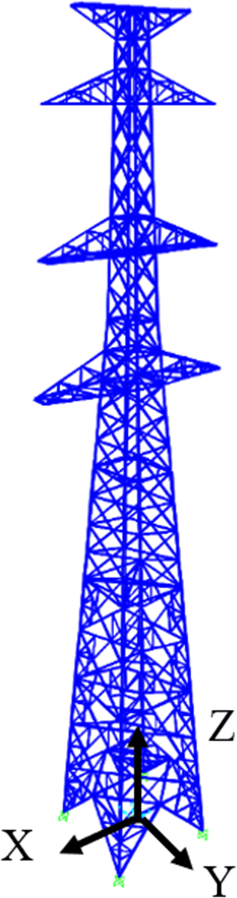

   图4 输电塔有限元模型。

图中主要标注：X / Y / Z：结构 X／Y／Z 坐标轴。

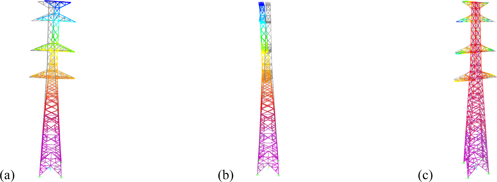

   图5 输电塔的动力特性：（a）X 向一阶模态（2.013 Hz）；（b）Y 向一阶模态（2.023 Hz）；（c）扭转模态（6.678 Hz）。

图中主要标注：(a)：X 向一阶模态；(b)：Y 向一阶模态；(c)：扭转模态。

3.1.2 等效悬臂杆模型验证
^^^^^^^^^^^^^^^^^^^^^^^^^^^^^^

将输电塔划分为10段，各段质量集中于图6所示代表高度。物理参数列于表1，其中 :math:`A_{s,i}` 为第 :math:`i` 段垂直于横担平面的投影面积， :math:`EI_{X,i}`、 :math:`EI_{Y,i}` 分别为该段等效杆在X、Y方向得到的抗弯刚度。 :math:`EI_X`、 :math:`EI_Y` 利用FEM模型动力特性，按附录方法求得。MLM的质量矩阵 :math:`\mathbf M=\operatorname{diag}[m_1,m_2,\ldots,m_{10}]` 由各 :math:`m_i\ (i=1,2,\ldots,10)` 确定； :math:`\mathbf K_X`、 :math:`\mathbf K_Y` 分别利用 :math:`EI_{X,i}`、 :math:`EI_{Y,i}` 按式(A-22)～(A-25)求得。为简洁起见，原文没有详列 :math:`\mathbf M`、 :math:`\mathbf K_X` 和 :math:`\mathbf K_Y`。

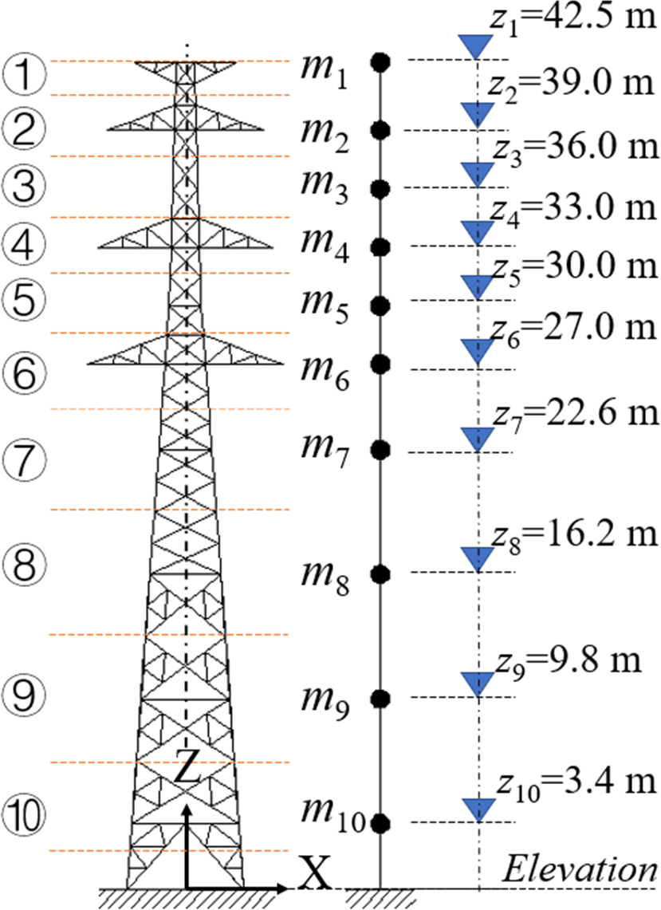

   图6 输电塔的等效悬臂模型。

图中主要标注：Elevation：标高；m\_1–m\_10：第1至10个集中质量；z\_1–z\_10：第1至10个集中质量的标高；X / Z：X 轴／Z 轴。

.. list-table:: 表1 等效模型参数。
   :header-rows: 1

   * - 分段
     - 代表高度 :math:`z_i/\mathrm m`
     - 投影面积 :math:`A_{s,i}/\mathrm{m^2}`
     - 质量 :math:`m_i/\mathrm{kg}`
     - X向抗弯刚度 :math:`EI_{X,i}/(\mathrm{N\,m^2})`
     - Y向抗弯刚度 :math:`EI_{Y,i}/(\mathrm{N\,m^2})`
   * - 1
     - 42.5
     - 1.31
     - 305.4
     - 8.682 × 10⁷
     - 1.334 × 10⁸
   * - 2
     - 39.0
     - 2.16
     - 593.8
     - 6.329 × 10⁸
     - 4.779 × 10⁸
   * - 3
     - 36.0
     - 0.88
     - 272.8
     - 2.677 × 10⁸
     - 3.342 × 10⁸
   * - 4
     - 33.0
     - 2.57
     - 781.5
     - 1.063 × 10⁹
     - 9.707 × 10⁸
   * - 5
     - 30.0
     - 1.18
     - 396.1
     - 6.499 × 10⁸
     - 7.697 × 10⁸
   * - 6
     - 27.0
     - 3.08
     - 916.2
     - 1.853 × 10⁹
     - 1.796 × 10⁹
   * - 7
     - 22.6
     - 2.79
     - 964.4
     - 4.132 × 10⁹
     - 4.574 × 10⁹
   * - 8
     - 16.2
     - 3.55
     - 1291.5
     - 8.747 × 10⁹
     - 7.744 × 10⁹
   * - 9
     - 9.8
     - 3.96
     - 1416.3
     - 1.380 × 10¹⁰
     - 1.553 × 10¹⁰
   * - 10
     - 3.4
     - 3.31
     - 1717.2
     - 1.146 × 10¹⁰
     - 1.020 × 10¹⁰

弯曲振动频率列于表2，误差表示MLM与FEM的偏差。MLM在X、Y方向的第一阶频率分别与FEM几乎相等；第二阶频率误差分别为6.94%和7.45%。图7给出相应的质量归一化弯曲振型。MLM两方向第一阶振型分别与FEM一致；第二阶振型存在一定但可接受的偏差。因此，所获MLM整体上能够符合原FEM模型。为方便起见，后续计算采用MLM。

.. list-table:: 表2 弯曲振动频率。
   :header-rows: 1

   * - 模态
     - X方向 MLM/Hz
     - X方向 FEM/Hz
     - X方向误差
     - Y方向 MLM/Hz
     - Y方向 FEM/Hz
     - Y方向误差
   * - 一阶
     - 2.012
     - 2.013
     - −0.06 %
     - 2.022
     - 2.023
     - −0.07 %
   * - 二阶
     - 6.660
     - 6.198
     - 6.94 %
     - 6.841
     - 6.331
     - 7.45 %

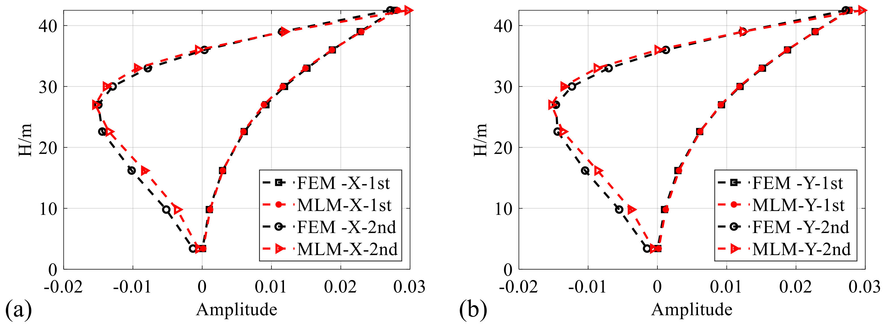

   图7 弯曲振型：（a）X 方向；（b）Y 方向。

图中主要标注：Amplitude：振型幅值；H/m：高度（m）；FEM-X-1st / FEM-Y-1st：有限元模型 X／Y 向一阶振型；MLM-X-1st / MLM-Y-1st：多集中质量模型 X／Y 向一阶振型；FEM-X-2nd / FEM-Y-2nd：有限元模型 X／Y 向二阶振型；MLM-X-2nd / MLM-Y-2nd：多集中质量模型 X／Y 向二阶振型；(a) / (b)：X 方向／Y 方向。

3.2 输电塔动力响应模拟
~~~~~~~~~~~~~~~~~~~~~~~~~~

由于不易获得格构塔实际风荷载，先安排数值模拟。平均风速与湍流强度剖面取GB 50009—2012[35]规定的B类风场，目标谱采用风洞流场纵向脉动经验谱[28]，不同高度风速相关性采用原文所引Shiotani[38]相干函数。塔顶（图6测点1）参考风速为 :math:`\overline U_H=37.5\,\mathrm{m/s}`，采样率10 Hz，时长600 s；用谐波叠加法[37]生成高度 :math:`z` 处脉动风速时程 :math:`u(z,t)`。图8给出模拟脉动风样本，表明模拟功率谱密度（PSD）与目标吻合良好。

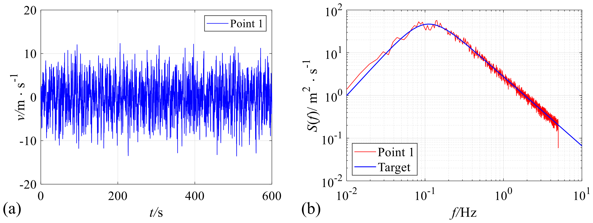

   图8 点1处模拟的脉动风速：（a）时程；（b）功率谱密度（PSD）。

图中主要标注：Point 1：点1；Target：目标谱；v/(m·s⁻¹)：脉动风速（m/s）；t/s：时间（s）；S(f)/(m²·s⁻¹)：风速功率谱密度（m²/s）；f/Hz：频率（Hz）；(a) / (b)：时程／功率谱密度。

依据准定常假设，第 :math:`i` 段脉动风荷载可近似为：

.. math::

   \widetilde F_w(z_i,t)\approx\rho_a C_{D,i}A_{s,i}\mu_{w,i}\overline U(z_i)u(z_i,t) \qquad (30)

其中， :math:`\rho_a` 为空气密度， :math:`C_{D,i}` 为阻力系数， :math:`\mu_{w,i}` 为斜风荷载分配系数， :math:`\overline U(z_i)` 为 :math:`z_i` 处平均风速。

输电塔在侧向来风下的性能较受工程关注。本节在风沿X方向时，仅模拟X轴向动力响应。全塔统一采用 :math:`C_D=2.5` [28]；横担取 :math:`\mu_{w,i}=0.45`，塔身取 :math:`\mu_{w,i}=1.0` [39]。基于X方向等效MLM，采用常规Newmark-β算法计算结构动力响应， :math:`\beta=0.25`。此外，将总阻尼矩阵 :math:`\mathbf C` 假定为Rayleigh阻尼矩阵，前两阶模态阻尼比均设为0.02，近似考虑结构阻尼和气动阻尼。

在准确位移时程中加入高斯白噪声以表示测量误差，即：

.. math::

   \boldsymbol{x}_{kr}=\boldsymbol{x}_k+\gamma_d\boldsymbol{\sigma}_x\boldsymbol{r}_k \qquad (31)

其中， :math:`x_{kr}`、 :math:`x_k` 分别表示受噪声污染和未受污染的时程， :math:`\gamma_d` 为噪声水平， :math:`\sigma_x` 为位移标准差， :math:`r_k` 为缩放后的白噪声。

3.3 用模拟数据验证动力风力重构
~~~~~~~~~~~~~~~~~~~~~~~~~~~~~~~~~~

依据POD技术[22]，目标塔第一阶模态的能量贡献已超过99%，因此动力风力重构只考虑其贡献。对受污染位移数据采用截止频率3 Hz的低通滤波，以减弱噪声相对高频部分的影响。利用代表四层横担的质量点，即图6测点1、2、4、6的响应，近似模态位移，再由KF-ARLSE识别输入模态力。实践中，系统噪声与测量噪声协方差无法预先知道，但可采用标准正则化参数估计技术[40]确定；本文取 :math:`Q_1=1`、 :math:`R_1=10^{-8}`。

首先检验位移测量噪声水平 :math:`\gamma_d` 对风力重构的影响，分别取0%、10%和20%。如图9，三种噪声水平下识别的模态力时程都与准确值几乎一致。

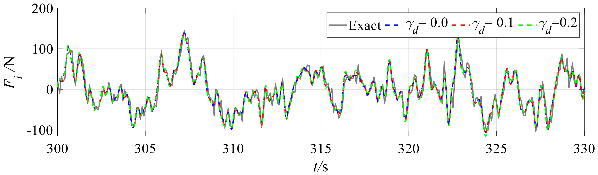

   图9 识别得到的输入模态力时程。

图中主要标注：Exact：精确值；γ\_d = 0.0 / 0.1 / 0.2：测量噪声水平为0%、10%、20%；F\_i/N：输入模态力（N）；t/s：时间（s）。

按式(29)，利用识别出的模态力重构脉动风力。例如，测点1、6的风力时程见图10。重构时程与准确值存在一定差别，但输入风力的波动趋势相似。由于估计脉动风力是输入模态力的幅值调制，仅考虑第一阶模态，不能完整反映实际输入。

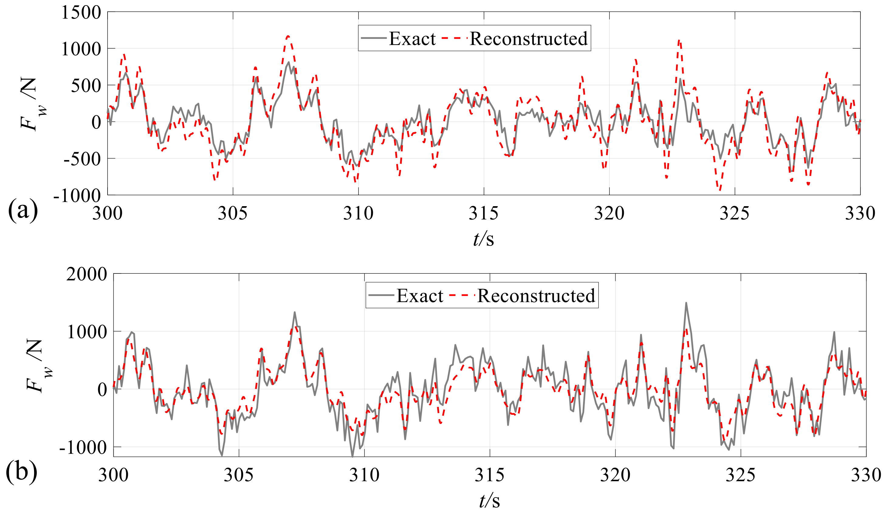

   图10 脉动风力时程：（a）点1；（b）点6。

图中主要标注：Exact：精确值；Reconstructed：重构值；F\_w/N：脉动风力（N）；t/s：时间（s）；(a) / (b)：点1／点6。

将重构脉动风力施加于等效模型，用Newmark-β算法分析动力响应。图11、12分别在时域和频域比较重构位移与准确结果，整体上未见显著差别。

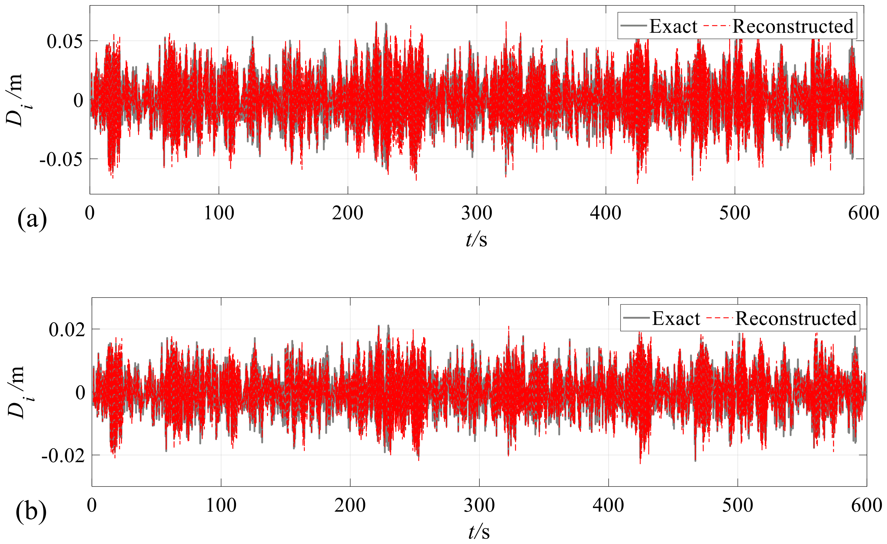

   图11 脉动位移时程：（a）点1；（b）点6。

图中主要标注：Exact：精确值；Reconstructed：重构值；D/m：脉动位移（m）；t/s：时间（s）；(a) / (b)：点1／点6。

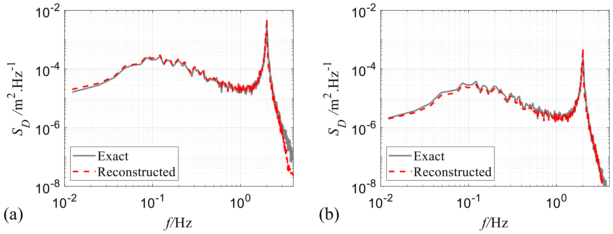

   图12 脉动位移的功率谱密度：（a）点1；（b）点6。

图中主要标注：Exact：精确值；Reconstructed：重构值；S\_D/(m²·Hz⁻¹)：位移功率谱密度（m²/Hz）；f/Hz：频率（Hz）；(a) / (b)：点1／点6。

3.4 建模误差敏感性分析
~~~~~~~~~~~~~~~~~~~~~~~~~~

3.4.1 固有频率误差敏感性
^^^^^^^^^^^^^^^^^^^^^^^^^^^^^^

按 :math:`f_r=f_T+\Delta f\times f_T` 施加固有频率建模误差，其中 :math:`\Delta f` 表示固有频率的相对变化， :math:`f_r`、 :math:`f_T` 分别为带误差值和真实值。采用 :math:`\gamma_d=10\%` 的受污染响应作为测量数据，并相应地用施加建模误差的MLM模拟结构动力响应。

识别模态力时程见图13。其变化趋势与准确值相似，但 :math:`\Delta f=+0.1` 时幅值大于其他情况， :math:`\Delta f=-0.1` 时幅值相对较小。图14比较模态力PSD。当 :math:`\Delta f=+0.1` 且频率约低于1.5 Hz时，估计谱值略大于准确值；在固有频率 :math:`f_T` 附近，估计谱先在准确谱线上方显著增大，再急剧降至其下方。当 :math:`\Delta f=-0.1` 时，情况与正误差相反。因此，在一定程度上可依据估计PSD的显著变化判断固有频率偏差。

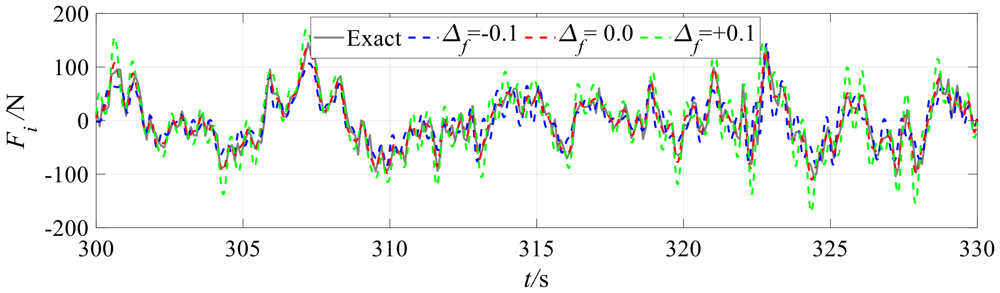

   图13 存在固有频率误差时识别得到的模态力时程。

图中主要标注：Exact：精确值；Δ\_f = −0.1 / 0.0 / +0.1：固有频率相对误差为−10%、0、+10%；F\_i/N：模态力（N）；t/s：时间（s）。

.. figure:: ../../../wechat/assets/public-safe/ref-zhang2023-ES/fig-14.png
   :alt: 图14 存在固有频率误差时识别得到的模态力功率谱密度。
   :align: center
   :width: 100%

   图14 存在固有频率误差时识别得到的模态力功率谱密度。

图中主要标注：Exact：精确值；Δ\_f = −0.1 / 0.0 / +0.1：固有频率相对误差为−10%、0、+10%；S\_Fi/(N²·Hz⁻¹)：模态力功率谱密度（N²/Hz）；f/Hz：频率（Hz）。

图15比较位移均方根（RMS）。 :math:`\Delta f=-0.1` 时结果小于准确值，塔顶误差为−8.3%； :math:`\Delta f=+0.1` 时结果大于准确值，塔顶误差约为13.1%。

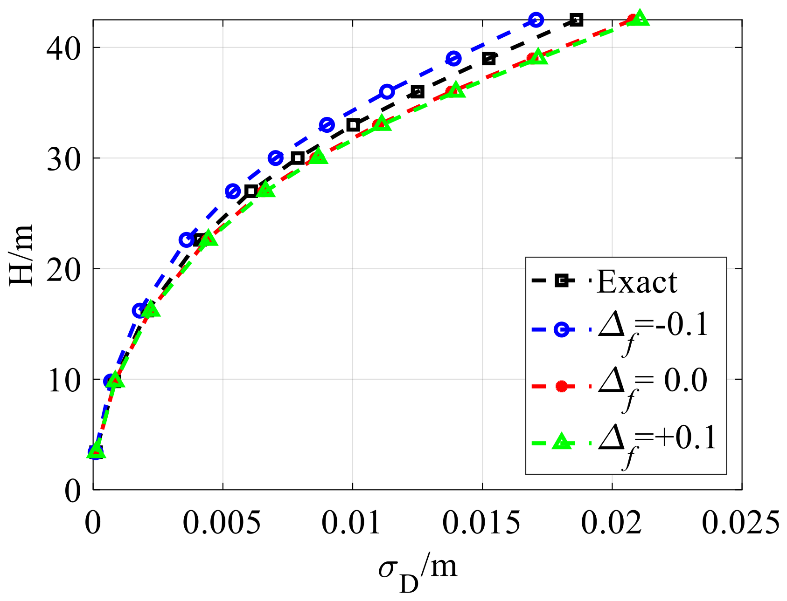

   图15 存在固有频率误差时重构位移的均方根。

图中主要标注：Exact：精确值；Δ\_f = −0.1 / 0.0 / +0.1：固有频率相对误差为−10%、0、+10%；σ\_D/m：位移均方根（m）；H/m：高度（m）。

3.4.2 阻尼比误差敏感性
^^^^^^^^^^^^^^^^^^^^^^^^^^^^

取阻尼比 :math:`\xi=0.01`、0.02和0.03，图16、17分别在时域和频域比较识别模态力，显示阻尼比偏差几乎不影响所识别输入模态力。

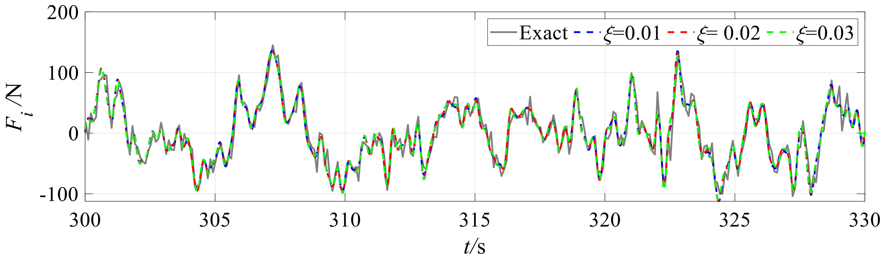

   图16 存在阻尼比误差时识别得到的模态力时程。

图中主要标注：Exact：精确值；ξ = 0.01 / 0.02 / 0.03：阻尼比为1%、2%、3%；F\_i/N：模态力（N）；t/s：时间（s）。

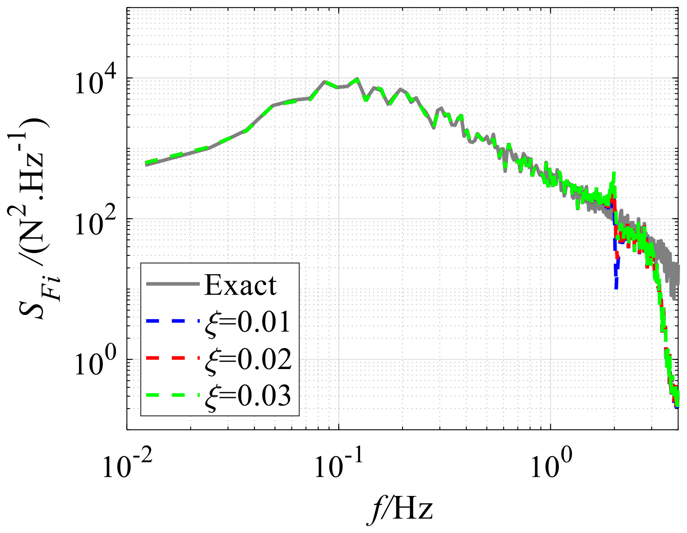

   图17 存在阻尼比误差时识别得到的模态力功率谱密度。

图中主要标注：Exact：精确值；ξ = 0.01 / 0.02 / 0.03：阻尼比为1%、2%、3%；S\_Fi/(N²·Hz⁻¹)：模态力功率谱密度（N²/Hz）；f/Hz：频率（Hz）。

相应位移RMS见图18。 :math:`\xi=0.01` 时，结果大于 :math:`\xi=0.02` 工况，塔顶误差29.9%； :math:`\xi=0.03` 时，结果略小于 :math:`\xi=0.02` 工况，原文报告塔顶误差6.3%。因此，在验证风力重构时，准确识别动力参数是必要的。

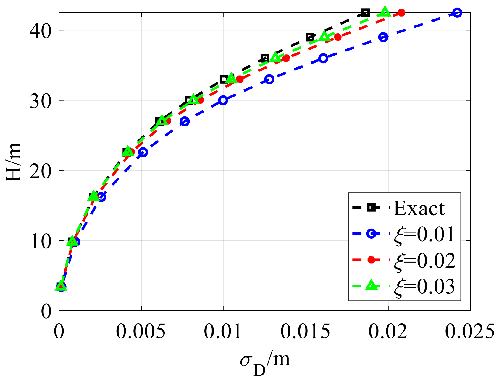

   图18 存在阻尼比误差时重构位移的均方根。

图中主要标注：Exact：精确值；ξ = 0.01 / 0.02 / 0.03：阻尼比为1%、2%、3%；σ\_D/m：位移均方根（m）；H/m：高度（m）。

.. note::

   阻尼变化对“识别出的模态力”影响小，不等于对“施加该力后算出的位移”影响也小。上述两个结果对应不同输出量；6.3%按原文作为误差大小保留；“略小于”的比较对象是阻尼比0.02工况，而不是准确值，不能据此改写为相对准确值低估6.3%。

4 输电塔气弹风洞试验
----------------------

4.1 结构与测量布置
~~~~~~~~~~~~~~~~~~~~~~

对输电塔开展气弹风洞试验（图19）。缩尺气弹模型按相似律设计，同时为可行性放宽部分次要相似要求。试验模型与原型严格满足Cauchy数和Strouhal数相似，而经审慎判断放宽Froude数和Reynolds数相似。取几何相似比 :math:`\lambda_L=1:25`、风速相似比 :math:`\lambda_U=1:3`，可推得表3所列原型与缩尺模型性质。依据GB 50009—2012[35]，在风洞内模拟B类大气边界层流场。试验布置见图19，缩尺塔模型与风洞流场详细描述见先前研究[28]。

.. figure:: ../../../wechat/assets/public-safe/ref-zhang2023-ES/fig-19.png
   :alt: 图19 风洞试验布置。
   :align: center
   :width: 100%

   图19 风洞试验布置。

图中主要标注：Camera：相机；Entrance of wind tunnel flow field：风洞流场入口；Tower model：塔模型；#1 / #2 / #4 / #6：测点1／2／4／6；z\_1 = 1.70 m / z\_2 = 1.56 m / z\_4 = 1.32 m / z\_6 = 1.08 m：缩尺模型测点标高依次为1.70、1.56、1.32、1.08 m。

.. list-table:: 表3 气弹性模型的特性。
   :header-rows: 1

   * - 属性
     - 子项
     - 原型
     - 缩尺比
     - 缩尺模型
   * - 高度
     -
     - 42.5 m
     - 1:25
     - 1.7 m
   * - 质量
     -
     - 8982.2 kg
     - 1:25³
     - 0.56 kg
   * - 固有频率
     - X轴一阶模态
     - 2.013 Hz
     - 8.33:1
     - 16.056 Hz
   * - 固有频率
     - Y轴一阶模态
     - 2.023 Hz
     - 8.33:1
     - 16.113 Hz
   * - 固有频率
     - 扭转模态
     - 6.678 Hz
     - 8.33:1
     - 54.83 Hz
   * - 阻尼比
     -
     - 1 %
     - 1:1
     - ≈1%

.. note::

   表1显示的10段质量相加为8655.2 kg（此为据表值的核算），表3原型质量列8982.2 kg。原文未解释这两种质量口径的差别，本页保留两表，不猜补附件质量或以合计覆盖原表。

.. note::

   表3的频率缩尺因子列为8.33:1，但将所列各模型频率除以原型频率，数值并不完全等于该比例。本文分别保留名义相似比与列出的模型／原型频率，不用名义比例重算覆盖原表。

图20给出风向与塔体轴线关系， :math:`\theta=0^\circ` 和 :math:`90^\circ` 分别沿Y轴与X轴。试验采用7个风向，从 :math:`0^\circ` 到 :math:`90^\circ`，间隔 :math:`15^\circ`；两种风速对应原型尺度塔顶平均风速 :math:`\overline U_H=32.4\,\mathrm{m/s}`、 :math:`37.5\,\mathrm{m/s}`。利用图19所示商用运动捕捉系统测量塔在X、Y方向的动力位移。采样率179 Hz时，位移测量精度标定为0.015 mm。本研究采用图19塔模型上标记点的测量数据；这些点的编号与图6 MLM集中质量点一一对应。

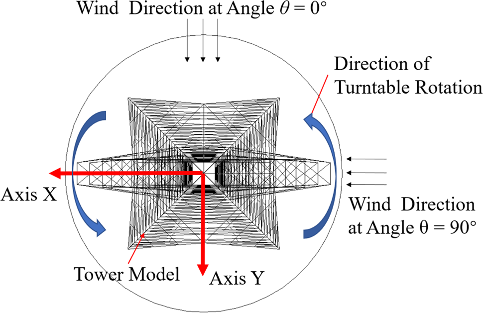

   图20 风洞试验坐标系。

图中主要标注：Wind Direction at Angle θ = 0°：θ = 0° 时的来流方向；Wind Direction at Angle θ = 90°：θ = 90° 时的来流方向；Direction of Turntable Rotation：转盘旋转方向；Tower Model：塔模型；Axis X / Axis Y：X 轴／Y 轴。

4.2 运行模态分析
~~~~~~~~~~~~~~~~~~~~

图21给出 :math:`\theta=90^\circ`、 :math:`\overline U_H=37.5\,\mathrm{m/s}` 时位移PSD :math:`S_D`。X方向（顺风向）背景响应的贡献大于Y方向（横风向）。两方向都在各自第一阶模态频率附近出现明显共振峰，而高频共振峰幅值不显著。因此，第一阶弯曲模态主导该塔风致振动。

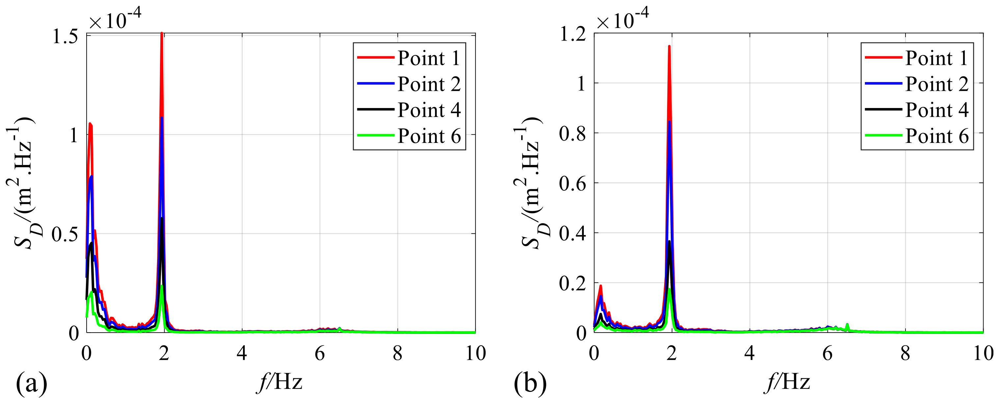

   图21 θ = 90°、U_H = 37.5 m/s 时位移的功率谱密度：（a）X 方向；（b）Y 方向。

图中主要标注：Point 1 / Point 2 / Point 4 / Point 6：测点1／2／4／6；S\_D/(m²·Hz⁻¹)：位移功率谱密度（m²/Hz）；f/Hz：频率（Hz）；(a) / (b)：X 方向／Y 方向。

采用NExT-ERA方法[36]开展运行模态分析。所识别基本模态固有频率与阻尼比分别见图22、23。图22中，在 :math:`\overline U_H=32.4\,\mathrm{m/s}` 和 :math:`37.5\,\mathrm{m/s}` 下识别的频率 :math:`f_s` 随风向、风速有小幅变化，且略大于无风 :math:`\overline U_H=0\,\mathrm{m/s}` 情形。由于格构塔自重轻，风作用下附加气动刚度为正，使结构整体刚度在一定程度上增加。

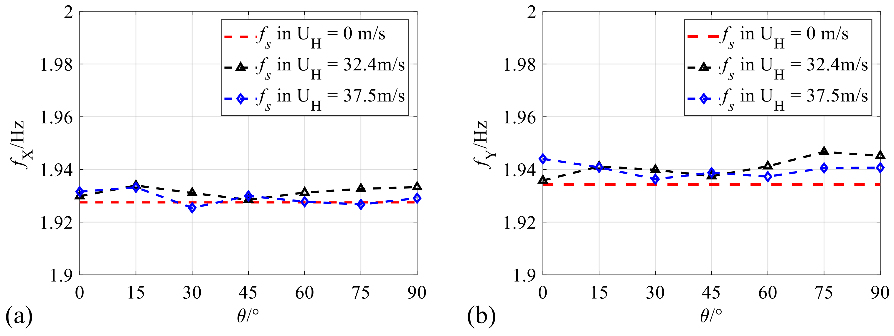

   图22 识别得到的输电塔固有频率：（a）X 方向；（b）Y 方向。

图中主要标注：f\_s/Hz：识别得到的固有频率（Hz）；U\_H = 0 / 32.4 / 37.5 m/s：塔顶平均风速为0、32.4、37.5 m/s；θ/°：风向角（°）；(a) / (b)：X 方向／Y 方向。

识别阻尼比 :math:`\xi` 分为结构阻尼比 :math:`\xi_s` 与气动阻尼比 :math:`\xi_a`。假定 :math:`\xi_s` 不变， :math:`\xi` 的变化来自 :math:`\xi_a`。根据准定常假设，格构塔顺风向气动阻尼比 :math:`\xi_{a0}` 可按下式[41]计算：

.. math::

   \xi_{a0}=\frac{\rho_a}{4\pi f_T}\cdot\frac{\sum_{i=1}^{N}C_{D,i}A_{s,i}\mu_{w,i}\overline U(z_i)\varphi_T^{2}(z_i)}{\sum_{i=1}^{N}m_i\varphi_T^{2}(z_i)} \qquad (32)

其中， :math:`f_T`、 :math:`\varphi_T` 分别表示基本模态频率和振型。对该塔， :math:`\theta=0^\circ`、 :math:`90^\circ` 时的推荐 :math:`\xi_{a0}` 也绘于图23。

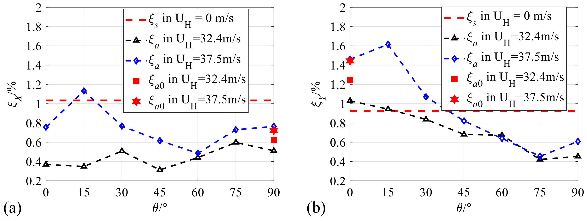

   图23 识别得到的输电塔阻尼比：（a）X 方向；（b）Y 方向。

图中主要标注：ξ/%：阻尼比（%）；ξ\_s in U\_H = 0 m/s：无风时的结构阻尼比；ξ\_a in U\_H = 32.4 / 37.5 m/s：塔顶平均风速为32.4／37.5 m/s 时识别得到的气动阻尼比；ξ\_a0 in U\_H = 32.4 / 37.5 m/s：相应风速下按准定常假设计算的气动阻尼比；θ/°：风向角（°）；(a) / (b)：X 方向／Y 方向。

图23显示，X、Y方向所有识别出的 :math:`\xi_a` 均为正；整体上， :math:`\overline U_H=37.5\,\mathrm{m/s}` 时大于 :math:`32.4\,\mathrm{m/s}` 时；在较高风速下， :math:`\xi_{a0}` 与识别的 :math:`\xi_a` 几乎相等，而在 :math:`32.4\,\mathrm{m/s}` 下， :math:`\xi_{a0}` 高于识别值，误差约20%。考虑测量识别结果的离散性，作者认为这种差别在一定程度上可接受。此外， :math:`\theta=0^\circ` 时顺风向气动阻尼大于 :math:`90^\circ` 时，主要由两个风向下横担投影面积不同引起。

此外，在 :math:`\theta=0^\circ`、 :math:`90^\circ` 时，顺风向 :math:`\xi_a` 大于横风向 :math:`\xi_a`。钢格构塔顺风振动主要来自纵向脉动；横风向则有较显著的尾流相互作用与风遮蔽效应贡献[27,28]。动力机制差异可能是主要原因，Deng等[42]的试验也有类似现象。

当 :math:`\theta` 从 :math:`0^\circ` 增至 :math:`90^\circ`，横担在Y方向的投影面积分布减小。因此，顺风气动阻尼对Y轴的贡献降低，而横风气动阻尼本身相对较弱。综合作用可能使Y轴向 :math:`\xi_a` 随 :math:`\theta` 增大而减小，如图23(b)。但图23(a)没有显示X轴向 :math:`\xi_a` 随风向的明确变化趋势。方向性脉动会影响格构塔气动阻尼的离散性。

5 利用气弹风洞试验数据重构动力风力
------------------------------------

5.1 顺风与横风脉动力重构
~~~~~~~~~~~~~~~~~~~~~~~~~~~~

本节利用气弹风洞数据，研究 :math:`\overline U_H=37.5\,\mathrm{m/s}`、 :math:`\theta=90^\circ` 时输电塔顺风与横风力反演。动力风力重构只考虑第一阶模态；利用识别出的固有频率和阻尼比修正等效MLM。采用四层横担上标记点的实测位移，并用低通滤波器处理测量数据。

识别的顺风与横风向输入模态力时程见图24。顺风模态力幅值大于横风模态力，两者均方根 :math:`\sigma_{F_i}` 分别为29.4 N和14.8 N。

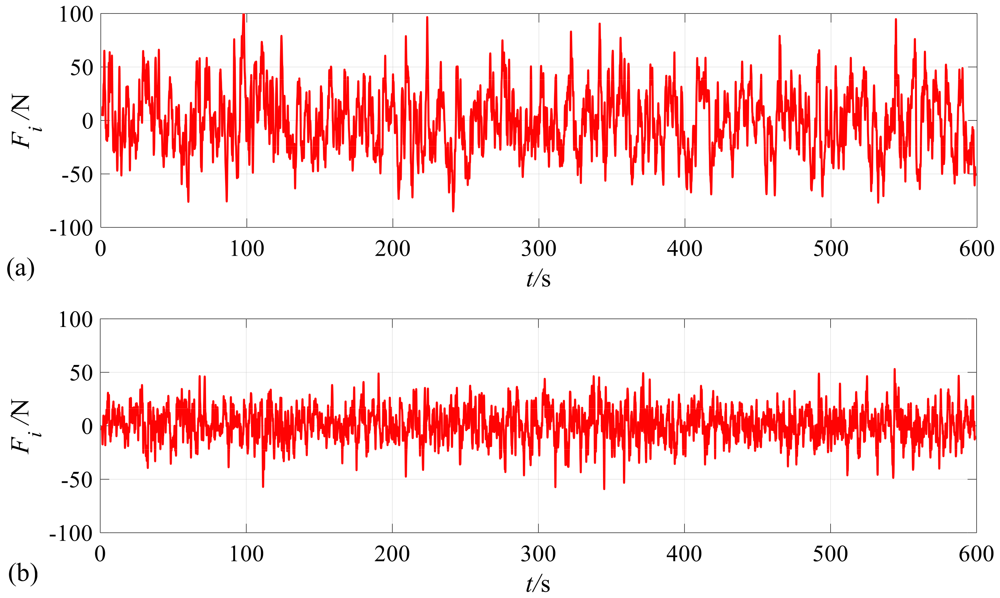

   图24 输入模态力时程：（a）顺风向；（b）横风向。

图中主要标注：F\_i/N：输入模态力（N）；t/s：时间（s）；(a) / (b)：顺风向／横风向。

图25给出识别模态力PSD。频率约低于1 Hz时，顺风模态力谱值大于横风模态力；约高于1 Hz时，两者谱值几乎一致。依据式(29)可用识别模态力重构动力风力。图26给出不同分段的顺风与横风力RMS；最高与最低横担之间各段的动力风力RMS有起伏，主要与自重分布不均匀有关。

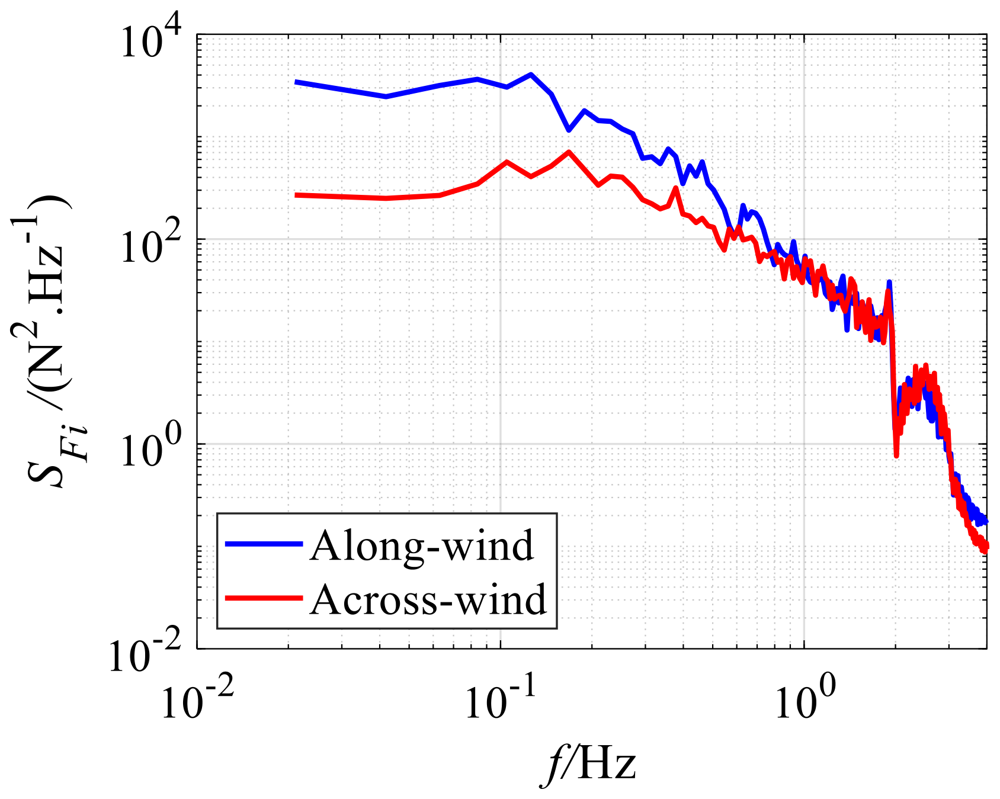

   图25 识别得到的模态风力功率谱密度。

图中主要标注：Along-wind：顺风向；Across-wind：横风向；S\_Fi/(N²·Hz⁻¹)：模态风力功率谱密度（N²/Hz）；f/Hz：频率（Hz）。

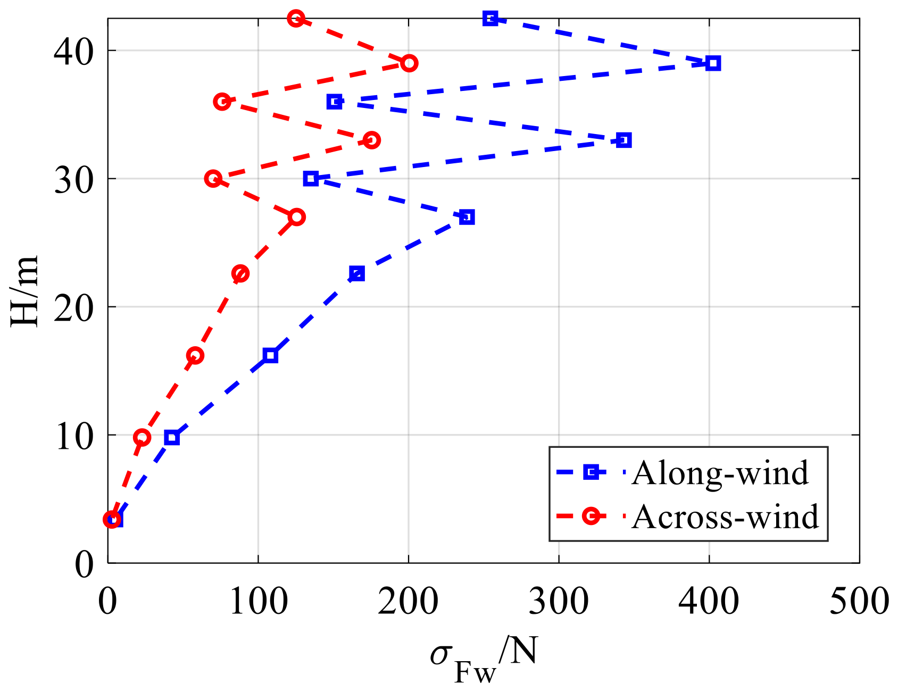

   图26 重构脉动风力的均方根。

图中主要标注：Along-wind：顺风向；Across-wind：横风向；σ\_Fw/N：脉动风力均方根（N）；H/m：高度（m）。

5.2 重构脉动风力验证
~~~~~~~~~~~~~~~~~~~~~~~~

通常无法知道格构塔实际风力分布。整塔HFFB试验可确定整体风力特征[28]，有助于检验重构结果。此外，重构风力的目标是模拟结构动力响应。因此，通过两个途径验证：（1）将重构风力的无量纲系数与PSD，同HFFB试验结果比较；（2）将更新MLM的重构位移同测量值比较。

5.2.1 重构与HFFB试验比较
^^^^^^^^^^^^^^^^^^^^^^^^^^^^^^^^^^

无量纲系数 :math:`C_{\sigma F}` 表示塔上总动力风力的幅值水平，定义为：

.. math::

   C_{\sigma F}=\frac{\sigma_{Fw}}{0.5\rho_a\overline U_H^{2}A_m} \qquad (33)

其中， :math:`\sigma_{F_w}` 为总脉动风力RMS， :math:`A_m` 为 :math:`\theta=0^\circ` 时塔的投影面积。重构与HFFB试验得到的 :math:`C_{\sigma F}` 列于表4；顺风向几乎相等，横风向存在25%误差。

.. list-table:: 表4 脉动风力系数 :math:`C_{\sigma F}`。
   :header-rows: 1

   * - 方向
     - 重构
     - HFFB试验[28]
   * - 顺风向
     - 0.096
     - 0.097
   * - 横风向
     - 0.050
     - 0.040

广义脉动风力无量纲PSD :math:`S_F^*` 可表示为：

.. math::

   \begin{cases}S_F^{*}=\dfrac{fS_{Fw}^{*}(f)}{\sigma_{Fw}^{2}}\\f^{*}=\dfrac{fB_m}{\overline U_H}\end{cases} \qquad (34)

其中， :math:`f^*` 为无量纲频率， :math:`S^*_{F_w}(f)` 为广义风力PSD， :math:`B_m` 为塔底宽度。式(34)得到的 :math:`S_F^*` 绘于图27，并与HFFB试验[28]的经验模型比较。相应拟合优度 :math:`R^2` 计算为：

.. math::

   R^{2}=1-\frac{\sum_{i=1}^{N_p}(S_{F,i}^{*}-\widehat S_{F,i}^{*})^{2}}{\sum_{i=1}^{N_p}(S_{F,i}^{*}-\overline S_F^{*})^{2}} \qquad (35)

其中， :math:`N_p` 为样本总数； :math:`S^*_{F,i}`、 :math:`\widehat S^*_{F,i}` 分别为第 :math:`i` 个样本的重构值与经验值； :math:`\overline S^*_F` 为重构样本的平均值。

顺风向重构 :math:`S_F^*` 与HFFB吻合良好；横风向在 :math:`f^*=0.15\text{–}0.30` 范围高于HFFB，导致两者 :math:`C_{\sigma F}` 差异。顺风和横风向 :math:`R^2` 分别为0.914和0.868。因此，作者认为脉动力重构表现适当。

.. figure:: ../../../wechat/assets/public-safe/ref-zhang2023-ES/fig-27.png
   :alt: 图27 脉动风力功率谱密度比较：（a）顺风向；（b）横风向。
   :align: center
   :width: 100%

   图27 脉动风力功率谱密度比较：（a）顺风向；（b）横风向。

图中主要标注：Reconstruction：重构结果；HFFB：高频测力天平试验结果；S\_F*：无量纲脉动风力功率谱密度；f*：无量纲频率；(a) / (b)：顺风向／横风向。

5.2.2 位移重构与测量比较
^^^^^^^^^^^^^^^^^^^^^^^^^^^^^^

将重构动力风荷载施加于更新后的MLM，用Newmark-β方法分析振动响应。各测点顺风与横风位移RMS列于表5。塔顶测点1的重构位移RMS，顺风、横风误差分别为6.8%和11.0%；测点6的重构RMS小于实测，误差分别为−21.3%和−16.3%，但绝对差仍较小。测点2、4的RMS误差介于测点1与6之间。

.. list-table:: 表5 顺风向与横风向位移的均方根。
   :header-rows: 1

   * - 位置
     - 顺风重构/mm
     - 顺风测量/mm
     - 顺风误差
     - 横风重构/mm
     - 横风测量/mm
     - 横风误差
   * - 测点1
     - 7.39
     - 6.92
     - 6.8 %
     - 5.46
     - 4.92
     - 11.0 %
   * - 测点2
     - 6.00
     - 5.92
     - 1.3 %
     - 4.48
     - 4.27
     - 4.9 %
   * - 测点4
     - 3.86
     - 4.41
     - −12.5 %
     - 2.96
     - 2.93
     - 0.7 %
   * - 测点6
     - 2.29
     - 2.91
     - −21.3 %
     - 1.80
     - 2.15
     - −16.3 %

测点1、6位移PSD分别见图28、29。测点1重构顺风与横风位移PSD分别与滤波后的测量结果一致；对测点6，重算背景响应谱值小于测量情形。

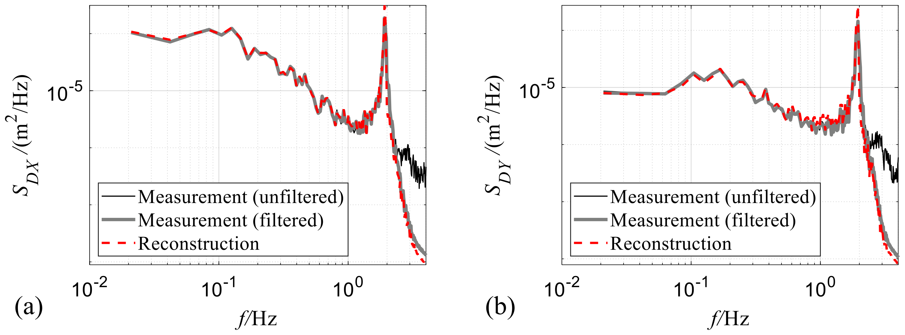

   图28 点1动力位移的功率谱密度：（a）顺风向；（b）横风向。

图中主要标注：Measurement (unfiltered)：实测值（未滤波）；Measurement (filtered)：实测值（已滤波）；Reconstruction：重构值；S\_DX / S\_DY：X／Y 向位移功率谱密度；f/Hz：频率（Hz）；(a) / (b)：顺风向／横风向。

.. figure:: ../../../wechat/assets/public-safe/ref-zhang2023-ES/fig-29.png
   :alt: 图29 点6动力位移的功率谱密度：（a）顺风向；（b）横风向。
   :align: center
   :width: 100%

   图29 点6动力位移的功率谱密度：（a）顺风向；（b）横风向。

图中主要标注：Measurement (unfiltered)：实测值（未滤波）；Measurement (filtered)：实测值（已滤波）；Reconstruction：重构值；S\_DX / S\_DY：X／Y 向位移功率谱密度；f/Hz：频率（Hz）；(a) / (b)：顺风向／横风向。

测点1、6位移时程分别见图30、31。对测点1，顺风和横风方向的重构包络线均与实测时程吻合良好。测点6实测位移略超出重构包络线，但包络趋势与实测时程一致。

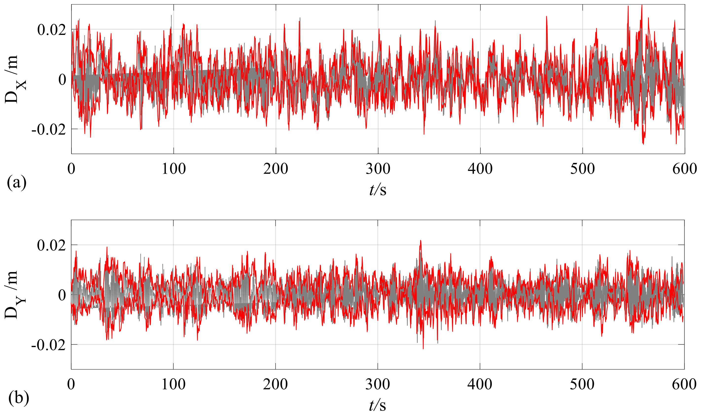

   图30 点1动力位移时程：（a）顺风向；（b）横风向。注：灰线表示实测位移，红线表示重构位移的包络线。关于图例中颜色的说明，请参见本文网络版。

图中主要标注：D\_X/m / D\_Y/m：X／Y 向动力位移（m）；t/s：时间（s）；(a) / (b)：顺风向／横风向；grey line：实测位移；red line：重构位移的包络线（按原图题说明）。

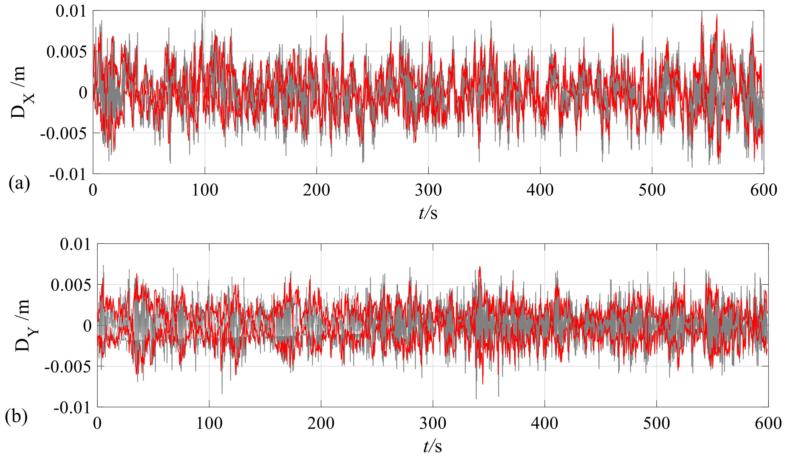

   图31 点6动力位移时程：（a）顺风向；（b）横风向。注：灰线表示实测位移，红线表示重构位移的包络线。关于图例中颜色的说明，请参见本文网络版。

图中主要标注：D\_X/m / D\_Y/m：X／Y 向动力位移（m）；t/s：时间（s）；(a) / (b)：顺风向／横风向；grey line：实测位移；red line：重构位移的包络线（按原图题说明）。

测点1、6实测与重构位移相关图分别见图32、33。结果显示重构与测量高度相关，且顺风向相关系数 :math:`\rho_c` 大于横风向。

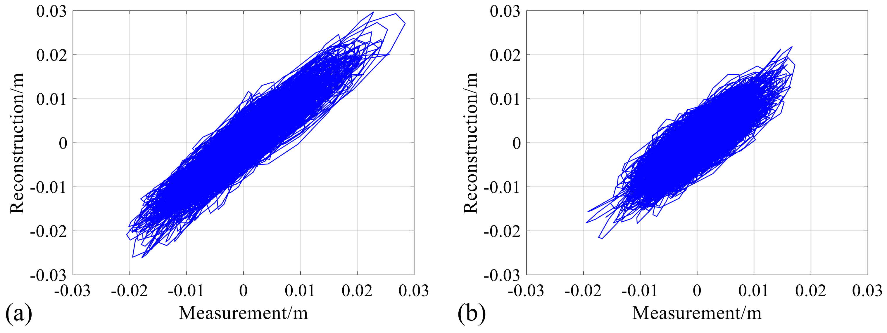

   图32 点1位移重构值与实测值的相关图：（a）顺风向（ρ_c = 0.924）；（b）横风向（ρ_c = 0.825）。

图中主要标注：Reconstruction/m：重构位移（m）；Measurement/m：实测位移（m）；(a) / (b)：顺风向／横风向；ρ\_c：重构位移与实测位移的相关系数。

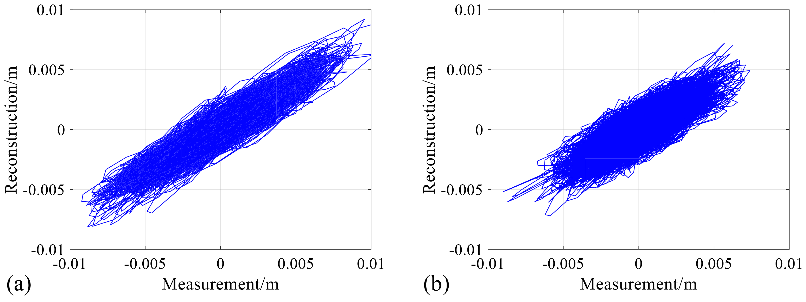

   图33 点6位移重构值与实测值的相关图：（a）顺风向（ρ_c = 0.922）；（b）横风向（ρ_c = 0.821）。

图中主要标注：Reconstruction/m：重构位移（m）；Measurement/m：实测位移（m）；(a) / (b)：顺风向／横风向；ρ\_c：重构位移与实测位移的相关系数。

根据上述结果，虽然重构与实测位移并非完全吻合，其差别仍可接受。因此，重构风力能够有效模拟等效结构动力响应。

.. note::

   风洞验证没有各段实际风力的直接真值。整塔HFFB谱与系数提供整体层面的比较，位移回算提供响应等效性检查；不能据此证明局部真实荷载已唯一、精确恢复。原文也报告横风总力系数25%的差别和测点6较大的相对位移误差。

6 结论
----------------

本文提出一种利用有限动力位移重构自立式钢格构塔动力风力的方法，以等效悬臂杆模型上的集中风力代表塔体分布风力，作为反演对象。引入修正柔度法确定等效模型刚度矩阵，将模态坐标下的状态空间系统与KF-ARLSE结合，识别输入模态风力，再依据模态叠加原理重构动力风力。文中设计了风荷载重构方案，并通过典型输电塔数值模拟与风洞试验验证。由于第一阶振动模态主导所研究塔的风致响应，反演过程只考虑其贡献。主要结论如下：

1. KF-ARLSE可准确识别模态风力。
2. 虽然与实际动力风力有一定差别，重构风力仍能产生等效动力响应。
3. 所提流程对测量噪声影响表现稳健，并可依据模态力PSD变化判断建模误差影响。
4. 该反演途径可利用有限响应测量，实用地评估自立式格构塔动力风力。

依据气弹风洞试验开展运行模态分析，还获得了格构塔气动阻尼的有用结果。不过，动力风力重构方案的适用性仅在一座典型塔上验证，本文未讨论多阶模态共同主导结构振动的情形。作者认为，该情形的适用性仍可预期，因为重构风力的有效性取决于能否准确识别关注的模态力，问题因而转化为获得准确模态位移以识别模态力。此外，本文未考虑长横担或不对称横担输电塔等风下扭转效应明显的塔；未来仍需对其他塔型进一步研究，发展该方法。

.. note::

   上述“准确识别”和稳健性结论对应本文的一阶主导塔、所用噪声和建模误差工况。多模态适用性是作者展望，尚非本篇已完成验证；局部风力、平均风力、明显扭转以及任意塔型也未因此获得完整反演保证。

附录 降阶模型刚度矩阵评估的柔度方法
------------------------------------

悬臂杆 :math:`N` 个集中质量系统的特征值方程为：

.. math::

   \boldsymbol{K}\boldsymbol\varphi_i-\omega_i^{2}\boldsymbol{M}\boldsymbol\varphi_i=0 \qquad (A-1)

其中， :math:`\boldsymbol\varphi_i`、 :math:`\omega_i` 分别为第 :math:`i` 阶振型向量和圆频率。

式(A-1)可归一化为：

.. math::

   \boldsymbol{\Upsilon}\boldsymbol{\chi}_i=\omega_i^{2}\boldsymbol{\chi}_i \qquad (A-2)

其中：

.. math::

   \boldsymbol{\Upsilon}=\boldsymbol{M}^{-1/2}\boldsymbol{K}\boldsymbol{M}^{-1/2} \qquad (A-3)

.. math::

   \boldsymbol{\chi}_i=\boldsymbol{M}^{1/2}\boldsymbol\varphi_i \qquad (A-4)

于是有：

.. math::

   \boldsymbol{\Upsilon}^{-1}\boldsymbol{\chi}_i=\frac{1}{\omega_i^{2}}\boldsymbol{\chi}_i \qquad (A-5)

其中：

.. math::

   \boldsymbol{\Upsilon}^{-1}=\boldsymbol{M}^{1/2}\boldsymbol{K}^{-1}\boldsymbol{M}^{1/2} \qquad (A-6)

结构柔度矩阵 :math:`\mathbf D` 可写为：

.. math::

   \mathbf D=\begin{bmatrix}\delta_{11}&\cdots&\delta_{1N}\\\vdots&\ddots&\vdots\\\delta_{N1}&\cdots&\delta_{NN}\end{bmatrix} \qquad (A-7)

其中， :math:`\delta_{ij}=\delta_{ji}\ (i,j=1,2,\ldots,N)`，且 :math:`\mathbf D=\mathbf K^{-1}`。

对 :math:`N` 个集中质量系统， :math:`\mathbf M=\operatorname{diag}[m_1,m_2,\ldots,m_N]`。原文此处写“令 :math:`ij=\sqrt{m_i m_j}\,\delta_{ij}` ”，式(A-6)可转换为：

.. math::

   \boldsymbol{\Upsilon}^{-1}=\begin{bmatrix}\upsilon_{11}&\cdots&\upsilon_{1N}\\\vdots&\ddots&\vdots\\\upsilon_{N1}&\cdots&\upsilon_{NN}\end{bmatrix} \qquad (A-8)

.. note::

   上述等号左端在原文中只印有 :math:`ij`，缺少元素符号；下式矩阵采用 :math:`\upsilon_{ij}` 型记号。这里保留源文缺字现象，不将推测补字冒充原文。

对 :math:`\mathbf\Upsilon^{-1}`，其对角线和上三角区域元素可写成以下向量：

.. math::

   \begin{Bmatrix}\upsilon_{11}\\\upsilon_{12}\\\vdots\\\upsilon_{1N}\\\upsilon_{22}\\\vdots\\\upsilon_{2N}\\\vdots\\\upsilon_{NN}\end{Bmatrix}=\begin{bmatrix}\sqrt{m_1m_1}&&&&&&&&\\&\sqrt{m_1m_2}&&&&&&&\\&&\ddots&&&&&&\\&&&\sqrt{m_1m_N}&&&&&\\&&&&\sqrt{m_2m_2}&&&&\\&&&&&\ddots&&&\\&&&&&&\sqrt{m_2m_N}&&\\&&&&&&&\ddots&\\&&&&&&&&\sqrt{m_Nm_N}\end{bmatrix}\begin{Bmatrix}\delta_{11}\\\delta_{12}\\\vdots\\\delta_{1N}\\\delta_{22}\\\vdots\\\delta_{2N}\\\vdots\\\delta_{NN}\end{Bmatrix} \qquad (A-9)

或：

.. math::

   \boldsymbol\upsilon=\boldsymbol\Omega\boldsymbol\delta \qquad (A-10)

式(A-5)可进一步改写为：

.. math::

   \mathbf X_{\chi i}\boldsymbol\upsilon=\frac{1}{\omega_i^{2}}\boldsymbol{\chi}_i \qquad (A-11)

其中：

.. math::

   \mathbf X_{\chi i}=\begin{bmatrix}\chi_{1i}&\chi_{2i}&\chi_{3i}&\cdots&\chi_{Ni}&\vdots&0&\cdots&&0&\vdots&0&&0&\vdots&0&&0\\&\chi_{1i}&0&\cdots&0&\vdots&\chi_{2i}&\chi_{3i}&\cdots&\chi_{Ni}&\vdots&0&&&\vdots&&&0\\&&\chi_{1i}&\cdots&0&\vdots&0&\chi_{2i}&\cdots&0&\vdots&\chi_{3i}&\cdots&\chi_{Ni}&\vdots&0&\cdots&0\\&&&\ddots&\vdots&\vdots&&&\ddots&&\vdots&&\ddots&&\vdots&\cdots&\ddots&0\\0&&&&\chi_{1i}&\vdots&0&&&\chi_{2i}&\vdots&0&&\chi_{3i}&\vdots&0&&\chi_{Ni}\end{bmatrix} \qquad (A-12)

有如下关系：

.. math::

   \begin{aligned}\delta_{jj}&=\sum_{r=j}^{N}\frac{l_r^3}{3EI_r}+\sum_{r=j}^{N}\frac{\left(\sum_{k=j}^{r}l_{k-1}-l_{j-1}\right)l_r^2}{2EI_r}+\sum_{r=j}^{N}\frac{\left(\sum_{k=j}^{r}l_{k-1}-l_{j-1}\right)l_r^2}{2EI_r}\\&\quad+\sum_{r=j}^{N}\frac{\left(\sum_{k=j}^{r}l_{k-1}-l_{j-1}\right)\left(\sum_{k=j}^{r}l_{k-1}-l_{j-1}\right)l_r}{EI_r}\end{aligned} \qquad (A-13a)

.. math::

   \begin{aligned}\delta_{j,j+1}&=\sum_{r=j+1}^{N}\frac{l_r^3}{3EI_r}+\sum_{r=j+1}^{N}\frac{\left(\sum_{k=j}^{r}l_{k-1}-l_{j-1}\right)l_r^2}{2EI_r}+\sum_{r=j+1}^{N}\frac{\left(\sum_{k=j}^{r}l_{k-1}-l_{j-1}-l_j\right)l_r^2}{2EI_r}\\&\quad+\sum_{r=j+1}^{N}\frac{\left(\sum_{k=j}^{r}l_{k-1}-l_{j-1}\right)\left(\sum_{k=j}^{r}l_{k-1}-l_{j-1}-l_j\right)l_r}{EI_r}\end{aligned} \qquad (A-13b)

.. math::

   \delta_{j,N}=\frac{l_N^3}{3EI_N}+\frac{\left(\sum_{k=j}^{N}l_{k-1}-l_{j-1}\right)l_N^2}{2EI_N} \qquad (A-13c)

其中， :math:`l_r`、 :math:`(EI)_r` 为第 :math:`r` 根杆的长度和抗弯刚度。

式(A-13)可归纳为：

.. math::

   \delta_{i,j}=\sum_{r=j}^{N}\frac{l_r^3}{3EI_r}+\sum_{r=j}^{N}\left[\frac{\left(\sum_{k=i}^{r-1}l_k\right)l_r^2}{2EI_r}+\frac{\left(\sum_{k=j}^{r-1}l_k\right)l_r^2}{2EI_r}+\frac{\left(\sum_{k=i}^{r-1}l_k\right)\left(\sum_{k=j}^{r-1}l_k\right)l_r}{EI_r}\right] \qquad (A-14)

其中， :math:`1\leq i\leq j\leq N`；原文说明，当 :math:`k>r-1` 时， :math:`\sum_{k=i,j}^{r-1}l_k=0`。

原文称，式(A-14)表示 :math:`\delta_{jr}` 与 :math:`EI_r` 的线性关系，并可改写为矩阵形式：

.. math::

   \boldsymbol\delta=\boldsymbol\Lambda\left\{\frac{1}{(EI)_1},\ \cdots,\ \frac{1}{(EI)_N}\right\}^{T} \qquad (A-15)

其中， :math:`\boldsymbol\Lambda` 为系数矩阵。

.. note::

   紧邻文字称与 :math:`EI_r` 线性，但式(A-15)中实际列出的未知量为 :math:`1/(EI)_r`。原式保留，本页明确区别抗弯刚度与其倒数，不将两者视为同一线性变量。

原文表述为将式(A-10)代入式(A-15)，得到：

.. math::

   \boldsymbol\upsilon=\boldsymbol\Omega\boldsymbol\Lambda\left\{\frac{1}{(EI)_1},\ \cdots,\ \frac{1}{(EI)_N}\right\}^{T} \qquad (A-16)

再将式(A-16)代入式(A-11)，得到：

.. math::

   \mathbf X_{\chi i}\boldsymbol\Omega\boldsymbol\Lambda\left\{\frac{1}{(EI)_1},\ \cdots,\ \frac{1}{(EI)_N}\right\}^{T}=\frac{1}{\omega_i^2}\boldsymbol{\chi}_i \qquad (A-17)

式(A-17)有 :math:`N` 个未知量和 :math:`N` 个方程。因此，对悬臂结构，只需一阶振动模态的数据即可识别抗弯刚度 :math:`EI`。为进一步提高求解可靠性，还可利用另一阶模态特征值，建立另一组方程：

.. math::

   \mathbf X_{\chi j}\boldsymbol\Omega\boldsymbol\Lambda\left\{\frac{1}{(EI)_1},\ \cdots,\ \frac{1}{(EI)_N}\right\}^{T}=\frac{1}{\omega_j^2}\boldsymbol{\chi}_j \qquad (A-18)

联立式(A-17)、(A-18)，得到：

.. math::

   \begin{bmatrix}\mathbf X_{\chi i}\\\mathbf X_{\chi j}\end{bmatrix}\boldsymbol\Omega\boldsymbol\Lambda\left\{\frac{1}{(EI)_1},\ \cdots,\ \frac{1}{(EI)_N}\right\}^{T}=\begin{Bmatrix}\dfrac{1}{\omega_i^2}\boldsymbol{\chi}_i\\\dfrac{1}{\omega_j^2}\boldsymbol{\chi}_j\end{Bmatrix} \qquad (A-19)

令：

.. math::

   \boldsymbol{X}_{\chi}=\begin{bmatrix}\mathbf X_{\chi i}\\\mathbf X_{\chi j}\end{bmatrix} \qquad (A-20)

式(A-19)的最小二乘解为：

.. math::

   \left\{\frac{1}{(EI)_1},\ \cdots,\ \frac{1}{(EI)_N}\right\}^{T}=\left([\mathbf X_\chi\boldsymbol\Omega\boldsymbol\Lambda]^T[\mathbf X_\chi\boldsymbol\Omega\boldsymbol\Lambda]\right)^{-1}[\mathbf X_\chi\boldsymbol\Omega\boldsymbol\Lambda]^T\begin{Bmatrix}\dfrac{1}{\omega_i^2}\boldsymbol{\chi}_i\\\dfrac{1}{\omega_j^2}\boldsymbol{\chi}_j\end{Bmatrix} \qquad (A-21)

已知抗弯刚度 :math:`EI` 后，可采用静力凝聚技术评估悬臂杆抗侧刚度矩阵 :math:`\mathbf K`，即：

.. math::

   \boldsymbol{K}=\boldsymbol{K}_{xx}-\boldsymbol{K}_{x\theta}\boldsymbol{K}_{\theta\theta}^{-1}\boldsymbol{K}_{\theta x} \qquad (A-22)

.. math::

   K_{xx}=\begin{bmatrix}d_1&-d_1&&&&&\\-d_1&d_1+d_2&-d_2&&&&0\\&\cdots&\cdots&\cdots&&&\\&&-d_{i-1}&d_{i-1}+d_i&-d_i&&\\&&&\cdots&\cdots&\cdots&\\0&&&&-d_{N-2}&d_{N-2}+d_{N-1}&-d_{N-1}\\&&&&&-d_{N-1}&d_{N-1}+d_N\end{bmatrix} \qquad (A-23)

.. math::

   K_{x\theta}=\begin{bmatrix}-c_1&-c_1&&&&&\\c_1&c_1-c_2&-c_2&&&&0\\&\cdots&\cdots&\cdots&&&\\&&c_{i-1}&c_{i-1}-c_i&-c_i&&\\&&&\cdots&\cdots&\cdots&\\0&&&&c_{N-2}&c_{N-2}-c_{N-1}&-c_{N-1}\\&&&&&c_{N-1}&c_{n-1}-c_N\end{bmatrix} \qquad (A-24)

.. math::

   K_{\theta\theta}=\begin{bmatrix}a_1&b_1&&&&&\\b_1&a_1+a_2&b_2&&&&0\\&\cdots&\cdots&\cdots&&&\\&&b_{i-1}&a_{i-1}+a_i&b_i&&\\&&&\cdots&\cdots&\cdots&\\0&&&&b_{N-2}&a_{N-2}+a_{N-1}&b_{N-1}\\&&&&&b_{N-1}&a_{N-1}+a_N\end{bmatrix} \qquad (A-25)

其中， :math:`\mathbf K_{xx}` 为剪力与侧移的关系矩阵， :math:`\mathbf K_{x\theta}` 为剪力与转角的关系矩阵， :math:`\mathbf K_{\theta x}` 为弯矩与侧移的关系矩阵，且 :math:`\mathbf K_{\theta x}=\mathbf K_{x\theta}^{T}`； :math:`\mathbf K_{\theta\theta}` 为弯矩与转角的关系矩阵。此外， :math:`a_i=4(EI)_i/l_i`， :math:`b_i=2(EI)_i/l_i`， :math:`c_i=6(EI)_i/l_i^2`， :math:`d_i=12(EI)_i/l_i^3`。

.. note::

   式(A-24)右下角原文写 :math:`c_{n-1}-c_N`，其中前一项使用小写 :math:`n`，与矩阵其余大写 :math:`N` 下标不同。本页保留该排印差异，不据此补造刚度求解代码。

参考文献
----------------

[1] Asgarian B, Eslamlou SD, Zaghi AE, Mehr M. Progressive collapse analysis of power transmission towers. J Constr Steel Res 2016;123:31–40.

[2] El Damatty A, Elawady A. Critical load cases for lattice transmission line structures subjected to downbursts: economic implications for design of transmission lines. Eng Struct 2018;159:213–26.

[3] Tamura Y, Cao S. International group for wind-related disaster risk reduction (IG-WRDRR). J Wind Eng Ind Aerodyn 2012;104:3–11.

[4] Yang Q, Gao R, Bai F, Li T, Tamura Y. Damage to buildings and structures due to recent devastating wind hazards in East Asia. Nat Hazard 2018;92(3):1321–53.

[5] Cermak JE. Wind-tunnel development and trends in applications to civil engineering. J Wind Eng Ind Aerodyn 2003;91(3):355–70.

[6] Inoue H, Harrigan JJ, Reid SR. Review of inverse analysis for indirect measurement of impact force. Appl Mech Rev 2001;54(6):503–24.

[7] Liu R, Dobriban E, Hou Z, Qian K. Dynamic load identification for mechanical systems: a review. Arch Comput Methods Eng 2021:1–33.

[8] Simonian SS. Inverse problems in structural dynamics—I. Theory. Int J Numer Meth Eng 1981;17(3):357–65.

[9] Simonian SS. Inverse problems in structural dynamics—II. Applications. Int J Numer Meth Eng 1981;17(3):367–86.

[10] Chen J, Li J. Study on wind load inverse of tall building. Chin Q Mech 2001;22(1):72–7.

[11] Law SS, Bu JQ, Zhu XQ. Time-varying wind load identification from structural responses. Eng Struct 2005;27(10):1586–98.

[12] Kazemi Amiri K, Bucher C. Derivation of a new parametric impulse response matrix utilized for nodal wind load identification by response measurement. J Sound Vib 2015;344:101–13.

[13] Kazemi Amiri K, Bucher C. A procedure for in situ wind load reconstruction from structural response only based on field testing data. J Wind Eng Ind Aerodyn 2017;167:75–86.

[14] Xue H, Lin K, Luo Y, Liu H. Time-varying wind load identification based on minimum-variance unbiased estimation. Shock Vib 2017;2017:1–15.

[15] Tuan PC, Ji CC, Fong LW, Huang WT. An input estimation approach to on-line two-dimensional inverse heat conduction problems. Numerical Heat Transfer 1996;29(3):345–63.

[16] Chen TC, Lee MH. Inverse active wind load inputs estimation of the multilayer shearing stress structure. Wind Struct: Int J 2008;11(1):19–33.

[17] Zhi L, Yu P. Wind load estimation of tall building by a Kalman filtering based inverse method. J Wuhan Univ Technol 2016;38(2):57–63.

[18] Tuan PC, Hou WT. Adaptive robust weighting input estimation method for the 1-D inverse heat conduction problem. Numer Heat Transf, Part B 1998;34(4):439–56.

[19] Ma CK, Tuan PC, Chang JM, Lin DC. Adaptive weighting inverse method for the estimation of input loads. Int J Syst Sci 2003;34(3):181–94.

[20] Hwang JS, Kareem A, Kim WJ. Estimation of modal loads using structural response. J Sound Vib 2009;326(3–5):522–39.

[21] Hwang JS, Kareem A, Kim HJ. Wind load identification using wind tunnel test data by inverse analysis. J Wind Eng Ind Aerodyn 2010;99(1):18–26.

[22] Zhi LH, Fang MX, Li QS. Estimation of wind loads on a tall building by an inverse method. Struct Control Health Monit 2017;24(4):e1908.

[23] Zhi LH, Chen B, Fang MX. Wind load estimation of super-tall buildings based on response data. Struct Eng Mech: Int J 2015;56(4):625–48.

[24] Bayar DC. Drag coefficients of latticed towers. J Struct Eng 1986;112(2):417–30.

[25] Yang F, Yang J, Niu H, Zhang H. Design wind loads for tubular-angle steel cross-arms of transmission towers under skewed wind loading. J Wind Eng Ind Aerodyn 2015;140:10–8.

[26] Zhou Q, Ma B, Qing Zu, Zhang H. Investigation on wind loads on angle-steel cross-arms of lattice transmission towers via direct force measurement. J Wind Eng Ind Aerodyn 2019;191:117–26.

[27] Zou L, Liang S, Li QS, Zhao L, Ge Y. Investigation of 3-D dynamic wind loads on lattice towers. Wind Struct: Int J 2008;11(4):323–40.

[28] Zhang W, Xiao Y, Li C, Zheng Q, Tang Y. Wind load investigation of self-supported lattice transmission tower based on wind tunnel tests. Eng Struct 2022;252:113575.

[29] Xiong T, Liang S, Zou L. Wind loading identification of transmission towers based-on wind tunnel tests of full aero-elastic model. J Build Struct 2010;31(10):48–54.

[30] Xiong TH, Liang SG. Along-wind load spectra identification method for a long-span concrete-filled steel-tube transmission tower. J Vib Shock 2012;31(23):26–31.

[31] Zhang Q, Gu M, Huang P. Multi-degree-freedom model of a lattice transmission tower. J Vib Shock 2012;31(5):148–52.

[32] Li GQ, Hao KC, Lu Y, Chen SW. A flexibility approach for damage identification of cantilever-type structures with bending and shear deformation. Comput Struct 1999;73(6):565–72.

[33] Szafran J, Juszczyk K, Kamiński M. Experiment-based reliability analysis of structural joints in a steel lattice tower. J Constr Steel Res 2019;154:278–92.

[34] Solari G, Pagnini LC. Gust buffeting and aeroelastic behavior of poles and monotubular towers. J Fluids Struct 1999;13(7–8):877–905.

[35] National Standards Committee. Load code for the design of building structures. China National Standard (CNS). GB 50009-2012;2012.

[36] Siringoringo DM, Fujino Y. System identification of suspension bridge from ambient vibration response. Eng Struct 2008;30:462–77.

[37] Deodatis G. Simulation of ergodic multivariate stochastic processes. J Eng Mech 1996;122(8):778–87.

[38] Simiu E, Yeo D. Wind effects on structures: modern structural design for wind. Oxford, UK: John Wiley & Sons Ltd;2019.

[39] DL/T5551. Load code for the design of overhead transmission line, China;2018.

[40] Lourens E, Reynders E, De Roeck G, Degrande G, Lombaert G. An augmented Kalman filter for force identification in structural dynamics. Mech Syst Sig Process 2012;27:446–60.

[41] Loredo-Souza AM, Davenport AG. The influence of the design methodology in the response of transmission towers to wind loading. J Wind Eng Ind Aerodyn 2003;91:995–1005.

[42] Deng H, et al. Experimental and numerical study on the responses of a transmission tower to skew incident winds. J Wind Eng Ind Aerodyn 2016;157:171–88.

完整引用
----------------

Wentong Zhang, Chao Li, Gaixia Liu, Yiqing Xiao. Reconstruction of dynamic wind forces on a transmission steel lattice tower using aeroelastic wind tunnel test data. *Engineering Structures*, 275 (2023), 115167. DOI: `10.1016/j.engstruct.2022.115167 <https://doi.org/10.1016/j.engstruct.2022.115167>`_.

收录信息见 :ref:`WOEAI 学术成果页对应条目 <ref-zhang2023-ES>`。
