.. _paper-note-ref-zhang2023-S:

基于广义风力谱估计钢格构塔动力风荷载：论文精解
================================================================

精简版微信公众号文章：待发布

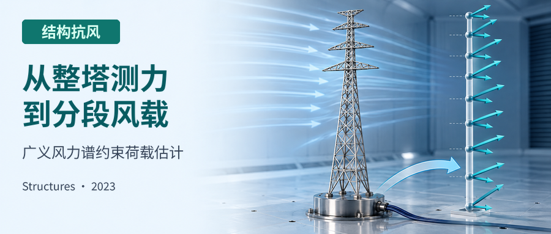

本页依据17页出版社论文，完整精解科学正文、33个编号公式、表格、全部图板及附录、参考文献；按项目范围省略作者贡献、利益冲突和致谢等声明性尾节。

.. contents:: 本页目录
   :local:
   :depth: 2

论文信息
----------------

**原文题名：** Estimation of dynamic wind forces on a steel lattice tower based on generalized wind force spectra。

**作者：** Wentong Zhang、Chao Li（通讯作者）、Gaixia Liu、Yiqing Xiao（通讯作者）。

**单位：** 哈尔滨工业大学（深圳）土木与环境工程学院；哈尔滨工业大学（深圳）实验与创新实践教育中心。单位名称按本文发表时来源保留。

**期刊与年份：** Structures，48（2023），1634–1650。

**DOI：** `10.1016/j.istruc.2022.12.073 <https://doi.org/10.1016/j.istruc.2022.12.073>`_。

**收稿与出版：** 2022年9月22日收稿，2022年12月7日修回，12月19日录用；2023年1月18日在线发表。

**WOEAI 相关方向：** 结构风工程 / 结构抗风。

摘要
----------------

本文提出一种估计钢格构塔动力风荷载的方法。基于广义风力谱推导局部风力谱，并考虑斜向来风下不同轴向风力之间的相干性。建立风力互功率谱密度（PSD）矩阵后，可采用谐波叠加法在时域中模拟脉动风力。文中介绍了一座典型输电钢格构塔的风洞试验。利用试验数据分析不同塔体轴向风力的相干性，并拟合相应经验函数。结合此前风洞试验获得的广义风力经验功率谱，在目标风环境下模拟该输电塔的动力风力。计算塔在所估计风力作用下的动力响应，并与气弹风洞试验测量值比较。结果表明，本文提出的钢格构塔分布式动力风力估计方法有效。

**关键词：** 钢格构塔；动力风力；风洞试验；广义风力谱；相干函数。

1 引言
----------------

输电塔、通信塔和气象塔等钢格构塔广泛应用于结构工程。随着电力资源、信息通信和社区安全需求增加，它们在现代城市和工业发展中发挥越来越重要的作用。然而，台风、龙卷风和下击暴流等恶劣天气频繁发生，已有研究报道其引起的建筑与结构损伤[1]。虽然这类塔的设计将风荷载视为主要环境荷载之一，风致损坏仍未避免[2–4]。风荷载建模对于提高结构抵御强风的能力至关重要[5]。

目前，钢格构塔设计风荷载可依据设计标准[6–10]确定，通常将其视为等效静风力（ESWF）。ESWF一般仅用于评估结构顺风向的等效最大位移[11]。阵风响应因子 :math:`\beta_z` 是理论确定ESWF的关键参数。Holmes[12]早期假定塔为线性收缩形状，通过荷载—响应相关法研究自立式格构塔的 :math:`\beta_z`。然而，实际塔形多样，塔身质量分布也影响整体ESWF。Zhao等[13]结合惯性荷载法，并考虑隔板和横担的影响，推导了带悬臂横担输电格构塔的设计风荷载公式。

由于格构塔构造复杂，阻力系数 :math:`C_D` 受到较多关注。Bayar[14]早期采用高频测力天平（HFFB），通过一系列风洞试验研究方形格构塔阻力系数。这些系数结合实度比，检验了角钢格构塔的风遮蔽效应[15]。横担截面并非正方形，且位于输电塔较高位置，因此其风力对风环境较敏感。现行标准对横担设计风荷载的估计在一定程度上仍存在不足[16]。Yang等[17]和Zhou等[18,19]研究不同类型钢横担在斜向来风下的作用，并提出设计荷载建议。对一些高耸钢塔，研究者开展分段模型风洞试验，以确定较准确的设计风荷载[20–22]。然而，由于各段阻力系数单独识别，相邻塔段的影响可能未被充分考虑。

气弹风洞试验是检验结构在风场中实际动力行为的一种可靠、直观途径[23,24]。但对钢格构塔而言，制作严格满足相似律的完整气弹模型并不容易。在工程应用中，数值动力分析提供了另一条路径，可模拟动力响应，并进一步检验结构在极端风事件下的安全储备[25,26]。由于格构塔局部风力不易直接获得，通常需要基于准定常假设确定。这样可能忽略气动导纳影响，并用风速相干性表示空间风力相关性，从而高估相关程度[27]。上述工作的共同不足是尚未定义格构塔横风向荷载，而格构结构横风向振动较强，不能忽略[28,29]。

整塔刚性模型HFFB试验测量塔底剪力、倾覆弯矩和扭矩。假定不同轴向的主导振型为理想线性振型，即可估计整塔广义风力[29,30]。在模拟大气边界层流场中，广义风力自然包含局部风力的分布与相互干扰效应。虽然可以评估顺风向和横风向广义气动力，但由于只测得塔底力，风力空间分布仍不明确。Liu等[31]和Xiao等[32]结合准定常假设，分别推导海上石油平台和输电格构塔的分布风力谱。但这些方法仅在来风方向与塔体坐标轴正交时较适用；斜风情况下所用投影面积与正交风情况相同，可能给风荷载评估带来较大误差。这些研究也尚未考虑不同轴向风力分量之间的相干性。

本文基于广义风力谱提出钢格构塔动力风力估计方法，内容安排如下：第2节详细推导分布式动力风力功率谱，并介绍采用谐波叠加法模拟脉动风力时程的步骤；第3节介绍典型输电塔风洞试验，分析风力相干函数，并给出不同风速尺度下广义风力功率谱的确定程序；第4节根据输电塔物理参数，在目标风环境中模拟脉动风力，并从功率谱密度和相干函数方面检验；第5节将计算得到的输电塔动力响应与气弹风洞试验测量值比较；第6节给出结论与展望。

2 钢格构塔动力风力估计方法
----------------------------

2.1 动力风力谱的推导
~~~~~~~~~~~~~~~~~~~~~~~~

图1为划分成 :math:`N` 个分段的钢格构塔。塔上分布风力可等效为作用于集中质量悬臂杆的集中力。各段质量 :math:`m_i` 集中于代表高度 :math:`z_i`。X轴沿横向设置，Y轴垂直于所示平面，Z轴沿高度方向。 :math:`F_{X,i}` 和 :math:`F_{Y,i}` 表示合风力在塔体坐标轴上的水平分量；来风角 :math:`\theta=0^\circ` 与 :math:`\theta=90^\circ` 分别沿Y轴、X轴设置。

.. figure:: ../../../wechat/assets/public-safe/ref-zhang2023-S/fig-1.png
   :alt: 图1 格构塔等效风荷载示意图。
   :align: center
   :width: 100%

   图1 格构塔等效风荷载示意图。

图中主要标注：Distributed wind load：分布风荷载；Equivalent wind load：等效风荷载；Actual Model：实际模型；Equivalent Model：等效模型；Equivalent：等效；m\_i：第 i 段集中质量；z\_i：第 i 段代表高度；F\_Xi, F\_Yi：第 i 段沿 X、Y 轴的风力。

依据准定常假设，第 :math:`i` 段脉动力在X、Y轴上的分量，即 :math:`\widetilde F_{X,i}` 和 :math:`\widetilde F_{Y,i}`，可估计为：

.. math::

   \begin{cases}\widetilde F_{X,i}(t)=\rho_a\overline U_i u_i(t)A_{e,i}\eta_{X,i}\\\widetilde F_{Y,i}(t)=\rho_a\overline U_i u_i(t)A_{e,i}\eta_{Y,i}\end{cases} \qquad (1)

式中， :math:`\rho_a` 为空气密度； :math:`\overline U_i` 和 :math:`u_i(t)` 分别为来流平均分量与湍流分量； :math:`A_{e,i}` 为有效投影面积，写为 :math:`A_{e,i}=A_{s,i}C_{D,i}`，其中 :math:`A_{s,i}`、 :math:`C_{D,i}` 分别为 :math:`\theta=0^\circ` 时该段投影面积与阻力系数； :math:`\eta_{X,i}`、 :math:`\eta_{Y,i}` 分别为X、Y轴向风荷载分配系数。

在塔高范围内，将 :math:`u_i(t)` 的功率谱密度 :math:`\widehat S_u(z_i,f)` 假定为下式是可接受的：

.. math::

   \widehat S_u(z_i,f)=\sigma_u^2(z_i)S_u(f) \qquad (2)

其中， :math:`\sigma_u(z_i)` 是高度 :math:`z_i` 处 :math:`u_i(t)` 的均方根（RMS）； :math:`S_u(f)` 为归一化风速谱。

 :math:`u_i(t)` 和 :math:`u_k(t)` 之间的互功率谱 :math:`\widehat S_u(z_i,z_k,f)` 可写为：

.. math::

   \begin{aligned}\widehat S_u(z_i,z_k,f)&=\sqrt{\widehat S_u(z_i,f)\widehat S_u(z_k,f)}\,coh(z_i,z_k)\\&=\sigma_u(z_i)\sigma_u(z_k)S_u(f)coh(z_i,z_k)\end{aligned} \qquad (3)

其中， :math:`\operatorname{coh}(z_i,z_k)` 为 :math:`u_i(t)` 和 :math:`u_k(t)` 之间的相干函数；根据原文所引Shiotani[33]，可假定其与频率无关。

令高度 :math:`z_i` 处湍流强度为 :math:`I_i=\sigma_u(z_i)/\overline U_i`，则 :math:`\widehat S_u(z_i,z_k,f)` 可改写为：

.. math::

   \widehat S_u(z_i,z_k,f)=\overline U_i\overline U_k I_i I_k S_u(f)coh(z_i,z_k) \qquad (4)

考虑气动导纳函数 :math:`|\chi(f)|^2` 后， :math:`\widetilde F_{X,i}` 的功率谱 :math:`S_{\widetilde F_X}(z_i,f)` 为：

.. math::

   S_{\widetilde F_X}(z_i,f)=\left[\rho_a\overline U_i A_{e,i}\eta_{X,i}\right]^2\widehat S_u(z_i,f)|\chi(f)|^2 \qquad (5)

相应地， :math:`\widetilde F_{X,i}` 与 :math:`\widetilde F_{X,k}` 的互功率谱 :math:`S_{\widetilde F_X}(z_i,z_k,f)` 表示为：

.. math::

   S_{\widetilde F_X}(z_i,z_k,f)=\rho_a^2\overline U_i\overline U_k A_{e,i}A_{e,k}\eta_{X,i}\eta_{X,k}\widehat S_u(z_i,z_k,f)|\chi(f)|^2 \qquad (6)

代入式(4)， :math:`S_{\widetilde F_X}(z_i,z_k,f)` 可改写为：

.. math::

   S_{\widetilde F_X}(z_i,z_k,f)=\rho_a^2\overline U_i^2\overline U_k^2 I_i I_k A_{e,i}A_{e,k}\eta_{X,i}\eta_{X,k}S_u(f)coh(z_i,z_k)|\chi(f)|^2 \qquad (7)

对塔沿X轴的第 :math:`j` 阶振动模态，广义风力功率谱 :math:`S^*_{\widetilde F_X,j}(f)` 为：

.. math::

   S^*_{\widetilde F_X,j}(f)=\sum_{i=1}^{N}\sum_{k=1}^{N}\left[\varphi_{ji}\varphi_{jk}S_{\widetilde F_X}(z_i,z_k,f)\right] \qquad (8)

其中， :math:`\varphi_{ji}` 和 :math:`\varphi_{jk}` 分别为第 :math:`j` 阶振型在 :math:`z_i`、 :math:`z_k` 处的振型系数。

将式(7)代入式(8)，得到：

.. math::

   S^*_{\widetilde F_X,j}(f)=\rho_a^2 S_u(f)|\chi(f)|^2\sum_{i=1}^{N}\sum_{k=1}^{N}\left[\varphi_{j,i}\varphi_{j,k}\overline U_i^2\overline U_k^2 I_i I_k A_{e,i}A_{e,k}\eta_{X,i}\eta_{X,k}coh(z_i,z_k)\right] \qquad (9)

因此，对应理想线性振型的功率谱 :math:`S^*_{\widetilde F_X,L}(f)` 可表示为：

.. math::

   S^*_{\widetilde F_X,L}(f)=\rho_a^2 S_u(f)|\chi(f)|^2\sum_{i=1}^{N}\sum_{k=1}^{N}\left[\varphi_{L,i}\varphi_{L,k}\overline U_i^2\overline U_k^2 I_i I_k A_{e,i}A_{e,k}\eta_{X,i}\eta_{X,k}coh(z_i,z_k)\right] \qquad (10)

其中， :math:`\varphi_{L,i}`、 :math:`\varphi_{L,k}` 分别是线性振型在 :math:`z_i`、 :math:`z_k` 处的系数，即 :math:`\varphi_{L,i}=z_i/H`、 :math:`\varphi_{L,k}=z_k/H`； :math:`H` 为塔总高度。此外， :math:`S^*_{\widetilde F_X,L}(f)` 可通过HFFB试验获得。

令 :math:`S_w(f)=\rho_a^2S_u(f)|\chi(f)|^2`，可得：

.. math::

   S_w(f)=\frac{S^*_{\widetilde F_X,L}(f)}{\sum_{i=1}^{N}\sum_{k=1}^{N}\left[\varphi_{L,i}\varphi_{L,k}\overline U_i^2\overline U_k^2 I_i I_k A_{e,i}A_{e,k}\eta_{X,i}\eta_{X,k}coh(z_i,z_k)\right]} \qquad (11)

再代入式(7)， :math:`S_{\widetilde F_X}(z_i,z_k,f)` 可写为：

.. math::

   S_{\widetilde F_X}(z_i,z_k,f)=\frac{S^*_{\widetilde F_X,L}(f)\overline U_i^2\overline U_k^2 I_i I_k A_{e,i}A_{e,k}\eta_{X,i}\eta_{X,k}coh(z_i,z_k)}{\sum_{i=1}^{N}\sum_{k=1}^{N}\left[\varphi_{L,i}\varphi_{L,k}\overline U_i^2\overline U_k^2 I_i I_k A_{e,i}A_{e,k}\eta_{X,i}\eta_{X,k}coh(z_i,z_k)\right]} \qquad (12)

类似地，对于脉动力Y轴分量， :math:`\widetilde F_{Y,i}` 与 :math:`\widetilde F_{Y,k}` 之间的互功率谱可推导为：

.. math::

   S_{\widetilde F_Y}(z_i,z_k,f)=\frac{S^*_{\widetilde F_Y,L}(f)\overline U_i^2\overline U_k^2 I_i I_k A_{e,i}A_{e,k}\eta_{Y,i}\eta_{Y,k}coh(z_i,z_k)}{\sum_{i=1}^{N}\sum_{k=1}^{N}\left[\varphi_{L,i}\varphi_{L,k}\overline U_i^2\overline U_k^2 I_i I_k A_{e,i}A_{e,k}\eta_{Y,i}\eta_{Y,k}coh(z_i,z_k)\right]} \qquad (13)

其中， :math:`S^*_{\widetilde F_Y,L}(f)` 表示Y轴向广义风力的功率谱。

根据定义， :math:`\widetilde F_{X,i}(t)` 与 :math:`\widetilde F_{Y,k}(t)` 之间的互功率谱可写为：

.. math::

   S_{\widetilde F_X\widetilde F_Y}(z_i,z_k,f)=\sqrt{S_{\widetilde F_X}(z_i,z_i,f)S_{\widetilde F_Y}(z_k,z_k,f)}\,coh_{XY}(z_i,z_k,f) \qquad (14)

其中， :math:`\operatorname{coh}_{XY}(z_i,z_k,f)` 为 :math:`\widetilde F_{X,i}(t)` 和 :math:`\widetilde F_{Y,k}(t)` 的相干函数。本文采用以下分解：

.. math::

   coh_{XY}(z_i,z_k,f)=coh(z_i,z_k)\cdot coh_{F_XF_Y}(f) \qquad (15)

式中， :math:`\operatorname{coh}_{F_XF_Y}(f)` 表示 :math:`\widetilde F_X(t)` 和 :math:`\widetilde F_Y(t)` 的相干函数，假定其与高度无关。

**说明1。** 对钢格构塔，顺风向振动主要由纵向脉动分量引起。对于横风向力，尾流相互作用和风遮蔽效应的贡献，比构件涡脱落更突出[29,30,34,35]。塔的顺风向与横风向力均表现为抖振力；相比之下，横风向力功率谱的主导频率与有效带宽略大于顺风向。斜风下， :math:`\widetilde F_X(t)`、 :math:`\widetilde F_Y(t)` 都自然混合了顺风向与横风向分量。例如， :math:`\theta=45^\circ` 时，HFFB测得两者功率谱可能呈相似分布形状[29]。根据式(12)、(13)，两个同轴互功率谱通过权重分配确定，并考虑风场和结构特征。结合准定常假设与气动导纳函数，上述推导可近似描述钢格构塔上的分布式动力风力。

**说明2。** 本推导采用原文所引Shiotani[33]相干函数，使沿高度风力相关性成为权重因子之一。由于机制不同，格构塔单段顺风向与横风向力之间的相干性可忽略[21]。但斜风下，塔体X、Y轴分量混合顺风向与横风向力，因此 :math:`\operatorname{coh}_{F_XF_Y}(f)` 自然存在。此外，在给定来风角下，该相干函数似乎与高度无关。因此，式(15)可在一定程度上应用于悬臂格构塔分布风力的相干函数。

2.2 时域动力风力模拟
~~~~~~~~~~~~~~~~~~~~~~~~

本文将脉动风力时程视为由其功率谱决定的随机过程。有了互功率谱矩阵，即可用谐波叠加法[36]模拟脉动风力时程。为简洁起见，此处只给出最终表达式。

格构塔动力风力互功率谱矩阵 :math:`\mathbf S_{\widetilde F}(\omega)` 可表示为：

.. math::

   \boldsymbol S_{\widetilde F}(\omega)=\begin{bmatrix}\boldsymbol S_{\widetilde F_X}(\omega)&\boldsymbol S_{\widetilde F_X\widetilde F_Y}(\omega)\\\boldsymbol S_{\widetilde F_Y\widetilde F_X}(\omega)&\boldsymbol S_{\widetilde F_Y}(\omega)\end{bmatrix} \qquad (16)

.. math::

   \boldsymbol S_{\widetilde F_X}(\omega)=\begin{bmatrix}S_{\widetilde F_X,11}(\omega)&S_{\widetilde F_X,12}(\omega)&\cdots&S_{\widetilde F_X,1N}(\omega)\\S_{\widetilde F_X,21}(\omega)&S_{\widetilde F_X,22}(\omega)&\cdots&S_{\widetilde F_X,2N}(\omega)\\\vdots&\vdots&\ddots&\vdots\\S_{\widetilde F_X,N1}(\omega)&S_{\widetilde F_X,N2}(\omega)&\cdots&S_{\widetilde F_X,NN}(\omega)\end{bmatrix} \qquad (17)

.. math::

   \boldsymbol S_{\widetilde F_Y}(\omega)=\begin{bmatrix}S_{\widetilde F_Y,11}(\omega)&S_{\widetilde F_Y,12}(\omega)&\cdots&S_{\widetilde F_Y,1N}(\omega)\\S_{\widetilde F_Y,21}(\omega)&S_{\widetilde F_Y,22}(\omega)&\cdots&S_{\widetilde F_Y,2N}(\omega)\\\vdots&\vdots&\ddots&\vdots\\S_{\widetilde F_Y,N1}(\omega)&S_{\widetilde F_Y,N2}(\omega)&\cdots&S_{\widetilde F_Y,NN}(\omega)\end{bmatrix} \qquad (18)

.. math::

   \boldsymbol S_{\widetilde F_X\widetilde F_Y}(\omega)=\begin{bmatrix}S_{\widetilde F_X\widetilde F_Y,11}(\omega)&S_{\widetilde F_X\widetilde F_Y,12}(\omega)&\cdots&S_{\widetilde F_X\widetilde F_Y,1N}(\omega)\\S_{\widetilde F_X\widetilde F_Y,21}(\omega)&S_{\widetilde F_X\widetilde F_Y,22}(\omega)&\cdots&S_{\widetilde F_X\widetilde F_Y,2N}(\omega)\\\vdots&\vdots&\ddots&\vdots\\S_{\widetilde F_X\widetilde F_Y,N1}(\omega)&S_{\widetilde F_X\widetilde F_Y,N2}(\omega)&\cdots&S_{\widetilde F_X\widetilde F_Y,NN}(\omega)\end{bmatrix} \qquad (19)

.. math::

   \boldsymbol S_{\widetilde F_Y\widetilde F_X}(\omega)=\boldsymbol S^{T}_{\widetilde F_X\widetilde F_Y}(\omega) \qquad (20)

式中， :math:`\omega` 为圆频率； :math:`S_{\widetilde F_X,ik}(\omega)`、 :math:`S_{\widetilde F_Y,ik}(\omega)` 和 :math:`S_{\widetilde F_X\widetilde F_Y,ik}(\omega)` 分别是 :math:`S_{\widetilde F_X}(z_i,z_k,\omega)`、 :math:`S_{\widetilde F_Y}(z_i,z_k,\omega)` 和 :math:`S_{\widetilde F_X\widetilde F_Y}(z_i,z_k,\omega)` 的简写。

.. note::

   式(20)按原文保留普通转置符号T，式(21)则保留共轭转置符号T*。二者记法不同；本页不据此推断作者程序有误，也不自动更改原式。

 :math:`\mathbf S_{\widetilde F}(\omega)` 的Cholesky分解为：

.. math::

   \boldsymbol S_{\widetilde F}(\omega)=\boldsymbol H(\omega)\cdot\boldsymbol H^{T*}(\omega) \qquad (21)

.. math::

   \boldsymbol H(\omega)=\begin{bmatrix}H_{11}(\omega)&0&\cdots&0\\H_{21}(\omega)&H_{22}(\omega)&\cdots&0\\\vdots&\vdots&\ddots&\vdots\\H_{(2\times N)1}(\omega)&H_{(2\times N)2}(\omega)&\cdots&H_{(2\times N)(2\times N)}(\omega)\end{bmatrix} \qquad (22)

其中， :math:`\mathbf H^{T*}(\omega)` 为 :math:`\mathbf H(\omega)` 的共轭转置矩阵。 :math:`\mathbf H(\omega)` 中的元素可表示为：

.. math::

   \begin{cases}H_{ik}(\omega)=|H_{ik}(\omega)|\exp\!\left(i\theta_{ik}(\omega)\right)\\\theta_{ik}(\omega)=\tan^{-1}\!\left\{\dfrac{Im(H_{ik}(\omega))}{Re(H_{ik}(\omega))}\right\}\end{cases} \qquad (23)

其中， :math:`\theta_{ik}(\omega)` 为 :math:`H_{ik}(\omega)` 的辐角；Re与Im分别表示实部和虚部算子。

.. note::

   式(23)保留原文的反正切比值表达式；原文没有进一步说明相位分支的数值处理，不能将此处转写误认为已提供完整的四象限相位实现。

第 :math:`i` 段脉动风力时程 :math:`\widetilde F_{X,i}(t)`、 :math:`\widetilde F_{Y,i}(t)` 可由下式获得：

.. math::

   \begin{cases}\displaystyle\widetilde F_{X,i}(t)=\sum_{k=1}^{i}\sum_{l=1}^{N_\omega}|H_{ik}(\omega_l)|\sqrt{2\Delta\omega}\cos\left[\omega_l t+\theta_{ik}(\omega_l)+\psi_{kl}\right]\\\displaystyle\widetilde F_{Y,i}(t)=\sum_{k=1}^{N+i}\sum_{l=1}^{N_\omega}|H_{(N+i)k}(\omega_l)|\sqrt{2\Delta\omega}\cos\left[\omega_l t+\theta_{(N+i)k}(\omega_l)+\psi_{kl}\right]\end{cases} \qquad (24)

其中， :math:`\Delta\omega` 为频率增量； :math:`N_\omega` 为脉动风力频带划分数； :math:`\omega_l` 为谐波叠加中第 :math:`l` 个谐波的频率，即 :math:`\omega_l=l\Delta\omega`； :math:`\psi_{kl}` 为在 :math:`[0,2\pi]` 上均匀分布的随机数。给定圆频率上限 :math:`\omega_u` 后，有 :math:`\Delta\omega=\omega_u/N_\omega`。

3 典型输电塔风洞试验
----------------------

3.1 结构与测量设置
~~~~~~~~~~~~~~~~~~~~~~

本文输电塔用于中国高压输电线路工程。图2给出角钢原型塔构造，其风洞试验布置已在先前研究[29]中发表。受篇幅限制，本文只简要介绍试验。

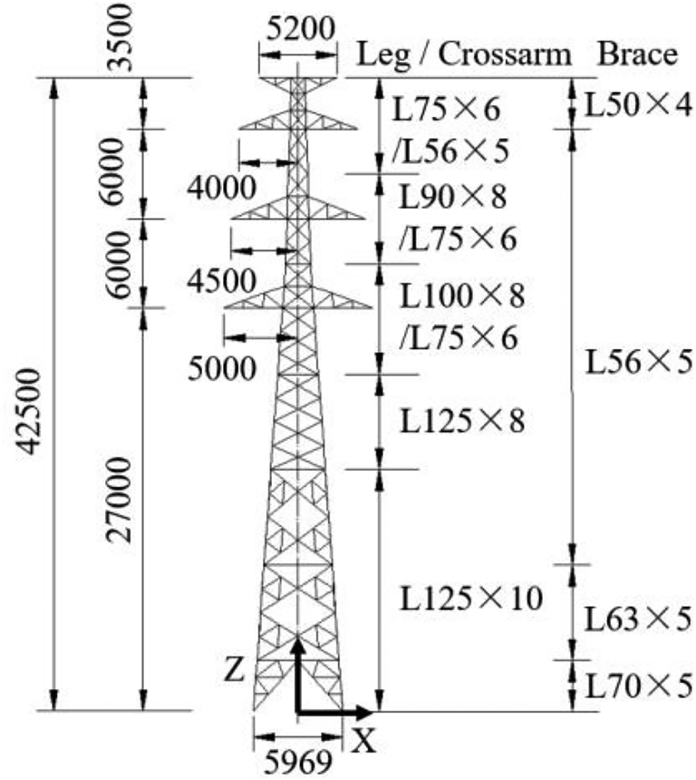

   图2 输电塔结构布置（单位：mm）。

图中主要标注：Leg / Crossarm：主材／横担；Brace：斜材；L75×6 等：角钢截面规格。

按适当相似律设计缩尺模型，几何相似比为 :math:`\lambda=1:25`，模型总高 :math:`H_m=1.7\,\mathrm m`。依据中国标准GB 50009—2012[7]，在风洞中模拟B类大气边界层。图3给出塔体坐标系与风向坐标系的关系；来风角从 :math:`0^\circ` 至 :math:`90^\circ`，间隔 :math:`15^\circ`。图4为风洞试验系统。

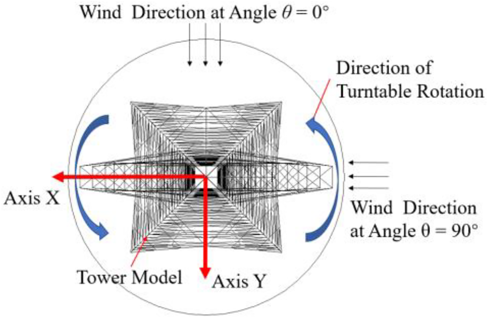

   图3 风洞试验坐标系。

图中主要标注：Wind Direction at Angle θ = 0°：θ = 0° 时的来流方向；Wind Direction at Angle θ = 90°：θ = 90° 时的来流方向；Direction of Turntable Rotation：转盘旋转方向；Tower Model：塔模型；Axis X / Axis Y：X 轴／Y 轴。

.. figure:: ../../../wechat/assets/public-safe/ref-zhang2023-S/fig-4.png
   :alt: 图4 风洞试验布置。
   :align: center
   :width: 100%

   图4 风洞试验布置。

图中主要标注：Camera：相机；Cobra：Cobra 风速探针；Balance：测力天平。

HFFB试验采用高频底部测力天平测量塔模型基底反力。气弹风洞试验采用商用视觉测量系统，测量气弹输电塔模型在X、Y方向的动力位移，分别记为 :math:`D_X` 和 :math:`D_Y`。本文采用塔顶原型参考平均风速 :math:`\overline U_H=37.5\,\mathrm{m/s}` 下的 :math:`D_X`、 :math:`D_Y` 测量数据。缩尺气弹模型的更多资料见既有研究[29,37]。

由于缩尺模型较高（ :math:`H_m=1.7\,\mathrm m`），HFFB试验和气弹风洞试验针对不同目的分别开展。HFFB在满足天平测量精度的同时，将试验风速设得足够低，以避免模型明显振动，获得有效风力功率谱。相反，气弹试验在满足相机系统测量精度与稳定性的同时，将风速设得足够高，以产生明显结构振动。因此，风洞试验没有同步测量塔底反力与动力位移。

3.2 动力风力相干函数
~~~~~~~~~~~~~~~~~~~~~~~~

可利用测得的X、Y轴倾覆弯矩 :math:`M_X`、 :math:`M_Y`，分析横向与纵向风力之间的相干性。 :math:`\widetilde F_X(t)` 与 :math:`\widetilde F_Y(t)` 的相干函数可定义为[27]：

.. math::

   coh_{F_XF_Y}(f)=coh(M_X,M_Y,f)=\frac{Re(S_{M_XM_Y}(f))}{\sqrt{S_{M_X}(f)S_{M_Y}(f)}} \qquad (25)

其中， :math:`S_{M_XM_Y}(f)` 为 :math:`M_X` 与 :math:`M_Y` 的互功率谱； :math:`S_{M_X}(f)` 和 :math:`S_{M_Y}(f)` 分别为两者自功率谱。

.. note::

   式(25)按原文使用互谱实部除以自谱乘积的平方根，不能无说明替换成幅平方相干函数。这里的塔体X、Y轴与顺、横风方向只在特定来风角下重合。

图5给出式(25)计算的风力相干函数，其中 :math:`fB_m/\overline U_H` 为无量纲频率， :math:`B_m` 为塔底宽度。缩尺塔模型不能表现为完全刚体，在湍流中会于其固有频率附近产生共振。因此，本文仅考虑无量纲频率0～0.3范围内的 :math:`\operatorname{coh}_{F_XF_Y}`。

.. figure:: ../../../wechat/assets/public-safe/ref-zhang2023-S/fig-5.png
   :alt: 图5 风力 F_X 与 F_Y 之间的相干函数。
   :align: center
   :width: 100%

   图5 风力 F_X 与 F_Y 之间的相干函数。

图中主要标注：coh\_FXFY：X、Y 轴风力的相干函数；fB\_m/U\_H：无量纲频率；θ：风向角；Fitting：拟合曲线。

当 :math:`\theta=0^\circ`、 :math:`90^\circ` 时，图示无量纲频率范围内 :math:`\operatorname{coh}_{F_XF_Y}` 小于约0.2，证实顺、横风向力的相干性很弱。其他角度下， :math:`fB_m/\overline U_H<0.1` 时，相干函数从约0.8～0.9随频率增加而减小；超过0.1后， :math:`15^\circ`、 :math:`75^\circ` 下基本小于约0.4， :math:`30^\circ`、 :math:`45^\circ`、 :math:`60^\circ` 下基本小于约0.2。这表明斜风下由于顺、横风分量混合，两个塔体轴向脉动力自然具有相似的相关性。

选取代表性风向 :math:`\theta=30^\circ`、 :math:`45^\circ`、 :math:`60^\circ`，相干函数经验模型服从指数衰减规律，拟合为：

.. math::

   coh_{F_XF_Y}(f)=0.867\exp\!\left(-14.7\frac{fB_m}{\overline U_H}\right) \qquad (26)

因此，本文在 :math:`\theta=0^\circ` 和 :math:`90^\circ` 时取 :math:`\operatorname{coh}_{F_XF_Y}(f)\approx0`；在 :math:`0^\circ<\theta<90^\circ` 时采用式(26)。

.. note::

   式(26)以本文所列30°、45°、60°试验结果拟合，并被作者用于其余斜风工况；这不是任意塔型或所有频率范围已获验证的普适相干模型。

3.3 广义风力功率谱的确定程序
~~~~~~~~~~~~~~~~~~~~~~~~~~~~~~~~

将 :math:`\widetilde F_X(t)`、 :math:`\widetilde F_Y(t)` 的无量纲系数 :math:`C_{\sigma F_X}`、 :math:`C_{\sigma F_Y}` 定义为：

.. math::

   C_{\sigma FX}=\frac{\sigma_{FX}}{0.5\rho_a\overline U_H^2 A_m} \qquad (27)

.. math::

   C_{\sigma FY}=\frac{\sigma_{FY}}{0.5\rho_a\overline U_H^2 A_m} \qquad (28)

其中， :math:`\sigma_{F_X}`、 :math:`\sigma_{F_Y}` 分别为两方向脉动风力的均方根； :math:`A_m` 为 :math:`\theta=0^\circ` 时整塔投影面积。

广义风力经验功率谱的无量纲形式可表示为：

.. math::

   \begin{cases}\displaystyle\frac{fS^*_{F,r}(f)}{\sigma^2_{F,r}}=\frac{a_1(a_2f^*)^{a_3}}{\left(1+a_4(a_2f^*)^{a_5}\right)^{\alpha_6}}\\\displaystyle f^*=\frac{fB_m}{\overline U_H}\end{cases} \qquad (29)

其中， :math:`\sigma_{F,r}` 是r轴广义风力的均方根，r可为X或Y； :math:`f^*` 为无量纲频率； :math:`a_1,a_2,a_3,a_4,a_5,a_6` 为所定义系数。

.. note::

   原文式(29)分母最外层指数写为 :math:`\alpha_6`，紧邻正文却列出系数 :math:`a_6`。本页分别照录，保留这一记号差异，不补造拟合系数或擅自统一符号。

对本文输电塔， :math:`C_{\sigma F_X}`、 :math:`C_{\sigma F_Y}` 及 :math:`a_1` 至 :math:`a_6` 可从此前HFFB试验[29]获得。根据上述归一化风力模型，可估计目标风环境下的广义风力功率谱。其程序简述如下：

1. 将目标塔顶参考平均风速设为 :math:`\overline U_H=\overline U_R`。
2. 分别按式(27)、(28)确定 :math:`\sigma_{F_X}` 与 :math:`\sigma_{F_Y}`。
3. 将 :math:`\overline U_R`、 :math:`\sigma_{F_X}`、 :math:`\sigma_{F_Y}` 代入式(29)，得到目标风环境下的 :math:`S^*_{F,X}(f)` 与 :math:`S^*_{F,Y}(f)`。

.. note::

   本篇给出确定程序，但未列出此前文献[29]中每个风向的全部经验拟合系数。本文精解不补造这些系数，也不把本篇单独描述为无需原始经验谱即可完整复算的独立数据包。

4 利用HFFB试验数据估计动力风力
------------------------------------

4.1 输电塔物理参数
~~~~~~~~~~~~~~~~~~~~~~

输电塔划分为10个分段，图6给出等效模型示意，物理参数列于表1。阻力系数 :math:`C_D` 按文献[10]计算：

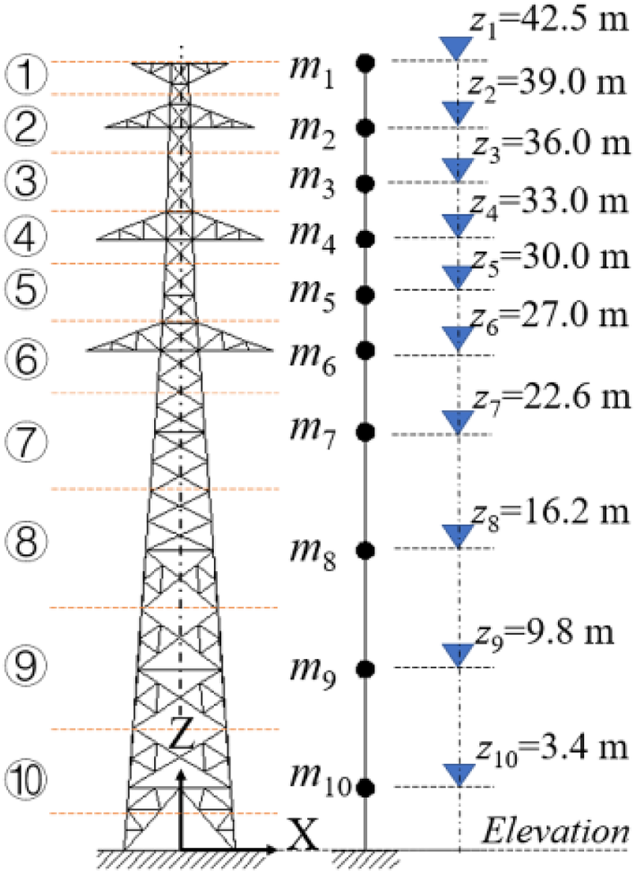

   图6 输电塔分段方案。

图中主要标注：Elevation：标高；m\_1–m\_10：第1–10段集中质量；z\_1–z\_10：第1–10段代表高度；X / Y / Z：塔体坐标轴。

.. list-table:: 表1 输电塔的物理参数。
   :header-rows: 1

   * - 分段
     - 代表高度 :math:`z_i/\mathrm{m}`
     - 质量 :math:`m_i/\mathrm{kg}`
     - 投影面积 :math:`A_{s,i}/\mathrm{m^2}`
     - 实度比 :math:`\Phi_i`
     - 阻力系数 :math:`C_{D,i}`
   * - 1
     - 42.5
     - 305.4
     - 1.31
     - 0.29
     - 2.62
   * - 2
     - 39.0
     - 593.8
     - 2.16
     - 0.28
     - 2.64
   * - 3
     - 36.0
     - 272.8
     - 0.88
     - 0.23
     - 2.86
   * - 4
     - 33.0
     - 781.5
     - 2.57
     - 0.26
     - 2.75
   * - 5
     - 30.0
     - 396.1
     - 1.18
     - 0.23
     - 2.84
   * - 6
     - 27.0
     - 916.2
     - 3.08
     - 0.25
     - 2.77
   * - 7
     - 22.6
     - 964.4
     - 2.79
     - 0.17
     - 3.13
   * - 8
     - 16.2
     - 1291.5
     - 3.55
     - 0.15
     - 3.20
   * - 9
     - 9.8
     - 1416.3
     - 3.96
     - 0.14
     - 3.27
   * - 10
     - 3.4
     - 1717.2
     - 3.31
     - 0.14
     - 3.24

.. math::

   C_D=4.0\Phi^2-5.9\Phi+4.0 \qquad (30)

其中， :math:`\Phi` 为分段实度比。

实际处理中通常忽略格构塔风升力，将合风力方向设为风阻力方向。给定 :math:`\theta` 后，风荷载分配系数可写为 :math:`\eta_{X,i}=K_{\theta,i}\sin\theta`、 :math:`\eta_{Y,i}=K_{\theta,i}\cos\theta`。其中， :math:`K_{\theta,i}` 为斜风荷载系数，定义为 :math:`K_{\theta,i}=C_{D,\theta,i}/C_{D,i}`； :math:`C_{D,\theta,i}` 为给定角度下的阻力系数。

由于横担在Y方向的外形与投影面积大于X方向，其斜风效应不同于正方形塔身。因此，估计风力互功率谱时，需要区分两类部位的 :math:`K_\theta` [8,9]。正方形截面塔身取：

.. math::

   K_\theta=1+0.2\sin^2(2\theta) \qquad (31)

横担则取：

.. math::

   K_\theta=\cos\theta+0.4\sin\theta \qquad (32)

分段合风力方向（记为 :math:`\alpha`）实际上不同于来风方向 :math:`\theta`，横担尤其如此[17–19]。因此，设定 :math:`\alpha=\theta` 不可避免地会使风力估计产生一定偏差。尽管如此，下文结果表明，在缺少准确 :math:`\alpha` 信息时，这种处理可以接受。

.. note::

   将本节分配系数逐字代入式(12)、(13)，在某一轴向分配系数为零的正交风情形下，会出现分子、分母同为零的形式。原文没有展开共同因子消去、极限或数值实现，属于复现说明缺口，不能据此认定其计算程序错误；本文也不补造处理算法。下节另行指出准定常对照在90°来风下无法给出横风谱。

4.2 脉动风力模拟结果
~~~~~~~~~~~~~~~~~~~~~~~~

采用表1物理参数，按第3.3节三步程序估计目标风环境下广义风力功率谱。风力互功率谱由式(12)～(14)确定，再按式(21)～(24)模拟脉动风力时程，采样率10 Hz，时长600 s。本节以塔顶平均风速 :math:`\overline U_H=37.5\,\mathrm{m/s}` 下 :math:`\theta=90^\circ`、 :math:`60^\circ` 两工况为例。为比较，还令气动导纳 :math:`|\chi(f)|^2=1`，给出第i段两方向脉动力的准定常功率谱：

.. math::

   \begin{cases}S^q_{\widetilde F_X}(z_i,f)=\left[\rho_a\overline U_i A_{e,i}\eta_{X,i}\right]^2\sigma_u^2(z_i)S_u(f)\\S^q_{\widetilde F_Y}(z_i,f)=\left[\rho_a\overline U_i A_{e,i}\eta_{Y,i}\right]^2\sigma_u^2(z_i)S_u(f)\end{cases} \qquad (33)

其中， :math:`S_u(f)` 取风洞流场纵向脉动的归一化谱[29]。

图7给出 :math:`\theta=90^\circ` 时第1、6段模拟动力风力时程，图8给出对应自功率谱与互功率谱。图8显示，模拟风力各谱均符合推导得到的目标谱。相比之下，若不考虑气动导纳，顺风向 :math:`\widetilde F_X(t)` 的准定常谱 :math:`S^q_{\widetilde F_X}` 会被高估；该工况下横风向 :math:`\widetilde F_Y(t)` 的准定常谱 :math:`S^q_{\widetilde F_Y}` 无法获得。此外，因相干性很弱，文中没有列出X、Y轴风力之间的模拟互谱。

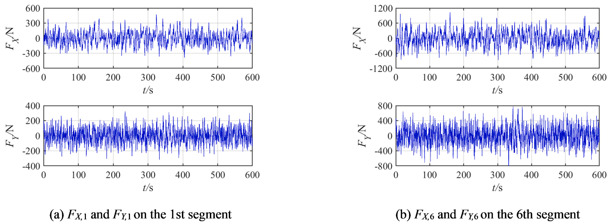

   图7 θ = 90° 时模拟脉动风力的时程。

图中主要标注：F\_X1 and F\_Y1 on the 1st segment：第1段的 X、Y 轴风力；F\_X6 and F\_Y6 on the 6th segment：第6段的 X、Y 轴风力；t/s：时间（s）；F\_X, F\_Y / N：X、Y 轴风力（N）。

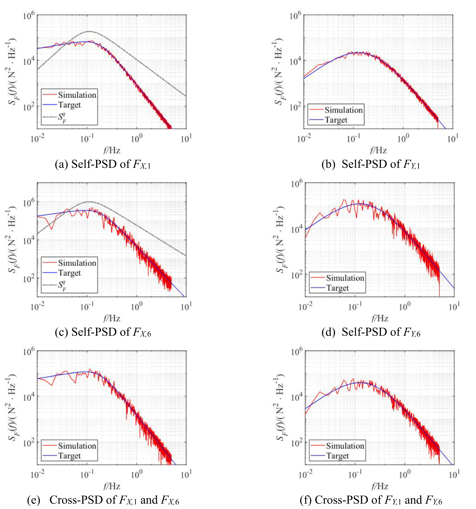

   图8 θ = 90° 时模拟脉动风力的功率谱密度。

图中主要标注：Simulation：模拟结果；Target：目标谱；Self-PSD：自功率谱密度；Cross-PSD：互功率谱密度；f/Hz：频率（Hz）；S\_F^q：准定常假设下的风力功率谱密度；(a)–(d)：F\_X1、F\_Y1、F\_X6、F\_Y6 的自谱；(e)–(f)：F\_X1 与 F\_X6、F\_Y1 与 F\_Y6 的互谱。

 :math:`\theta=60^\circ` 时风力时程及对应自谱、互谱分别见图9、10。类似地，图10中各模拟风力谱与推导目标谱吻合良好。该工况下，两个方向的准定常谱 :math:`S^q_{\widetilde F_X}`、 :math:`S^q_{\widetilde F_Y}` 在主导频率范围仍大于推导谱。考虑相干性后，模拟X、Y轴风力互谱也与目标良好吻合。

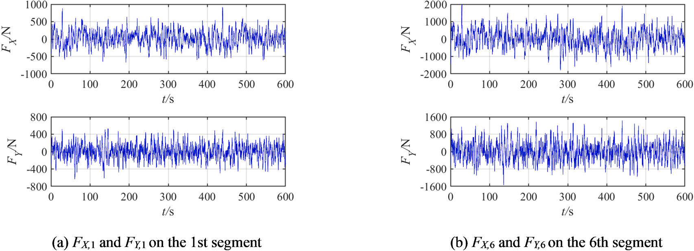

   图9 θ = 60° 时模拟脉动风力的时程。

图中主要标注：F\_X1 and F\_Y1 on the 1st segment：第1段的 X、Y 轴风力；F\_X6 and F\_Y6 on the 6th segment：第6段的 X、Y 轴风力；t/s：时间（s）；F\_X, F\_Y / N：X、Y 轴风力（N）。

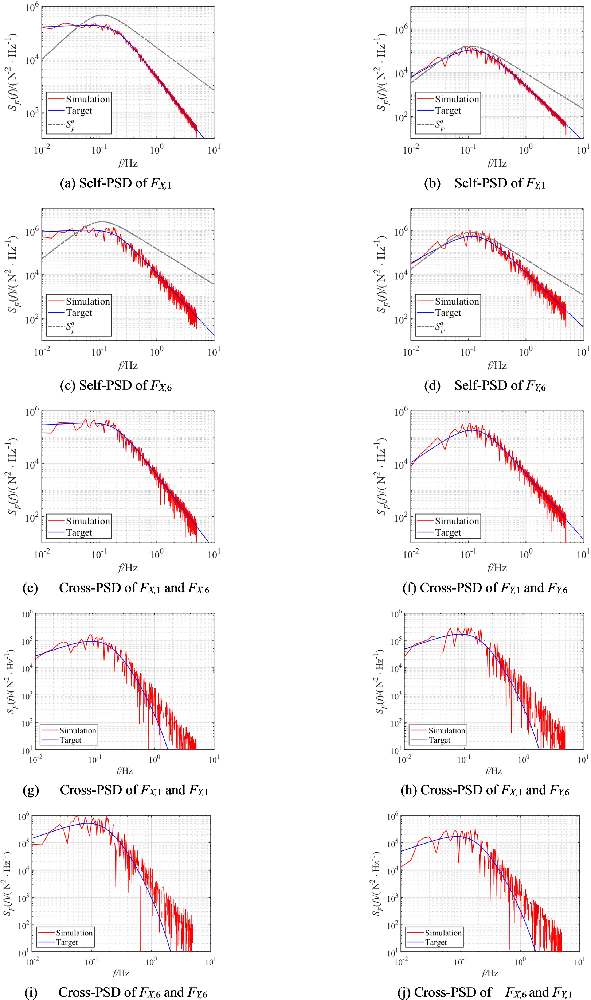

   图10 θ = 60° 时模拟脉动风力的功率谱密度。

图中主要标注：Simulation：模拟结果；Target：目标谱；Self-PSD：自功率谱密度；Cross-PSD：互功率谱密度；f/Hz：频率（Hz）；S\_F^q：准定常假设下的风力功率谱密度；(a)–(d)：F\_X1、F\_Y1、F\_X6、F\_Y6 的自谱；(e)–(f)：同轴不同段风力的互谱；(g)–(j)：不同轴风力的互谱。

按式(8)计算X、Y轴广义风力功率谱，如图11所示。在 :math:`\theta=90^\circ`、 :math:`60^\circ` 两工况下，模拟广义风力谱均符合目标。图12给出整体X、Y轴脉动力相干函数： :math:`90^\circ` 时大部分小于0.2，与试验结果相似； :math:`60^\circ` 时，其变化趋势与式(26)目标模型一致。

.. figure:: ../../../wechat/assets/public-safe/ref-zhang2023-S/fig-11.png
   :alt: 图11 广义风力的功率谱密度。
   :align: center
   :width: 100%

   图11 广义风力的功率谱密度。

图中主要标注：Simulation：模拟结果；Target：目标谱；f/Hz：频率（Hz）；(a)–(b)：θ = 90° 时 X、Y 轴广义风力谱；(c)–(d)：θ = 60° 时 X、Y 轴广义风力谱。

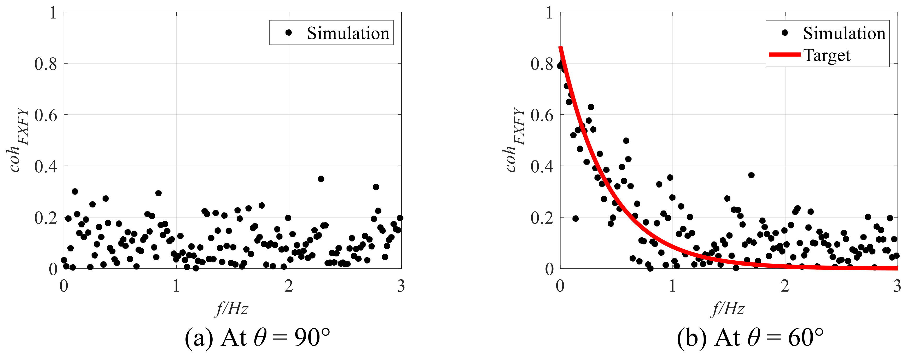

   图12 脉动风力的相干函数。

图中主要标注：Simulation：模拟结果；Target：目标相干函数；coh\_FXFY：X、Y 轴脉动风力的相干函数；f/Hz：频率（Hz）；(a) At θ = 90°：（a）θ = 90°；(b) At θ = 60°：（b）θ = 60°。

5 输电塔风致动力分析
----------------------

本节在模拟动力风力下分析输电塔风致动力响应，并与气弹风洞试验测量值比较。节点连接与地基土刚度会在一定程度上影响结构动力行为，因此，计算模型与实际结构相符十分重要[38]。根据实际结构动力特性，可采用修正柔度法[37]确定输电塔降阶模型。

对图6等效悬臂杆模型，质量矩阵 :math:`\mathbf M=\operatorname{diag}[m_1,m_2,\ldots,m_{10}]` 为对角矩阵， :math:`m_i\ (i=1,2,\ldots,10)` 由物理模型确定；刚度矩阵 :math:`\mathbf K` 根据测量识别的固有频率确定。强风下，流固相互作用产生的运动诱导力可视为气动阻尼力。因此，总阻尼矩阵定义为 :math:`\mathbf C=\mathbf C_s+\mathbf C_a`，其中 :math:`\mathbf C_s` 为结构阻尼矩阵， :math:`\mathbf C_a` 为主要气动阻尼矩阵。本文将 :math:`\mathbf C` 假定为Rayleigh阻尼模型，利用气弹风洞试验识别的模态阻尼比 :math:`\xi` 确定。 :math:`\xi` 包含结构阻尼和气动阻尼，且随风速与风向变化；其采用值见先前研究[37]。

在线性系统中，抖振可视为结构围绕平均风力引起的准静态状态振动。本文只分析模拟脉动风力作用下的脉动动力响应，采用Newmark-β法， :math:`\beta=0.25`。与风洞试验相对应，在 :math:`\overline U_H=37.5\,\mathrm{m/s}` 下研究7个风向， :math:`\theta` 从 :math:`0^\circ` 至 :math:`90^\circ`，间隔 :math:`15^\circ`。

塔顶挠度可作为整塔性能指标，因此本节主要讨论塔顶响应。各风向下塔顶位移 :math:`D_X`、 :math:`D_Y` 的一个模拟时程样本与一个测量样本见附录图A1，其概率密度函数（PDF）与功率谱密度（PSD）分别在图A2、A3中比较。两方向位移时程的主要特征分别相似，整体较好符合正态分布。测量与模拟功率谱也较吻合，仅有小幅偏差；各自谱中在第一阶模态频率附近均有一个明显共振峰，说明该塔风致振动以第一阶平动模态为主。

谐波叠加法生成脉动风力的过程具有随机性，所激发动力响应也自然包含随机性。对每个工况，本文进行了100次模拟，每次包括脉动风力生成和结构动力响应分析。为比较，采用滑动时间窗从每个工况的试验数据中提取20个时程样本；每个样本时长600 s。

从每个 :math:`D_X`、 :math:`D_Y` 时程样本计算均方根 :math:`\sigma_{D_X}`、 :math:`\sigma_{D_Y}` 与峰值 :math:`D_{\max,X}`、 :math:`D_{\max,Y}`。MATLAB箱线图函数可直观呈现样本统计摘要。如图13，每个箱线图显示中位数、下四分位数与上四分位数（对应0.25、0.75分位数）、根据四分位距IQR确定的离群值，以及剔除离群值后的最大值和最小值。箱体长度IQR主要反映离散程度。用各风向20个测量样本与100个模拟样本，绘制四项指标的箱线图（图14）。均值另以“*”表示，相邻风向均值以直线连接。

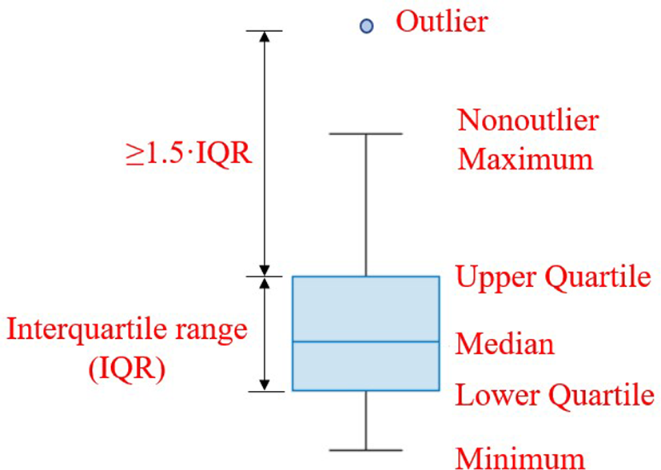

   图13 箱线图图例说明。

图中主要标注：Outlier：异常值；Nonoutlier Maximum：非异常最大值；Upper Quartile：上四分位数；Median：中位数；Lower Quartile：下四分位数；Minimum：最小值；Interquartile range (IQR)：四分位距（IQR）；≥1.5·IQR：不小于1.5倍四分位距。

.. figure:: ../../../wechat/assets/public-safe/ref-zhang2023-S/fig-14.png
   :alt: 图14 塔顶位移统计量比较。
   :align: center
   :width: 100%

   图14 塔顶位移统计量比较。

图中主要标注：Measurement：实测结果；Simulation：模拟结果；RMS of D\_X / D\_Y：X／Y 向塔顶位移均方根；Peak value of D\_X / D\_Y：X／Y 向塔顶位移峰值；θ/°：风向角（°）；D\_max,X, D\_max,Y / m：X、Y 向塔顶位移峰值（m）。

图14(a)、(b)显示，测量与模拟各箱线图IQR均较小， :math:`\sigma_{D_X}`、 :math:`\sigma_{D_Y}` 均值位于箱体内，表明相同来风方向下两方向位移均方根离散性较小。其均值随风向的模拟变化趋势与测量相似，误差小于10%。由于均方根平方代表系统动态能量，作者据此认为动力风力功率谱分布具有合理性。

图14(c)、(d)中， :math:`D_{\max,X}`、 :math:`D_{\max,Y}` 离散性较大，测量与模拟均值之间存在一定偏差。但各工况测量数据和模拟数据的离散区间有较大范围重合；总体而言，两者随 :math:`\theta` 的变化趋势也相似。

综上，模拟分布式动力风力能够合理预测该输电塔在全部给定风向下的动力响应。不过，由于采用沿高度风速相干性，可能在一定程度上高估动力风力的相关程度，整体塔响应略有高估趋势。相比之下，若假定 :math:`|\chi(f)|^2=1`，风力谱被高估，还会进一步高估顺风向结构响应。

.. note::

   “误差小于10%”对应本文7个风向下两方向塔顶位移RMS的样本均值，不是峰值误差保证，也不表示每个模拟时程与试验一一对应。结构刚度和总模态阻尼均使用试验识别信息，风力和位移并未同步测量；本比较不等于对任意未知塔型完全独立的盲预测验证。

6 结论与展望
----------------

本文基于广义风力谱提出钢格构塔动力风力估计方法。推导所得分布动力风力谱采用权重分配，考虑风场和结构特征；动力风力互谱矩阵还考虑不同轴向风力的相干性。利用所推导互谱矩阵，采用谐波叠加法模拟脉动风力时程。为验证方法，介绍了一座典型输电塔的风洞试验，提供结构动力响应测量数据与广义风力经验谱模型，并补充分析不同轴向风力的相干函数。主要结论如下：

1. 角钢格构塔的顺风向与横风向力相干性较弱；不同斜风情况下，塔体不同轴向风力相干函数相似，可用指数衰减经验模型描述。
2. 模拟动力风力时程在功率谱和相干性方面符合目标风环境，并产生与气弹风洞测量相似的动力响应。
3. 不考虑气动导纳效应，会高估顺风向风力功率谱。
4. 本文钢格构塔分布式动力风力估计方法表现有效。

不过，所估计动力风力的精度仍取决于阻力系数、风荷载分配系数、斜风荷载系数和相干函数等权重因素，输电塔横担尤其如此。对这些因素建立更合理模型，可进一步提高结果精度。此外，对截面对称的常见格构塔，风致扭转影响较小，因此本文没有考虑分段局部扭矩。对于风下扭转效应明显的塔，本方法还需要进一步发展。

附录
----------------

见图A1～A3。以下完整保留跨页图板，不删减续页风向工况。

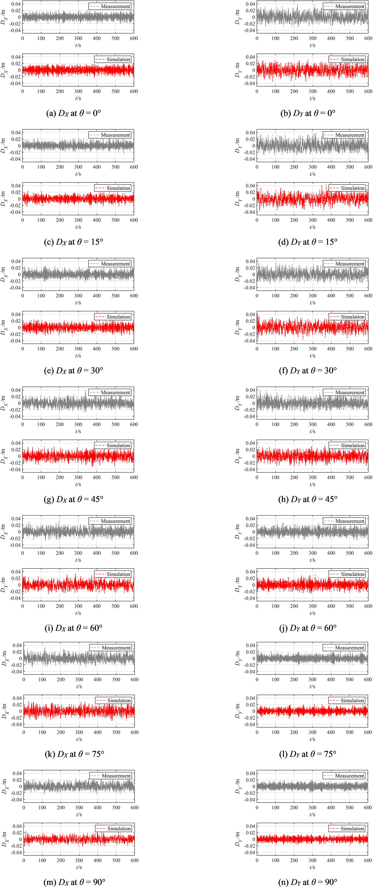

   图A1 塔顶动力位移的时程。

图中主要标注：Measurement：实测结果；Simulation：模拟结果；D\_X / D\_Y：X／Y 向塔顶位移；t/s：时间（s）；(a)–(n)：0°、15°、30°、45°、60°、75°、90° 七种风向下 X、Y 向响应。

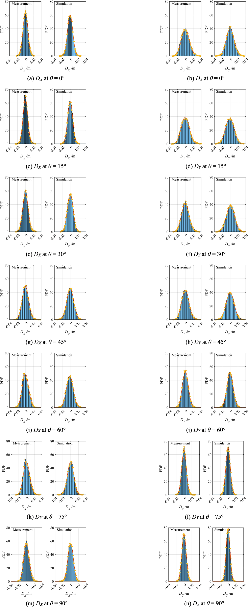

   图A2 塔顶动力位移的概率密度函数（PDF）。

图中主要标注：Measurement：实测结果；Simulation：模拟结果；PDF：概率密度函数；D\_X / D\_Y：X／Y 向塔顶位移；(a)–(n)：0°、15°、30°、45°、60°、75°、90° 七种风向下 X、Y 向响应。

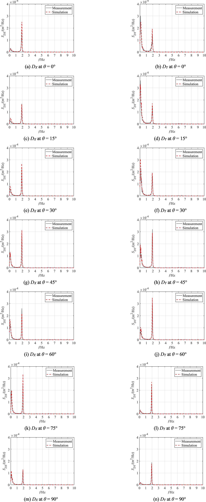

   图A3 塔顶动力位移的功率谱密度（PSD）。

图中主要标注：Measurement：实测结果；Simulation：模拟结果；f/Hz：频率（Hz）；S\_DX, S\_DY：X、Y 向塔顶位移功率谱密度；(a)–(n)：0°、15°、30°、45°、60°、75°、90° 七种风向下 X、Y 向响应。

参考文献
----------------

[1] Yang Q, Gao R, Bai F, Li T, Tamura Y. Damage to buildings and structures due to recent devastating wind hazards in East Asia. Nat Hazard 2018;92(3):1321–53.

[2] Roy S, Kundu CK. State of the art review of wind induced vibration and its control on transmission towers. Structures 2021;29:254–64.

[3] El Damatty A, Elawady A. Critical load cases for lattice transmission line structures subjected to downbursts: Economic implications for design of transmission lines. Eng Struct 2018;159:213–26.

[4] Tian L, Zhang X, Fu X. Collapse simulations of communication tower subjected to wind loads using dynamic explicit method. J Perform Constr Facil 2020;34(3):04020024.

[5] Solari G. Wind loading of structures: framework, phenomena. Tools Codif Struct 2017;12:265–85.

[6] Iec. 60826, Design Criteria of Overhead Transmission Lines. 3rd ed. Geneva, Switzerland: International Electrotechnical Commission; 2003.

[7] GB 50009-2012, Load code for the design of building structures, China Architecture and Building Press, Beijing, China, 2012.

[8] DL/T 5154. Technical Code for the Design of Tower and Pole Structures of Overhead Transmission Lines. China Planning Press, Beijing, China, 2012.

[9] EN 50341-1. Overhead Electrical Lines Exceeding AC 1 kV. European Committee for Electrotechnical Standardization, Brussels, Belgium, 2012.

[10] ASCE-74, Guidelines for electrical transmission line structural loading, 4th ed. American Society of Civil Engineers, USA, 2020.

[11] Holmes JD. Effective static load distributions in wind engineering. J Wind Eng Ind Aerodyn 2002;90:91–109.

[12] Holmes JD. Along-wind response of lattice towers: Part I - derivation of expressions for gust response factors. Eng Struct 1994;16:287–92.

[13] Zhao S, Yan Z, Savory E. Design wind loads for transmission towers with cantilever cross-arms based on the inertial load method. J Wind Eng Ind Aerodyn 2020;205:104286.

[14] Bayar DC. Drag coefficients of latticed towers. J Struct Eng 1986;112(2):417–30.

[15] Prudhomme S, Legeron F, Laneville A, Tran MK. Wind forces on single and shielded angle members in lattice structures. J Wind Eng Ind Aerodyn 2014;124:20–8.

[16] Mara TG, Ho TCE. Design loads for transmission towers under skewed wind loading. Struct Cong 2011;2011:1246–57.

[17] Yang F, Yang J, Niu H, Zhang H. Design wind loads for tubular-angle steel cross-arms of transmission towers under skewed wind loading. J Wind Eng Ind Aerodyn 2015;140:10–8.

[18] Zhou Q, Ma B, Qing Zu, Zhang H. Investigation on wind loads on angle-steel cross-arms of lattice transmission towers via direct force measurement. J Wind Eng Ind Aerodyn 2019;191:117–26.

[19] Zhou Q, Zhang H, Ma B, et al. Wind loads on transmission tower bodies under skew winds with both yaw and tilt angles. J Wind Eng Ind Aerodyn 2019;187:48–60.

[20] Li Y, Li Z, Savory E, Zhong Y, Yan Z. Wind tunnel measurement of overall and sectional drag coefficients for a super high-rise steel tube transmission tower. J Wind Eng Ind Aerodyn 2020;206:104363.

[21] Zhang Q. Experimental study of wind loads on typical single-circuit transmission towers. Proc Inst Civil Eng Struct Build 2020;173(3):186–97.

[22] Calotescu I, Torre S, Freda A, et al. Wind tunnel testing of telecommunication lattice towers equipped with ancillaries. Eng Struct 2021;241:112526.

[23] Liang S, Zou L, Wang D, Cao H. Investigation on wind tunnel tests of a full aeroelastic model of electrical transmission tower-line system. Eng Struct 2015;85:63–72.

[24] Azzi Z, Elawady A, Irwin P, et al. Aeroelastic modeling to study the wind-induced response of a self-supported lattice tower. Eng Struct 2021;245:112885.

[25] Li X, Zhang W, Niu H, Wu ZY. Probabilistic capacity assessment of lattice transmission towers under strong wind. Eng Struct 2018;175:517–30.

[26] Sarmasti H, Abedi K, Chenaghlou RM. Stability behavior of the transmission line system under incremental dynamic wind load. Wind Struct 2020;31(6):509–22.

[27] Li F, Zou L, Song J, Liang S, Chen Y. Investigation of the spatial coherence function of wind loads on lattice frame structures. J Wind Eng Ind Aerodyn 2021;215:104675.

[28] Lou WJ, Sun BN, Tang JC. Aeroelastic model investigation and spectral analysis of a tall lattice tower. Adv Struct Eng 2000;3(2):119–30.

[29] Zhang W, Xiao Y, Li C, Zheng Q, Tang Y. Wind load investigation of self-supported lattice transmission tower based on wind tunnel tests. Eng Struct 2022;252:113575.

[30] Zou L, Liang S. Investigation of 3-D dynamic wind loads on lattice towers. Wind Struct 2008;11(4):323–40.

[31] Liu H, Chen G, Lyu T, Lin H, Zhu B, Huang A. Wind-induced response of large offshore oil platform. Pet Explor Dev 2016;43(4):708–16.

[32] Xiao Z, Li Z, Wang Z, Yan Z, Ren K. Wind-induced vibration analysis of UHV transmission tower based on the HFFB tests. Eng Mech 2010;27(4):218–25.

[33] Simiu E, Yeo D. Wind Effects on Structures: Modern Structural Design for Wind. Oxford, UK: John Wiley & Sons Ltd; 2019.

[34] Zhang H, Zhou L, Liu T, Guo Z, Golnary F. Dynamic mode decomposition analysis of the two-dimensional flow past two transversely in-phase oscillating cylinders in a tandem arrangement. Phys Fluids 2022;34(3):033602.

[35] Zhang H, Xin D, Zhan J, Zhou L. Flow past a transversely oscillating cylinder at lock-on region and three-dimensional Floquet stability analysis of its wake. Phys Fluids 2021;33(2):025111.

[36] Deodatis G. Simulation of ergodic multivariate stochastic processes. J Eng Mech 1996;122(8):778–87.

[37] Zhang W, Li C, Liu G, Xiao Y. Reconstruction of dynamic wind forces on a transmission steel lattice tower using aeroelastic wind tunnel test data. Eng Struct 2023;275:115167.

[38] Szafran J, Juszczyk K, Kamiński M. Experiment-based reliability analysis of structural joints in a steel lattice tower. J Constr Steel Res 2019;154:278–92.

完整引用
----------------

Wentong Zhang, Chao Li, Gaixia Liu, Yiqing Xiao. Estimation of dynamic wind forces on a steel lattice tower based on generalized wind force spectra. *Structures*, 48 (2023), 1634–1650. DOI: `10.1016/j.istruc.2022.12.073 <https://doi.org/10.1016/j.istruc.2022.12.073>`_.

收录信息见 :ref:`WOEAI 学术成果页对应条目 <ref-zhang2023-S>`。
