.. _paper-note-ref-zhao2021-AR:

复杂地形中微尺度嵌套行星边界层模拟的侧边界处理新思路：论文精解
============================================================================

精简版微信公众号文章：待发布

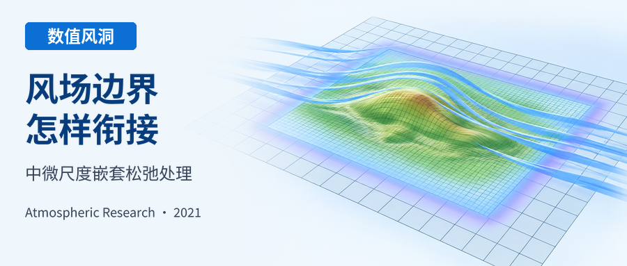

.. contents:: 本页目录
   :local:
   :depth: 2

论文信息
--------

原文题名：New consideration of lateral boundary treatment for meso- and micro-scale nested PBL simulations over complex terrain。

作者：Zihan Zhao；Yiqing Xiao；Chao Li（通讯作者）；Jinghan Wang；Gang Hu。

作者单位：哈尔滨工业大学（深圳）土木与环境工程学院，中国深圳；代尔夫特理工大学土木工程与地球科学学院，荷兰代尔夫特。

期刊：Atmospheric Research，254（2021），105507。
DOI：https://doi.org/10.1016/j.atmosres.2021.105507。

收稿：2020 年 10 月 8 日；修回：2021 年 1 月 31 日；录用：2021 年 2 月 1 日；在线发表：2021 年 2 月 6 日。

摘要
----

通过嵌套中尺度数值天气预报（NWP）模型与微尺度计算流体动力学（CFD），可以模拟复杂地形上细致的行星边界层（PBL）流动。当侧边界上的变量被完全指定时，CFD 或有限区域模型的过指定处理可能导致不适定性和数值不稳定。这些行为源于中尺度与微尺度模型的控制方程、湍流黏度模型及下垫面不一致。本文在 CFD 边缘区域施加松弛处理，使其风速分量趋向外部指定的 NWP 值。松弛方案由简单平流输运方程推导，并利用遗传算法优化。与已有方法相比，其在浅水系统中吸收波反射的数值能力更好。随后，在中性层结的 Askervein Hill 算例中，系统研究松弛强度、湍流模型常数以及 NWP–CFD 嵌套边界预报变量选择等关键问题。从简单系统获得的松弛方案在 CFD 中同样有效，缩短了过指定出口边界附近风速的适应距离。本文提出并验证了一套完整方法，使由 NWP 提供入流边界的微尺度域获得适定 PBL 解。

关键词
------

NWP–CFD；PBL 参数化；复杂地形；遗传算法；有限区域模型。

1 引言
------

耦合方法已成为 NWP 和计算风工程（CWE）中模拟 PBL 流动的常用做法。近期应用包括利用嵌套区域天气预报模型进行台风再分析（Li et al., 2020）、城市尺度污染物扩散（Tewari et al., 2010），以及山地风模拟（Han et al., 2018；Prieto-Herráez et al., 2021）。由探空或卫星观测初始化的中尺度或大尺度模型，通常可以向微尺度域提供预报变量的气象背景；已有研究证明，这能提高细网格 PBL 模拟精度。这种单向降尺度的重要问题是微尺度求解器中的开放边界处理，它涉及非封闭数值域和多方向风流（Cap, 2003）。然而，这些边界可能出现不受约束的流体运动，例如连续山体中的“人工悬崖”（Han et al., 2018），或嵌套边界附近分辨出的湍流运动不一致（Vonlanthen et al., 2016）。因此，要获得适定解，必须在有限区域模型（LAM）上指定恰当的变量子集。

改善 LAM 边界不匹配的有效处理包括：整个区域采用精细网格，或使网格从加密区域逐渐扩展。然而，对于需要真实气象背景的 PBL 流动，这一做法并不适合 CWE 应用，因为高分辨率区域 NWP 模型的稳定性要求和高计算成本都无法回避（Yamaguchi and Feingold, 2012）。此外，中微尺度求解器网格嵌套比从 :math:`10^1` 至 :math:`10^3` 不等（Liu et al., 2012；Yamada and Koike, 2011），难以在同一框架中表示相似物理过程或流动运动。将粗网格 NWP 场传入 CFD 域等方法（Ashie and Kono, 2011；Prieto-Herráez et al., 2021；Rodrigo et al., 2017），则可通过折中计算成本与分辨率，灵活选择研究对象。

在理想化 PBL 模拟中，侧边界条件（LBC）处理直接，可以在固定风向下恰当指定；多数算例采用明确的入口、出口及顶部对称面（Kumar et al., 2017；Law et al., 2019）。但在实际的单向 NWP 耦合微尺度求解器中（Castro et al., 2015；Rodrigues et al., 2016），时间和空间相关的边界会随气象背景改变，例如受 Ekman 螺旋或科里奥利力影响，风向随高度变化（Constantin and Johnson, 2019）。指定这些 LBC 十分棘手，同一边界可能同时包含入流和出流，进而产生过指定条件，影响解的唯一性与适定性。这些问题尚未解决：模型物理或网格分辨运动不匹配会造成边界数值不稳定与模型误差（Baumhefner and Perkey, 1982；Moeng et al., 2007）。例如，粗网格 NWP 使用简化的 PBL 方案与约化 Navier–Stokes 方程（Temel et al., 2018），即使其数值解已收敛，将这些解指定给微尺度嵌套边界仍面临挑战。

在气象模型中，对于边界过指定的降尺度问题，可在 LBC 附近采用阻尼或松弛处理，使外部指定流场得到令人满意的结果（Davies, 1983；Marbaix et al., 2003）。这种实用调整，在距边界一定范围内平滑混合外部流场与内部求解结果，使嵌套域吸收过定条件产生的非物理扰动（Davies, 2014）。近年来，LAM 松弛边界已用于多种计算模拟，包括均匀流中的简化大气（Davies, 1983）、自由表面波预测（Perić and Abdel-Maksoud, 2016）和 LES 内嵌 LES（Vonlanthen et al., 2016）。这些半解析 LBC 的成功应用，为 NWP–CFD 嵌套提供了前景。其共同原理是在动量输运方程中加入源项 :math:`S_R`，同时考虑随距耦合边界距离变化的松弛强度 :math:`\alpha(x)`，以及粗网格变量 :math:`\widetilde u_b` 和细网格变量 :math:`u_f` 的差，即 :math:`S_R=-\alpha(x)(u_f-\widetilde u_b)`。尽管理论基础简化且不完善，这类调整在跨越不同数值模型差异时缺点较少（Marbaix et al., 2003）。对于复杂地形 PBL，Rodrigues et al. (2016) 在中微尺度嵌套中采用这种处理，考虑山区截断并减少重力波反射。但在较小 CFD 域中，应评估 :math:`\alpha` 与松弛厚度的敏感性，因为分辨率或近壁处理改变后，细节流动还需要发展（Blocken et al., 2007；Davies, 2014）。

此外，不恰当实施仍可能带来问题。例如，出流特征不匹配而混合不足，可能产生异常并迅速向域内传播（Kallberg, 1977）。松弛项过大时，额外动量源可能在时间积分中导致不稳定。较审慎的做法是先在简单方程中以优化方式评估敏感性，再推广到复杂系统（Davies, 1983；Lehmann, 1993；McDonald, 2000）。这些研究表明，这类 LBC 有望用于涉及不同流动现象的降尺度模型。区域 NWP 通常将目标区域放在远离修正 LBC 的位置，留出数十公里距离供细网格流动发展。对于与 NWP 嵌套的较小 CFD 域，混合性能值得讨论，尤其是两个尺度采用独立下垫面时。这对 PBL 模拟尤为关键：CWE 中的风速增大、分离和再附着，无法与采用不同网格和简化湍流黏度模型的粗分辨 NWP 域相匹配（Stull, 2012；Yamada and Koike, 2011）。

本文旨在研究中微尺度 PBL 耦合非定常求解器中的适定 LBC。首先，扩展 Lehmann (1993) 的工作，用简单平流方程优化松弛方案；优化采用遗传算法（GA），不考虑数值离散不确定性。随后，在更复杂的二维浅水系统中检查流动适定性，利用优化松弛方案量化 LAM 数值表现，并在反射边界条件下检查内部流动。面向实际应用，在中性层结 Askervein Hill 算例（Taylor and Teunissen, 1987）中，将 NWP 与非定常雷诺平均（URANS）CFD 嵌套，研究松弛型 LBC。WRF 模拟中的不确定参数，包括物理方案和初始化（Fernández-González et al., 2018；Gholami et al., 2021），用真实算例的探空数据验证；再利用 TU-03B 现场观测，探讨微尺度适定侧边界性质。

2 简单方程中的松弛方案
----------------------

2.1 一维平流方程
~~~~~~~~~~~~~~~~

描述均匀流中小振幅大气静力扰动的线性浅水系统，可转化为式 (1) 的平流形式（Davies, 1983；Marbaix et al., 2003）；这里均匀流速度为 :math:`U`，流动无旋且等温。中尺度模型讨论重力波等空间传播现象时，经常涉及这些项。假定嵌套域的水平风扰动场 :math:`\widetilde u` 已给定，采用松弛侧边界的 LAM 可写为

.. math::

   \frac{\partial\widetilde u_b}{\partial t}+c\frac{\partial\widetilde u_b}{\partial x}=0 \qquad (1)

.. math::

   \frac{\partial u_f}{\partial t}+c\frac{\partial u_f}{\partial x}=-\alpha L(x)(u_f-\widetilde u_b) \qquad (2)

其中 :math:`\widetilde u_b` 和 :math:`u_f` 分别是粗网格 :math:`\Delta x_b` 与细网格 :math:`\Delta x_f` 两种网格尺度系统的离散解。:math:`c=U\pm(gh)^{0.5}` 为非零常速度，:math:`h` 与位势扰动有关，:math:`g` 为重力加速度。用式 (1) 减去式 (2)，可简化为

.. math::

   \frac{\partial u_e}{\partial t}+c\frac{\partial u_e}{\partial x}=-\alpha L(x)u_e \qquad (3)

其中 :math:`u_e=\widetilde u_b-u_f` 来自网格离散或模型分辨差异。可见，:math:`u_e` 的平流运动以特征速度 :math:`c` 传播。

根据 Taylor 级数展开，对于粗、细网格比 :math:`r`，即 :math:`\Delta x_b=r\Delta x_f`，按照 Richardson 外推的 :math:`p` 阶精度估计方案（Roy, 2010），离散网格上的平流型数学模型解满足式 (4)：

.. math::

   \bar{\varepsilon}_G=\bar u-u_f=\frac{\widetilde u_b-u_f}{1-r^p} \qquad (4)

其中 :math:`\bar u` 表示精确解的一般估计。离散误差 :math:`\bar{\varepsilon}_G` 可按下式计算：

.. math::

   u_e=\bar{\varepsilon}_G(1-r^p) \qquad (5)

为评估侧边界附近相对误差场的传播，在式 (6) 中引入与网格尺度相关的常数 :math:`A_{\Delta x}`，简化复指数形式的 :math:`\bar{\varepsilon}_G`。随后，考虑网格加密比 :math:`r`，得到式 (7) 的 :math:`u_e`：

.. math::

   \bar{\varepsilon}_G=A_{\Delta x}e^{i(\widetilde\nu x-wt)} \qquad (6)

.. math::

   u_e=A_{\Delta x}(1-r^p)e^{i(\widetilde\nu x-wt)} \qquad (7)

其中 :math:`\widetilde\nu` 为波数，:math:`w` 为角频率。

具有时间周期性的 :math:`u_e` 可视为从无限区域入射至松弛区界面的行波（Davies, 1983），其可能产生伪反射，向内部域引入数值误差。时间积分中应消除这些非物理扰动。图 1 详细示意了这一数值现象。注意，在位置 :math:`s` 处，出口 LBC 来自粗网格指定，因此 :math:`u_e=0`。

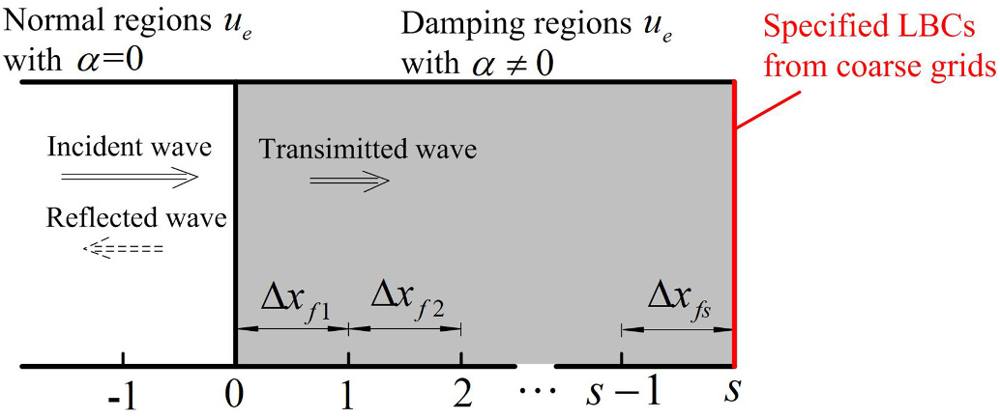

   **图 1** 含边界松弛区的一维域示意（s≥0）。Δx_f1…Δx_fs 表示离散网格尺寸。嵌套模型的解 u 不匹配，会在 α≠0 处产生反射波；Davies (1983) 有类似描述。图中分别标示无阻尼普通区、阻尼区、入射波、反射波、透射波及粗网格指定的侧边界。

将式 (7) 代入式 (3)，并分别除以偏导项 :math:`\partial u_e/\partial t` 和 :math:`\partial u_e/\partial x`，得到

.. math::

   \widetilde\nu=\frac wc+\frac{\alpha L(x)i}c \qquad (8)

与原始相速和波数关系 :math:`w=\widetilde\nu c` 相比，式 (8) 的虚部 :math:`\alpha L(x)i/c` 表示误差场 :math:`u_e` 在域边界附近传播时的阻尼或衰减效应（Perić and Abdel-Maksoud, 2018）。为简化后续对未知入射波参数 :math:`\langle w,c\rangle` 及松弛区参数的计算，针对相速区间 :math:`[c_{\min},c_{\max}]`，引入无量纲变量 :math:`B^*=\sqrt{c_{\min}c_{\max}}/c`。式 (8) 因而可等价写为

.. math::

   \widetilde\nu=[w+\alpha L(x)i]\frac{\Delta x}{2\pi\sqrt{c_{\min}c_{\max}}}\cdot\frac{2\pi\sqrt{c_{\min}c_{\max}}}{c\Delta x} \qquad (9)

这里使用均匀离散间距 :math:`\Delta x`，并定义两个无量纲变量 :math:`w^*` 和 :math:`\alpha^*`：

.. math::

   w^*=\frac{w\Delta x}{2\pi\sqrt{c_{\min}c_{\max}}} \qquad (10)

.. math::

   \alpha^*=\frac{\alpha\Delta x}{2\pi\sqrt{c_{\min}c_{\max}}} \qquad (11)

式 (9) 变为

.. math::

   \widetilde\nu=[w^*+\alpha^*L(x)i]\frac{2\pi B^*}{\Delta x} \qquad (12)

同时考虑积分稳定性，即显式形式的 Courant–Friedrichs–Lewy（CFL）数限制，以及慢波可能的穿透，选取 :math:`c_{\max}/c_{\min}=100`，与 Davies (1983) 和 Lehmann (1993) 一致。因此，不确定量 :math:`B^*` 可转化为区间 :math:`[1/10,10]` 内的独立变量。选择均匀离散间距与松弛厚度，使松弛厚度等于波长 :math:`\lambda` 的整数倍，定义为

.. math::

   \text{松弛厚度}=a\lambda=s\Delta x \qquad (13)

将式 (13) 代入式 (12)，替换 :math:`\Delta x` 后，:math:`\widetilde\nu` 可写为

.. math::

   \widetilde\nu=\left[1+\frac{\alpha^*sB^*L(x)i}a\right]\frac{2\pi}\lambda \qquad (14)

2.2 边界反射的计算
~~~~~~~~~~~~~~~~~~

图 1 中的细网格入射波跨过 :math:`\alpha=0` 与 :math:`\alpha\neq0` 的界面时，可分为透射与反射分量。这类似自由表面波在无限域中产生非期望反射的现象（Perić and Abdel-Maksoud, 2016）。对于 :math:`0\leq j\leq s` 区间内的流动，Lehmann (1993) 将反射误差 :math:`u_e` 假设为常数，对应无限波长或零振幅。其显式表达式在理想稳态条件下计算，关于 :math:`\langle\alpha(x),c,\Delta x\rangle` 的形式与 Davies (1983) 相同。但这些由平流项中心差分经逐次消元得到的解，不足以处理复杂离散方案和非常数误差场。本节采用经 Perić and Abdel-Maksoud (2018) 验证的显式总波动方程，即式 (15)，考虑松弛区内部传播和反射流动。

.. math::

   \begin{aligned}u_{e(j)}={}&A_{\Delta x}(1-r^p)\left(\prod_{n=0}^{j-1}C_{T(n)}\right)\\&\times\left\{\exp\!\left[i\left(\sum_{n=0}^{j-1}\widetilde\nu_n\Delta x_{fn}+\widetilde\nu_j\left(x-\sum_{n=0}^{j-1}\Delta x_{fn}\right)\right)\right]\right.\\&\left.\quad-C_{R(j)}\exp\!\left[i\left(\sum_{n=0}^{j-1}\widetilde\nu_n\Delta x_{fn}+2\widetilde\nu_j\Delta x_{fn}-\widetilde\nu_j\left(x-\sum_{n=0}^{j-1}\Delta x_{fn}\right)\right)\right]\right\}\end{aligned} \qquad (15)

译注：式 (15) 第二个指数中的 :math:`2\widetilde\nu_j\Delta x_{fn}` 保留原文下标；该项位于求和之外而仍使用 :math:`n`，原文未另行解释。

其中 :math:`C_R` 和 :math:`C_T` 分别为反射与透射系数。为量化二者，在 :math:`j`、:math:`j+1` 界面采用两个空间波条件，即 :math:`u_{e(j)}=u_{e(j+1)}` 和 :math:`\partial u_{e(j)}/\partial x=\partial u_{e(j+1)}/\partial x`。由此得到含隐式 :math:`\beta_{j+1}` 的关系式 (16)–(18)（Perić and Abdel-Maksoud, 2018）。

.. math::

   C_{T(j)}=\frac{1-C_{R(j)}}{1-C_{R(j+1)}e^{i(2\widetilde\nu_{j+1}x_{d,j+1})}} \qquad (16)

.. math::

   C_{R(j)}=\frac{\widetilde\nu_{j+1}\beta_{j+1}-\widetilde\nu_j}{\widetilde\nu_{j+1}\beta_{j+1}+\widetilde\nu_j} \qquad (17)

.. math::

   \beta_{j+1}=\frac{1+C_{R(j+1)}e^{i(2\widetilde\nu_{j+1}x_{d,j+1})}}{1-C_{R(j+1)}e^{i(2\widetilde\nu_{j+1}x_{d,j+1})}} \qquad (18)

在第一层，:math:`C_{R(1)}` 表示穿入内部域的反射波强度。评估其幅值有助于明确决定松弛性能的关键配置。采用不同 :math:`\alpha^*` 和两类 :math:`L(x)` 评估这些关系。应通过控制相邻松弛层的强度变化消除反射（Davies, 1983）。图 2、3 表明，:math:`\langle\alpha^*,L(x),a,s\rangle` 均影响 :math:`C_{R(1)}`。增加厚度参数 :math:`a` 有利于减小反射，除扩大计算域并增加成本之外，未见其他不足。:math:`L(x)` 的过渡形式也有助于削弱数值反射。:math:`\alpha^*` 不足或过大，都可能导致 :math:`C_{R(1)}>0.8` 的不理想效应。Kallberg (1977) 也在斜压模型中发现了不恰当阻尼配置的影响，即时间积分产生额外反射。调节松弛层内 :math:`\Delta x` 与 :math:`\alpha^*`，使网格足够细且强度位于特定区间，可获得反射最小的数值表现。

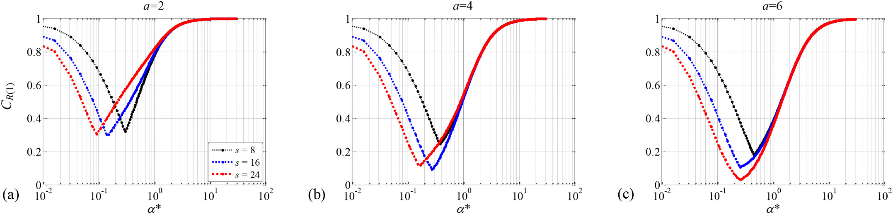

   **图 2** 线性类型 L(x)=jΔx/L 下，1/10≤B*≤1 区间内反射系数 C_R(j=1) 随 α* 的变化比较，采用波长 λ=10 m。三个分图分别为 a=2、4、6。

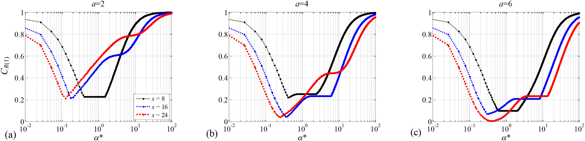

   **图 3** 正弦平方类型 L(x)=sin²[(π/2)jΔx/L] 下，1/10≤B*≤1 区间内反射系数 C_R(j=1) 随 α* 的变化比较。

译注：正文将 :math:`B^*` 取值区间写为 :math:`[1/10,10]`，图 2、3 原图题写为 :math:`1/10\leq B^*\leq1`，两处不一致；此处分别保留。

在界面 :math:`j=s`，边界由粗网格模型指定，因此 :math:`u_e=0`。松弛区末端的系数关系为 :math:`C_{R(s)}=1`、:math:`C_{T(s)}=0`，表示不产生 :math:`u_e`。式 (16) 的 :math:`C_T` 表示透射波与入射波幅值之比，式 (17) 的 :math:`C_R` 表示反射波与入射波幅值之比，二者都应检查。这些无量纲系数用于量化反射时，对 :math:`u_e` 离散的具体形式不敏感。将原表达式 :math:`\alpha^*L(x)` 换成 :math:`\alpha^*(x)`，目标是寻找合适松弛形式，使相速区间 :math:`[c_{\min},c_{\max}]` 内可能出现的最大 :math:`C_R` 最小（Lehmann, 1993）。考虑阻尼区不确定波相互作用产生的反射，选择前两层 :math:`j=1,2` 的 :math:`C_R` 作为优化对象，定义为

.. math::

   \min_{\alpha_1^*\alpha_2^*\cdots\alpha_n^*}\left\{\max_c\left\{\left.\sum_{j=1}^{2}|C_R^j(c)|\ \right|\ c\in[c_{\min},c_{\max}]\right\}\right\} \qquad (19)

2.3 松弛系数的优化形式
~~~~~~~~~~~~~~~~~~~~~~

采用类似“适者生存”原则的 GA 求解式 (19)。这种稳健优化算法通过竞争与繁殖，从模拟生物种群中获得最适合的目标变量候选解，已广泛用于单目标和多目标工程问题（San José-Revuelta, 2007）。根据图 2、3，将 :math:`\alpha^*(x)` 种群通过二进制染色体编码，在 :math:`[0,1]` 内随机初始化；该区间也作为 GA 线性约束。敏感性评估后，种群规模选为 :math:`5\times10^2`。通过繁殖、交叉、变异，直至适应度满足相邻两代差值 :math:`10^{-7}` 的停止标准，得到最优或近最优解。采用比例缩放，将原始适应度映射至适合选择的范围，控制高适应度个体规模（Goldberg, 1989）。在适应度函数中引入 :math:`10^4` 惩罚项，以加快收敛（Deb, 2000）。

原始 GA 计算终止后，采用混合函数，避免多模态问题中的常规局部最优（Dahidah et al., 2008）。该函数从可能包含多个局部极小值不确定性的粗略估计解出发，通过微调改善全局优化结果。两部分计算均在 MATLAB GA-Toolbox 中完成（Chipperfield and Fleming, 1995）。对式 (19) 的极小化问题，图 4 通过比较每代最优适应度与标准差，展示出良好收敛及很低的计算需求。表 1 汇总 :math:`a=4` 时最优 :math:`\alpha^*(x)`。当 :math:`s` 从 4 增至 10 时，前两层目标 :math:`C_{Rj}` 从 0.14 降至 0.017。注意，:math:`\alpha_1^*` 对应图 1 内部域一侧的第一层松弛区。

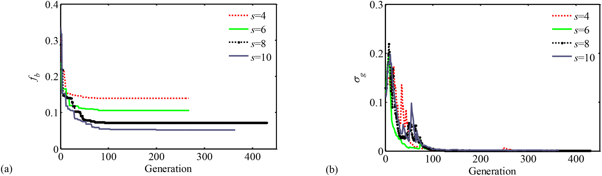

   **图 4** 遗传算法优化过程中的（a）最优适应度 f_b 与（b）标准差 σ_g 变化（a=4）。横轴为代数，曲线对应 s=4、6、8、10。

.. list-table:: 表 1 图 1 前两层（j=1,2）的优化权重 α* 及相应最大反射
   :header-rows: 1

   * - s
     - α₁*
     - α₂*
     - α₃*
     - α₄*
     - α₅*
     - α₆*
     - α₇*
     - α₈*
     - α₉*
     - α₁₀*
     - 前两层反射绝对值和最大值
   * - 4
     - 0.011
     - 0.056
     - 0.678
     - 0.999
     - —
     - —
     - —
     - —
     - —
     - —
     - 0.140
   * - 6
     - 0.018
     - 0.017
     - 0.067
     - 0.344
     - 0.906
     - 0.950
     - —
     - —
     - —
     - —
     - 0.096
   * - 8
     - 0.006
     - 0.008
     - 0.010
     - 0.039
     - 0.088
     - 0.219
     - 0.594
     - 0.904
     - —
     - —
     - 0.053
   * - 10
     - 0.002
     - 0.005
     - 0.012
     - 0.032
     - 0.081
     - 0.206
     - 0.433
     - 0.564
     - 0.748
     - 0.831
     - 0.017

表注：:math:`a=4`，:math:`\alpha^*=\alpha\Delta x/(2\pi\sqrt{c_{\min}c_{\max}})`，:math:`c_{\max}/c_{\min}=100`。

3 优化松弛方案在二维浅水方程中的评估
------------------------------------

采用平坦地形、中心位势扰动的二维浅水方程（SWE），评估所提松弛方案在 LAM 中的性能。SWE 可再现重力波、地形 Rossby 波等中尺度大气运动（Durran, 2010）。数值积分采用二阶 Lax–Wendroff 有限差分，只需前一时间步，且不依赖人工扩散维持稳定。计算网格为 :math:`40\times40`，水平间距 10 km，时间步长 10 s。侧边界指定零风速分量与零梯度位势。中心区域用下列高斯型扰动初始化：

.. math::

   h=10\exp\!\left[-\frac{(x-x_0)^2+(y-y_0)^2}{4}\right] \qquad (20)

其中 :math:`\langle x_0,y_0\rangle` 为离散网格 :math:`x=20`、:math:`y=20` 处的初始 :math:`h` 扰动位置。根据第 2 节的优化结果，特征速度满足 :math:`c_{\max}/c_{\min}=100`，因此 CFL 数 :math:`c\Delta t/\Delta x` 选在 :math:`1/100\leq\mathrm{CFL}\leq1` （Davies, 1983；Lehmann, 1993）。在侧边界布置松弛区，采用表 1 的 :math:`s=4,6,8` 方案。

图 5 展示浅水系统积分 3 h 后的风分量散度。无限域中应得到零散度，而 LAM 中向外传播的波会出现伪反射。图 5(a)–(c) 表明，随着松弛厚度层数 :math:`s` 增加，LBC 激发的数值噪声减弱。图 6 采用 Lehmann (1993) 的优化方案 L-93 作为参考。本文方案在这一算例中表现稳健。表 2 汇总以 10 m 初始振幅归一化的最大扰动 :math:`h^*_{\max}=(h_{\max}-10)/10`。:math:`\operatorname{div}(u,v)_{\max}` 与 :math:`h^*_{\max}` 表征 LAM 边界不一致造成的伪反射程度；未用优化松弛时，这些值远大于采用优化松弛后的结果。此类扰动应随时间积分向外传播并消失。此外，当 :math:`s` 从 4 变化至 8 时，本文方案的 :math:`h^*_{\max}` 数值及其变化均小于 L-93。

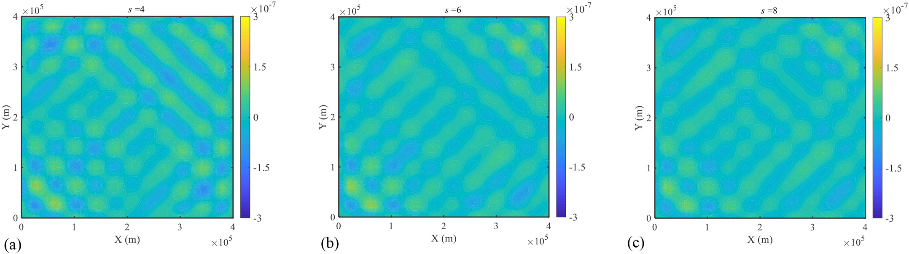

   **图 5** 二维浅水模型中心施加高斯位势扰动后，风分量散度的比较。积分 3 h，采用表 1 的所提松弛方案；（a）–（c）分别为 s=4、6、8。

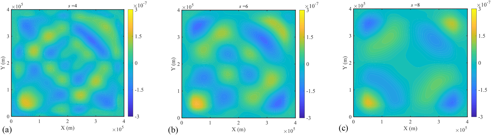

   **图 6** 采用 Lehmann (1993) 提出的 L-93 松弛方案；其他配置与图 5 相同。

.. list-table:: 表 2 二维浅水方程中风场散度与位势扰动的比较
   :header-rows: 1

   * - s
     - L-93 最大散度（10⁻⁷ s⁻¹）
     - L-93 h_Lmax*
     - 本文最大散度（10⁻⁷ s⁻¹）
     - 本文 h_Pmax*
     - 最大扰动相对差
   * - 0
     - 209.181
     - 1.033
     - 209.181
     - 1.033
     - —
   * - 4
     - 1.654
     - 0.017
     - 1.170
     - 0.013
     - 23.5%
   * - 6
     - 1.964
     - 0.021
     - 1.190
     - 0.013
     - 38.1%
   * - 8
     - 1.681
     - 0.024
     - 0.929
     - 0.012
     - 50%
   * - 10
     - —
     - —
     - 0.420
     - 0.012
     - —

最后一列为 :math:`|(h_{\max}^{P*}-h_{\max}^{L*})/h_{\max}^{L*}|\times100\%`。

4 所提松弛方案在 NWP–CFD 耦合模拟中的应用
------------------------------------------

以下各节研究中微尺度嵌套模型中的实际侧边界处理。一个主要因素是选择 NWP 提供的合适入口边界，以确保解适定并改善 CFD 表现。采用苏格兰复杂地形 Askervein Hill 的真实算例与现场观测（Taylor and Teunissen, 1987）评估非定常耦合模型。

4.1 Askervein Hill 算例
~~~~~~~~~~~~~~~~~~~~~~~~~~~~~~~~

4.1.1 WRF 模型配置
^^^^^^^^^^^^^^^^^^

本文采用 1983 年 10 月 3 日 Askervein Hill 的 TU-03B 测量（Taylor and Teunissen, 1987），选取 13:00–16:00 UTC 的中性层结时段进行模拟。代表热力与流动剪切项叠加作用的 Richardson 数，在这一时段介于 −0.0038 与 −0.0074 之间。

采用具有多尺度相互作用能力的 WRF-ARW 模型，设置图 7 的四层嵌套域，重现气象背景。全部计算域采用 51 个垂直层，其中底部 1 km 内有 21 个 sigma 层，100 m 以下有 6 层。Askervein 算例的 WRF 敏感性分析参考 Temel and van Beeck (2016)，该研究结合观测讨论了 PBL 参数化对 WRF 及嵌套 CFD 的综合影响。采用 1.5 阶局地闭合 Mellor–Yamada–Janjic（MYJ）方案（Janjić, 1994）与 MYNN 方案（Nakanishi and Niino, 2009）预报湍动能，以检验其对 CFD 的影响。这两种雷诺平均方法在 :math:`O(10^2\text{–}10^3)\,\mathrm m` 空间尺度的真实算例中均有效，耗散形式由长度尺度模型确定（Kantha, 2004）。

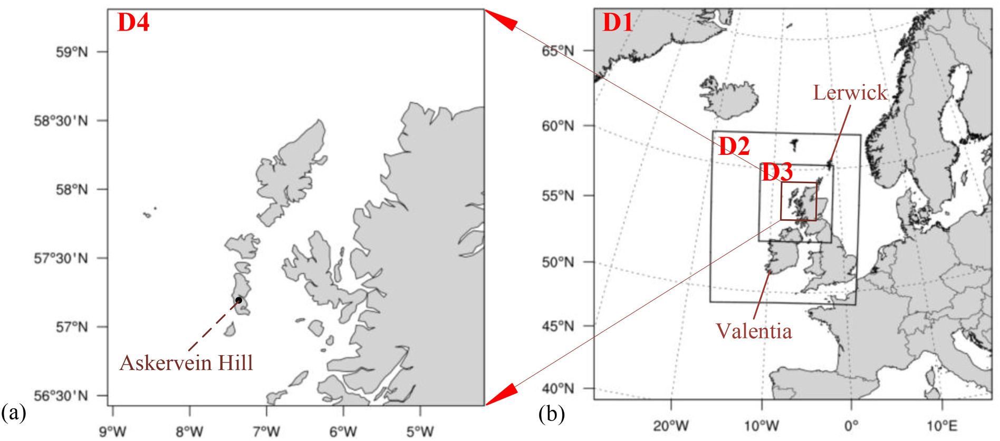

   **图 7** WRF 单向嵌套域，水平网格从 D01 的 27 km 以 1:3 比例加密至 D04 的 1 km。最内层 D04 面积为 96,019 km²，网格数为 301×319。

采用两种可接受的初始化资料：NCAR 气候预报系统再分析数据 CFSR（ds093.1，1979–2011）和 ECMWF 第五代大气再分析 ERA5。两者均包含基于四维变分同化（4D-Var）的最佳大气状态估计。模型从 1983 年 10 月 2 日 12:00 UTC 开始，积分 30 h，前 24 h 作为预热时间。D04 域以 600 s 间隔采样 WRF 解，在嵌套计算中用作 CFD 侧边界。WRF 配置见表 3。积云与微物理参数化、长短波辐射等其他方案与既有研究一致（Temel and van Beeck, 2016）。

.. list-table:: 表 3 WRF 敏感性分析工况
   :header-rows: 1

   * - 工况
     - 初始化
     - 陆面模型
     - 表面层方案
     - PBL 方案
   * - CNJ-J
     - CFSR
     - Unified Noah
     - Monin–Obukhov Janjic
     - MYJ
   * - CRJ-J
     - CFSR
     - RUC
     - Monin–Obukhov Janjic
     - MYJ
   * - CNJ-N
     - CFSR
     - Unified Noah
     - Monin–Obukhov Janjic
     - MYNN
   * - CRJ-N
     - CFSR
     - RUC
     - Monin–Obukhov Janjic
     - MYNN
   * - CNM-N
     - CFSR
     - Unified Noah
     - MYNN
     - MYNN
   * - CRM-N
     - CFSR
     - RUC
     - MYNN
     - MYNN
   * - ENJ-J
     - ERA
     - Unified Noah
     - Monin–Obukhov Janjic
     - MYJ
   * - ERJ-J
     - ERA
     - RUC
     - Monin–Obukhov Janjic
     - MYJ
   * - ENJ-N
     - ERA
     - Unified Noah
     - Monin–Obukhov Janjic
     - MYNN
   * - ERJ-N
     - ERA
     - RUC
     - Monin–Obukhov Janjic
     - MYNN
   * - ENM-N
     - ERA
     - Unified Noah
     - MYNN
     - MYNN
   * - ERM-N
     - ERA
     - RUC
     - MYNN
     - MYNN

4.1.2 CFD 中的流动物理
^^^^^^^^^^^^^^^^^^^^^^

中微尺度耦合 PBL 模拟的限制来自湍流涡黏度和壁面处理定义不同（Temel et al., 2018）。为由 NWP 解指定 CFD 湍流入流，Temel and van Beeck (2016) 通过保持湍流黏度一致，修正经验常数 :math:`C_\mu`。入口湍动能 :math:`k` 和比耗散率 :math:`\omega` 保持与 NWP 一致；NWP 通过比例关系 :math:`\varepsilon=q^3/(B_1l)` 与 :math:`\omega=\varepsilon/(C_\mu k)` 计算 :math:`\omega`。这里 :math:`q` 为湍流速度尺度，:math:`l` 为含能涡特征长度，:math:`B_1` 为闭合常数（Kantha, 2004）。修正的 :math:`C_\mu` 定义为

.. math::

   C_\mu=4S_m/B_1 \qquad (21)

经验常数 :math:`\langle S_m,B_1\rangle` 由实测估计，在 MYJ 与 MYNN 中分别为 :math:`\langle0.51,11.8\rangle` 和 :math:`\langle0.41,24\rangle`。

不过，修正 CFD 湍流常数可能改善一个区域，却使其他区域变差。一些研究（Castro et al., 2015；Rodrigues et al., 2016）在大气边界层模拟中采用标准常数 :math:`C_\mu=0.033`。观测表明，近地 PBL 采用小于 0.09 的 :math:`C_\mu` 更合理（Yang et al., 2009）。本文采用两方程标准 :math:`k\text{–}\omega` 模型，因其稳健且对近地边界不太敏感（Sogachev and Panferov, 2006）。同时考虑 MYJ、MYNN 对应的修正 :math:`C_\mu` 以及经验值 0.033。采用 Wilcox (1988) 的 RANS 模型，常数关系为 :math:`\alpha_{k-\omega}=C_{\omega1}`、:math:`\beta=C_\mu C_{\omega2}`、:math:`\beta^*=C_\mu`。:math:`\omega` 方程取标准系数 :math:`\langle C_{\omega1},C_{\omega2}\rangle=\langle0.52,0.8\rangle`，比值 :math:`C_{\omega2}/C_{\omega1}\approx1.54` 代表观测与优化模型常数的折中（Sogachev, 2009）。近地面 :math:`\sigma_\omega` 根据 von Karman 常数关系 :math:`\kappa=\sqrt{\sigma_\omega C_\mu^{0.5}(C_{\omega2}-C_{\omega1})}` 计算（Pope, 2000），且 :math:`\sigma_k=\sigma_\omega`。本文可调模型常数见表 4。

.. list-table:: 表 4 标准 k–ω 模型采用的模型常数
   :header-rows: 1

   * - 工况
     - β*
     - α_k−ω
     - β
     - σ_k
     - σ_ω
   * - 与 MYNN 一致修正
     - 0.0683
     - 0.52
     - 0.0546
     - 2.1865
     - 2.1865
   * - 与 MYJ 一致修正
     - 0.1729
     - 0.52
     - 0.1383
     - 1.374
     - 1.374
   * - 标准
     - 0.033
     - 0.52
     - 0.0264
     - 3.1456
     - 3.1456

为考虑科里奥利力与近地粗糙度，在动量方程中加入源项 :math:`S_i` （Liu et al., 2016；Sogachev and Panferov, 2006），定义为

.. math::

   S_i=-\frac12C_dA(z)|U|U_i+F_{ci} \qquad (22)

其中 :math:`U=\sqrt{\langle U_i\rangle\langle U_i\rangle}` 为平均速度大小；对于粗糙度长度 :math:`z_0=0.03\,\mathrm m` 的地表，经验阻力系数 :math:`C_d=0.2` （Fesquet et al., 2009）。叶面积密度 :math:`A(z)` 采用 Treuhaft et al. (2002) 建议的高斯分布 :math:`A(z)=0.3\exp[-10(z/h-0.45)^2]`。根据 Katul et al. (2004)，平均冠层高度 :math:`h=10z_0`。:math:`F_{ci}=fU_i\ (i=1,2)` 为科里奥利力，参数 :math:`f=10^{-4}\,\mathrm{s^{-1}}` （Undheim et al., 2006）。

根据 Sogachev (2009) 关于尾流生成 :math:`S_p` 与增强耗散 :math:`S_d` 平衡的假设，湍动能方程不加入地表植被阻力项。在比耗散率方程中指定 :math:`S_d` 后，:math:`\omega` 控制方程变为

.. math::

   \frac{\partial\omega}{\partial t}+U_j\frac{\partial\omega}{\partial x_j}-\frac{\partial}{\partial x_i}\left(\frac{\nu_t}{\sigma_\omega}\frac{\partial\omega}{\partial x_i}\right)=\frac\omega k C_{\omega1}P_\varphi-\omega^2 C_{\omega2}F_{\varphi W}+\frac\omega k[(C_{\omega2}-C_{\omega1})S_d] \qquad (23)

译注：式 (23) 原式写 :math:`P_\varphi`、:math:`F_{\varphi W}`，紧随其后的原文说明写 :math:`P_\omega`、:math:`F_{\omega W}`；此处分别保留。

其中 :math:`\sigma_\omega` 为 Schmidt 数，:math:`F_{\omega W}` 和 :math:`P_\omega` 分别表示标准 :math:`k\text{–}\omega` 模型的修正项和湍流剪切生成项（Wilcox, 1988）。式 (24) 给出 :math:`S_d` 的近似表达式，可消除模型对 :math:`C_\mu` 的敏感性（Sogachev and Panferov, 2006）：

.. math::

   S_d=12C_\mu^{1/2}C_d A|U|k \qquad (24)

采用 ANSYS/Fluent 的 URANS CFD 求解器。压力与速度耦合使用 SIMPLEC 算法，时间采用二阶隐式非定常格式，空间采用迎风离散。

4.1.3 侧边界处理
^^^^^^^^^^^^^^^^

图 8 示意了中尺度和微尺度模型中的场地地形。研究区为苏格兰 Askervein Hill（Taylor and Teunissen, 1987），山体坡度适中。图 8(a) 展示 WRF D04 域中 1 km 水平分辨率的周边地形，只能描述粗略地形特征；图 8(b) 则在中心细网格域中清楚显示山体的椭圆形。该山短轴、长轴约为 1 km 和 2 km，在 WRF 最内层 D04 中仅占一至两个单元。

.. figure:: ../../../wechat/assets/public-safe/ref-zhao2021-AR/fig08-original.jpeg
   :alt: 图 8 中微尺度计算域相对位置与地表网格。（a）外层绿色实线为 D04 中长度 1 km 的 WRF 网格，黑色等高线给出两种地形，中心红圈为 Askervein Hill。（b）山体附近采用均匀网格，包含 HT、CP 及 A–A、AA–AA 测线。色标为地形高度。
   :align: center
   :width: 100%

   **图 8** 中微尺度计算域相对位置与地表网格。（a）外层绿色实线为 D04 中长度 1 km 的 WRF 网格，黑色等高线给出两种地形，中心红圈为 Askervein Hill。（b）山体附近采用均匀网格，包含 HT、CP 及 A–A、AA–AA 测线。色标为地形高度。

三维 CFD 域长 11 km（x）、宽 12 km（y）、高 1.8 km。参考既有研究（Balogh et al., 2012；Undheim et al., 2006），图 8(b) 的最小水平网格长度为 17 m，测站附近保持均匀分布。经网格独立性分析，第一层竖向网格为 0.05 m，以改善背风侧分离预测。此外，沿 A–A 线建立长 6.5 km、高 1.8 km 的二维域，用于初步评估（图 9）。

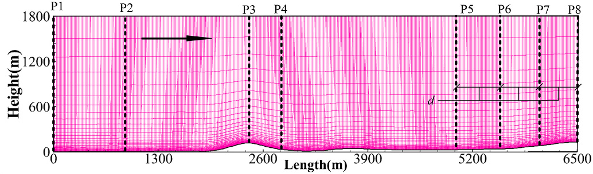

   **图 9** 沿图 8 的 A–A 线、经过 HT 站建立的二维域。P1（入口）至 P8（出口）是第 4.3 节评价嵌套性能的八个位置，P5–P8 相邻间距 d=600 m。

修正的 URANS 求解器在 CFD 侧边界附近设置隐式松弛区域。在规定距离，即松弛厚度内，向动量方程加入额外源项 :math:`S_{Ri}`。用于调节 WRF 粗网格解 :math:`\widetilde U_i^{\mathrm{meso}}` 与 CFD 微尺度变量 :math:`U_i^{\mathrm{micro}}` 的源项定义为

.. math::

   S_{Ri}=-p_m\alpha_n(U_i^{\mathrm{micro}}-\widetilde U_i^{\mathrm{meso}}) \qquad (25)

其中 :math:`\alpha_n` 为表 1 的优化松弛参数，:math:`p_m` 为控制松弛强度的常数，取值从 0.01 至 1.5。图 10 详细展示 CFD 阻尼区：:math:`\alpha_n` 在 LBC 处最大，向域内逐渐减为零。

.. figure:: ../../../wechat/assets/public-safe/ref-zhao2021-AR/fig10-original.jpeg
   :alt: 图 10 三维 Askervein 算例中的松弛区示意。粉色表示边界附近 α_n 的变化，WRF 变量 Ũ^meso 指定在 CFD 侧边界。边界处强度最大，向内部减至零；图内标出东、南、西、北边界与松弛厚度。
   :align: center
   :width: 100%

   **图 10** 三维 Askervein 算例中的松弛区示意。粉色表示边界附近 α_n 的变化，WRF 变量 Ũ^meso 指定在 CFD 侧边界。边界处强度最大，向内部减至零；图内标出东、南、西、北边界与松弛厚度。

CFD 由 WRF 粗网格解提取的时变边界驱动。图 10 中侧边界处理的验证围绕两类过指定开放边界配置展开：

a. 在 CFD 侧边界指定 WRF 预报的湍动能 :math:`k`、耗散率 :math:`\varepsilon` 和速度分量。CFD 两方程 RANS 使用式 (21) 修正模型常数，使湍流黏度定义与 MYNN 或 MYJ PBL 参数化一致。
b. 仅在 CFD 侧边界指定 WRF 风速分量；不用 PBL 方案的 :math:`k` 与 :math:`\varepsilon`，而是在嵌套界面对其采用零梯度条件。进一步验证使用表 4 的标准模型常数，这些常数常用于理想表面层模拟。

表 5 汇总耦合配置。为维持 CFD 的总体连续性，每次迭代均进行质量守恒调整（Rodrigues et al., 2016）。先将 WRF 湍流剖面 :math:`\langle k,\varepsilon\rangle` 从 eta 层线性插值到 Arakawa-C 网格中心，再采用反距离加权插值，用最近 WRF 水平网格的速度分量预测 CFD 侧边界。对于本中微尺度网格配置，衰减参数等于 1、搜索模式为四点时，这一预测器表现稳健。CFD 采用 :math:`\Delta t=1\,\mathrm s` 的隐式时间积分，通过线性插值与较长的 600 s WRF 采样周期衔接。

.. list-table:: 表 5 NWP–CFD 耦合的侧边界处理与模型常数
   :header-rows: 1

   * - 维度
     - 工况
     - 入口
     - 出口
     - 顶部
     - 底部
     - 松弛
     - 模型常数
   * - 二维
     - M(U,k,ω)
     - 由 NWP 指定 Uᵢ、k、ω
     - Uᵢ、k、ω 流向零梯度
     - 对称
     - 无滑移壁面
     - 否
     - 修正
   * - 二维
     - DM(U,k,ω)
     - 由 NWP 指定 Uᵢ、k、ω
     - 由 NWP 指定 Uᵢ、k、ω
     - 由 NWP 指定 Uᵢ、k、ω
     - 无滑移壁面
     - 是
     - 修正
   * - 二维
     - NDM(U,k,ω)
     - 由 NWP 指定 Uᵢ、k、ω
     - 由 NWP 指定 Uᵢ、k、ω
     - 由 NWP 指定 Uᵢ、k、ω
     - 无滑移壁面
     - 否
     - 修正
   * - 二维
     - DM(U)
     - 由 NWP 指定 Uᵢ；k、ω 零梯度
     - 由 NWP 指定 Uᵢ；k、ω 零梯度
     - 由 NWP 指定 Uᵢ；k、ω 零梯度
     - 无滑移壁面
     - 是
     - 修正
   * - 二维
     - DS(U)
     - 由 NWP 指定 Uᵢ；k、ω 零梯度
     - 由 NWP 指定 Uᵢ；k、ω 零梯度
     - 由 NWP 指定 Uᵢ；k、ω 零梯度
     - 无滑移壁面
     - 是
     - 标准
   * - 三维
     - DM(U,k,ω)
     - 由 NWP 指定 Uᵢ、k、ω
     - 由 NWP 指定 Uᵢ、k、ω
     - 由 NWP 指定 Uᵢ、k、ω
     - 无滑移壁面
     - 是
     - 修正
   * - 三维
     - NDM(U,k,ω)
     - 由 NWP 指定 Uᵢ、k、ω
     - 由 NWP 指定 Uᵢ、k、ω
     - 由 NWP 指定 Uᵢ、k、ω
     - 无滑移壁面
     - 否
     - 修正
   * - 三维
     - DS(U)
     - 由 NWP 指定 Uᵢ；k、ω 零梯度
     - 由 NWP 指定 Uᵢ；k、ω 零梯度
     - 由 NWP 指定 Uᵢ；k、ω 零梯度
     - 无滑移壁面
     - 是
     - 标准

表注：D 表示松弛处理，ND 表示侧边界无松弛；M、S 分别表示表 4 的修正、标准模型常数。U、k、ω 为在 CFD 中指定的 WRF 量。零梯度在原表写为沿 x 的偏导等于零。

4.2 WRF 结果验证
~~~~~~~~~~~~~~~~

采用怀俄明大学在线资料中的 1983 年 10 月 3 日 12:00 UTC 探空剖面，在图 7 的 Lerwick 与 Valentia 站验证 WRF。对探空各高度，使用均方根误差（RMSE）、绝对分数偏差（FB）与一致性指数（IOA）三项统计量，其定义见式 (26)–(28)。无量纲 :math:`\mathrm{IOA}=1`、:math:`\mathrm{FB}=0` 表示观测与数值结果吻合良好。

.. math::

   \mathrm{RMSE}=\sqrt{\langle(S-T)^2\rangle} \qquad (26)

.. math::

   \mathrm{FB}=\left|\frac{\langle T\rangle-\langle S\rangle}{0.5(\langle T\rangle+\langle S\rangle)}\right| \qquad (27)

.. math::

   \mathrm{IOA}=1-\frac{\langle(S-T)^2\rangle}{\langle(|T-\langle T\rangle|+|S-\langle T\rangle|)^2\rangle} \qquad (28)

其中尖括号 :math:`\langle\ \rangle` 表示数据集平均，:math:`T` 为观测数据，:math:`S` 为数值数据。

表 6 表明，风速得到较好再现，IOA 大于 0.85。ERA5 初始和边界条件使结果改善，尽管 CFSR 也未出现明显相对误差。表现最差的是 MYJ 与 RUC 陆面模型、Monin–Obukhov Janjic 表面层组合，即 CRJ-J 和原文写作 ERR-J 的工况。由于表现较好，选择 ENJ-J 与 ENM-N 开展 NWP–CFD 耦合。

译注：表 3、6 对应 ERA5 工况名为 ERJ-J，原文此句写 ERR-J；表 6 的最低风速 IOA 为 0.85，而正文表述为“大于 0.85”。二者按源文保留。

.. list-table:: 表 6 WRF 风速、风向的 RMSE、FB、IOA 比较
   :header-rows: 1

   * - 工况
     - 风速 RMSE（m/s）
     - 风向 RMSE（°）
     - 风速 FB
     - 风向 FB
     - 风速 IOA
     - 风向 IOA
   * - CNJ-J
     - 2.8
     - 10.5
     - 0.038
     - 0.034
     - 0.87
     - 0.70
   * - CRJ-J
     - 2.9
     - 11.9
     - 0.039
     - 0.034
     - 0.85
     - 0.70
   * - CNJ-N
     - 2.7
     - 10.5
     - 0.031
     - 0.034
     - 0.89
     - 0.70
   * - CRJ-N
     - 2.7
     - 10.5
     - 0.031
     - 0.034
     - 0.90
     - 0.70
   * - CNM-N
     - 2.7
     - 10.4
     - 0.027
     - 0.034
     - 0.88
     - 0.70
   * - CRM-N
     - 2.8
     - 10.4
     - 0.027
     - 0.034
     - 0.89
     - 0.70
   * - ENJ-J
     - 2.5
     - 10.8
     - 0.014
     - 0.018
     - 0.89
     - 0.72
   * - ERJ-J
     - 2.5
     - 11.5
     - 0.016
     - 0.019
     - 0.86
     - 0.70
   * - ENJ-N
     - 2.5
     - 10.9
     - 0.010
     - 0.016
     - 0.90
     - 0.72
   * - ERJ-N
     - 2.5
     - 10.9
     - 0.010
     - 0.016
     - 0.90
     - 0.72
   * - ENM-N
     - 2.4
     - 10.6
     - 0.0080
     - 0.015
     - 0.90
     - 0.73
   * - ERM-N
     - 2.5
     - 11.0
     - 0.0081
     - 0.016
     - 0.90
     - 0.72

表注：原表的 WS 为风速，WD 为风向；此处按工况逐行排列，完整保留两个原始面板的全部数据。

图 11 将 WRF 剖面与探空资料比较。两种配置均给出相似温度变化趋势，说明 TU-03B 的层结背景模拟较好。虽然 Lerwick 的风速有差异，但 Valentia 在 PBL 高度以下（小于 3 km）吻合更好，在 3–15 km 范围形状相似。竖向风向相对观测的差异总体较小，位于可接受的 :math:`0^\circ\text{–}30^\circ` 范围。TU-03B 测量期间平均风向接近 :math:`210^\circ` （Taylor and Teunissen, 1987）。

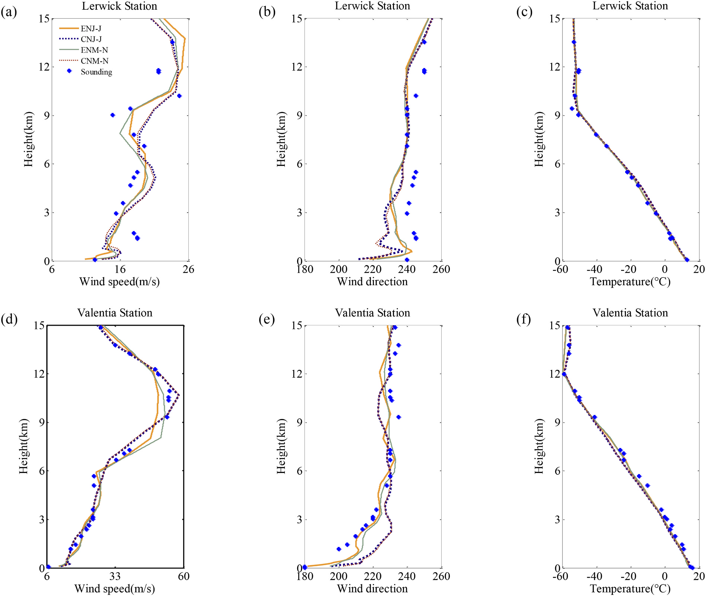

   **图 11** 12:00 UTC 不同初始化与 PBL 方案的 WRF 结果和探空剖面比较。（a）–（c）Lerwick；（d）–（f）Valentia。各列依次为风速、风向和温度，散点为探空。

4.3 二维域中的初步评估
~~~~~~~~~~~~~~~~~~~~~~

4.3.1 松弛强度与类型的影响
^^^^^^^^^^^^^^^^^^^^^^^^^^

首先在二维域中模拟 13:00–16:00 UTC。图 12 给出 DM(U,k,ω) 工况出口附近 P5–P8 的平均剖面，采用混合边界，并在 0.6 km 厚度内控制松弛强度；六层（:math:`s=6`）方案按原文此处引用表 2。风速 :math:`V^*` 与湍动能 :math:`k^*` 以 P2 点离地 10 m 速度大小 :math:`U_{P2}` 归一化，即 :math:`V^*=U/U_{P2}`、:math:`k^*=k/U_{P2}^2`。式 (25) 的源项通过 :math:`p_m` 调节，:math:`p_m` 从 0.01 至 1.5，增量为 :math:`5\times10^{-2}`。

译注：优化六层系数实际列于表 1，原文该段写表 2；图 12 原图题则引用表 1。

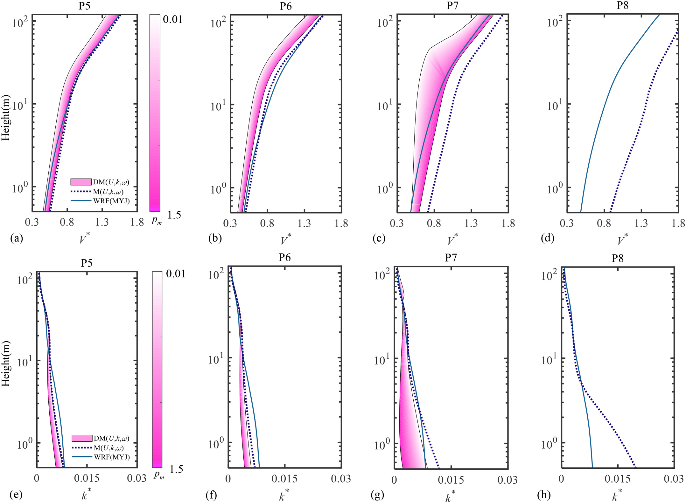

   **图 12** P5–P8 位置的（a）–（d）平均 V* 和（e）–（h）平均 k*。采用表 1 的六层松弛方案；粉色渐变表示 DM(U,k,ω) 中 p_m 变化，松弛厚度 0.6 km。嵌套采用 WRF-MYJ PBL。

检查 P8 可见，粗网格 WRF 的过指定出口因地形人工截断而与 M(U,k,ω) 工况不同。CFD 在 P5–P8 表示的地形变化，在中尺度剖面中仅引起轻微变化。M(U,k,ω) 的侧边界代表充分发展流，不受 LAM 下游指定的不匹配中尺度解约束。因此，考虑复杂地形 PBL 常用的流向零梯度出口（Balogh et al., 2012；Zajaczkowski et al., 2011），选择 M(U,k,ω) 为参考。松弛区对中微尺度 :math:`V^*` 有效，使 DM(U,k,ω) 解逐渐趋向 M(U,k,ω)。这些新的流动形态在 P5–P8 间持续约 1.5–2 km，跨越 WRF 最内层两个中尺度网格，在 :math:`\alpha^*(x)` 最小时消失。此外，质量守恒调整使 DM(U,k,ω) 在隐式时间积分下保持连续性，表现为快速收敛和稳定迭代。

然而，湍动能并未随 :math:`p_m` 增加呈现与 :math:`V^*` 相同的趋势，在混合区出现相反变化。LES 内嵌 LES 也发现类似现象（Vonlanthen et al., 2016）：出口混合区的 :math:`k` 并非位于粗、细网格值之间，而会略微超过粗网格参考值。出口附近 P8 的 :math:`k^*` 呈现耦合边界指定的中尺度特征。DM(U,k,ω) 与 M(U,k,ω) 的 :math:`k^*` 差异主要出现在近壁 :math:`H<10^1\,\mathrm m` 区域，并在约 1 km 距离内发展；与 :math:`V^*` 相比，P5、P6 的敏感性较弱。

设置松弛区的目的是减轻过指定 LBC 对 CFD 域的影响。上述评估表明，不匹配流动主要产生于指定出口；其不确定性不仅来自下垫面处理与湍流黏度模型不同，还来自嵌套界面诊断变量的统计插值（Han et al., 2018）。松弛区过窄或过强，无法保证细 CFD 流场有足够距离发展成 LBC 指定的粗网格场（Vonlanthen et al., 2016）。为比较，图 13 给出线性松弛方案，源项为 :math:`-p_m(U_i^{\mathrm{micro}}-\widetilde U_i^{\mathrm{meso}})(L-l)/L`；:math:`l` 为距边界距离。其 :math:`V^*`、:math:`k^*` 在 P5–P8 的变化范围更宽，意味着当 :math:`p_m` 作为经验常数时，应在 CFD 域中留出距侧边界大于 1.5 km 的厚度，以减小 LBC 影响。虽然将 :math:`p_m` 调至 1.5 可使 :math:`V^*` 接近 M(U,k,ω)，但细网格湍流向粗网格过渡时，额外源项对 P5–P7 的 :math:`k^*` 产生负面影响。特别要注意，一些复杂地形 PBL 模拟采用较小 CFD 域（Balogh et al., 2012；Temel et al., 2018），必须在指定出口 LBC 与目标区之间留出足够发展距离。

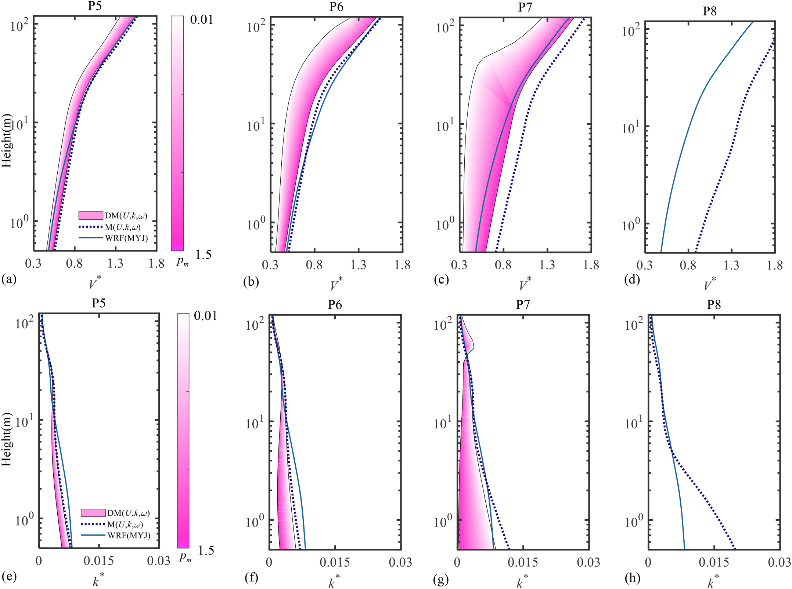

   **图 13** P5–P8 位置的（a）–（d）平均 V* 和（e）–（h）平均 k*。嵌套采用线性松弛 −p_m(U_i^micro−Ũ_i^meso)(L−l)/L。

4.3.2 侧边界配置的影响
^^^^^^^^^^^^^^^^^^^^^^

使用观测验证表 5 各侧边界配置的数值表现。取 :math:`p_m=0.05`，其余松弛方案与第 4.3.1 节相同。图 14 展示不同位置的 :math:`V^*`、:math:`k^*`。

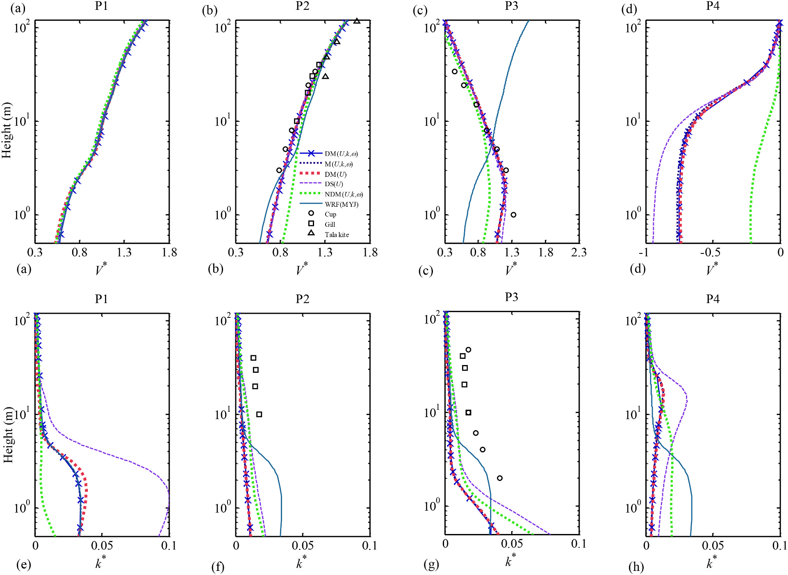

   **图 14** P1–P4 位置归一化剖面。（a）–（d）风速；（e）–（h）湍动能。时间平均范围为 1983 年 10 月 3 日 13:00–16:00 UTC，嵌套采用 MYJ。P2、P3 观测分别对应 RS 和山顶 HT（Taylor and Teunissen, 1985）。

微尺度域再现了随精细地形和气象背景演变的平均速度剖面；粗网格 NWP 中仅约两格、约 2 km 的范围内，无法再现这些空间变化。虽然 DM(U,k,ω) 在下游和顶部均过指定 :math:`\langle U,k,\omega\rangle`，但与采用相同常数的 DM(U) 比较，P1–P4 差异很小。这可归因于 CFD 求解器边界处理：当 DM(U,k,ω) 边界上的湍流标量 :math:`\langle k,\omega\rangle` 处于出流状态时，会采用与 DM(U) 相同的零梯度条件。

沿 P1–P3，DM 与 M 型速度剖面均较好地对应现场观测，P2 对应 RS，P3 对应 HT（Taylor and Teunissen, 1985）。Apsley and Castro (1997) 也发现，近似平衡一维风流中的平均速度几乎独立于 :math:`C_\mu`。比较还表明，DM 边界处理在 P2–P4 相比 NDM(U,k,ω) 有效。沿相对平坦地形，湍动能从 P1 到 P2、约 1 km 内衰减；采用 :math:`C_\mu=0.033` 和 :math:`\langle k,\omega\rangle` 零梯度边界的 DS(U)，衰减趋势更大。Blocken et al. (2007) 将这种非均匀性归因于沿流向地表性质不连续，即中微尺度近壁与下垫面处理不同。此外，中尺度湍流入流基于通量形式 Euler 方程，其收敛解也不同于 CFD 的 Navier–Stokes 方程，因此沿流向存在适应距离（Temel and van Beeck, 2016）。

比较 DM(U,k,ω) 与 DS(U)，后者允许在不同微尺度模型中灵活选择经审慎调整的模型常数，无须兼顾中微尺度湍流黏度不匹配（Temel et al., 2018）；这一配置不使用 WRF PBL 生成的湍流剖面。可以采用与标准值混合等 :math:`C_\mu` 处理，改善复杂地形 PBL 精度（Balogh et al., 2012）。

4.4 三维域的风流形态
~~~~~~~~~~~~~~~~~~~~

比较 DM(U,k,ω) 与 DS(U) 两种侧边界处理，并分别嵌套 MYJ、MYNN PBL 方案。根据前文讨论，松弛厚度为 0.9 km，采用 :math:`\langle p_m,s\rangle=\langle0.05,6\rangle`。

4.4.1 流向风场云图
^^^^^^^^^^^^^^^^^^

首先利用图 15 的 DS(U)-MYNN 流向云图检查 CFD 数值稳定性。作为参考，图 15(a)、(b) 给出没有特殊侧边界处理、直接指定 WRF 速度分量得到的不适定结果；积分 3 h 后，域内沿流向出现数值不稳定。采用松弛边界和质量守恒调整后，图 15(c)、(d) 较好再现合理流动形态，即山顶增速、背风分离和湍动能随高度衰减。

.. figure:: ../../../wechat/assets/public-safe/ref-zhao2021-AR/fig15-original.jpeg
   :alt: 图 15 Askervein Hill 沿 A–A 截面的竖向风场比较。（a）、（b）表 5 的 NDM(U,k,ω) 因过指定侧边界而得到不适定风速与湍动能；（c）、（d）DS(U)-MYNN 采用质量守恒及松弛边界后得到合理数值结果。黑箭头为模拟期间主导风向。
   :align: center
   :width: 100%

   **图 15** Askervein Hill 沿 A–A 截面的竖向风场比较。（a）、（b）表 5 的 NDM(U,k,ω) 因过指定侧边界而得到不适定风速与湍动能；（c）、（d）DS(U)-MYNN 采用质量守恒及松弛边界后得到合理数值结果。黑箭头为模拟期间主导风向。

图 16(a) 给出 Askervein Hill 附近离地 10 m 的风场。上游预测为减速，随后在山顶加速。DM(U,k,ω)-MYNN 与 DS(U)-MYNN 的山脊最大风速分别为 :math:`U_1^{\max}=18.13\,\mathrm{m/s}`、:math:`U_2^{\max}=18.08\,\mathrm{m/s}`；相应 MYJ 工况为 :math:`U_3^{\max}=17.71\,\mathrm{m/s}`、:math:`U_4^{\max}=17.61\,\mathrm{m/s}`。这些小差别表明，相比表 5 的侧边界类型，PBL 方案可能更主导最大风速。图 16(a) 中代表微地形增速与分离的深红、深蓝区，在 DS(U) 中更稳定，DM(U,k,ω) 的分离区域则更薄。下游动量收支中，扩散项可能超过平流与压力梯度项（Castro et al., 2003）。由中尺度 PBL 方案决定的 :math:`k\text{–}\omega` 湍流黏度系数，会影响微尺度背风侧扩散贡献。

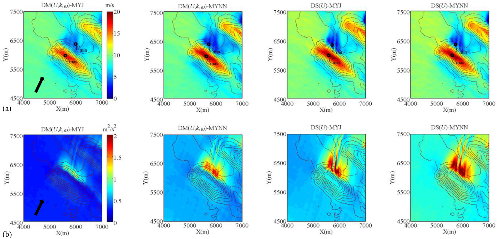

   **图 16** 离地 10 m 水平风场比较。（a）平均风速；（b）湍动能。黑箭头为模拟期间主导风向，黑实线为地形等高线。

图 16(b) 比较水平湍动能 :math:`k`。:math:`k` 在背风区增大，在低风速处达到最大。平坦地形中，DM(U,k,ω)-MYJ 的 :math:`k<0.7\,\mathrm{m^2/s^2}`，DM(U,k,ω)-MYNN 则为较高的 :math:`0.7\text{–}1.2\,\mathrm{m^2/s^2}`。结合两者不同的 :math:`C_\mu` 及模型常数，这些差异表明中尺度形式与湍流参数化对再现流场十分重要。MYNN 利用基于 LES 的混合长度和稳定性修正更新闭合系数，在较深混合层与稳定边界层描述中表现准确（Cohen et al., 2015）。中性层结的近地观测（Richards and Hoxey, 1993）给出 :math:`C_\mu=(u^{*2}/k)^2<0.09`，:math:`k/u^{*2}` 在 3.35 至 8.75 间变化，其中 :math:`u^*` 为地表摩擦速度。使中微尺度湍流黏度一致后，MYNN 更新的 :math:`C_\mu` 更接近这些经验值及常用的 0.033。因此，它可能更有利于嵌套 URANS，尤其有助于风能应用中复杂地形轮毂高度湍流强度的预测。

4.4.2 数值性能与观测的验证
^^^^^^^^^^^^^^^^^^^^^^^^^^

采用无量纲增速比 :math:`\Delta S=U(z)/U_{\mathrm{ref}}(z)-1` 评估观测站平均流。:math:`U(z)` 为速度大小，:math:`U_{\mathrm{ref}}(z)` 为图 8 中 RS 参考站的速度，代表未受扰动气流。

图 17(a)、(b) 给出离地 10 m 的空间平均流动，与 TU-03B 历史事件观测吻合良好。微尺度 :math:`k\text{–}\omega` 模型详细表示地形，产生 PBL 增速、分离及再附着。在 :math:`X<0` 的上游，各种边界和 PBL 方案的 :math:`\Delta S` 仅有微小差异，即使直接使用 NWP 湍动能与耗散剖面也是如此。沿 A–A 山脊，WRF-MYJ 输入工况（红线）最大 :math:`\Delta S=0.90`，高于 WRF-MYNN（灰线）的 0.83；AA–AA 线趋势类似，分别为 0.88 和 0.81。:math:`X>0` 背风侧存在差异，图 17(a) 中 DS(U) 工况最低 :math:`\Delta S=-0.84`、−0.71，与观测吻合，说明回流区预测较好。此外，在 A–A 线 :math:`500<X<1000\,\mathrm m` 范围，DS(U) 分离后的风流恢复更快。

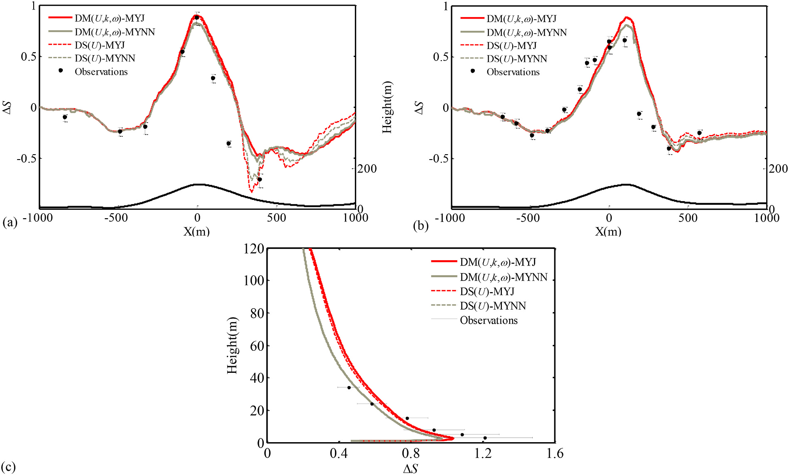

   **图 17** TU-03B 期间增速比比较，平均时段为 1983 年 10 月 3 日 13:00–16:00 UTC。（a）、（b）横轴分别为沿 A–A 距 HT、沿 AA–AA 距 CP 的水平距离；X<0 为上游，右轴为地形高度。（c）HT 竖向剖面。

图 17(c) 比较 HT 站竖向剖面。10–70 m 高度内的湍流形态关系到风机选址（Yang et al., 2020）、风资源评估（Rodrigues et al., 2016）和土木结构稳定性（He et al., 2019）。WRF-MYJ 工况在离地 2.2 m 上方给出最大 :math:`\Delta S=2.2`，这一高度低于采用理想入流的稳态研究预测的 3 m（Undheim et al., 2006）。不同湍流模型与近壁处理会影响微尺度近地流动。采用随地形质量垂直坐标的 WRF 等中尺度模型难以捕捉这些现象。常用底边界基于 Monin–Obukhov 相似理论，该关系仅在惯性子层内或以上有效，意味着最低网格应显著高于空气动力学粗糙度高度（Basu and Lacser, 2017）。这限制了中尺度底部网格选择，尤其是下垫面粗糙元尺度较大时。

译注：原文此段写最大 :math:`\Delta S=2.2`，但图 17(c) 的横轴及近地曲线峰值约在 1 附近，需区分原文数值与图示；此处保留原叙述，不自行改为其他数值。

图 18 比较湍动能 :math:`k`。在图 18(a) 的近地面，除 DM(U,k,ω) 外，两类工况均较好预测观测。由于微尺度采用粗糙壁面函数，离地 3 m 以下出现较大的 :math:`k`；Balogh et al. (2012) 也发现类似趋势，与图 17(c) 的增速现象密切相关。不过，各工况独立使用侧边界处理和湍流常数，竖向 :math:`k` 因而存在差别。图 18(b) 的上游 :math:`X<0` 区域，DS(U) 的 :math:`k` 与观测部分吻合，下游则低估。DS(U)-MYJ 最大 :math:`k` 约为 :math:`3.04\,\mathrm{m^2/s^2}`，观测为 :math:`4.87\,\mathrm{m^2/s^2}`。峰值位置接近 :math:`X=300\,\mathrm m`，大于 Castro et al. (2003) 的 250 m，但接近 Undheim et al. (2006) 的 294 m。在 :math:`0<X<500\,\mathrm m`，扩散项中湍流与平均场相互作用更强，非线性流动效应占优势。此外，:math:`k` 的生成与耗散达到最大，在活跃的平流及输运项中主导湍动能输运（Castro et al., 2003）。

.. figure:: ../../../wechat/assets/public-safe/ref-zhao2021-AR/fig18-original.jpeg
   :alt: 图 18 湍动能比较。（a）HT 站竖向剖面；（b）沿 A–A 的水平分布。
   :align: center
   :width: 100%

   **图 18** 湍动能比较。（a）HT 站竖向剖面；（b）沿 A–A 的水平分布。

表 7 使用式 (26)–(28) 的三项统计量，评估开放边界下经松弛调整的 CFD 性能，验证位置位于 A–A 和 AA–AA 线。FB 与 IOA 均对低估或高估敏感，反映系统误差。DS(U) 不指定 PBL 湍流标量而采用零梯度，具有较低 RMSE、FB 和较高 IOA，表现稳健；DS(U)-MYNN 又优于 DS(U)-MYJ。这些变化来自中尺度入流的影响。

.. list-table:: 表 7 沿 A–A 与 AA–AA 的 RMSE、FB、IOA 统计比较
   :header-rows: 1

   * - 变量
     - 指标
     - DM(U,k,ω)-MYJ
     - DM(U,k,ω)-MYNN
     - DS(U)-MYJ
     - DS(U)-MYNN
   * - ΔS
     - RMSE（m/s，原表单位）
     - 0.2364
     - 0.2197
     - 0.2239
     - 0.2138
   * - ΔS
     - FB
     - 0.7985
     - 0.6051
     - 0.7761
     - 0.6021
   * - ΔS
     - IOA
     - 0.9151
     - 0.9210
     - 0.9232
     - 0.9248
   * - k
     - RMSE（m²/s²）
     - 1.9773
     - 1.6708
     - 1.4679
     - 1.4561
   * - k
     - FB
     - 1.2091
     - 0.8607
     - 0.6585
     - 0.6193
   * - k
     - IOA
     - 0.4962
     - 0.5401
     - 0.5981
     - 0.6159

译注：ΔS 在正文定义为无量纲，原表却将其 RMSE 单位标为 m/s；此处保留并标明原表单位，不擅自换算。

5 结论与说明
------------

本文为 LAM 推导新的侧边界松弛方案，并引入复杂地形中微尺度嵌套 PBL 模拟。由时变中尺度计算获得的 LBC，施加于非定常 RANS 微尺度 CFD 域。该降尺度框架在 Askervein TU-03B 历史观测事件中表现令人满意，说明其可在灵活选择嵌套域的情况下保持计算效率。

从数值角度，首先研究二维浅水系统。高斯位势扰动下，LAM 中反射波流动会产生数值噪声；基于平流方程、经 GA 优化的松弛方案，能稳健吸收过指定边界产生的不稳定。具体而言，与已发表方法相比，采用所提 4–10 层松弛时可减小伪反射，并改善最大残余扰动。

随后，在更复杂的中微尺度湍流耦合模拟中，评估侧边界与湍流常数敏感性，重点讨论为获得适定、实用解应在嵌套边界指定哪些诊断变量。在 Askervein 二维足尺域评估了四种方法，包括分设入口与出口，以及在嵌套界面指定全部诊断变量。结果表明，简单系统优化得到的松弛方案，也适用于有意设置的过指定边界。出口附近指定不一致中尺度风剖面时，内部湍流形态受影响减弱。尤其当为节约成本采用较小 CFD 域、边缘常需人为截断复杂地形时，可通过松弛处理维持适定计算。

第三，三维 Askervein 算例中，NWP–CFD 耦合界面的过指定 LBC 导致数值不稳定；松弛边界结合质量守恒调整消除了这些不适定结果。此外，为匹配不一致的中尺度湍流黏度而修改 CFD 常数，对 RANS 平均风速影响较小，却显著影响复杂地形湍流形态。因此，应结合中尺度输入边界审慎选择常数，以得到合理湍动能。嵌套计算中，MYNN 优于 MYJ 参数化。

未来需要研究热层结流动中的 LBC 处理。在 CFD 域引入浮力后，会出现山地重力波等空间传播现象；若无有效处理，这些传播现象会因过指定 LBC 而在微尺度域内部反射。

附录 A 缩写与符号表
-------------------

.. list-table:: 拉丁符号
   :header-rows: 1

   * - 符号
     - 定义
   * - :math:`\langle a,s\rangle`
     - 整数常数
   * - :math:`A_{\Delta x}`
     - 网格尺度相关常数
   * - :math:`B_1`
     - PBL 方案常数
   * - :math:`\langle C_\mu,C_{\omega1},C_{\omega2}\rangle`
     - CFD 湍流模型常数
   * - :math:`C_R`
     - 反射系数
   * - :math:`C_T`
     - 透射系数
   * - :math:`C_d`
     - 经验阻力系数
   * - :math:`c`
     - 常（相）速度
   * - :math:`d`
     - 距离
   * - :math:`f`
     - 科里奥利参数
   * - :math:`F_{\varphi W}`
     - 修正项
   * - :math:`g`
     - 重力加速度
   * - :math:`h`
     - 位势扰动
   * - :math:`H`
     - 距地高度
   * - :math:`k`
     - 湍动能
   * - :math:`k^*`
     - 归一化湍动能
   * - :math:`L(x)`
     - 松弛类型
   * - :math:`p_m`
     - 松弛强度
   * - :math:`r`
     - 粗、细网格尺寸比
   * - :math:`Ri`
     - 梯度 Richardson 数
   * - :math:`S_m`
     - PBL 方案模型常数
   * - :math:`\langle S_d,S_{Ri}\rangle`
     - CFD 源项
   * - :math:`\Delta S`
     - 分数增速比
   * - :math:`T`
     - 温度
   * - :math:`\langle\widetilde u_b\rangle`
     - 粗网格变量（中尺度）
   * - :math:`\langle u_f\rangle`
     - 细网格变量（微尺度）
   * - :math:`\bar u`
     - 精确解的估计
   * - :math:`\bar U`
     - 均匀流
   * - :math:`U_i`
     - 风速分量
   * - :math:`V^*`
     - 归一化风速大小
   * - :math:`w`
     - 角频率
   * - :math:`\Delta t`
     - 时间步长
   * - :math:`\Delta x_b`
     - 粗网格尺寸
   * - :math:`\Delta x_f`
     - 细网格尺寸
   * - :math:`\langle w^*,B^*\rangle`
     - 无量纲变量

.. list-table:: 希腊符号
   :header-rows: 1

   * - 符号
     - 定义
   * - :math:`\langle\alpha,\alpha(x)\rangle`
     - 松弛强度
   * - :math:`\alpha^*`
     - 无量纲变量
   * - :math:`\langle\alpha_{k-\omega},\beta,\beta^*\rangle`
     - CFD 湍流模型常数
   * - :math:`\bar{\varepsilon}_G`
     - :math:`\bar u` 与 :math:`u_f` 的差异
   * - :math:`\kappa`
     - von Karman 常数
   * - :math:`\lambda`
     - 波长
   * - :math:`\nu_t`
     - 涡黏度
   * - :math:`\rho`
     - 空气密度
   * - :math:`\langle\sigma_k,\sigma_\varphi\rangle`
     - 湍流 Schmidt 数
   * - :math:`\widetilde\nu`
     - 波数
   * - :math:`\omega`
     - 比耗散率

参考文献
--------

Apsley, D.D., Castro, I.P., 1997. A limited-length-scale k-ε model for the neutral and stably-stratified atmospheric boundary layer. Bound.-Layer Meteorol. 83, 75–98.

Ashie, Y., Kono, T., 2011. Urban-scale CFD analysis in support of a climate-sensitive design for the Tokyo Bay area. Int. J. Climatol. 31, 174–188.

Balogh, M., Parente, A., Benocci, C., 2012. RANS simulation of ABL flow over complex terrains applying an Enhanced k-ε model and wall function formulation: implementation and comparison for fluent and OpenFOAM. J. Wind Eng. Ind. Aerodyn. 104, 360–368.

Basu, S., Lacser, A., 2017. A cautionary note on the use of Monin–Obukhov similarity theory in very high-resolution large-eddy simulations. Bound.-Layer Meteorol. 163, 351–355.

Baumhefner, D.P., Perkey, D.J., 1982. Evaluation of lateral boundary errors in a limiteddomain model. Tellus 34, 409–428.

Blocken, B., Stathopoulos, T., Carmeliet, J., 2007. CFD simulation of the atmospheric boundary layer: wall function problems. Atmos. Environ. 41, 238–252.

Cap, F.F., 2003. Mathematical Methods in Physics and Engineering With Mathematica. Crc Press.

Castro, F.A., Palma, J., Lopes, A.S., 2003. Simulation of the Askervein flow. Part 1: Reynolds averaged Navier–Stokes equations (k∈turbulence model). Bound.-Layer Meteorol. 107, 501–530.

Castro, F.A., Silva Santos, C., Lopes Da Costa, J.C., 2015. One-way mesoscale–microscale coupling for the simulation of atmospheric flows over complex terrain. Wind Energy 18, 1251–1272.

Chipperfield, A., Fleming, P., 1995. The MATLAB genetic algorithm toolbox. In: IEE Colloq. Appl. Control Technol. Using MATLAB, pp. 10/11–10/14.

Cohen, A.E., Cavallo, S.M., Coniglio, M.C., Brooks, H.E., 2015. A review of planetary boundary layer parameterization schemes and their sensitivity in simulating southeastern US cold season severe weather environments. Weather Forecast. 30, 591–612.

Constantin, A., Johnson, R., 2019. Atmospheric Ekman flows with variable eddy viscosity. Bound.-Layer Meteorol. 170, 395–414.

Dahidah, M.S., Agelidis, V.G., Rao, M.V., 2008. Management, hybrid genetic algorithm approach for selective harmonic control. Energy Convers. 49, 131–142.

Davies, H.C., 1983. Limitations of some common lateral boundary schemes used in regional NWP models. Mon. Weather Rev. 111, 1002–1012.

Davies, T., 2014. Lateral boundary conditions for limited area models. Q. J. R. Meteorol. Soc. 140, 185–196.

Deb, K., 2000. An efficient constraint handling method for genetic algorithms. Comput. Methods Appl. Mech. 186, 311–338.

Durran, D.R., 2010. Numerical Methods for Fluid Dynamics: With Applications to Geophysics. Springer Science & Business Media.

Fernández-González, S., et al., 2018. Sensitivity analysis of the WRF model: windresource assessment for complex terrain. J. Appl. Meteorol. Climatol. 57, 733–753.

Fesquet, C., Dupont, S., Drobinski, P., Dubos, T., Barthlott, C., 2009. Impact of terrain heterogeneity on coherent structure properties: numerical approach. Bound.-Layer Meteorol. 133, 71–92.

Gholami, S., Ghader, S., Khaleghi-Zavareh, H., Ghafarian, P., 2021. Sensitivity of WRFsimulated 10 m wind over the Persian Gulf to different boundary conditions and PBL parameterization schemes. Atmos. Res. 247, 105147.

Goldberg, D., 1989. Genetic Algorithms in Search, Optimization and Machine Learning. Addison Wesley Publishing Company.

Han, Y., et al., 2018. Multiscale simulation of wind field on a long-span bridge site in mountainous area. J. Wind Eng. Ind. Aerodyn. 177, 260–274.

He, B., et al., 2019. A method for analyzing stability of tower-line system under strong winds. Adv. Eng. Softw. 127, 1–7.

Janjić, Z.I., 1994. The step-mountain eta coordinate model: Further developments of the convection, viscous sublayer, and turbulence closure schemes. Monthly Weather Review 122, 927–945.

Kallberg, P., 1977. Test of a Lateral Boundary Relaxation Scheme in a Barotropic Model. Internal Report 3. Research Dept., ECMWF, Bracknell, England.

Kantha, L., 2004. The length scale equation in turbulence models. Nonlinear Process. Geophys. 11, 83–97.

Katul, G.G., Mahrt, L., Poggi, D., Sanz, C., 2004. One-and two-equation models for canopy turbulence. Bound.-Layer Meteorol. 113, 81–109.

Kumar, P., Singh, S.K., Ngae, P., Feiz, A.-A., Turbelin, G., 2017. Assessment of a CFD model for short-range plume dispersion: applications to the Fusion Field Trial 2007 (FFT-07) diffusion experiment. Atmos. Res. 197, 84–93.

Law, W.P., Erain, N., Ramli, N.I., Gimbun, J., 2019. Assessment of chlorine leak dispersion around Gebeng industrial area and potential evacuation route. Atmos. Res. 216, 117–129.

Lehmann, R., 1993. On the choice of relaxation coefficients for Davies’ lateral boundary scheme for regional weather prediction models. Meteorog. Atmos. Phys. 52, 1–14.

Li, J., Ding, C., Li, F., Chen, Y., 2020. Effects of single-and double-moment microphysics schemes on the intensity of super typhoon Sarika (2016). Atmos. Res. 238, 104894.

Liu, Y.S., Miao, S.G., Zhang, C.L., Cui, G.X., Zhang, Z.S., 2012. Study on microatmospheric environment by coupling large eddy simulation with mesoscale model. J. Wind Eng. Ind. Aerodyn. 107, 106–117.

Liu, Z., Ishihara, T., He, X., Niu, H., 2016. LES study on the turbulent flow fields over complex terrain covered by vegetation canopy. J. Wind Eng. Ind. Aerodyn. 155, 60–73.

Marbaix, P., Gallee, H., Brasseur, O., Van Ypersele, J., 2003. Lateral boundary conditions in regional climate models: a detailed study of the relaxation procedure. Mon. Weather Rev. 131, 461–479.

McDonald, A., 2000. Boundary conditions for semi-Lagrangian schemes: testing some alternatives in one-dimensional models. Mon. Weather Rev. 128, 4084–4096.

Moeng, C.H., Dudhia, J., Klemp, J., Sullivan, P., 2007. Examining two-way grid nesting for large eddy simulation of the PBL using the WRF model. Mon. Weather Rev. 135, 2295–2311.

Nakanishi, M., Niino, H., 2009. Development of an improved turbulence closure model for the atmospheric boundary layer. J. Meteorol. Soc. Jpn. Ser. II 87, 895–912.

Perić, R., Abdel-Maksoud, M., 2016. Reliable damping of free-surface waves in numerical simulations. Ship Technol. Res. 63, 1–13.

Perić, R., Abdel-Maksoud, M., 2018. Analytical prediction of reflection coefficients for wave absorbing layers in flow simulations of regular free-surface waves. Ocean Eng. 147, 132–147.

Pope, S.B., 2000. Turbulent Flows. Cambridge University Press.

Prieto-Herráez, D., et al., 2021. Local wind speed forecasting based on WRF-HDWind coupling. Atmos. Res. 248, 105219.

Richards, P., Hoxey, R., 1993. Appropriate boundary conditions for computational wind engineering models using the k-ϵ turbulence model. J. Wind Eng. Ind. Aerodyn. 46, 145–153.

Rodrigo, J.S., et al., 2017. Mesoscale to microscale wind farm flow modeling and evaluation. Wiley Interdiscip. Rev. 6.

Rodrigues, C.V., Palma, J., Rodrigues, Á.H., 2016. Atmospheric flow over a mountainous region by a one-way coupled approach based on Reynolds-averaged turbulence modelling. Bound.-Layer Meteorol. 159, 407–437.

Roy, C., 2010. Review of discretization error estimators in scientific computing. In: 48th AIAA Aerospace Sciences Meeting Including the New Horizons Forum and Aerospace Exposition, p. 126.

San José-Revuelta, L.M., 2007. A new adaptive genetic algorithm for fixed channel assignment. Inf. Sci. 177, 2655–2678.

Sogachev, A., 2009. A note on two-equation closure modelling of canopy flow. Bound.Layer Meteorol. 130, 423–435.

Sogachev, A., Panferov, O., 2006. Modification of two-equation models to account for plant drag. Bound.-Layer Meteorol. 121, 229–266.

Stull, R.B., 2012. An Introduction to Boundary Layer Meteorology. Springer Science & Business Media.

Taylor, P.A., Teunissen, H.W., 1985. The Askervein Hill Project: Report on the Main Field Experiment. Meteorological Services Research Branch, Atmospheric Environment Service.

Taylor, P.A., Teunissen, H.W., 1987. The Askervein Hill project: overview and background data. Bound.-Layer Meteorol. 39, 15–39.

Temel, O., van Beeck, J., 2016. Adaptation of mesoscale turbulence parameterisation schemes as RANS closures for ABL simulations. J. Turbul. 17, 966–997.

Temel, O., Bricteux, L., van Beeck, J., 2018. Coupled WRF-OpenFOAM study of wind flow over complex terrain. J. Wind Eng. Ind. Aerodyn. 174, 152–169.

Tewari, M., et al., 2010. Impact of coupling a microscale computational fluid dynamics model with a mesoscale model on urban scale contaminant transport and dispersion. Atmos. Res. 96, 656–664.

Treuhaft, R.N., Asner, G.P., Law, B.E., Van Tuyl, S., 2002. Forest leaf area density profiles from the quantitative fusion of radar and hyperspectral data. J. Geophys. Res. 107 (pp. ACL 7-1-ACL 7-13).

Undheim, O., Andersson, H.I., Berge, E., 2006. Non-linear, microscale modelling of the flow over Askervein Hill. Bound.-Layer Meteorol. 120, 477–495.

Vonlanthen, M., Allegrini, J., Carmeliet, J., 2016. Assessment of a one-way nesting procedure for obstacle resolved large eddy simulation of the ABL. Comput. Fluids 140, 136–147.

Wilcox, D.C., 1988. Reassessment of the scale-determining equation for advanced turbulence models. AIAA J. 26, 1299–1310.

Yamada, T., Koike, K., 2011. Downscaling mesoscale meteorological models for computational wind engineering applications. J. Wind Eng. Ind. Aerodyn. 99, 199–216.

Yamaguchi, T., Feingold, G., 2012. Technical note: large-eddy simulation of cloudy boundary layer with the Advanced Research WRF model. J. Adv. Model. Earth Syst. 4.

Yang, Y., Gu, M., Chen, S., Jin, X., 2009. New inflow boundary conditions for modelling the neutral equilibrium atmospheric boundary layer in computational wind engineering. J. Wind Eng. Ind. Aerodyn. 97, 88–95.

Yang, L., Rojas, J.I., Montlaur, A., 2020. Advanced methodology for wind resource assessment near hydroelectric dams in complex mountainous areas. Energy 190, 116487.

Zajaczkowski, F.J., Haupt, S.E., Schmehl, K.J., 2011. A preliminary study of assimilating numerical weather prediction data into computational fluid dynamics models for wind prediction. J. Wind Eng. Ind. Aerodyn. 99, 320–329.

完整引用
--------

收录信息见 :ref:`WOEAI 学术成果页对应条目 <ref-zhao2021-AR>`。
