.. _paper-note-ref-zhao2021-EFM:

复杂地形行星边界层流动的多尺度模拟：近中性条件下的实现与论文精解
====================================================================

精简版微信公众号文章：待发布

.. contents:: 本页目录
   :local:
   :depth: 2

论文信息
--------

**原题：** Multiscale modelling of planetary boundary layer flow over complex terrain: implementation under near-neutral conditions。

**作者：** Zihan Zhao、Chao Li（通讯作者）、Yiqing Xiao、Jinghan Wang、Gang Hu、Kai Xiao。

**单位：** 前五位作者为哈尔滨工业大学（深圳）土木与环境工程学院；Kai Xiao 为广东电网有限责任公司电力科学研究院，广州。

**期刊与年份：** Environmental Fluid Mechanics，2021。当前原文为在线排版版，共 32 个 PDF 物理页，未据此猜填卷期页码。

**DOI：** `10.1007/s10652-021-09796-4 <https://doi.org/10.1007/s10652-021-09796-4>`_。

**收稿与录用：** 2020 年 5 月 31 日收稿，2021 年 5 月 24 日录用，2021 年 6 月 3 日在线发表。

**WOEAI 相关方向：** 工程结构抗风 / 数值风洞。

摘要
----

本文通过中尺度数值天气预报（NWP）与非定常计算流体动力学（CFD）程序的单向耦合，对复杂地形上的近中性层结行星边界层（PBL）流动开展数值研究。首先，修改湍流模型经验常数，使中尺度 NWP 的 PBL 参数化方案与微尺度 CFD 的 :math:`k-\omega` 湍流闭合具有一致的湍流黏度。其次，为重建粗网格 NWP 分析给出的湍流入流，优化反距离加权（IDW）插值，并将其用于耦合界面周围。使用高长宽比 NWP 网格时，该方法已显示出降低预测不确定性的作用。与时间序列实测比较，所提方法在 Askervein 山丘的上游和分离区域均给出了较为一致的风速，但仍低估背风侧湍动能。另一个以 Feng Men Hill 为中心、计算域更大的中等复杂地形算例，也得到改善的数值结果。此外，非定常模拟表明，风速增大和尾流均与入流特性高度相关。将嵌套模拟成功集成到通用 CFD 程序中，说明该流程在模拟复杂地形高分辨率非定常流动方面具有灵活性和效率。

**关键词：** NWP；CFD；PBL 流动；Askervein 山丘；IDW 预测。

符号表
------

.. list-table:: 拉丁符号
   :header-rows: 1

   * - 符号
     - 含义
   * - :math:`\langle a_0,a_1,a_2\rangle`
     - 多项式系数
   * - :math:`B_1`
     - PBL 方案常数
   * - :math:`\langle C_\mu,C_{\varphi1},C_{\varphi2}\rangle`
     - CFD 湍流模型常数
   * - :math:`C_{rj}`
     - 修正系数
   * - :math:`C`
     - 预报变量
   * - :math:`\langle c,d\rangle`
     - 湍流剖面经验常数
   * - :math:`d_s`
     - 直线距离，m
   * - :math:`f`
     - 科里奥利参数，s⁻¹
   * - :math:`F_{\varphi W}`
     - 近壁修正项
   * - :math:`g`
     - 重力加速度，m/s²
   * - :math:`G`
     - 网格嵌套比
   * - :math:`H`
     - 边界层厚度，m
   * - :math:`K`
     - 湍动能，m²/s²
   * - :math:`K_m`
     - 涡扩散系数
   * - :math:`l_{\mathrm{NWP}}`
     - 中尺度模型长度尺度，m
   * - :math:`l_{\mathrm{CFD}}`
     - CFD 模型长度尺度，m
   * - :math:`N`
     - 归一化风速比
   * - :math:`P`
     - 压力，Pa
   * - :math:`P_\varphi`
     - 湍流剪切生成，kg/(m·s³)
   * - :math:`q`
     - PBL 方案湍流速度尺度，m²/s（原单位）
   * - :math:`q_c`
     - 距离衰减参数
   * - :math:`q_{m,\mathrm{res}}`
     - 通量残差，kg/(m·s)（原单位）
   * - :math:`\mathbf Q_m`
     - 质量通量，kg/(m·s)（原单位）
   * - :math:`R_i`
     - 梯度 Richardson 数
   * - :math:`S_m`
     - PBL 方案模型常数
   * - :math:`S`
     - IDW 搜索域
   * - :math:`\Delta S`
     - 分数增速比
   * - :math:`T`
     - 温度，K
   * - :math:`u_*`
     - 摩擦速度，m/s
   * - :math:`\langle u,v,w\rangle`
     - 风速分量，m/s
   * - :math:`w_*`
     - 对流速度尺度
   * - :math:`V`
     - 风速大小，m/s
   * - :math:`Z`
     - 距地表距离，m
   * - :math:`z_0`
     - 地表粗糙度长度，m
   * - :math:`Z_i`
     - 样本变量
   * - :math:`Z_p`
     - 插值变量

.. list-table:: 希腊符号
   :header-rows: 1

   * - 符号
     - 含义
   * - :math:`\langle\alpha,\beta,\beta^*\rangle`
     - CFD 湍流模型常数
   * - :math:`\alpha_p`
     - 幂指数
   * - :math:`\varepsilon`
     - 耗散率，m²/s³
   * - :math:`\gamma_c`
     - 局地修正项
   * - :math:`\varphi`
     - CFD 中代表标量的一般变量
   * - :math:`\kappa`
     - von Kármán 常数
   * - :math:`\lambda_i`
     - 分配权重
   * - :math:`\mu_j`
     - 质量流量，kg/s
   * - :math:`\nu_t`
     - 涡黏度，m²/s
   * - :math:`\theta`
     - 位温，K
   * - :math:`\rho`
     - 空气密度，kg/m³
   * - :math:`\langle\sigma_k,\sigma_\varphi\rangle`
     - 湍流施密特数
   * - :math:`\sigma`
     - 标准差
   * - :math:`\omega`
     - 比耗散率，s⁻¹

.. note::

   符号表保留原文的大小写和单位。例如原表以大写 K 表示湍动能、Z 表示离地距离，而正文采用 k、z；q 的单位印为 m²/s，质量通量和残差的单位均印为 kg/(m·s)，与其名称或式（18）的量纲存在疑点。此处不默改成推定正确单位。

1 引言
------

行星边界层与人类活动密切相关，是大气运动的主要来源。准确预测复杂地形或城市环境中的 PBL 流动，有助于评价风敏感结构的风效应 [15,18]、评估风能 [6]，以及预测城市污染物扩散 [11,23]。作为现场实测和风洞试验的补充，数值技术凭借详细描述流动的能力，在风工程应用中日益突出。然而，复杂几何上的风速增大、分离与回流，使大范围计算域更需要精细网格，计算代价较高 [44]。此外，对于边界附近存在高程突变或人工陡崖的截断计算模型，入流处理必须考虑这些边缘附近的流动阻挡与分离，避免产生不真实的解 [15]。应对这些挑战有两种广泛采用的方法。第一种是在同一 NWP 模型内进行计算域嵌套，由全球气候模型降尺度至区域计算域，多数气象应用采用这种方法 [3,9,12]。第二种是多尺度耦合，由 NWP 降尺度至 CFD 方程系统 [6,35]。二者都为微尺度嵌套区域模拟由粗网格域生成的湍流入流，可称为多尺度模拟或降尺度模拟。这类模型的空间分辨率，从描述天气尺度准二维涡的 10–100 km，变化至描述三维湍流运动的米级尺度 [23]。

采用第一种方法时，细化中尺度方程系统中的粗网格，可明显改善数值表现 [8]。但在复杂地形中，由随地形坐标向笛卡尔坐标系转换会产生截断误差，降低该过程对缓坡和陡峭几何的计算精度。Lundquist 等 [25] 将浸入边界法（IBM）集成到天气研究与预报（WRF）程序，把地表作为附加体积力引入控制方程。IBM 采用的不贴体网格技术无需坐标变换即可描述地形，从而消除地理映射中的预测误差。尽管这一处理增强了 NWP 模型的适用性，风工程应用仍需满足陡峭壁面边界，例如建筑外形、陡崖地形和风机叶片，以及微尺度湍流结构带来的计算要求。此外，在声学时间步长和云饱和调整的限制下，还必须仔细处理数值结果的整体稳定性与敏感性 [42]。

考虑上述两方面特征，本文采用耦合 NWP 与 CFD 程序的降尺度框架。具体而言，后者所需的非定常入流取自前者的计算结果。不同于 CFD 中常用的双输运方程雷诺平均 Navier–Stokes（RANS）闭合，NWP 采用一维湍动能输运方程和代数耗散闭合，它们主要依据薄水平剪切层中的均匀性假设确定。此外，中尺度与微尺度方案的网格分辨率不同，通常采用较大的网格嵌套比 :math:`G=\Delta x_{\mathrm{meso}}/\Delta x_{\mathrm{micro}}>10^2`，使嵌套模拟进入“灰区”[41]。采用非定常 RANS 求解器进行耦合时，需要解决两个问题。首先，既有研究 [35,36] 指出，实验室尺度 CFD 模拟使用的传统双方程 RANS 涡黏度闭合，与 NWP 的 PBL 方案具有不一致的定义。因此，一个问题是准确描述湍流速度尺度和长度尺度。其次，中尺度方程采用较大的水平网格，两类方案所解析的湍流现象不同，中尺度或大尺度程序的下垫面比精细解析的微尺度模型更粗糙。因此，有必要在嵌套边界附近重建缺失的湍流入流。

既有研究 [35,36] 通过一致调整中尺度方程采用的湍流黏度，提出了修改后的微尺度 :math:`k-\varepsilon` 湍流闭合，为降尺度模拟研究提供了新思路。然而，仅采用 WRF 结果中的一个站点风剖面，不足以提供非定常 CFD 入流，尤其在选择较大计算域时。Han 等 [15] 使用分块多项式插值，把 WRF 粗网格解插值到 CFD 入口。嵌套边界周围的各个分块及相应多项式表达式都需预先确定，这不是选择合理分块区域的通用方法。此外，要降低预测不确定性，应考虑多项式次数、加权系数的敏感性以及交叉验证误差的有效性。本文重点研究如何从中尺度结果确定适当入口，提出将 IDW 等稳健预测方法用于嵌套模拟。该方法对邻近 NWP 数据赋权，预测 CFD 侧边界上的风速分量。通过预先评价估计方差与平滑效应等统计指标，量化 IDW 权重分配的敏感性。本文在商用 Fluent 程序中验证两个数值算例：Askervein 山丘 [34] 和中等复杂程度的 Feng Men Hill。主要内容如下。

* 提出基于 IDW 预测的合理 NWP/CFD 嵌套边界数据传递流程。针对插值的不确定性，仔细设计搜索方式和控制权重的距离衰减参数，并进行交叉验证与统计评价。
* 考虑 :math:`k-\omega` 湍流模型计算稳定、对下边界设置相对不敏感 [32]，按建议调整湍流黏度，提出用于嵌套计算的修正标准 :math:`k-\omega` 闭合；采用二维空域评价风剖面的维持特性。
* 针对两个山丘，采用非定常 RANS（URANS）输运方程进行足尺模拟，侧边界由 Advanced Research WRF（WRF-ARW）模型提供，并以 TU-03B 观测和时间序列数据验证山丘周围平均风统计量。

2 数值方法
----------

2.1 中尺度模型的 PBL 方案
~~~~~~~~~~~~~~~~~~~~~~~~~~

中尺度 NWP 模型已广泛用于区域天气预报和历史事件分析。在该框架下，指定适当的气象与静态输入边界，就能再现受天气尺度条件影响的动量输运。模型中 PBL 的演化由剪切生成湍流和浮力湍流共同控制。这些现象主要通过平均量的参数化表示。考虑计算效率，PBL 方案按闭合复杂程度和涡扩散的确定方式分类。修正的一阶延世大学（YSU）方案 [17] 采用更新后的对流速度尺度形式，已被证明能够可靠地再现合理的涡输运。对水平均匀假设下代表风速分量 :math:`\langle u,v\rangle` 和位温 :math:`\theta` 的平均状态预报变量 :math:`\bar C`，竖向湍流扩散可写为：

.. math::

   \frac{\partial\bar C}{\partial t}=\frac{\partial}{\partial z}\left[K_m\left(\frac{\partial\bar C}{\partial z}-\gamma_c\right)-\overline{w' C'}\left(\frac zH\right)^3\right] \qquad (1)

其中，:math:`\bar C` 和 :math:`C'` 分别表示平均值与脉动值；H 为 PBL 厚度；z 为离地高度；:math:`\gamma_c` 表示大尺度涡对总通量的贡献，由地表相似方案确定；:math:`K_m` 为各预报变量的涡扩散系数；w 为竖向风速分量；协方差项 :math:`\overline{w'C'}` 是地表层与逆温层产生的通量，以 K 理论和平均量进行参数化。

对于式（1）所示一般变量的高阶闭合，例如 1.5 阶 Mellor–Yamada–Janjic（MYJ）PBL 参数化，湍动能 k 和耗散率 :math:`\varepsilon` [20] 被用作预报量，其定义为：

.. math::

   \frac{\partial k}{\partial t}=-\left(\overline{u' w'}\frac{\partial\bar u}{\partial z}+\overline{v' w'}\frac{\partial\bar v}{\partial z}\right)+\frac g{\bar\theta}\overline{w'\theta'}-\frac{\partial}{\partial z}\left(\overline{\frac{\overline{w' p'}}{\rho}+kw'}\right)-\varepsilon \qquad (2)

.. math::

   \varepsilon=\frac{q^3}{B_1l_{\mathrm{NWP}}} \qquad (3)

其中，q 为 PBL 方案中的湍流速度尺度，p 为压力。中尺度和大尺度模型的长度尺度 :math:`l_{\mathrm{NWP}}` 分别依据 PBL 内外的两个表达式诊断确定，:math:`B_1` 为闭合常数。式（2）右侧四项分别为剪切生成、浮力、压力脉动和耗散。

2.2 CFD 的一致双方程闭合
~~~~~~~~~~~~~~~~~~~~~~~~

对于复杂几何计算域，采用更精细网格的微尺度 CFD 程序，能够适应湍流风场分离、再附和增速的描述要求。在控制方程中加入额外的浮力生成项和耗散项后，可在 CFD 域内数值预测热力层结风场。然而，广泛使用的 RANS 模型在中、微尺度方案之间的湍流闭合定义存在差异，见表 1。预测湍动能的高阶 PBL 闭合有助于解释 PBL 平均流量，而 YSU 方案无法直接生成 CFD 所需的这类湍流入流。不过，MYJ 中尺度方案与微尺度双方程 RANS 模型的湍流闭合仍有不可忽略的差异 [36]。两者的湍流长度尺度也不同，中尺度程序同时包括小型耗散涡和大型输运涡，以反映气象背景。要使中、微尺度程序之间的嵌套计算可靠，就需在时变边界下消除耦合界面附近的涡黏度、耗散等差异。本文首先考虑中性层结，以及相应的湍流、动量和质量控制方程。

.. list-table:: 表 1 中、微尺度程序动量方程的湍流闭合对照
   :header-rows: 1

   * - 方案
     - 湍流通量闭合
     - 湍流黏度
     - 湍流长度尺度
   * - 一阶 YSU
     - —
     - :math:`K_m=\kappa zw_*(1-z/h)^2`
     - —
   * - 1.5 阶 MYJ
     - :math:`\overline{u_i'w'}=-K_m(k,\theta'^2)\frac{\partial u_i}{\partial z}`
     - :math:`K_m=S_mql_{\mathrm{NWP}}`
     - PBL 以下与 k 有关的经验形式
   * - 双方程 RANS
     - :math:`\overline{u_i'u_j'}=2\nu_t\bar S_{ij}-\frac23\left(k+\nu_t\frac{\partial u_i}{\partial x_i}\right)\delta_{ij}`
     - :math:`\nu_t=C_\mu k^{0.5}l_{\mathrm{CFD}}`
     - :math:`l_{\mathrm{CFD}}=k^{0.5}/(C_\mu\omega)`

CFD 求解雷诺平均控制方程时，采用湍流黏度模型描述湍流通量；:math:`k-\varepsilon` [28] 或 :math:`k-\omega` [40] 闭合均需求解两个微分输运方程。这些模型中的湍流黏度 :math:`\nu_t` 与长度尺度 :math:`l_{\mathrm{CFD}}` 和速度尺度成正比；相关尺度由湍动能 k、耗散率 :math:`\varepsilon` 或比耗散率 :math:`\omega` 构成，其中 :math:`\omega=\varepsilon/(C_\mu k)`。指定经验常数 :math:`C_\mu` 后，双方程闭合中 :math:`\nu_t` 的最终形式为：

.. math::

   \nu_t=C_\mu k^2/\varepsilon=k/\omega \qquad (4)

风工程与工业应用中，:math:`C_\mu` 的标准值为 0.09，来自大量风洞观测估计。但在 PBL 模拟中，该值在 0.02–0.12 之间变化；Sogachev 等 [33] 建议的 0.033 得到广泛采用。对植物冠层参数化时，不同经验 :math:`C_\mu` 会导致 k 发生变化 [32]。在双方程闭合中，耗散率的时间或空间演化值得注意，因为需要额外的微分方程确定 :math:`\varepsilon` 或 :math:`\omega`；而在薄水平剪切层中，中尺度方程对 :math:`\varepsilon` 采用经验表达式。该量可由含能涡的性质确定，并与 :math:`q^3/l_{\mathrm{NWP}}` 成正比。MYJ 方案中的湍流速度尺度 q 等于 :math:`(2k)^{0.5}`。因此，对 1.5 阶 PBL 参数化，经典耗散级联模型由含经验常数 :math:`B_1` 的式（3）描述 [38]。为实现中、微尺度一致的模型，Temel 和 van Beeck [35] 依据混合长度与湍流黏度关系 :math:`\nu_t=S_m ql_{\mathrm{NWP}}`，提出湍流黏度平衡方案：

.. math::

   \nu_t=S_m(2k)^{0.5}l_{\mathrm{NWP}}=C_\mu k^2/\varepsilon \qquad (5)

其中，:math:`S_m=0.51` 是 MYJ 方案中的比例系数，类似 CFD 湍流闭合中的经验常数 :math:`C_\mu`。根据式（3）和式（5），使单向嵌套计算湍流黏度一致的修正 :math:`C_\mu` 可写为：

.. math::

   C_\mu=4S_m/B_1 \qquad (6)

应注意，一阶 YSU 方案不能同时预测 k 和 :math:`\varepsilon`。为克服这一不足，Temel 和 van Beeck [35] 在 :math:`S_m=1` 的条件下计算 :math:`C_\mu`。在经典黏度关系 :math:`\nu_t=k^{0.5}l_{\mathrm{NWP}}` 中，q 定义为 :math:`k^{0.5}`。因此，YSU 方案中的 :math:`C_\mu` 可按式（7）给出，用于确定湍流黏度的经验常数列于表 2。

.. math::

   C_\mu=B_1^{-1} \qquad (7)

.. list-table:: 表 2 确定一致湍流黏度的经验常数
   :header-rows: 1

   * - 嵌套方案
     - :math:`S_m`
     - :math:`B_1`
     - :math:`C_\mu`
   * - WRF-MYJ/CFD URANS
     - 0.51
     - 11.8
     - 0.1729
   * - WRF-YSU/CFD URANS
     - 1
     - 24
     - 0.0417

Umlauf 和 Burchard [38] 针对原始双方程 RANS 模型提出了代表不同 :math:`\varepsilon` 或 :math:`\omega` 的一般湍流闭合，其形式为：

.. math::

   \frac{\partial\varphi}{\partial t}+\langle\bar u_j\rangle\frac{\partial\varphi}{\partial x_j}=\frac{\partial}{\partial x_j}\left(\frac{\nu_t}{\sigma_\varphi}\frac{\partial\varphi}{\partial x_j}\right)+\frac\varphi k\left(C_{\varphi1}P_\varphi-C_{\varphi2}\varepsilon F_{\varphi W}\right) \qquad (8)

当 :math:`\varphi=\omega` 时，:math:`P_\varphi` 和 :math:`F_{\varphi W}` 分别表示湍流剪切生成项和近壁修正项。:math:`\langle\sigma_\varphi,C_{\varphi1},C_{\varphi2}\rangle` 为湍流模型常数，在大气模拟中需要适应经验 :math:`C_\mu` 的变化 [27]。

通过在式（8）右端指定相应项，例如温度梯度对应的浮力项，可以考虑旋转与大气层结。为研究和评价中、微尺度非定常求解器之间的一致湍流闭合，本文仅考虑近中性层结大气，不包含能量方程。依据式（8）中生成项与耗散项相等的条件，可用式（9）更新地表层以下的耗散率湍流施密特数 :math:`\sigma_\varphi`，其中 :math:`\kappa=0.4` 为 von Kármán 常数。该关系表明，近中性条件下的 CFD 解可满足地表层恒定应力对数剖面 [28,32]。

.. math::

   \sigma_\varphi=\frac{\kappa^2}{C_\mu^{0.5}(C_{\varphi2}-C_{\varphi1})} \qquad (9)

依据式（9），可利用两个已知经验常数更新其余修正常数。为使 :math:`\langle\sigma_\varphi,C_{\varphi1},C_{\varphi2}\rangle` 适用于地表层以上区域，Temel 和 van Beeck [35] 首先根据经修正的 Rossby 数，在空间与时间维度上求解 :math:`C_{\varphi1}`，随后选用标准 :math:`\sigma_\varphi`，用式（9）按更新后的 :math:`C_{\varphi1}` 修正 :math:`C_{\varphi2}`。但商用 Fluent 程序限制了这些计算，即使修改用户自定义函数，也难以实现随时间变化的 :math:`C_\varphi` 常数。此外，式（9）建立于近壁区域，假定 k 的生成与耗散平衡。因此，考虑 :math:`C_{\omega1}` 的变化在很大程度上控制尾流扩展，本文改用标准常数 :math:`\langle C_{\omega1},C_{\omega2}\rangle=(0.52,0.8)`。随后以表 2 中修正的 :math:`C_\mu` 代入式（9）更新 :math:`\sigma_\omega`。在没有严格规定时，令 :math:`\sigma_k=\sigma_\omega` [33]。两组修正模型常数列于表 3。

.. list-table:: 表 3 与中尺度 PBL 方案相应的模型常数
   :header-rows: 1

   * - 湍流模型
     - 嵌套方案
     - :math:`C_{\varphi1}`
     - :math:`C_{\varphi2}`
     - :math:`\sigma_k`
     - :math:`\sigma_\varphi`
   * - :math:`k-\omega`
     - MYJ
     - 0.52
     - 0.8
     - 1.374
     - 1.374
   * - :math:`k-\omega`
     - YSU
     - 0.52
     - 0.8
     - 2.798
     - 2.798

对于 Wilcox [40] 给定的 :math:`k-\omega` 湍流模型，:math:`\langle C_\mu,C_{\omega1},C_{\omega2}\rangle` 写成 :math:`\langle\beta^*,\alpha,\beta\rangle`，其中 :math:`\beta^*=C_\mu`、:math:`\alpha=C_{\omega1}`、:math:`\beta=C_\mu C_{\omega2}`。因此，根据表 3，本文分别用于 MYJ 和 YSU 方案的修正湍流闭合可写成式（10）和式（11）。

.. math::

   \langle\beta^*,\alpha,\beta,\sigma_k,\sigma_\omega\rangle_{\mathrm{MYJ}}=\langle0.1729,0.52,0.1383,1.374,1.374\rangle \qquad (10)

.. math::

   \langle\beta^*,\alpha,\beta,\sigma_k,\sigma_\omega\rangle_{\mathrm{YSU}}=\langle0.0417,0.52,0.0334,2.798,2.798\rangle \qquad (11)

2.3 嵌套界面的风场数据传递算法
~~~~~~~~~~~~~~~~~~~~~~~~~~~~~~

2.3.1 IDW 插值
^^^^^^^^^^^^^^

由于中、微尺度程序在空间和时间上存在差异，需要通过插值预测嵌套界面的缺失变量，再将其指定为 CFD 侧边界。与 Kriging 等地统计预测相比，基于邻近性概念的确定性 IDW 方法更稳健，显式公式也使空间插值更高效。然而，其表现对搜索方式、邻近点及权重系数敏感 [1]。不合理的权重可能使极值点附近的预测不连续或不光滑，即出现“牛眼”现象。尽管已有研究根据不统一的目标推荐搜索点与距离衰减参数 [1]，WRF 的随地形坐标仍具有较大的水平网格（约 :math:`10^3\,\mathrm m`），而竖向尺度为 :math:`10^0\!\sim\!10^3\,\mathrm m`，非对称样本因此增加不确定性。

图 1(a) 展示本文的耦合方式：由 WRF 粗网格指定 CFD 侧边界。图 1(b)、(c) 说明部分细分辨率变量的预测过程。无限延伸的 CFD 边界被 WRF 粗网格分割，样本变量 :math:`Z_i` 从 WRF 输出中沿竖向提取。对于 CFD 精细网格中的插值变量 :math:`Z_p`，在包含 n 个样本点的每个搜索域内，IDW 表达式定义为：

.. math::

   Z_p=\sum_{i=1}^{n}\lambda_iZ_i \qquad (12)

.. math::

   \lambda_i=\frac{d_{si}^{-q_c}}{\sum_{i=1}^{n}d_{si}^{-q_c}} \qquad (13)

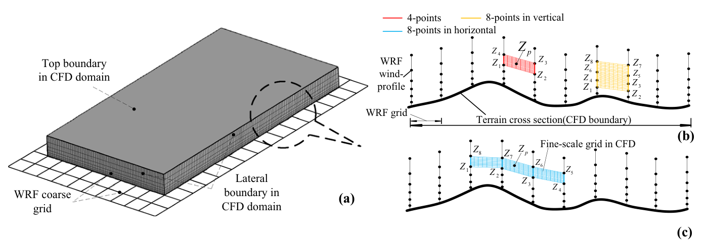

   **图 1** WRF 与 CFD 嵌套网格及边界。（a）耦合示意；（b）、（c）展示 n=4 和 n=8 的三种 IDW 搜索方式。

其中，:math:`\lambda_i\ (i=1,\ldots,n)` 为距离衰减参数 :math:`q_c` 决定的权重，:math:`d_{si}` 为 :math:`Z_p` 与 :math:`Z_i` 之间的直线距离。

WRF 压力–sigma 坐标第一层以下缺少风速分量，因此用多项式函数近似风剖面：

.. math::

   u(z)=a_0+a_1\ln z+a_2(\ln z)^2 \qquad (14)

其中，:math:`\langle a_0,a_1,a_2\rangle` 为多项式系数。在经验幂律假设下，幂指数 :math:`\alpha_p` 可写为：

.. math::

   \alpha_p=\frac zu\frac{\mathrm du}{\mathrm dz} \qquad (15)

将式（14）代入式（15），得到 :math:`\alpha_p=(a_1+2a_2\ln z)/u(z)`，可采用 WRF 最低 2–5 层数据，通过传统最小二乘拟合确定 [14]。

通过评价均方误差（MSE）、平滑效应和估计方差，采用关注平滑性与连续性的统计指标。利用交叉验证评估 IDW 预测器的敏感性。在二阶平稳假设下，表示预测变量方差 :math:`\operatorname{Var}(Z_p)` 与 WRF 样本方差 :math:`\sigma^2` 之差的平滑效应，也就是缺失方差，可由式（16）计算。注意，平滑效应为零表示预测器完全匹配 [1]。

.. math::

   \begin{aligned}\text{平滑效应}&=\sigma^2-\operatorname{Var}\left(\sum_{i=1}^{n}\lambda_iZ_i\right)\\&=\sigma^2-\sum_{i=1}^{n}\sum_{j=1}^{n}\lambda_i\lambda_j\operatorname{Cov}(Z_i,Z_j),\qquad Z_i,Z_j\in\mathbf S\end{aligned} \qquad (16)

其中，:math:`\mathbf S` 为搜索域。表示样本空间相关性的协方差数据，由全向变差函数确定 [31]。式（17）的估计方差用于评价预测值与 WRF 结果在样本位置上的差异。

.. math::

   \begin{aligned}\text{估计方差}&=\sigma^2-2\sum_{i=1}^{n}\lambda_i\operatorname{Cov}(Z_i,Z_p)\\&\quad+\sum_{i=1}^{n}\sum_{j=1}^{n}\lambda_j\lambda_i\operatorname{Cov}(Z_i,Z_j),\qquad Z_i,Z_j\in\mathbf S\end{aligned} \qquad (17)

通过将样本点从 4 个增至 8 个，并考虑邻近位置风特性的相似性，比较插值器的敏感性。以离线流程按 10 min 间隔提取并整理与 WRF 粗网格嵌套的 CFD 边界，再用线性插值在每个 CFD 积分时间步重建变量。

2.3.2 质量守恒调整
^^^^^^^^^^^^^^^^^^

在所有侧边界均被指定的情况下，WRF 与 CFD 耦合界面的通量插值不能满足质量流量平衡。微尺度域内存在质量流量残差，会污染非定常模拟。因此，需进行人工调整以改善数值稳定性。各 CFD 侧边界质量流量相加，可得到侧边界通量残差 :math:`q_{m,\mathrm{res}}`：

.. math::

   q_{m,\mathrm{res}}=\sum_{j=1}^{4}\left(\iint_{A_j}\mathbf Q_m\cdot\vec{\mathbf n}\,\mathrm dA\right)=\sum_{j=1}^{4}\mu_j \qquad (18)

其中，:math:`\mu_j` 为边界 :math:`A_j` 上的质量流量；:math:`Q_m` 为质量通量，由空气密度与速度向量的乘积计算；边界法向量 :math:`\vec n` 指向域外。

如 Rodrigues 等 [30] 所述，在耦合计算中，将插值风速分量乘以式（19）、（20）定义的修正系数 :math:`C_{rj}`，即可实现质量守恒调整。该流程调整非守恒质量流量，并将其重新分配到嵌套边界。

.. math::

   C_{rj}=1-\operatorname{sgn}(\mu_j)\left[q_{m,\mathrm{res}}\bigg/\sum_{j=1}^{m}|\mu_j|\right] \qquad (19)

.. math::

   Z_{cp}=C_{rj}Z_p \qquad (20)

在 Fluent 平台实现这一调整的一个挑战是并行计算。本文通过传递残差通量消息，同步主节点与计算进程。

2.4 湍流入流条件
~~~~~~~~~~~~~~~~

CFD 求解器的湍流入流建立在上述中尺度结果插值的基础上。MYJ 方案计算出的时变 k 和耗散剖面用于 URANS 计算。相反，一阶 YSU 方案无法在中尺度域内生成这些湍流入流，因此采用为地表层模拟推荐的经验式（21）–（22）[4]，其中风速大小 V 和摩擦速度 :math:`u_*` 取自 YSU 解。日本 AIJ 2004 风荷载规范建议的经验湍流强度剖面为幂律型，可按式（23）表示，常数 c、d 由地形暴露类别确定 [22]。两个数值算例均采用 EC4 开阔地形，取 :math:`\langle c,d,z_0\rangle=\langle0.2,0.2,0.03\rangle`。

.. math::

   k(z)=(I(z)V)^2 \qquad (21)

.. math::

   \omega=\frac{u_*^3}{C_\mu k(z)\kappa(z+z_0)} \qquad (22)

.. math::

   I(z)=c\left(\frac{10}{z}\right)^d \qquad (23)

3 算例说明
----------

以下各节介绍中尺度与微尺度模型的设置。为重点考察修正湍流闭合与 IDW 预测器的数值表现，选择起伏相对较小、PBL 层结近中性的 Askervein Hill 和 Feng Men Hill 两个复杂地形。

3.1 Askervein Hill
~~~~~~~~~~~~~~~~~~

在苏格兰南尤伊斯特岛西岸实施的 Askervein 山丘项目 [34]，已成为评价真实算例数值模型的基准。其坡度适中、周围地形平坦，使验证无需考虑截断剖面。现场观测期间布置了 50 多座观测塔，分成三个阵列，见图 3；测量的详细说明见 Taylor 和 Teunissen [34]。本文选择 1983 年 10 月 3 日实施的 TU-03B 现场观测，因为当天 1300–1600 UTC 存在近中性层结 PBL。该时段 Richardson 数在 −0.0038 至 −0.0074 之间变化。沿 A 线、AA–AA 线的水平风特性，以及山顶 HT 处竖向剖面，均有详细记录。参考站 RS 测得主导风向和风速约为 207°、8.9 m/s。Taylor 和 Teunissen [34] 指出，该地形周围的恒定地表粗糙度高度接近 0.03 m。

3.2 Feng Men Hill
~~~~~~~~~~~~~~~~~

另一个中等复杂程度的地形位于中国南部沿海，采用分辨率为 30 m 的地形图表示。在 CFD 域中，沿 Y 轴 2 km 距离内，地形高度从海平面变化至最高 350 m。嵌套区域附近西北侧地形平坦，也为计算资源有限时控制计算域大小提供了便利。计算域中心附近，位于山坡处输电塔顶的两个气象站 P1、P2，均安装风速仪和温度传感器。这些相距数千米的风速仪还用于极端天气，例如台风条件下的电网预警系统。两处监测点周围的海拔约在 70–370 m 之间变化。

此前在距地约 30 m 高度采集的数据可用于验证。该地形的地表粗糙度，参考基于遥感数据集的前期研究确定。表 4 列出观测平均量。统计时段为 24 h，即 2017 年 8 月 21 日 0600 UTC 至 8 月 22 日 0600 UTC；原文援引研究指出，中国沿海地区秋季出现中性条件的概率较高 [10]。

.. list-table:: 表 4 Feng Men Hill 监测站风况
   :header-rows: 1

   * - 站点
     - V 最小 (m/s)
     - V 最大 (m/s)
     - V 平均 (m/s)
     - T 最小 (°C)
     - T 最大 (°C)
     - T 平均 (°C)
     - 平均风向 (°)
   * - P1
     - 1.1
     - 13.3
     - 3.99
     - 23.8
     - 27.7
     - 26.8
     - 242.1 (WSW)
   * - P2
     - 1.2
     - 7.4
     - 2.64
     - 23.8
     - 27.1
     - 26.1
     - 226.1 (SW)

表注：V 与 WD 分别为距地 30 m 监测的风速和风向；T 为距地 10 m 采集的温度。

3.3 WRF 模型设置
~~~~~~~~~~~~~~~~

单向区域模型在 WRF-ARW 中实现，水平网格尺寸从 D01 的 9 km，减小至 D02 的 3 km，再到 D03 的 1 km，见图 2。最内层域的地形用 3 角秒分辨率 DEM 数据替换，以精确描述下垫面。所有域均包含 40 个竖向层，模型顶为 50 hPa；其中距地 1 km 以下的 21 个 sigma 层经过加密，以再现 PBL 演化，eta_levels 依次为 1、0.99875、0.99625、0.99375、0.99125、0.98875、0.98625、0.98375、0.98125、0.97750、0.97500、0.97250、0.97000、0.96750、0.96500、0.95500、0.94500、0.93500、0.92500、0.91500、0.90000。积分持续 24–30 h，包含 6 h 起转时间的影响。表 5 给出中尺度算例的时空设置。

Askervein 算例采用气候预报系统再分析数据集 CFSR（ds093.1，1979–2011）初始化气象场，其空间分辨率在赤道为 0.25°，热带以外扩展至 0.5°。Feng Men 算例采用 1° 的最终业务全球分析数据集 FNL（ds083.2，1999 年至原文所述“现在”）。WRF-ARW 采用交错 Arakawa C 网格离散计算域。考虑稳定性限制，时间分裂积分采用三阶 Runge–Kutta 格式，D01、D02、D03 的时间步长分别为 36、6、2 s。

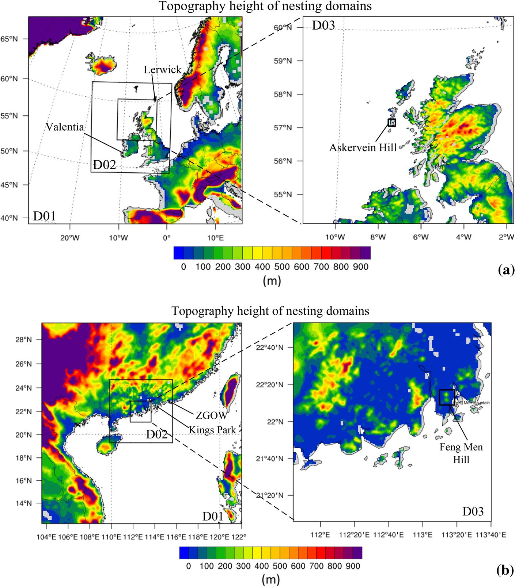

   **图 2** 三个嵌套域的相对位置。外部两域 D01、D02 地形由 0.9 km 分辨率 DEM 生成；D03 替换为 3 角秒（约 90 m）ASTER 地形。（a）Askervein；（b）Feng Men。

.. list-table:: 表 5 中尺度 WRF 模型的物理方案与计算域设置
   :header-rows: 1

   * - 项目
     - Askervein Hill
     - Feng Men Hill
   * - PBL 方案
     - MYJ/YSU
     - MYJ/YSU
   * - 微物理
     - WSM3 三类方案
     - 同左（原表合并项）
   * - 地表层
     - Monin–Obukhov（MYJ）；修正 Monin–Obukhov（YSU）
     - 同左（原表合并项）
   * - 陆面
     - 统一 Noah 陆面模型
     - 同左（原表合并项）
   * - 积云
     - 两个域均用 Kain–Fritsch 方案
     - 同左（原表合并项）
   * - 初始化
     - CFSR
     - FNL
   * - 最外层域 (km²)
     - 3510 × 3510
     - 1920 × 1920
   * - 时段
     - 1983-10-03 0000–2400 UTC
     - 2017-08-21 0000 UTC 至 2017-08-22 0600 UTC

3.4 CFD 数值技术
~~~~~~~~~~~~~~~~

3.4.1 计算域与网格
^^^^^^^^^^^^^^^^^^

关于网格加密准则，多项研究 [5,39] 已详细讨论网格对增速现象的敏感性，以及湍动能对地形特征的敏感性。为捕捉平均流动，本文采用表 6 所示三种包含六面体加密单元的网格方案，开展网格敏感性分析。计算域见图 3、图 4；由中心区域向外，网格按几何级数增大。注意，Feng Men 算例使用更均匀的网格方案，以提高中心区域的网格质量。

.. list-table:: 表 6 网格敏感性分析方案
   :header-rows: 1

   * - 算例
     - 方案
     - 网格总量（百万）
     - :math:`\Delta(x,y)_{\min}` (m)
     - :math:`\Delta z_{\min}` (m)
     - 竖向层数
   * - Askervein
     - 1
     - 1.66
     - 14
     - 0.1
     - 38
   * - Askervein
     - 2
     - 2.20
     - 14
     - 0.01
     - 50
   * - Askervein
     - 3
     - 1.33
     - 17
     - 0.05
     - 38
   * - Feng Men
     - 1
     - 1.69
     - 50
     - 0.5
     - 38
   * - Feng Men
     - 2
     - 2.02
     - 50
     - 0.2
     - 45
   * - Feng Men
     - 3
     - 1.24
     - 60
     - 0.5
     - 38

表注：原表多层表头在版面上错位；此处按数值列及正文定义展开，保留六行全部数值。水平和竖向最小网格尺寸均指中心加密区。

参考 Kim 等 [21] 的研究，选择计算域上下游，包括风程区和周围地形，以准确再现风场。Askervein 山丘的水平域约为 9 km × 9 km，Feng Men Hill 约为 8.4 km × 10.5 km。为避免阻塞效应，两算例域高分别增至 1.2 km、1.8 km。采用归一化风速比 N 和分数增速比 :math:`\Delta S` 两个指标评价 CFD 表现。N 用于评价网格依赖性。对图 3、图 4 中每个关注位置，:math:`N=V_p/V_{\mathrm{ref}}`，其中 :math:`V_p` 为监测点风速，:math:`V_{\mathrm{ref}}` 为参考站距地 10 m 处未受扰动的风速。此外，沿水平 A–A、AA–AA 线及竖向 HT 剖面的平均风速，可相对于 RS 站归一化并表示为 :math:`\Delta S`。该变量用于衡量近地地形影响，写为 :math:`\Delta S=V_{\mathrm{num},h}/V_{\mathrm{RS},h}-1`；:math:`V_{\mathrm{num},h}` 为距地 h 高度的数值风速，:math:`V_{\mathrm{RS},h}` 为参考点同高度监测风速。

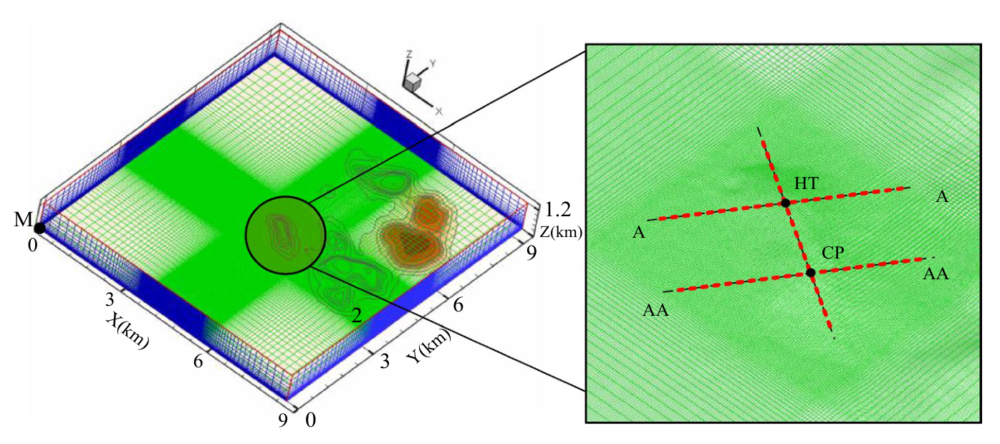

   **图 3** Askervein 山丘计算域及中心网格分布（右）。第 4.2 节二维算例的 3 h 平均风剖面取自 M 点。Y 正向为北。左图圆圈为关注地形；右图 HT、A–A、AA–AA、CP 为观测位置，红虚线附近关注位置用于网格无关性分析。

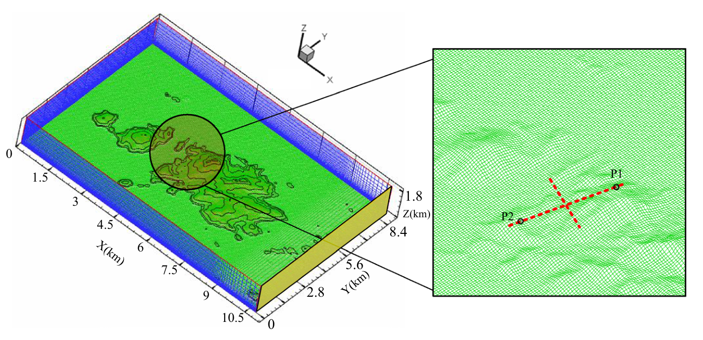

   **图 4** Feng Men Hill 计算域。Y 正向为北；黄色东侧边界用于第 4.3 节讨论。左图圆圈为关注地形；右图 P1、P2 为观测点，红虚线沿线关注位置用于网格无关性分析。原英文图题在“points of”处缺词，观测点身份由正文确定。

图 5 给出网格无关性检验的图示对比。Askervein 算例的方案 1 与方案 2 在 :math:`0<N<0.4` 区间存在差异，这对应观测点附近背风区应被预测的风流分离。相反，对 :math:`N>1` 的增速区，提高这些方案的网格分辨率影响较小。作为折中，图 5(b) 评估方案 3，发现它在两类位置均与更精细的方案 2 较为一致。既有研究 [2,5,39] 在 Askervein 足尺算例中针对不同湍流求解器使用 10–24 m 的水平网格尺寸；在测量不确定性范围内，较粗水平网格的风速结果与更细网格相当一致。因此，本文 Askervein 算例采用方案 3。此外，已有研究表明，:math:`O(10^1\!\sim\!10^2)\,\mathrm m` 的 PBL 流动空间尺度可满足长期风能评价 [6]，故 Feng Men 算例采用较粗网格。图 5(b) 的三角符号显示，在两处观测站附近，三个方案差异较小，因此本文也使用较粗的方案 3。

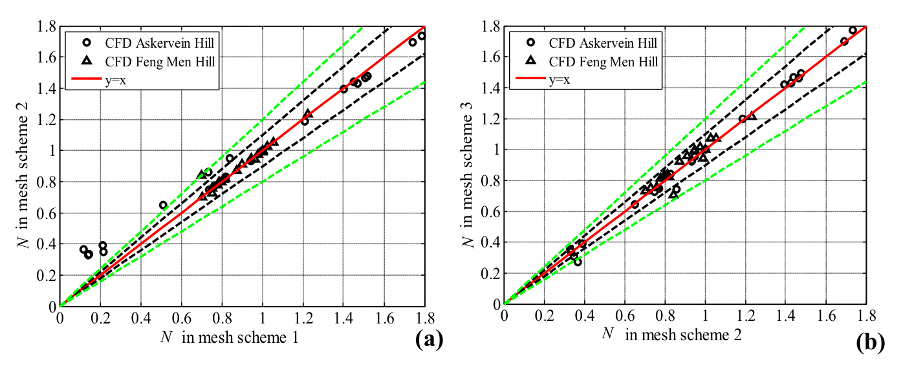

   **图 5** 网格无关性结果散点图。原图题：（a）Askervein Hill；（b）Feng Men Hill。虚线为绝对误差限，黑色±10%、绿色±20%；红实线 y=x 表示完全拟合。图题与两幅图坐标/图例的差异见下方校核说明。

.. note::

   原图 5 图题把 (a)、(b) 分别称为 Askervein 与 Feng Men，但两幅图的图例均同时包含两地；坐标轴实际显示 (a) 比较网格方案 1 与 2，(b) 比较方案 2 与 3。保留原图及原图题，不据图题把两个场地拆成各一幅。

3.4.2 流动物理设置
^^^^^^^^^^^^^^^^^^

考虑 Courant–Friedrichs–Lewy（CFL）限制，URANS 积分时间步长取 1 s，每步设置 20–25 次迭代。动量和连续性残差达到 :math:`1\times10^{-4}` 后，各步解表现为收敛。该不可压缩流动采用压力基求解器，并结合 SIMPLE-Consistent（SIMPLEC）压力–速度耦合。Askervein 算例的风向不变，北侧和东侧边界设为零梯度。Feng Men 算例所有侧边界均定义为速度入口，通过质量守恒调整 [30] 实现，即在各嵌套边界将预测风速分量乘以修正系数。域顶假定剪切应力为零，在所考虑的中性大气层结下可作为对称边界；Han 等 [15]、Temel 和 van Beeck [35] 的嵌套模拟也采用此处理。地表设为无滑移壁面。两算例 Rossby 数为 :math:`10^2\!\sim\!10^3`，表明行星旋转对 CFD 模拟影响较小。科里奥利力项由参数 f 与水平风速分量的乘积计算，以体积源项 :math:`F_{c1}=fu`、:math:`F_{c2}=-fv` 考虑 [39]；Askervein 和 Feng Men 算例的 f 分别为 :math:`10^{-4}\,\mathrm{s^{-1}}`、:math:`10^{-5}\,\mathrm{s^{-1}}`。

.. note::

   原文将科里奥利源项明确印为 :math:`F_{c1}=fu`、:math:`F_{c2}=-fv`。此处保留原式，不擅自替换为常见坐标约定下的交叉分量形式；复现时须另核对坐标和程序实现。

对 :math:`k-\omega` 湍流模型，使用混合函数的分区近壁处理表现较好，可视为对 :math:`y^+` 不敏感的壁面处理 [13]。依据单元中心距壁距离，将近壁速度剖面与比耗散率 :math:`\omega` 的解析表达分为黏性区和对数区。混合壁面公式后，网格壁面距离成为分母项，自动控制两层之间的过渡。这类稳健近壁公式增强 :math:`k-\omega` 模型适用性，避免近壁流动计算恶化。

4 结果讨论
----------

4.1 中尺度结果验证
~~~~~~~~~~~~~~~~~~

如图 2 所示，采用怀俄明大学提供的 Lerwick、Valentia、Kings Park 和 ZGOW 等站探空资料验证 WRF 结果。所选观测的主导风向与关注区域附近一致。

Askervein 算例 TU-03B 观测期间，1200 UTC 的观测风速剖面与风向见图 6，并与 1200–1300 UTC 的 MYJ、YSU 时变结果比较。虽然观测较稀疏，数值风向在 Lerwick 站吻合较好，但在 Valentia 站偏差达 22.5°。500 m 以下，两站模拟结果均接近 SSW 方位（202.5°），与 Askervein 山丘附近观测接近。另一方面，两种 PBL 方案在两站近地面均给出相似风速剖面。数值与观测数据仍存在偏差。一个不可避免的原因是气象气球在大气中运动，沿记录路线可偏移数千米。不确定性既包括从恒定竖向速度上升到气球爆裂高度（约距地 35 km）这一过程中的测量，也包括仪器摆动。

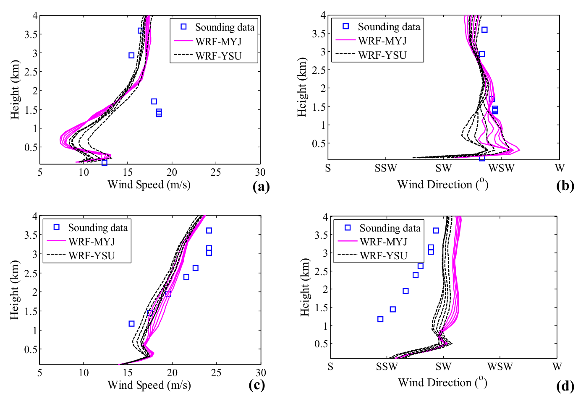

   **图 6** Askervein 算例 WRF 风剖面与观测比较，1983 年 10 月 3 日 1200–1300 UTC。（a）、（b）Lerwick；（c）、（d）Valentia。各曲线为相隔 10 min 的风剖面。

图 7 将 WRF 结果与 2017 年 8 月 22 日 0000 UTC 探空数据比较，显示其可靠性。Kings Park 气象站位于目标区域东侧，原文称其与 ZGOW 站相距 76 km。考虑朝西方向的测量，预测风剖面与多数探空资料一致。虽然 YSU 方案在 Kings Park 给出更高风速，两种 PBL 方案在 PBL 厚度以下仍给出相似风速剖面。

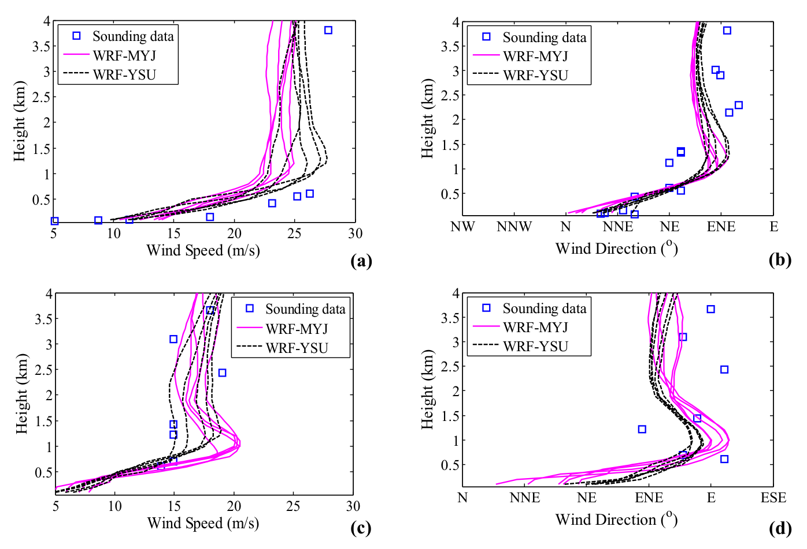

   **图 7** Feng Men 算例 WRF 竖向风剖面与观测比较，2017 年 8 月 22 日 0000–0100 UTC。（a）、（b）Kings Park；（c）、（d）ZGOW。各曲线为相隔 10 min 的风剖面。

4.2 二维空域中的入流湍流发展
~~~~~~~~~~~~~~~~~~~~~~~~~~~~

在二维空域中，使用 WRF 结果提取的入流，检验速度与湍流入口的维持情况。计算域长 4 km、高 1.2 km，第一层网格高 0.01 m，增长率 1.07，与表 6 所示一致；水平网格长度为 4 m。由 WRF 结果沿纵向提取图 3 中 M 点，即 XY 坐标原点处的 3 h 平均速度和湍流剖面。M 点周围为海面，选用 EC5 类地表，即开阔湖面或障碍物极少的地面 [22]，取 :math:`\langle c,d,z_0\rangle=\langle0.16,0.15,0.002\rangle`。平均湍流剖面指定为 Dirichlet 条件，地面无滑移，顶部对称。

图 8 给出经验证的中尺度入流，包括 WRF MYJ 直接提供的剖面，以及按式（21）–（23）修正的 YSU 湍流剖面。可见，距地 200 m 以下两方案风速略有差异，YSU 估计稍高。与式（21）的经验表达相比，图 8(b) 的 MYJ 方案低估 k；该值由地表层以下的一维输运方程计算。应注意，MYJ 耗散率根据中尺度或大尺度湍流含能涡的性质构造，由与离地距离有关的代数方程确定。尽管该假设在近地表区域效果较好，当经典混合长度关系取渐近值 :math:`l_{\mathrm{NWP}}=250\,\mathrm m` [35] 时，YSU 方案在地表层以上预测的 :math:`l_{\mathrm{NWP}}`，相对于 MYJ 指定公式偏大，见图 8(d)。此外，WRF 第一标量层以下的摩擦速度、温度尺度等地表参数，采用带稳定度修正的对数律剖面构造 [19]。这些用于真实算例的假设，可能使 NWP 结果与式（21）、（22）确定的经验入流产生估计差异；后两式已广泛用于理想 CFD 入流 [2,4]。

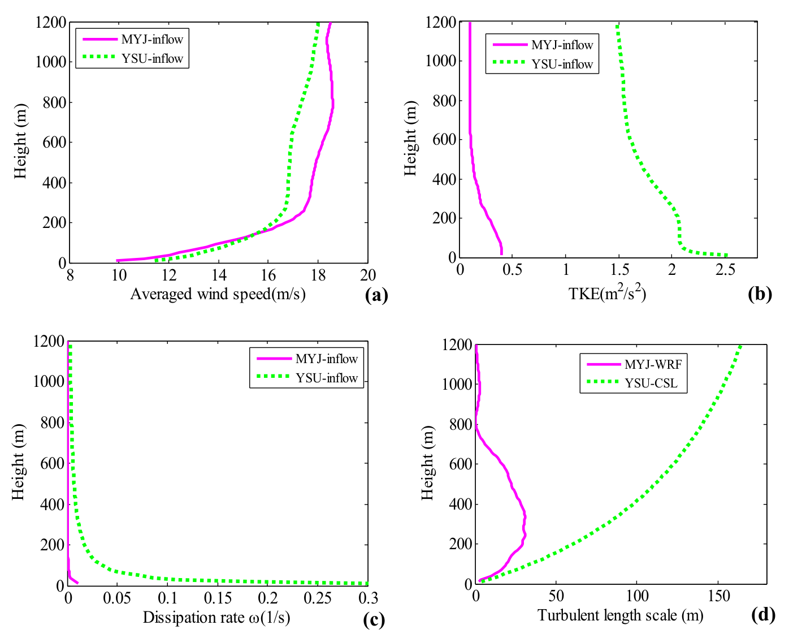

   **图 8** 二维空域入流条件。（a）3 h 平均风速；（b）湍动能；（c）耗散率；（d）湍流长度尺度比较。CSL 为采用 250 m 恒定长度尺度的地表层长度尺度模型。原图（c）纵向变量单位为 1/s，正文相应变量为比耗散率 ω。

图 9 比较入口与出口的 k 和风速剖面。在当前边界和湍流闭合下，两种方案从中尺度程序提取的平均速度剖面都能贯穿整个域保持，仅 YSU 出口近地面略有差异。图 9(c) 显示两种 PBL 方案的 k 剖面均有衰减。一个可能原因是中、微尺度程序对地面条件的定义不同：WRF 使用水体、草地等土地利用分类；嵌套 CFD 域却以 :math:`z_0=0.002` 确定 YSU 入流。如 Blocken 等 [4] 所述，入口剖面代表入口上游地形，可在内部计算域引入内边界层；平均风速和湍流剖面都需要一定距离适应不同地表条件。另一个可能原因是顶边界设置不当 [29]，施加剪切应力边界条件有助于消除衰减。但即使修改后，维持可持续 PBL 的能力仍有限，且可能出现额外误差 [16]。Yang 等 [43] 也曾在相同自由滑移边界下，通过调整湍流入流再现平衡 PBL，验证了拟合入口剖面对湍流输运方程的重要性。图 9(c) 的 MYJ 出口湍流剖面维持得更好，表明对直接使用 NWP 入流的 CFD 计算，一致调整湍流闭合具有帮助。

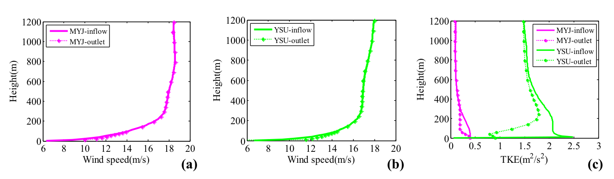

   **图 9** MYJ、YSU 修正湍流闭合下预测风速与湍动能剖面对比。

4.3 IDW 性能评价
~~~~~~~~~~~~~~~~

为计算第 2.3.1 节式（16）、（17）统计指标的空间分布，系统采集 Feng Men 算例在 2017 年 8 月 22 日 0500 UTC、图 4 东侧嵌套边界的粗网格 WRF 解，采用 10 min 平均。该时刻嵌套边界风速含局部极值，位于图 10 左下角约 1 km 长度范围内，右侧区域分布则较均匀，因此总体趋势可用于判断插值器有效性。所验证的 WRF/CFD 界面取水平位置 2–6 km、竖向高度 1.6 km，并提供足够样本检验搜索方式与点数。图 10 的风速预测与平滑效应，即缺失方差，显示以下现象。

* 每种搜索方式（n=4–8）下，权重系数增大都会使 2–4 km 区间出现由过高估值引起的预测风速不连续。距离衰减参数 :math:`q_c` 对样本点数量较敏感。
* 图 10(b) 左下区域存在明显缺失方差，且随样本点增多而增大；距离衰减参数的变化却没有显著改善最终平滑效应。

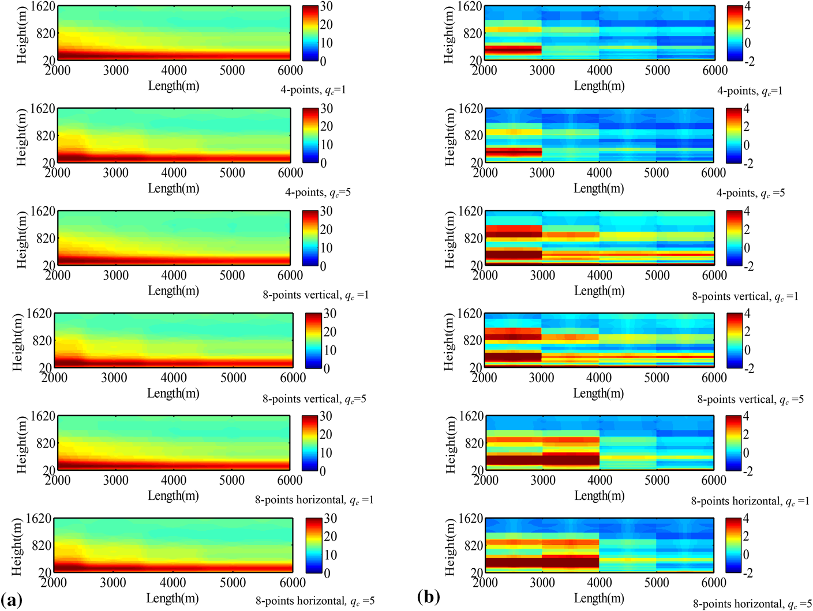

   **图 10** 图 4 东侧嵌套边界的（a）预测风速（m/s）与（b）缺失方差（m²/s²）比较。Feng Men Hill，2017 年 8 月 22 日 0500 UTC；距离衰减参数分别为1和5。原图题指向式（12），权重中该参数实际见式（13）。

图 11(a) 给出距地约 100 m 处估计方差沿长度的变化。尽管搜索域从水平方向转为竖向，四点插值器仍显示较低估计误差，说明当前 WRF 粗网格耦合策略中，增加样本数据未必改善预测。此外，图 11(b) 中四点插值器在 6 km 位置达到最小估计方差，较大的 :math:`q_c` 带来更好的预测能力。

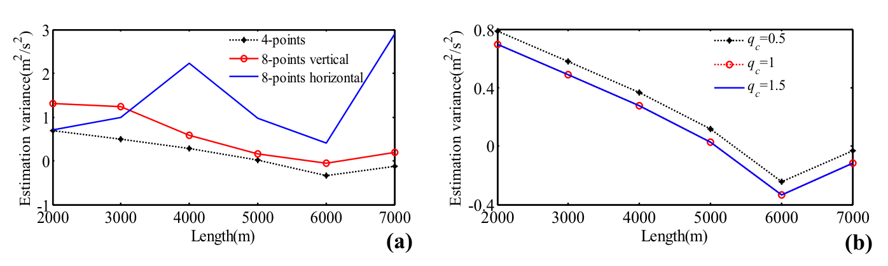

   **图 11** 图 4 东侧嵌套边界估计方差的空间比较，2017 年 8 月 22 日 0500 UTC。（a）q_c=1 的不同搜索方式；（b）四点 IDW 插值器的变化趋势。原图题称 q_c 为式（12）的权重系数，相关表达式实际见式（13）。

图 12(a) 给出不同搜索方式下 MSE 随时间变化。在 12 h 验证期，即 2017 年 8 月 21 日 1800 UTC 至 8 月 22 日 0600 UTC，以 10 min 平均数据检验时，虽然运行约 18 h 出现误差峰值，当 :math:`q_c=1` 时两种水平插值器估计误差均较低，原文记为 MSE<1 m/s。但竖向八点搜索预测较差，对样本点更敏感，原文记为 MSE>2 m/s。图 12(b) 给出四点插值器在不同 :math:`q_c` 下的总体精度。注意，当距离衰减参数足够小时，竖向最近的 WRF 数据不会在权重上压过稀疏的水平数据，因此 :math:`q_c=1` 的 IDW 插值器适合当前预测。

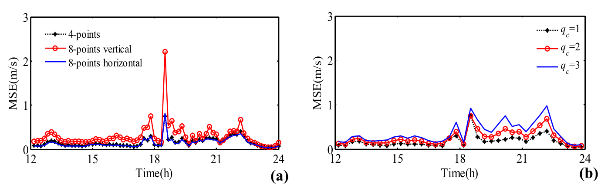

   **图 12** 图 4 东侧嵌套边界 MSE 时间序列，2017 年 8 月 21 日 1800 UTC 至 8 月 22 日 0600 UTC。（a）q_c=1 的不同搜索方式；（b）四点 IDW 在不同 q_c 下的变化。原图题将该权重系数指向式（12）；单位和公式交叉引用疑点见正文译注。

.. note::

   原文把 MSE 称作均方误差，但正文阈值及图 12 纵轴均使用 m/s；此处保留原单位，不将其擅改为均方根误差或 m²/s²。图 10–12 图题将距离衰减参数指向式（12），实际含 :math:`q_c` 的权重表达式为式（13）。图 11 的“估计方差”曲线还出现负值，保留原结果，不把该经验估计曲线当作严格非负方差的证明。

总之，平滑效应验证和不确定性估计说明，四点搜索的 IDW 插值器在嵌套边界附近给出合理风变量。同时，对于每个交叉区域，例如从 WRF 提取不同风场的东、南嵌套边界重叠部分，建议采用水平八点搜索方式。

4.4 Askervein 山丘验证
~~~~~~~~~~~~~~~~~~~~~~

4.4.1 归一化增速
^^^^^^^^^^^^^^^^

图 13 给出从精细 CFD 域提取的平均风剖面，并与现场观测验证。选择与监测相同的 1300–1600 UTC、3 h 平均时段。图 13(a) 显示，从中尺度输出推导的入流较准确地重建了速度剖面，可与参考站 RS 的 8.9 m/s 平均风速比较。WRF-MYJ/CFD URANS 与 WRF-YSU/CFD URANS 耦合计算的该均值分别为 8.2 m/s、8.5 m/s。虽然结果存在偏差，距地 10 m 以下数值风速偏低，考虑测量和湍流模型不确定性，该误差对后续分析仍可接受。

沿 A–A、AA–AA 水平线和 HT 竖向剖面的平均风速，以 RS 站为参考归一化，表示为分数增速比 :math:`\Delta S`。该量衡量近地表地形影响，写为 :math:`\Delta S=V_{\mathrm{num},h}/V_{\mathrm{RS},h}-1`；:math:`V_{\mathrm{num},h}` 为距地 h 高度数值结果，:math:`V_{\mathrm{RS},h}` 为参考站监测风速。

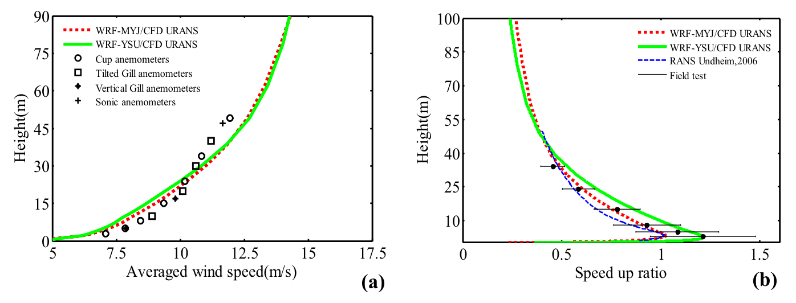

   **图 13** 平均竖向风剖面，1300–1600 UTC 的 3 h 平均；TU-03B 现场观测附不确定性范围 [34]。（a）RS 站风速；（b）HT 站归一化解。

图 13(b) 表明，两种数值方案均与验证观测合理一致。通过这一耦合数值流程，精细网格 CFD 域再现了山顶风速增大效应。最大增速比不在较高处，而在距地 10 m 以下，与既有研究的总体趋势一致 [39]。虽然数值增速都位于不确定性范围内，WRF-YSU/CFD URANS 达到与平均观测近似的 :math:`\Delta S_{\max}=1.21`，WRF-MYJ/CFD URANS 的最大值则较小，为 1.03。此外，10 m 以上前一方法呈高估趋势，后一方法则低估。作为补充，图 13(b) 也列出采用细网格和理想入流的 CFD 结果 [39]，其中 10 m 以下山顶增速偏低。尽管 Undheim 等 [39] 将数字地形图分辨率从 10 m 提高至 2 m 以改善结果，低估趋势仍然存在。考虑非定常计算使用中尺度模型指定的边界，以及风入流不确定性，这些时变入流在研究山地增速效应时表现较好。

Askervein 山丘的典型现象，是迎风和背风区域 :math:`\Delta S` 迅速增大和减小。图 14 对这一现象的图示，在监测线 A–A 上与多数观测定性吻合较好，但在 AA–AA 线的山顶及下游区域存在差异。预测间歇性流动分离的多数数值方法，在模拟 Askervein 背风区时都面临挑战。WRF-YSU/CFD URANS 非定常结果在 A–A 线上游与下游，均与 LES 结果较一致。如 Lopes 等 [24] 所述，下游网格分辨率会导致 :math:`\Delta S` 差异，因为模拟需要再现亚网格尺度特性。湍流闭合方案或 RANS 方法 [5] 也会影响分离长度。Kim 等 [21] 还指出，粗糙度高度及下游邻近山丘可能通过阻塞效应进一步影响 :math:`\Delta S` 分布。因此，图 14(a) 同时比较既有研究中的风洞与数值解。

在迎风和背风区，相较采用理想对数律入口的大涡模拟，由中尺度方程指定侧边界的 WRF/CFD URANS 给出满意结果。HT 点距地 10 m 的最大平均风速，MYJ、YSU 分别为 15.27 m/s、15.76 m/s，接近竖直 Gill 风速仪测得的 16.2 m/s。沿 AA–AA 线，各验证结果间的局部最大正差异 :math:`+\Delta S` 在距 CP 约 100 m 处接近 20%，而局部最小 :math:`-\Delta S` 的差异在约 280 m 处为 60%。虽然 Undheim 等 [39] 验证了更细网格可改善结果，数值解之间的差异仍存在。它们可归因于与知识不足有关的认知不确定性，以及与系统物理变异有关的随机不确定性 [11]。

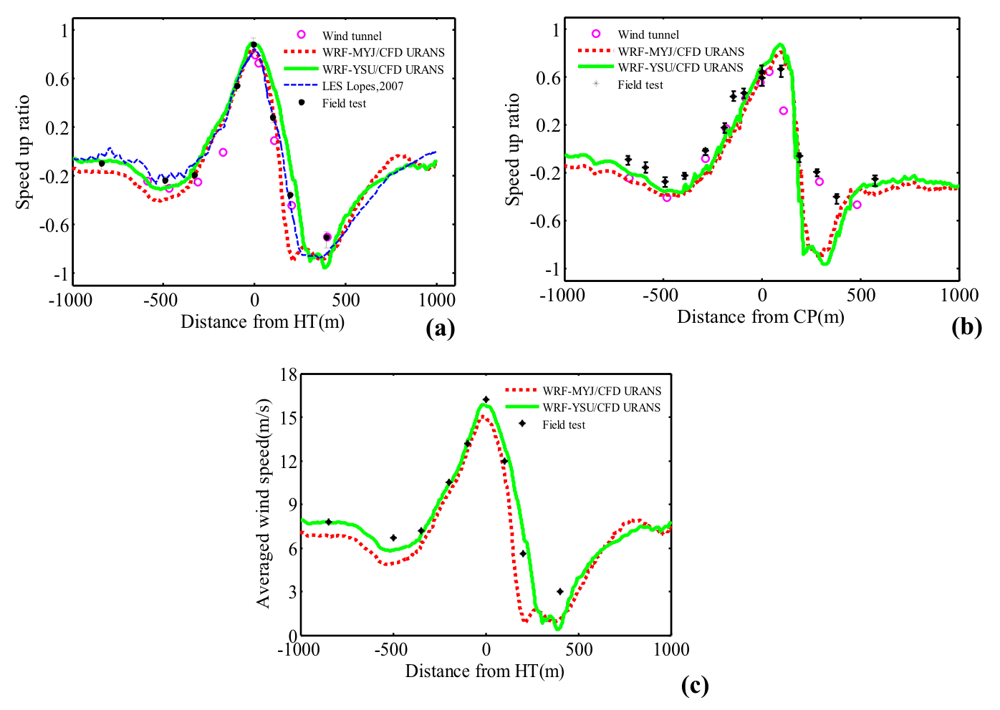

   **图 14** 距地 10 m 水平平均风场（1300–1600 UTC 的 3 h 平均）与带误差线的现场观测比较。（a）、（b）分别为 A–A、AA–AA 线归一化增速；（c）A–A 线平均风速及竖直 Gill 风速仪实测。风洞数据来自 Teunissen 等 [37]，风向角210°。

图 15 比较数值和实测的湍动能 k 剖面。尽管近地面存在高估趋势，相较 Balogh 等 [2] 的稳态 RANS 剖面，图 15(a) 在距地 5 m 以上的吻合可认为满意。Balogh 等 [2] 同样使用 Fluent，依据速度预测误差混合标准 :math:`C_\mu` 常数与 k 源项，并在复杂地形上充分验证这些修改。近地处，WRF-YSU 与 Balogh 等 [2] 的 k 剖面均与经验湍流入流形式较一致。WRF-MYJ 嵌套形式的结果更好，变化趋势更接近测量。

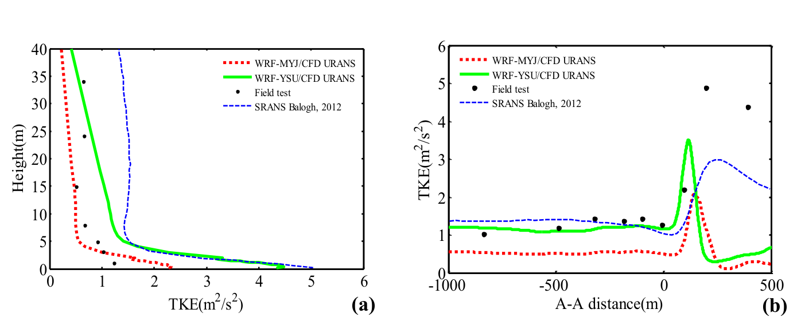

   **图 15** 1300–1600 UTC 的 3 h 平均湍动能比较。（a）HT 站竖向剖面；（b）A–A 线水平剖面。

虽然图 15(b) 没有证实任一数值方案都有显著改善，采用原文所引式（22）的经验 k、:math:`\omega` 入流时，A–A 线上游 k 的估计较好；这种入流已被证明适用于中性层结的理想 CFD 计算。回顾图 8 的入流比较，中尺度 MYJ 低估 k，说明 WRF-MYJ/CFD URANS 即使考虑地形影响，对 k 分布的改善也不显著。此外，两者在非线性湍流效应占主导的背风侧，k 都表现较差。现场较高的 k 可能源于间歇性或非定常分离，而 RANS 求解器没有描述这些现象 [21]。本节的非定常 RANS 虽然考虑中尺度结果的时变统计量，所提嵌套框架仍未充分再现这些分离现象。两种 WRF 结果也都存在风向 WD 预测误差。模拟期间参考站附近距地约 10 m 处，MYJ 与 YSU 的 :math:`\langle\mathrm{WD}_{\mathrm{mean}},\mathrm{WD}_{\mathrm{std}}\rangle` 分别为 :math:`\langle197^\circ,\pm4^\circ\rangle`、:math:`\langle200^\circ,\pm6^\circ\rangle`。TU-03B 观测平均风向约 207°，多数既有研究采用 210° [2]。此外，Balogh 等 [2] 指出，数值方案对湍流入流剖面和近壁公式的不同处理，也是上述差异的原因。

.. note::

   此段原文将“k 和 ω 经验入流”统一引至式（22）；实际 k、ω 分别见式（21）、（22）。保留原论述所指的经验入流，不将其表述为式（22）单独给出两者。

4.4.2 水平流动形态
^^^^^^^^^^^^^^^^^^

图 16 展示 Askervein 周围时间平均速度大小 :math:`V=\sqrt{u^2+v^2+w^2}` 与湍动能 k 的水平等值图。结果为最后 3 h、距地 10 m 的时间平均。水平 V 分布在增速和分离区域均随地形特征一致变化。图 16(a)、(c) 的连续分布表明，所提降尺度框架对风速具有可靠性。虽然图 16(b)、(d) 的最大 k 出现在山顶附近，WRF-YSU 嵌套在南、西边界附近仍存在不希望出现的 k 衰减。Temel 等 [36] 在另一个算例，即西班牙 Ria de Ferrol 海风事件中，也提到类似不一致，不过其 CFD 边界数百米内 k 呈增大分布。除第 4.2 节二维空域讨论的原因外，还应注意参数化 PBL 方案适用于 :math:`O(10^2\!\sim\!10^4)\,\mathrm m` 空间尺度的大气现象。尽管嵌套计算跨越“未知领域”连接中、微尺度，参数化通量项不同仍可能在边界附近生成不真实的流动结构 [26,41]。经过耦合边界传递的中尺度结构，可在网格更小的微尺度域中分解；CFD 结果还需要沿下游一定适应距离，使风场进一步发展。图 16(d) 显示，MYJ 虽低估 k，却比 YSU 更能在嵌套边界附近维持它。这些差异说明，高阶 PBL 方案提供的湍流黏度等中尺度特征，可通过一致调整湍流闭合用于 CFD；而依据 YSU 结果构造的经验入流，在跨越中、微尺度流动形态时仍会带来不一致。

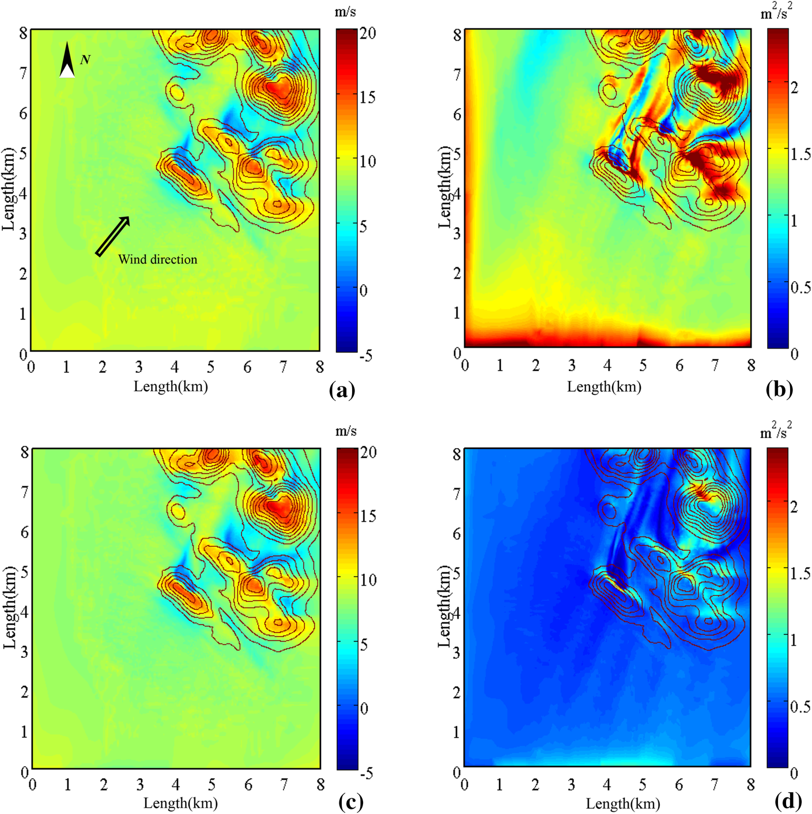

   **图 16** 3 h 平均风速等值图：（a）WRF-YSU/CFD URANS，（c）WRF-MYJ/CFD URANS；对应湍动能分别为（b）、（d）。内部黑实线为 Askervein 山丘地形高程。

总体而言，YSU 和 MYJ 两种方案下的降尺度方法都会影响 URANS 的数值表现。Askervein 足尺模拟中，WRF/CFD 嵌套给出了满意的风速结果。

4.5 Feng Men Hill 验证
~~~~~~~~~~~~~~~~~~~~~~

由于 WRF 提供的单向耦合 CFD 边界包含日变化过程中的湍流剖面，Feng Men 算例配置了 24 h 模拟。但当前微尺度程序既不考虑能量方程，也不考虑地表热通量。因此，首先以 Zoumakis 和 Kelessis [45] 所述梯度 Richardson 数 Ri 检验山丘附近的大气层结。使用 P1 周围 WRF 结果最低两层，即距地约 9–45 m 的数据预测 Ri。Fan 等 [10] 根据多年统计分析推荐了适用于中国沿海的稳定度分类方法，指出秋季近中性 PBL 出现概率较高。

图 17 给出中、微尺度程序风速 V 的时间序列。这些量对风能可能至关重要，:math:`V^3` 直接决定风机产生的功率。验证结果中 V 高度相关，有利于采用测量–相关–预测方法，将数值结果延伸至较长时段，而不必计算整个时期 [6]。此外，虽然当前 CFD 不包含能量方程，WRF 与 CFD 解之间的风场差异说明，气象条件与地形特征都会影响局部平均风统计量。为量化这些影响，本节采用归一化均方误差 NMSE、几何平均偏差、吻合指数 IOA 和分数偏差 FB；原文首次将几何平均偏差缩写为 MB，随后在公式与表格中使用 MG。FB 与 MG 对低估或高估敏感，可表征系统误差；IOA 则描述总体估计趋势。

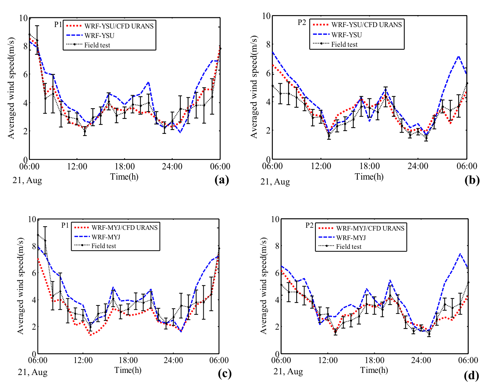

   **图 17** Feng Men 验证期 P1、P2 站小时平均风速，2017 年 8 月 21 日 0600 UTC 至 8 月 22 日 0600 UTC，距地 30 m。（a）、（b）为 WRF-YSU 方案下两站验证；（c）、（d）为 WRF-MYJ 下相同比较。

.. math::

   \begin{aligned}\mathrm{NMSE}&=\frac{\overline{(V_o-V_p)^2}}{\bar V_o\times\bar V_p},\\\mathrm{MG}&=\exp\left(\overline{\ln\left(\frac{V_o}{V_p}\right)}\right),\\\mathrm{FB}&=\frac{\bar V_o-\bar V_p}{0.5(\bar V_o+\bar V_p)}\end{aligned} \qquad (24)

.. math::

   \mathrm{IOA}=1-\frac{\overline{(V_o-V_p)^2}}{\overline{\left(|V_o-\bar V_o|+|V_p-\bar V_o|\right)^2}} \qquad (25)

其中，下标 o、p 分别表示观测量和预测量。

表 7 比较整个观测期的这些统计量，并列出 1 km 网格分辨率的 WRF PBL 方案结果，可作为评价 URANS 表现的参考。依据空气质量评价中的统计模型 [7]，可接受阈值为 NMSE<4、−0.3<FB<0.3、0.7<MG<1.3。IOA 为 1 表示预测与测量具有很高相关性。

.. list-table:: 表 7 图 17 整个观测期的性能指标
   :header-rows: 1

   * - 指标
     - P1 W1
     - P1 W2
     - P1 WC1
     - P1 WC2
     - P2 W1
     - P2 W2
     - P2 WC1
     - P2 WC2
   * - NMSE
     - 0.067
     - 0.067
     - 0.021
     - 0.040
     - 0.112
     - 0.120
     - 0.028
     - 0.045
   * - MG
     - 0.895
     - 0.931
     - 1.009
     - 1.103
     - 0.821
     - 0.800
     - 0.995
     - 1.134
   * - IOA
     - 0.897
     - 0.897
     - 0.974
     - 0.936
     - 0.802
     - 0.779
     - 0.931
     - 0.910
   * - FB
     - −0.119
     - −0.087
     - 0.080
     - 0.096
     - −0.221
     - −0.244
     - −0.016
     - 0.121

表注：W 为 WRF 结果，WC 为单向耦合结果；下标 1、2 分别为 YSU、MYJ PBL 方案。

虽然两种方案都存在数值误差，表 7 的统计指标显示嵌套计算有所改善，表现为 NMSE 下降、IOA 上升。MG 也处于 0.8–1.2 的可接受范围。应注意，中尺度模拟不确定性会直接影响 URANS。两种 WRF 结果的 FB 均为负，意味着高估趋势。虽然更细地形的 CFD 域改善了这一现象，特定时段的数值误差仍未消除，例如 2017 年 8 月 22 日 0000–0600 UTC。风速增强时，亚网格地形可能影响 WRF 的高估趋势。此外，这些时段存在原文称为“略不稳定”的大气层结，:math:`Ri<-0.5`。热力层结对湍动能生成和耗散的作用，可能影响复杂地形上的流动恢复与再附。

.. note::

   本文研究目标为近中性条件，但原文明确报告个别时段 :math:`Ri<-0.5` 且微尺度模型不求解热过程。此处保留原文“略不稳定”的措辞及数值，不把整个 24 h 声称为严格中性，也不把风速改善当作热力层结已获验证。

图 18 给出 URANS 在 P1、P2 周围模拟的水平风场等值图。风速分别在接近当地时间 0800、1300 的 10 min 内平均。虽然 24 h 观测的主导风向为西南，更新中尺度提取的侧边界后，CFD 捕捉到了两个时段之间的差异，图 18(a)、(b) 分别变化为南向和东南向。精细地形再现了风速强度与增速效应；图 18 的背风区流动形态也呈时变趋势。结合 Askervein 对背风区数值表现的验证，可见 WRF 提供的上游风向在 Feng Men 算例中十分重要。

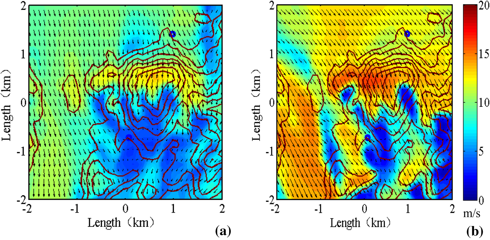

   **图 18** 两监测站周围距地 70 m 的水平风场，CFD 的 10 min 平均，单位 m/s。（a）2017 年 8 月 21 日 2400 UTC；（b）8 月 22 日 0500 UTC。黑实线为地形高程，箭头为风矢量，圆圈为监测点。

5 结论与进一步说明
------------------

为了兼顾气象背景与地形特征，高效模拟复杂地形上的真实风场，本文提出单向嵌套方法，将 NWP 提取的侧边界指定给 URANS CFD 求解器。与近中性层结下的实验观测比较，该方法显示有效性。

首先，从常用的 MYJ、YSU 中尺度 PBL 方案推导出与微尺度 :math:`k-\omega` 闭合一致的湍流黏度。使用 WRF 平均湍流入流，在二维空域中模拟稳态风场，验证两组修正闭合常数。除 YSU 算例近地面略有差异外，NWP 速度剖面可在整个域内满意地保持。然而，MYJ 中由代数长度尺度模型描述扩散项，得到较低的湍动能，并能适当维持；YSU 由于使用经验湍流入口，所得湍动能剖面出现非物理衰减。

其次，考虑中、微尺度网格尺寸的显著差距，在嵌套边界采用可从粗网格 WRF 解重建未解析变量的 IDW 预测器。通过交叉验证开展通用统计控制流程，包括平滑效应、估计方差和均方误差。尤其采用四点搜索与距离衰减参数 :math:`q_c=1` 时，结果显示该设置对高长宽比 WRF 网格具有稳健性。

随后，用上述方法重建 Askervein TU-03B 测量对应的山丘风场。沿 A 线和山顶剖面的平均风速捕捉较好；最大差异出现在 AA–AA 线，在 WRF-YSU 方案下为正。MYJ 配合修正 :math:`k-\omega` 闭合时得到更一致的风场，而 k 分布差异说明，适当的湍流入流对数值表现十分关键。尽管 :math:`\omega` 方程启用了自动近壁处理，在时变风向下，两种算例分离区域的湍动能都过早衰减。这体现 RANS 闭合固有限制的趋势，也见于多数数值算例 [2,39]。所提耦合方法还用于中等复杂地形 Feng Men Hill。时变边界再现了风向影响，预测小时平均风速相较中尺度结果与观测有更好的统计一致性。风速增大、尾流等大气流动特征，似乎与风速和风向高度相关。

总之，本文结合修正 RANS 闭合、IDW 插值和质量守恒调整，创新地实现两个真实 PBL 事件的嵌套模拟。预测结果改善，说明该方法在更精细地形下模拟非定常流动具有灵活性和效率。

虽然本文验证了平均风特性，仍需进一步解决若干潜在问题。首先，中、微尺度域之间较大的网格嵌套比通常不可避免，因此，应通过人工调整缓解或吸收耦合边界处已解析湍流结构不匹配所引起的数值不稳定。此外，源于浮力与重力效应的热力层结，对估计微尺度域内的日变化气象现象也至关重要，例如低空急流的动态演化。

参考文献
--------

[1] Babak O, Deutsch CV (2009) Statistical approach to inverse distance interpolation. Stoch Env Res Risk Assess 23:543–553

[2] Balogh M, Parente A, Benocci C (2012) RANS simulation of ABL flow over complex terrains applying an Enhanced k-ε model and wall function formulation: implementation and comparison for fluent and OpenFOAM. J Wind Eng Ind Aerodyn 104:360–368

[3] Basu S, Lacser A (2017) A cautionary note on the use of Monin-Obukhov similarity theory in very high-resolution large-eddy simulations. Bound-Layer Meteorol 163:351–355

[4] Blocken B, Stathopoulos T, Carmeliet J (2007) CFD simulation of the atmospheric boundary layer: wall function problems. Atmos Environ 41:238–252

[5] Castro FA, Palma J, Lopes AS (2003) Simulation of the Askervein flow. Part 1: Reynolds Averaged Navier-Stokes Equations (k-ε Turbulence Model). Bound-Layer Meteorol 107:501–530

[6] Castro FA, Silva Santos C, Lopes Da Costa JC (2015) One-way mesoscale-microscale coupling for the simulation of atmospheric flows over complex terrain. Wind Energy 18:1251–1272

[7] Chang JC, Hanna SR (2004) Air quality model performance evaluation. Meteorol Atmos Phys 87:167–196

[8] Chow FK, Weigel AP, Street RL, Rotach MW, Xue M (2006) High-resolution large-eddy simulations of flow in a steep Alpine valley. part i: methodology, verification, and sensitivity experiments. J Appl Meteorol Climatol 45:63–86

[9] Cuchiara G, Rappenglück B (2018) Performance analysis of WRF and LES in describing the evolution and structure of the planetary boundary layer. Environ Fluid Mech 18:1257–1273

[10] Sj FAN, Ws LIN, Xh SU (1999) Study on the application of Richardson number’s stability classifying schemes over the surface layer over coastal region. J Tropic Meteorol 15:370–375

[11] García-Sánchez C, Van Tendeloo G, Gorlé C (2017) Quantifying inflow uncertainties in RANS simulations of urban pollutant dispersion. Atmos Environ 161:263–273

[12] Golaz JC, Doyle JD, Wang S (2009) One-way nested large‐eddy simulation over the Askervein Hill. J Adv Model Earth Syst 1(3)

[13] Grotjans H, Menter FR (1998) Wall functions for general application CFD codes. Computational fluid dynamics 1112–1117

[14] Hahmann AN, Vincent CL, Peña A, Lange J, Hasager CB (2015) Wind climate estimation using WRF model output: method and model sensitivities over the sea. Int J Climatol 35:3422–3439

[15] Han Y, Shen L, Xu G, Cai C, Hu P, Zhang J (2018) Multiscale simulation of wind field on a long-span bridge site in mountainous area. J Wind Eng Ind Aerodyn 177:260–274

[16] Hargreaves D, Wright NG (2007) On the use of the k–ε model in commercial CFD software to model the neutral atmospheric boundary layer. J Wind Eng Ind Aerodyn 95:355–369

[17] Hong S-Y, Noh Y, Dudhia J (2006) A new vertical diffusion package with an explicit treatment of entrainment processes. Mon Weather Rev 134:2318–2341

[18] Hu G, Tse K-T, Kwok KC, Zhang Y (2015) Large eddy simulation of flow around an inclined finite square cylinder. J Wind Eng Ind Aerodyn 146:172–184

[19] Jiménez PA, Dudhia J, González-Rouco JF, Navarro J, Montávez JP, García-Bustamante E (2012) A revised scheme for the WRF surface layer formulation. Mon Weather Rev 140:898–918

[20] Kantha L (2004) The length scale equation in turbulence models. Nonlinear Process Geophys 11:83–97

[21] Kim HG, Patel VC, Lee CM (2000) Numerical simulation of wind flow over hilly terrain. J Wind Eng Ind Aerodyn 87:45–60

[22] Kwon DK, Kareem A (2013) Comparative study of major international wind codes and standards for wind effects on tall buildings. Eng Struct 51:23–35

[23] Liu YS, Miao SG, Zhang CL, Cui GX, Zhang ZS (2012) Study on micro-atmospheric environment by coupling large eddy simulation with mesoscale model. J Wind Eng Ind Aerodyn 107:106–117

[24] Lopes AS, Palma J, Castro F (2007) Simulation of the Askervein flow. part 2: Large-eddy simulations. Bound-Layer Meteorol 125:85–108

[25] Lundquist KA, Chow FK, Lundquist JK (2012) An immersed boundary method enabling large-eddy simulations of flow over complex terrain in the WRF model. Mon Weather Rev 140:3936–3955

[26] Mazzaro LJ, Muñoz-Esparza D, Lundquist JK, Linn RR (2017) Nested mesoscale-to-LES modeling of the atmospheric boundary layer in the presence of under-resolved convective structures. J Adv Model Earth Syst 9:1795–1810

[27] Pontiggia M, Derudi M, Busini V, Rota R (2009) Hazardous gas dispersion: a CFD model accounting for atmospheric stability classes. J Hazard Mater 171:739–747

[28] Pope SB (2000) Turbulent Flows. Turbulent Flows 12:806

[29] Richards PJ, Norris SE (2011) Appropriate boundary conditions for computational wind engineering models revisited. J Wind Eng Ind Aerodyn 99:257–266

[30] Rodrigues CV, Palma J, Rodrigues ÁH (2016) Atmospheric flow over a mountainous region by a one-way coupled approach based on Reynolds-averaged turbulence modelling. Bound-Layer Meteorol 159:407–437

[31] Rossi RE, Dungan JL, Beck LR (1994) Kriging in the shadows: geostatistical interpolation for remote sensing. Remote Sens Environ 49:32–40

[32] Sogachev A, Panferov O (2006) Modification of two-equation models to account for plant drag. Bound-Layer Meteorol 121:229–266

[33] Sogachev A, Kelly M, Leclerc MY (2012) Consistent two-equation closure modelling for atmospheric research: buoyancy and vegetation implementations. Bound-Layer Meteorol 145:307–327

[34] Taylor PA, Teunissen HW (1987) The Askervein Hill project: overview and background data. Bound-Layer Meteorol 39:15–39

[35] Temel O, van Beeck J (2016) Adaptation of mesoscale turbulence parameterisation schemes as RANS closures for ABL simulations. J Turbul 17:966–997

[36] Temel O, Bricteux L, van Beeck J (2018) Coupled WRF-OpenFOAM study of wind flow over complex terrain. J Wind Eng Ind Aerodyn 174:152–169

[37] Teunissen H, Shokr M, Bowen A, Wood C, Green D (1987) The Askervein Hill project: wind-tunnel simulations at three length scales. Bound-Layer Meteorol 40:1–29

[38] Umlauf L, Burchard H (2003) A generic length-scale equation for geophysical turbulence models. J Mar Res 61:235–265

[39] Undheim O, Andersson HI, Berge E (2006) Non-linear, microscale modelling of the flow over Askervein Hill. Bound-Layer Meteorol 120:477–495

[40] Wilcox DC (1988) Reassessment of the scale-determining equation for advanced turbulence models. AIAA J 26:1299–1310

[41] Wyngaard JC (2004) Toward numerical modeling in the “Terra Incognita.” J Atmos Sci 61:1816–1826

[42] Yamaguchi T, Feingold G (2012) Technical note: Large‐eddy simulation of cloudy boundary layer with the Advanced Research WRF model. J Adv Model Earth Syst 4

[43] Yang Y, Gu M, Chen S, Jin X (2009) New inflow boundary conditions for modelling the neutral equilibrium atmospheric boundary layer in computational wind engineering. J Wind Eng Ind Aerodyn 97:88–95

[44] Yan B, Li Q, He Y, Chan P (2016) RANS simulation of neutral atmospheric boundary layer flows over complex terrain by proper imposition of boundary conditions and modification on the k-ε model. Environ Fluid Mech 16:1–23

[45] Zoumakis N, Kelessis A (1991) The dependence of the bulk Richardson number on stability in the surface layer. Bound-Layer Meteorol 57:407–414
