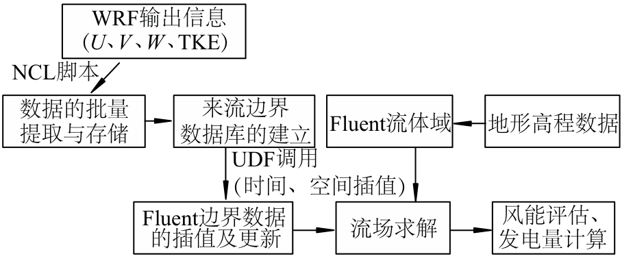
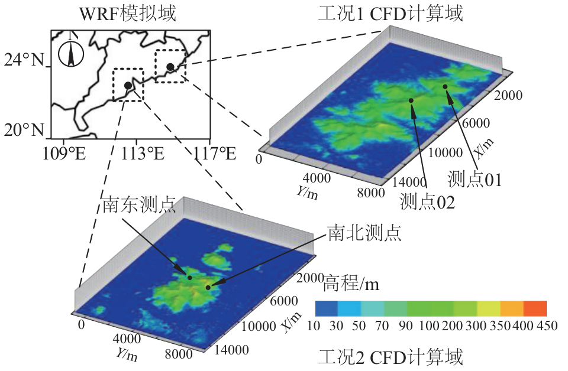
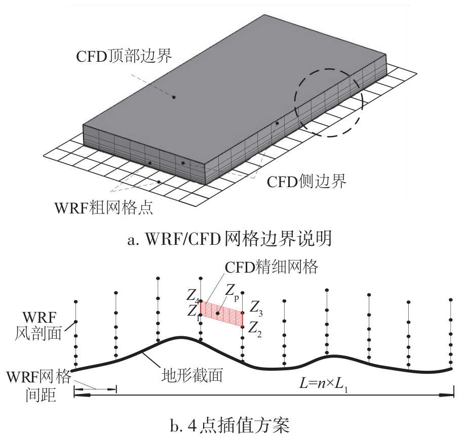
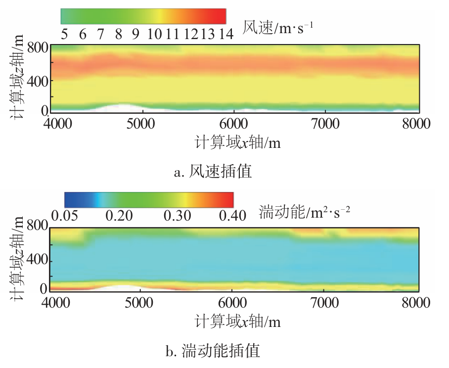
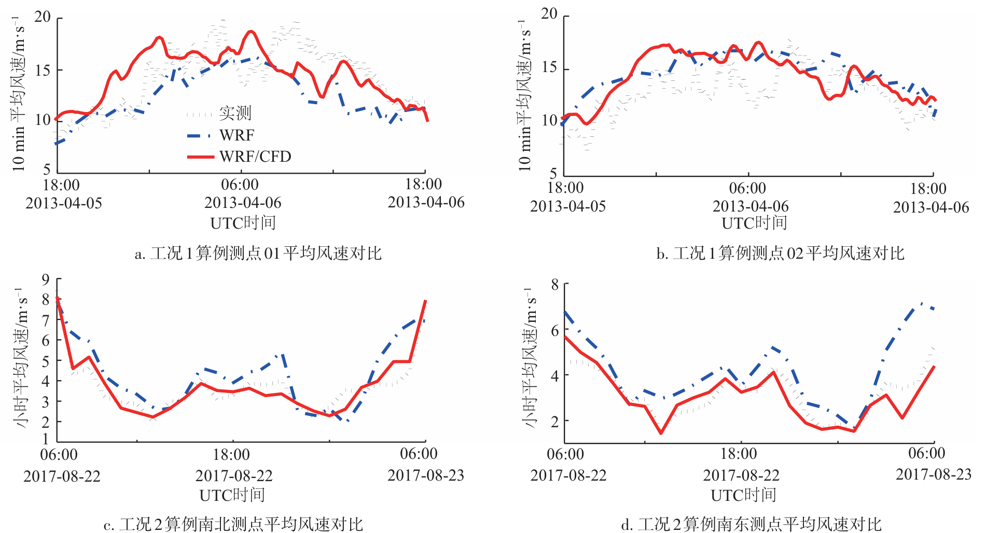
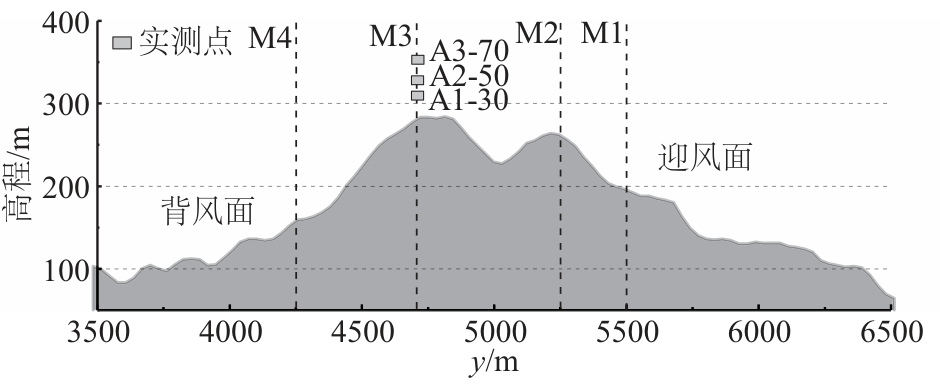
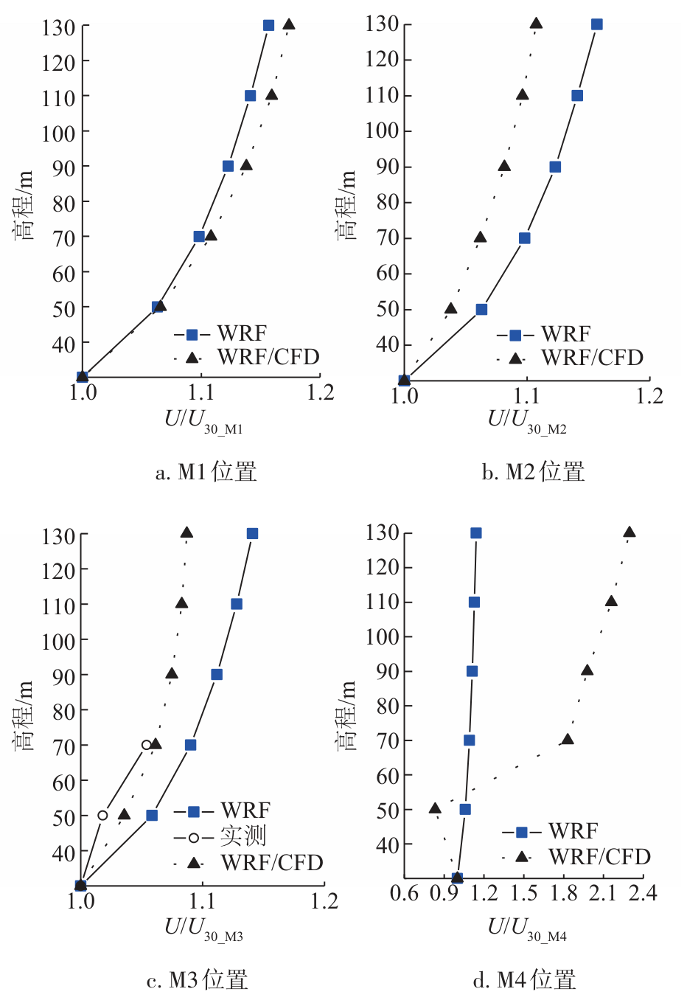

.. _paper-note-ref-zhao2021-TYNXB:

NWP/CFD 嵌套的复杂地形风场模拟：论文精解
========================================

精简版微信公众号文章：待发布

.. contents:: 本页目录
   :local:
   :depth: 2

论文信息
--------

**题名：** 基于 NWP/CFD 嵌套的复杂地形风场模拟研究。

**作者：** 赵子涵\ :sup:`1`、李朝\ :sup:`1`、肖仪清\ :sup:`1`、肖凯\ :sup:`2`、吴晓鹏\ :sup:`3`、宋晓萍\ :sup:`3`。

**作者单位：** 1. 哈尔滨工业大学（深圳）土木与环境工程学院，深圳 518055；2. 广东电网公司电力科学研究院，广州 510080；3. 湘电风能有限公司，湘潭 411102。

**期刊：** 《太阳能学报》，2021 年 2 月，第 42 卷第 2 期，205–210 页。

**DOI：** `10.19912/j.0254-0096.tynxb.2018-1134 <https://doi.org/10.19912/j.0254-0096.tynxb.2018-1134>`_。

**收稿日期：** 2018-10-23。**通信作者：** 李朝。

**WOEAI 相关方向：** 工程结构抗风 / 数值风洞。

本页保留中文原文的段落顺序、方程、图表和参考文献；原文末尾的英文摘要另译为中文，并保留在参考文献之后。校核说明与原文明确区分。

摘要
----

为解决复杂地形边界层风场模拟的边界条件问题，结合中尺度数值天气预报（NWP）和小尺度计算流体动力学（CFD）技术，提出一种基于 NWP/CFD 嵌套的降尺度风场模拟方法。该方法依据 NWP 低分辨率输出结果，建立目标区域来流边界数据库，并结合反距加权插值获得 CFD 边界精细格点信息。以沿海地区 2 处复杂地形为对象，重现目标区域内的风场日变化。参考经验风剖面分布形式，验证插值算法在中小尺度耦合界面数据传递的适用性。然后基于模拟域内实测点数据及误差统计指标，评估风场模拟效果。结果表明，所提降尺度风场模拟方法能有效反映微地形、微气象对风力机尺度大气运动影响。

关键词
------

边界条件；CFD；风力机；边界层流；风电场。

0 引言
------

近年来，中国对风电资源利用保持持续增长。最优风电资源场地的选取及精细化风能资源评估、预测已成为发展高效风电场的重要保障。作为大气运动的一种产物，边界层风的波动、间歇和不可控性会给风电场选址、短期电力调度带来诸多困难。准确获得风力机工作区域内风场的时空分布特征，需综合考虑微气象、微地形等不确定因素影响。

对于不同地区风电场风能资源的评估，薛桁等 [1] 基于中国各气象站的历史平均风速、威布尔统计参数的特征，绘制了距地 10 m 高度的风能资源分布图谱。陈欣等 [2]、顾本文等 [3] 通过计算不同气候背景下具有代表性的测风塔观测数据，详细讨论了中国东南沿海及“三北”地区风能资源分布的差异。采用统计分析方法尽管能相对真实地反演测点附近的风能分布，但气象测风站点的稀疏分布，测量高度与风力机工作高度的差异并不能精确表征丘陵、山地地貌环境对风能资源的影响 [4]。

近年来，随着数值计算能力提升，以大气运动物理规律为基础的中尺度数值天气预报（numerical weather prediction，NWP）和小尺度计算流体动力学（CFD）方法在复杂地形风能资源计算领域得到应用。将粗网格分辨率的数值计算结果作为精细网格区域的边界条件，使复杂地形风场的数值求解更为真实合理 [5]。

Yamaguchi 等 [6] 基于中尺度 RAMS（区域大气模拟系统）和 GIS 地理信息系统，获得了日本近海地区 2 km 分辨率的风能分布数据。Castro 等 [7] 通过中尺度数值模式和小尺度 WINDIE 模型的单向嵌套，获得一处复杂地形区域 300 m 分辨率的流场日循环结果，并指出与中尺度模式较高分辨率输出结果相比，采用中小尺度嵌套模型在保证计算效率的前提下，能够获得更可靠的结果。李军等 [8] 基于目标区域实测点位置处，中尺度 WRF（weather research forcast）模式的逐小时风剖面数据，驱动 Fluent 实现复杂地形边界层风场求解，在小时平均流场内描述了微地形变化引起的风场细节。也有学者将这种多尺度嵌套计算方法应用到城市风环境模拟 [9]、桥梁选址 [10] 等领域。

针对当前研究中，中小尺度数值模型耦合界面的数据传递问题，本文以广东沿海地区三清山、风门坳 2 处复杂地形为研究对象，在时间和空间上分别采用线性插值和反距加权插值，较为精细地实现 NWP 和 CFD 这 2 种不同数值模式的单向嵌套风场计算。结合模拟域内实测站点的短期测风数据，验证降尺度风场计算效果。该方法实施可为复杂地形环境中，风电场微观选址及风能长期评估奠定基础。

1 数值计算方案
--------------

1.1 单向嵌套计算思路
~~~~~~~~~~~~~~~~~~~~

中尺度 WRF 模式动力求解方案以可压非静力平衡方程为基础，在全球及区域天气预报中得到广泛应用。然而受中尺度数值模式自身限制，目前商业气象服务的 WRF 输出结果仍受限于 km 分辨率。围绕复杂地形 CFD 风场精细化计算所需的边界信息（风速、风向、湍动能），首先基于 WRF 模式多层自嵌套输出结果，以 10 min 为间隔，建立目标求解区较低空间分辨率的来流边界数据库（包括 WRF 空间格点的高度、风速分量及湍动能）。其次，通过 Fluent 用户自定义函数，实现数据库调用、嵌套区边界格点数据（m 分辨率）插值、更新及流场求解。其流程如图 1 所示。

   **图 1** 单向嵌套计算流程图（Flow chart of one-way nesting process）。WRF 输出 :math:`U,V,W,\mathrm{TKE}`，经 NCL 脚本批量提取和存储，建立来流边界数据库；UDF 调用时间、空间插值，更新 Fluent 边界数据。地形高程数据生成 Fluent 流体域，随后求解流场，衔接风能评估和发电量计算。

1.2 中尺度模式数值方案
~~~~~~~~~~~~~~~~~~~~~~

采用 WRF-ARW 框架，结合美国国家大气研究中心（NCAR）提供的历史再分析数据，分别对广东沿海三清山（工况 1）、风门坳地区（工况 2）进行气象场重现。综合考虑计算代价，模式求解时长选为 30 h（表 1），其中前 6 h 为模式启动时间。模式水平空间离散采用 Arakawa-C 方案，时间积分采用三阶龙格-库塔积分。边界层采用 MYJ 方案，该方案在边界层内部，将湍动能作为模式预报量，对所有湍流阶量进行诊断，以闭合边界层内的控制方程。变量的竖向分布满足莫宁-奥布霍夫相似。设置模式计算结果输出间隔为 10 min。以 CFD 模拟域为中心，在 WRF 中采取 2 层嵌套方案（1–3 km）实现降尺度风场求解，地形数据采用美国地质勘探局（USGS）提供的 0.9 km 分辨率格点资料。模式在大气边界层 600 m 以下采用 17 层加密（:math:`\sigma` 气压坐标），输出结果采用 NCL 脚本处理并建立 CFD 模拟域的来流边界数据库。目标区域四周地势平坦，内部地形起伏、复杂，海拔高度最高 480 m，属于典型的丘陵地貌，其相对位置如图 2 所示。

.. list-table:: 表 1 WRF 模式的模拟时间区间（Computational time interval of WRF）
   :header-rows: 1
   :widths: 15 85

   * - 工况
     - 模拟时段（UTC 时间）
   * - 1
     - 2013 年 4 月 5 日 12:00 至 4 月 6 日 18:00
   * - 2
     - 2017 年 8 月 22 日 00:00 至 8 月 23 日 06:00

工况 1 区域内有 2 处位于山顶的测风站点（测点 01、测点 02），其距地 30–70 m 高度区间内，以 20 m 为间隔依次布置 NRG 风速传感器。工况 2 区域内，南东、南北测点为 2 处位于山坡上的微气象观测站，其在距地 30 m 高度记录小时平均历史风速资料。

   **图 2** 多尺度嵌套区域的相对位置（Relative position of multiscale nesting area）。左上为 WRF 模拟域；右上为工况 1 CFD 计算域及测点 01、02；下部为工况 2 CFD 计算域及南东、南北测点。地形色标单位为 m，水平坐标 :math:`X,Y` 单位为 m。

1.3 CFD 计算方案设置
~~~~~~~~~~~~~~~~~~~~

随着模拟域分辨率的提高，以求解不可压非线性 Navier-Stokes 方程为基础的计算流体动力学方法能够精确描述流体的分离、绕流等现象。其雷诺时均控制方程可表示为式（1）和式（2）。

.. math::

   \frac{\partial u_i}{\partial x_i}=0 \qquad (1)

.. math::

   \frac{\partial}{\partial t}(\rho u_i)
   +\frac{\partial}{\partial x_j}(\rho u_i u_j)
   =-\frac{\partial p}{\partial x_i}
   +\frac{\partial}{\partial x_j}
   \left(\mu\frac{\partial u_i}{\partial x_j}-\rho\overline{u_i'u_j'}\right)
   \qquad (2)

式中，:math:`u_i`、:math:`\overline{u_i'}` 为风速的平均值及脉动部分的时均值；:math:`\rho`、:math:`\mu` 为空气密度和动力粘度。

针对式（2）中新增的雷诺应力项，通常不直接处理，而是引入相应的湍流模型来使方程封闭。本文选取适应性较强的 SST :math:`k-\omega` 模型 [11]，该模型综合考虑 :math:`k-\omega` 和 :math:`k-\varepsilon` 模型在壁面边界层内外计算的优点。通过引入混合函数，能够较好地描述流体流动的分离现象。

采用交错网格对上述控制方程离散，并结合低速不可压流体的压力基求解器对离散后的方程求解。压力速度之间的解耦采用收敛速度更快的 SIMPLEC 算法。压力的空间离散采用二阶迎风格式。动量的空间离散采用精度更高且具有守恒特性的 QUICK 格式，以减少假扩散的影响。瞬态时间步长选取满足 CFL 条件。计算域来流边界的风速分量、湍动能由 WRF 输出结果经反距加权插值算法得到。对于 WRF 粗网格首层高度以下，地面以上缺失的变量数据，采用规范规定的指数率风剖面分布形式确定。地表面采用无滑移壁面边界条件，其余边界采用速度入口形式 [12]。

1.4 复杂地形网格方案
~~~~~~~~~~~~~~~~~~~~

基于 USGS 公开的全球数字高程数据（SRTM1 V3.0，30 m 分辨率），采用样条插值算法建立 CFD 模拟域内的地形曲面。为避免边界附近求解异常，适当扩大算例的计算域，使四周地势平坦，并采用 Gambit 生成空间离散的结构化六面体网格。为保证计算效率及精度，分别对比水平分辨率为 70、90 m 的网格无关性测试结果，发现当竖向网格数量控制在 65 时，稳态计算结果差别不大。因此选取水平网格间距为 70 m，总网格数控制在 150 万。

2 插值算法实现
--------------

2.1 反距加权插值思路
~~~~~~~~~~~~~~~~~~~~

空间插值在气象和地质勘探领域得到广泛应用。按数学原理不同，可分为确定性插值和地统计插值。后者由于插值过程中引入统计模型，其插值精度要高于前者。然而综合考虑效率与代价，以拟合数学函数为主的确定性插值仍有广泛应用 [10]。本文选取适应性较强的反距加权插值算法来获得嵌套区域耦合界面的变量分布。

对于 CFD 计算域边界网格点 :math:`z_p` 的未知变量 :math:`v_p` （图 3b 内部区域），其在空间上插值结果列于式（3）、式（4）。嵌套区域边界变量的插值和在时间维度的更新采用 Fluent 用户自定义函数实现。由于 WRF 模式输出结果时间间隔较大，必须在时间维度上采用插值函数获得较短间隔数据。参考 Castro 等 [7] 研究结果，本文采用线性插值实现时间维度变量更新。

   **图 3** 计算域嵌套及插值方案示意图（Illustration of WRF/CFD nesting boundary and four-points interpolation schemes）。（a）WRF/CFD 网格边界说明，标出 WRF 粗网格点、CFD 顶部及侧边界；（b）4 点插值方案，在地形跟随的 WRF 风剖面之间选取 :math:`Z_1`–:math:`Z_4`，求 CFD 精细网格点 :math:`Z_p` 的量。图中 :math:`L=n\times L_1` 表示跨越多个 WRF 网格间距的距离。

.. math::

   v_p=\sum_{i=1}^{n}\lambda_i v_i \qquad (3)

.. math::

   \lambda_i=\frac{d_{i0}^{-p}}{\displaystyle\sum_{i=1}^{n}d_{i0}^{-p}}
   \qquad (4)

式中，:math:`v_i` 为 WRF 格点的 :math:`Z_i` 变量；:math:`p` 为权重系数，本文取 2.5；:math:`d_{i0}` 为 CFD 网格待求点 :math:`z_p` 到 :math:`Z_i` 的直线距离；:math:`n` 为临近插值点数量，本文取 4。

2.2 CFD 边界插值效果
~~~~~~~~~~~~~~~~~~~~

工况 1 算例下（UTC 时间：2013 年 4 月 6 日 12:00）耦合界面北侧边界的风速、湍动能插值云图分别如图 4a、图 4b 所示。显然，边界层内（B 类地貌，梯度风高度 350 m），垂直方向的速度分布由小变大，满足指数率风剖面的分布趋势，湍动插值结果略大于中国建筑结构荷载规范（GB 50009—2012）对 B 类地貌规定的 10 m 高度名义湍流强度（:math:`I_{10}=0.14`），但由大到小的变化仍满足负指数率衰减趋势，且风速与湍动能插值云图的整体连续性较好。

计算域北侧边界在 :math:`x=5000\,\mathrm{m}` 附近地形稍微起伏。比较图 4a、图 4b，对于地形的隆起，WRF 模式在竖向采用的静力气压地形跟随坐标在近地面（:math:`z<200\,\mathrm{m}`）及 400–600 m 高度区间内，一定程度地反映地形对竖向风速分布的影响。:math:`x`、:math:`z` 方向地形分布及对应的风速、湍动能插值结果验证了反距加权插值方法的适用性。

   **图 4** CFD 计算域北侧边界插值云图结果（Interpolated contours of wind speed and TKE）。（a）风速插值，色标单位为 m·s⁻¹；（b）湍动能插值，色标单位为 m²·s⁻²。两图横轴为计算域 :math:`x` 轴、纵轴为 :math:`z` 轴，单位均为 m。

.. note::

   原文在本节将“湍动插值结果”与无量纲名义湍流强度比较，而图 4b 色标是有量纲湍动能。两者不是同一物理量，本页保留原句与原图，不自行补造换算或据此认定湍流强度已定量验证。

3 模拟结果验证
--------------

3.1 测点风速时程对比
~~~~~~~~~~~~~~~~~~~~

图 5 比较了三清山测点（工况 1）距地 70 m 高度，风门坳微气象站（工况 2）距地 30 m 高度处时长 24 h 的实测风速序列、中尺度 WRF 输出数据及降尺度模拟结果。不难看出，在复杂地形区域内，将 WRF 计算结果作为 CFD 的时变边界条件能够从整体趋势上重现大气日循环对测点位置的风速影响。模拟时段内，2 处算例的风速较大值出现在约 13:00（北京时间，UTC+8），而夜间风速整体偏弱，该时间区间与实测吻合较好。对于山顶 2 处测点，工况 1 算例风速较强（>10 m/s），在模拟结束前 6 h 时段内，采用降尺度方法较 WRF 计算有一定改善。工况 2 算例风速偏弱（<9 m/s），NB、ND 这 2 处测点的 CFD 计算较中尺度结果而言更接近观测风速，降尺度风场复原的改善效果明显。

为定量分析降尺度计算效果，采用归一化均方误差（NMSE）和一致性指数（IOA）2 个无量纲统计指标进一步评估测点位置附近的平均风速计算效果。如式（5）、式（6）所示，其中 IOA 可作为整体计算误差的评价标准。各指标计算结果列于表 2。

.. math::

   \mathrm{NMSE}=\frac{\overline{(v_o-v_p)^2}}{\overline{v_o}\times\overline{v_p}}
   \qquad (5)

.. math::

   \mathrm{IOA}=1-
   \frac{\overline{(v_o-v_p)^2}}
   {\overline{\left(\left|v_o-\overline{v_o}\right|
   +\left|v_p-\overline{v_o}\right|\right)^2}}
   \qquad (6)

式中，:math:`v_o`、:math:`v_p` 为测点观测及降尺度计算结果；:math:`\overline{v_o}`、:math:`\overline{v_p}` 为测点观测平均值和降尺度计算平均值。

.. list-table:: 表 2 各测点的统计量汇总（Summary of statistical index at monitor site）
   :header-rows: 1
   :widths: 20 20 20 20 20

   * - 站点
     - WRF：NMSE
     - WRF：IOA
     - WRF/CFD：NMSE
     - WRF/CFD：IOA
   * - 测点 01
     - 0.040
     - 0.761
     - 0.029
     - 0.743
   * - 测点 02
     - 0.037
     - 0.645
     - 0.031
     - 0.695
   * - 南北测点
     - 0.076
     - 0.860
     - 0.015
     - 0.974
   * - 南东测点
     - 0.130
     - 0.756
     - 0.028
     - 0.934

对比表 2，目标区域内平均风速计算结果的整体误差较 WRF 输出结果有一定改善，其中 NMSE 在三清山地区的测点 01 及测点 02 分别由 0.040、0.037 降低至 0.029、0.031，而在风门坳地区，该值分别由 0.076、0.130 减少至 0.015、0.028。进一步比较 IOA 指数，发现除位于山顶的测点 01（海拔 381 m）外，采用 CFD 精细网格计算获得结果的变化趋势与实测吻合更好。

   **图 5** 2 处算例的模拟及实测风速对比（Comparison of wind speed at monitor sites）。（a）、（b）为工况 1 测点 01、02 的 10 min 平均风速；（c）、（d）为工况 2 南北、南东测点的小时平均风速。灰色标记为实测，蓝色点划线为 WRF，红色实线为 WRF/CFD；风速单位为 m·s⁻¹，横轴为 UTC 时间。

3.2 测点风速误差原因分析
~~~~~~~~~~~~~~~~~~~~~~~~

复杂地形环境中，风场的形成与分布一方面与大尺度气象背景场有关，另一方面受地形的阻挡、隆起及狭管效应影响。

工况 1 算例在前 18 h 内（2013 年 4 月 5 日 18:00 至 4 月 6 日 12:00）的模拟与实测数据之间存在一定误差。进一步对比图 5，发现除测点 01 外，2 处算例的 WRF 模拟结果略高于实测值。夜间至中午时段（北京时间），受太阳辐射影响，边界层垂直方向热量和动量输送增强，此时测点风速表现出增大趋势，而 WRF 模式的预测在 2 个算例中均高估这一变化。一方面原因是，中尺度边界层方案并未准确考虑次网格地形及陆面过程对边界层风场影响 [13]，其对近地面风速的空间变化幅度预测存在误差，通常会高估复杂地形及其附近平原的风速 [8,14]。中尺度数值模式作为降尺度计算的数据输入端，其计算结果本身不足会进一步激发 CFD 计算的系统误差。

对比图 5、表 2，工况 2 算例整体风速偏弱（2–8 m/s），采用 WRF/CFD 嵌套计算对风速的改善要优于风速较强的工况 1 算例。在 2013 年 4 月 5 日 18:00 至 4 月 6 日 06:00 时段内，测点 01 及测点 02 位置风力强劲且变化明显，同时查阅历史天气资料发现该时段内有短时强降雨，表明三清山地区可能存在对流不稳定层结。而 CFD 计算以求解不可压 Navier-Stokes 方程为主，并未考虑热力学效应和湿物理过程影响，在进行较大区域复杂地形风场模拟时，其计算效果也会受到一定限制。对于数值模拟和实测数据间的误差，可通过后续风力机实测数据进行订正。

3.3 归一化风剖面对比
~~~~~~~~~~~~~~~~~~~~

复杂山地地形对边界层风场影响可分为迎风面和山顶风加速区、背风面分离区。针对风力发电设备、输电线路微观选址所关心的大风区域，需要讨论复杂地形环境中风剖面分布情况。结合工况 1 中测点 01 的实测数据，本部分在 :math:`x=5980\,\mathrm{m}` 截面分别选取 M1、M2、M3 及 M4 位置（图 6），以距地 30 m 高度小时平均风速为参考，获得了 2013 年 4 月 6 日 07:30–08:30 的小时平均归一化风剖面，如图 7a–图 7d 所示。其中 M3 位置（测点 01）在距地 30、50 及 70 m 高度处，分别布置 NRG 风速传感器，其测量结果可作为降尺度效果的验证。

   **图 6** 地形截面及风剖面提取位置示意图（Transections of terrain and wind profile extraction position）。横轴为 :math:`y` （m），纵轴为高程（m）；M1、M2 位于迎风面，M3 位于山顶测点，M4 位于背风面。A1-30、A2-50、A3-70 为三个高度的实测点标记。

   **图 7** M1–M4 位置归一化风剖面对比情况（Normalized wind profile at M1-M4 site respectively）。（a）M1；（b）M2；（c）M3；（d）M4。横轴分别为 :math:`U/U_{30\_\mathrm{M1}}` 至 :math:`U/U_{30\_\mathrm{M4}}`，纵轴为高程（m）。蓝色方形为 WRF，黑色三角形为 WRF/CFD；M3 的空心圆为实测。各分图横轴范围不同。

.. note::

   高度基准校核：图 6 中山顶地形高程约为 300 m，而第 3.1 节称测点 01 海拔 381 m；图 7 的纵轴标为“高程”，第 3.3 节正文则用距地 30、50、70 m 描述观测高度。原文未说明这些表述是否使用不同高程基准，本页分别保留，不擅自统一或据此换算。

不同位置处的归一化风剖面计算结果表明，WRF 模式计算结果并不能精确揭示风剖面受地形影响的分布情况，主要原因是其在一个粗网格内相同变量的空间分布取平均，并采用参数化的次网格尺度项来表征比网格尺度小的系统运动。

依次比较 M3 和 M4 位置的风剖面计算结果可知，降尺度风场模拟方法在山顶位置得到的风剖面更接近实测结果，在背风坡得到的风剖面能表现出风速分离现象。而中尺度数值模式输出结果在迎风面、山顶及背风面的变化特征不明显。

4 结论
------

采用中尺度 NWP 模式单向驱动小尺度 CFD 求解，重现广东沿海三清山、风门坳 2 处复杂地形区域的风场日循环过程。通过比较平均风速及归一化风剖面的时空变化特征，验证降尺度风场模拟的数值计算精度，并提出基于反距加权插值的中小尺度耦合界面数据传递过程，主要得到以下结论：

1) 对于复杂地形的风场复原，采用 NWP/CFD 单向嵌套获得的流场较中尺度模式计算结果而言有一定改善；
2) 基于较低分辨率的中尺度格点数据，采用反距加权插值方案能较好地获得 CFD 精细网格的变量分布；
3) 在反距加权插值方案中，为避免不合理“牛眼”的产生，有必要进一步研究插值结果对插值参数的敏感性。

参考文献
--------

[1] 薛桁，朱瑞兆，杨振斌，等. 中国风能资源贮量估算 [J]. 太阳能学报，2001，22(2): 167–170. XUE H, ZHU R Z, YANG Z B, et al. Assessment of wind energy reserves in China [J]. Acta energiae solaris sinica, 2001, 22(2): 167–170.

[2] 陈欣，宋丽莉，黄浩辉，等. 中国典型地区风能资源特性研究 [J]. 太阳能学报，2011，32(3): 331–337. CHEN X, SONG L L, HUANG H H, et al. Study on characteristics of wind energy resources in two tipical areas in China [J]. Acta energiae solaris sinica, 2011, 32(3): 331–337.

[3] 顾本文，王明，施晓辉. 云南风能资源的特点 [J]. 太阳能学报，2000，21(1): 45–49. GU B W, WANG M, SHI X H. The characteristics of wind energy in Yunnan [J]. Acta energiae solaris sinica, 2000, 21(1): 45–49.

[4] 李泽椿，朱蓉，何晓凤，等. 风能资源评估技术方法研究 [J]. 气象学报，2007，65(5): 708–717. LI Z C, ZHU R, HE X F, et al. Study of the assessment technology of wind energy resource [J]. Acta meteorologica sinica, 2007, 65(5): 708–717.

[5] YAMADA T, KOIKE K. Downscaling mesoscale models for computational wind engineering applications [J]. Journal of wind engineering and industrial aerodynamics, 2011, 99(4): 199–216.

[6] YAMAGUCHI A, ISHIHARA T, FUJINO Y. An assessment of offshore wind energy potential using mesoscale model and GIS [C]// Proceedings of European Wind Energy Conference, London, UK, 2004.

[7] CASTRO F A, SILVA S C, LOPES D C J C. One-way mesoscale-microscale coupling for the simulation of atmospheric flows over complex terrain [J]. Wind energy, 2015, 18(7): 1251–1272.

[8] 李军，宋晓萍，程雪玲，等. 从天气尺度到风力机尺度大气运动的动力模拟 [J]. 太阳能学报，2015，36(4): 806–811. LI J, SONG X P, CHENG X L, et al. Dynamical simulation of wind flow from synoptic scale to turbine scale [J]. Acta energiae solaris sinica, 2015, 36(4): 806–811.

[9] WYSZOGRODZKI A A, MIAO S, CHEN F. Evaluation of the coupling between mesoscale-WRF and LES-EULAG models for simulating fine-scale urban dispersion [J]. Atmospheric research, 2012, 118: 324–345.

[10] 沈炼，韩艳，董国朝，等. 基于 WRF 的山区峡谷桥址风场数值模拟 [J]. 中国公路学报，2017，30(5): 104–113. SHEN L, HAN Y, DONG G C, et al. Numerical simulation of wind field on bridge site located in mountainous area and gorge based on WRF [J]. China journal of highway and transport, 2017, 30(5): 104–113.

[11] 肖仪清，李朝，欧进萍，等. 复杂地形风能评估的 CFD 方法 [J]. 华南理工大学学报（自然科学版），2009，37(9): 30–35. XIAO Y Q, LI C, OU J P, et al. CFD approach to evaluation of wind energy in complex terrain [J]. Journal of South China University of Technology (natural science edition), 2009, 37(9): 30–35.

[12] LIU Y S, MIAO S G, ZHANG C L, et al. Study on micro-atmospheric environment by coupling large eddy simulation with mesoscale model [J]. Journal of wind engineering and industrial aerodynamics, 2012, 107: 106–117.

[13] 马晨晨，余晔，何建军，等. 次网格地形参数化对 WRF 模式在复杂地形区风场模拟的影响 [J]. 干旱气象，2016，34(1): 96–105. MA C C, YU Y, HE J J, et al. Effect of subgrid-scale terrain parameterization on WRF’s performance on wind Field over complex terrain [J]. Arid meteorology, 2016, 34(1): 96–105.

[14] SHIMADA S, OHSAWA T. Accuracy and characteristics of offshore wind speeds simulated by WRF [J]. SOLA-scientific online letters on the atmosphere, 2011, 7(1): 21–24.

英文题名与摘要译文
------------------

**英文题名：** WIND FIELD SIMULATION OVER COMPLEX TERRAIN BY COUPLING NWP/CFD APPROACH。

**作者：** Zhao Zihan、Li Chao、Xiao Yiqing、Xiao Kai、Wu Xiaopeng、Song Xiaoping；单位及对应关系与首页一致。

为了确定复杂地形边界层流动重建的合理边界条件，提出一种耦合中尺度数值天气预报（NWP）和微尺度计算流体动力学（CFD）的降尺度方法。通过反距加权（IDW）插值，将 NWP 模式的解用作 CFD 模拟的初始输入。采用两个实际复杂地形风电场发生的强风事件检验该降尺度方法的表现。利用经验风剖面验证 IDW 方法在数据传递过程中的适用性。通过与观测塔现场数据比较，采用误差统计方法评估降尺度效果。结果表明，本文提出的耦合方法能够在考虑地形特征的情况下，有效反映小尺度风力机的风场分布。

**关键词：** 边界条件；CFD；风力机；边界层流；风电场。

完整引用
--------

赵子涵，李朝，肖仪清，肖凯，吴晓鹏，宋晓萍. 基于 NWP/CFD 嵌套的复杂地形风场模拟研究 [J]. 太阳能学报，2021，42(2): 205–210. DOI: 10.19912/j.0254-0096.tynxb.2018-1134。

收录信息见 :ref:`WOEAI 学术成果页对应条目 <ref-zhao2021-TYNXB>`。
