.. _paper-note-ref-zhao2023-BS:

台风天气下城市风环境的多尺度模拟：论文精解
========================================================

精简版微信公众号文章：待发布

本页依据22页出版社论文完整精解科学正文、符号表、公式、图表和参考文献；按项目范围省略致谢等声明性尾节。

.. contents:: 本页目录
   :local:
   :depth: 2

**原文题名：** Multiscale simulation of the urban wind environment under typhoon weather conditions。

**作者：** Zihan Zhao、Yiqing Xiao、Chao Li（通讯作者）、P. W. Chan、Gang Hu、Qingfeng Zhou。

**单位：** 深圳职业技术学院建设工程学院；哈尔滨工业大学（深圳）土木与环境工程学院；香港天文台；深圳市城市规划与国土资源研究中心。机构名称按本文发表时来源保留。

**期刊与年份：** Building Simulation，2023。本次来源为22页论文文件，页首未列最终卷期页码。

**DOI：** `10.1007/s12273-023-0991-7 <https://doi.org/10.1007/s12273-023-0991-7>`_。

**收稿与录用：** 2022年11月15日收稿，2023年1月5日修回，1月19日录用。

**WOEAI 相关方向：** 工程结构抗风 / 数值风洞。

摘要
----

准确模拟城市区域行星边界层（PBL）风场，需要结合气象知识与精细几何信息。计算流体力学（CFD）广泛用于评估行人风舒适度和风灾，为韧性城市规划服务。然而，CFD预测的PBL受入口边界显著影响。热带气旋等极端天气下的风剖面难以确定，也尚未获得适用于这些条件的统一对数律或幂律表达。本文采用中尺度与微尺度模型单向嵌套方法，模拟山地地形上的城市风流。CFD中的入口风速、湍流标量与位温由数值天气预报（NWP）模型提供。研究考察适用于台风天气的方法，以提高中尺度台风结构和行人高度风况的数值预测精度，并分别量化中尺度与微尺度模型的误差。通过将局地观测引入CFD区域，提出一种新的趋势同化方法：利用经验模态分解量化观测与NWP结果之间的平均风速差异，再乘以空间相关系数，将差异外推至NWP–CFD嵌套界面。数值结果通过气象现场观测，以及登陆台风“海马”期间试验性激光雷达测得的风剖面进行验证。模拟风场在局部城市区域的精度有所提高，具体表现为风速一致性指数从0.28提高至0.72，平均绝对误差从5.46 m/s降至1.89 m/s。

**关键词：** NWP–CFD；城市风流；数据同化；台风灾害；韧性城市。

1 引言
--------

强风研究是韧性城市规划关注的问题。强风事件会破坏密集建成区并造成社会损失。例如，热带气旋（TC）在近海和沿海地区引发强风灾害，而这些地区往往经济发达、人口持续增长。在西北太平洋和中国东南海域发展的台风“利奇马”（1909）就是一例，原文援引Zhou et al. (2022)，称其造成浙江东南沿海地区13人死亡、约83亿美元损失。这些灾害不仅源于强降雨，也来自台风眼墙及外围涡旋区域的强风作用（Li et al. 2015; Sun et al. 2019）。图1展示超级台风“山竹”对中国香港街谷的影响，观测到的高风险事件包括景观树木倒损、玻璃幕墙和基础设施破坏。这些影响不仅危及行人高度风环境，还会增加基础设施的脆弱性（Repetto et al. 2018）。建筑群会强化风流通道，或产生伴随高速角隅流的近地驻涡，进而影响风舒适度与安全（Van Druenen et al. 2019）。

.. rubric:: 符号表（原文第2页）

.. list-table::
   :header-rows: 1

   * - 符号／缩写
     - 含义
   * - :math:`B_1`
     - PBL 方案中的常数
   * - :math:`c_{\mathrm{p}}`
     - 比热容
   * - :math:`C_1`
     - 第一阶 IMF
   * - :math:`C_{\mathrm{r}}`
     - 实测残余项
   * - :math:`C_{\mathrm{r}}^{\mathrm{WRF}}`
     - 中尺度模拟残余项
   * - :math:`\langle C_{\mu},C_{\omega1},C_{\omega2}\rangle`
     - CFD 湍流模型常数
   * - :math:`F_{ci}`
     - 旋转科里奥利力
   * - :math:`g`
     - 重力加速度
   * - :math:`k`
     - 湍动能
   * - :math:`L`
     - Monin–Obukhov（M–O）长度
   * - :math:`r_{\mathrm{c}}`
     - 空间相关系数
   * - :math:`S_{\mathrm{e}}`
     - 修正热源项
   * - :math:`S_{\mathrm{m}}`
     - 体积源项
   * - :math:`T`
     - 温度
   * - :math:`U_{\mathrm{cp}}`
     - 修正风速
   * - :math:`\overline{U}_{\mathrm{m}}`
     - 平均风速
   * - :math:`U_i^{\mathrm{c}}`
     - 实测风速
   * - :math:`U_i^{\mathrm{p}}`
     - NWP 模拟风速
   * - :math:`\beta`
     - 热体积膨胀变量
   * - :math:`\Gamma`
     - 干绝热递减率
   * - :math:`\theta`
     - 位温
   * - :math:`\mu_{\mathrm{t}}`
     - 动力涡黏度
   * - :math:`\rho`
     - 空气密度
   * - :math:`\sigma_{\mathrm{T}}`
     - 湍流普朗特数
   * - :math:`\langle\sigma_k,\sigma_{\omega}\rangle`
     - 湍流施密特数
   * - :math:`\omega`
     - 比耗散率

.. rubric:: 缩写表（原文第2页）

.. list-table::
   :header-rows: 1

   * - 符号／缩写
     - 含义
   * - AGL
     - 离地高度
   * - CFD
     - 计算流体力学
   * - CMA
     - 中国气象局
   * - ECMWF
     - 欧洲中期天气预报中心
   * - EMD
     - 经验模态分解
   * - ERA5
     - ECMWF 第五代大气再分析数据
   * - IMF
     - 本征模态函数
   * - IMP
     - 插值多尺度剖面
   * - IOA
     - 一致性指数
   * - MAE
     - 平均绝对误差
   * - MFEM
     - 多因子误差法
   * - MSLP
     - 最低海平面气压
   * - MWS
     - 近中心最大风速
   * - MYJ
     - Mellor–Yamada–Janjic
   * - NC
     - 数值算例
   * - NP
     - 北角观测
   * - NWP
     - 数值天气预报模式
   * - PBL
     - 行星边界层
   * - RANS
     - 雷诺平均 Navier–Stokes
   * - SE
     - 九龙东南观测
   * - SN
     - 谱逼近
   * - TC
     - 热带气旋
   * - WD
     - 风向
   * - WRF
     - 天气研究与预报模式
   * - WS
     - 风速

台风强风直接造成的损害包括建成基础设施和城市景观破坏。无论高层建筑抗风设计还是脆弱性评估，都需要量化风速。准确预测台风风场，可为灾后调查中再现结构破坏模式，以及飞散物和树木受损提供参考。随着计算能力和先进湍流模型的发展，CFD已成为再现城市风环境的有用工具（Blocken et al. 2016; Liu and Niu 2016; Buccolieri et al. 2021）。精细网格能够捕捉街谷内PBL风场分布，确保模拟精度的关键问题之一，是确定真实的风剖面。基于指南（Tominaga et al. 2008; Franke et al. 2011）或观测（Ramponi et al. 2015）拟合的幂律、对数律风剖面得到广泛使用。García-Sánchez et al. (2014)量化了俄克拉荷马城市中心采用此类入口条件时的随机不确定性，发现来流方向和大小是影响雷诺平均Navier–Stokes（RANS）湍流模型精度的主要因素。Wise et al. (2018)发现，入口风向很小的变化也可能使城市风流发生显著改变。这些研究认为，PBL风场的不一致性、波动性和不可控性，构成CFD建模中的重要不确定性。入口风剖面还受到水汽、低压涡旋和海气热通量等非定常气象因素影响。

台风风况下，用CFD模拟城市风环境面临不同的困难。首先，风速剖面偏离经验幂律（Song et al. 2004; Song et al. 2016），其指数参数使经验剖面不同于正常天气条件（Li et al. 2012b; Liu et al. 2018），这种差异在台风眼墙和台风眼附近尤为明显。其次，台风中心经过前后平均风向突变明显，使上游下垫面条件发生变化；但登陆台风路径不确定、测量不足，近地观测难以充分捕捉风特征。第三，具有热分层的近地层也是影响模拟性能的不确定因素（Li et al. 2022）。既有观测发现，台风眼墙和外围涡旋近地区域存在弱稳定与稳定条件（Li et al. 2012a），即使平均风速已经高于Pasquill稳定度分类中通常对应中性条件的风速范围（Mohan and Siddiqui 1998）。这些热稳定条件可能影响PBL风剖面，以及复杂几何周围的风流再附（Alinot and Masson 2005; Pieterse and Harms 2013）。上述研究指出，复现受气象作用影响的真实风事件时，CFD区域侧边界的选择存在困难。

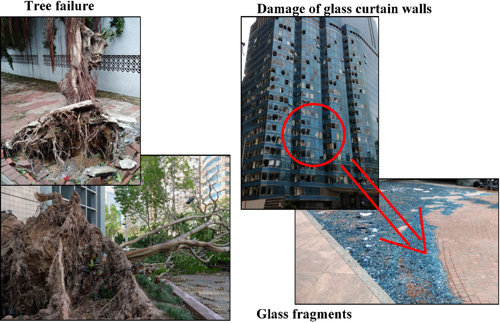

   **图 1** 台风风作用下，中国香港玻璃幕墙和景观植物的历史受损情况。

   图中标注：树木破坏；玻璃幕墙损坏；玻璃碎片。

.. note::

   图1是原论文用于说明问题的“山竹”历史损坏照片，不是下文“海马”算例的损坏验证，也不代表本文已经预测玻璃幕墙或树木的破坏。

近年，中尺度NWP与微尺度CFD嵌套模拟已用于风电场流动（Castro et al. 2015; Sanz Rodrigo et al. 2017）、城市风环境和扩散计算（Baik et al. 2009; Tewari et al. 2010; Kwak et al. 2015），以及结构空气动力学（Gopalan et al. 2014）。这些应用利用NWP再现的气象场维持CFD侧边界，并适当控制网格质量，以适应不同几何形状（Bairagi and Dalui 2021; Hassan et al. 2022）。NWP框架还为CFD所需的风分量、湍流标量和位温等气象变量提供时变边界条件。尽管这些优点已获确认，仍缺少针对登陆台风强风事件验证嵌套模拟性能的研究。Emanuel et al. (2004)和Tien et al. (2013)指出，模拟路径误差及强度高估、低估，是影响NWP精度的不可避免因素。即使先进NWP模型，也难以准确模拟边界层过程，因为海气热通量是台风重要的能量来源（Li et al. 2015; Sun et al. 2019）。当入口条件来自不准确结果时，嵌套框架中提高CFD网格分辨率，对最终精度的贡献有限。台风风剖面还包含近地风向突变、不同热分层和水平非均匀风速分布；实现嵌套计算，需要针对这些气象现象认真设计多尺度框架。既有研究通过嵌套界面数据插值（Han et al. 2018）、湍流黏性一致处理（Zhao et al. 2021b）等修正，使CFD获得适定解，但有关精度改善的结论以正常风况为基础。考虑热带气旋复杂结构来分析这些方法的表现，具有研究价值。

数据同化是用于提高NWP数值精度的成熟方法，近期研究包括松弛逼近（nudging，Delfino et al. 2022）、变分同化（Thomas et al. 2020）和机器学习（Frerix et al. 2021）。这些方法的数学目标，是获得多源观测与动力框架的最优结合，提供高质量的模式初始化（Zou et al. 1992; Fierro et al. 2012）。利用大量卫星和气象站测量开展陆地、海洋数据同化，有助于改善预报模式质量。相应修正流程在中尺度程序中已较成熟，但微尺度域内测量有限，使CFD同化仍具挑战性。用稀疏数据同化来修正数值误差是新的尝试，然而很少有研究检验其在多尺度框架中的表现。Zajaczkowski et al. (2011)和Li et al. (2019b)尝试在动量输运方程中加入含nudging源项的体积力，使CFD模拟趋近修正风数据。这种方法的不足是，nudging强度和时空权重函数显著影响同化结果，在nudging位置附近还可能出现非真实尾流。Sousa et al. (2018)通过城市风场数据同化，利用多个风传感器推断CFD入口条件；其逆向集合卡尔曼滤波基于连接局地风观测与入口条件的代理模型，更新入口剖面。但该同化流程采用不变的来流，并考虑不受气象因素影响的缩减风速；为建立代理模型，RANS计算需要大量计算资源。这些尝试难以直接用于嵌套计算，需要进一步研究以复现真实天气事件。

为提高多尺度城市风环境模拟的数值精度，本文将台风风场中的问题和限制分别分解到中尺度、微尺度模型。未使用同化方法的模拟，检验现有多尺度框架复现真实城市风环境的局限；采用谱nudging及本文趋势修正的算例则获得精度改善。相关验证说明，这些方法能够从测量中提取直接风信息，例如风速变化趋势。本文强调以下新工作。

- 采用近期提出、基于标准 :math:`k\text{-}\omega` 湍流模型的NWP–CFD嵌套框架（Zhao et al. 2021a），验证城市风环境数值模拟。针对台风路径、强度预测的不足，评估NWP中的谱nudging同化和本文提出的CFD趋势修正，定量评价台风结构及风速场的模拟误差。
- 分别从中尺度和微尺度框架出发，评估减小台风路径与近地风流模拟误差的方法。观测表明，多尺度模型可提高城市风环境中台风影响的再现精度，涉及台风路径、强度及近地风速。
- 再现中国香港九龙湾的行人高度风环境，补充超大城市受台风灾害影响时真实风数据的不足。针对登陆台风，在多尺度模拟中考察近地风向突变、不同热分层和水平非均匀风速分布；作者将这些内容与既有NWP–CFD嵌套研究相比较。

2 中尺度模型对台风事件的再现
------------------------------

2.1 海马（1622）及观测概况
----------------------------------

超级台风“海马”是2016年第22个获得命名的热带气旋，下文记为1622。它登陆后对菲律宾群岛和中国广东省造成广泛破坏（Lu et al. 2021）。该热带风暴于2016年10月15日在西北太平洋形成，经过菲律宾吕宋岛东北部后，于10月21日向南海移动，随后在中国汕尾市登陆。根据现场观测，最大持续近地风速达到42 m/s。图2(a)中的红线是中国气象局（CMA）提供的“海马”路径，该数据库利用事后分析，给出台风中心位置每6 h的最佳估计。研究城市区域位于中国香港九龙湾，见图2(b)。原文给出该区域与登陆点的直线距离为96 km；尽管相隔这一距离，气象预警系统仍发出了八号风暴信号，城市当日停摆。

研究城市区域设置了用于气象观测的螺旋桨式风速仪。图2(b)给出东南九龙（SE）与北角（NP）两个气象站（Li et al. 2017），数据由香港天文台提供。本文还出于研究目的开展了Windcube激光雷达观测（Tse et al. 2013; Kim et al. 2016; Newman et al. 2016）。试验持续24 h，以捕捉前侧眼墙、台风眼和后侧眼墙等真实台风结构。便携Windcube设备适合应对台风路径的不确定性，可监测相应PBL风特征。风速测量利用大气气溶胶运动引起的多普勒频移，并由脉冲激光雷达通过外差探测识别该频移。

该激光雷达监测点距台风登陆位置4.5 km，测得的风分量覆盖40–290 m范围内12个高度层，每秒存储一次，用于检验模拟气象背景。强风中的飞散物或降雨可能降低观测质量，因此通过剔除数据尖峰进行质量控制，保证平均风速采样有效率高于90%（Li et al. 2012a）。

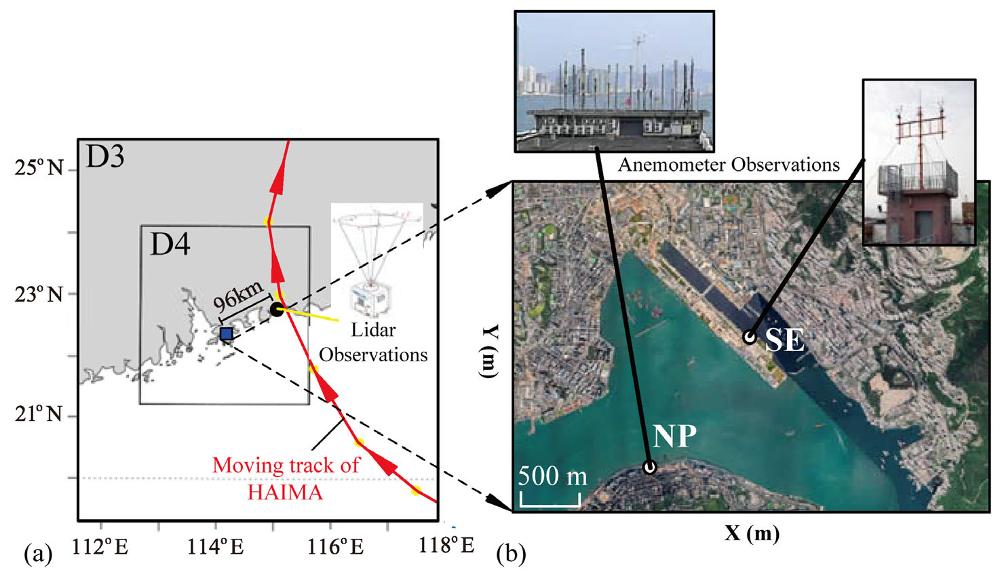

   **图 2** （a）中尺度模型两个内层计算域（D3 和 D4）的空间配置。红线表示中国气象局（CMA）数据库中的最佳路径（Ying 等，2014）。网格水平分辨率由 27 km 逐级减小至 D4 的 1 km。LiDAR 观测布置在台风登陆位置附近。（b）CFD 计算域细节及测量位置。

   图中标注：第三、第四层中尺度计算域；“海马”移动路径；激光雷达观测；风速仪观测；北角（NP）；东南九龙（SE）观测站点，保留原站点缩写；水平坐标 X、Y（m）。

.. note::

   登陆点附近的激光雷达、九龙湾域内NP同化站和SE验证站承担不同任务；4.5 km是激光雷达距登陆点距离，96 km是原文给出的研究城市区域距登陆点距离，不能合并成同一测站。

2.2 模型设置与初步结果
--------------------------

采用先进飓风天气研究与预报（WRF）模型（Skamarock et al. 2019），通过单向嵌套获得中尺度台风风场。四个固定区域的网格尺寸按1:3递减，由27 km细化到1 km。气象初始化使用欧洲中期天气预报中心（ECMWF）的ERA5单层逐小时资料。垂向采用51个ETA层，并在1 km以下加密底部15层，以计算PBL演变；还选用1 km分辨率地形及土地利用类别，描述中尺度框架内地表细节。既有研究（Islam et al. 2015; Sun et al. 2019）指出，优化参数化方案可改善台风路径和强度预测。本文以中国气象局提供的热带气旋最佳路径数据（Ying et al. 2014）检验这些数值方案的敏感性，发现Goddard微物理和Kain–Fritsch积云参数化能较稳健地再现“海马”路径及强度，而较精细D4域未使用该积云参数化。PBL采用1.5阶Mellor–Yamada方案，湍流标量由输运方程预测。

现有气象模型预测台风强度和路径仍然复杂。除上述敏感性试验外，尚未解决的因素包括大尺度过程和内核动力框架（Davis et al. 2008）。NWP的PBL求解偏差会不可避免地传入CFD，因此实现多尺度模拟时忽略NWP精度并不合理。本文在最外层D1域采用Kida et al. (1991)的谱nudging（SN）同化方法，以3 h间隔将各数值域的驱动场向观测逼近。对PBL中的风分量、位温和水汽混合比施加 :math:`3\times10^{-4}\,\mathrm{s^{-1}}` 的nudging强度；内层D2–D4域不施加观测nudging。该设置用于防止WRF驱动场中的大尺度环境流漂移（Wang et al. 2013）。

模拟时间为2016年10月19日2400 UTC至10月21日1800 UTC，在12 h初始化调整期后检验结果。图3展示中尺度台风特征随时间的演变。采用中心附近10 min平均最大风速（MWS）和最低海平面气压（MSLP）评价台风强度，并根据MSLP所在位置确定路径。SN算例的灰色实线显示，台风路径有明显改善。采用多因素误差方法（MFEM），相对于红色实线参考算例和最佳路径数据量化效果（Cheng et al. 2014）；SN算例的MFEM误差为 :math:`1.5\times10^4\,\mathrm{km^3}`，明显低于参考算例的 :math:`2.027\times10^4\,\mathrm{km^3}`。MWS和MSLP的变化趋势与CMA观测一致，同时可推测，台风在登陆点附近的强度未明显升高，而呈下降趋势。

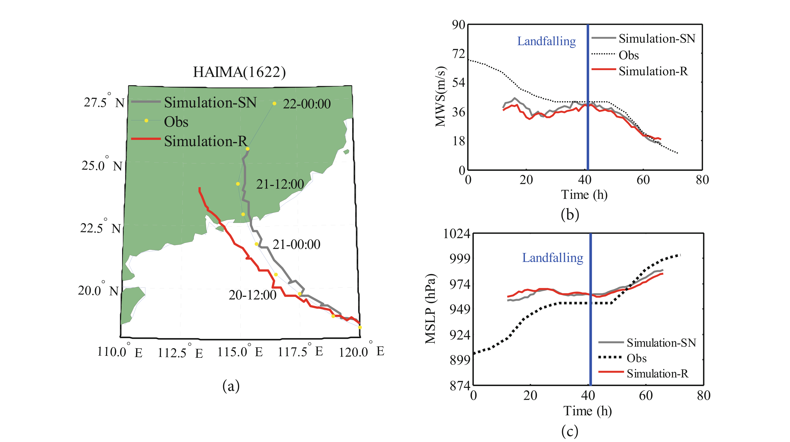

   **图 3** 台风“海马”的模拟强度和路径。（a）以 6 h 间隔采样的移动路径，观测路径为 CMA 最佳路径；（b）10 m 高度最大风速（MWS，m/s）；（c）最低海平面气压（MSLP，hPa）。横轴起始时刻为 2016 年 10 月 19 日 24:00 UTC。SN 表示 WRF 模拟中采用谱逼近，R 表示未采用同化的 WRF 参考结果。

   图中标注：台风“海马”（1622）；采用谱逼近的模拟；观测；未同化参考模拟；登陆；最大风速（m/s）；最低海平面气压（hPa）；时间（h）。

除图3中的常用气象指标外，图4还以激光雷达观测验证模拟台风风剖面，并结合MWS、MSLP评价真实台风结构。虽然强降雨带引起的观测尖峰已被剔除，激光雷达仍清楚记录了前侧眼墙、台风眼及后侧眼墙。台风中心经过时，气象背景使风向发生接近180°的转变；风攻角突变和强度非定常变化，使量化密集建成区风扰及高风险位置变得困难。图3中的模拟路径波动，也会通过台风结构影响PBL风预测误差。采用SN方法提高路径精度，有助于获得更准确的风剖面，见图4(e)、(f)。尽管SN结果总体得到较好评价，在0.11 km以上仍可看到风强度高估；这表明，与粗分辨率中尺度结果嵌套时，CFD区域仍需修正。

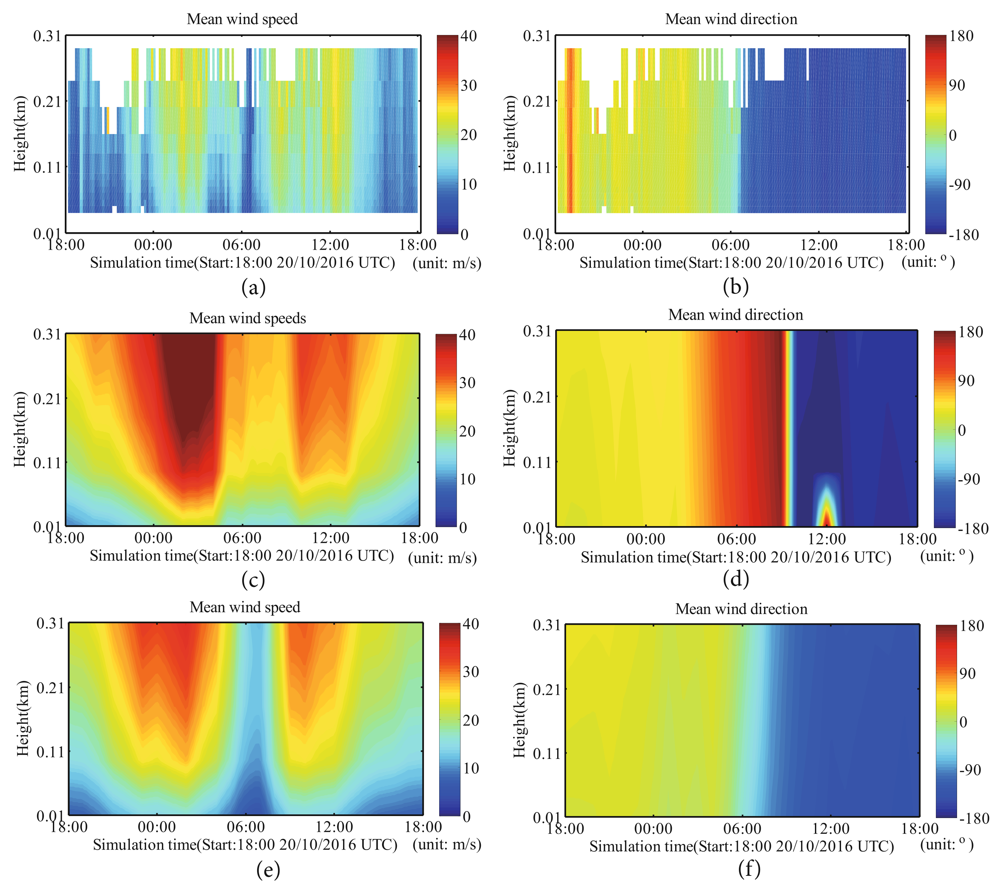

   **图 4** 台风登陆位置附近近地风剖面的验证：（a）、（b）为 LiDAR 观测；（c）、（d）为未采用谱逼近的 WRF 重现台风风场；（e）、（f）为采用谱逼近的 WRF 结果。数据按 10 min 间隔取平均。

   图中标注：平均风速；平均风向；高度（km）；模拟时间（起点为 2016 年 10 月 20 日 18:00 UTC）；单位：m/s；单位：°；（a）、（b）观测；（c）、（d）无谱逼近；（e）、（f）有谱逼近。

3 CFD数值方法
------------------

3.1 单向降尺度框架
----------------------

NWP与CFD采用不同湍流模型，网格所解析的流动也不同，实现单向嵌套因而具有挑战性（Castro et al. 2015; Sanz Rodrigo et al. 2017）。除空间分辨率外，中尺度PBL参数化与微尺度双方程RANS模型使用不同湍流闭合（Zhao et al. 2021a）。例如，NWP的Mellor–Yamada–Janjic（MYJ）PBL方案将经验长度尺度设为随高度变化，耗散率由含能涡确定（Kantha 2004）；CFD湍流黏性模型则独立求解湍动能与耗散。此外，以往一些CFD研究未考虑热效应与科里奥利力（Castro et al. 2003; Li and Chan 2012; Pieterse and Harms 2013; Conan et al. 2016），近地层模拟忽略Ekman螺旋，风向也不随高度改变。图5对嵌套流程作专门安排，将粗分辨率NWP模型到真实风工程应用分为三个阶段。

阶段I利用全球再分析资料，在WRF中再现真实台风天气。通过nudging同化，WRF动力求解器先修正粗分辨率时变风分量、湍流标量与位温；嵌套界面附近的结果随后构成微尺度入口所用风场库。阶段II利用第3.4节提出的修正方法，将局地观测引入预先计算的风剖面，再取时间平均，为稳态CFD求解器设置侧边界。为减小阶段I与II的空间分辨率差异，采用反距离加权插值补充CFD侧边界所需数据；同时修正CFD湍流闭合，避免湍流黏性和网格尺度不一致，以在精细区域较好维持中尺度湍流入口（Zhao et al. 2021a）。热效应和科里奥利力作为源项进入CFD控制方程，具体设置见第3.2节。阶段III在微尺度域内再现台风风剖面等真实气象现象，服务工程应用；利用地理信息系统（GIS）提取建筑细节，更便利地建立城市CFD区域与离散网格。

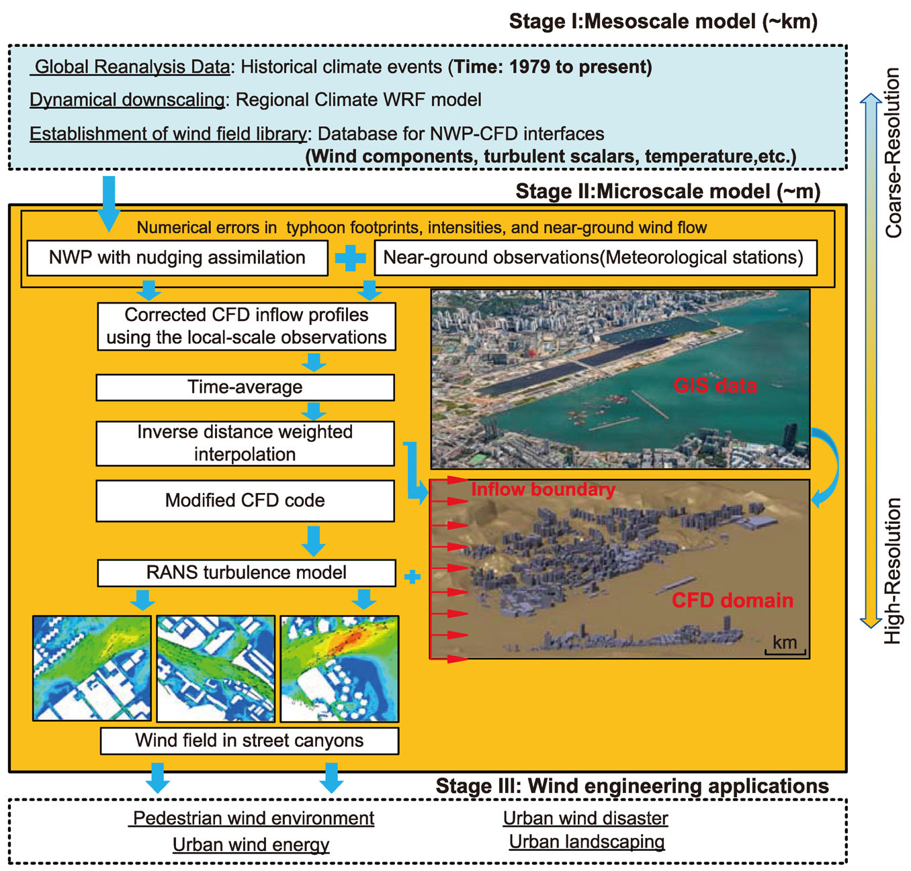

   **图 5** 从中尺度数值天气预报（NWP）到城市风环境高分辨率 CFD 计算域的单向嵌套框架示意图。

   图中标注：第一阶段：中尺度模型（约 km 尺度）；第二阶段：微尺度模型（约 m 尺度）；第三阶段：风工程应用；采用逼近同化的数值天气预报；近地面观测（气象站）；利用局地尺度观测修正 CFD 入流剖面；时间平均；反距离加权插值；修改后的 CFD 程序；雷诺平均 Navier–Stokes 湍流模型；街谷风场；行人风环境；城市风灾；城市风能；城市景观设计。

.. note::

   这是NWP向CFD传递边界的一向嵌套，不是CFD反向影响天气模式的双向耦合。微尺度采用分时段平均边界下的稳态RANS，不能据此宣称已经解析完整非定常街区湍流或瞬时阵风荷载。

3.2 适用于气象条件的程序修正
--------------------------------

真实气象条件下，中性分层PBL并不常见。即使登陆台风风强度较高，依据观测Monin–Obukhov长度分类，眼墙或外围涡旋附近仍可能出现弱稳定、稳定分层（Li et al. 2012a; Li et al. 2019a）。因此，微尺度CFD在具有热分层的PBL条件下模拟湍流，包含能量、动量和连续性方程。采用不可压缩稳态RANS求解器，通过Boussinesq近似计算重力作用（Alinot and Masson 2005），仅在重力项中令密度 :math:`\rho` 随气温线性变化。在Fluent标准 :math:`k\text{-}\omega` 模型中作相应修正，以处理热分层湍流。重力形成静水压力场（Pieterse and Harms 2013）；旋转科里奥利力则使风向随高度变化。动量方程中的体积源项 :math:`S_m` 合并重力与科里奥利力 :math:`F_{ci}`：

.. math::

   S_{\mathrm{m}}=\rho g_i+F_{ci} \qquad (1)

其中， :math:`\rho` 为流体密度， :math:`g` 为重力加速度。原文将 :math:`F_{ci}` 定义为科里奥利参数 :math:`f` 与水平风分量的乘积，写作 :math:`F_{c1}=fu`、 :math:`F_{c2}=-fv`。根据研究位置经纬度，取 :math:`f=10^{-4}\,\mathrm{s^{-1}}`。

.. note::

   上述科里奥利分量按原文逐字保留。它与常见水平分量交叉耦合记法不同；复现时应核实坐标、分量定义与程序实现，本页不擅自换成另一组公式。

微尺度区域中，以位温 :math:`\theta` 重新表述温度标量 :math:`T`。位温具有沿高度保持守恒的便利性质，可用于CFD中的热分层大气边界层模拟（Pieterse and Harms 2013; El-Askary et al. 2017）：

.. math::

   \theta=T\left(\frac{P_0}{P}\right)^{0.286} \qquad (2)

其中， :math:`P_0` 是地面参考压力。

根据静水方程，压力梯度可由空气密度与重力加速度表述。利用理想气体状态方程，并对式(2)两侧求偏导，得到：

.. math::

   \frac{\partial\theta}{\partial z}=\frac{\theta}{T}\left(\frac{\partial T}{\partial z}+\Gamma\right)\cong\frac{\partial T}{\partial z}+\Gamma \qquad (3)

其中，干绝热递减率 :math:`\Gamma=g_i/c_p`，空气比热 :math:`c_p=1.003\,\mathrm{kJ/(kg\cdot K)}`。

以 :math:`\theta` 为诊断变量，在能量方程中加入修正源项。修正热源 :math:`S_e` 写为（Alinot and Masson 2005; Pieterse and Harms 2013）：

.. math::

   S_{\mathrm{e}}=-\nabla\cdot\left(\frac{\mu_{\mathrm{t}}}{\sigma_{\mathrm{T}}}g_i\right) \qquad (4)

其中， :math:`\mu_t` 是动力涡黏度， :math:`\sigma_T` 是湍流Prandtl数。

CFD求解器采用标准 :math:`k\text{-}\omega` 湍流模型（Wilcox 1988），以较小的数值伪影敏感性预测湍流（Sogachev et al. 2012）。在钝体近壁区， :math:`\omega` 输运方程中的不敏感壁面处理结合黏性底层与对数层，表现稳健、准确，能够为分离流计算提供可靠结果（Hu et al. 2013）。热状态的影响通过PBL内浮力及风切变考虑。浮力引起的湍动能生成由式(5)计算，并加入 :math:`k` 输运方程。 :math:`G_b>0` 促进湍流生成，对应不稳定PBL； :math:`G_b<0` 则在稳定PBL中削弱湍流。由于相应流动性质对热分层不敏感，浮力影响未加入 :math:`\omega` 输运方程（Peng and Davidson 1999; Pieterse and Harms 2013）：

.. math::

   G_{\mathrm{b}}=\beta g_i\frac{\mu_{\mathrm{t}}}{\sigma_{\mathrm{T}}}\left(\frac{\partial\theta}{\partial x_i}-\frac{g_i}{c_{\mathrm{p}}}\right) \qquad (5)

其中， :math:`\beta` 是体积热膨胀变量。

为区分NWP参数化与CFD湍流求解器计算的湍流输运量，下文以下标mm表示中尺度、ms表示微尺度。CFD湍流黏性模型在线性涡黏性假设下计算雷诺应力，其 :math:`\mu_t^{\mathrm{ms}}` 与长度尺度 :math:`L_{\mathrm{ms}}`、速度尺度 :math:`U_{\mathrm{ms}}` 成正比：

.. math::

   \mu_{\mathrm{t}}^{\mathrm{ms}}=\rho C_{\mu}L_{\mathrm{ms}}U_{\mathrm{ms}} \qquad (6)

在CFD双方程模型中， :math:`L_{\mathrm{ms}}=k^{3/2}/\varepsilon=k^{1/2}/(\omega C_\mu)`， :math:`U_{\mathrm{ms}}=k^{1/2}`。中尺度1.5阶MYJ方案（Janjić 1994）的长度尺度由代数关系确定，与离地距离成正比；式(7)的耗散率 :math:`\varepsilon` 根据含能涡性质计算，因此与 :math:`U_{\mathrm{mm}}^3/L_{\mathrm{mm}}` 成正比，速度尺度为 :math:`U_{\mathrm{mm}}=(2k)^{1/2}`。动力涡黏度随后由式(8)给出：

.. math::

   \varepsilon=\frac{U_{\mathrm{mm}}^3}{B_1L_{\mathrm{mm}}} \qquad (7)

.. math::

   \mu_{\mathrm{t}}^{\mathrm{mm}}=\rho S_{\mathrm{m}}L_{\mathrm{mm}}U_{\mathrm{mm}} \qquad (8)

其中， :math:`\langle S_m,B_1\rangle=\langle0.51,11.8\rangle` 为MYJ PBL方案的两个经验常数。

.. note::

   这里的经验常数S_m与式(1)体积源项S_m同形，按原文分别解释，不能当作同一个物理量。

单向嵌套中，CFD侧边界的湍流标量由中尺度PBL参数化维持。由于指定湍流剖面已经在中尺度模型内收敛，CFD求解器需要修正湍流闭合。中尺度PBL演变计算已经考虑陆气系统、微物理等复杂动量输运过程，因此采用一致涡黏性条件 :math:`\mu_t^{\mathrm{ms}}=\mu_t^{\mathrm{mm}}` 进行修正（Zhao et al. 2021a）。式(9)据此修改标准模型常数，使CFD的 :math:`C_\mu=0.1729`；标准 :math:`k\text{-}\omega` 求解器中其他闭合常数，如 :math:`\langle C_{\omega1},C_{\omega2}\rangle`，也相应更新。结合Sogachev et al. (2012)的讨论，最终采用 :math:`\langle C_\mu,C_{\omega1},C_{\omega2},\sigma_k,\sigma_\omega\rangle=\langle0.1729,0.52,0.82,1.374,1.374\rangle`：

.. math::

   C_{\mu}=4S_{\mathrm{m}}/B_1 \qquad (9)

3.3 计算区域与入口边界
--------------------------

CFD区域位于中国香港九龙城区，沿水平 :math:`x`、 :math:`y` 和垂直 :math:`z` 的尺寸分别为3.3 km×3.5 km×1.2 km。根据既有敏感性分析（Li et al. 2017），建筑表面目标网格间距为2–5 m、增长率1.2，远场地形表面网格尺寸为2–100 m、增长率1.25。这种分辨率使建筑截面具有多于4–6条网格线，网格尺寸小于建筑尺度的十分之一（Tseng et al. 2006; Tominaga et al. 2008）。区域内部采用多面体网格，几何增长率1.25，最大单元边长132 m。沿垂向，在距壁1.75 m以内设置5层棱柱或层状单元，首层高度0.23 m，以满足Franke and Baklanov (2007)针对建筑及地表附近的指南。入口近地垂向网格进一步加密，以捕捉PBL风剖面。总网格数为320万，最大偏斜度0.76，全部设置通过Fluent meshing实现。

基于压力的求解器采用SIMPLEC压力—速度耦合，由连续性方程修正压力场。地面和建筑表面均为无滑移条件。按第3.4节同化方法，将中尺度模拟与近地观测结合建立风场库。与正常风况相比，台风期间风向更不稳定，使微尺度入口类型的指定更困难。首先对各侧边界采样的主风向分类，确定占主导地位的风攻角，再依据上游风特征，将水平入口条件划分为图6(e)–(h)的四种类型。每种情形均通过反距离加权插值，由上游WRF结果指定CFD入口侧边界风分量、位温及湍流标量的Dirichlet条件（Zhao et al. 2021a）。下游采用零梯度条件，保留上游流动变量；顶部设为对称边界，以保证解适定，计算中未观察到反向流。科里奥利力或Ekman螺旋引起的垂向风向变化，没有造成求解发散。

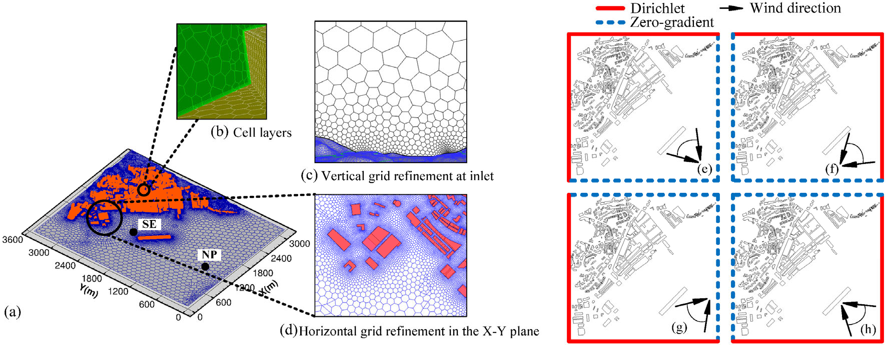

   **图 6** （a）CFD 计算域中的空间网格分布，红色几何体表示关注区域的建筑物；（b）在建筑表面及地面附近添加的网格层；（c）为捕捉行星边界层（PBL）风剖面而在入口实施的竖向网格加密；（d）计算域内部填充区域细化网格的生成；（e）—（h）不同风向下四个侧边界的处理。

   图中标注：网格层；入口竖向网格加密；X–Y 平面水平网格加密；狄利克雷边界；零梯度边界；风向；完整保留空间网格、壁面层、入口及内部加密和四种侧边界处理的八个分图。

3.4 用于CFD模型的同化方法
--------------------------------

根据台风中心的代表性测量，登陆过程中PBL平均风速随时间常呈M形变化。该双峰分布由一个低风速区与两个峰组成，分别反映台风眼、眼墙的空间结构（Li et al. 2015; Song et al. 2016）；台风外围涡旋区域则呈单峰分布。既有研究利用这种变化趋势评估近地风预测精度，模拟趋势与测量一致时，表明模拟较好（Huang et al. 2018; Chen et al. 2020）。但CFD的关键不确定输入仍可能来自不完善的NWP物理参数化，例如边界层过程、微物理及再分析初始化，它们会使台风空间结构预测产生误差。中尺度嵌套条件下，将CFD域内局地观测纳入同化，是提高数值精度的一项有益尝试。

风速信号趋势表示随时间变化的平均特征。依据上述台风近地平均风特征，微尺度区域开阔暴露位置的非平稳观测，可以反映相同气象背景。相对于1 s间隔高频观测，NWP的10 min输出在描述这些变化时具有较粗时间分辨率。首先考察NWP风场与测量之间的差异，并利用稳健的经验模态分解（EMD）方法（Huang et al. 1998; Xu and Chen 2004），在指定任意时间间隔 :math:`\Delta t` 内提取观测时变平均风速。原文表述为：EMD将风信号分解为若干具有最低频率的本征模态函数（IMF），并结合残差或最低频率的信号趋势；下文具体例子采用最后IMF作为趋势。风信号趋势的物理意义，是时间间隔 :math:`\Delta t` 内的平均风速。只有当周围建筑和近地地形未显著影响传感器观测时，才可将这种变化视为微尺度区域附近气象背景的影响。EMD按以下步骤实现。

- 在风速序列中识别时变风速 :math:`U(t)` 的极值，利用三次样条沿极值生成上、下包络线。
- 计算包络的平均风速 :math:`\overline{U}_m(t)`，以及差值 :math:`U_d(t)=U(t)-\overline{U}_m(t)`。当 :math:`U_d(t)` 满足两个条件时，确定 :math:`\Delta t` 内第一个IMF :math:`C_1`：局部最大值、最小值形成的包络均值为零；局部极值点数和过零点数“低于±1”（原文如此）。若不满足，以 :math:`U_d(t)` 替代 :math:`\overline{U}_m(t)`，重复搜索直到确定 :math:`C_1`。
- 下一轮搜索 :math:`C_2,\ldots,C_n` 时，以 :math:`C_1` 替代 :math:`\overline{U}_m(t)`，重复 :math:`U_d(t)` 的计算。当最后一个IMF或残差 :math:`C_r` 为单调函数时，停止上述筛分。

.. note::

   以上保留原文对EMD筛分变量替换和频率的叙述。源文在第二个条件中没有明确写出极值点数与过零点数“之差”，本页不将这一含混措辞静默改成另一个判据，也不补造筛分停止阈值或程序；IMF频带与残差的实际处理，应结合原始实现核验。

为量化中尺度模拟误差，可求得斜率 :math:`K_c`：

.. math::

   K_{\mathrm{c}}(t)=\left|\frac{C_{\mathrm{r}}(t)-C_{\mathrm{r}}^{\mathrm{WRF}}(t)}{\Delta t}\right| \qquad (10)

其中， :math:`C_r(t)`、 :math:`C_r^{\mathrm{WRF}}(t)` 分别为时间间隔 :math:`\Delta t` 末端的观测残差和中尺度模拟残差，单位m/s； :math:`\Delta t` 的单位为s。

观测位置在时刻 :math:`t` 的修正项可写为：

.. math::

   U_{\mathrm{c}}(t)=\operatorname{sgn}\left(C_{\mathrm{r}}(t)-C_{\mathrm{r}}^{\mathrm{WRF}}(t)\right)\times K_{\mathrm{c}}(t)\times t \qquad (11)

修正项 :math:`U_c(t)` 表示观测与NWP模拟风速趋势的差异，单位m/s。将同化项 :math:`U_c(t)` 从观测位置相同离地高度（AGL）向CFD侧边界外推，量化其影响并消除中尺度模型产生的模拟误差。空间相关系数 :math:`r_c` 用来描述指定观测高度与CFD侧边界不同高度风分量之间的关系：

.. math::

   r_{\mathrm{c}}(d)=\frac{\displaystyle\sum_{i=1}^{N}\left(\left(U_i^{\mathrm{p}}-\overline{U}^{\mathrm{p}}\right)\left(U_i^{\mathrm{c}}-\overline{U}^{\mathrm{c}}\right)\right)}{\displaystyle\sqrt{\sum_{i=1}^{N}\left(U_i^{\mathrm{p}}-\overline{U}^{\mathrm{p}}\right)^2}\sqrt{\sum_{i=1}^{N}\left(U_i^{\mathrm{c}}-\overline{U}^{\mathrm{c}}\right)^2}} \qquad (12)

其中， :math:`N` 为采样数， :math:`U_i^p` 和 :math:`U_i^c` 分别是CFD侧边界附近和测量位置的NWP模拟风速； :math:`d` 为这两个位置之间的直线距离。

.. note::

   符号表将U_i^c列为测得风速，而式(12)后的正文称两者均为相应位置的NWP模拟风速。本页分别保留这两处定义，不自行统一相关系数实际使用的数据来源。式(13)前原文把U_c(t)称为“观测”，但式(11)定义的是趋势修正项，计算含义应按两处关系核验，不能直接用原始观测风速替代修正量。式(10)的商外有绝对值，式(11)是sgn(C_r−C_r^WRF)乘K_c再乘t；不能按文本抽取中被打乱的次序转写。

使用式(13)的趋势同化修正风速。由NWP结果 :math:`U_p(t,h)` 与观测修正项 :math:`U_c(t)` 预先计算 :math:`U_{cp}(t,h,d)`，再从该时变风场库提取稳态CFD侧边界：

.. math::

   U_{\mathrm{cp}}(t,h,d)=U_{\mathrm{p}}(t,h)+U_{\mathrm{c}}(t)\times r_{\mathrm{c}}(d) \qquad (13)

其中， :math:`h` 为离地高度。

图7以一段3600 s风速样本展示上述同化流程。该非平稳数据集被分解为9个IMF，图7(a)–(c)比较最后三个分量IMF7–IMF9，将残差IMF9视为平均趋势。该验证表明，EMD能够提取真实的风强度下降趋势。残差受到气象因素影响，但无需预先给定相关信息即可求得。图7(d)展示这一时段观测与WRF之间的预测误差；指定 :math:`\Delta t` 后，按式(10)由趋势差异求得 :math:`K_c(t)`。取 :math:`\Delta t=600\,\mathrm{s}`，利用 :math:`C_r` 和 :math:`C_r^{\mathrm{WRF}}`，在 :math:`t=600,1200,1800,\ldots,3600\,\mathrm{s}` 各时间节点末端按式(11)计算 :math:`U_c(t)`。低估风强度、即 :math:`C_r>C_r^{\mathrm{WRF}}` 时，符号函数使修正项为正。式(13)再乘以已建立的 :math:`r_c(d)`，在各 :math:`\Delta t` 末端形成 :math:`U_{cp}`，减小估计误差。该方法通过修正侧边界，将局地观测引入CFD，但不在域内作特殊处理。与将误差nudging项加入动量输运方程的Newtonian relaxation方法（Zajaczkowski et al. 2011）不同，作者指出本方法结果不受nudging强度、空间衰减等不确定参数影响。

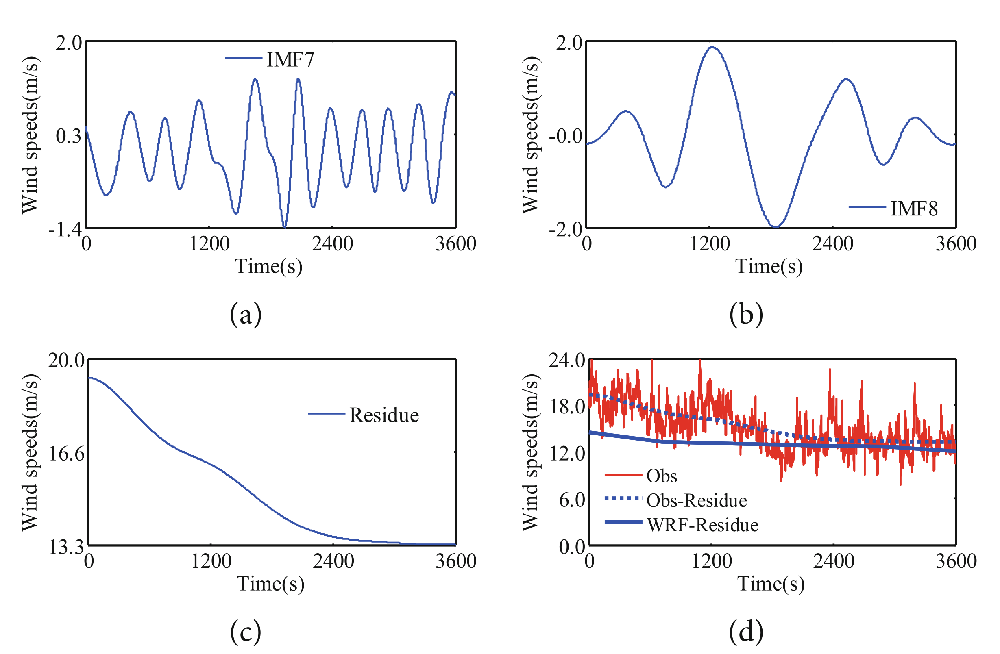

   **图 7** （a）—（c）采用经验模态分解（EMD）得到的最后三个本征模态函数（IMF）项，其中余项等于 IMF9；（d）时变风速与提取出的余项（趋势）的比较。

   图中标注：第 7、第 8 个本征模态函数；余项；观测；观测余项；WRF 余项；风速（m/s）；时间（s）。

.. note::

   “不受上述参数影响”针对未使用的域内nudging系数，不代表整个同化方法无假设、无参数或不受观测误差影响。时间节点t与Δt的数值用法按原文保留，不在此补造滚动窗口、滤波器或在线算法。

虽然在精细CFD域内再现瞬态气象影响有价值，但嵌套模拟增加的计算成本不能忽略，复杂建筑几何会使网格数显著增长。本文用CFD稳态求解器再现时变台风强度影响下的城市风环境，并利用预先建立的入口剖面更新侧边界；所关注变量是建筑通风的风路与风强度。预先修正CFD边界风剖面，可提高计算效率。

4 数值结果验证
----------------

4.1 WRF热分层分类
------------------------

根据Monin–Obukhov（M–O）长度，按表1对CFD区域大气稳定度分类，结果见图8(a)（Holtslag et al. 2014）。WRF下垫面给出的这一变量反映PBL底部的浮力作用。原文称2016年10月20日约06:00 UTC中性条件较多，对应图8(b)中的较高风速；台风外围涡旋前、后部则出现稳定和极稳定条件，原文将其时间序列位置指向图5。这些稳定条件强烈影响高层结构疲劳荷载计算中的风切变预测（Holtslag et al. 2014）与湍动能分布（Li et al. 2012a）。图8(d)地表温度分布通常被解释为：海马经过时，温度标量只有轻微变化，未出现明显地表加热或冷却。图8(c)还捕捉到风向突变，24 h内变化接近180°，影响时变入口、出口的确定。既有分类将风速高于5 m/s与弱不稳定或中性大气联系起来（Mohan and Siddiqui 1998），本文按稳定度和风速统计的模拟样本显示了这一判断的不足。图8(b)采用行人风舒适度分类（Janssen et al. 2013），大于10 m/s表示室外舒适度较差或存在危险。

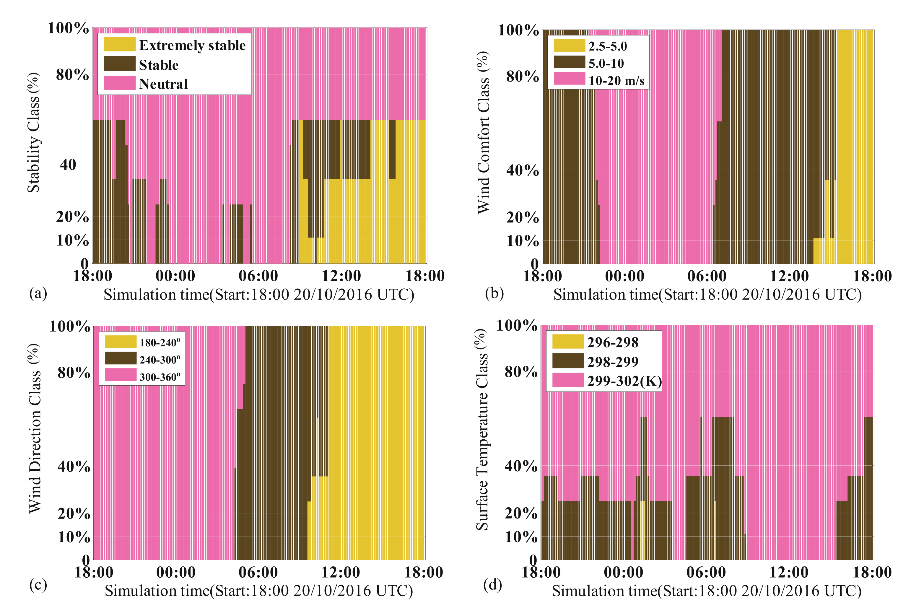

   **图 8** 2016 年 10 月 20 日 18:00 UTC 至 10 月 21 日 18:00 UTC 期间的 PBL 稳定度、风舒适度、风向和地表位温分类。纵轴表示以 1 h 间隔采样得到的各类别频率。

   图中标注：稳定度类别频率（%）；极稳定；稳定；中性；风舒适度类别频率（%）；风速分级：2.5—5.0、5.0—10、10—20 m/s；风向类别频率（%）；风向分级：180°—240°、240°—300°、300°—360°；地表温度类别频率（%）；原图轴标题保留，图题使用地表位温；温度分级：296—298、298—299、299—302 K。

.. list-table:: 表 1 根据 Monin–Obukhov（M-O）长度划分的 PBL 稳定性类别
   :header-rows: 1

   * - M-O 长度（m）
     - 稳定性条件
   * - :math:`|L| > 500`
     - 中性
   * - :math:`0 < L \le 200`
     - 极稳定
   * - :math:`200 < L \le 500`
     - 稳定
   * - :math:`-200 \le L < 0`
     - 极不稳定
   * - :math:`-500 \le L < -200`
     - 不稳定

.. note::

   图8(d)坐标写“地表温度”，图注写“地表位温”，两处原文表述不完全相同，分别保留。本段时间与图号按来源保留：正文为06:00 20/10/2016，图8标题时窗则为18:00 20/10/2016至18:00 21/10/2016；图5是嵌套框架图，不是这里所述稳定度时间统计图。上述源内时间／交叉引用不一致尚未由作者代码或原始数据核实，不能擅自补正成某一天某一时刻。

4.2 CFD边界同化后的风速
------------------------------

利用NP观测，按第3.4节方法修正CFD入口边界。图9给出两段各1800 s样本中，观测与WRF风速残差的差异。高估趋势表明，WRF再现的气象背景在当前嵌套计算中仍存在预测不足。图10、11以西、南侧边界风速分布展示CFD模拟所用边界；台风气象背景下PBL并不均匀，水平方向存在局地增强、减弱等空间梯度波动。近地层以下，图10(a)、(b)高估风速经修正成为图10(c)、(d)，150 m以上仍保持较高风强度。同化强度随高度改变，由式(12)空间相关系数决定；高层风速与低处指定观测高度之间的联系较弱。这些比较表明，本文方法在修正同时保留了WRF所确定PBL风特征的空间趋势。经典Newtonian relaxation同化常采用Cressman型权重（Zajaczkowski et al. 2011），以径向衰减形式表示观测影响；这种通过经验关系修正CFD局部风场的方法，与本文不使用这些经验系数、直接修改侧边界的趋势同化不同。

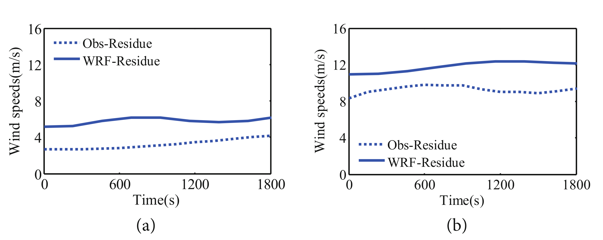

   **图 9** 在（a）、（b）两个时间区间内，NP 观测与对应 WRF 结果的时变余项。

   图中标注：观测余项；WRF 余项；风速（m/s）；时间（s）；两个不同的 1800 s 时间区间。

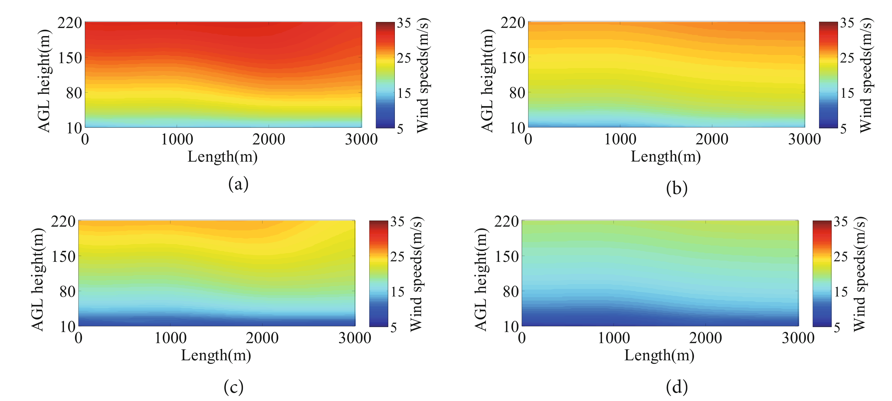

   **图 10** CFD 侧边界插值得到的近地风速：（a）、（b）分别为未采用趋势同化时的西侧和南侧边界；（c）、（d）分别为采用所提出趋势同化后的西侧和南侧边界。所选时间区间见图 9（a）。

   图中标注：离地高度（m）；边界长度（m）；风速（m/s）；（a）西侧未同化；（b）南侧未同化；（c）西侧同化后；（d）南侧同化后。

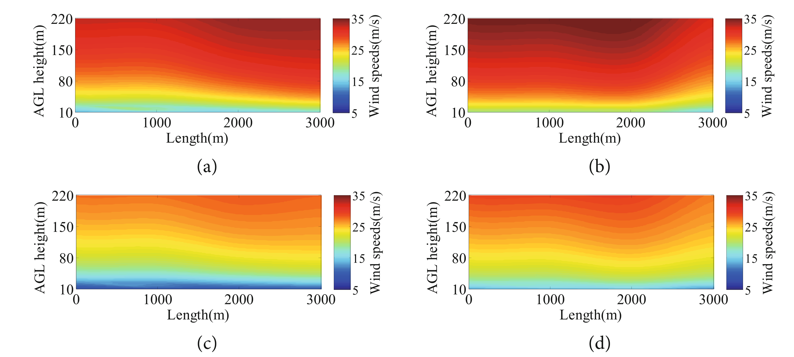

   **图 11** CFD 侧边界插值得到的近地风速：（a）、（b）分别为未采用趋势同化时的西侧和南侧边界；（c）、（d）分别为采用所提出趋势同化后的西侧和南侧边界。所选时间区间见图 9（b）。

   图中标注：离地高度（m）；边界长度（m）；风速（m/s）；（a）西侧未同化；（b）南侧未同化；（c）西侧同化后；（d）南侧同化后。

4.3 平均风特征的改善
------------------------

采用固定SE站观测进行验证，其位置在图2(b)所示CFD中心区域。近旁海面使该站在南侧来风时属于开阔暴露环境，而北侧来风对应城市下垫面。图12比较21 h再现风速，每点为30 min平均值。图12(a)、(c)中，大多数风速分布在4–12 m/s之间，原文将其分别与漫步、快速行走的风舒适度准则联系（Isyumov and Davenport 1975; Lawson 1978）。用散点图检验CFD与观测的相对误差，并通过最小二乘拟合线性趋势。即使中尺度模型较好再现“海马”路径和强度（图3），未同化结果的散点分布仍较差。考虑原文所列CFD域距登陆点96 km，部分误差来自中尺度模拟的台风外围涡旋区域。图12(a)、(b)显示，拟合线斜率由0.250变为0.835，风速变化趋势得到改善。对多数风向，未同化算例相对差异分布在±30%范围；修正CFD边界风分量后，改善到±10%。

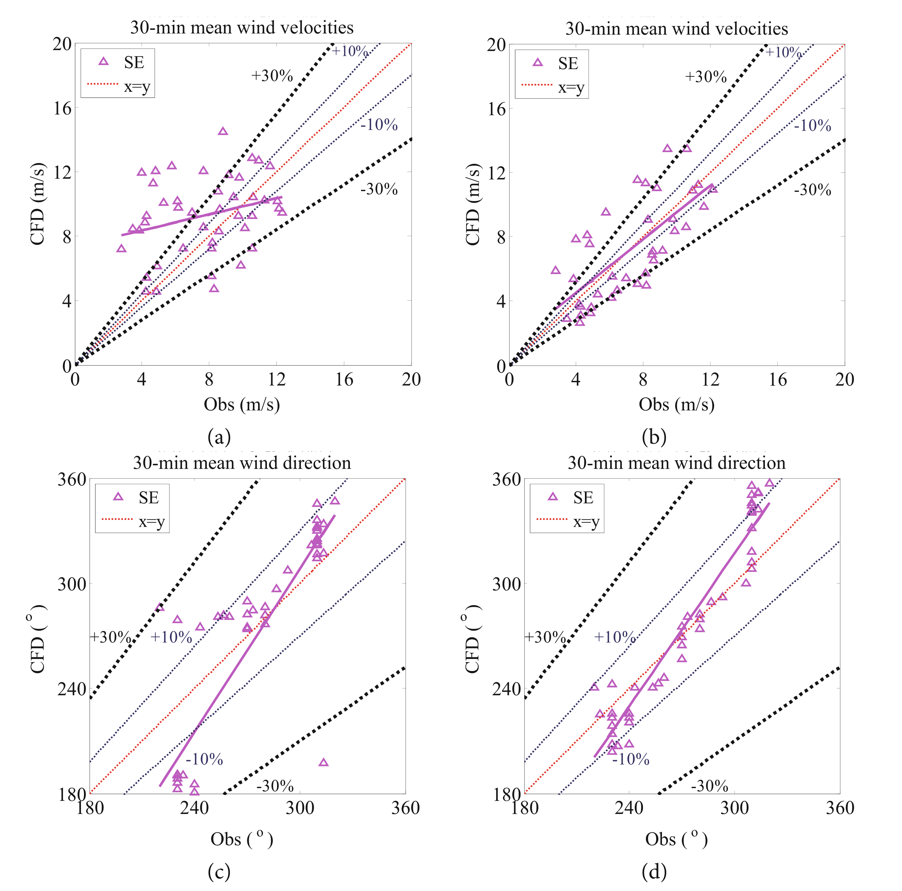

   **图 12** 台风“海马”登陆期间 CFD 模拟与 SE 观测的验证。左列：（a）、（c）为未进行数据同化时的平均风速和局地风向；180°—360° 风攻角表示入流风向从南侧逆时针转至北侧。右列：（b）、（d）为采用所提出趋势同化后的数值结果。深蓝色和深色虚线表示 CFD 与观测之间 ±10% 和 ±30% 相对误差界限。

   图中标注：30 min 平均风速；30 min 平均风向；CFD 模拟；观测；SE 站点；模拟值等于观测值；±10% 和 ±30% 相对误差界限。

.. note::

   图12图注中的“逆时针”按原文保留；图16另用N=0°、E=90°、S=180°、W=270°的罗盘角标注，两者观察方向或角度定义的对应关系需核实，不能据此自行重建风向转换算法。

使用一致性指数（IOA）和平均绝对误差（MAE）量化图12散点结果。原文将IOA解释为均方误差与潜在误差的比值，对极值敏感；同时指出IOA=1代表模拟与观测完全吻合。MAE衡量同一尺度上的平均绝对差异，强调平均趋势。表2汇总两项指标：风速、风向IOA分别由0.28、0.80提高至0.72、0.96，相对变化为157%、20%；MAE分别由5.46 m/s、9.8°降至1.89 m/s、4.6°，相对变化幅度为65%、53%。这些结果表明，在本次台风条件下将局地观测引入CFD，可以提高数值精度，为应对不确定入口条件提供了有意义的步骤。

.. list-table:: 表 2 30 min 平均风速和风向统计指标的比较
   :header-rows: 1

   * - 指标
     - 原始结果（Ori）：风速
     - 原始结果（Ori）：风向
     - 数据同化后（DA）：风速
     - 数据同化后（DA）：风向
     - 绝对相对变化：风速
     - 绝对相对变化：风向
   * - IOA
     - 0.28
     - 0.80
     - 0.72
     - 0.96
     - 157%
     - 20%
   * - MAE
     - 5.46 m/s
     - 9.8°
     - 1.89 m/s
     - 4.6°
     - 65%
     - 53%

.. note::

   表2的绝对相对变化计算式为 :math:`\left|\frac{DA-Ori}{Ori}\right|\times100\%`，WS表示风速，WD表示风向。

.. note::

   上述指标来自海马案例SE站21 h样本、30 min平均风速／风向比较，NP站用于修正，SE站用于验证；不能将其写成任意台风、全城每点或瞬时阵风均获得同样改善。表2相对变化式含绝对值，MAE的65%／53%是下降幅度。原文未在这里完整给出IOA计算公式，本文保留其解释与“1为完全吻合”约定，不据此反推或补造计算实现。其“均方误差与潜在误差之比”的文字定义与完全匹配取1的约定之间存在省略或不一致，不能直接按这一裸比值实现；复现时须核实实际指标公式。

4.4 行人风环境评估
----------------------

PBL内湍流显著受到地形和密集建成区等复杂几何影响。街道高度会形成涡旋、通道流及下洗，角部还存在风速加速，从而影响1.75 m行人高度的风舒适度和风危险。本文进一步评估SE站周边街谷以量化这些作用。图13给出建筑与地形高度，北侧海拔接近100–120 m，反映复杂地形起伏。选取东头村道（P1，Tung Tau Road）、宋皇台（P2，Sung Wong Toi）、观塘（P3，Kwun Tong）和观塘绕道（P4，Kwun Tong Bypass）四个位置，比较街谷局地风场。表3列出按小时划分的风况。受台风外围涡旋影响，原文将NC1–NC4入口变化概括为由西北转向西南，平均风速范围为3.7–11.9 m/s。

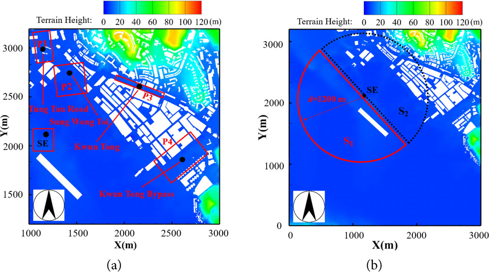

   **图 13** 中国香港九龙湾地形高度与建筑物概况。（a）P1—P4 为关注的四条城市街道位置；（b）以 SE 站点为中心、距离不超过 1200 m 的两个半圆区域 S1 和 S2，用于第 4.5 节的观测代表性计算。

   图中标注：地形高度；四处街道位置 P1、P2、P3、P4；两个代表性计算区域 S1、S2；半径 d=1200 m；SE 站点；水平坐标 X、Y（m）。

.. list-table:: 表 3 不同风强度和入流方向下的数值设置汇总
   :header-rows: 1

   * - 算例
     - 时间段
     - 入流风向
     - SE 站风速（m/s）
   * - NC1
     - 2016-10-20 23:00–24:00（UTC）
     - 北
     - 8.1
   * - NC2
     - 2016-10-21 06:00–07:00（UTC）
     - 西北
     - 11.9
   * - NC3
     - 2016-10-21 13:00–14:00（UTC）
     - 西南
     - 5.3
   * - NC4
     - 2016-10-21 15:00–16:00（UTC）
     - 西南
     - 3.7

.. note::

   表3对NC1明确列“北风”，NC2为“西北风”，NC3与NC4为“西南风”；保留这些逐工况值，不用正文概括的“西北到西南”覆盖NC1。

评价建筑周边行人风舒适度和危险，需要风环境准则。多数准则将风速阈值与最大允许超越概率结合，区分行人活动类别。Janssen et al. (2013)比较Isyumov and Davenport (1975)、Lawson (1978)、Melbourne (1978)及NEN 8100 (2006)后，得到并不一致的结论：危险类别风速阈值从15 m/s到23 m/s不等，相应允许超越时长从每年0.85 h（0.01%）到1.9 h（0.022%）。图14、15比较1.75 m AGL高度风速分布。尽管建筑与地形复杂，四个小时工况的建筑上、下游平均风场仍得到较好捕捉。NC1与NC2中SE站平均风速均低于12 m/s，但Y=3000 m附近出现多处高于15 m/s的区域。强风下的流动形态显示，复杂地形是造成风速放大和风扰问题区的重要因素。平顺流线的比较也为观测通过中尺度—微尺度界面同化的可行性提供初步证据，未在CFD域内产生明显不合理扰动。

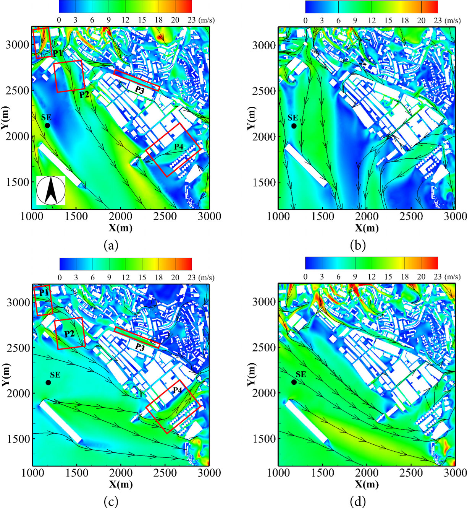

   **图 14** 密集建筑群中行人高度的风速等值分布及流动路径。左列：（a）、（c）分别为未进行同化修正的 NC1、NC2 工况；右列：（b）、（d）分别为进行同化修正后的 NC1、NC2 工况。

   图中标注：NC1、NC2 工况；水平坐标 X、Y（m）；风速单位 m/s；（a）、（c）未同化；（b）、（d）同化修正后，保留各分图完整色标和流动路径。

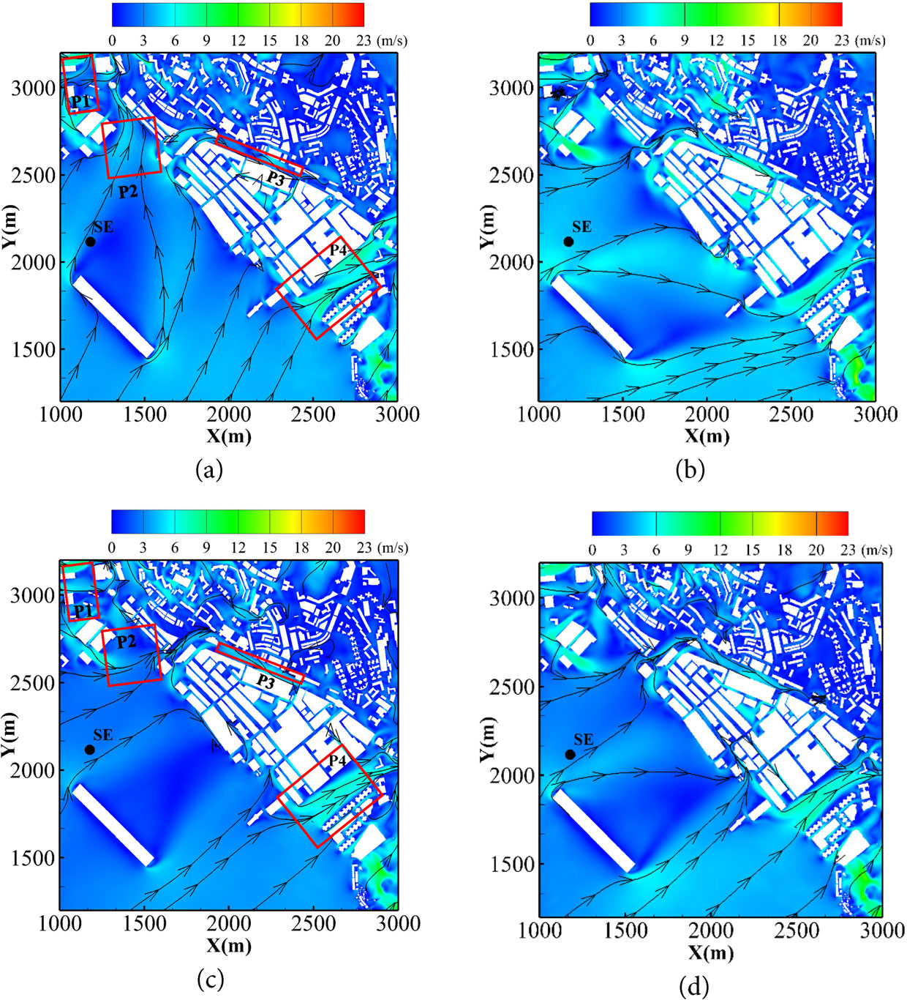

   **图 15** NC3 和 NC4 数值工况中行人高度的风速等值分布与流动路径：（a）、（c）为未进行修正的模拟；（b）、（d）为利用 NP 观测修正后的模拟。

   图中标注：NC3、NC4 工况；水平坐标 X、Y（m）；风速单位 m/s；（a）、（c）未修正；（b）、（d）经 NP 观测修正，保留各分图完整色标和流动路径。

图14(b)、(d)和图15(b)、(d)显示，来流方向变化会使当地风力等级改变。为量化这种不确定性，图16进一步给出P1–P4在21 h内按罗盘方向统计风速频率的风玫瑰。P3与P4中8.4–11.1 m/s强风（原文称strong breezes）分别占20.3%、20.5%；P1与P2相应占比为18.2%、13.6%，风力较低。P1、P2未模拟到13.8–16.9 m/s的大风（原文称gale），而P3、P4的相应频率分别为4.6%、11.4%。风穿越建筑间隙是伴随高、低压区的短程环流过程，压力差通常形成通道射流和角隅流，放大街谷风速（Janssen et al. 2013）。尽管P3观塘受到周围建筑遮挡，北侧复杂地形与特定街道方向仍使通道风穿过建筑；P4观塘绕道也出现类似加速，图16(c)、(d)的来流方向变化展示了相似风效应。这些验证说明，降尺度模拟有助于定位强风事件中的风敏感区域。

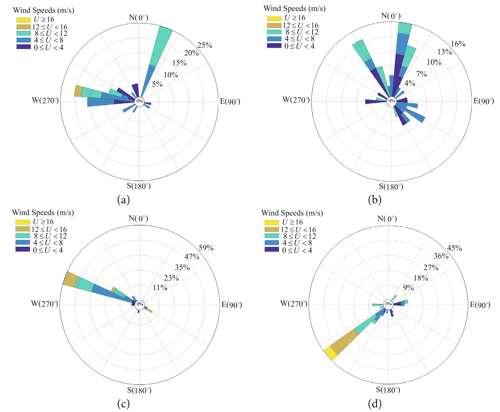

   **图 16** P1—P4 位置平均风速大小与风向的风玫瑰图。数据取自采用数据同化的数值工况，共 21 h，采样间隔为 30 min。不同径向长度表示风速的统计频率。

   图中标注：风速（m/s）；风速分级：≥16、12—16、8—12、4—8、0—4 m/s，区间上下限依原图；北（0°）；东（90°）；南（180°）；西（270°）；P1、P2、P3、P4 四个位置；径向刻度表示统计频率，各分图量程不同。

.. note::

   图16图例使用0≤U<4、4≤U<8、8≤U<12、12≤U<16和U≥16 m/s分档，与正文8.4–11.1、13.8–16.9 m/s的风级区间不完全对应，不能声称正文精确比例直接读自图中相同分档。21 h内样本频率不是全年风速超越概率，不能把本事件风玫瑰直接与按年允许时长结合，宣称街区通过某项全年舒适度或安全认证；原文给出的不同风级区间也不在本页自行改写为统一风级标准。

4.5 观测代表性评估
----------------------

单站观测的空间代表性，有助于量化城市风环境中稀疏风速仪的作用。以降尺度CFD结果作为风场库，采用点对面一致性指标 :math:`P_{\mathrm{pta}}` 评估代表性。该无量纲量反映作用于SE测点的气象条件与周边水平面平均风速等区域特征之间的一致程度（Li et al. 2017），一般表达见式(14)。为验证，选取图13的S1、S2两区域，在半径 :math:`d=1200\,\mathrm{m}` 内计算；S1为海面或海岸暴露类别，S2接近一般城市地区。按照原文所引准则， :math:`P_{\mathrm{pta}}<0.1` 时，该测量可代表周边面积平均值（Schmid and Lloyd 1999）：

.. math::

   P_{\mathrm{pta}}(d)=\left|\frac{U_{\mathrm{CFD\_O}}-\overline{U}_{\mathrm{CFD\_P}}}{\overline{U}_{\mathrm{CFD\_P}}}\right| \qquad (14)

其中， :math:`U_{\mathrm{CFD\_O}}` 是SE测点的CFD风速， :math:`\overline{U}_{\mathrm{CFD\_P}}` 是半径 :math:`d` 区域内的平均CFD风速，单位均为m/s， :math:`d` 的单位为m；原文此处将几何示意指向图9。

.. note::

   原文式(14)后文字所引图9展示NP与WRF趋势，而区域S1、S2位于图13。此处保留并指出源内图号差异，不改原图或补造另一个空间区域。

图17给出北侧来流NC1工况的 :math:`P_{\mathrm{pta}}`。离地高度增加时，粗糙地面对风流的影响减弱，因此分别考察10 m和30 m水平面，对应图17(a)、(b)。Li et al. (2017)也采用30 m条件，其CFD边界来自上游区域预模拟形成的插值多尺度剖面（IMP），上游使用测量拟合风剖面。图17中 :math:`P_{\mathrm{pta}}` 随距SE中心距离 :math:`d` 改变，总体随距离增加而增大，符合预期。图17(b)中本文降尺度结果与Li et al. (2017)趋势接近；后者按最佳实践指南（Franke et al. 2011）认真设置了更大计算域、入口、数值算法与长期验证。原文在这一比较中称最大 :math:`P_{\mathrm{pta}}<0.1`，说明SE风速在1200 m范围内具有较好代表性。S1预测差异可归因于近地城市景观影响，这一例子强调用稀疏测量评估风环境时提高观测离地高度的重要性，也为CFD数据同化时优化风速仪位置提供帮助。

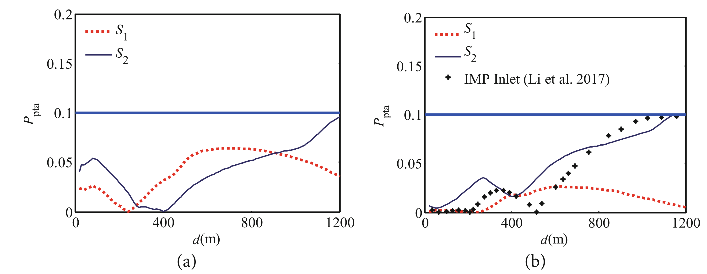

   **图 17** 以 SE 站点为中心的 S1 和 S2 两个区域中，点—区域指标的变化趋势：（a）离地 10 m；（b）离地 30 m。

   图中标注：点—区域指标；距 SE 站点的半径 d（m）；两个半圆区域 S1、S2；IMP 入口条件的对照结果（Li 等，2017）；离地 10 m；离地 30 m。

.. note::

   这里的代表性讨论限于NC1、指定SE站和S1／S2区域，并需区分图17的10 m与30 m面；不能扩展为SE在任意高度、任意风向或全部台风阶段均代表1200 m区域。CFD点对面一致性属于模型辅助评估，不是独立测量覆盖整个区域。

5 结论
--------

本文在台风气象条件下再现密集建成区精细风场，围绕台风路径、强度及近地风流讨论数值精度改善。将局地观测引入CFD城市域，用于消除台风结构引起的预测误差，并提出适配中尺度—微尺度嵌套的EMD趋势同化。观测与NWP结果之间由EMD提取的风速趋势差异，被外推至CFD侧边界，而不修改域内输运方程。模型性能通过历史台风“海马”（1622）期间中国香港九龙湾观测活动验证，说明该方法如何从观测风速中提取有用信息。

经参数化方案敏感性分析，在WRF中获得初步中尺度台风风场。采用谱nudging后，最大风速、最低海平面气压及多因素路径误差表明，台风中尺度结构和路径得到较好再现。但即使这些气象指标较好，近地激光雷达风剖面仍显示，PBL内风强度精度不足可能是影响降尺度模拟的重要不确定性；作者指出，此类发现此前较少受到气象研究关注。利用中尺度M–O长度定量研究登陆台风期间热分层发现，即使近地风速超过通常划为中性条件的风速范围，台风涡旋区样本仍存在稳定PBL。这与已有观测一致，说明在微尺度再现风场时，不应忽略热因素。

利用趋势同化考察中尺度—微尺度嵌套界面的空间风速分布。对于不同时间尺度的数据，EMD能较稳健地提取观测与模拟的时变平均风速趋势，将开阔暴露位置的趋势差异视为气象背景差异。通过最后IMF或残差计算这些差异，并用其变化趋势修正指定时段的模拟风速误差。再利用空间相关系数，将观测点同化项外推到CFD侧边界。该方法修正了CFD入口近地层以下WRF高估的风速，同时保留中尺度台风风场中的非均匀空间特征。局地CFD数据同化提高了验证点的降尺度风矢量精度：风速、风向IOA分别由未同化时0.28、0.80提高到0.72、0.96，平均风速绝对误差由5.46 m/s降为1.89 m/s。

进一步分析行人高度结果，在登陆台风影响下识别城市风危险区域。21 h风玫瑰比较表明，该降尺度模拟有助于量化街谷实际风速放大。即使CFD边界缺少足够风剖面来准确再现气象场，采用降尺度和同化仍可为城市规划提供有价值的信息。如果能够识别危险区域，并掌握强风事件发生和演变信息，还可能用于风灾预警。

当前讨论仍限于最佳路径资料与稀疏观测，如何将多个位置的测量纳入CFD值得进一步研究。集合卡尔曼滤波与变分同化，可能通过结合数值解和多点测量，为CFD入口估计最优状态。台风期间的详细观测，也有助于量化降尺度精度，尤其是高层结构抗风设计所关心的湍流标量。台风路径和强度不确定，可能是观测不足的原因；即使本文已剔除尖峰，测量噪声仍是影响趋势同化的现实因素，试验不确定性的作用将在后续研究中考虑。

参考文献
--------

Alinot C, Masson C (2005). k-ε model for the atmospheric boundary layer under various thermal stratifications. Journal of Solar Energy Engineering, 127: 438–443.

Baik J-J, Park S-B, Kim J-J (2009). Urban flow and dispersion simulation using a CFD model coupled to a mesoscale model. Journal of Applied Meteorology and Climatology, 48: 1667–1681.

Bairagi AK, Dalui SK (2021). Wind environment around the setback building models. Building Simulation, 14: 1525–1541.

Blocken B, Stathopoulos T, van Beeck JPAJ (2016). Pedestrian-level wind conditions around buildings: Review of wind-tunnel and CFD techniques and their accuracy for wind comfort assessment. Building and Environment, 100: 50–81.

Buccolieri R, Santiago JL, Martilli A (2021). CFD modelling: The most useful tool for developing mesoscale urban canopy parameterizations. Building Simulation, 14: 407–419.

Castro FA, Palma JMLM, Silva Lopes A (2003). Simulation of the askervein flow. part 1: Reynolds averaged navier–stokes equations (k-ε turbulence model). Boundary-Layer Meteorology, 107: 501–530.

Castro FA, Silva Santos C, Lopes da Costa JC (2015). One-way mesoscale-microscale coupling for the simulation of atmospheric flows over complex terrain. Wind Energy, 18: 1251–1272.

Chen J, Wang Z, Tam C-Y, et al. (2020). Impacts of climate change on tropical cyclones and induced storm surges in the Pearl River Delta region using pseudo-global-warming method. Scientific Reports, 10: 1965.

Cheng A, Wang Y, Yuan J, et al. (2014). A new method for analyzing track forecast error of typhoon. Acta Oceanologica Sinica, 36(5): 46–53. (in Chinese)

Conan B, Chaudhari A, Aubrun S, et al. (2016). Experimental and numerical modelling of flow over complex terrain: the Bolund hill. Boundary-Layer Meteorology, 158: 183–208.

Davis C, Wang W, Chen SS, et al. (2008). Prediction of landfalling hurricanes with the advanced hurricane WRF model. Monthly Weather Review, 136: 1990–2005.

Delfino RJ, Bagtasa G, Hodges K, et al. (2022). Sensitivity of simulating Typhoon Haiyan (2013) using WRF: The role of cumulus convection, surface flux parameterizations, spectral nudging, and initial and boundary conditions. Natural Hazards and Earth System Sciences, 22: 3285–3307.

El-Askary WA, Sakr IM, AbdelSalam AM, et al. (2017). Modeling of wind turbine wakes under thermally-stratified atmospheric boundary layer. Journal of Wind Engineering and Industrial Aerodynamics, 160: 1–15.

Emanuel K, DesAutels C, Holloway C, et al. (2004). Environmental control of tropical cyclone intensity. Journal of the Atmospheric Sciences, 61: 843–858.

Fierro AO, Mansell ER, Ziegler CL, et al. (2012). Application of a lightning data assimilation technique in the WRF-ARW model at cloud-resolving scales for the tornado outbreak of 24 May 2011. Monthly Weather Review, 140: 2609–2627.

Franke J, Baklanov A (2007). Best practice guideline for the CFD simulation of flows in the urban environment: COST action 732 quality assurance and improvement of microscale meteorological models. University of Hamburg, Meteorological Institute, Germany

Franke J, Hellsten A, Schlunzen KH, et al. (2011). The COST 732 Best Practice Guideline for CFD simulation of flows in the urban environment: a summary. International Journal of Environment and Pollution, 44: 419.

Frerix T, Kochkov D, Smith J, et al. (2021). Variational data assimilation with a learned inverse observation operator. In: Proceedings of International Conference on Machine Learning.

García-Sánchez C, Philips DA, Gorlé C (2014). Quantifying inflow uncertainties for CFD simulations of the flow in downtown Oklahoma City. Building and Environment, 78: 118–129.

Gopalan H, Gundling C, Brown K, et al. (2014). A coupled mesoscale–microscale framework for wind resource estimation and farm aerodynamics. Journal of Wind Engineering and Industrial Aerodynamics, 132: 13–26.

Han Y, Shen L, Xu G, et al. (2018). Multiscale simulation of wind field on a long-span bridge site in mountainous area. Journal of Wind Engineering and Industrial Aerodynamics, 177: 260–274.

Hassan S, Molla MM, Nag P, et al. (2022). Unsteady RANS simulation of wind flow around a building shape obstacle. Building Simulation, 15: 291–312.

Holtslag MC, Bierbooms WAAM, van Bussel GJW (2014). Estimating atmospheric stability from observations and correcting wind shear models accordingly. Journal of Physics: Conference Series, 555: 012052.

Hu P, Li Y, Cai CS, et al. (2013). Numerical simulation of the neutral equilibrium atmospheric boundary layer using the SST k-ω turbulence model. Wind and Structures, 17: 87–105.

Huang NE, Shen Z, Long SR, et al. (1998). The empirical mode decomposition and the Hilbert spectrum for nonlinear and non-stationary time series analysis. Proceedings of the Royal Society of London Series A: Mathematical, Physical and Engineering Sciences, 454: 903–995.

Huang M, Wang Y, Lou W, et al. (2018). Multi-scale simulation of time-varying wind fields for Hangzhou Jiubao Bridge during Typhoon Chan-hom. Journal of Wind Engineering and Industrial Aerodynamics, 179: 419–437.

Islam T, Srivastava PK, Rico-Ramirez MA, et al. (2015). Tracking a tropical cyclone through WRF–ARW simulation and sensitivity of model physics. Natural Hazards, 76: 1473–1495.

Isyumov N, Davenport A (1975). The ground level wind environment in built-up areas. In: Proceedings of the 4th International Conference on Wind Effects on Buildings and Structures.

Janjić ZI (1994). The step-mountain eta coordinate model: Further developments of the convection, viscous sublayer, and turbulence closure schemes. Monthly Weather Review, 122: 927–945.

Janssen WD, Blocken B, van Hooff T (2013). Pedestrian wind comfort around buildings: Comparison of wind comfort criteria based on whole-flow field data for a complex case study. Building and Environment, 59: 547–562.

Kantha LH (2004). The length scale equation in turbulence models. Nonlinear Processes in Geophysics, 11: 83–97.

Kida H, Koide T, Sasaki H, et al. (1991). A new approach for coupling a limited area model to a GCM for regional climate simulations. Journal of the Meteorological Society of Japan Ser II, 69: 723–728.

Kim D, Kim T, Oh G, et al. (2016). A comparison of ground-based LiDAR and met mast wind measurements for wind resource assessment over various terrain conditions. Journal of Wind Engineering and Industrial Aerodynamics, 158: 109–121.

Kwak K-H, Baik J-J, Ryu Y-H, et al. (2015). Urban air quality simulation in a high-rise building area using a CFD model coupled with mesoscale meteorological and chemistry-transport models. Atmospheric Environment, 100: 167–177.

Lawson TV (1978). The wind content of the built environment. Journal of Wind Engineering and Industrial Aerodynamics, 3: 93–105.

Li L, Chan PW (2012). Numerical simulation study of the effect of buildings and complex terrain on the low-level winds at an airport in typhoon situation. Meteorologische Zeitschrift, 21: 183–192.

Li L, Xiao Y, Kareem A, et al. (2012a). Modeling typhoon wind power spectra near sea surface based on measurements in the South China sea. Journal of Wind Engineering and Industrial Aerodynamics, 104: 565–576.

Li L-x, Xiao Y-q, Song L-l, et al. (2012b). Study on wind profile of typhoon Hagupit using wind observed tower and wind profile radar measurements. Engineering Mechanics, 29(9): 284–293. (in Chinese)

Li L, Kareem A, Hunt J, et al. (2015). Turbulence spectra for boundary-layer winds in tropical cyclones: a conceptual framework and field measurements at coastlines. Boundary-Layer Meteorology, 154: 243–263.

Li C, Zhou S, Xiao Y, et al. (2017). Effects of inflow conditions on mountainous/urban wind environment simulation. Building Simulation, 10: 573–588.

Li L, Kareem A, Hunt J, et al. (2019a). Observed sub-hectometer-scale low level jets in surface-layer velocity profiles of landfalling typhoons. Journal of Wind Engineering and Industrial Aerodynamics, 190: 151–165.

Li S, Sun X, Zhang R, et al. (2019b). A feasibility study of simulating the micro-scale wind field for wind energy applications by NWP/CFD model with improved coupling method and data assimilation. Energies, 12: 2549.

Li W, Subiantoro A, McClew I, et al. (2022). CFD simulation of wind and thermal-induced ventilation flow of a roof cavity. Building Simulation, 15: 1611–1627.

Liu J, Niu J (2016). CFD simulation of the wind environment around an isolated high-rise building: An evaluation of SRANS, LES and DES models. Building and Environment, 96: 91–106.

Liu YC, Chen DY, Li SW, et al. (2018). Revised power-law model to estimate the vertical variations of extreme wind speeds in China coastal regions. Journal of Wind Engineering and Industrial Aerodynamics, 173: 227–240.

Lu X, Yu H, Ying M, et al. (2021). Western north Pacific tropical cyclone database created by the China meteorological administration. Advances in Atmospheric Sciences, 38: 690–699.

Melbourne WH, Siddiqui T (1978). Criteria for environmental wind conditions. Journal of Wind Engineering and Industrial Aerodynamics, 3: 241–249.

Mohan M, Siddiqui TA (1998). Analysis of various schemes for the estimation of atmospheric stability classification. Atmospheric Environment, 32: 3775–3781.

NEN (2006). Wind Comfort and Wind Danger in the Built Environment. Dutch Standard, NEN 8100. (in Dutch)

Newman JF, Klein PM, Wharton S, et al. (2016). Evaluation of three lidar scanning strategies for turbulence measurements. Atmospheric Measurement Techniques, 9: 1993–2013.

Peng S-H, Davidson L (1999). Computation of turbulent buoyant flows in enclosures with low-Reynolds-number k-ω models. International Journal of Heat and Fluid Flow, 20: 172–184.

Pieterse JE, Harms TM (2013). CFD investigation of the atmospheric boundary layer under different thermal stability conditions. Journal of Wind Engineering and Industrial Aerodynamics, 121: 82–97.

Ramponi R, Blocken B, Coo LD, et al. (2015). CFD simulation of outdoor ventilation of generic urban configurations with different urban densities and equal and unequal street widths. Building and Environment, 92: 152–166.

Repetto MP, Burlando M, Solari G, et al. (2018). A web-based GIS platform for the safe management and risk assessment of complex structural and infrastructural systems exposed to wind. Advances in Engineering Software, 117: 29–45.

Sanz Rodrigo J, Chávez Arroyo RA, Moriarty P, et al. (2017). Mesoscale to microscale wind farm flow modeling and evaluation. WIREs Energy and Environment, 6: e214.

Schmid HP, Lloyd CR (1999). Spatial representativeness and the location bias of flux footprints over inhomogeneous areas. Agricultural and Forest Meteorology, 93: 195–209.

Skamarock WC, Klemp JB, Dudhia J, et al. (2019). A Description of The Advanced Research WRF Model Version 4. Boulder, CO, USA: National Center for Atmospheric Research.

Sogachev A, Kelly M, Leclerc MY (2012). Consistent two-equation closure modelling for atmospheric research: buoyancy and vegetation implementations. Boundary-Layer Meteorology, 145: 307–327.

Song L-l, Mao H-q, Tang H-y, et al. (2004). Observation and analysis of Guangdong coastal gales in the near-surface layer. Journal of Tropical Meteorology, 20: 731–736.

Song L, Chen W, Wang B, et al. (2016). Characteristics of wind profiles in the landfalling typhoon boundary layer. Journal of Wind Engineering and Industrial Aerodynamics, 149: 77–88.

Sousa J, García-Sánchez C, Gorlé C (2018). Improving urban flow predictions through data assimilation. Building and Environment, 132, 282-290.

Sun J, He H, Hu X, et al. (2019). Numerical simulations of typhoon hagupit (2008) using WRF. Weather and Forecasting, 34: 999–1015.

Tewari M, Kusaka H, Chen F, et al. (2010). Impact of coupling a microscale computational fluid dynamics model with a mesoscale model on urban scale contaminant transport and dispersion. Atmospheric Research, 96: 656–664.

Thomas G, Mahfouf J-F, Montmerle T (2020). Toward a variational assimilation of polarimetric radar observations in a convective-scale numerical weather prediction (NWP) model. Atmospheric Measurement Techniques, 13: 2279–2298.

Tien DD, Ngo-Duc T, Mai HT, et al. (2013). A study of the connection between tropical cyclone track and intensity errors in the WRF model. Meteorology and Atmospheric Physics, 122: 55–64.

Tominaga Y, Mochida A, Yoshie R, et al. (2008). AIJ guidelines for practical applications of CFD to pedestrian wind environment around buildings. Journal of Wind Engineering and Industrial Aerodynamics, 96: 1749–1761.

Tse KT, Li SW, Chan PW, et al. (2013). Wind profile observations in tropical cyclone events using wind-profilers and Doppler SODARs. Journal of Wind Engineering and Industrial Aerodynamics, 115: 93–103.

Tseng Y-H, Meneveau C, Parlange MB (2006). Modeling flow around bluff bodies and predicting urban dispersion using large eddy simulation. Environmental Science and Technology, 40: 2653–2662.

Van Druenen T, van Hooff T, Montazeri H, et al. (2019). CFD evaluation of building geometry modifications to reduce pedestrian-level wind speed. Building and Environment, 163: 106293.

Wang H, Wang Y, Xu H (2013). Improving simulation of a tropical cyclone using dynamical initialization and large-scale spectral nudging: A case study of Typhoon Megi (2010). Acta Meteorologica Sinica, 27: 455–475.

Wilcox DC (1988). Reassessment of the scale-determining equation for advanced turbulence models. AIAA Journal, 26: 1299–1310.

Wise DJ, Boppana VBL, Li KW, et al. (2018). Effects of minor changes in the mean inlet wind direction on urban flow simulations. Sustainable Cities and Society, 37: 492–500.

Xu YL, Chen J (2004). Characterizing nonstationary wind speed using empirical mode decomposition. Journal of Structural Engineering, 130: 912–920.

Ying M, Zhang W, Yu H, et al. (2014). An overview of the China meteorological administration tropical cyclone database. Journal of Atmospheric and Oceanic Technology, 31: 287–301.

Zajaczkowski FJ, Haupt SE, Schmehl KJ (2011). A preliminary study of assimilating numerical weather prediction data into computational fluid dynamics models for wind prediction. Journal of Wind Engineering and Industrial Aerodynamics, 99: 320–329.

Zhao Z, Li C, Xiao Y, et al. (2021a). Multiscale modelling of planetary boundary layer flow over complex terrain: implementation under near-neutral conditions. Environmental Fluid Mechanics, 21: 759–790.

Zhao Z, Xiao Y, Li C, et al. (2021b). New consideration of lateral boundary treatment for meso- and micro-scale nested PBL simulations over complex terrain. Atmospheric Research, 254: 105507.

Zheng S, Zhai ZJ, Yi W, et al. (2022). Evaluation and comparison of various fast fluid dynamics modeling methods for predicting airflow around buildings. Building Simulation, 15: 1083–1095.

Zhou C, Chen P, Yang S, et al. (2022). The impact of typhoon lekima (2019) on East China: a postevent survey in wenzhou city and taizhou city. Frontiers of Earth Science, 16: 109–120.

Zou X, Navon IM, Ledimet FX (1992). An optimal nudging data assimilation scheme using parameter estimation. Quarterly Journal of the Royal Meteorological Society, 118: 1163–1186.

完整引用
--------

Zihan Zhao, Yiqing Xiao, Chao Li, P. W. Chan, Gang Hu, Qingfeng Zhou. Multiscale simulation of the urban wind environment under typhoon weather conditions. *Building Simulation* (2023). DOI: `10.1007/s12273-023-0991-7 <https://doi.org/10.1007/s12273-023-0991-7>`_.

收录信息见 :ref:`WOEAI 学术成果页对应条目 <ref-zhao2023-BS>`。
