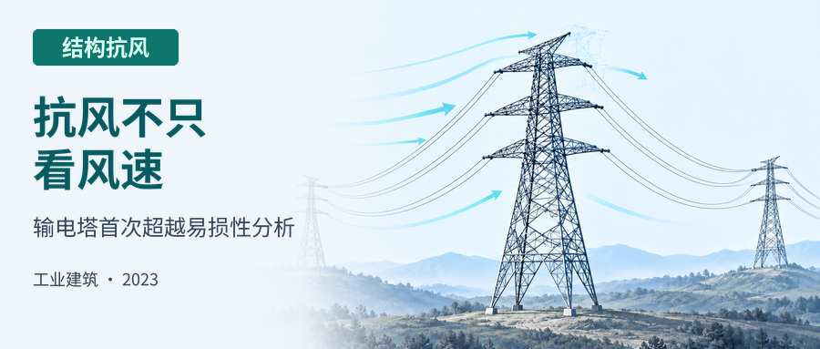
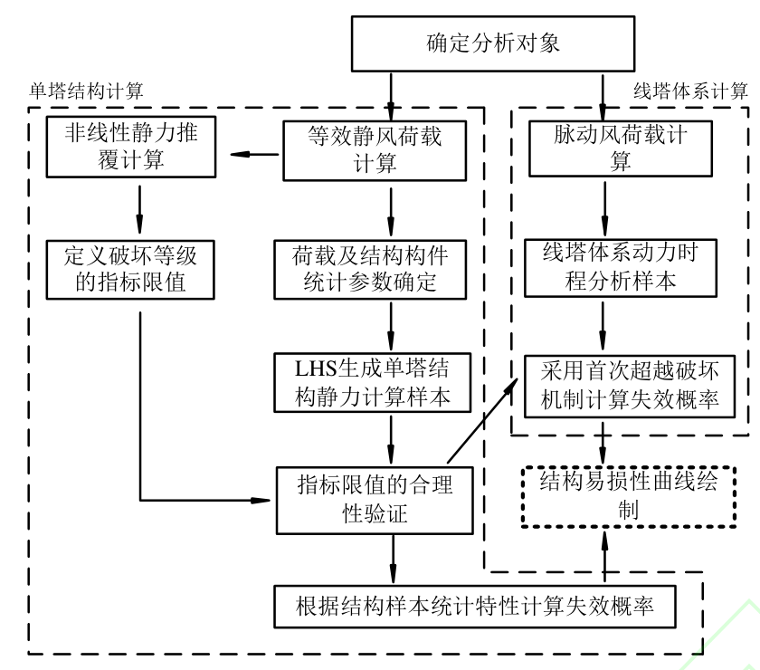
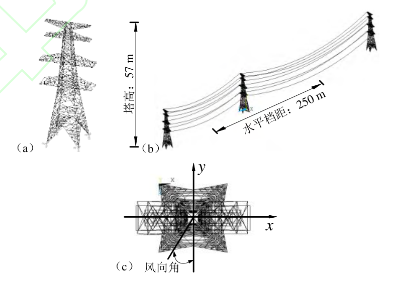
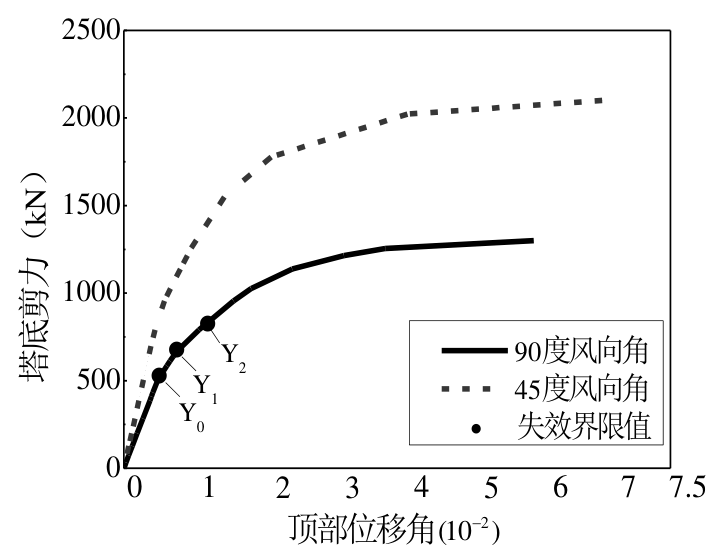
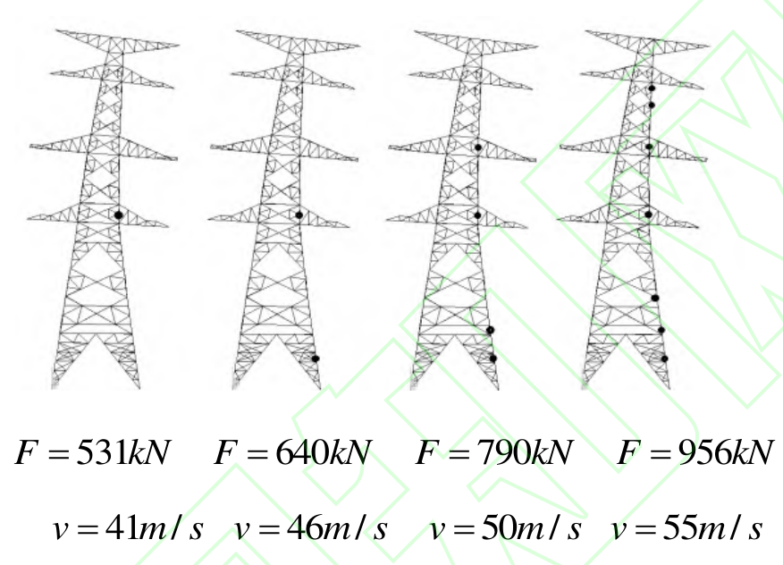
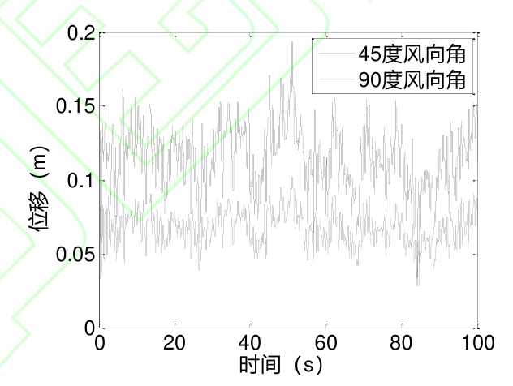
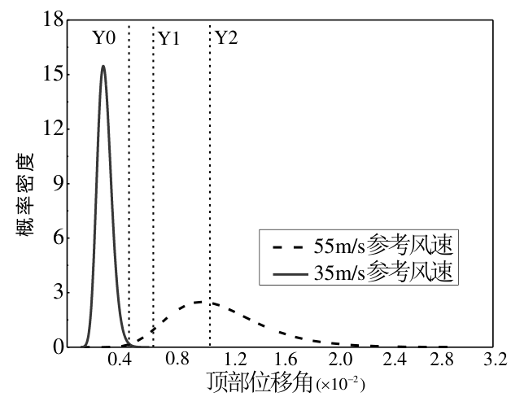
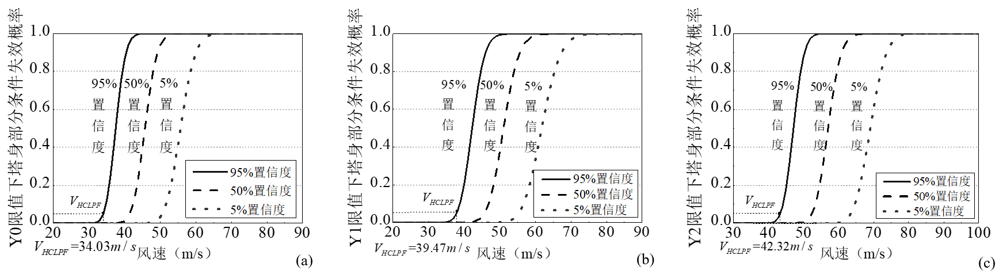
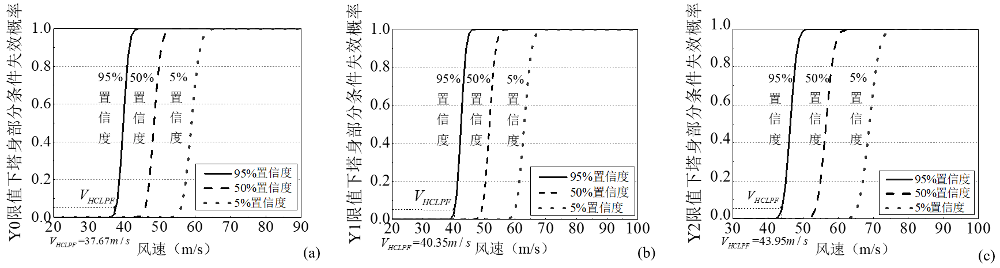

.. _paper-note-ref-zhao2023-GYJZ:

输电塔强风首次超越易损性分析：论文精解
======================================

精简版微信公众号文章：待发布

论文信息
--------

- **题名**：基于首次超越破坏的输电塔强风易损性分析
- **英文题名**：Fragility Analysis of Transmission Tower Under the First-Passage Failure Criterion
- **作者**：赵子涵、肖凯、肖仪清、李朝、张文通。
- **单位**：1. 深圳职业技术学院建筑工程学院，广东深圳 518055；2. 广东电网公司电力科学研究院，广东广州 510080；3. 哈尔滨工业大学（深圳）土木与环境工程学院，广东深圳 518055。
- **期刊与版本**：《工业建筑》（Industrial Construction），2023 年网络首发稿；所提供 PDF 共 11 页，含 1 页首发说明及 10 页论文。
- **网络首发时间**：2023 年 2 月 27 日 10:39:45。
- **首发入口**：`中国知网首发记录 <https://kns.cnki.net/kcms/detail//11.2068.tu.20230224.1610.013.html>`_。
- **研究方向**：结构风工程 / 结构抗风。

.. contents:: 本页目录
   :local:
   :depth: 2

导读
----

输电塔的抗风问题不能仅用一个“能承受多大风速”概括：破坏限值、风荷载和材料的不确定性、导地线的耦合，以及采用的置信水平，都会影响易损性结果。本文针对广东大亚湾一座 57 m 高、500 kV 耐张塔，比较单塔等效静力抽样与“三塔两线”动力可靠性两条计算路线。核心指标是塔顶位移角首次超越给定限值的概率，不是断线、金具破坏及倒塔全过程的联合概率。

以下按网络首发稿顺序保留中文正文，英文摘要另译成中文；公式、图、表及参考文献完整列出。所提供原稿的表题、图号引用、统计数值和保守性措辞存在若干不一致，均在相邻位置标明，不替作者重算或修改源数据。此版本不提供无来源支持的 DOI，也不把网络首发稿的页码当作最终卷期页码。

摘要
----

参照输电塔现行设计规范，本文首先获得了风荷载作用下单塔结构的能力曲线，并依据结构构件的受力特征，以塔顶位移角为指标讨论了三种首次超越破坏的界限状态。其次，基于拉丁超立方抽样技术获得的结构等效静力计算样本，对界限值划分的合理性进行验证。最后，结合不确定分析分析样本的统计特性，计算塔架在最不利风向角下，不同顶点位移角限值的易损性曲线，并对比了采用动力可靠性分析获得的“三塔两线”体系计算结果。HCLPF（High Confidence, Low Probability of Failure）对应风速值表明，不同方法的计算结果较为接近，但单塔结构计算效率较高。本文分析方法为输电塔在台风灾害下的灾前预警和灾后评估奠定基础。

**关键词**：输电塔；能力曲线；易损性曲线；HCLPF；首次超越破坏。

英文摘要译文
~~~~~~~~~~~~

本文依据设计规范与标准，计算格构式输电塔在风荷载作用下的能力曲线。根据能力曲线和结构中的塑性铰，在首次超越破坏准则下假定三种性能指标。结构计算样本表明，这些性能指标是合理的。对于不考虑导线动力特性的塔架，采用拉丁超立方抽样进行统计分析。随后，计算不利风向下塔架的易损性曲线。作为对比，还基于首次超越破坏理论计算架空输电线塔体系。HCLPF（高置信度、低失效概率）条件下的风速结果表明，不同方法的结果非常接近，但前者的计算效率较高。上述计算过程与结果为架空输电塔体系的风灾预测和评估奠定基础。

**英文关键词译文**：输电塔；能力曲线；易损性曲线；HCLPF；首次超越破坏。

0 引言
------

电力基础设施是我国东南沿海城市化进程中不可或缺的一部分，然而强风作用下，输电铁塔倒塌事故时有发生。仅 2012 年和 2013 年，台风在我国广东沿海地区共造成 4 基 220 kV、14 基 110 kV 铁塔倒塌 [1]。近几年来，随着全球气候变暖，台风在我国登陆强度呈现出的增大趋势 [2]，使得沿海地区输电线塔的台风灾害风险分析日趋重视。台风灾害风险分析包括危险性分析、易损性分析和灾害损失评估 [3]。其中易损性分析是指在给定风速下，结构系统或构件达到不同破坏状态的概率。由于台风强度和登陆路径的可预见性，输电塔的易损性分析，一方面可结合中尺度天气预报系统，为台风影响区域的输电设施灾前预警奠定基础，另一方面也可结合台风登陆后的实测数据，为灾后结构的修复和评估提供参考依据。

结构风灾易损性分析方法可以概括为定性 [4,5] 和定量分析 [6–8] 两种。其中，基于概率可靠度理论的定量计算方法由于方式灵活，结果可靠，目前已在台风灾害风险分析领域广泛采用。对于输电线塔这类柔性结构体系，其在风、雨等环境荷载影响下的动力响应表现出了较强的随机非线性特征。传统的等效静力概率评估手段不能真实地考虑结构本身在荷载激励下的失效准则及可靠性 [9]。而相比之下，以首次超越破坏为代表的概率可靠性分析能够较好地考虑荷载的随机性和线塔结构本身的非线性反应特征。该方法以结构体系关键部位（如控制点的应力、应变、位移等）是否超越安全界限来判别破坏或失效状态，能够处理分析过程中出现的各种随机因素。对于输电塔这类高耸结构，可通过塔顶位移响应的统计特征来评估结构的刚度破坏状态 [10]。

本文基于首次超越破坏理论，获得了台风影响区域内典型杆塔结构在不利风向角下的失效概率。着重探讨了等效静力计算和非线性动力时程分析两种方法在结构易损性曲线，及高置信度低失效概率对应风速值的计算效果差异。

1 结构易损性计算方法
--------------------

强风作用下，输电塔架结构的破坏形式包括受拉构件的强度破坏、受压构件的失稳破坏以及弯曲剪切破坏的组合等 [9]。由于塔线结构体系的复杂性，环境荷载作用变量与结构构件响应之间并不具有明确的功能函数表达式，使得概率可靠性模型难以直接确定。而对于输电塔这类高耸结构而言，在水平风荷载作用下，最大位移发生在塔身顶点部位，其结构的功能函数可简化表示为：

.. math::

   Z=F(X)=\theta_{\mathrm{limit}}(X)-\theta(X).\qquad (1)

式中：:math:`X=\{x_1,x_2,\ldots,x_n\}` 为荷载和结构抗力的随机参数，:math:`\theta` 和 :math:`\theta_{\mathrm{limit}}` 为荷载作用下结构的顶点位移角及其限值。

基于首次超越破坏理论，当 :math:`F(X)<0` 时，可判定结构跨越安全界限，处于一定的刚度失效状态，此时结构的失效概率可表示为：

.. math::

   P_f=P(F(X)<0)=\int_{F(X)<0}f(X)\,\mathrm dX.\qquad (2)

式中：:math:`f(X)` 为不确定参数的联合概率密度分布函数。根据式 (2) 构造方法的不同，结构失效概率 :math:`P_f` 的计算有多种类型。

本文采取的计算路线如图 1 所示，首先以塔身构件的受力特征和顶点位移角为指标，采用非线性静力推覆获得结构不同破坏状态的指标限值；其次，针对单塔结构的等效静力计算，本文基于拉丁超立方抽样（Latin Hypercube Sampling，简称 LHS）技术获得的结构计算样本统计特性，讨论了单塔结构在不同界限值下的失效概率；然后，为考虑导地线对塔身动力特性的影响，采用首动力可靠性分析方法对“三塔两线”结构体系中，塔身的失效概率做出计算；最后，结合置信区间的概念，获得了不同置信度下结构的易损性曲线及高置信度低失效概率所对应的风速值。

   **图 1 输电线塔易损性分析计算流程图。** 左侧由推覆计算确定破坏等级，结合 LHS 静力样本检验限值；右侧通过脉动风荷载和动力时程计算线塔体系失效概率，最后形成易损性曲线。原图各节点和箭头完整保留。

近几年的风灾实例表明，输电线塔体系的失效类型主要包括金具断裂、倒塔、断线和故障跳闸 [1]，其中，倒塔对电力设施的抢修影响最大。随着输电线塔结构设计标准和生产质量的提高，导地线及其连接部分在强风作用下发生断裂破坏的概率明显降低。为此，文中主要讨论该连接部分不失效的前提下，塔身结构失效的易损性计算。

2 计算模型及性能指标的确定
--------------------------

2.1 有限元模型建立
~~~~~~~~~~~~~~~~~~

易损性分析对象为广东大亚湾地区某 500 kV 耐张线塔体系。其中，耐张塔高 57 m，水平档距 250 m，设计风速为 38 m/s。该典型塔架在大亚湾地区的主网中使用较多，且所处区域受台风影响较大，如 2016 年超强台风“海马”，2018 年超强台风“山竹”。线塔体系在通用 ANSYS 有限元软件中进行建模，其中主材、斜材、横材采用 BEAM188 梁单元，辅材和导地线分别采用 LINK8 和 LINK10 单元，塔身材料为 Q345 钢和 Q235 钢两种。简化考虑，将四分裂导线合成一条导线。为提高计算效率，线塔体系采用“三塔两线”体系。导地线模型采用表 1 参数，线塔体系计算模型及风向角的定义如图 2 所示。

   **图 2 易损性分析有限元模型。** （a）塔身；（b）三塔两线；（c）风向角。图内塔高为 57 m，水平档距为 250 m；保留原版坐标轴、角度与标签。

.. list-table:: 表 1 各测点的统计参数汇总设置（原表题）
   :header-rows: 1
   :widths: 23 11 11 13 12 8 11 11

   * - 型号
     - 总截面积（mm²）
     - 总直径（mm）
     - 拉断力（N）
     - 弹性模量（MPa）
     - 泊松比
     - 单位长度质量（kg/km）
     - 最大使用张力（N）
   * - JL/LB1A-400/35
     - 425.24
     - 26.82
     - 101005.9
     - 66000
     - 0.3
     - 1307.3
     - 39482
   * - JL/LB1A-150/35
     - 181.62
     - 17.5
     - 63986.3
     - 75000
     - 0.3
     - 634.4
     - 24919

.. note::

   原表 1 的中文题为“各测点的统计参数汇总设置”，英文题为“Properties of transmission line”（输电线参数），实际内容为两种导地线的物性及张力参数。此处保留中文原题，不据其推断存在未列出的测点。

2.2 风荷载模拟与施加
~~~~~~~~~~~~~~~~~~~~

单塔结构的等效静风荷载选取参照我国杆塔结构设计规范（DLT5154-2012）[11]。对于线塔体系的动力计算，本文采用谐波叠加法生成随机风速时程。其中，假设平均风剖面服从指数分布，模拟风速谱采用 Kaimal 谱：

.. math::

   \frac{nS_f}{u_*^2}=\frac{200f}{(1+50f)^{5/3}}.\qquad (3)

式中，:math:`S_f` 为功率谱密度，:math:`f` 为 Monin 坐标。

相干函数采用 Davenport 形式：

.. math::

   \operatorname{Coh}(\omega)=\exp\left[-C\frac{\omega r}{2\pi U(z)}\right].\qquad (4)

式中：:math:`C` 为衰减系数，此处取 8，:math:`\omega` 为圆频率（rad/s），:math:`r` 为计算点之间的间距（m）。根据输电线塔的结构分布特征，竖向选取 10 个不同位置（高度依次为 9 m、14 m、19 m、24 m、29 m、34 m、39 m、44 m、49 m、57 m），水平向以 16 m 为间隔，生成不同位置处的脉动风速时程。:math:`t` 时刻，:math:`z` 高度处，塔身和导地线的风压计算忽略脉动风的平方项。

.. note::

   式 (3) 中的频率符号 :math:`n`、摩阻速度符号 :math:`u_*` 及 Monin 坐标的展开式，原段未另作定义；后文式 (7) 又使用 :math:`n` 表示次数。两处符号语境不同，不应混为一个量。本文照录原公式，不补写原稿没有给出的具体风剖面指数或全部时程生成参数。

2.3 塔身不利风向角与性能指标的计算
~~~~~~~~~~~~~~~~~~~~~~~~~~~~~~~~~~

非线性静力推覆（Nonlinear Static Pushover，简称 NSP）以及增量动力分析方法（Incremental Dynamic Analysis，简称 IDA）被广泛用于确定建筑结构在地震作用下的能力曲线，但 NSP 和 IDA 方法在结构抗风中应用较少。考虑到输电塔在南方沿海地区受风荷载影响要大于地震作用，本文参考 Banik 等人的研究成果 [12]，采用 NSP 方法，获得杆塔结构设计规范 [11] 所要求的 45°、90° 风向角下塔身的顶点位移角—底部剪力曲线。

结合抗震领域结构性能水平划分方法 [13] 和构件受力情况，本文将塔身初步划分为三种破坏状态（表 2）。为进一步确定各状态对应塔顶位移角 :math:`\theta` 的限值，图 3 给出了 NSP 加载过程中，:math:`\theta` 随基底剪力的变化关系。结合图 4 塔身构件进入屈服状态的位置和数量，对限值分母近似取整，本节初步将 Y0、Y1 及 Y2 失效状态对应的 :math:`\theta` 依次划分为 1/200、1/150 及 1/100，该值的合理性将在本文 3.1 节进一步讨论。

为考虑导地线对塔身动力特性影响，本文结合非线性动力时程分析获得了“三塔两线”体系在两种风向角下，中塔塔顶合成 :math:`x,y` 方向后的总位移响应时程（图 5）。结合图 3 单塔结构计算结果，发现塔身在 90° 风向角下的抗风能力明显弱于 45°。据此可判定该结构不利风向角为 90°。

.. list-table:: 表 2 塔身结构性能指标的划分
   :header-rows: 1
   :widths: 30 35 35

   * - 名称
     - 塑性构件百分比（主材）
     - 塑性构件数目（主材）
   * - 完好无损（Y0）
     - 0
     - 0
   * - 适度破坏（Y1）
     - 2%
     - 3–4 个
   * - 严重破坏（Y2）
     - 20%
     - 8–10 个

表注：表中塑性构件百分比 = 进入塑性的主材数目 / 全部主材数目。

.. note::

   表 2 的比例和数量按原值列出；2% 对应 3–4 个与 20% 对应 8–10 个不能直接反推出同一个全部主材数量。原稿未解释这一差异，不能据此擅自改成另一比例。Y0/Y1/Y2 是本算例提出的位移角界限，不是对所有塔型通用的倒塌限值。

   **图 3 结构顶点位移角—塔底剪力曲线。** 实线对应 90°，虚线对应 45°；黑点为 Y0、Y1、Y2 界限。横轴位移角采用 :math:`10^{-2}` 标度，纵轴剪力为 kN。

   **图 4 90° 风向角，不同参考风速下受压构件应力大于 310 MPa 的位置（黑色点）。** 从左到右，:math:`F=531,640,790,956\,\mathrm{kN}`，:math:`v=41,46,50,55\,\mathrm{m/s}`。保留原图黑点及下方荷载、风速标记。

   **图 5 不同风向角下，塔顶合位移响应时程。** 比较 45° 和 90° 风向的合位移，横轴为时间（s），纵轴为位移（m）。

3 结构易损性计算
----------------

3.1 单塔结构失效概率计算
~~~~~~~~~~~~~~~~~~~~~~~~

当参考风速不变时，采用 ANSYS 概率分析模块（PDS）对单塔进行 LHS 抽样计算，并选取结构的顶点位移角 :math:`\theta` 为控制变量，当变量均值趋于平稳时停止抽样。材料特性，风压高度变化系数，及体型系数的统计特性如表 3 所示 [14,15]。

.. list-table:: 表 3 M0–M3 位置处的塔身平均风荷载对比（原表题）
   :header-rows: 1
   :widths: 36 17 17 30

   * - 类别
     - 均值系数
     - 变异系数
     - 分布类型
   * - Q345 屈服强度
     - 1.345
     - 0.066
     - 对数正态分布
   * - Q235 屈服强度
     - 1
     - 0.026
     - 对数正态分布
   * - 弹性模量
     - 1.024
     - 0.0179
     - 正态分布
   * - 角钢肢厚
     - 0.985
     - 0.032
     - 对数正态分布
   * - 角钢肢宽
     - 1.001
     - 0.008
     - 对数正态分布
   * - 风压高度变化系数
     - 1
     - 0.1
     - 正态分布
   * - 体型系数
     - 1
     - 0.122
     - 正态分布
   * - 风荷载调整系数
     - 1
     - —
     - 正态分布

.. note::

   表 3 的中英文原题都写 M0–M3 位置平均风荷载对比，但表内实际为不确定参数的均值系数、变异系数和分布类型。此处按实际单元格照录并展开原表合并的分布类型栏，不凭表题虚构测点或风荷载数值。

风荷载调整系数 :math:`\beta_Z` 的变异参数主要和结构的基频、相对高度有关。参考文献 [14,15] 计算方法，:math:`\beta_Z` 的变异系数统计结果如表 4 所示。

Kolmogorov–Smirnov 检验表明，在显著性水平为 0.05 的条件下，取对数之后的 :math:`\theta` 服从正态分布假定。据此可判定，在相同参考风速下，抽样得到的结构顶点位移角服从对数正态分布。因此，单塔的条件失效概率可表示为：

.. math::

   P_{f_d\mid v}=1-\Phi\left(\frac{\ln(Y_i)-\mu_{\ln\theta_{\max}\mid v}}{\sigma_{\ln\theta_{\max}\mid v}}\right).\qquad (5)

式中，:math:`Y_i` 为 :math:`\theta` 的超越界限值，:math:`\mu_{\ln\theta_{\max}\mid v}`、:math:`\sigma_{\ln\theta_{\max}\mid v}` 分别为参考风速 :math:`v` 下，:math:`\theta` 的对数均值和标准差。

.. list-table:: 表 4 风荷载调整系数的变异系数
   :header-rows: 1
   :widths: 28 18 18 18 18

   * - 第一自振周期（s）／相对高度
     - 0.2
     - 0.5
     - 0.8
     - 1
   * - 1
     - 0.011
     - 0.039
     - 0.054
     - 0.058
   * - 1.5
     - 0.012
     - 0.042
     - 0.058
     - 0.061
   * - 2.5
     - 0.014
     - 0.046
     - 0.062
     - 0.066

表注：相对高度 = 位置高度 / 塔身总高度。

根据结构抽样计算样本，可统计得到其概率密度函数（图 6）。结果表明，当参考风速 :math:`v` 为 35 m/s 时，:math:`\theta` 的均值要小于界限 Y0，且距离 Y1 较远，而当 :math:`v` 为 55 m/s 时，该均值又远大于 Y0、Y1，这与该转角耐张塔的最大设计风速 38 m/s 是相符的。本文旨在对比输电塔易损性计算方法，有关 :math:`\theta` 值的划分是根据塔身设计风速、NSP 加载过程中构件的受力特征，以及样本统计结果得到的。对于其他塔型，该值仍需进一步讨论。表 5 给出了不同参考风速下，:math:`\theta` 的统计结果。结合式 (5)，结构失效概率计算结果如表 6 所示。

.. list-table:: 表 5 不同参考风速下塔顶位移角统计参数
   :header-rows: 1
   :widths: 34 33 33

   * - 参考风速（m/s）
     - 对数均值
     - 对数标准差
   * - 5
     - -9.420
     - 0.116
   * - 10
     - -8.131
     - 0.136
   * - 15
     - -7.340
     - 0.13
   * - 20
     - -6.805
     - 0.132
   * - 25
     - -6.362
     - 0.138
   * - 30
     - -6.022
     - 0.14
   * - 35
     - -5.727
     - 0.141
   * - 40
     - -5.496
     - 0.142
   * - 45
     - -5.209
     - 0.163
   * - 50
     - -4.921
     - 0.22
   * - 55
     - -4.575
     - 0.271
   * - 60
     - -4.212
     - 0.311

   **图 6 参考风速为 35 m/s、55 m/s 时塔顶位移角统计结果。** 竖向虚线标出 Y0、Y1、Y2，横轴位移角采用 :math:`10^{-2}` 标度；实线为 35 m/s，虚线为 55 m/s。

3.2 线塔体系结构失效概率计算
~~~~~~~~~~~~~~~~~~~~~~~~~~~~

目前就建筑物的可靠性计算而言，基于结构振动导致的首次超越问题 [16] 的有多种近似计算方法，如 Poisson 过程法、修正的 Vanmarcke 法、极值分布法、数值模拟法等。Cao H 等 [17] 对比了高耸结构在风荷载作用下 7 种不同方法的动力可靠性，得出了当结构动力响应的极值分布假设为修正的正态分布时，计算结果与数值模拟结果最为接近。基于此，在水平风荷载作用下，本文以“三塔两线”体系中塔塔顶位移角为控制限值，分别采用修正的 Vanmarcke 法和修正的正态分布方法来计算塔架结构的失效概率。

输电线塔体系在风荷载作用下的塔顶位移角 :math:`\theta` 的响应可转化为单侧界限问题。当风速已知时，采用修正的正态分布法，塔身失效概率可表示为：

.. math::

   P_f=1-P_s(S\leq S_1)=1-\left[\operatorname{erf}\left(\frac{S_1}{\sqrt{2}\sigma_x}\right)\right]^{n/2}.\qquad (6)

.. math::

   \operatorname{erf}(x)=\frac{2}{\sqrt{\pi}}\int_0^x\exp(-t^2)\,\mathrm dt,
   \qquad n=\frac{\sigma_{\dot x}T}{\pi\sigma_x}.\qquad (7)

式中，:math:`\operatorname{erf}` 为误差函数，:math:`n` 为风荷载作用时间 :math:`0–T` （s）内，:math:`\theta` 超越限值的次数，:math:`\sigma_{\dot x}`、:math:`\sigma_x` 分别为塔顶在风荷载作用下的角速度响应标准差和位移角响应标准差，:math:`S_1` 为塔顶位移角的限值。

采用修正的 Vanmarcke 方法可表示为：

.. math::

   \begin{aligned}
   P_f&=1-\exp\left\{-\frac{\omega_2}{2\pi}T\left[\exp\left(-\frac{r_1^2}{2}\right)
   \frac{1-\exp(-\sqrt{\pi/2}\,q\,r_1)}{1-\exp(-r_1^2/2)}\right]\right\},\\
   \omega_2&=\frac{\sigma_{\dot x}}{\sigma_x},\qquad
   r_1=\frac{S_1}{\sigma_x},\qquad
   q=\sqrt{1-\frac{\sigma_{\dot x}^2}{\sigma_x\sigma_{\ddot x}}}.
   \end{aligned}\qquad (8)

篇幅原因，部分参考风速下，线塔体系中塔的失效概率部分计算结果如表 7 所示。

.. note::

   式 (6)–(8) 的符号与单侧限值叙述按原稿保留。原稿没有另列 :math:`\sigma_{\ddot x}` 的文字定义，也未在这几式旁展开均值扣除、平稳性假设等实施细节；不能仅凭列式认为所有实际台风响应都满足其适用条件。图 5 展示的 100 s 时程不自动等于全部可靠性工况的统一作用时长。

3.3 考虑置信度区间的结构易损性曲线
~~~~~~~~~~~~~~~~~~~~~~~~~~~~~~~~~~

考虑置信区间的易损性计算最早是由 R. P. Kennedy [18] 在分析地震灾害下核反应堆堆芯融毁概率时提到的。参考根据美国电力研究院（Electric Power Research Institute）推荐的风灾易损性分析模型 [19]，考虑到风荷载作用的固有随机性和人为认知的不确定性，可用一组具有不同可信度的易损性曲线来描述结构的风灾易损性。

结合第 3 节计算结果，以横轴表示风速变量，纵轴表示失效概率，获得表示结构易损性的离散点。对这若干个点进行数值拟合可以得到塔身在不同状态限值下的中值风速能力 :math:`V_m`。给定失效模式和风速 :math:`v`，塔身的条件失效概率 :math:`P_f'` 可表示为：

.. math::

   P_f'=\Phi\left[\frac{\ln(v/V_m)+\beta_U\Phi^{-1}(Q)}{\beta_R}\right].\qquad (9)

式中 :math:`\beta_R`、:math:`\beta_U` 分别为风速的固有随机性和人为认知不确定性随机变量的对数标准差，置信度 :math:`Q=[P_f<P_f'\mid v]` 为给定风速 :math:`v` 条件下，塔身实际失效概率 :math:`P_f` 小于计算得到的 :math:`P_f'` 的保证率。

对于置信度为 5% 到 95% 的易损性曲线，:math:`\Phi^{-1}(Q)` 的值从 −1.65 到 1.65。通常情况下，置信度易损性曲线群由 5%、50%、95% 的置信度易损性曲线组成。高置信度（95%）曲线上，对应低失效概率值（5%）的风速大小，叫做结构的 :math:`V_{\mathrm{HCLPF}}` 值，即：

.. math::

   V_{\mathrm{HCLPF}}=V_m\exp[-1.65(\beta_R+\beta_U)].\qquad (10)

当 :math:`\beta_U` 取 0.12 时，结合式 (9)、(10) 计算方法，得到不同界限值下，3 种置信度下的易损性曲线和 :math:`V_{\mathrm{HCLPF}}` 值，分别如图 7–图 12、表 8 所示。篇幅原因，此处仅列出修正的 Vanmarcke 方法计算结果。

.. note::

   原稿本段写“图 7–图 12”，所提供版本实际仅有图 1–8；图 7 和图 8 各含三幅子图，本文不虚构图 9–12。参考文献 [19] 的标题是地震易损性方法，正文却称为“风灾易损性分析模型”；两处照录，不能据此将该文献改写为风灾专用规范。

分别对比图 7、图 8 可得，较线塔体系计算方法而言，单塔结构计算得到的易损性曲线变化趋势相对平缓，但整体趋势是一致的。同时 :math:`V_{\mathrm{HCLPF}}` 计算结果表明，就线塔体系而言，无论是修正的 Vanmarcke 法还是修正的正态分布法，虽然后者的计算结果较前者而言偏高，但彼此之间相差不超过 2%。比较线塔体系与单塔结构计算结果可知，后者较前者而言虽然计算结果偏于不安全，但彼此之间的误差在 12% 以内，而前者由于涉及非线性动力时程分析，耗时较多。

此外，作为上述讨论方法的实际工程应用，雷旭等 [20] 分析了第 1409 号超强台风“威马逊”影响期间，沿海地区某耐张段的临界失效情况，该案例进一步验证了本研究第 3.1 小节采用单塔结构失效概率计算方法的可靠性。

.. list-table:: 表 6 不同限值下单塔结构的失效概率计算结果
   :header-rows: 1
   :widths: 14 28 29 29

   * - 参考风速（m/s）
     - Y0
     - Y1
     - Y2
   * - 25
     - 5.77E-15
     - 0
     - 0
   * - 30
     - 1.10E-07
     - 2.22E-13
     - 0
   * - 35
     - 1.18E-03
     - 1.87E-07
     - 0
   * - 40
     - 8.20E-02
     - 3.19E-04
     - 1.83E-10
   * - 45
     - 7.07E-01
     - 1.12E-01
     - 1.07E-04
   * - 50
     - 9.57E-01
     - 6.58E-01
     - 7.61E-02
   * - 55
     - 9.96E-01
     - 9.46E-01
     - 5.44E-01
   * - 60
     - 9.99E-01
     - 9.95E-01
     - 8.96E-01

.. list-table:: 表 7 不同限值下，线塔体系塔身失效概率计算结果
   :header-rows: 1
   :widths: 12 14 24 24 26

   * - 参考风速（m/s）
     - 方法
     - Y0
     - Y1
     - Y2
   * - 44
     - 1
     - 9.57E-04
     - 2.70E-07
     - 0
   * - 44
     - 2
     - 1.89E-03
     - 5.39E-07
     - 0
   * - 46
     - 1
     - 1.06E-02
     - 1.59E-05
     - 1.41E-13
   * - 46
     - 2
     - 2.06E-02
     - 3.17E-05
     - 2.71E-13
   * - 48
     - 1
     - 1.81E-01
     - 4.52E-03
     - 9.16E-08
   * - 48
     - 2
     - 3.19E-01
     - 8.88E-02
     - 1.83E-07
   * - 50
     - 1
     - 7.59E-01
     - 1.13E-01
     - 1.07E-04
   * - 50
     - 2
     - 9.33E-01
     - 2.07E-01
     - 2.13E-04
   * - 52
     - 1
     - 8.96E-01
     - 2.88E-01
     - 1.67E-03
   * - 52
     - 2
     - 9.86E-01
     - 4.79E-01
     - 3.30E-03

表注：方法 1 表示修正的正态分布法，方法 2 表示修正的 Vanmarcke 方法。

.. note::

   表 5–7 为便于阅读调整了行列布局，数值、限值和方法对应关系均未改变。表 7 中 48 m/s、Y1、方法 2 的原值为 8.88E-02，不是 8.88E-03；它与方法 1 的比例明显不同于邻近低概率单元格，本文保留原值，不代为改指数。

   **图 7 PDS 方法下，单塔结构的易损性曲线。** （a）Y0；（b）Y1；（c）Y2。每幅图分别给出 95%、50%、5% 置信度曲线及 HCLPF 风速；各置信度不等于纵轴的失效概率。

   **图 8 修正的 Vanmarcke 方法下，线塔体系中塔结构易损性曲线。** （a）Y0；（b）Y1；（c）Y2。各图同时包含 95%、50%、5% 置信度曲线及 HCLPF 风速。

.. list-table:: 表 8 不同计算方法下 HCLPF 风速统计结果（m/s）
   :header-rows: 1
   :widths: 40 20 20 20

   * - 方法类型
     - Y0 限值
     - Y1 限值
     - Y2 限值
   * - PDS 抽样方法
     - 34.03
     - 39.47
     - 42.32
   * - 修正的 Vanmarcke 方法
     - 37.67
     - 40.35
     - 43.95
   * - 修正的正态分布方法
     - 38.23
     - 40.80
     - 44.32

.. note::

   **保守性措辞的原文差异。** 表 8 中，单塔 PDS 的 HCLPF 风速低于两种线塔动力方法；3.3 节却将单塔结果称为“偏于不安全”，下文结论 (2) 又称线塔失效概率结果“趋于保守”。这些措辞不能直接由表 8 的大小关系推出。表 6、7 在共同风速 50 m/s 处，单塔三种限值的失效概率也均高于所列线塔结果。本文保留数值和原文判断，但不据此替读者宣布某一方法在所有风速、限值与置信水平下一定更安全。HCLPF 差异不超过 12% 指本算例的该指标，不是所有失效概率的误差上界。

4 分析结论
----------

本文主要根据塔身顶点位移角 :math:`\theta` 的统计特性和首次超越破坏原理，分别计算了不同限值下的塔身易损性曲线，及高置信度低失效概率对应的风速值。由分析过程可得以下结论：

1. 结构塔顶位移角 LHS 样本统计结果表明，当显著性水平为 0.05 时，基于文中变量统计参数，不考虑导线耦合的 :math:`\theta` 计算样本服从对数正态分布。
2. 当风速低于 35 m/s 时，两种计算方法在 Y0 限值下的失效概率均趋近于 0，表明该耐张段具有较强抗风能力。当风速介于 35 m/s 至 50 m/s 之间时，线塔体系失效概率计算结果较单塔而言趋于保守。当风速超过 50 m/s，Y0 限值下两种计算结果趋于一致，而线塔体系结果在 Y1、Y2 限值下的仍趋于保守。
3. 对比 :math:`V_{\mathrm{HCLPF}}`，发现单塔结构计算效率虽高，但结果较线塔体系偏低，然而误差不大。

目前，国内输电塔的台风灾后详细调查资料不多，其他塔型的易损性分析方法本文计算方法虽同样适用，但关于不同界限值的划分和不同方法之间的计算误差仍需进一步讨论。

参考文献
--------

原文参考文献按编号保留；中英文并列条目均列出。文献 [1] 中、英文版本的页码分别写 23–28 与 36–40，文献 [20] 中文期刊名原写“中国机电工程学报”，均保留原稿，不作无源校正。

[1] 厉天威，江巳彦，赵建华，等． 南方电网沿海地区输电线路风灾事故分析[J]． 高压电器． 2016（6）： 23-28．Li Tianwei， Jiang Siyan， ZHAO Jianhua， et al． Wind accident of southern grid coastal region transmission Line [J]． High Voltage Apparatus， 2016（6）： 36-40． （in Chinese）

[2] 康斌． 我国台风灾害统计分析[J]． 中国防汛抗旱． 2016（2）： 36-40． Kang Bin. The statistical analysis of typhoon in China [J]. China Flood & Drought Management, 2016(2): 36 -40. (in Chinese)

[3] Grossi P. Catastrophe modeling: a new approach to managing risk [M]. Springer Science & Business Media, 2005.

[4] 吴明祥，包建强，叶尹，等． 超强台风“桑美”引起温州电网输电线路事故的分析[J]． 电力建设． 2007（9）： 39-41． Wu Ming-xiang, Bao Jian-qiang, YE Yin, et al. Transmission line accident analysis of wenzhou grid caused by super typhoon “SAOMAI” [J]. Electric Power Construction, 2007(9): 39-41. (in Chinese)

[5] Minor J E, Mehta K C. Wind damage observations and implications [J]. Journal of the Structural Division. 1979, 105(11): 2279 -2291.

[6] Leicester R H, Bubb C, Dorman C, et al. An assessment of potential cyclone damage to dwellings in Austral ia [C]. Pergamon, New York, 1979.

[7] Li Y, Ellingwood B R. Hurricane damage to residential construction in the US: Importance of uncertainty modeling in risk asse ssment [J]. Engineering structures. 2006, 28(7): 1009-1018.

[8] 龙坪． 土木工程结构台风易损性评估研究[D]． 哈尔滨工业大学， 2008． Long Ping. Study on typhoon vulnerability assessment for civil engineering structures [D]. Harbin Institute of Technology, 20 08. (in Chinese)

[9] 韩枫． 特高压输电塔线体系的抗风可靠度研究[D]． 重庆大学，2012． Han Feng. Study on reliability analysis of UHV Transmission tower-line system with wind action [D]. Chongqing University, 2012. (in Chinese)

[10] 李桂青，曹宏，李秋胜． 结构动力可靠度理论及其应用[M]． 北京：地震出版社，1993． Li Guiqing, Cao Hong, Li Qiusheng. Theory of structural dynamic reliability and its Application [M]. Beijing: Seismological P ress, 1993. (in Chinese)

[11] 国家能源局． 架空输电线路杆塔结构设计技术规定：DL/T 5154-2012[S]，北京：中国计划出版社，2012 National Energy Administration: Technical code for the design of tower and pole structures of overhead transmission lines: DL /T 5154- 2012[S], Beijing: China Planning Press, 2012. (in Chinese)

[12] Banik S S, Hong H P, Kopp G A. Assessment of capacity curves for transmission line towers under wind loading [J]. Wind and Str uctures An International Journal. 2010, 13(1): 1-20.

[13] Erberik M A, Elnashai A S. Fragility analysis of flat-slab structures [J]. Engineering Structures. 2004, 26(7): 937-948.

[14] 欧进萍，段宇博，叶骏． 等效随机静风荷载的模型及其参数确定[J]． 哈尔滨建筑工程学院学报． 1994（02）： 1-8． Ou Jinping, Duan Yubo, Ye Jun. A random equivalent static wind load model and its parameter determination [J]. J. Harbin Arch it. & Civ. Eng. Inst. 1994(02): 1-8. (in Chinese)

[15] 王松涛． 现行输电塔设计规范可靠度水准的评估与分析[D]． 重庆大学， 2014． Wang Songtao. Reliability assessment and analysis of the current design code for transmission towers [D]. Chongqing Universit y, 2014. (in Chinese)

[16] Huang M, Chan C, Lou W, et al. Statistical extremes and peak factors in wind-induced vibration of tall buildings[J]. Journal of Zhejiang University-Science A (Applied Physics and Engineering), 2012, 13(1): 18-32.

[17] Cao H, Li Q S. Calculation of wind resistant structure safety [J]. China Civil Engineering Journal. 1994, 27(1).

[18] Kennedy R P, Cornell C A, Campbell R D, et al. Probabilistic seismic safety study of an existing nuclear power plant [J]. Nuc lear Engineering and Design. 1980, 59(2): 315-338.

[19] Jack R. Benjamin And Assoiates I. Methodology for Developing Seismic Fragilities[R]. Electric Power Research Institute, Inc, 1994.

[20] 雷旭，付兴，肖凯，等． 强风作用下输电塔结构不确定性倒塌分析[J]． 中国机电工程学报． 2018， 38： 266-274． Lei Xu, Fu Xing, Xiao Kai. Failure Analysis of a Transmission Tower Subjected to Wind Load Using Uncertainty Metho d [J]. Proceedings of the CSEE, 2018, 38: 266-274. (in Chinese)

完整论文引用
------------

赵子涵，肖凯，肖仪清，李朝，张文通．基于首次超越破坏的输电塔强风易损性分析．工业建筑，2023 年网络首发稿，正文页 1–10。网络首发日期：2023-02-27。

相关论文条目：:ref:`输电塔强风首次超越易损性 <ref-zhao2023-GYJZ>`。
