.. _paper-note-ref-zheng2023-JRSE:

10 MW Y形半潜式风机方向性动力响应的风洞—波浪水槽试验：论文精解
======================================================================

精简版微信公众号文章：待发布

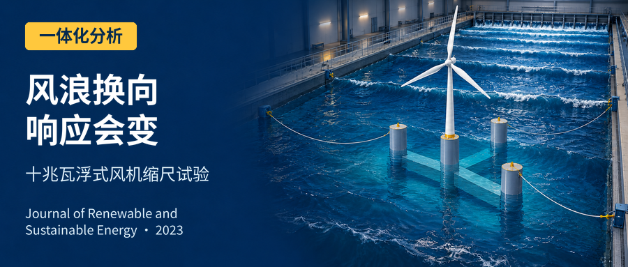

.. contents:: 本页目录
   :local:
   :depth: 2

论文信息
--------

**原文题名：** Wind tunnel and wave flume testing on directionality dynamic responses of a 10 MW Y-shaped semi-submersible wind turbine。

**作者：** Shunyun Zheng，Chao Li（通讯作者），Peicen Wang，Shengtao Zhou，Yiqing Xiao。

**单位：** 哈尔滨工业大学（深圳）土木与环境工程学院；哈尔滨工业大学深圳市土木工程智能结构系统重点实验室。

**期刊：** Journal of Renewable and Sustainable Energy，15（2023），013305。DOI：`10.1063/5.0131279 <https://doi.org/10.1063/5.0131279>`_。

**稿件日期：** 2022年10月19日投稿；2023年1月10日录用；2023年2月7日在线发表。

**WOEAI 相关方向：** 海洋能源结构 / 一体化分析。

**阅读范围：** 完整科学主文与参考文献。源文件共20个物理页，首张为出版社封页，论文为其后19页；以下引用原页时采用论文印刷页码，证据审计另记物理页。

摘要
----

Y形半潜平台是漂浮风机的典型支撑结构。不完全对称的平台在不同风／浪方向下可能产生方向性动力响应，不利响应会影响结构安全。应在风洞—波浪水槽（WTWF）实验室开展一体化精细试验，研究动力响应机制。本文设计了10 MW Y形半潜式风机1:70缩尺WTWF模型试验，并在开源平台OpenFAST建立气动—水动—弹性—伺服动力数值模型，验证试验结果。首先标定风场和波场质量，再开展静水、单风、单浪及风浪联合作用试验，最后详细分析比较不同风／浪方向下的动力响应和服役表现。结果表明，良好的风浪场为高精度试验提供基础，风浪方向确实影响漂浮风机的方向性动力响应。特别是0°、60°波向的纵摇、塔底荷载和机舱加速度较大，应额外关注，因为它们关联结构安全和发电效率。结构设计前应充分确定方向性动力响应，以利于Y形半潜式风机运行维护。

I 引言
--------

人类面临日益严重的能源和环境危机。改变以化石能源为主的传统结构，发展清洁、高效、可靠的可再生能源，是实现可持续发展的途径。可再生能源主要包括波浪能、风能和潮汐能[1–4]。风能是其中规模最大的来源之一，产业快速发展[5–7]。截至2020年底，全球风电累计装机733 GW[7]，新增127 GW，是可再生能源增长的最大贡献者[8]。欧洲2020年新增14.7 GW，满足约16%用电[9]。中国累计装机最多，约占2020年全球新增装机55.91%[10]，预计2050年满足全国17%电力需求[11]。全球海上风资源比陆地更丰富，具有供应安全、发电稳定、环境影响较小、视觉和噪声干扰变化较小以及市场价格较低等优点[12–15]。中国大部分陆地平均风能密度低于100 W/m²，东南沿海基本高于100 W/m²；估计海上风能效率比陆地高20%–40%。随着产业发展，海上风电场必然由浅水转向深水[16]，漂浮式海上风机（FOWT）将发挥重要作用。

.. note::

   引言中的装机规模、价格和发展预测均为原论文发表时引用的背景信息，不作为当前统计或普遍工程经济结论。

海上风机浮式支撑主要从石油工业成熟平台演化，包括驳船、Spar、张力腿平台（TLP）和半潜式[17–19]。半潜平台具有“消波效应”，能改善波浪动力响应，被推荐用于FOWT[20]。它通常由支撑连接的三或四根细长立柱组成[21]。单柱湿表面积、浮心高度、柱间距影响使浮体恢复原位和姿态的作用力；湿表面增加还提供更大的水动力稳定性及承受波荷载的结构刚度。深吃水使半潜平台在风荷载下的水动力特性优于其他浮式平台[22]。具体而言，垂荡运动中，平衡位置的波浪激励几乎消失[23]；纵荡响应与Spar相近，优于TLP，而纵摇小于Spar[24]。半潜平台支撑FOWT有优势，但风浪联合作用可能产生复杂未知响应，设计研究仍具挑战[23]。

缩尺模型试验和数值模拟是研究FOWT动力学的两种主要方法。实验室风浪联合试验复杂昂贵，但除实尺度海试外，仍是捕捉复杂海洋环境强非线性现象的唯一有效方法[25]。模型试验通常补充并验证数值模拟[23]，是当前较可靠的动力研究途径。Feist等[26]提出准耦合风浪试验框架，研究平台运动学对振荡FOWT尾流的影响；Sang等[27]通过风洞和模拟讨论变桨控制对功率与荷载的影响，但未考虑风浪联合。Tomasicchio等[28]用5 MW OC3-Hywind研究Spar在规则／不规则波与不同风荷载下的响应，Russo等[29]进一步关注波浪陡度增加时不同风荷载的影响。Meng等[30]结合水槽和模拟研究100 m水深6 MW Spar，运动结果良好一致。半潜平台方面，Ahn等[31]对10 MW机组开展均匀风、规则波和均匀流联合试验，但未考虑反映真实海况的随机波。Michailides等[32]将半潜风机与波浪发电装置结合，试验与模拟比较说明极端环境生存性良好。Chen和Hu[33]以1:50模型研究OC4半潜风机气动诱发动力特性。Michailides等[34]、Gao等[35]以1:50模型研究半潜式风能与襟翼式波能转换器组合（SFC）的功能。然而这些试验仅用一个荷载方向，实际风浪方向会变化，且风浪质量未充分强调；应开展更贴近实际、深入、一体化和精细的试验，详细说明动力表现。

不同风／浪方向可能导致不同响应，Y形等不完全对称浮体尤其如此。Zhou等[36]通过数值模拟，从疲劳寿命动力表现评价安装朝向，指出海上安装前应综合考虑风浪方向。Bachynski等[37]开展不同风浪方向半潜风机试验，但对实际动力表现的讨论仍少且不清晰。Zhou等[38]通过联合试验与耦合多体模拟研究方向性，指出它对Y形风机运维很重要；但仅分析额定运行环境，且只测系统运动。要准确全面理解方向性，应考虑更多联合工况，测量分析更多响应，特别是关联结构安全和寿命经济收益的塔底荷载、机舱加速度。

风浪下不利响应会影响服役表现、结构安全和经济收益。风洞—水槽联合试验有助于全面理解不同环境下动力特性，为海上设计安装提供参考。本文研究10 MW Y形半潜式风机多风浪来向效应的现象及机制，在高质量风浪场WTWF开展联合试验，以OpenFAST验证。平台由中央柱和三外柱通过浮箱连接，风机安装于中央柱。首先设计1:70模型，并精心设计标定系统模型、环境和仪器；其次开展静水、单风、单浪、联合试验，均考虑0°、30°、60°来向，研究静水自由衰减，并比较不同方向、运行和环境工况的响应，为设计提供试验参考；最后建立数值模型与试验互证，比较方向结果、确定主要原因。安装前考虑方向效应有利于发电效率与安全。

II 模型试验布置
------------------

A 风洞—波浪水槽实验室
~~~~~~~~~~~~~~~~~~~~~~~~

试验在哈尔滨工业大学WTWF进行（图1）。该实验室是具有大小两个试验段的闭式回流风洞，可在可控高质量风浪场开展联合结构试验。小试验段4.0 m宽、3.0 m高、25 m长，最高风速50 m/s，风场质量较高。大试验段为耦合段，风洞6.0 m宽、3.6 m高、50 m长；水槽5.0 m宽、4.5 m深、50 m长，可灵活调节风浪，最高风速30 m/s、最大波高0.4 m、波周期0.5–5 s。本文主要在大试验段完成。

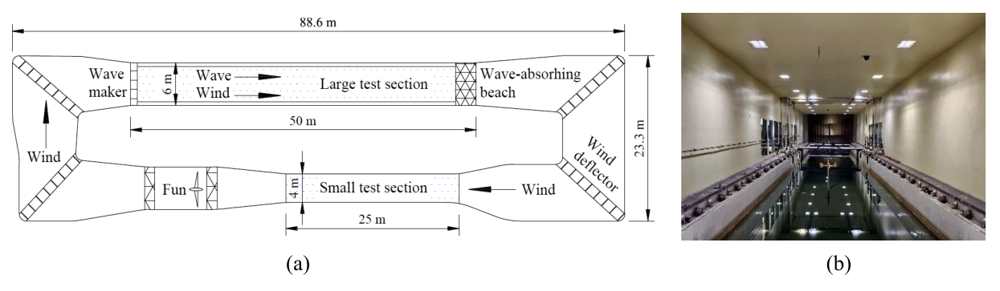

   **图 1** 风洞—波浪水槽实验室：（a）大试验段示意／剖面布置；（b）大试验段实景。

B 试验对象与缩尺模型
~~~~~~~~~~~~~~~~~~~~~~

1 风机模型
^^^^^^^^^^^^

可由NREL 5 MW基准机组放大设计10 MW风机[39]。以5 MW风机为优化对象，获取10 MW试验缩尺模型，并优化叶片以保证Froude相似，尤其推力相似。10 MW风机1:70缩尺对应5 MW风机1:50缩尺。

叶片推力、转矩和陀螺力矩是缩尺风机动力响应主要影响因素。推力影响通常比转矩大一个数量级，且二者一般不能同时满足相似要求，故忽略转矩相似。陀螺力矩主要由叶片惯量与转速控制；转速可严格按比例调节，惯量主要关联质量分布。因此模型叶片优化目标为推力系数和质量分布，变量为弦长与扭角。NREL 5 MW翼型在低Re下升力系数显著下降，几何相似叶片不能满足气动要求，故采用适合低Re的SD7032翼型、圆形叶根。按相似与合理性原则设置变量边界及线性约束：弦长和扭角不超过几何相似值1.5倍，扭角曲线单调性与几何相似叶片一致，叶尖扭角趋零，以尽量减小几何改变对系统响应的影响。

Bayati等[40]仅在额定工况进行单目标叶片设计，具有局限，需考虑多工况。本文以表I六工况推力系数为目标，用遗传算法求解，使缩尺叶片满足气动要求。图2为优化弦长与扭角。叶根圆截面弦长经调整，使其中心与SD7032气动中心同轴；叶根对整体气动影响弱，略调圆截面弦长几乎不影响此前优化结果。

.. list-table:: 表 I 叶片优化的缩尺目标参数
   :header-rows: 1
   :class: longtable

   * - 工况
     - 叶尖速比
     - 风速 / m/s
     - 转速 / rpm
     - 推力系数
     - 推力 / N
   * - OP1
     - 3.19
     - 3.54
     - 85.56
     - 0.25
     - 9.6
   * - OP2
     - 4
     - 2.83
     - 85.56
     - 0.36
     - 8.9
   * - OP3
     - 5
     - 2.25
     - 85.56
     - 0.51
     - 7.9
   * - OP4
     - 6
     - 1.88
     - 85.56
     - 0.66
     - 7.1
   * - OP5
     - 7
     - 1.61
     - 85.56
     - 0.75
     - 6.0
   * - OP6
     - 8
     - 0.99
     - 59.75
     - 0.81
     - 2.4

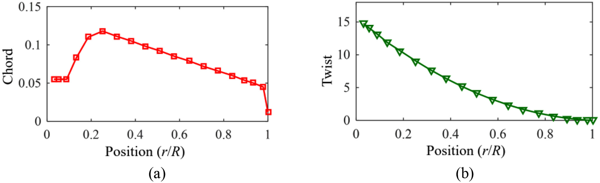

   **图 2** 优化缩尺叶片：（a）弦长曲线；（b）扭角曲线。

据优化结果制作图3模型，主要参数见表II。为满足质量与刚度，叶片采用轻质高强碳纤维，但受材料厚度限制，质量不可避免地高于目标。轮毂由三个角度调节器构成，实现桨距调节，也使质量偏高。机舱由伺服电机及1:5减速器组成，控制叶尖速比，质量基本符合目标。铝制塔筒受材料工艺限制，难同时严格满足几何和动力相似，按重要性依次优先保证高度、一阶振型、固有频率、质量相似，使动力响应与原型一致。

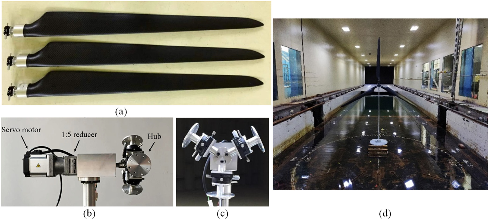

   **图 3** 缩尺风机模型：（a）叶片；（b）机舱；（c）轮毂；（d）风机。

.. list-table:: 表 II 缩尺风机主要参数
   :header-rows: 1
   :class: longtable

   * - 参数
     - 全尺度
     - 1:50缩尺目标
     - 模型实际
   * - 叶片质量
     - 17740 kg
     - 0.140 kg
     - 0.176 kg
   * - 叶片长度
     - 61.5 m
     - 1.23 m
     - 1.23 m
   * - 轮毂质量
     - 56780 kg
     - 0.45 kg
     - 0.78 kg
   * - 机舱质量
     - 240000 kg
     - 1.92 kg
     - 1.97 kg
   * - 风轮直径
     - 126 m
     - 2.52 m
     - 2.52 m
   * - 塔筒质量
     - 249718 kg
     - 1.998 kg
     - 1.47 kg
   * - 塔筒高度
     - 77.6 m
     - 1.55 m
     - 1.55 m
   * - 塔筒重心（从底部计）
     - 43.0%
     - 43.0%
     - 38.0%
   * - 塔筒一阶频率（原表未列单位）
     - 0.37
     - 2.62
     - 2.47

为检验优化模型，开展推力系数风洞试验，见图3(d)。阻塞比即转子扫掠面积／风洞截面积，为16%。转动叶轮不同于静止结构，并不完全阻挡整个扫掠区域的流动，作者认为可接受较大阻塞比。图4显示，多目标优化后，相较简单几何相似叶片，不同叶尖速比下推力系数显著改善，满足试验气动要求。图4(b)为变桨距角下推力系数曲线，据此可快速找到试验所需目标推力。

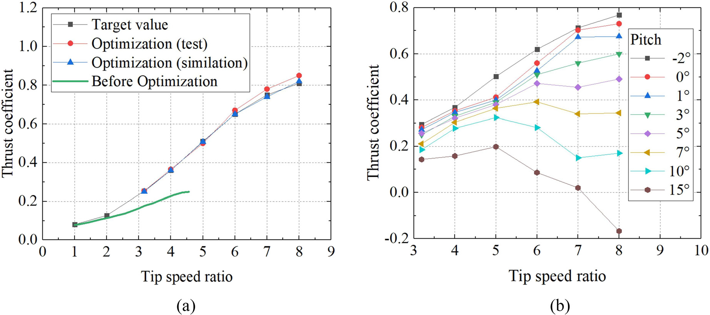

   **图 4** 模型推力系数：（a）多目标优化结果；（b）不同叶尖速比与桨距角的实测推力系数。

为满足10 MW风浪联合试验，取DTU 10 MW为参考原型，在保证叶尖速比相似前提下，调桨距模拟所需推力。表III列出1:50 NREL 5 MW与1:70 DTU 10 MW模型：叶长相同，转子直径仅差3 cm，扫掠面积基本相同，两机叶片弦长与扭角分布也相似。试验以DTU 10 MW各风速推力为目标，调桨距获得所需推力，图5显示效果良好。

.. list-table:: 表 III 5 MW与10 MW缩尺机组主要参数
   :header-rows: 1
   :class: longtable

   * - 参数
     - 1:50 NREL 5 MW模型
     - 1:70 DTU 10 MW模型
   * - 叶片质量
     - 0.140 kg
     - 0.140 kg
   * - 叶长
     - 1.23 m
     - 1.23 m
   * - 转子直径
     - 2.52 m
     - 2.55 m
   * - 额定转速
     - 85.56 rpm
     - 80.32 rpm
   * - 切入风速
     - 0.42 m/s
     - 0.43 m/s
   * - 额定风速
     - 1.61 m/s
     - 1.36 m/s
   * - 切出风速
     - 3.53 m/s
     - 2.99 m/s

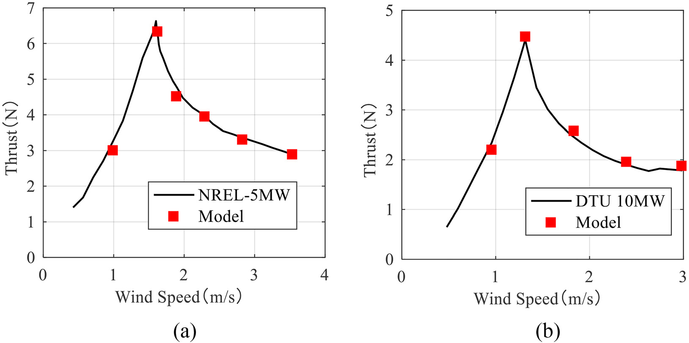

   **图 5** 缩尺模型推力曲线：（a）1:50 NREL 5 MW；（b）1:70 DTU 10 MW。

.. note::

   这里通过优化及桨距标定匹配目标推力，不表示两种原型在转矩、全部气动特性或控制器动作上完全相似。本文明确忽略转矩相似，模型桨距由人工调整。

2 Y形半潜式模型
^^^^^^^^^^^^^^^^^^

图6的Y形半潜平台支撑10 MW水平轴风机，以悬链线限制位移。目标水深130 m，基于10 MW OO-star半潜平台原型[41]，由三外柱和一中央柱组成，风机居中央；通过水动力优化得到性能良好的主要尺寸。系统和参数见图6、表IV。吃水18 m，平台总质量1.47×10⁷ kg，重心在平均海面（MSL）下12.80 m；关于重心的横摇、纵摇、艏摇惯量分别6.86×10⁹、6.86×10⁹、1.14×10¹⁰ kg。图7为试验模型与现场布置，平台用足够强度和刚度的不锈钢制作。优化内部压载分布，使质量、重心、惯量与原型相似，计入平台仪器的质量分布。采用右手坐标系，原点为平台平均水线面中心，见图6。

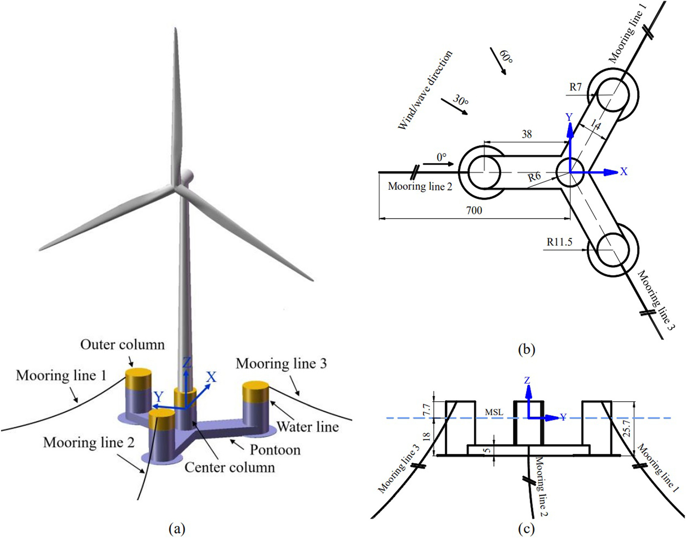

   **图 6** 10 MW Y形半潜式风机：（a）三维模型；（b）平台俯视图，单位m；（c）侧视图，单位m。

.. list-table:: 表 IV Y形平台主要参数
   :header-rows: 1
   :class: longtable

   * - 参数
     - 原型
     - 缩尺模型
   * - 吃水
     - 18 m
     - 25.71 cm
   * - 中央柱直径
     - 6 m
     - 8.57 cm
   * - 外柱直径
     - 7 m
     - 10.00 cm
   * - 浮箱长／宽／高（原表weight）
     - 38/14/5 m
     - 54.29/20.00/7.14 cm
   * - 重心
     - (0,0,−12.80) m
     - (0,0,−18.29) cm
   * - 排水体积
     - 1.62×10⁴ m³
     - 0.047 m³
   * - 平台质量
     - 1.47×10⁷ kg
     - 42.70 kg
   * - Ixx
     - 6.86×10⁹ kg·m²
     - 4.08 kg·m²
   * - Iyy
     - 6.86×10⁹ kg·m²
     - 4.08 kg·m²
   * - Izz
     - 1.14×10¹⁰ kg·m²
     - 6.78 kg·m²

.. note::

   上一段原文将转动惯量单位写为kg，表IV实际为kg·m²，表中按其原单位保留；不能把质量单位误当正确惯量量纲。表IV的“Pontoon length/weight/height”原拼写含weight，但给出的均为长度单位，按长／宽／高解释并注明。

系泊由三根相邻夹角120°悬链线组成，线长700 m、锚距700 m，导缆点设在外柱顶缘。等效单位长度质量416.66 kg/m，轴向刚度1.59×10⁹ N。水槽宽度通常不能满足直接缩尺后的跨距，因此对原型系泊作等效水平截断设计，保证刚度和平台运动相似。如图7，用细钢绞线，均匀设置配重铅坠保证静水质量相似，并在导缆点接弹簧调刚度。作者说明模型各性质满足缩尺要求，其特性将在静水试验分析。

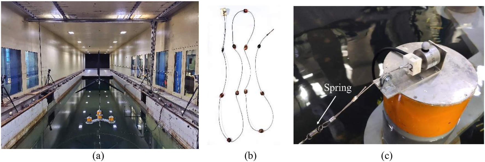

   **图 7** 模型布置：（a）漂浮风机系统；（b）系泊线；（c）导缆点及连接弹簧。

C 试验仪器
~~~~~~~~~~~~

图8为仪器布置，测量平台运动、塔底荷载和机舱加速度。压力传感器与皮托管测风速，配合升降架获得风剖面；电容波高仪监测波高时程；塔底六分力天平测荷载；加速度传感器测机舱加速度。立体视觉系统通过跟踪球及高精度红外相机捕捉六自由度。球面覆反光材料，红外高反射便于识别空间位置、排除环境光干扰，经精细标定误差可控在1 mm内。六台红外相机实时记录分别固定在四柱顶部的四个跟踪球三维坐标，并转换为六自由度时程，采样频率180 Hz。

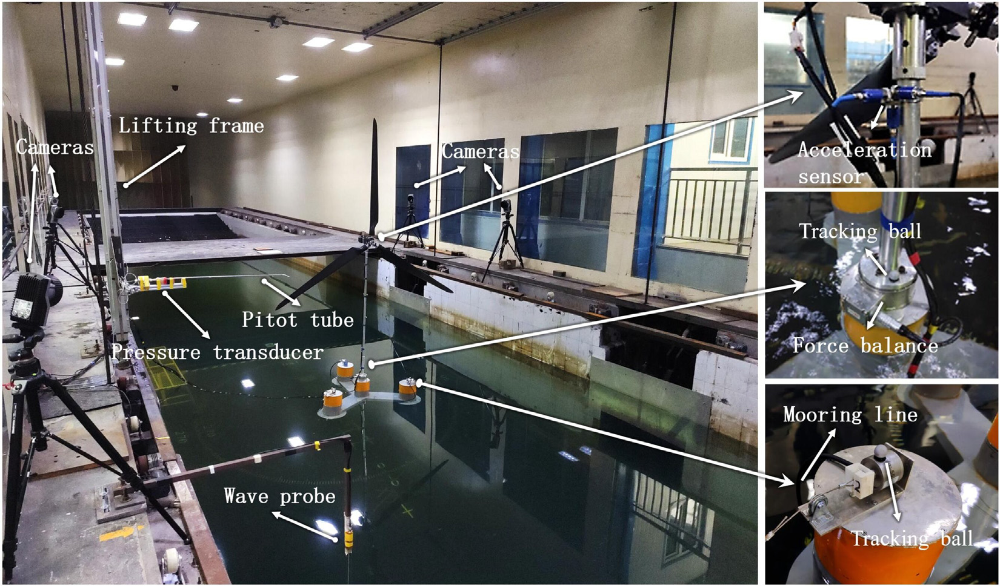

   **图 8** 测量仪器：升降架、压力传感器、皮托管、波高仪、红外相机、跟踪球、测力天平、加速度传感器和系泊线。

D 试验工况
~~~~~~~~~~~~

本文开展静水、单风、单浪和风浪联合试验，全面研究方向性。表V–VII按运行状态选取四风场、九规则波、四不规则波、四风浪联合工况，四种状态为额定、正常、最大运行及极限自存。规则波用于获取响应幅值算子（RAO），周期从5到21 s、间隔2 s。不规则波模拟真实海上响应，四波况对应四风速，根据中国东南海域长期风浪观测选择波高与周期，采用JONSWAP谱。因构型不完全对称，每工况考虑0°、30°、60°，见图6(b)。设施只能产生共线风浪，所以联合工况风浪同向。WTWF传播方向固定，通过旋转模型模拟不同来向，并调整机舱偏航，保证转子始终迎风，见图9。

.. list-table:: 表 V 风工况
   :header-rows: 1
   :class: longtable

   * - 工况
     - 原型机舱风速 / m/s
     - 模型机舱风速 / m/s
     - 运行状态
   * - SW1
     - 12
     - 1.43
     - 额定运行
   * - SW2
     - 16
     - 1.91
     - 正常运行
   * - SW3
     - 25
     - 2.99
     - 最大运行
   * - SW4
     - 50
     - 5.98
     - 极限自存

.. list-table:: 表 VI 波浪工况
   :header-rows: 1
   :class: longtable

   * - 工况
     - 原型有义波高 / m
     - 模型有义波高 / m
     - 原型谱峰周期 / s
     - 模型谱峰周期 / s
     - 波谱
     - 状态
   * - RW1
     - …
     - …
     - 5:2:21
     - 0.60:0.24:2.52
     - …
     - …
   * - IW1
     - 2.23
     - 0.03
     - 6.74
     - 0.80
     - JONSWAP
     - 额定运行
   * - IW2
     - 3.70
     - 0.05
     - 8.53
     - 1.02
     - JONSWAP
     - 正常运行
   * - IW3
     - 5.10
     - 0.07
     - 10.37
     - 1.23
     - JONSWAP
     - 最大运行
   * - IW4
     - 10.65
     - 0.15
     - 14.13
     - 1.69
     - JONSWAP
     - 极限自存

.. list-table:: 表 VII 风浪联合工况
   :header-rows: 1
   :class: longtable

   * - 工况
     - 风场
     - 波场
     - 运行状态
   * - LC1
     - SW1
     - IW1
     - 额定运行
   * - LC2
     - SW2
     - IW2
     - 正常运行
   * - LC3
     - SW3
     - IW3
     - 最大运行
   * - LC4
     - SW4
     - IW4
     - 极限自存

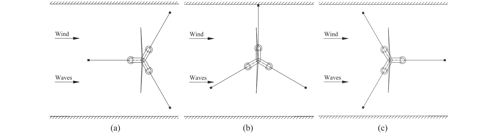

   **图 9** WTWF内不同风浪方向的模型布置：（a）0°；（b）30°；（c）60°。

所有工况均用OpenFAST模拟，与试验互证，以进一步保证准确性并阐明风浪效应。用ANSYS AQWA分析平台水动力，获得静水刚度、附加质量、辐射阻尼、波浪力及二阶平均漂移力系数。验证表明运行状态下模拟20 min后趋稳，因此每次模拟至少30 min，保证10 min可用时程。

III 风浪环境标定试验
------------------------

A 风场标定
~~~~~~~~~~~~

为保证后续试验准确性，标定四风场，平均风速与湍流度剖面见图10、11。平均风速采用指数0.14的幂律。受设施限制，难在水面放置尖劈和粗糙元调湍流，且会影响波形传播，故风场在空风洞中自由发展、湍流较低。机舱高度湍流度分别5.9%（SW1）、3.4%（SW2）、1.8%（SW3）、1.5%（SW4）。SW1缩尺风速很低，叶轮低速运行使湍流高于其他工况；但总体仍低。数值风场据试验生成。图12实测风谱与标准比较，四风场脉动风模拟较好，少数点偏差略大但在工程允许范围，作者认为实验室风场良好。

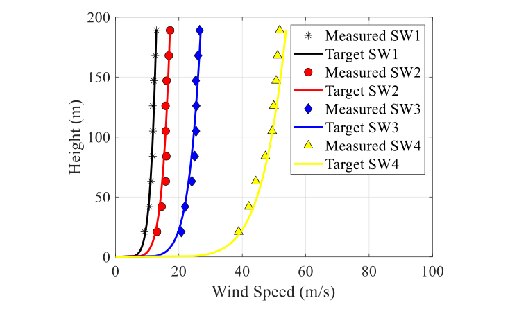

   **图 10** 平均风速剖面：四风场实测与目标比较。

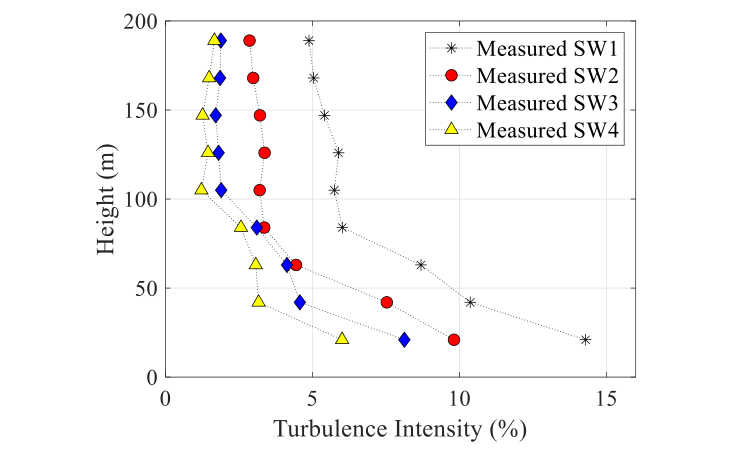

   **图 11** 四风场湍流度剖面。

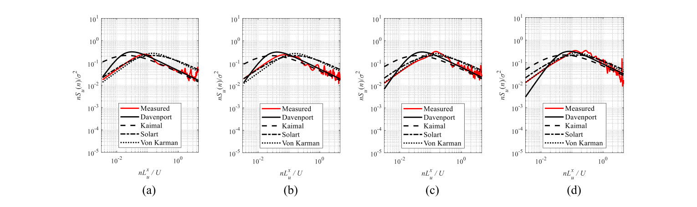

   **图 12** 风谱：（a）SW1；（b）SW2；（c）SW3；（d）SW4。

B 波场标定
~~~~~~~~~~~~

为保证结果准确，检查不规则波场。图13比较四种实测波谱和目标JONSWA谱，二者一致良好；小误差可能来自水槽侧壁反射波。结果说明水槽可模拟指定真实海况、满足试验要求。

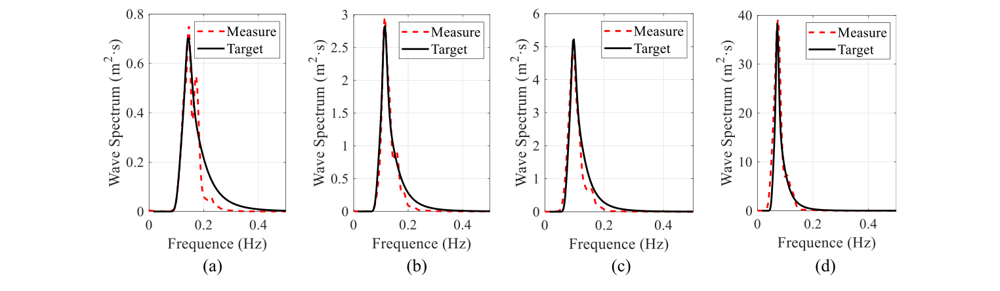

   **图 13** 波谱：（a）IW1；（b）IW2；（c）IW3；（d）IW4。

.. note::

   正文此处原拼写JONSWA，工况表与前文使用JONSWAP；指向同一目标波谱，不据拼写差异另造模型。实验室低湍流条件与同向风浪约束，不等于任意真实海上湍流或非共线风浪均已验证。

C 风机荷载标定
~~~~~~~~~~~~~~~~

缩尺模型塔底荷载可能不同于真实风机，须标定以保证试验顺利。在叶尖速比相似前提下，改变桨距使塔底荷载相似，机舱电机控转速，桨距人工调节。标定时塔底固定，风机直接安装在实验室底板而非浮台上，但机舱垂向坐标与漂浮系统相同。图14对比塔底剪力、弯矩与目标，吻合良好，最大误差仅8.6%，模型满足试验要求。

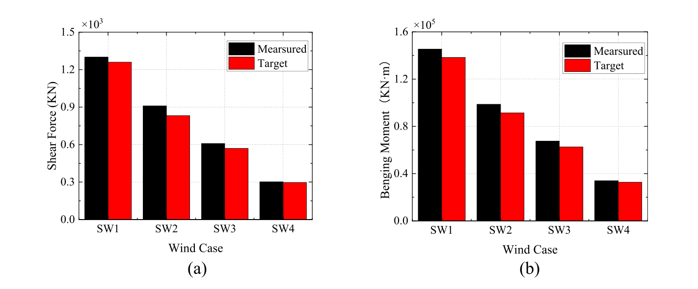

   **图 14** 风机塔底荷载标定：（a）剪力；（b）弯矩。

IV 试验结果与分析
--------------------

A 静水试验
~~~~~~~~~~~~

对0°、30°、60°方向施加多个初始位移，得到系泊恢复力，见图15。数值与试验一致良好，说明试验线长、配重、锚距等与目标参数相符。位移绝对值小于10 m时，恢复力—位移关系近线性；超过10 m时呈非线性，刚度随位移增加。因Y形平台对称性，0°与60°恢复力曲线数值相同、方向相反，呈对称关系。考虑正位移侧，0°刚度最大，其次30°，60°最小。

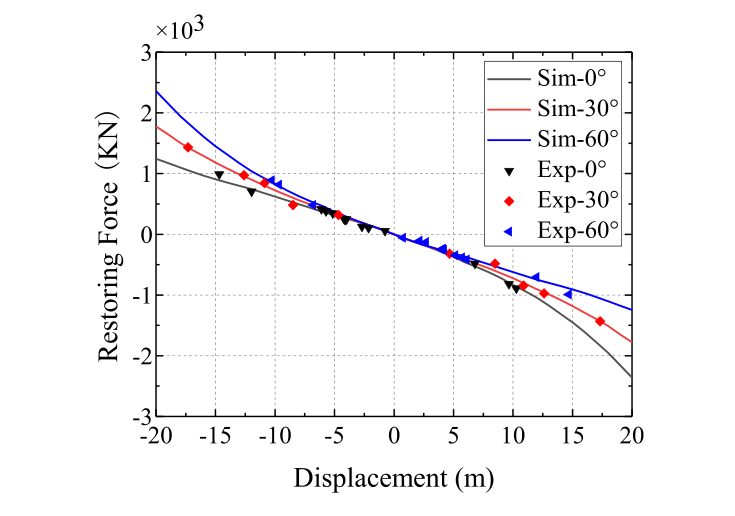

   **图 15** 系泊系统恢复力—位移关系，含0°、30°、60°试验与模拟。

静水试验可得模型自由衰减。图16比较FAST与试验的纵荡、垂荡、纵摇，固有周期见表VIII。两者一致良好，表明实际模型质量、重心高度、惯量和系泊刚度与目标相符，制作、配重位置和密封性理想。本文还依据自由衰减曲线调整模型水环境刚度与阻尼系数，为后续模拟建立基准。

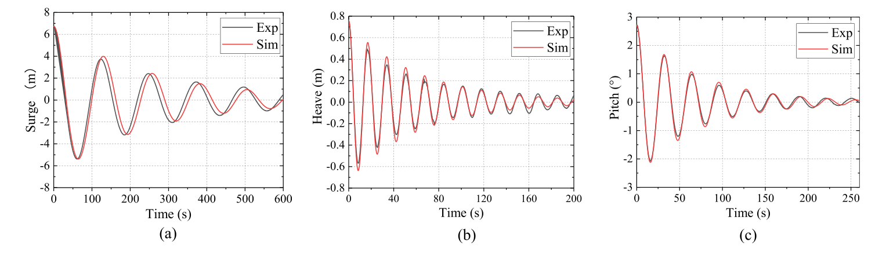

   **图 16** 静水自由衰减试验与模拟：（a）纵荡；（b）垂荡；（c）纵摇。

.. list-table:: 表 VIII 自由衰减周期比较
   :header-rows: 1
   :class: longtable

   * - 运动
     - 试验周期 / s
     - 模拟周期 / s
   * - 纵荡
     - 124.1
     - 128.3
   * - 垂荡
     - 17.0
     - 16.9
   * - 纵摇
     - 32.2
     - 32.0

为避免过大共振，系统固有频率不应与转子、波浪频率重叠。10 MW机组转速6.0–9.6 rpm，故1P范围0.10–0.16 Hz、3P范围0.30–0.48 Hz；波浪激励通常0.06–0.18 Hz。表VIII显示本研究平台运动固有频率均低于0.06 Hz，有利于减小响应；垂荡、纵摇更易接近波频下界。调整压载分布改变质量惯量，或调整柱径改变静水刚度，可调固有频率。

.. note::

   表VIII列的是纵荡、垂荡、纵摇周期；“均低于0.06 Hz”据此限定为这些平台运动，不扩展成塔筒、叶片等所有结构模态。自由衰减用于模型参数标定，不能把同一标定一致性误当完全独立预测验证。

B 规则波试验
~~~~~~~~~~~~~~

规则波试验研究耐波性及波浪对线性水动力特性的影响，水槽试验和数值模拟共同获取RAO。图17比较三波向，整体一致良好，随波周期趋势也相同。

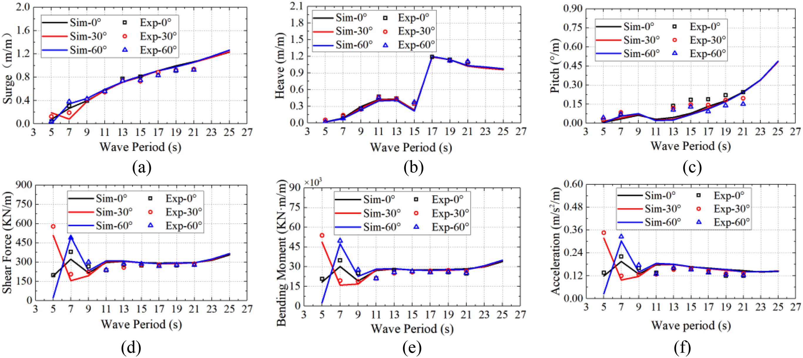

   **图 17** 三波向RAO：（a）纵荡；（b）垂荡；（c）纵摇；（d）塔底剪力；（e）塔底弯矩；（f）机舱前后向加速度。

5–9 s短周期下，波向对纵荡RAO影响明显，方向效应随周期改变。11–21 s三方向基本相同，超过21 s后60°逐渐大于另两向，反映不同方向系泊刚度。波向对垂荡和纵摇RAO影响较小：7–13 s垂荡0°最高，其次30°；纵摇60°在5–9 s略高，在11–19 s略低，周期继续增大时方向影响很小。塔底剪力、弯矩及加速度RAO变化相关明显，5–9 s方向差异较大：5 s时30°最大、60°最小，7 s反转为60°最大、30°最小，与纵荡一致，说明短周期塔底荷载和机舱加速度主要受纵荡控制。9 s时三向差异迅速减小，此后随周期增大继续减弱。无风时两者主要来自平台运动，不同方向较小的纵荡、纵摇差异也会放大为塔底荷载、加速度差异。总体而言，波向影响Y形半潜风机耐波性。

纵荡和纵摇RAO基本随周期增大。纵摇在短周期增长慢，随周期增加增速提高；长周期极端海况须关注纵摇共振导致的倾覆风险。垂荡RAO在0–19 s基本增大，仅13–15 s下降，17 s因共振突增，需要足够水上柱高防淹。仅有规则波、没有气动时，塔底剪力和弯矩主要由机舱惯性力及纵摇产生的重力分量组成。塔底荷载与机舱加速度RAO随周期趋势基本相同、相关显著。11–21 s均略下降，加速度降幅较大；21–27 s塔底荷载增速显著高于加速度，主要因为较大纵摇角增加重力分量。

.. note::

   试验工况明确为5–21 s九个规则波，而本节讨论曲线延伸到27 s；图17同时含数值曲线与试验点。这里保留原讨论，不把21–27 s都宣称为已开展的规则波实测试验。

C 单风试验
~~~~~~~~~~~~

通过试验和模拟研究风向及运行状态影响。试验湍流低，响应均值与极值差异不大，图18仅展示均值。试验与模拟一致，表明数值模型可准确捕捉该系统气动特性。

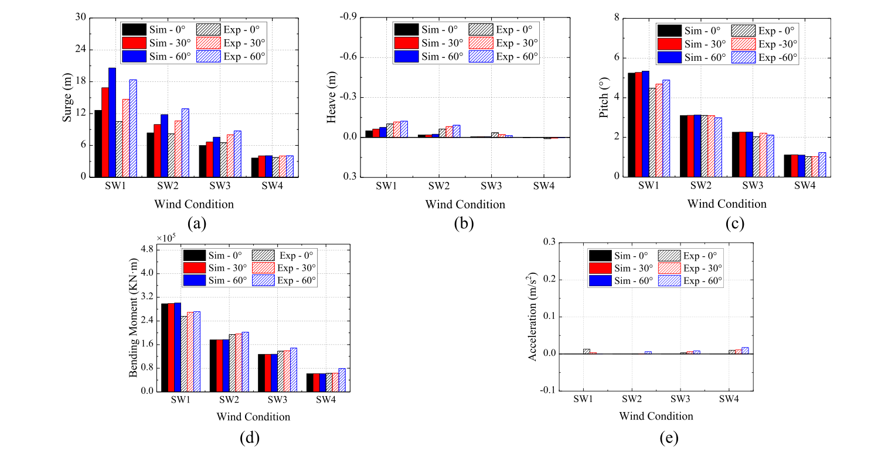

   **图 18** 三风向平均响应：（a）纵荡；（b）垂荡；（c）纵摇；（d）塔底弯矩；（e）机舱加速度。

纵荡主要由转子风推力与系泊恢复力平衡决定。因方向刚度不同，60°纵荡最大，30°次之，0°最小。额定运行推力最大，方向差异也最大；SW1中60°纵荡极值比30°、0°分别高22%、63%，说明风向影响显著。除额定工况60°垂荡、纵摇略大外，后二者方向差异不明显。

低湍流下机组运行稳定，机舱加速度基本为零。浮台运动明显放大塔底荷载，漂浮机组塔底弯矩为固定机组的188%–218%（见图14），因为纵摇带来的重力分量增加荷载。弯矩关系强度安全与疲劳寿命，应在设计中重点关注。三方向塔底弯矩与机舱加速度相似，风向影响较小。

.. note::

   188%–218%为“浮式值占固定值的比例”，不是增加188%–218%。图18显示均值，正文随后用“极值”给出22%和63%，这里保留作者措辞，不据该均值柱图另算极值。

D 单浪试验
~~~~~~~~~~~~

图19为不规则单浪下平台运动、塔底弯矩和机舱加速度统计，各工况数值与试验一致良好。

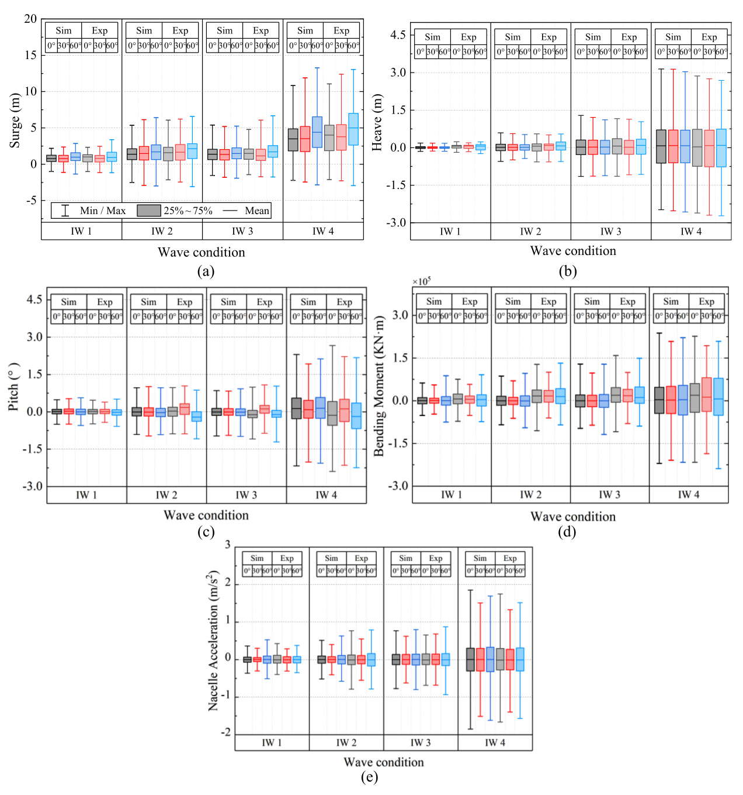

   **图 19** 三波向响应箱线：（a）纵荡；（b）垂荡；（c）纵摇；（d）塔底弯矩；（e）机舱前后向加速度。箱体为25%–75%，横线为均值，须为最小／最大。

二阶平均漂移力使单浪下纵荡均值偏离平衡位置，但均小于5.0 m。均值与方向系泊刚度密切相关，0°最小、60°最大。垂荡、纵摇、塔底弯矩和机舱加速度均值基本为零，说明平均漂移力对这些量影响小。实际试验不能像数值模拟一样完全理想，外部干扰不可避免，故有些均值不完全接近零；但整体仍基本一致。

60°系泊刚度最小，纵荡最大，其次30°，0°极值最小。IW4波浪荷载最大，方向极值差异也最大：60°比30°、0°分别高12%、23%。垂荡方向影响不明显，0°略高。IW4中30°纵摇显著小于另两向，因此极端海况应更关注0°、60°倾覆风险。30°塔底荷载和机舱加速度明显较小，与图17 RAO一致，更详细原因将在IV.F频谱分析。波向明显影响系统响应，设计安装应适当分析，以实现良好性能。

E 风浪联合试验
~~~~~~~~~~~~~~~~

图20比较风浪联合作用下模型试验与数值结果，二者吻合良好。

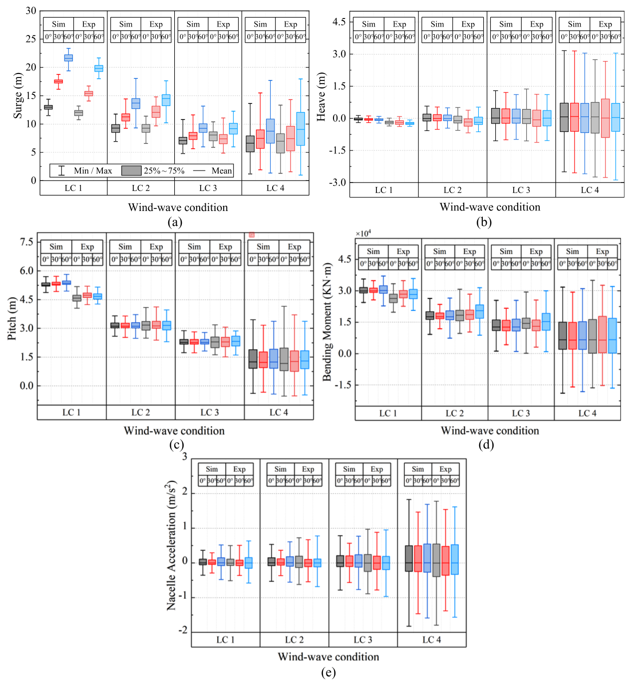

   **图 20** 三风浪同向来向响应箱线：（a）纵荡；（b）垂荡；（c）纵摇；（d）塔底弯矩；（e）机舱前后向加速度。

.. note::

   图20(c)原轴把Pitch标为m，而图19和其他纵摇图用°；保留原图，不认可该长度单位作为纵摇量纲。图18(d)、19(d)弯矩标度为10⁵，图20(d)为10⁴，按源图保留，读者不应在未核对源数据前直接据此跨图作量级换算。

结合单风、单浪结果，运行状态下纵荡、纵摇和塔底弯矩主要受风荷载控制；相较单浪，风浪联合极值增加97%–1065%。风机荷载下降，风作用比例也降低。极限自存状态叶片顺桨、停止发电，风机荷载迅速降低，极端海况响应更受波浪影响。垂荡与机舱加速度主要受波荷载影响，极限自存时风浪联合与单浪极值几乎相同。

方向系泊刚度不同，使60°联合纵荡最大，30°、0°依次减小。垂荡和纵摇的方向性与单浪类似：0°垂荡略高，LC4中30°纵摇显著较小；30°塔底荷载和机舱加速度也远小于0°、60°。

F 频谱分析
~~~~~~~~~~~~

前述统计为时域结果，需频谱分析进一步探索机制。本节在频域分析单浪与联合响应，为简化，仅选IW2和LC2，考察纵荡、垂荡、纵摇、塔底弯矩和机舱加速度。图21比较各方向功率谱密度（PSD）。

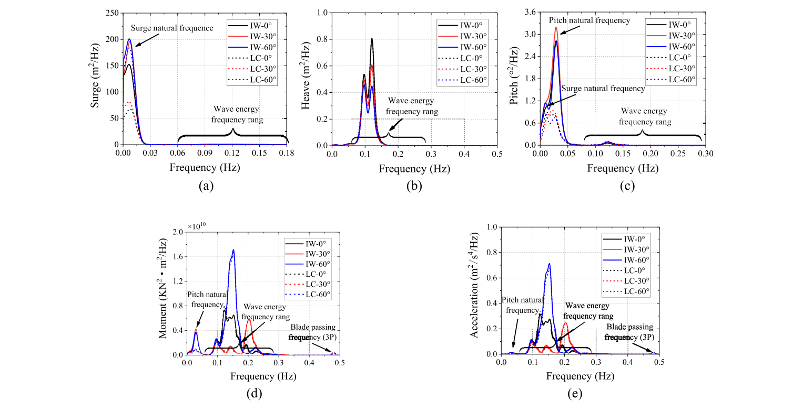

   **图 21** IW2和LC3模型试验响应频谱比较（原图注所列工况）：（a）纵荡；（b）垂荡；（c）纵摇；（d）塔底弯矩；（e）机舱加速度。

.. note::

   正文写IW2／LC2，原图21图注写IW2／LC3，而图例仅写IW／LC，没有工况编号；二者存在源内冲突，不能自行断定哪个组合正确。另下段原文指图21(a)、(b)的纵荡与纵摇，实际子图(b)是垂荡，(c)才是纵摇。

如原文所引图21(a)、(b)，纵荡和纵摇谱峰主要接近各自固有频率，共振运动占主导，0.06–0.28 Hz波频分量较弱，因此须避免纵摇固有频率接近波频；纵摇还与纵荡耦合。垂荡不同，谱峰主要集中波频，自身固有频率影响弱，不受耦合影响，独立于纵荡、纵摇。塔底弯矩与机舱加速度相关强、谱形相似，谱峰主要在波频、响应主要受波浪控制；同时还受纵摇固有频率与叶片通过频率3P激发。显然，纵摇产生的机舱和塔筒重力分量增加塔底荷载。

低湍流下机组运行稳定，风荷载对垂荡、塔底弯矩、机舱加速度PSD影响较小，单浪谱基本与联合谱一致。但单浪的纵荡、纵摇谱峰明显大于联合情况，因为转子气动力由相对气流速度，即风速与系统振动速度矢量和产生，平台振动造成的附加气动相当于提供气动阻尼，抑制两者幅值。联合工况塔底荷载在纵摇固有频率附近的谱峰也显著降低；运行叶片的3P效应对塔底荷载和机舱加速度明显。

不同方向PSD明显不同。系泊刚度使60°纵荡PSD最大，其次30°，0°最小；垂荡相反，0°最大、60°最小。30°纵摇PSD略大于另两向，0°、60°基本相同。波频范围内塔底弯矩和机舱加速度PSD以60°最大；0°与30°最大PSD相近，但峰频不同，30°明显峰偏高频。30°两响应总能量显著较小，说明平台不同方向吸收波能不同，是其响应较小的主要原因。0.02–0.05 Hz低频区，纵摇共振激发塔底弯矩，方向PSD差异与纵摇类似，30°略高。

总之，风浪方向显著影响系统PSD，特别是关联疲劳、强度安全和传动链运行的塔底荷载与机舱加速度，必须关注。

V 结论
--------

本文开展10 MW Y形半潜式风机0°、30°、60°风／浪方向缩尺试验，以数值模拟验证。WTWF风浪场良好，模型可准确代表原型FOWT，主要结论如下。

静水试验表明，平台固有频率可远离转子与波频以减小响应，但垂荡、纵摇更易接近波浪激励，应特别关注。频谱显示纵摇可激发主要峰在波频的塔底荷载和机舱加速度；纵摇与波浪共振可能导致倾覆及结构破坏。主要由波频控制的垂荡也要求足够水上柱高。

规则波结果表明，应特别注意短周期方向效应。5–9 s不同方向的纵荡、塔底荷载、机舱加速度存在显著差异，短周期后两者RAO甚至可能超过长周期。

不规则单浪与单风下，纵荡方向性主要由系泊刚度控制，垂荡方向差异不很明显。0°、60°主要由波频主导的塔底弯矩与机舱加速度较大，应重点关注；极限自存时这两向较大纵摇会进一步增加二者响应。波向还改变峰频：30°对较高频波浪敏感，0°、60°对较低频敏感，平台不同方向吸收波能确有差异。

综上，风浪方向确实影响10 MW Y形半潜式系统，尤其纵摇、塔底荷载和机舱加速度；还需关注垂荡、纵摇固有频率，避免过大响应。这些均关联结构强度安全及机舱发电效率，设计和安装前应全面确定方向效应。

.. note::

   结论基于本构型、0°／30°／60°、所列海况与低湍流同向风浪。这里测量运动、荷载和加速度，不是实际发电收益或寿命疲劳的定量认证，也不证明任意方向下30°都最优。

参考文献
--------

[1] C. Iuppa, L. Cavallaro, E. Foti, and D. Vicinanza, “Potential wave energy production by different wave energy converters around Sicily,” J. Renewable Sustainable Energy 7(6), 061701 (2015). `原文链接 <https://doi.org/10.1063/1.4936397>`__。

[2] P. Contestabile, V. Ferrante, and D. Vicinanza, “Wave energy resource along the Coast of Santa Catarina (Brazil),” Energies 8(12), 14219–14243 (2015).). `原文链接 <https://doi.org/10.3390/en81212423>`__。

[3] A. Uihlein and D. Magagna, “Wave and tidal current energy: A review of the current state of research beyond technology,” Renewable Sustainable Energy Rev. 58, 1070–1081 (2016). `原文链接 <https://doi.org/10.1016/j.rser.2015.12.284>`__。

[4] T. Soukissian, F. Karathanasi, and P. Axaopoulos, “Satellite-based offshore wind resource assessment in the Mediterranean Sea,” IEEE J. Oceanic Eng. 42(1), 73–86 (2017). `原文链接 <https://doi.org/10.1109/JOE.2016.2565018>`__。

[5] B. K. Sahu, “Wind energy developments and policies in China: A short review,” Renewable Sustainable Energy Rev. 81, 1393–1405 (2018). `原文链接 <https://doi.org/10.1016/j.rser.2017.05.183>`__。

[6] WWEA, see https://wwindea.org/worldwide-wind-capacity-reaches-744-gigawatts/ for “Worldwide Wind Capacity Reaches 744 Gigawatts: An Unprecedented 93 Gigawatts Added in 2020” (last accessed March 24, 2021).

[7] International Renewable Energy Agency, Renewable Capacity Highlights (International Renewable Energy Agency, Masdar, 2020).

[8] British Petroleum, Statistical Review of World Energy (British Petroleum, London, 2020).

[9] Wind Europe, Wind energy in Europe in 2020-Trends and Statistics (Wind Europe, Brussels, 2020).

[10] Global Wind Energy Council, Global Wind Report 2021 (Global Wind Energy Council, Brussels, 2021).

[11] Energy Research Institute, NDRC, PRC, China’s Wind Power Development Roadmap 2050 (Energy Research Institute, 2011) (in Chinese).

[12] J. Z. Wang, S. S. Qin, S. Q. Jin, and J. Wu, “Estimation methods review and analysis of offshore extreme wind speeds and wind energy resources,” Renew Sustain Energy Rev. 42, 26–42 (2015). `原文链接 <https://doi.org/10.1016/j.rser.2014.09.042>`__。

[13] S. P. Breton and G. Moe, “Status, plans and technologies for offshore wind turbines in Europe and North America,” Renewable Energy 34, 646–654 (2009). `原文链接 <https://doi.org/10.1016/j.renene.2008.05.040>`__。

[14] N. Ederer, “The market value and impact of offshore wind on the electricity spot market: Evidence from Germany,” Appl. Energy 154, 805–814 (2015). `原文链接 <https://doi.org/10.1016/j.apenergy.2015.05.033>`__。

[15] G. Chen, X. F. Liang, and X. B. Li, “Modeling of wake dynamics and instabilities of a floating horizontal axis wind turbine under surge motion,” Energy 239, 122110 (2022). `原文链接 <https://doi.org/10.1016/j.energy.2021.122110>`__。

[16] J. Ladenburg and M. Skotte, “Heterogeneity in willingness to pay for the location of offshore wind power development: An application of the willingness to pay space model,” Energy 241, 122900 (2022). `原文链接 <https://doi.org/10.1016/j.energy.2021.122900>`__。

[17] G. Failla and F. Arena, “New perspectives in offshore wind energy,” Philos. Trans. 373(2035), 20140228 (2015). `原文链接 <https://doi.org/10.1098/rsta.2014.0228>`__。

[18] J. Jonkman, Definition of the Floating System for Phase IV of OC3 (National Renewable Energy Laboratory, 2010).

[19] M. Collu and M. Borg, “Design of floating offshore wind turbines,” in Offshore Wind Farms (Woodhead Publishing, 2016), pp. 359–385.

[20] M. H. Patel, Dynamics of Offshore Structures (Butterworth Publishers, Stoneham, MA, 2013).

[21] M. Karimirad, “Floating offshore wind turbines,” in Offshore Energy Structures (Springer, 2014), pp. 53–76.

[22] T. D. Petty and L. G. Chabot, “Semi-submersible platform with adjustable heave motion,” U.S. patent 4,850,744 (United States Patent and Trademark Office, 1989).

[23] L. C. Liu, S. W. Li, Q. Yi, and D. Y. Chen, “Developments in semi-submersible floating foundations supporting wind turbines: A comprehensive review,” Renewable Sustainable Energy Rev. 60, 433–499 (2016). `原文链接 <https://doi.org/10.1016/j.rser.2016.01.109>`__。

[24] B. B. Li, K. Liu, G. W. Yan, and J. P. Ou, “Hydrodynamic comparison of a semi-submersible, TLP, and Spar: Numerical study in the South China Sea environment,” J. Mar. Sci. Appl. 10, 306 (2011). `原文链接 <https://doi.org/10.1007/s11804-011-1073-2>`__。

[25] N. Bruinsma, B. T. Paulsen, and N. G. Jacobsen, “Validation and application of a fully nonlinear numerical wave tank for simulating floating offshore wind turbines,” Ocean Eng. 147, 647–658 (2018). `原文链接 <https://doi.org/10.1016/j.oceaneng.2017.09.054>`__。

[26] C. Feist, F. Sotiropoulos, and M. Guala, “A quasi-coupled wind wave experimental framework for testing offshore wind turbine floating systems,” Theor. Appl. Mech. Lett. 11, 100294 (2021). `原文链接 <https://doi.org/10.1016/j.taml.2021.100294>`__。

[27] L. Q. Sang, Q. A. Li, C. Cai, T. Meada, Y. Kamadal, X. B. Wang, S. N. Zhou, and F. H. Zhang, “Wind tunnel and numerical study of a floating offshore wind turbine based on the cyclic pitch control,” Renewable Energy 172, 453–464 (2021). `原文链接 <https://doi.org/10.1016/j.renene.2021.03.027>`__。

[28] G. R. Tomasicchio, D. Vicinanza, M. Belloli, C. Lugli, J. Latham, B. Jensen, A. Vire, J. Monbaliu, F. Taruffi, L. Pustina et al., “Physical model tests on spar buoy for offshore floating wind energy conversion,” Ital. J. Eng. Geol. Environ. 1, 129–143 (2020). `原文链接 <https://doi.org/10.4408/IJEGE.2020-01.S-15>`__。

[29] S. Russo, P. Contestabile, A. Bardazzi, E. Leone, G. Iglesias, G. R. Tomasicchio, and D. Vicinanza, “Dynamic loads and response of a Spar buoy wind turbine with pitch-controlled rotating blades: An experimental study,” Energies 14(12), 3598 (2021). `原文链接 <https://doi.org/10.3390/en14123598>`__。

[30] L. Meng, Y. P. He, Y. S. Zhao, J. Yang, H. Yang, Z. L. Han, L. Yu, W. G. Mao, and W. K. Du, “Dynamic response of a 6 MW Spar type floating offshore wind turbine by experiment and numerical analyses,” China Ocean Eng. 34(5), 608–620 (2020). `原文链接 <https://doi.org/10.1007/s13344-020-0055-z>`__。

[31] H. Ahn and H. Shin, “Experimental and numerical analysis of a 10 MW floating offshore wind turbine in regular waves,” Energies 13(10), 608–620 (2020). `原文链接 <https://doi.org/10.3390/en13102608>`__。

[32] C. Michailides, Z. Gao, and T. Moan, “Experimental and numerical study of the response of the offshore combined wind/wave energy concept SFC in extreme environmental conditions,” Mar. Struct. 50, 35–54 (2016). `原文链接 <https://doi.org/10.1016/j.marstruc.2016.06.005>`__。

[33] J. Chen and Z. Hu, “Experimental investigation of aerodynamic effect-induced dynamic characteristics of an OC4 semi-submersible floating wind turbine,” J. Eng. Marit. Environ. 232(1), 19–36 (2018). `原文链接 <https://doi.org/10.1177/1475090217706194>`__。

[34] C. Michailides, Z. Gao, and T. Moan, “Experimental study of the functionality of a semi-submersible wind turbine combined with flap-type wave energy converters,” Renewable Energy 93, 675–690 (2016). `原文链接 <https://doi.org/10.1016/j.renene.2016.03.024>`__。

[35] Z. Gao, T. Moan, L. Wan, and C. Michailides, “Comparative numerical and experimental study of two combined wind and wave energy concepts,” J. Ocean Eng. Sci. 1(1), 36–51 (2016). `原文链接 <https://doi.org/10.1016/j.joes.2015.12.006>`__。

[36] S. T. Zhou, C. Li, Y. Q. Xiao, and P. W. Cheng, “Importance of platform mounting orientation of Y-shaped semi-submersible floating wind turbines: A case study using surrogate models,” Renewable Energy 156, 260–278 (2020). `原文链接 <https://doi.org/10.1016/j.renene.2020.04.014>`__。

[37] E. E. Bachynski, M. Thys, T. Sauder, V. Chabaud, and L. O. Sæther, “Real-time hybrid model testing of a braceless semi-submersible wind turbine: Part II—Experimental results,” in Proceedings of the 35th International Conference on Ocean, Offshore and Arctic Engineering, Busan, Korea (ASME, 2016), p. 12.

[38] S. T. Zhou, B. H. Shan, Y. Q. Xiao, C. Li, G. Hu, X. P. Song, Y. Q. Liu, and Y. M. Hu, “Directionality effects of aligned wind and wave loads on a Y-shape semi-submersible floating wind turbine under rated operational conditions,” Energies 10, 2097 (2017). `原文链接 <https://doi.org/10.3390/en10122097>`__。

[39] C. Bak, F. Zahle, R. Bitsche, T. Kim, A. Yde, L. C. Henriksen, M. H. Hansen, J. Blasques, M. Gaunaa, and A. Natarajan, The DTU 10-MW Reference Wind Turbine (Risø National Laboratory, Technical University of Denmark, 2013).

[40] I. Bayati, M. Belloli, L. Bernini, and A. Zasso, “Aerodynamic design methodology for wind tunnel tests of wind turbine rotors,” J. Wind Eng. Ind. Aerodyn. 167, 217–227 (2017). `原文链接 <https://doi.org/10.1016/j.jweia.2017.05.004>`__。

[41] W. Yu, K. Müller, and F. Lemmer, Qualification of Innovative Floating Substructures for 10 MW Wind Turbines and Water Depths Greater than 50 m (University of Stuttgart, 2015).
