.. _paper-note-ref-zheng2023-MS:

海上风机导管架结构的高效优化设计方法：论文精解
==============================================

精简版微信公众号文章：待发布

**精解范围：** 覆盖摘要、科学正文、图表、公式及参考文献；不含利益冲突声明、数据可用性说明和致谢尾节。

.. contents:: 本页目录
   :local:
   :depth: 2

论文信息
--------

**原文题名：** Efficient optimization design method of jacket structures for offshore wind turbines。

**作者：** Shunyun Zheng，Chao Li（通讯作者），Yiqing Xiao。

**单位：** 哈尔滨工业大学（深圳）土木与环境工程学院；哈尔滨工业大学深圳市土木工程智能结构系统重点实验室。

**期刊：** Marine Structures，89（2023），103372。DOI：`10.1016/j.marstruc.2023.103372 <https://doi.org/10.1016/j.marstruc.2023.103372>`_。

**稿件日期：** 2021年12月27日收稿；2022年10月18日修回；2022年12月24日录用；2023年1月31日在线发表。

**WOEAI 相关方向：** 海洋能源结构 / 一体化分析。

**研究对象边界：** 本文实际对象是由海床桩支撑的底固定式导管架，不是漂浮平台。保留既定关联研究分类，不据栏目名称把其结论改写成浮式风机验证。

摘要
----

随着海上风能开发逐步推进，未来将向更深水域扩展。水深增加时，导管架基础将取代目前单桩基础。基础占海上风电场建设成本的大部分，导管架结构优化将带来可观经济收益。结构优化是计算量巨大的复杂迭代过程，因此本文提出基于代理模型的方法，高效解决该问题，快速获得轻量化导管架方案。优化主要考虑50年重现期等效静态极端荷载下响应，以参数敏感性分析确定关键变量，将有限元模型转为代理模型，用遗传算法直接优化。随后以耦合动力分析、屈曲强度和疲劳寿命复核，并对不满足要求的局部构件精细再优化。30、50、 :math:`70\,\mathrm{m}` 水深轻量化方案说明方法适用且高效。敏感性分析可将变量数减半，代理模型约节省原计算时间98.61%。作者认为所提方法精度和效率较高，适用于工程实践。

**关键词：** 风机；导管架；代理模型；结构优化；疲劳；屈曲。

1 引言
--------

近年来，人类逐步降低化石能源依赖，提高清洁能源关注和需求，可再生能源增长已不可阻挡。风能近20年发展显著，成为全球清洁低成本主流能源，研究持续推进降本。风场选址于丰富风资源区，可取得有竞争力的经济效益，甚至挑战化石能源。资源丰富区常在沿海或海上，沿海国家逐步布局、产业快速扩张。近岸因各种原因已占用或受限，开发向深水延伸；广阔海域有较高发电效率和大型风场建设条件，海上噪声、视觉污染不再成问题，使其备受关注。GWEC报告指出，海上风电日益推动全球装机[1]，2020年行业新增装机创 :math:`9.3\,\mathrm{GW}` 新高、同比增长53%[1]，但仍不足以确保2050净零，全球需求继续迅速扩大[1–3]；预计2030年海上累计装机达 :math:`120\,\mathrm{GW}` 。另一方面，复杂海况增加设计和建设成本，水深（WD）增大及强水动、气弹荷载需要复杂庞大支撑。深水风电面临机遇与挑战。

.. note::

   引言统计、成本及2030预测为原文历史背景，不更新为当前行业数据，也不据此作现时投资判断。

海上风机常用固定式和浮式基础。单桩结构简单、施工便利，仍为商业机组最常见基础，欧洲多数位于浅水。WindEurope统计2020年单桩占80.5%，原文称超过三分之二；导管架第二，占19%，新增100座。截至2020年底欧洲568台海上机组采用导管架，占比由2019年8.9%升至2020年9.9%[4]。欧盟2050净零目标使海上风电前景广阔[5]，更大机组、更深水将需要更多导管架而非单桩[5]。中国近年也建设导管架：2014年珠海桂山高 :math:`30\,\mathrm{m}` 、重 :math:`400\,\mathrm{t}` ；2019年阳江南鹏岛吊装 :math:`900\,\mathrm{t}` ；2020年阳江阳西沙扒项目安装当时国内最大、高 :math:`63\,\mathrm{m}` 、重 :math:`1560\,\mathrm{t}` 导管架。中国开发向深海推进，已批准22个水深 :math:`26\text{–}55\,\mathrm{m}` 项目，将对导管架提出更多需求。

深水导管架在经济性与结构性能上优于单桩[6]。支撑系统占总成本较大比例，有研究估计美国 :math:`500\,\mathrm{MW}` 海上风场建设成本5000–6000美元/kW，支撑系统资本成本占22%[7]。基础降本潜力大，吸引学术界与工业界研究[8]，结构优化是有效措施[9]。实际导管架多凭经验设计，安全冗余和材料消耗较大，优化空间可观；但问题高度受约束、非凸、非线性，需要大量复杂迭代[10]。多变量复杂支撑结构的高效优化尤其值得研究。

借助海上油气技术经验，导管架适合 :math:`30\text{–}80\,\mathrm{m}` 水深[11–14]。已有研究多针对约 :math:`50\,\mathrm{m}` 水深。Chew等[15,16]用解析梯度优化OC4，显著减重；Oest等[17]比较三种梯度方法，通过管件尺寸取得初步方案；Kaveh等[18,19]用碰撞体优化CBO及增强ECBO改善效率、减重。上述均面向NREL  :math:`5\,\mathrm{MW}` ，而近年机组增至 :math:`10\,\mathrm{MW}` ，导管架挑战更大。Sandal等[20]基于梯度优化尺寸，另有研究[21]一体化优化导管架与桩以降综合成本。为避共振，Natarajan等[22]以固有频率最小化为目标，用无导数和序列二次规划优化DTU  :math:`10\,\mathrm{MW}` 轻量化基础。Häfele等[23]提出夹层管混合导管架并优化。复杂迭代耗资巨大，动力模拟优化需数月[23]，静力也需数日[22]，实际工程却需短期内获得可靠方案，故高效方法意义重大。

本文为满足成本与效率要求，提出代理模型导管架优化。目标为结构总质量，约束包括固有频率、机舱位移、von Mises应力、屈曲强度。屈曲和疲劳分析需要耗时耦合模拟；疲劳主要关联局部参数，故作为优化后最终校核。优化主要考虑50年重现期极端荷载的等效静力，保证极限状态；通过敏感性分析筛选变量，将有限元替换为代理并用遗传算法求解，再耦合动力校核实际海况的材料强度、屈曲和疲劳，对失效局部精细再优化。以DTU  :math:`10\,\mathrm{MW}` 为对象，对30、50、 :math:`70\,\mathrm{m}` 水深设计比较，评价方法表现。

2 结构优化设计方法
--------------------

2.1 优化框架
~~~~~~~~~~~~~~~~

海上风机是复杂海洋结构。随着深海开发，导管架将较大范围替代单桩[24]。支撑成本占工程总成本较大部分，其设计兼具机遇挑战。为缩短传统优化耗时，本文研究改进框架，快速获取初始设计。

结构设计首先考察极限状态（ULS）。DNV-ST-0126要求以50年重现期极端组合荷载设计[25]，DNV还建议采用极端荷载等效静力，求最大应力、应变和挠度[26]。本文据此获得合理初步导管架。按DNV-ST-0437，50年极端风机荷载通常由长期动力响应统计外推，结构设计也推荐50年参考有义波[27]。一般该静力响应对导管架设计足够且偏保守[28]，第3.1.3节将比较静、动力说明必要性与保守性。为效率，迭代主要采用等效静力、模态和屈曲分析，另对优化方案开展不同环境的必要动力时域验证。再以敏感性分析降维、代理模型替代复杂低效有限元，直接在代理上求解。

.. figure:: ../../../wechat/assets/public-safe/ref-zheng2023-MS/fig01.jpg
   :alt: 图1 导管架优化框架：重力、静水压力、50年风机与参考波浪荷载进入等效静力；敏感性筛选、试验设计、代理建立验证、遗传优化后，依次开展耦合动力、屈曲及疲劳校核，不合格则修改约束或局部参数。
   :align: center
   :width: 100%

   **图 1** 导管架优化框架：重力、静水压力、50年风机与参考波浪荷载进入等效静力；敏感性筛选、试验设计、代理建立验证、遗传优化后，依次开展耦合动力、屈曲及疲劳校核，不合格则修改约束或局部参数。

图1给出具体流程。优化采用DNV-ST-0437的50年极端荷载[27]，工况为塔顶统计外推风机极端荷载与50年参考波浪荷载的保守组合[29,30]，并考虑永久重力与静水压力。设计变量虽多，但不都显著，用敏感性分析识别关键量。将有限元转为变量与目标／约束间简单代数关系，以拉丁超立方抽样计算有限元结果建立并验证Kriging代理，允许相对误差不超过5%。遗传算法求优化方案，继以全耦合动力、屈曲、疲劳验证。屈曲和疲劳一般由少数局部构件控制，失败时分析再优化局部参数，满足完整性要求后得到最终方案。

2.2 优化问题
~~~~~~~~~~~~~~~~

导管架优化可降低设计建设成本、提高经济收益。本文以导管架与桩总质量为目标。疲劳主要由局部构件变量控制，又需不同环境动力模拟，因此等效静力性能优化过程中不考虑疲劳，随后单独作局部精细优化。一般约束包括固有频率、材料许用强度、屈曲强度、机舱位移和变量相关条件，表达为：

.. math::

   \begin{aligned}
   &\text{Find}\quad x=[x_1,x_2,x_3,\ldots,x_n]\\
   &\text{Minimize}\quad f(x)=\rho\sum_{e=1}^{e_{\max}}A_e(d_e,t_e)l_e,\quad e=1,2,\ldots,e_{\max}\\
   &\text{Subject to}\quad \sigma_e\le\sigma'_e/\gamma,\quad e=1,2,\ldots,e_{\max}\\
   &\qquad g_e\le1,\quad e=1,2,\ldots,e_{\max}\\
   &\qquad U_{\mathrm{NAC}}\le U'_{\mathrm{NAC}}/\gamma\\
   &\qquad f_{\min-i}\le f_i\le f_{\max-i},\quad e=1,2,\ldots,e_{\max}\\
   &\qquad x_n\in X,\quad n=1,2,\ldots,n_{\max}
   \end{aligned}
   \qquad (1)

x为设计点变量， :math:`A_e` 、 :math:`d_e` 、 :math:`t_e` 、 :math:`l_e` 分别为构件e的面积、直径、壁厚、长度，目标累加设计域全部单元质量。 :math:`f_i` 及上下限为第i阶固有频率约束，整机频率应远离波浪与转子1P、3P，避免共振。 :math:`\sigma_e` 为设计点的von Mises应力， :math:`\sigma'_e/\gamma` 为考虑荷载安全系数γ的许用应力； :math:`g_e` 为DNV-RP-C202定义的屈曲利用率[31]。 :math:`U_{\mathrm{NAC}}` 为机舱位移， :math:`U'_{\mathrm{NAC}}/\gamma` 为考虑γ的许用最大位移。X是设计变量线性约束，包括边界与变量间取值关系。

.. note::

   式(1)频率约束行原文仍写构件索引e=1,…,emax，而频率用i标识；保留原式索引差异，不默改作者记号。本页涉及规范为原研究引用版本，不替代现行规范及项目设计复核。

3 导管架结构优化
------------------

3.1 模拟设置
~~~~~~~~~~~~~~~~

3.1.1 DTU 10 MW基准风机
^^^^^^^^^^^^^^^^^^^^^^^^^^^^^^^^^^^^^^

DTU  :math:`10\,\mathrm{MW}` 基准机组近年广泛采用，参数见表1[32]。它是针对IEC 1A类海上风环境的标准三叶片风机。塔筒为空心变截面圆筒，外径从底 :math:`8.3\,\mathrm{m}` 线性降至顶 :math:`5.5\,\mathrm{m}` ，总高 :math:`115.63\,\mathrm{m}` ，沿高度分10段；壁厚由底 :math:`38\,\mathrm{mm}` 到顶 :math:`20\,\mathrm{mm}` ，每段递减 :math:`2.0\,\mathrm{mm}` ，段内恒定。S355钢弹性模量 :math:`210\,\mathrm{GPa}` 、泊松比0.3、密度 :math:`7850\,\mathrm{kg/m^3}` 。计入次要构件质量时，塔密度约增8%至 :math:`8500\,\mathrm{kg/m^3}` ，详见[32]。

.. list-table:: 表 1 DTU  :math:`10\,\mathrm{MW}` 基准风机主要参数 [32]
   :header-rows: 1
   :class: longtable

   * - 参数
     - 取值
   * - 风况
     - IEC Class 1A
   * - 转子朝向
     - 顺时针旋转；上风向
   * - 控制方式
     - 变速、集体变桨
   * - 切入／额定／切出风速
     - 4／11.4／ :math:`25\,\mathrm{m/s}`
   * - 额定功率
     -  :math:`10\,\mathrm{MW}`
   * - 叶片数
     - 3
   * - 转子／轮毂直径
     - 178.3／ :math:`5.6\,\mathrm{m}`
   * - 轮毂高度
     -  :math:`119.0\,\mathrm{m}`
   * - 传动系统
     - 中速、多级齿轮箱
   * - 最小／最大转速
     - 6.0／ :math:`9.6\,\mathrm{rpm}`
   * - 最大叶尖速度
     -  :math:`90.0\,\mathrm{m/s}`
   * - 轮毂悬伸
     -  :math:`7.1\,\mathrm{m}`
   * - 主轴倾角
     - 5.0°
   * - 转子预锥角
     - −2.5°
   * - 叶片预弯
     -  :math:`3.332\,\mathrm{m}`
   * - 转子／机舱／塔筒质量
     - 227962／446036／ :math:`628442\,\mathrm{kg}`

3.1.2 导管架概念设计
^^^^^^^^^^^^^^^^^^^^^^^^^^

导管架由多根腿柱和用于加劲的支撑组成。本文为四腿、四桩支撑，相邻腿以X撑连接，这是最常见形式[33]。以INNWIND.EU为DTU  :math:`10\,\mathrm{MW}` 、 :math:`50\,\mathrm{m}` 水深设计的参考架为对象[34]，生成30、 :math:`70\,\mathrm{m}` 初始方案，见图2。为避免波浪直接冲击塔筒和过渡段，按最大波高留足气隙，三水深实际架高46、66、 :math:`86\,\mathrm{m}` 。沿高分段，每段相邻腿由同平面双交叉撑连接，交点为X节点；顶、底加水平撑。同平面双撑和一腿相连为K节点。

.. figure:: ../../../wechat/assets/public-safe/ref-zheng2023-MS/fig02.jpg
   :alt: 图2 不同水深海上风机导管架：（a）整机三维模型；（b）70、50、30 m水深结构分段、X节点、K节点与桩示意。
   :align: center
   :width: 100%

   **图 2** 不同水深海上风机导管架：（a）整机三维模型；（b）70、50、 :math:`30\,\mathrm{m}` 水深结构分段、X节点、K节点与桩示意。

设计变量为顶宽、底宽、各段高度、腿与撑尺寸、桩尺寸，足以描述导管架，见表2。段高可变使K节点沿腿移动，但不允许节点重叠；几何确定后X节点固定。腿和撑为圆环截面，下段尺寸应大于上段，同段一致。桩径与壁厚也为变量，入土深度据轴向承载力和极限轴力自动确定[35]。承载力为桩侧摩阻与土中总端阻之和，详见[35]；桩还须为腿提供足够水平刚度。土剖面见表3[33]。30、50、 :math:`70\,\mathrm{m}` 方案分别18、23、28变量，但不必全部优化，应以敏感性筛选提高效率。

.. list-table:: 表 2 导管架设计变量（原表共用的单元格在三水深列中展开）
   :header-rows: 1
   :class: longtable

   * - 类别／变量
     - 初值： :math:`30\,\mathrm{m}`
     - 初值： :math:`50\,\mathrm{m}`
     - 初值： :math:`70\,\mathrm{m}`
     - 范围： :math:`30\,\mathrm{m}`
     - 范围： :math:`50\,\mathrm{m}`
     - 范围： :math:`70\,\mathrm{m}`
   * - 整体／底宽 BW
     -  :math:`25\,\mathrm{m}`
     -  :math:`30\,\mathrm{m}`
     -  :math:`35\,\mathrm{m}`
     -  :math:`16\text{–}28\,\mathrm{m}`
     -  :math:`16\text{–}32\,\mathrm{m}`
     -  :math:`16\text{–}36\,\mathrm{m}`
   * - 整体／顶宽 TW
     -  :math:`14\,\mathrm{m}`
     -  :math:`14\,\mathrm{m}`
     -  :math:`14\,\mathrm{m}`
     -  :math:`8\text{–}16\,\mathrm{m}`
     -  :math:`8\text{–}16\,\mathrm{m}`
     -  :math:`8\text{–}16\,\mathrm{m}`
   * - 整体／段高 SH
     - 第1段 :math:`16\,\mathrm{m}` ；第2、3段 :math:`15\,\mathrm{m}`
     - 第1段 :math:`16\,\mathrm{m}` ；第2、3段 :math:`15\,\mathrm{m}` ；第4段 :math:`20\,\mathrm{m}`
     - 第1段 :math:`16\,\mathrm{m}` ；第2、3段 :math:`15\,\mathrm{m}` ；第4、5段 :math:`20\,\mathrm{m}`
     -  :math:`10\text{–}25\,\mathrm{m}`
     -  :math:`10\text{–}25\,\mathrm{m}`
     -  :math:`10\text{–}25\,\mathrm{m}`
   * - 腿柱／直径 LD
     -  :math:`1.40\,\mathrm{m}`
     -  :math:`1.40\,\mathrm{m}`
     -  :math:`1.40\,\mathrm{m}`
     -  :math:`0.5\text{–}1.6\,\mathrm{m}`
     -  :math:`0.5\text{–}1.6\,\mathrm{m}`
     -  :math:`0.5\text{–}1.6\,\mathrm{m}`
   * - 腿柱／壁厚 LT
     -  :math:`0.08\,\mathrm{m}`
     -  :math:`0.08\,\mathrm{m}`
     -  :math:`0.08\,\mathrm{m}`
     -  :math:`0.04\text{–}0.12\,\mathrm{m}`
     -  :math:`0.04\text{–}0.12\,\mathrm{m}`
     -  :math:`0.04\text{–}0.12\,\mathrm{m}`
   * - 支撑／直径 BD
     -  :math:`0.70\,\mathrm{m}`
     -  :math:`0.70\,\mathrm{m}`
     -  :math:`0.70\,\mathrm{m}`
     -  :math:`0.5\text{–}1.0\,\mathrm{m}`
     -  :math:`0.5\text{–}1.0\,\mathrm{m}`
     -  :math:`0.5\text{–}1.0\,\mathrm{m}`
   * - 支撑／壁厚 BT
     -  :math:`0.04\,\mathrm{m}`
     -  :math:`0.04\,\mathrm{m}`
     -  :math:`0.04\,\mathrm{m}`
     -  :math:`0.02\text{–}0.10\,\mathrm{m}`
     -  :math:`0.02\text{–}0.10\,\mathrm{m}`
     -  :math:`0.02\text{–}0.10\,\mathrm{m}`
   * - 桩／直径 PD
     -  :math:`2.50\,\mathrm{m}`
     -  :math:`2.50\,\mathrm{m}`
     -  :math:`2.50\,\mathrm{m}`
     -  :math:`2.0\text{–}6.0\,\mathrm{m}`
     -  :math:`2.0\text{–}6.0\,\mathrm{m}`
     -  :math:`2.0\text{–}6.0\,\mathrm{m}`
   * - 桩／壁厚 PT
     -  :math:`0.05\,\mathrm{m}`
     -  :math:`0.05\,\mathrm{m}`
     -  :math:`0.05\,\mathrm{m}`
     -  :math:`0.05\text{–}0.15\,\mathrm{m}`
     -  :math:`0.05\text{–}0.15\,\mathrm{m}`
     -  :math:`0.05\text{–}0.15\,\mathrm{m}`

.. list-table:: 表 3 土剖面设计参数 [33]
   :header-rows: 1
   :class: longtable

   * - 深度（m）
     - 土类
     - 浮重度（kN/m³）
     - 内摩擦角（°）
     - 弹性模量（MPa）
     - 单位侧摩阻（kPa）
     - 单位端阻（MPa）
   * - 0.0～−3.3
     - 砂土
     - 9.00
     - 35.0
     - 5.7
     - 0.0
     - 0.0
   * - −3.3～−9.0
     - 砂土
     - 9.00
     - 35.0
     - 13.7
     - 15.1
     - 1.1
   * - −9.0～−10.0
     - 砂土
     - 9.00
     - 35.0
     - 16.6
     - 32.8
     - 2.4
   * - −10.0～−15.0
     - 砂土
     - 9.00
     - 35.0
     - 19.7
     - 47.0
     - 3.4
   * - −15.0～−20.0
     - 砂土
     - 10.00
     - 35.0
     - 24.4
     - 71.1
     - 5.1
   * - −20.0～−22.5
     - 砂土
     - 10.50
     - 35.0
     - 27.5
     - 89.8
     - 6.5
   * - −22.5～−29.0
     - 砂土
     - 11.00
     - 35.0
     - 30.8
     - 105.5
     - 8.1
   * - −29.0～−32.0
     - 砂土
     - 11.00
     - 35.0
     - 34.0
     - 115.0
     - 9.9
   * - −32.0～−38.0
     - 砂土
     - 11.00
     - 35.0
     - 36.8
     - 115.0
     - 11.2
   * - −38.0～−40.0
     - 砂土
     - 11.00
     - 35.0
     - 39.1
     - 115.0
     - 12.0
   * - −40.0～−90.0
     - 砂土
     - 11.00
     - 35.0
     - 50.3
     - 115.0
     - 12.0

导管架采用S355钢，E= :math:`210\,\mathrm{GPa}` 、ν=0.3、ρ= :math:`7850\,\mathrm{kg/m^3}` ，屈服强度 :math:`355\,\mathrm{MPa}` 。按IEC考虑材料相关安全系数 :math:`\gamma_m` =1.30、 :math:`\gamma_c` =1.10[29]，折减强度 :math:`248\,\mathrm{MPa}` 为约束之一。为保证整体刚度，30、50、 :math:`70\,\mathrm{m}` 水深机舱最大位移分别限3.0、3.2、 :math:`3.5\,\mathrm{m}` [22]。

屈曲可能控制设计，尺寸配置不合理会导致屈曲、承载力迅速丧失。按DNV-RP-C202[31]验证全部腿撑，先检验式(2)长细比；不满足时进一步按式(3)检查屈曲利用率小于1。满足长细比的构件，在优化过程中屈曲利用率设为0。

.. math::

   \left(\frac{k_cL_c}{i_c}\right)^2\bigg/\left(\frac{2.5E}{f_y}\right)\le1
   \qquad (2)

:math:`k_c` 为有效长度系数， :math:`L_c` 为构件总长， :math:`i_c` =( :math:`I_c` /A)^0.5为截面回转半径；E为弹性模量， :math:`f_y` 为屈服强度。

.. math::

   \frac{\sigma_a}{f_k}+\frac{1}{f_a}\left[\left(\frac{\sigma_{m1}}{1-\sigma_a/f_{E1}}\right)^2+\left(\frac{\sigma_{m2}}{1-\sigma_a/f_{E2}}\right)^2\right]^{0.5}\le1
   \qquad (3)

:math:`\sigma_a` 为设计轴向压应力， :math:`\sigma_{m1}` 、 :math:`\sigma_{m2}` 为最大设计弯曲应力， :math:`f_k` 为设计构件屈曲强度， :math:`f_a` 为设计局部屈曲强度；原文将欧拉屈曲强度写为 :math:`f_{E1}` 和 :math:`f_{E1}` ，式(3)则为 :math:`f_{E1}` 、 :math:`f_{E2}` 。含义与计算详见规范[31]。

转子转频和波浪传播频率可能引起显著激励乃至不利共振，使设计复杂。系统固有频率必须远离转子频率，避免过大响应和疲劳。DTU  :math:`10\,\mathrm{MW}` 转速 :math:`6.0\text{–}9.6\,\mathrm{rpm}` ，1P范围[0.10,0.16] Hz、3P为[0.30,0.48] Hz；波频[0.06,0.18] Hz。考虑一定安全冗余，系统频率应在[0.20,0.28] Hz或高于 :math:`0.54\,\mathrm{Hz}` 。本文采用soft-stiff原则，一阶弯曲在前一区间，其他频率高于 :math:`0.54\,\mathrm{Hz}` ，此为重要约束。

3.1.3 有限元分析
^^^^^^^^^^^^^^^^^^^^^^

采用线性有限元模拟。导管架和塔筒用Timoshenko三维梁，承受轴拉压、弯曲、扭转；每单元两端节点，各有三平移三转动自由度。腿撑环形截面沿轴不变，塔筒用变截面梁，参数见3.1.1。塔顶转子—机舱总成RNA以 :math:`674002\,\mathrm{kg}` 集中质量模拟，绕X、Y、Z惯量分别1.66×10⁸、1.27×10⁸、1.27×10⁸ kg·m²[32]。

四桩自泥线穿入土层。桩土作用用各土层p–y、t–z、q–w曲线分别表示侧向、竖向、扭转弹簧，按API RP 2A-WSD[35]及场址土参计算，土剖面见表3。

.. note::

   上一段“q–w对应扭转”按原文torsional转写，原文未在这里进一步推导其自由度。不得将这句未经核对的对应关系直接作为桩土弹簧实现规范。

优化不含过渡段，其视为刚体[19,23]，刚接塔底和腿顶节点。无论对极端荷载、响应或疲劳有利与否，均忽略腐蚀、冲刷、土体退化等全部劣化效应[23]。

为满足ULS，等效静力采用50年极端风机与波浪荷载保守组合，重力和静水压力取 :math:`\gamma_l` =1.10。50年外推风机荷载直接施加塔顶RNA：推力 :math:`4600\,\mathrm{kN}` 、同时纵摇力矩 :math:`18000\,\mathrm{kN\,m}` [32]，均已计极限荷载系数。导管架构件通常小于0.2波长，工程常用Morrison公式；本文阻力系数0.7、惯性系数2.0[18,19]，波荷载乘 :math:`\gamma_l` =1.35。用适合约 :math:`30\,\mathrm{m}` 以上水深的Stokes五阶波求质点速度、加速度[27]。DTU  :math:`10\,\mathrm{MW}`  1A类50年参考有义波高 :math:`10\,\mathrm{m}` ，对应周期 :math:`12.5\,\mathrm{s}` ；IEC61400-3建议规则波高与有义波高比1.86[30]，因此静力采用 :math:`18.6\,\mathrm{m}` 波高、 :math:`12.5\,\mathrm{s}` 周期。为最不利状态，所有荷载方向均搜索0–360°波相位，间隔1°，原文称可保证99.98%波荷载精度。

单元尺寸与时间步影响精度，细化可改善。用表2未优化架检验收敛：单元尺寸采用与优化一致的静力荷载，时间步采用轮毂 :math:`11.5\,\mathrm{m/s}` 湍流风及 :math:`H_s` = :math:`1.68\,\mathrm{m}` 、 :math:`T_p` = :math:`6.53\,\mathrm{s}` 的JONSWAP随机波动力模拟。图3考察最大机舱位移和应力，尺寸 :math:`10.0\text{–}0.2\,\mathrm{m}` 、时间步 :math:`0.7\text{–}0.025\,\mathrm{s}` 。因单元特性，尺寸影响很小；时间步小于 :math:`0.15\,\mathrm{s}` 时动力结果趋稳。权衡精度与耗时，本文用 :math:`2.0\,\mathrm{m}` 单元、 :math:`0.1\,\mathrm{s}` 步长。

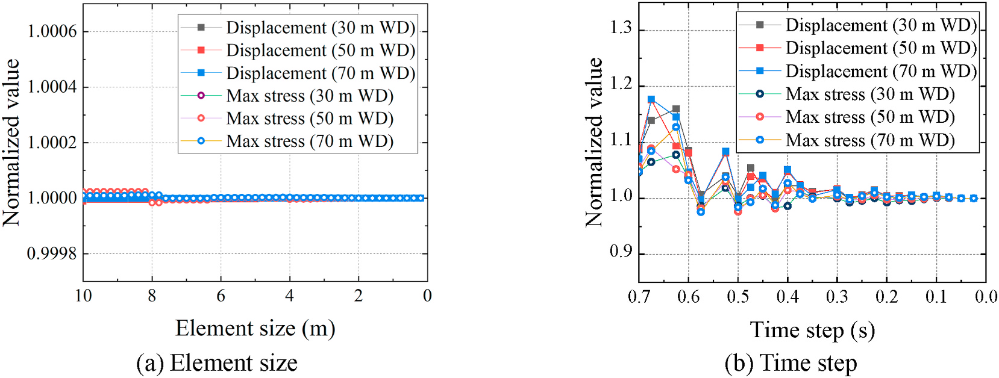

   **图 3** （a）单元尺寸、（b）时间步的收敛研究，比较三水深机舱位移与最大应力归一化结果。

优化主要用50年极端静力保证ULS，再用不同环境耦合动力检验。为说明分离合理性，先比较未优化架的静、动力。静力用50年等效极端，动力主要考虑DNV-ST-0437工况1.2和6.4[27]，详见4.1。表4比较表明，50年风机极值与最不利波浪组合带来较保守方案[36,37]，优化后还将在4.2验证。最不利波相搜索增加静力耗时，但仍远少于动力： :math:`0.1\,\mathrm{s}` 步长的 :math:`10\,\mathrm{min}` 动力模拟需 :math:`146.36\text{–}168.26\,\mathrm{min}` 计算，而静力仅 :math:`1.56\text{–}1.66\,\mathrm{min}` 。为实际工程效率，主要以50年静力优化，再以系列耦合动力查实际环境响应，是合适途径。

.. list-table:: 表 4 静力与动力分析比较
   :header-rows: 1
   :class: longtable

   * - 水深（m）
     - 最大应力：静／动（MPa）
     - 最大机舱位移：静／动（m）
     - 屈曲利用率：静／动
     - 耗时：静／动（min）
   * - 30
     - 120.61／67.76
     - 2.60／1.31
     - 0.37／0.21
     - 1.56／146.36
   * - 50
     - 120.10／68.04
     - 2.63／1.34
     - 0.36／0.21
     - 1.61／159.64
   * - 70
     - 119.32／67.73
     - 2.64／1.36
     - 0.36／0.21
     - 1.66／168.26

3.2 设计变量敏感性
~~~~~~~~~~~~~~~~~~~~~~

敏感性分析旨在从不确定变量中识别对目标与约束显著的量，估计影响并选择关键变量以提高效率。本文采用Spearman秩相关系数[38–40]，可同时考虑多个变量；该方法基于分级数据研究两变量相关，由成对两列秩差计算：

.. math::

   P_s=1-\frac{6\sum_{i=1}^{n}d_i^2}{n^3-n}
   \qquad (4)

n为样本数， :math:`d_i` 为第i组升序或降序排列的两变量秩差。系数由序位决定，单个异常值影响较小，数据要求不严格；当两变量观测为成对等级评价数据时，无论总体分布和样本空间大小，都可用于参数敏感性。

分析表2变量，采用拉丁超立方获得均匀样本空间。分区随机抽样保证设计空间被覆盖，重现随机变量总体情况。兼顾效率精度，设置自动停止：输出平均精度与标准差分别小于0.01、0.01时停止，最终约560个样本。

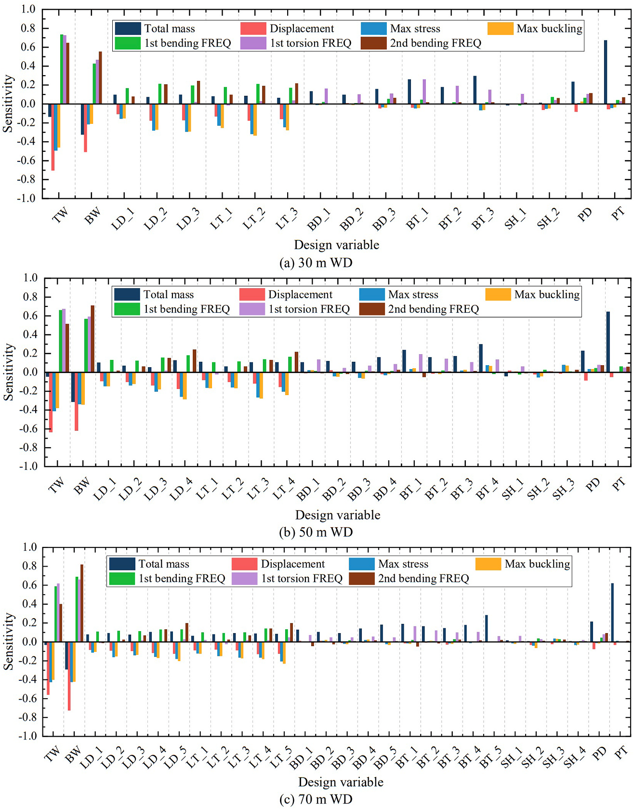

   **图 4** 导管架变量敏感性；横轴变量后的数字表示分段编号，分别为30、50、 :math:`70\,\mathrm{m}` 水深。

图4正敏感性表示变量增加使目标或约束增加，负值相反。顶宽、底宽影响最大，撑径和壁厚一般较小；因撑较多，其尺寸对质量影响略大于腿。机舱位移、最大应力和一阶弯曲频率对腿参数显著更敏感，撑接近零。撑对一阶扭转频率的影响略高于腿，但远小于顶底宽；后续结果将说明扭转频率不是决定性约束。段高敏感性很低。桩参数对架桩总质量的正相关影响明显大于其他参数，对约束却较弱。兼顾效率，本文选顶宽、底宽和腿径／壁厚为关键变量，撑和桩取允许最小值以减质量。为使K节点均布，段高固定见表5；总体变量数约减半。

.. list-table:: 表 5 导管架分段高度
   :header-rows: 1
   :class: longtable

   * - 分段
     - 第1段
     - 第2段
     - 第3段
     - 第4段
     - 第5段
   * - 高度（m）
     - 16
     - 15
     - 15
     - 20
     - 20

3.3 代理模型建立与验证
~~~~~~~~~~~~~~~~~~~~~~~~~~

3.3.1 Kriging模型
^^^^^^^^^^^^^^^^^^^^^^^^^^^^^^

常见预测方法包括多项式、神经网络、Kriging。多项式精度依赖项数，通常较差；神经网络需较多数据；Kriging小样本拟合较好，故本文采用。它由Krige提出[41]、Matheron形式化[42]，由全局回归趋势与局部偏差组成，假定为多项式模型加随机偏差：

.. math::

   y(x)=g(x)^T\beta+z(x)
   \qquad (5)

y(x)为代理模型，x为设计变量，g(x)为多项式，β为回归系数，z(x)为正态分布的高斯随机过程。g(x)提供全局预测，在全局逼近后仍有局部偏差z(x)，其期望、方差和协方差为：

.. math::

   \begin{cases}E[Z(x)]=0,\\\operatorname{var}[Z(x)]=\sigma^2,\\\operatorname{COV}[Z(\omega),Z(x)]=\sigma^2R(\omega,x,\delta).\end{cases}
   \qquad (6)

σ²为方差，δ为未知相关参数，空间相关函数R(ω,x,δ)描述ω与x的相关：

.. math::

   R(\omega,X)=\prod_{j=1}^{d}e^{-\delta|\omega_j-x_j|^P},\qquad\delta\ge0,\quad0\le P\le2
   \qquad (7)

j、d表示空间维度，δ表示各维邻点对目标点的影响，P控制平滑度，通常取2。

Kriging引入随机过程，从概率角度确定参数。使输入点X处响应Y的似然最大，可使模型泛化误差最小。

.. note::

   上一段按原文转述其参数估计思路。最大似然估计不构成任意数据分布下泛化误差最小的普适保证；本文的预测精度仍以所列样本和验证结果为依据。

未知点(x,y)的最佳线性无偏估计为：

.. math::

   \widehat y(x)=g^T(x)\widehat\beta+r^T(x)R^{-1}(Y-x\widehat\beta)
   \qquad (8)

β̂为β的最小二乘估计，r(x)为未知点与已知点关系向量，Y为回归数据输出。

.. note::

   式(7)左侧使用大写X、右侧xj，式(8)残差项原文为Y−xβ̂，而前面趋势项为gT(x)β̂；按原式保留，不能静默替换成其他Kriging记号或视作已可直接运行的无歧义实现。

y的均方偏差为：

.. math::

   S(\widehat y(x))\approx\sigma_z^2(1-r^TR^{-1}r)
   \qquad (9)

Kriging改善响应质量，适合输出高阶变化，以设计空间全局模型加局部偏差插值试验点。本文用代理代替有限元，将变量与目标／约束表示为代数关系，在迭代中从代理提取响应。简单代数计算使速度比有限元快数百倍。

3.3.2 Kriging验证
^^^^^^^^^^^^^^^^^^^^^^^^^^^^^^

原响应复杂度和构建代理所需观测数是精度关键，但通常难预知。本文用代理替代50年极端等效静力有限元，必须验证预测和适用性。更多样本可能更准确，但过多会增加成本、违背快速设计目标，因此需研究样本数。拉丁超立方分别生成200、400、600、800、1000样本并建模，再随机另选100验证样本，对比代理与有限元响应、考察相对误差。100验证点的响应必须满足优化约束；超出约束范围的变量将在优化中自动忽略，准确预测其响应没有意义。

对3.2节变量抽样，建立总质量、机舱位移、最大屈曲利用率、最大应力及固有频率代理。不同分段尺寸接近边界时，最大应力或屈曲位置可能突变，造成输入—极值关系异常、代理振荡，精度不满足要求。增加样本可改善但不经济；可按分段分别预测，以各段最大应力与屈曲值为约束。Kriging需样本少，建立额外分段模型耗时可忽略。30、50、 :math:`70\,\mathrm{m}` 架分别3、4、5段，每段再以X撑交点分上、下两部分，见图2。

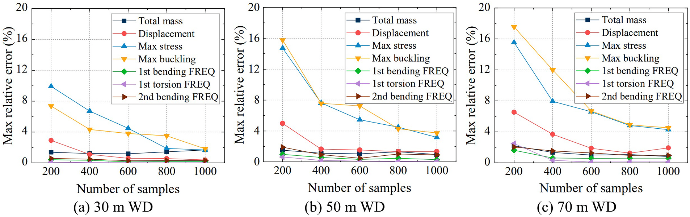

   **图 5** 三水深代理模型的最大相对误差随样本数变化，比较质量、位移、应力、屈曲及模态频率。

图5显示样本增多误差降低，总体精度较高，因为Kriging以已知点相关性为基本函数、通过相关矩阵综合全部已知信息，较少样本亦可合理预测。质量和固有频率200点即可良好一致，机舱位移400点满足要求；应力和屈曲需更多。达到800点时二者相对误差均小于5%，满足优化要求，故最终采用800点；3.4节还将用优化结果进一步验证。

3.4 导管架优化结果
~~~~~~~~~~~~~~~~~~~~~~

本文直接在代理模型上采用遗传算法优化海上风机导管架。对30、50、 :math:`70\,\mathrm{m}` 水深，分别经过58345、68860、71158次评价获得可靠的优化设计方案。如果在同样次数的迭代中直接求解有限元模型，计算成本将十分庞大，见表6。相比之下，只需800次数值模拟便可建立高精度代理模型，并将相对误差限制在5%以下。代理模型求解的是简单代数关系，优化迭代自身的计算成本可忽略，因此还可以更严格地设置优化算法参数，避免陷入局部最优。综合比较，代理模型方案的优化效率为直接有限元优化的71.78–87.00倍，相当于节省98.61%–98.85%的结构优化时间，表明其计算表现较好。

.. list-table:: 表 6 结构优化耗时
   :header-rows: 1
   :class: longtable

   * - 水深（m）
     - 迭代评价次数
     - 代理模型优化（h）
     - 有限元模型直接优化（h）
     - 效率比：有限元／代理
   * - 30
     - 58345
     - 21.13
     - 1516.87
     - 71.78
   * - 50
     - 68860
     - 21.88
     - 1847.76
     - 84.45
   * - 70
     - 71158
     - 22.63
     - 1968.71
     - 87.00

.. note::

   表6比较的是文中给定评价次数下的结构优化计算，不是整个工程设计周期。后续耦合动力、疲劳复核和局部修改不可因这一耗时比例而省略。

不同水深的优化几何见图6–8。作者另对优化后的导管架进行有限元模拟，再次检验代理模型精度。图9中各项相对误差均小于1.3%，说明这些优化点的代理结果能够较好表示有限元结果，满足本文优化精度要求。用代理模型替代反复的有限元求解，可提高优化效率并获得令人满意的设计方案。

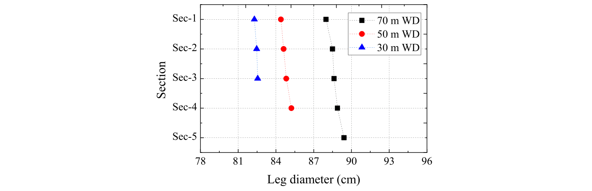

   **图 6** 优化导管架的腿柱直径。

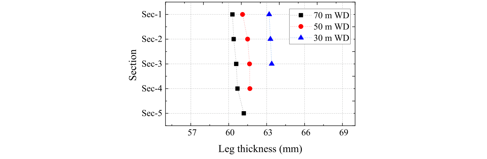

   **图 7** 优化导管架的腿柱壁厚。

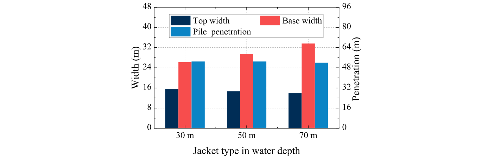

   **图 8** 优化导管架的整体尺寸，包括顶宽、底宽和桩入土深度。

.. figure:: ../../../wechat/assets/public-safe/ref-zheng2023-MS/fig09.jpg
   :alt: 图9 代理模型对优化结果的预测相对误差。
   :align: center
   :width: 100%

   **图 9** 代理模型对优化结果的预测相对误差。

遗传算法获得满足约束的轻量化方案。30、50、 :math:`70\,\mathrm{m}` 水深的导管架与桩总质量分别为910.30、1068.23、 :math:`1241.33\,\mathrm{t}` ，不含桩的导管架质量分别为387.74、546.86、 :math:`728.63\,\mathrm{t}` ，见图10。与 :math:`50\,\mathrm{m}` 水深、重 :math:`1210\,\mathrm{t}` 的INNWIND.EU参考导管架[34]相比，优化可节约约55%的导管架钢材。需要强调，这一比例针对 :math:`50\,\mathrm{m}` 水深的初步优化导管架；之后还须通过耦合动力和完整性验证，必要的修改可能增加质量。图10(a)显示单位水深的总质量：总质量随水深增加，但深水方案可能比浅水方案更经济，增加较少材料便可能适应更深水域。随结构高度增加，刚度下降，固有频率也降低，见图10(b)。一阶弯曲频率已接近频率约束边界， :math:`70\,\mathrm{m}` 水深尤其明显；水深继续增加时，优化可能主要受一阶弯曲频率而不是应力约束控制。虽然一阶扭转频率对支撑尺寸较敏感，但它不是本文导管架优化的关键约束，因此初始优化可不把支撑参数作为主要设计变量。优化方案的应力分布较好，构件材料强度得到充分利用，见图10(c)。图11(a)、(b)给出全部构件的长细比：三种水深的腿柱均通过检验，而下部支撑因长度较大不能全部通过，须按式(3)进一步检查。图11(c)中全部支撑的屈曲强度利用率均小于0.45，明显低于规范要求，支持本文优化方法的有效性。

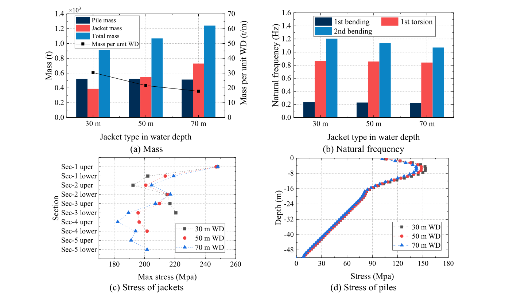

   **图 10** 优化导管架的特征：（a）质量及单位水深质量；（b）固有频率；（c）导管架应力；（d）桩应力。

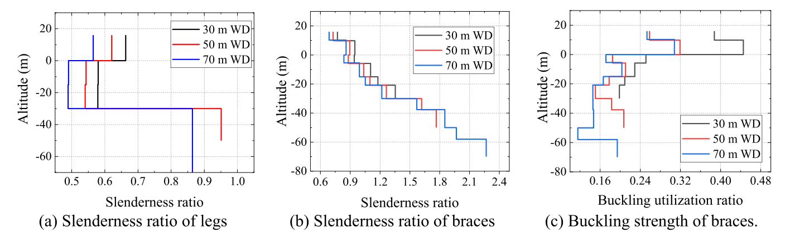

   **图 11** 优化导管架的屈曲特征：（a）腿柱长细比；（b）支撑长细比；（c）支撑屈曲利用率。

4 优化导管架的耦合动力分析
----------------------------

4.1 环境荷载工况
~~~~~~~~~~~~~~~~~~~~

为弥补等效静力优化的局限，作者进一步以耦合动力分析检验优化导管架在实际环境条件下的动力响应。主要考虑DNV工况1.2和6.4[27]，分别对应风机正常运行与停机状态。服役期环境工况列于表7，动力模拟还包括重力和静水压力。参考海洋数据来自BMT ARGOSS提供的waveclimate.com，代表以东经114°50′、北纬22°00′为中心、50 km范围内的风浪平均参数。机舱高度风速 :math:`4.5\text{–}36.5\,\mathrm{m/s}` 按 :math:`2\,\mathrm{m/s}` 间隔划分为16个区间，并取得各区间发生概率；模拟用区间平均风速代表该区间。波高取给定风速条件下的期望值，波周期取给定波高条件下的期望值，不考虑海流。每种工况考虑±10°偏航误差；利用导管架对称性，荷载方向在0–45°范围内按15°间隔选取，风与浪假定同向。因此16种风浪组合各含3个偏航角和4个荷载方向，共须进行16×3×4=192次、每次 :math:`10\,\mathrm{min}` 的耦合动力分析，评价优化方案的动力响应。

.. list-table:: 表 7 海上风机系统风浪环境工况
   :header-rows: 1
   :class: longtable

   * - 工况
     - 平均风速（m/s）
     - 湍流度（%）
     - 有义波高（m）
     - 谱峰周期（s）
     - 发生概率
   * - 1
     - 5.5
     - 21.22
     - 0.70
     - 5.78
     - 1.82 × 10⁻¹
   * - 2
     - 7.5
     - 17.96
     - 1.01
     - 6.02
     - 1.98 × 10⁻¹
   * - 3
     - 9.5
     - 16.07
     - 1.33
     - 6.27
     - 1.71 × 10⁻¹
   * - 4
     - 11.5
     - 14.84
     - 1.68
     - 6.53
     - 1.47 × 10⁻¹
   * - 5
     - 13.5
     - 13.98
     - 2.05
     - 6.86
     - 7.36 × 10⁻²
   * - 6
     - 15.5
     - 13.34
     - 2.47
     - 7.25
     - 3.61 × 10⁻²
   * - 7
     - 17.5
     - 12.84
     - 2.97
     - 7.77
     - 1.13 × 10⁻²
   * - 8
     - 19.5
     - 12.45
     - 3.55
     - 8.42
     - 3.44 × 10⁻³
   * - 9
     - 21.5
     - 12.13
     - 4.20
     - 9.21
     - 1.74 × 10⁻³
   * - 10
     - 23.5
     - 11.86
     - 4.88
     - 10.04
     - 8.35 × 10⁻⁴
   * - 11
     - 25.5
     - 11.64
     - 5.74
     - 11.10
     - 7.39 × 10⁻⁴
   * - 12
     - 27.5
     - 11.44
     - 6.86
     - 12.47
     - 3.29 × 10⁻⁴
   * - 13
     - 29.5
     - 11.28
     - 7.78
     - 13.58
     - 1.23 × 10⁻⁴
   * - 14
     - 31.5
     - 11.13
     - 8.82
     - 14.85
     - 9.58 × 10⁻⁵
   * - 15
     - 33.5
     - 11.01
     - 9.92
     - 15.90
     - 1.37 × 10⁻⁵
   * - 16
     - 35.5
     - 10.89
     - 11.10
     - 15.78
     - 4.11 × 10⁻⁵

.. note::

   表7最后两行谱峰周期分别为 :math:`15.90\,\mathrm{s}` 和 :math:`15.78\,\mathrm{s}` ，按原表保留，不根据波高递增而自行调整；所列风速区间的概率也不擅自归一化为1。这里的“实际环境条件”指按环境统计设置的数值工况，不是海上实测验证。

风场通常由平均分量与脉动分量组成。本文平均风速采用幂律剖面，风切变指数为0.12[29]；脉动风用湍流度和风速功率谱描述，采用IEC推荐的Kaimal谱[29]。TurbSim生成 :math:`10\,\mathrm{min}` 三维脉动风场，OpenFAST计算DTU  :math:`10\,\mathrm{MW}` 风机动力荷载，并直接施加在塔顶机舱位置。波浪荷载由Morrison公式计算，阻力系数和惯性力系数分别为0.7、2.0[18,19]，不规则海况用JONSWAP谱描述。

4.2 耦合动力响应验证
~~~~~~~~~~~~~~~~~~~~~~~~

本文采用Newmark方法研究导管架风机系统的稳态动力响应。动力模拟中，环境荷载安全系数为 :math:`\gamma_l` =1.35，永久荷载为 :math:`\gamma_l` =1.10，工况见表7。材料强度利用率 :math:`ur_\sigma` 定义为动力极值von Mises应力与材料许用极限强度之比：

.. math::

   ur_{\sigma}=\frac{\gamma_m\gamma_c\sigma_v}{f_y}
   \qquad (10)

相关安全系数取自IEC规范，其中材料相关系数 :math:`\gamma_m` =1.30、 :math:`\gamma_c` =1.10； :math:`\sigma_v` 为已考虑荷载安全系数的动力最大von Mises应力， :math:`f_y` = :math:`355\,\mathrm{MPa}` 为钢材屈服强度。

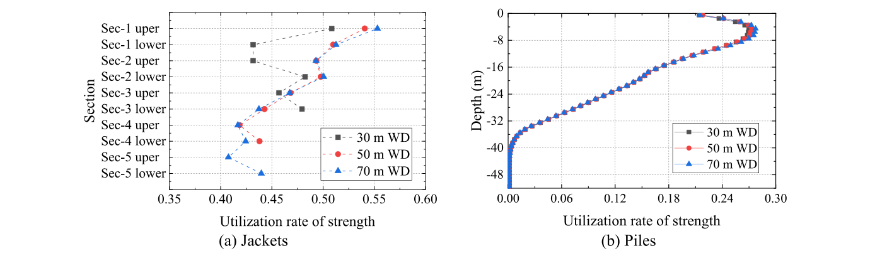

   **图 12** 优化方案的材料强度利用率：（a）导管架；（b）桩。

不同水深的材料强度利用率见图12。结果表明，以50年极端荷载等效静力优化的导管架具有保守性：导管架利用率约为40%–56%，桩的最大利用率为28%。桩轴向承载力也经复核，足以满足要求，见图13。作者认为保守性的根本原因在于静力计算采用了50年重现期的极端荷载；该荷载极值由时程最大荷载的概率统计外推得到[26,27]。静力模拟未计动力效应，最终得到本文中偏保守的设计结果。

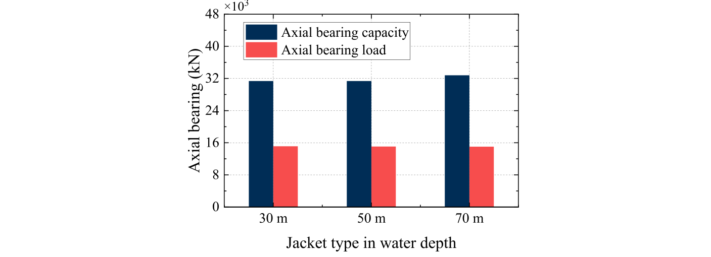

   **图 13** 优化方案的桩轴向承载能力与轴向承载荷载。

图14展示优化导管架在耦合动力模拟中的机舱运动极值。需注意，这些运动响应已考虑荷载安全系数。机舱位移均满足优化约束；机舱加速度则可作为传动系统荷载的指示量。原文依据常见海上风机工业设计实践，要求机舱加速度不超过0.3g[43]，其中g为重力加速度。计算所得机舱加速度满足原文采用的行业设计要求。

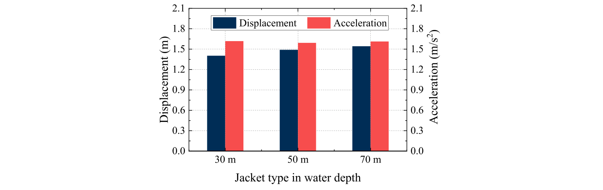

   **图 14** 优化导管架的机舱位移与加速度极值。

.. note::

   静力方案的保守性是在本文风浪工况、荷载系数和模型假设下得出的比较结论，不表示静力分析在任意场址均可替代动力验证。正文采用0.3g作为加速度限值，后文表9列为 :math:`3.0\,\mathrm{m/s^2}` ；保留两处原始表述，不把它们当作严格相等。

5 优化导管架的完整性验证
--------------------------

5.1 屈曲强度验证
~~~~~~~~~~~~~~~~~~~~

第3.4节已检查50年极端荷载静力作用下的屈曲强度，还需在耦合动力模拟中进一步验证。动力屈曲验算采用与耦合动力分析一致的环境工况，见表7，并计入环境荷载 :math:`\gamma_l` =1.35和永久荷载 :math:`\gamma_l` =1.10的安全系数。

依据图11的长细比检查，仅导管架支撑需要进一步进行屈曲强度验算。图15给出30、50、 :math:`70\,\mathrm{m}` 水深全部支撑的结果，屈曲强度利用率均小于0.20，明显低于规范要求。由此，优化方案满足本文的屈曲约束。

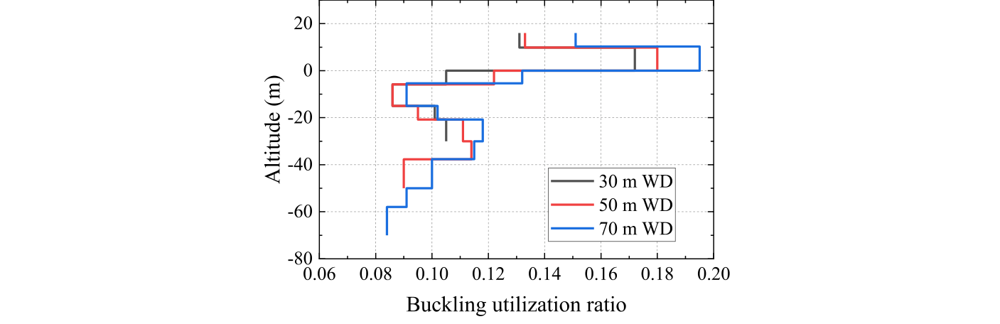

   **图 15** 耦合动力工况下优化导管架支撑的屈曲强度检查。

5.2 疲劳寿命验证
~~~~~~~~~~~~~~~~~~~~

钢结构焊接节点易发生疲劳破坏，因此须逐一检查优化导管架的全部焊接节点，确保达到疲劳寿命要求。依据DNV-RP-C203[44]，在主管侧和支管侧的焊缝截面上，各取均匀分布的8个参考热点评价疲劳损伤，见图16。

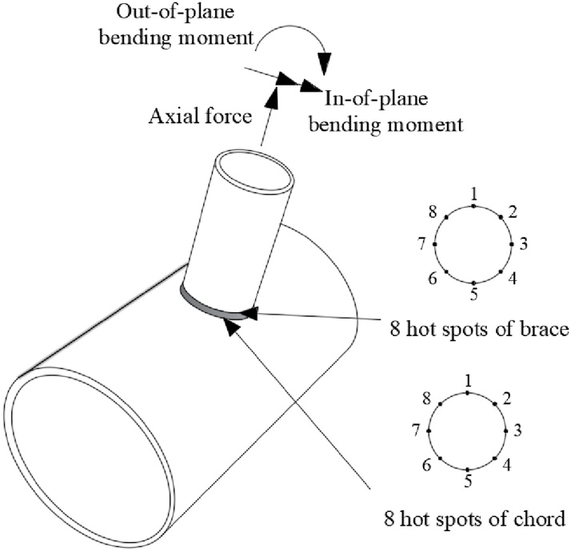

   **图 16** 焊接节点的8个热点位置，以及轴力、平面内弯矩和平面外弯矩。

焊接应力的确定较为复杂，因为它可能数倍于名义应力。焊接过程中，不均匀温度场引起局部塑性变形，产生瞬态焊接应力；温度场消失后，材料的不均匀收缩又形成较高残余应力。残余应力使平均应力难以确定，焊缝复杂几何还会导致应力集中。因此，需要用应力集中系数（SCF）放大名义应力，得到对实际热点应力更合理的估计；考虑SCF后的应力称为热点应力。本文依照DNV-RP-C203[44]计算并验证优化导管架的疲劳寿命。

图16给出热点应力验算参考点的定义。计算8个局部参考点的热点应力，需要轴向力在鞍点和冠点的应力集中系数 :math:`SCF_{AS}` 、 :math:`SCF_{AC}` ，以及平面外弯曲和面内弯曲的应力集中系数 :math:`SCF_{MOP}` 、 :math:`SCF_{MIP}` 。这些系数取决于主管、支管的几何尺寸和节点类型。本文全部K节点采用固定 :math:`0.25\,\mathrm{m}` 间距，原文将其表述为主管之间的间距[45]。焊接节点SCF的确定见DNV-RP-C203，沿焊缝8点的热点应力由式(11)计算：

.. math::

   \sigma_k(\theta)=\left[SCF_{AC}\cos^2\theta+SCF_{AS}\sin^2\theta\right]\frac{N}{A}+SCF_{MIP}\frac{M_{IP}}{I_c/r}\cos\theta-SCF_{MOP}\frac{M_{OP}}{I_c/r}\sin\theta
   \qquad (11)

k和θ分别为热点位置编号与方位角；N、 :math:`M_{IP}` 、 :math:`M_{OP}` 分别是轴力、面内弯矩和面外弯矩。耦合动力分析提取各节点的轴力与弯矩时程。A、 :math:`I_c` 、r分别为构件截面积、截面二次矩和外半径。

.. note::

   K节点间距的英文原句使用“between the chords”，这里保留其原始称谓；不能仅据这一短句替代节点详图或规范几何定义。

累计疲劳损伤按Palmgren–Miner线性累积假设计算。对每个荷载工况，采用雨流计数法从8个热点的应力时程得到疲劳应力幅范围和循环次数，再用DNV-RP-C203中阴极保护条件下的T型S–N曲线，计算每个应力范围对应的预测失效循环数N：

.. math::

   \log N=\log a^*-m\log\left[\Delta\sigma\left(\frac{t}{t_{\mathrm{ref}}}\right)^{k_t}\right]
   \qquad (12)

N为应力范围 :math:`\Delta\sigma` 下达到疲劳破坏的预测循环数，m是S–N曲线斜率的负倒数，log a*为其N轴截距；参考厚度 :math:`t_{\mathrm{ref}}` = :math:`16\,\mathrm{mm}` [46]，t为裂纹最可能扩展穿过的厚度。当t< :math:`t_{\mathrm{ref}}` 时取t= :math:`t_{\mathrm{ref}}` ， :math:`k_t` 为厚度指数。

对水下、失效后果中等的焊接节点，推荐疲劳设计系数FDF为3。因此，热点疲劳损伤约束写为：

.. math::

   D_k=\sum_{LC=1}^{LC_{\mathrm{num}}}P_{LC}\sum_{i=1}^{N_{k,RF}}\frac{n_{k,i}}{a^*}\left[\Delta\sigma\left(\frac{t}{t_{\mathrm{ref}}}\right)^{k_t}\right]^m\le\frac{1}{3}
   \qquad (13)

:math:`D_k` 为节点热点k的累计疲劳损伤， :math:`P_{LC}` 为荷载工况发生概率， :math:`N_{k,RF}` 为热点k的雨流计数数目， :math:`n_{k,i}` 为应力循环次数。

.. note::

   后文25年疲劳结果转述原文。式(13)本身未展开时长换算，以及偏航角／荷载方向组合的工况聚合实现；复现时须核对原始模型和数据，不能据此自行补造缩放因子或算法。

疲劳寿命验算采用表7的环境荷载工况，疲劳极限状态荷载安全系数为1.0。图17给出不同水深方案预测的25年疲劳损伤，损伤应不超过1/3。多数节点满足要求，只有 :math:`70\,\mathrm{m}` 水深导管架顶部的X节点超出疲劳限值，超限位置为焊缝截面第3个热点，即k=3、θ=90°。

.. figure:: ../../../wechat/assets/public-safe/ref-zheng2023-MS/fig17.png
   :alt: 图17 优化导管架的25年疲劳损伤：（a）K节点；（b）X节点。
   :align: center
   :width: 100%

   **图 17** 优化导管架的25年疲劳损伤：（a）K节点；（b）X节点。

针对 :math:`70\,\mathrm{m}` 水深顶部第1段X节点不满足疲劳约束的问题，调整支撑直径和壁厚能够降低热点应力及疲劳损伤，但直径、壁厚增大也会使导管架变重。为使质量最小，需要仔细研究两种参数的调整策略。原文将修改后构件的“质量变化比”写为：

.. math::

   \Delta m=\pi d t l\cdot\Delta d\Delta t
   \qquad (14)

d、t、l分别为支撑外径、壁厚与长度； :math:`\Delta d` 、 :math:`\Delta t` 分别为直径和壁厚的变化比。作者据此指出，两者对结构质量的影响程度一致。

.. note::

   式(14)按原式保留。原文称 :math:`\Delta m` 为质量变化比，却含πdtl且未写密度，同时把 :math:`\Delta d` 、 :math:`\Delta t` 定义为变化比，其量纲及有限增量含义并不明确。本译文不自行补密度、改成差分式或据此计算新的质量变化；后面的1.8%仅转述论文给出的优化结果。

局部支撑的小幅修改不会引起各构件内力的大幅重分布。本文据此定义内力因子（IFF）：

.. math::

   \begin{aligned}
   IFF_{AC}&=SCF_{AC}/A,\\
   IFF_{AS}&=SCF_{AS}/A,\\
   IFF_{MIP}&=SCF_{MIP}/W,\\
   IFF_{MOP}&=SCF_{MOP}/W.
   \end{aligned}
   \qquad (15)

:math:`IFF_{AC}` 、 :math:`IFF_{AS}` 、 :math:`IFF_{MIP}` 、 :math:`IFF_{MOP}` 分别为冠点轴力因子、鞍点轴力因子、面内弯矩因子和面外弯矩因子；A为截面积，W= :math:`I_c` /r为抗弯截面模量。内力因子显然是构件直径与壁厚的函数。根据热点应力式(11)，内力因子减小时，节点疲劳损伤也会减小。

为研究支撑参数调整策略，图18展示直径和壁厚增加比对IFF的影响。增大壁厚可迅速降低 :math:`IFF_{AC}` 、 :math:`IFF_{AS}` 、 :math:`IFF_{MOP}` ，提高疲劳寿命；对 :math:`IFF_{MIP}` 而言，直径与壁厚的作用基本相似。本文疲劳超限发生在第3个热点（k=3、θ=90°），根据式(11)，该处损伤主要由 :math:`IFF_{AS}` 和 :math:`IFF_{MOP}` 控制。因此，降低疲劳损伤时应先增大壁厚，待其超过允许值后再调整直径。计算表明，第1段支撑壁厚由 :math:`20\,\mathrm{mm}` 增至 :math:`25\,\mathrm{mm}` 即可满足疲劳寿命要求；导管架与桩总质量由 :math:`1241.33\,\mathrm{t}` 增加到 :math:`1264.38\,\mathrm{t}` ，原文记增加约1.8%；按上述所列质量直接计算约为1.86%。随后，作者在50年极端荷载等效静力及不同环境耦合动力作用下分别复核。表8、9显示，小幅增厚后，极限承载能力、屈曲强度和机舱运动响应基本不变，仍满足要求。

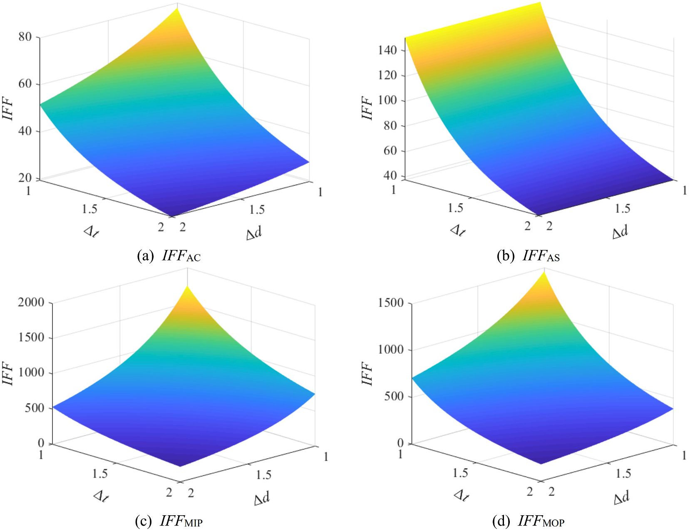

   **图 18** 支撑尺寸对内力因子的影响：（a）冠点轴力因子；（b）鞍点轴力因子；（c）面内弯矩因子；（d）面外弯矩因子。

.. list-table:: 表 8  :math:`70\,\mathrm{m}` 水深修正导管架的固有频率复核
   :header-rows: 1
   :class: longtable

   * - 模态
     - 一阶弯曲
     - 一阶扭转
     - 二阶弯曲
   * - 固有频率（Hz）
     - 0.2230
     - 0.8377
     - 1.0677

.. list-table:: 表 9  :math:`70\,\mathrm{m}` 水深修正导管架的极限与疲劳状态复核
   :header-rows: 1
   :class: longtable

   * - 位置
     - 强度利用率
     - 支撑屈曲利用率
     - K节点疲劳损伤
     - X节点疲劳损伤
     - 位移（m）
     - 加速度（m/s²）
   * - 阈值
     - ≤1
     - ≤1
     - ≤1/3
     - ≤1/3
     - ≤3.5
     - ≤3.0
   * - 机舱
     - —
     - —
     - —
     - —
     - 3.14
     - 1.66
   * - 第1段上部
     - 0.974
     - 0.219
     - 0.032
     - 0.080
     - —
     - —
   * - 第1段下部
     - 0.849
     - 0.273
     - 0.026
     - 0.063
     - —
     - —
   * - 第2段上部
     - 0.802
     - 0.180
     - 0.062
     - 0.056
     - —
     - —
   * - 第2段下部
     - 0.852
     - 0.200
     - 0.040
     - 0.043
     - —
     - —
   * - 第3段上部
     - 0.797
     - 0.162
     - 0.010
     - 0.028
     - —
     - —
   * - 第3段下部
     - 0.727
     - 0.137
     - 0.004
     - 0.017
     - —
     - —
   * - 第4段上部
     - 0.692
     - 0.142
     - 0.009
     - 0.021
     - —
     - —
   * - 第4段下部
     - 0.738
     - 0.142
     - 0.003
     - 0.024
     - —
     - —
   * - 第5段上部
     - 0.727
     - 0.137
     - 0.006
     - 0.016
     - —
     - —
   * - 第5段下部
     - 0.767
     - 0.204
     - 0.002
     - 0.008
     - —
     - —
   * - 桩
     - 0.587
     - —
     - —
     - —
     - —
     - —

.. note::

   表9汇总修正方案在等效静力和耦合动力作用下的复核，不与图12的单独动力材料利用率混为同一组结果。局部增厚优先的判断依赖本文超限热点、内力因子及小幅修改假设，并非所有导管架节点的一般最优规则。

6 结论
--------

本文提出海上风机导管架基础的高效结构优化设计方法，并通过 :math:`10\,\mathrm{MW}` 风机在30、50、 :math:`70\,\mathrm{m}` 水深的优化方案进行检验。作者认为，该方法具有较高精度和效率，适用于实际工程。主要结论如下。

1. 采用Spearman秩相关系数开展参数敏感性分析，将设计变量数减半；最终以顶宽、底宽和腿柱参数作为导管架结构优化的关键变量。

2. 建立并验证Kriging模型，将复杂风机系统有限元模型转为代数表达式。在最大允许相对误差5%的条件下，约节省原优化计算时间的98.61%。

3. 获得了不同水深的轻量化导管架。与 :math:`50\,\mathrm{m}` 水深参考架相比，导管架质量约降低55%。按50年极端风浪等效静力荷载设计的方案具有较高安全冗余，在本文动力检验中材料强度利用率最大为56%。

4. 验证了优化导管架的屈曲强度和疲劳寿命，仅 :math:`70\,\mathrm{m}` 水深导管架顶部X节点未满足疲劳要求。将第1段支撑壁厚从 :math:`20\,\mathrm{mm}` 增至 :math:`25\,\mathrm{mm}` 可降低疲劳损伤；修正方案经再次检验满足设计要求。

.. note::

   本文为底固定式导管架的数值优化与复核，未开展漂浮平台验证、海上全尺度试验或完整工程认证。保留原研究采用的规范版本、风浪同向、无海流及未计腐蚀／冲刷／土体退化等假设；迁移到其他场址或机组时，仍需重新建立荷载、土参数和设计约束。

参考文献
--------

[1] Lee J., Zhao F. Global wind report 2021. GWEC 2021. Available online: ``https://gwec.net/global-wind-report-2021/#Download.`` [Accessed 25 March 2021].

[2] Hensel J, Sharma MSR, Baxter CDP, Hu SLJ. Development of a technology type factor for jacket structures for offshore wind turbines in Rhode Island. J Renew Sustain Energy 2012;4:8–23.

[3] Cision PR Newswire. Offshore wind energy market—global industry analysis, size, share, growth, trends, and forecast 2020-2026. 2020. Available online: ``https://www.marketwatch.com/press-release.``

[4] Ramírez L, Fraile D, Brindley G. Offshore wind in Europe key trends and statistics 2020. 2020. Available online: ``https://windeurope.org/intelligence-platform/product/offshore-wind-in-europe-key-trends-and-statistics-2020/.``

[5] Benjamin Wilson A. Offshore wind energy in Europe. European Parliamentary Research Service; 2020. Available online: `EPRS 报告 <https://www.europarl.europa.eu/thinktank/en/document/EPRS_BRI(2020)659313>`_.

[6] Damiani R, Dykes K, Scott G. A comparison study of offshore wind support structures with monopiles and jackets for U.S. waters. Journal of Physics Conference Series 2016;753:092003.

[7] Hahn M., Gilman P. Offshore wind market and economic analysis - annual market assessment. 2013. Available online: `DOE 年度报告 <https://www1.eere.energy.gov/wind/pdfs/offshore_wind_market_and_economic_%20analysis.pdf>`_.

[8] Estate Crown. Offshore wind cost reduction Pathways study. 2012. Available online: ``https://vdocument.in/offshore-wind-cost-reduction-pathways-study.html?page=88.``

[9] Willows C, Valpy B. Approaches to cost-reduction in offshore wind. BVG Associates; 2015. Available online: ``https://www.theccc.org.uk/wp-content/uploads/2015/06/BVG-Associates-2015-Approaches-to-cost-reduction`` -in-offshore-wind.pdf.

[10] Michael M, Sebastian St. Design optimization of wind turbine support structures - a review. Ocean Wind Energy 2014;1(1):12–22.

[11] Wei K, Arwade SR, Myers AT. Incremental wind-wave analysis of the structural capacity of offshore wind turbine support structures under extreme loading. Eng Struct 2014;79:58–69.

[12] Shi W, Park H, Chung C, Baek J, Kim Y, Kim C. Load analysis and comparison of different jacket foundations. Renew Energy 2013;54:201–10.

[13] Lozano-Minguez E, Kolios AJ, Brennan FP. Multi-criteria assessment of offshore wind turbine support structures. Renew Energy 2011;36(11):2831–7.

[14] Ju SH, Su FC, Jiang YT, Chiu YC. Ultimate load design of jacket-type offshore wind turbines under tropical cyclones. Wind Energy 2019;22(5):685–97.

[15] Chew KH, Tai K, Ng EYK, Muskulus M. Optimization of offshore wind turbine support structures using an analytical gradient-based method. Energy Proc 2015; 80:100–7.

[16] Chew KH, Tai K, Ng EYK, Muskulus M. Analytical gradient-based optimization of offshore wind turbine substructures under fatigue and extreme loads. Mar Struct 2016;47:23–41.

[17] Oest J, Sandal K, Schafhirt S, Stieng LES, Muskulus M. On gradient-based optimization of jacket structures for offshore wind turbines. Wind Energy 2018;21(11): 953–67.

[18] Kaveh A, Sabeti S. Structural optimization of jacket supporting structures for offshore wind turbines using colliding bodies optimization algorithm. Struct Des Tall Special Build 2018;27(13):1–13.

[19] Kaveh A, Sabeti S. Optimal design of jacket supporting structures for offshore wind turbines using CBO and ECBO algorithms. Period Polytech Civ Eng 2018;62: 545–54.

[20] Sandal K, Verbart A, Stolpe M. Conceptual jacket design by structural optimization. Wind Energy 2018;21(12):1423–34.

[21] Sandal K, Latini C, Zania V, Stolpe M. Integrated optimal design of jackets and foundations. Mar Struct 2018;61:398–418.

[22] Natarajan A, Stolpe M, Wandji WN. Structural optimization based design of jacket type sub-structures for 10 MW offshore wind turbines. Ocean Eng 2019;172: 629–40.

[23] Häfele J, Gebhardt CG, Rolfes R. Deliverable D4.3.5-Innovative design of a hybrid-type jacket for 10MW turbines. INNWIND.EU; 2017.

[24] Shi W, Park Hl, Han J, Na S, Kim C. A study on the effect of different modeling parameters on the dynamic response of a jacket-type offshore wind turbine in the Korean Southwest Sea. Renew Energy 2013;58:50–9.

[25] Det Norske Veritas. DNV-ST-0126 - support structures for wind turbines. DNV; 2016.

[26] Det Norske Veritas. DNV-OS-J101 - design of offshore wind turbine structures. DNV; 2014.

[27] Det Norske Veritas. DNV-ST-0437 - loads and site conditions for wind turbines. DNV; 2016.

[28] Seidel M, Voormeeren S, van der Steen JB. State-of-the-art design processes for offshore wind turbine support structures. Stahlbau 2016;85(9):583–90.

[29] International Electrotechnical Commission. Standard IEC 61400-1: wind turbines - Part 1: design requirements for wind turbines. IEC; 2005.

[30] International Electrotechnical Commission. Standard IEC 61400-3: wind turbines - Part 3: design requirements for offshore wind turbines. IEC; 2009.

[31] Det Norske Veritas. DNV-RP-C202 - buckling strength of shells. DNV; 2011.

[32] Christian B, Frederik Z, Robert B, Taeseong K, Anders Y, Lars C, Henriksen, Natarajan Anand, Hansen Morten. Description of the DTU 10MW reference wind turbine. Technical University of Denmark, Department of Wind Energy; 2013.

[33] Stolpe M, Wandji WN, Natarajan A, Shirzadeh R, Kühn M, Kaufer D. Deliverable D4.34-Innovative design of a 10MW steel-type jacket. INNWIND.EU; 2016.

[34] Von Borstel T. Deliverable D4.3.1- Design report reference jacket. INNWIND.EU; 2013.

[35] American Petroleum Institute. Recommended practice for planning, designing and constructing fixed offshore platforms -Working Stress Design. API RP 2A- WSD; 2007.

[36] Haselbach P, Natarajan A, Jiwinangun RG, Branner K. Comparison of coupled and uncoupled load simulations on a jacket support structure. Energy Proc 2013; 35:244–52.

[37] Passon P, Branner K. Load calculation methods for offshore wind turbine foundations. Ships Offshore Struct 2014;9:433–49.

[38] Fieller EC, Pearson ES. Tests for rank correlation coefficients. II. Biometrika 1961;55(1–2):29–40.

[39] Meng QX, Li KC, Zhao C. An improved particle filtering algorithm using different correlation coefficients for nonlinear system state estimation. Big Data 2019;7 (2):114–20.

[40] Kempi V. A FORTRAN program for ranking and for calculation of Spearman’s correlation coefficient. Comput Methods Progr Biomed 1985;21(2):123–5.

[41] Krige DG. A statistical approach to some basic mine valuation problems on the witwatersrand. J S Afr Inst Min Metall 1951;52(6):119–39.

[42] Matheron G. Traité de Géostatistique appliquée. Memoires du bureau de recherches geologiques et miniere. 1962.

[43] Yu ZL, Amdahl J, Rypestøl M, Cheng ZS. Numerical modelling and dynamic response analysis of a 10 MW semi-submersible floating offshore wind turbine subjected to ship collision loads. Renew Energy 2022;184:677–99.

[44] Det Norske Veritas. DNV-RP-C203 - fatigue design of offshore steel structures. DNV; 2013.

[45] Oest J, Sørensen R, Overgaard LCT, Lund E. Structural optimization with fatigue and ultimate limit constraints of jacket structures for large offshore wind turbines. Struct Multidiscip Optim 2017;55(3):779–93.

[46] Ju SH, Su FC, Ke YP, Xie MH. Fatigue design of offshore wind turbine jacket-type structures using a parallel scheme. Renew Energy 2019;136:69–78.

完整引用
--------

Shunyun Zheng, Chao Li, Yiqing Xiao. Efficient optimization design method of jacket structures for offshore wind turbines. *Marine Structures*, 89 (2023), 103372. DOI: `10.1016/j.marstruc.2023.103372 <https://doi.org/10.1016/j.marstruc.2023.103372>`_.

:ref:`WOEAI 学术成果页对应条目 <ref-zheng2023-MS>`
