.. _paper-note-ref-zheng2025-QHDXXB:

中心与偏心布置半潜风机动力特性：论文精解
========================================

精简版微信公众号文章：待发布

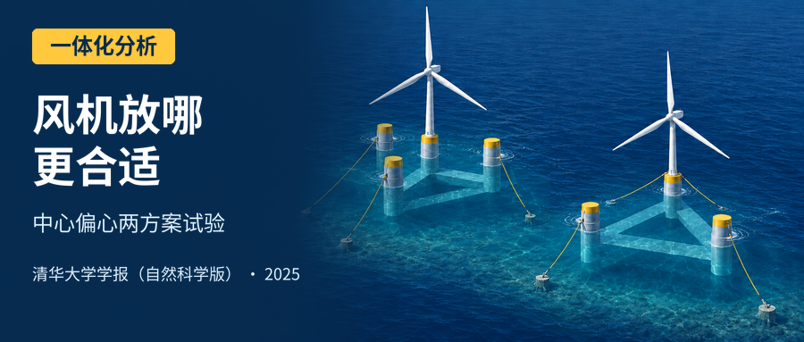

论文信息
--------

- **题名**：中心与偏心布置半潜风机动力特性的模型试验
- **英文题名**：Model tests on the dynamic characteristics of semi-submersible wind turbines with central and eccentric arrangements
- **作者**：郑舜云、周盛涛、石兵、李朝、胡钢、曾宇、李利孝；通信作者：李朝（原文首页明示）。
- **单位**：1. 哈尔滨工业大学（深圳）土木与环境工程学院，深圳 518055；2. 明阳智慧能源集团股份公司海洋与漂浮式工程技术中心，中山 528437；3. 中国电建集团中南勘测设计研究院有限公司新能源工程设计院，长沙 410014；4. 哈尔滨工业大学（深圳）广东省土木工程智能韧性结构重点实验室，深圳 518055；5. 东方电气风电股份有限公司风电研究设计院，德阳 618000；6. 深圳大学土木与交通工程学院，深圳 518060。
- **期刊与版本**：《清华大学学报（自然科学版）》，2025 年网络首发稿；本文依据所提供的 14 页全文，不将首发页码当作最终卷期页码。
- **网络首发时间**：2025 年 6 月 11 日 16:25:02。
- **DOI**：`10.16511/j.cnki.qhdxxb.2025.27.037 <https://doi.org/10.16511/j.cnki.qhdxxb.2025.27.037>`_。
- **研究方向**：海上漂浮风电 / 一体化分析。

.. contents:: 本页目录
   :local:
   :depth: 2

导读
----

把风机放在平台中央还是一侧，并不能单独决定哪种方案“更稳”。本文为同一 DTU 10-MW 风机设计两种具有可比性的半潜方案，在风洞与浪槽中开展 1∶70 全实物模型试验，比较平台运动、机舱加速度、塔基弯矩和系泊导缆孔张力。平台形状、立柱水线面和三线/四线系泊共同改变动力特性，因此结果是两套方案的比较，不是将其他参数完全控制相同后的单一偏心因果试验。

以下依原稿顺序完整保留中文科学正文、全部 21 幅图、3 张可编辑表、32 条参考文献，并在原文位置翻译末页英文结构化摘要。原稿没有编号公式或科学附录。新增校核注与原文分开；仅有两个典型海况、同向风浪、较低风场湍流度，且未包含压载调平控制，不据此宣布一种平台在全部场址及全寿命条件下最优。

摘要
----

风机中心布置的 Y 形和偏心布置的 Δ（Delta）形半潜式平台是深远海半潜式风机的主流平台形式，但其动力特性差异缺乏系统量化对比的相关研究。该文以最小化系统成本和累积疲劳损伤为目标，以平台及系泊关键主尺寸为变量，优化设计了适配 DTU 10-MW 风机的中心布置和偏心布置的半潜式平台及系泊方案；采用风浪联合的缩尺模型试验方法，针对风机的额定作业和极限自存的典型工况，测试了 2 类半潜式风机在风单独作用、波浪单独作用以及风浪联合作用下的动力响应；通过在时频域内对关键动力特性（平台运动、机舱加速度、塔基弯矩和系泊导缆孔张力）的统计分析，揭示了环境荷载作用效应及其耦合特性。结果表明，Δ 形半潜式风机存在垂荡和纵摇的耦合效应，纵摇会放大偏心风机的垂向运动；针对机舱加速度和塔基弯矩，Y 形半潜式风机在长波浪周期极端工况下更大，Δ 形半潜式风机在小波浪周期作业工况下更大。将该研究获得的典型工况动力特性与全寿命周期海况相结合进行分析，可为深远海浮式风电平台选型设计提供量化评价依据。

**关键词**：半潜式风机；模型试验；动力特性；风洞；浪槽。

引言
----

针对日益严峻的能源短缺和环境污染问题，发展清洁高效的可再生能源是实现可持续发展的必由之路。可再生能源包括波浪能、风能、潮汐能和太阳能等[1–4]，其中风能应用规模逐渐扩大[5–7]。全球风能理事会指出，2023 年新增风电装机容量达 117 GW，取得了历史性突破[8]。中国在“碳达峰、碳中和”的目标驱使下，大力推动风电产业，2050 年的风电装机容量预计达 1000 GW，有望成为国家五大电力来源之一[9]。可见风电产业正在全球范围内实现迅速发展。

中国海上风资源丰富，海上风能是陆上风能的 3 倍多[10]；现阶段已陆续完成了 50 m 水深内的近海风电场建设，主要采用固底式风机，并逐步进入平价时代。据保守估计，中国深远海风资源可开发量是近海的 3～4 倍[9]，风电总容量可达 290 GW，其中 150～200 GW 的风能有望获得充分开发[11]。

为了获取更为充沛和优质的海上风资源，海上风电场将从浅水区向深水区发展。然而，受建设成本和安装工艺的限制，固底式风机难以适应深远海域，因此，漂浮式风机将在深远海域发挥重要作用。

漂浮式风机根据支撑结构的不同可分为 4 种类型（张力腿式、驳船式、单柱式和半潜式）。考虑到中国深远海区域的水深、海况和建造条件，半潜式风机更为适应市场需求[12]。目前，风机中心布置的 Y 形和偏心布置的 Δ（Delta）形半潜式平台是半潜式风电平台的主流形式，Y 形半潜式平台包括中国的海油观澜号、美国国家可再生能源实验室的 VolturnUS 和挪威 Dr.techn. Olav Olsen AS 的 OO-Star 等，Δ 形半潜式平台包括国内的三峡引领号、中船扶摇号和国能共享号，以及美国 Principle Power, Inc 的 WindFloat 和日本丸红株式会社的 V-Shape 等。然而，针对 2 类半潜式风机的动力特性对比分析，已有研究多为定性分析[13]，定量对比仍存在不少难题，例如当前海上漂浮式风机的数值分析方法不太完备，极限和长期动力特性尚不明确；不同已建测试样机所采用的风机功率、设计标准和建造技术差异显著；可能存在技术壁垒和商业保密行为等。

缩尺模型试验和数值模拟是研究漂浮式风机动力特性的主要方法。缩尺模型试验虽然具有操作复杂、费用昂贵等不足，但仍是捕获复杂海洋环境中的强非线性现象的有效方法之一[14]。根据部件缩尺模型的完备情况，模型试验可分为半实物模型试验和全实物模型试验。半实物模型试验对系统的部分结构进行缩尺以建立实物模型，未缩尺部分采用数值模型进行等效。目前常见的是基于数值风机和数值浮体的半实物模型试验[12]。基于数值风机的半实物模型试验方面，Azcona 等[15]早期采用一个涵道式风速模拟器实现风机叶轮气动荷载的加载。之后，Sauder 等[16]采用多根牵引绳实现机舱位置处的气动力的加载，然而，牵引绳的引入也存在一定的负面干扰。近年来，采用旋翼组模拟风机气动荷载的方法备受众多学者的关注和青睐。Azcona 等[17]将四旋翼组应用于 INNWIND 10 MW 张力腿式风机的水池试验。Wen 等[18]开发了组合式多通道气动荷载模拟器，并对其静/动态性能展开详细而系统的测试和评估，取得了较为优异的成果。基于数值浮体的半实物模型试验方面，米兰理工大学建立了基于物理风机和数值浮体的半实物模型试验方法[19]。之后，上海交通大学也搭建了由漂浮式平台数值模型、风机缩尺物理模型和运动模拟平台组成的海上漂浮式风机混合模型试验系统[20–21]。全实物模型试验则对整个系统（包括叶轮、机舱、塔筒、平台和系泊等）进行缩尺，并模拟生成真实的物理风场和波浪场以完成试验测试，具有更高的测试完备性。美国缅因大学通过全实物模型试验的方式重点对比了 DeepCwind 的半潜式、单柱式和张力腿式风机的动力响应[22]。Tri-Floater 三立柱半潜式风机在荷兰的 Marin 水池完成了试验测试[23]。Chen 等[24]利用 1∶50 缩尺模型研究了 OC4 半潜式风机的空气动力学特性。Ahn 等[25]对 10 MW 半潜式风机进行了稳态风、规则波和海流条件下的模型试验测试，遗憾的是，该研究并未考虑反映真实海况的随机波浪条件。Michailides 等[26–27]的研究集成了半潜式风机平台与波浪能发电装置，结果表明了该装置在极端条件下的良好性能表现。Gao 等[28]通过 1∶50 的物理模型验证了半潜式风机和摆式波浪能装置的效能。

.. note::

   原文引言引用[19]支持“米兰理工大学的物理风机与数值浮体混合试验”，但文末[19]题为含矩阵变换器的风机最大功率跟踪控制，主题不一致；关于缅因大学 DeepCwind 对比的[22]文献题名则仅明示 Spar 模型。此处保留原叙述与编号，不将其当作已独立核实的外部文献证据。

为了满足设计方案的可比性前提，实现针对 2 类半潜式风机动力特性的定量对比，本研究基于 DTU 10-MW 风机，首先以系统成本和疲劳损伤为优化目标，以平台和系泊的主尺寸为优化变量，分别优化设计了 Y 形和 Δ 形半潜式平台和系泊系统；进而基于相似准则设计并建立了缩尺比为 1∶70 的半潜式风机试验模型，在风洞和浪槽中联合重现风场和波浪场条件，采用全实物模型试验方法对比 2 种半潜式风机在风机额定作业和极限自存状态下的动力特性，以期望为深远海风电半潜式风机平台的选型和设计提供依据。

1 半潜式风机的结构布置
----------------------

本研究采用的 Y 形半潜式平台以 OO-Star 半潜式平台[29]为参考，也据此设计 Δ 形半潜式平台，具体的结构布置分别如图 1 和图 2 所示。2 个平台均为搭载 10 MW 风机而设计，该风机满足 IEC 1A 类海上风场条件的要求。半潜式平台一般由数个立柱以及连接立柱的浮舱组成，并采用系泊系统对平台进行运动限制，因此，本研究所设计的 Y 形半潜式平台具有 4 个圆柱形立柱（1 个主立柱和 3 个外立柱）和 3 个立方体浮舱，浮舱呈 Y 形排布，风机位于主立柱上，呈中心布置（风机重心与平台的重心和浮心均处于同一垂线上）；Δ 形半潜式平台具有 3 个圆柱形立柱（1 个主立柱和 2 个外立柱）和 3 个立方体浮舱，浮舱呈 Δ 形排布，风机位于主立柱上，呈偏心布置（风机重心与平台的重心和浮心在垂向方向上不共线）。Y 形和 Δ 形半潜式风机的系泊缆均采用无档索链。在垂向投影上，系泊缆与浮舱的轴线平行，导缆孔位于立柱顶端外缘，Y 形半潜式风机具有 3 根互呈 120° 的系泊缆，而 Δ 形半潜式风机采用 4 根系泊缆，系泊缆之间呈 60° 或 120°。

本研究采用 Zhou 等[30]所述的主尺寸优化方法，获得性能优异的半潜式平台和系泊系统的设计方案。主尺寸优化的多目标函数为平台和系泊总建造成本，以及塔筒基底和系泊导缆孔的 25 a 累积疲劳损伤；优化约束包括结构几何约束、固有频率约束、平台平动位移、平台倾角、机舱加速度、系泊导缆孔张力、塔筒基底和系泊导缆孔的 25 a 累积疲劳损伤等；优化变量包括立柱尺寸、浮舱尺寸和系泊缆尺寸等。本研究采用带精英策略的非支配排序遗传算法（NSGA-II）对优化问题进行迭代求解。为了保证设计方案的可比性，选取优化的 2 个半潜式平台和系泊的尺寸变量和建造成本（见表 1）相近。

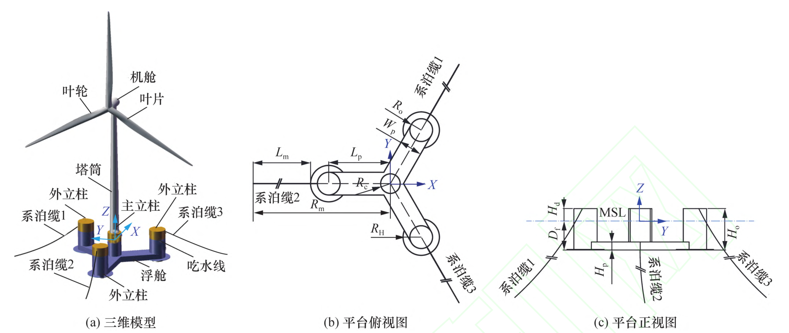

   **图 1** Y 形半潜式风机的结构布置。子图（a）三维模型；（b）平台俯视图；（c）平台正视图。

图注：:math:`L_m` 为系泊长度，:math:`L_p` 为立柱间距，:math:`R_m` 为系泊锚泊距离，:math:`R_c` 为主立柱半径，:math:`R_o` 为外立柱半径，:math:`R_H` 为垂荡板半径，:math:`W_p` 为浮舱宽度，:math:`H_p` 为浮舱高度，:math:`D_f` 为吃水深度，:math:`H_d` 为气隙高度，:math:`H_o` 为立柱高度，MSL 为平均海平面。

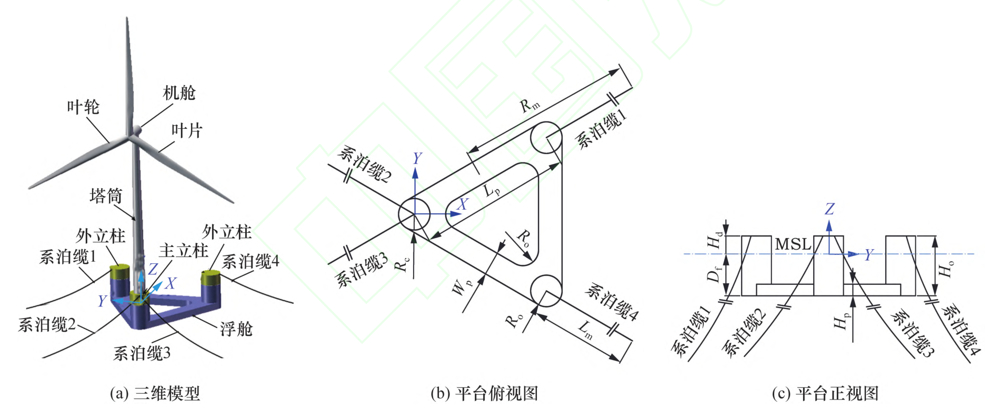

   **图 2** Δ 形半潜式风机的结构布置。子图（a）三维模型；（b）平台俯视图；（c）平台正视图。

图注：:math:`L_m` 为系泊长度，:math:`L_p` 为立柱间距，:math:`R_m` 为系泊锚泊距离，:math:`R_c` 为主立柱半径，:math:`R_o` 为外立柱半径，:math:`W_p` 为浮舱宽度，:math:`H_p` 为浮舱高度，:math:`D_f` 为吃水深度，:math:`H_d` 为气隙高度，:math:`H_o` 为立柱高度，MSL 为平均海平面。

.. list-table:: 表 1 半潜式风机的相关参数
   :header-rows: 1
   :widths: 40 30 30

   * - 参数
     - Y 形
     - Δ 形
   * - 风机容量 Pwt / MW
     - 10
     - 10
   * - 水深 Dw / m
     - 130
     - 130
   * - 吃水深度 Df / m
     - 18
     - 18
   * - 气隙高度 Hd / m
     - 7.67
     - 7.67
   * - 主立柱半径 Rc / m
     - 6
     - 7
   * - 外立柱半径 Ro / m
     - 7
     - 7
   * - 垂荡板半径 RH / m
     - 11.5
     - —
   * - 立柱间距 Lp / m
     - 38
     - 68
   * - 浮舱高度 Hp / m
     - 5
     - 5
   * - 系泊长度 Lm / m
     - 700
     - 700
   * - 系泊锚泊距离 Rm / m
     - 700
     - 700
   * - 系泊直径 Dm / mm
     - 150
     - 140
   * - 钢板等效厚度 tw / mm
     - 90
     - 80
   * - 平台排水量 Vw / m³
     - 1.62×10⁴
     - 1.77×10⁴
   * - 平台总质量 Mp / kg
     - 1.46×10⁷
     - 1.59×10⁷
   * - 重心惯量 Ixx / (kg·m²)
     - 6.75×10⁹
     - 1.19×10¹⁰
   * - 重心惯量 Ixz / (kg·m²)
     - 0
     - 4.45×10⁸
   * - 重心惯量 Iyy / (kg·m²)
     - 6.75×10⁹
     - 7.17×10⁹
   * - 重心惯量 Izz / (kg·m²)
     - 1.26×10¹⁰
     - 1.80×10¹⁰
   * - 重心 COM：x / m
     - 0
     - −45.75
   * - 重心 COM：y / m
     - 0
     - 0
   * - 重心 COM：z / m
     - −12.80
     - −12.92

.. note::

   原文将两方案称为“尺寸变量和建造成本相近”，但表 1 未列建造成本，且立柱间距、部分惯量和重心横坐标并不相同。本页完整保留参数，不把可比性解释成参数完全相等，也不补造成本数值。表中 Δ 形的重心横坐标为 −45.75 m，基准对应图 2 的塔筒轴线坐标系。

2 半潜式风机的缩尺模型
----------------------

Y 形和 Δ 形半潜式风机的试验模型的缩尺比为 1∶70。本研究的模型试验采用文[31]设计和制作的风电机组缩尺模型。以 DTU 10-MW 风机[32]为研究参考，在严格满足 Froude 数相似的前提下，优化设计了与之性能相似的风电机组缩尺模型。如图 3 所示，该风机叶轮由 3 个碳纤维叶片组成，轮毂设置有 3 个角度调节器，以实现叶片桨距角的精确调节。机舱由伺服电机和减速器（减速比为 1∶5）组成，实现对叶尖速比的精准控制。塔筒模型采用铝材制作，根据性能指标的重要性，依次优先保证了高度、一阶振型、基频和质量的相似，以保证塔筒的动力响应与参考原型相似。

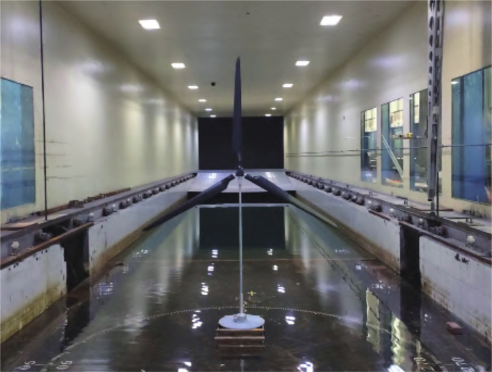

   **图 3** 风电机组的试验缩尺模型。

半潜式平台的缩尺模型如图 4 所示，平台模型采用不锈钢材质，以保证足够的强度和刚度。本研究对平台内部的压载分布进行优化设计，以保证质量、重心和惯量的缩尺相似。系泊缆采用细钢绞线制作，并在钢绞线上均匀设置配重铅坠以保证质量相似。同时，在导缆孔处连接一定弹性系数的弹簧，降低钢绞线的刚度，实现系泊系统的力学特性与原型基本一致，系泊缆的缩尺模型如图 5 所示。

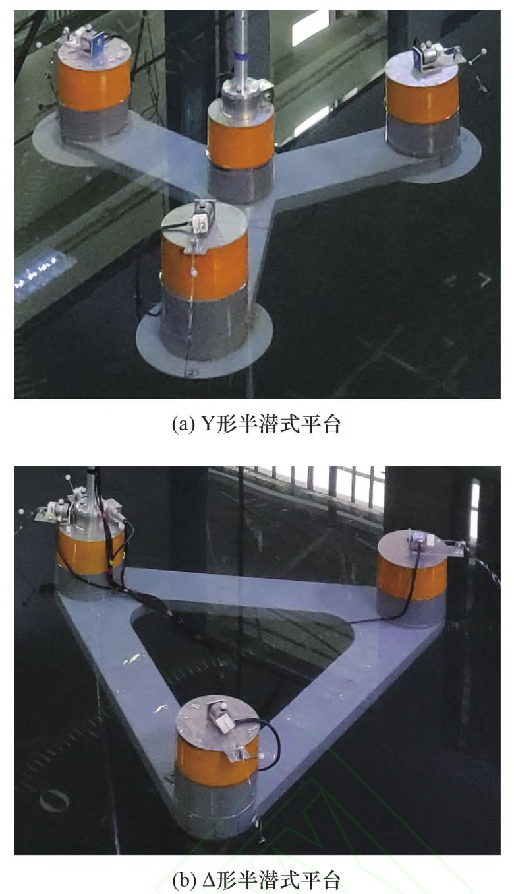

   **图 4** 半潜式平台的试验缩尺模型。原图两部分按原顺序上下排列：上为（a）Y 形半潜式平台，下为（b）Δ 形半潜式平台；两张照片均来自原稿，未改变平台形状。

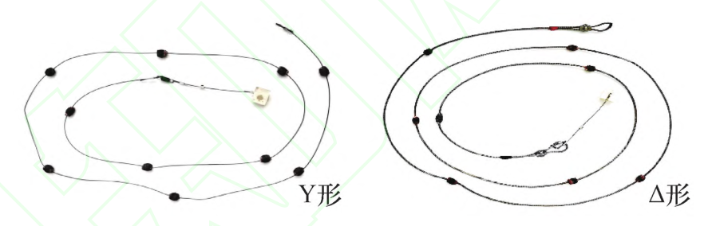

   **图 5** 系泊缆的试验缩尺模型。

3 模型试验设置
--------------

3.1 大气边界层风洞与浪槽联合实验室
~~~~~~~~~~~~~~~~~~~~~~~~~~~~~~~~~~

半潜式风机的模型试验在哈尔滨工业大学大气边界层风洞与浪槽联合（WTWF-HIT）实验室进行。如图 6 所示，实验室为闭口回流式矩形截面风洞，并配置有波浪水槽，可保证真实海况风浪场的高质量可控重现，实现风浪联合作用下海上结构的试验测试。WTWF-HIT 实验室设置了 2 个试验段（小试验段和大试验段），小试验段为风洞试验段，可模拟较高质量的大风速风场条件；大试验段为风洞浪槽耦合试验段，可实现灵活可调的组合风浪场。根据试验对象和目的，本研究的模型试验主要在大试验段完成。

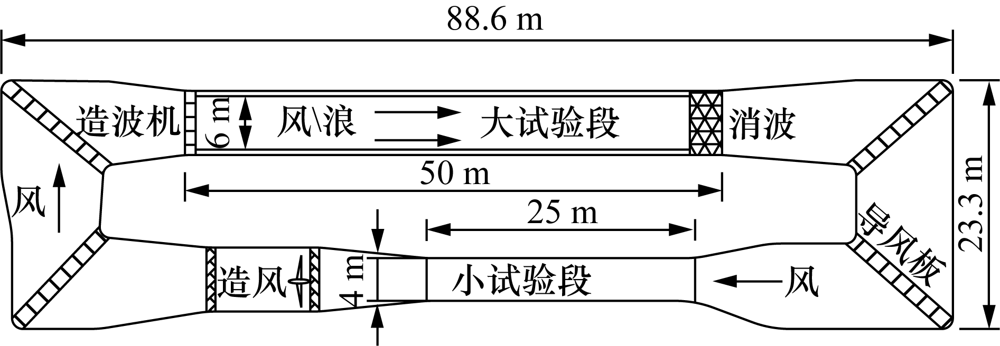

   **图 6** 大气边界层风洞与浪槽联合实验室。

3.2 试验测试平台与仪器设备
~~~~~~~~~~~~~~~~~~~~~~~~~~

根据动力响应特性和试验条件，本试验主要对半潜式风机的平台运动、机舱加速度、塔基荷载和系泊导缆孔张力进行测试。Y 形和 Δ 形半潜式风机所测试参数及仪器布置方式一致，以 Y 形半潜式风机模型为例，试验测试平台的现场搭建如图 7 所示。采用压力变送器和 Pitot 管实现风速的实时测试，并在移测架配合下获得风剖面。电容式浪高仪用于监测波高时程。风机塔筒底部安装有六分量测力天平，以实现塔基荷载的实时测试。加速度传感器固定于机舱，用于测量机舱的顺风向加速度。导缆孔处的水下拉力计可以获得系泊缆张力时程。试验模型的六自由度运动由立体视觉测量系统捕获，该系统主要由跟踪球和高精度红外摄像机组成。本试验环绕试验模型在水槽边上共架设了 6 台红外摄像机，有效避免视觉采集丢帧的问题，确保试验测试的精度。通过精细校准，立体视觉测量系统的误差可以良好地控制在 1 mm 以内。本研究中，立体视觉测量系统通过 6 台红外摄像机实时记录分别附着在立柱顶部的跟踪球的三维空间坐标，并将三维空间坐标转换为 6 个自由度运动时程。

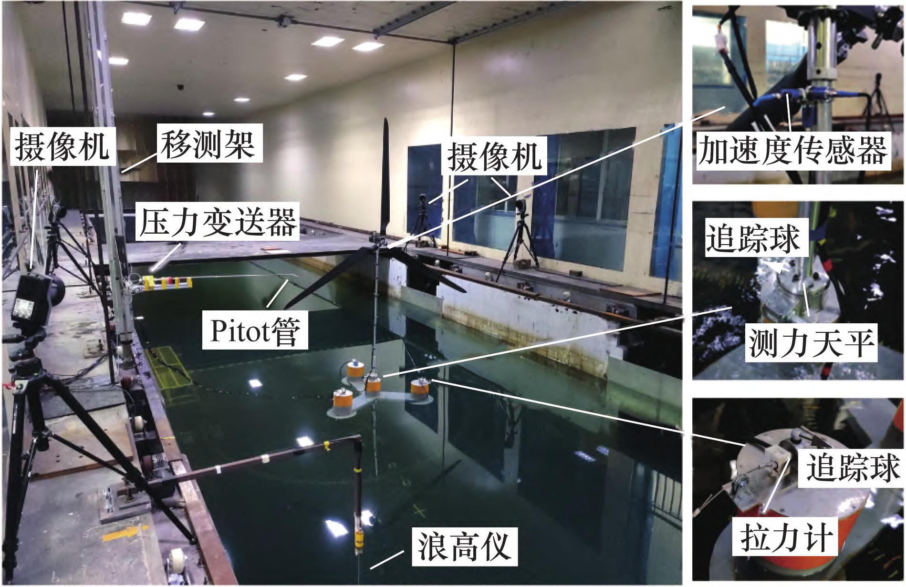

   **图 7** 半潜式风机的试验测试平台。

3.3 试验工况
~~~~~~~~~~~~

本研究选取风机额定作业和极限自存状态考察 Y 形和 Δ 形半潜式风机的动力特性。模型试验的环境荷载工况如表 2 所示，不规则波的有义波高和谱峰周期根据中国南海海域的长期风浪观测资料选取确定，并采用 JONSWAP 谱来描述波浪谱。受试验条件限制，本模型试验风浪同向，风浪作用方向为 0°，即图 1 和图 2 中的 X 轴正方向。

.. list-table:: 表 2 模型试验的环境荷载工况
   :header-rows: 1
   :widths: 40 30 30 30 30

   * - 试验工况
     - 机舱处风速 / (m·s⁻¹)
     - 有义波高 / m
     - 谱峰周期 / s
     - 风机状态
   * - LC1
     - 12
     - 2.23
     - 6.74
     - 额定作业
   * - LC2
     - 50
     - 10.65
     - 14.13
     - 极限自存

4 结果与分析
------------

4.1 环境条件标定
~~~~~~~~~~~~~~~~

本研究对 2 个试验风场和波浪场条件进行标定，以保证后续试验的准确性。平均风速剖面图如图 8 所示，由图 8 可知，平均风速剖面符合指数律，测试值与目标值基本一致。受试验条件限制，难以通过在浪槽水面上布置尖劈和粗糙元实现风场湍流强度的调节，且尖劈和粗糙元也会影响波浪的波面形态，造成波浪模拟失真。因此，风场在空风洞内自由发展，湍流强度较低。波浪功率谱如图 9 所示，由图可知，测试值与目标值吻合度较高。来自浪槽侧壁的反射波浪可能会引起一些细微误差，且其对波高较小的环境条件的影响相对较大。

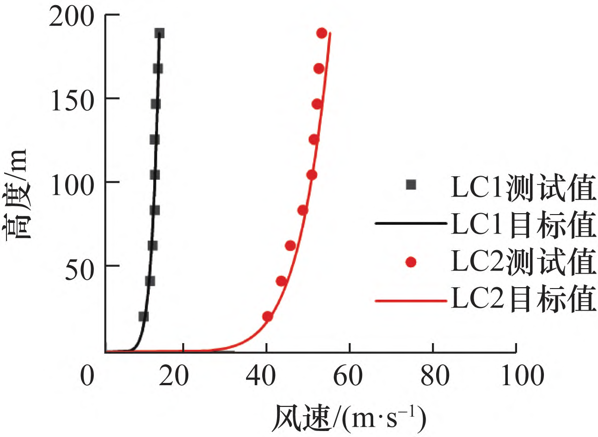

   **图 8** 平均风速剖面。

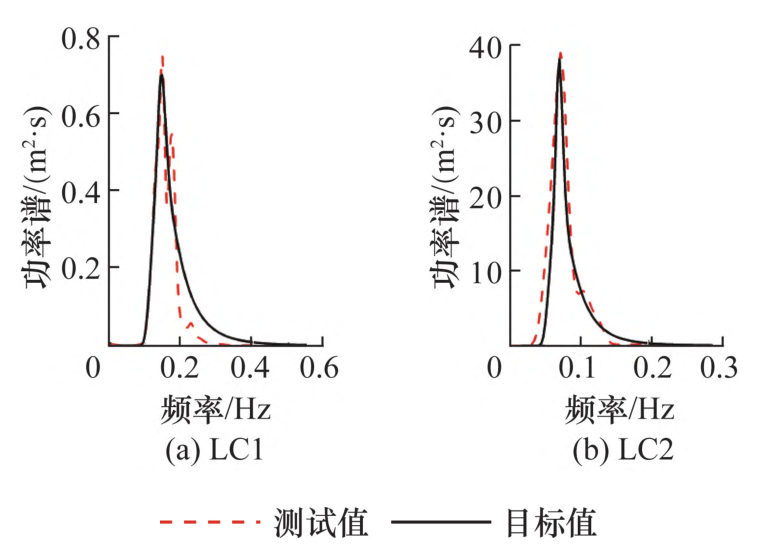

   **图 9** 波浪功率谱。（a）LC1；（b）LC2。

如表 3 所示，随机波浪的谱峰周期和有义波高的测试值和目标值吻合度较高。因此，本研究利用 WTWF-HIT 实验室能够很好地模拟和再现特定的海洋环境条件，并具有较高的精度。

.. list-table:: 表 3 模型试验的波浪参数
   :header-rows: 1
   :widths: 40 30 30 30 30

   * - 试验工况
     - 有义波高目标值 / m
     - 有义波高测试值 / m
     - 谱峰周期目标值 / s
     - 谱峰周期测试值 / s
   * - LC1
     - 2.23
     - 2.12
     - 6.74
     - 6.85
   * - LC2
     - 10.65
     - 11.05
     - 14.13
     - 13.88

4.2 风机荷载标定
~~~~~~~~~~~~~~~~

风电机组部件众多，其缩尺设计具有一定复杂性，缩尺模型的所有物理参数难以全部满足相似比的要求。本模型试验采用文[31]设计和制作的风电机组缩尺模型，在保证叶尖速比严格相似的前提下，选取合适的叶片桨距角以实现目标塔基荷载的相似等效。风机叶轮转速可以由机舱内伺服电机精准控制，而叶片桨距角通过轮毂的角度调节器手动精确调节。值得注意的是，半潜式平台的风致倾角将导致塔基剪力和弯矩额外包含风机重力分量部分，故在塔基荷载标定试验中，风机塔筒采用固底方式安装，即风机直接安装在风洞实验室的底板上，而不是浮动的半潜式平台上。为了排除风剖面对风机气动效应的影响，固底安装的风机机舱的高度位置与半潜式风机的机舱位置一致。2 个试验风场条件下的风机塔基剪力和弯矩的测试值与目标值对比如图 10 所示。由图可知，测试值与目标值吻合度较高，表明本研究设计和制作的风机缩尺模型可以正确模拟塔基荷载，可以满足后续相关试验的要求。

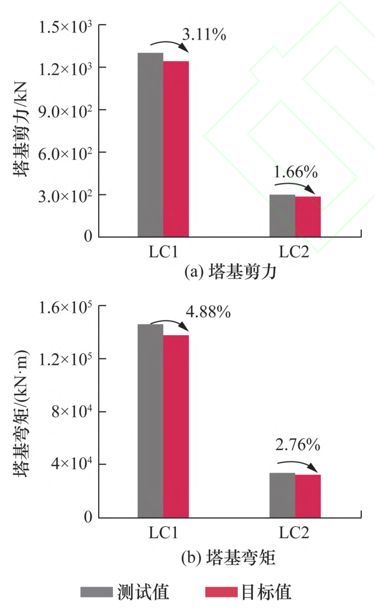

   **图 10** 风机塔基荷载标定。（a）塔基剪力；（b）塔基弯矩。

4.3 试验模型物理参数识别
~~~~~~~~~~~~~~~~~~~~~~~~

系泊系统的核心功能是对半潜式风机的位置和运动进行有效约束，确保风机在复杂海洋环境下的稳定性和安全性。本研究采用静水试验方法获取系泊刚度特性。Y 形和 Δ 形半潜式风机的系泊系统回复力–位移关系曲线如图 11 所示，由图可知，系泊回复力的测试值与目标值吻合度较高，说明模型试验中的系泊长度、配重、刚度和锚距等关键参数与目标模型参数基本一致，且本模型试验的水深设置也较为合理，设计的系泊系统缩尺模型能够合理和准确地反映原型系泊系统的一般固有特性。Δ 形半潜式风机采用 4 根系泊缆的布置方式，Δ 形半潜式风机的系泊刚度明显高于 Y 形半潜式风机的结果。此外，系泊系统具有一定的非线性特征，Δ 形半潜式风机的系泊线性刚度区间小于 Y 形半潜式风机的结果。

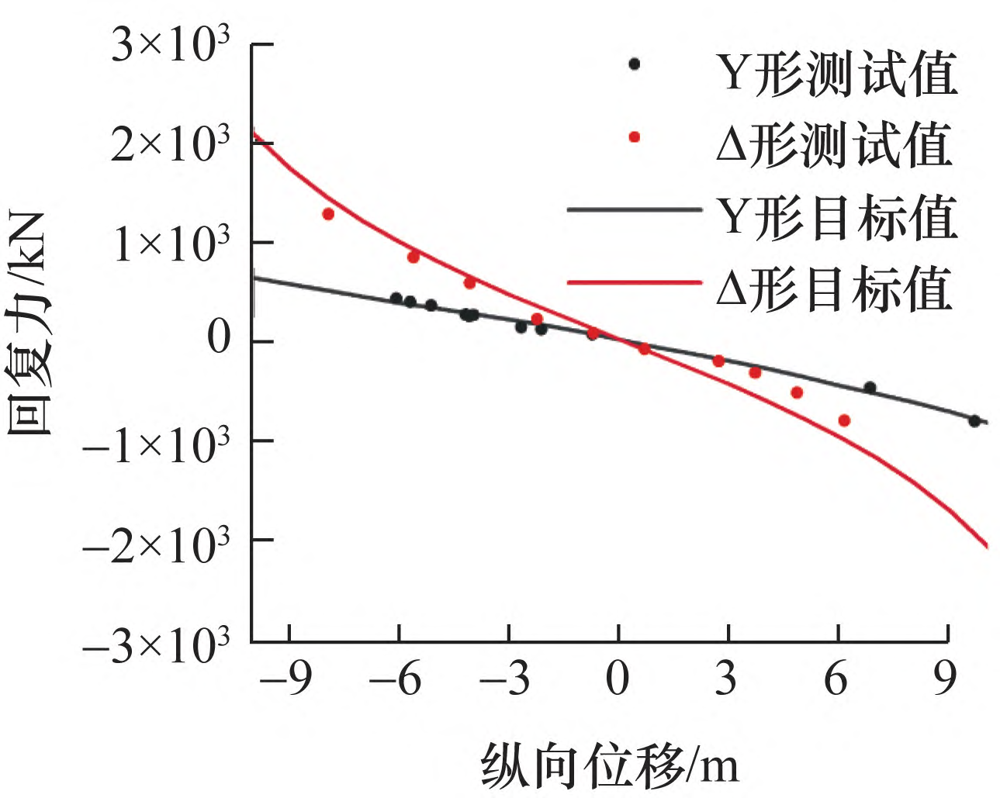

   **图 11** 系泊系统的回复力–位移关系图。

通过静水试验可以获得试验模型的自由衰减曲线，进而对半潜式风机的固有特性做出识别和评价。纵荡、垂荡和纵摇是半潜式风机的主要运动和关注重点，纵荡影响了系统部件的安全性，垂荡诱发了风电机组的垂向运动，对机组传动系统提出了考验，纵摇体现了系统的抗倾覆能力。Y 形和 Δ 形半潜式风机纵荡、垂荡和纵摇衰减的测试值与目标值对比如图 12 所示，自由衰减的测试值和目标值吻合较好，试验模型的设计制作、配重压载和气密性均较为理想，试验模型可对半潜式风机的质量、重心位置、转动惯量、阻尼特性和回复刚度等参数做出了较好表征。由图可见，由于系泊刚度的差异，Δ 形半潜式风机的纵荡固有周期显著小于 Y 形半潜式风机的结果；而二者的纵摇固有周期相近。此外，Y 形半潜式风机采用四立柱的形式，其垂荡自由度静水刚度较大，故垂荡固有周期小于 Δ 形半潜式风机。

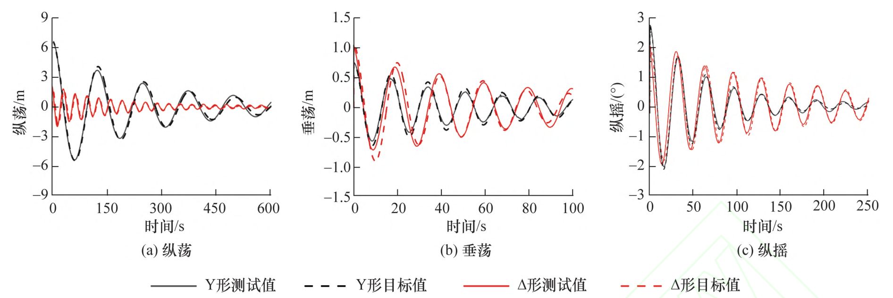

   **图 12** 半潜式风机的自由衰减的测试值与目标值比较。（a）纵荡；（b）垂荡；（c）纵摇。

4.4 试验可重复性校验
~~~~~~~~~~~~~~~~~~~~

模型试验的可重复性校验是确保数据可靠性和结论科学性的关键环节。重复性校验能够有效排除随机干扰，确认试验方法的有效性。本研究以纵荡和纵摇的结果为例对比了 LC2 工况下的 4 次试验的运动均值和标准差，结果如图 13 所示。由图可知，4 次试验结果呈现出较好的一致性，说明本模型试验具有一定的准确性和可靠性。

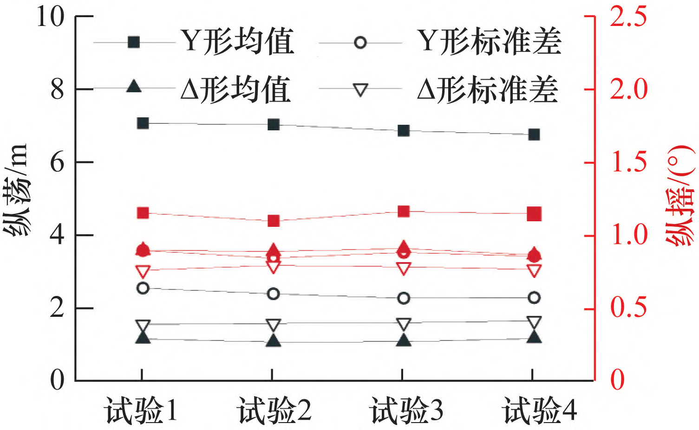

   **图 13** 4 次模型试验的均值和标准差。

4.5 平台运动对比
~~~~~~~~~~~~~~~~

纵荡、垂荡和纵摇是半潜式风机的主要运动响应，也是半潜式风机动力特性的考察重点。该三自由度的运动响应可影响系统的动态载荷，过大的运动可能导致塔筒、输电缆、系泊缆和风电机组等结构失效或疲劳损伤。威胁半潜式风机服役安全。在工程实践中，需严格控制其幅值，确保半潜式风机的安全性和稳定性。

图 14 给出了 Y 形和 Δ 形半潜式风机的纵荡、垂荡和纵摇的运动响应统计结果，并将 LC2 工况下的运动时程附于图 15。由图可知，半潜式风机服役于海洋环境，风场湍流度较低，风单独作用的均值与最值的差异较小。对于纵荡响应，Δ 形半潜式风机的纵荡均值（平均风荷载和二阶波浪慢漂力作用）和幅值（一阶波浪力作用）均显著小于 Y 形半潜式风机的结果，这主要是由于 2 个半潜式风机的系泊刚度的显著差异。对于垂荡响应，半潜式风机的垂荡均值主要受风荷载影响，波浪二阶慢漂力作用效应极小；此外，Δ 形半潜式风机的垂荡远大于 Y 形半潜式风机的结果，从而引起风电机组的大幅垂向运动。一方面，Y 形半潜式平台采用四立柱布置，具有较大的水线面面积，静水刚度较大；另一方面，风机偏离 Δ 形半潜式平台重心布置，系统的纵摇加大了参考点（见图 1 和图 2 中的惯性坐标系原点，即塔筒轴线与平均水线面的交点）的垂向位移。对于纵摇响应，Δ 形半潜式风机的纵摇略小于 Y 形半潜式风机的结果。这主要是由于 Y 形和 Δ 形半潜式风机的纵摇自由度的静水刚度相近，而 Δ 形半潜式风机的系泊纵摇刚度较大，且系泊系统的非线性特征更为显著，纵荡均值进一步加大了系泊刚度差异，进而抑制了 Δ 形半潜式风机的纵摇响应。

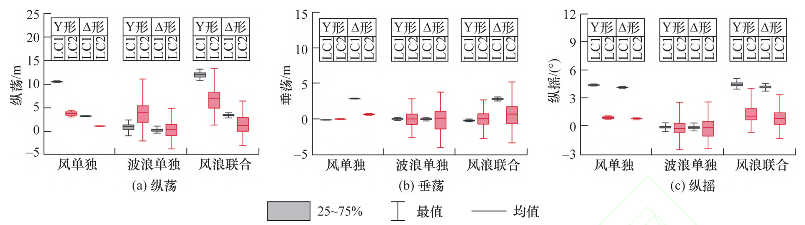

   **图 14** 半潜式风机的运动响应统计结果。（a）纵荡；（b）垂荡；（c）纵摇。

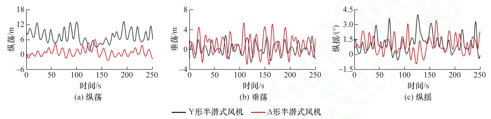

   **图 15** LC2 工况下的半潜式风机的运动响应时程曲线。（a）纵荡；（b）垂荡；（c）纵摇。

Y 形和 Δ 形半潜式风机的运动响应的功率谱曲线如图 16 所示。由图可见，2 台半潜式风机的纵荡响应均在其基频附近出现十分明显的谱峰；需要注意的是，系泊刚度具有非线性，纵荡均值将导致系泊刚度增大，进而引起风单独作用和风浪联合作用下的纵荡基频有所增大。在波浪频率范围内，Δ 形半潜式风机纵荡谱峰相对显著，这可能是由于 Δ 形半潜式风机纵荡固有周期相对较小，比较靠近波浪频率范围。此外，波浪单独作用的谱峰大于风浪联合作用的结果，这是由于风机叶轮气动阻尼效应削弱了运动响应。对于垂荡响应，Δ 形半潜式风机的纵摇响应激发了参考点的垂荡响应，垂荡响应的功率谱在纵摇固有频率处也观察到明显的谱峰，纵摇运动可放大机组的垂向运动，这与图 14 的分析结果相呼应。2 台半潜式风机的垂荡响应谱峰主要集中在波浪频率范围内。此外，风机叶轮气动阻尼效应对垂荡的削弱效应十分轻微。纵摇响应方面，纵摇响应在其固有频率附近出现十分显著的谱峰；而在波浪频率范围内，谱峰相对较弱。此外，纵摇与纵荡之间具有强耦合性。波浪单独作用的谱峰大于风浪联合作用的结果，说明风机叶轮气动阻尼效应对纵摇具有一定削弱效应。

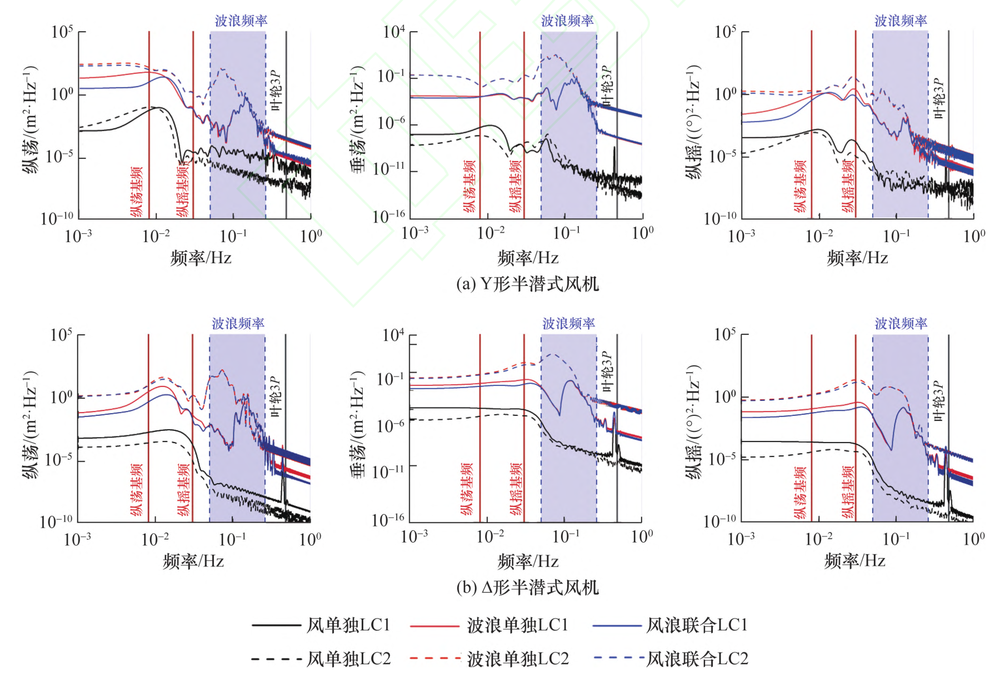

   **图 16** 半潜式风机的运动响应功率谱。（a）Y 形半潜式风机；（b）Δ 形半潜式风机。

图注：P 为风机叶轮旋转频率。

4.6 机组响应对比
~~~~~~~~~~~~~~~~

塔基弯矩是考察塔筒结构强度、安全性和疲劳寿命的重要指标，而机舱加速度直接关乎风机的发电效率和机舱传动系统可靠性。

半潜式风机的机组响应的箱线图如图 17 所示。塔基荷载主要由叶轮推力、平台纵荡和纵摇诱发的风机惯性力以及纵摇引起的风机重力分量组成，而机舱加速度主要受纵荡和纵摇控制，显然二者具有强相关性。风场湍流度较低，风单独作用的塔基荷载和机舱加速度的时程分布区间较窄。波浪单独作用的塔基弯矩和机舱加速度的均值趋于 0，波浪二阶慢漂力的影响甚微。如 4.5 节所述，较大的系泊刚度抑制了 Δ 形半潜式风机的纵荡和纵摇，进而导致 Δ 形半潜式风机的塔基弯矩均值略微偏小。对于波浪引起的时程变化幅度，LC1 工况的 Δ 形半潜式风机的机舱加速度和塔基弯矩幅值大于 Y 形半潜式风机的结果；LC2 工况的结果则相反。因此，机舱加速度和塔基弯矩对波浪周期较为敏感。需要注意的是，长期海况条件中小波浪周期占比较大，Δ 形半潜式风机的研究和应用应注意长期机舱加速度和塔基弯矩的识别和考察，以保证结构安全。

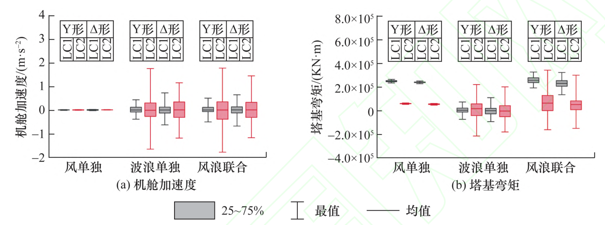

   **图 17** 半潜式风机的机组响应统计结果。（a）机舱加速度；（b）塔基弯矩。

如图 18 所示，塔基弯矩和机舱加速度的功率谱曲线具有一定的相似性，说明二者具有强相关性。塔基弯矩和机舱加速度的谱峰主要分布在波浪频率范围内；此外，纵摇固有频率也会对二者产生一定的激励作用，纵摇固有频率附近也观察到二者的谱峰，且机舱加速度的纵摇基频处谱峰相较于塔基弯矩偏小。显然，由纵摇角度引起的机组重力分量和惯性力一定程度上加大了塔基荷载的响应，而机舱加速度受纵摇的影响相对较弱。正如前文分析的，由于风机叶轮的气动阻尼效应，风浪联合的塔基弯矩和机舱加速度的功率谱谱峰略低于波浪单独作用的结果，特别地，由于气动阻尼效应削弱了纵摇响应，该现象在纵摇固有频率处的谱峰更为明显。

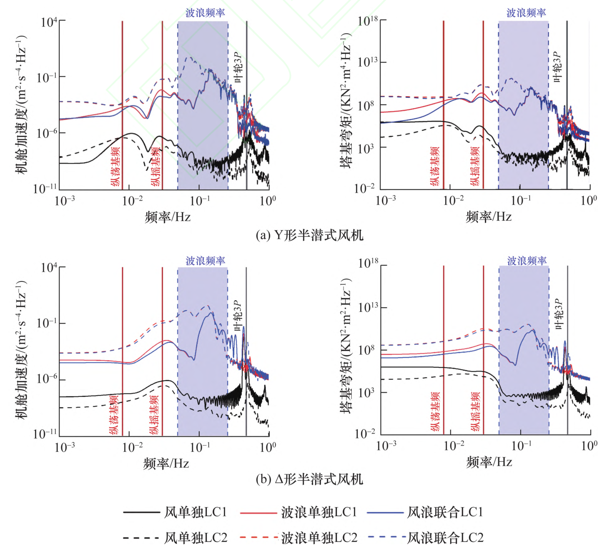

   **图 18** 半潜式风机的机组响应功率谱。（a）Y 形半潜式风机；（b）Δ 形半潜式风机。

图注：P 为风机叶轮旋转频率。

.. note::

   原文只报告两种典型工况的响应对比，不是已经完成全寿命发电量或疲劳损伤实测。原图 18 机舱加速度功率谱单位为 m²·s⁻⁴·Hz⁻¹；塔基弯矩功率谱轴则印为 KN²·m⁴·Hz⁻¹，与图 17 弯矩单位 KN·m 的平方量纲不一致。此处忠实保留原图，不静默改轴，也不据此重算谱值。

4.7 系泊导缆孔张力对比
~~~~~~~~~~~~~~~~~~~~~~

考虑到结构的对称性和风浪作用方向，Y 形半潜式风机的系泊缆 1 和 3（见图 1），Δ 形半潜式风机的系泊缆 1 和 4 以及系泊缆 2 和 3（见图 2）具有相似的动力响应。为简明，本节主要分析半潜式风机的系泊缆 1 和 2 的导缆孔张力，系泊导缆孔张力直接关乎其极限强度和疲劳强度。如图 19 所示，在风荷载和二阶波浪慢漂力作用下，系统发生平均纵荡响应，导致系泊缆 1 处于松弛状态，其导缆孔张力均值小于平衡状态下的张力结果，而系泊缆 2 处于张紧状态，其导缆孔张力均值大于平衡状态下的张力结果。由于风场湍流度较低，风单独作用的系泊导缆孔张力的时程变化分布区间较窄，而波浪引起了系统纵荡的较大幅度时程变化，导致在波浪作用和风浪联合作用下的系泊导缆孔张力的时程变化分布区间较大。总体而言，在 LC2 风浪联合作用下，系泊缆 2 导缆孔张力最大，且 Y 形半潜式风机采用三系泊缆系统，其张力略大于采用四系泊缆的 Δ 形半潜式风机的结果。

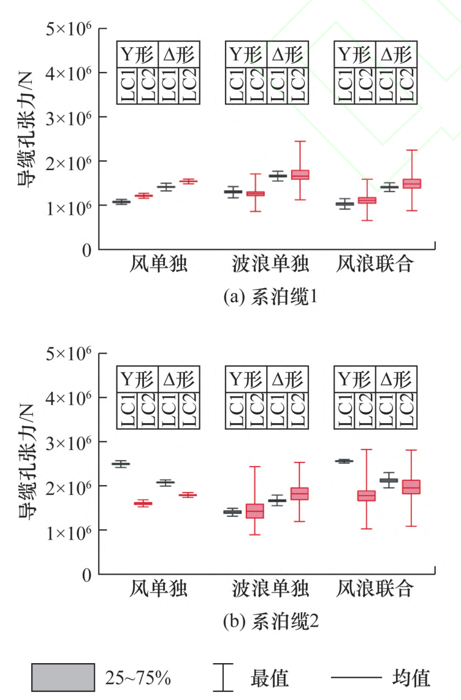

   **图 19** 半潜式风机的系泊导缆孔张力响应统计。（a）系泊缆 1；（b）系泊缆 2。

Y 形和 Δ 形半潜式风机的系泊缆 1 和 2 导缆孔张力功率谱曲线如图 20 所示。由图可知，系泊导缆孔张力的谱峰主要集中在波浪频率范围内和纵荡基频处。4.5 节和 4.6 节的分析结果表明，风浪联合工况的平台运动和机组响应由于叶轮气动阻尼效应的影响，其响应的谱峰低于波浪单独作用的结果；然而风浪联合工况的系泊缆 2 导缆孔张力谱峰值远大于波浪单独作用的结果，显然，存在其他因素放大了风浪联合工况的系泊缆 2 导缆孔张力谱峰值。

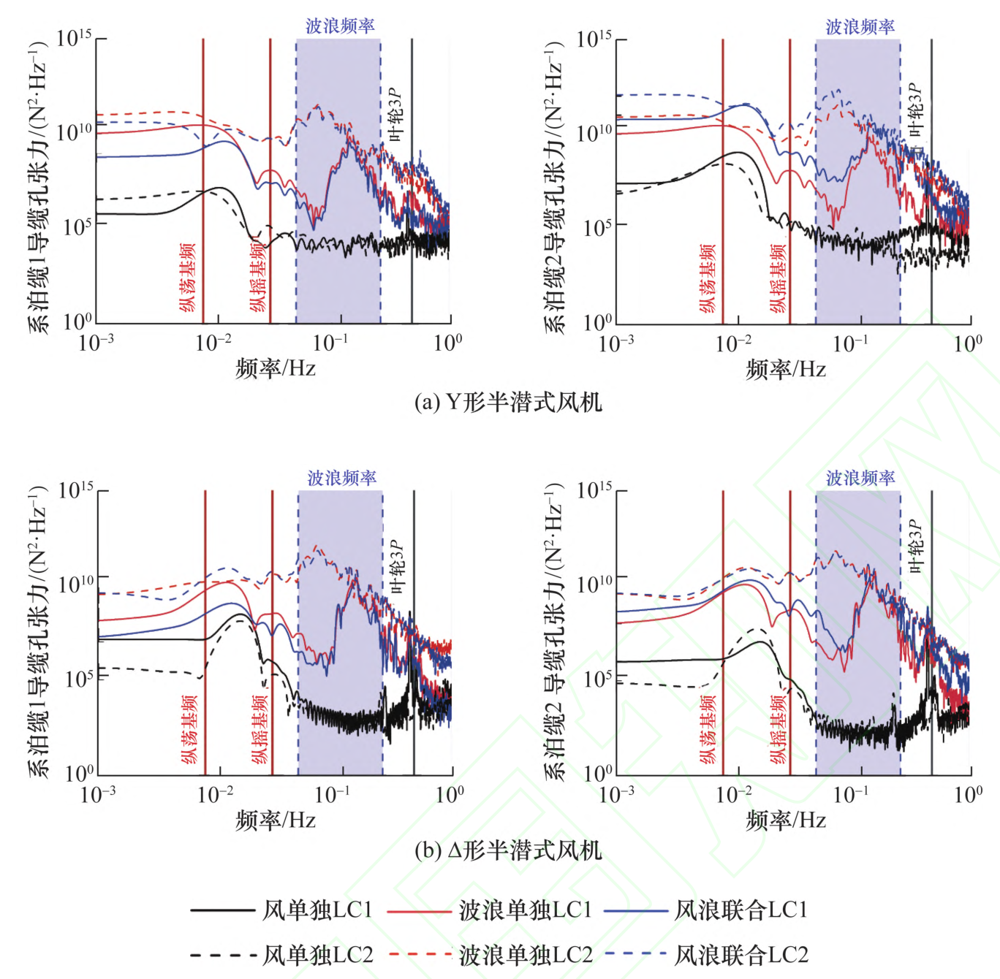

   **图 20** 半潜式风机的系泊导缆孔张力功率谱。（a）Y 形半潜式风机；（b）Δ 形半潜式风机。

图注：P 为风机叶轮旋转频率。

为了更直观地分析不同荷载条件下的系泊导缆孔张力动态特性，图 21 给出了风单独、波浪单独和风浪联合作用下的系泊缆 1 和 2 的导缆孔张力时程，为了便于比较，将系泊导缆孔张力响应时程进行置零处理（扣除均值）。由图可知，风场湍流度较低，风单独作用下的系泊导缆孔张力的时程变化区间较窄。风浪联合作用下的系泊缆 2 的导缆孔张力的变化剧烈程度远大于波浪单独作用的结果，而风浪联合作用下的系泊缆 1 的导缆孔张力的变化剧烈程度小于波浪单独作用的结果。系泊缆是一个非线性的体系，半潜式风机在 0° 风浪荷载作用下的平衡位置向风场下游偏离，上游的系泊缆 2 处于张紧状态，存在非线性的位移–张力关系；而下游的系泊缆 1 处于松弛状态，未进入非线性区间。因此，风浪荷载使系泊缆 2 进入非线性状态，进而导致波浪引起的较小位移产生较大的导缆孔张力；而系泊缆 1 尚处于弹性阶段，叶轮的气动阻尼效应抑制了导缆孔张力响应。

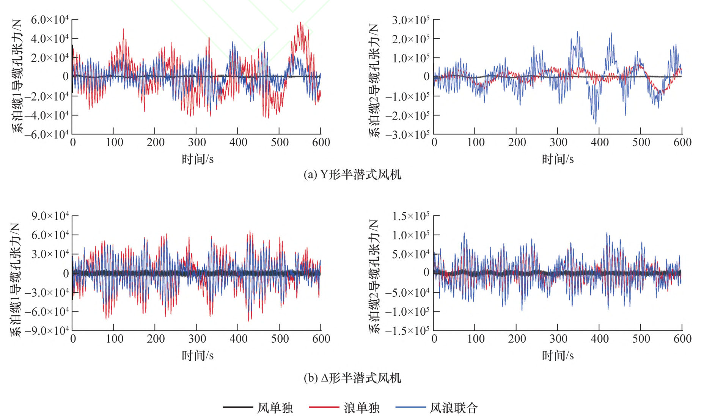

   **图 21** LC1 工况下的系泊导缆孔张力时程对比。（a）Y 形半潜式风机；（b）Δ 形半潜式风机。

5 结论
------

为了探寻风机中心布置的 Y 形和偏心布置的 Δ 形半潜式风机在不同海况条件下的动力特性差异，本研究在大气边界层风洞与浪槽联合实验室中再现了海上风浪环境，设计并制作了缩尺比为 1∶70 的试验模型，并采用全实物模型试验的方式测试风机、平台和系泊的固有特性与动力响应，通过典型工况试验及响应分析得到了如下结论：

1. 针对 10 MW 风机，通过半潜式风机的主尺寸优化，获得了尺寸参数（立柱尺寸、浮舱尺寸和系泊缆尺寸等）、排水量、质量、惯量和重心等参数相近的、具有方案可比性的 Y 形和 Δ 形半潜式风机设计。2 种半潜式风机的纵摇固有周期相近；Y 形半潜风机较大的竖向静水刚度使其的垂荡固有周期更小；而 Δ 形半潜式风机四线系泊方案的刚度大于 Y 形半潜式风机三线系泊，其纵荡固有周期更小。
2. 平台运动响应方面，风机偏心布置导致纵摇响应额外放大了机组的垂向运动，Δ 形半潜式风机的垂荡响应显著大于 Y 形半潜式风机的结果，这对风电机组的结构安全不利。不同系泊方案导致的系泊刚度差异使得 Δ 形半潜式风机的纵荡响应显著小于 Y 形半潜式风机的结果，纵摇响应略小于 Y 形半潜式风机的结果。
3. 在极限自存工况的大波浪周期下，Y 形半潜式风机的机舱加速度和塔基弯矩响应更大，但在额定作业工况的小波浪周期下则 Δ 形半潜式风机的结果更大。工程设计中需同时关注二者在承载力极限状态及疲劳极限状态中的差异。
4. 最大导缆孔张力出现在极限自存工况（轮毂高度处风速为 50 m/s，有效波高为 10.65 m，谱峰周期为 14.13 s）的 Y 形半潜式风机的上游系泊导缆孔处，但超出 Δ 形半潜式风机的系泊导缆孔张力幅度有限。此外，风浪荷载引起的系统平衡位置变化使得风场上游系泊缆处于张紧状态，进入非线性刚度区间，导致风浪联合作用下的上游系泊导缆孔张力变化更为剧烈，谱峰值也显著增强。

本研究中的 Δ 形半潜式风机未考虑压载调平控制系统的作用效应，未来研究的重点方向之一可通过压载调平控制系统进一步抑制其相关动力响应，尤其是小波浪周期下的机舱加速度、塔基弯矩和机组垂向运动响应，从而提高半潜式风机的可靠性和安全性。

参考文献
--------

[1] IUPPA C, CAVALLARO L, FOTI E, et al. Potential wave energy production by different wave energy converters around Sicily [J]. Journal of Renewable and Sustainable Energy, 2015, 7(6): 061701.

[2] CONTESTABILE P, FERRANTE V, VICINANZA D. Wave Energy Resource along the Coast of Santa Catarina (Brazil) [J]. Energies, 2015, 8(12): 14219–14243.

[3] UIHLEIN A, MAGAGNA D. Wave and tidal current energy—A review of the current state of research beyond technology [J]. Renewable and Sustainable Energy Reviews, 2016, 58: 1070–1081.

[4] SOUKISSIAN T, KARATHANASI F, AXAOPOULOS P. Satellite-Based Offshore Wind Resource Assessment in the Mediterranean Sea [J]. IEEE Journal of Oceanic Engineering, 2017, 42(1): 73–86.

[5] SAHU B K. Wind energy developments and policies in China: A short review [J]. Renewable and Sustainable Energy Reviews, 2018, 81: 1393–1405.

[6] WWEA. Worldwide Wind Capacity Reaches 744 gigawatts—an Unprecedented 93 gigawatts added in 2020 [R]. Bonn: World Wind Energy Association, 2021.

[7] IRENA. Renewable capacity highlights [R]. Bonn: International Renewable Energy Administration, 2022.

[8] GWEC. Global Wind Report 2024 [R]. Brussels: Global Wind Energy Council, 2024.

[9] 王仲颖, 时璟丽, 赵勇强, 等. 中国风电发展路线图2050 [R]. 北京: 国家发展和改革委员会能源研究所, 2011. / WANG Z Y, SHI J L, ZHAO Y Q, et al. Roadmap for China's Wind Power Development 2050 [R]. Beijing: Energy Research Institute of the National Development and Reform Commission, 2011. (in Chinese)

[10] 刘焕彬, 董旭光. 风电场风能资源评估综述 [C]//中国气象学会2007年中国气象学会年会. 广州: 中国气象学会, 2007. / LIU H B, DONG X G. A Review of Wind Energy Resource Assessment for Wind Farms [C]//2007 Chinese Meteorological Society Annual Conference. Guangzhou, China: Chinese Meteorological Society, 2007. (in Chinese)

[11] 国家能源局. 全国深远海海上风电规划 [R]. 北京: 国家能源局, 2021. / National Energy Administration. National Plan for Deep-Sea Offshore Wind Power [R]. Beijing: National Energy Administration, 2021. (in Chinese)

[12] 温斌荣, 田新亮, 李占伟, 等. 大型漂浮式风电装备耦合动力学研究: 历史、进展与挑战 [J]. 力学进展, 2022, 52(4): 731–808. / WEN B R, TIAN X L, LI Z W, et al. Coupling dynamics of floating wind turbines: History, progress and challenges [J]. Advances in Mechanics, 2022, 52(4): 731–808. (in Chinese)

[13] CASTILLO C A R, COLLU M, BRENNAN F. Comparative design space exploration of centred and off-centred semisubmersible configurations for floating offshore wind turbines [J]. Ocean Engineering, 2025, 324: 120740.

[14] BRUINSMA N, PAULSEN B T, JACOBSEN N G. Validation and application of a fully nonlinear numerical wave tank for simulating floating offshore wind turbines [J]. Ocean Engineering, 2018, 147: 647–658.

[15] AZCONA J, BOUCHOTROUCH F, GONZÁLEZ M, et al. Aerodynamic thrust modelling in wave tank tests of offshore floating wind turbines using a ducted fan [J]. Journal of Physics: Conference Series, 2014, 524: 012089.

[16] SAUDER T, CHABAUD V, THYS M, et al. Real-time hybrid model testing of a braceless semi-submersible wind turbine: Part I—The hybrid approach [C]//International Conference on Offshore Mechanics and Arctic Engineering. Busan, the Republic of Korea: American Society of Mechanical Engineers, 2016.

[17] AZCONA J, BOUCHOTROUCH F, VITTORI F. Low-frequency dynamics of a floating wind turbine in wave tank-scaled experiments with SiL hybrid method [J]. Wind Energy, 2019, 22(10): 1402–1413.

[18] WEN B R, LIANG Z H, ZHANG H, et al. A multi-drive aerodynamic load simulator for floating wind turbine model tests: Development, test and application [J]. Ocean Engineering, 2023, 286: 115579.

[19] BARAKATI S M, KAZERANI M, APLEVICH J D. Maximum power tracking control for a wind turbine system including a matrix converter [J]. IEEE Transactions on Energy Conversion, 2009, 24(3): 705–713.

[20] 刘浩学, 温斌荣, 魏汉迪, 等. 海上浮式风机混合模型试验系统开发 [J]. 实验室研究与探索, 2020, 39(5): 71–76. / LIU H X, WEN B R, WEI H D, et al. Development of Hybrid Model Test System for Floating Wind Turbines [J]. Research and Exploration in Laboratory, 2020, 39(5): 71–76. (in Chinese)

[21] 刘浩学. 海上浮式风机混合模型试验系统开发 [D]. 上海: 上海交通大学, 2020. / LIU H X. Development of Hybrid Model Test System for Offshore Floating Wind Turbine [D]. Shanghai: Shanghai Jiao Tong University, 2020. (in Chinese)

[22] UTSUNOMIYA T, SATO T, MATSUKUMA H, et al. Experimental validation for motion of a Spar-type floating offshore wind turbine using 1/22.5 scale model [C]//Proceedings of the ASME 28th International Conference on Ocean, Offshore and Arctic Engineering. Honolulu, USA: American Society of Mechanical Engineers, 2009.

[23] DE RIDDER E J, OTTO W, ZONDERVAN G J, et al. Development of a scaled-down floating wind turbine for offshore basin testing [C]//ASME 33rd International Conference on Ocean, Offshore and Arctic Engineering. San Francisco, USA: American Society of Mechanical Engineers, 2014.

[24] CHEN J H, HU Z Q. Experimental investigation of aerodynamic effect–induced dynamic characteristics of an OC4 semi-submersible floating wind turbine [J]. Proceedings of the Institution of Mechanical Engineers, Part M: Journal of Engineering for the Maritime Environment, 2018, 232(1): 19–36.

[25] AHN H, SHIN H. Experimental and Numerical Analysis of a 10 MW Floating Offshore Wind Turbine in Regular Waves [J]. Energies, 2020, 13(10): 2608.

[26] MICHAILIDES C, GAO Z, MOAN T. Experimental and numerical study of the response of the offshore combined wind/wave energy concept SFC in extreme environmental conditions [J]. Marine Structures, 2016, 50: 35–54.

[27] MICHAILIDES C, GAO Z, MOAN T. Experimental study of the functionality of a semisubmersible wind turbine combined with flap-type Wave Energy Converters [J]. Renewable Energy, 2016, 93: 675–690.

[28] GAO Z, MOAN T, WAN L, et al. Comparative Numerical and Experimental Study of two Combined Wind and Wave Energy Concepts [J]. Journal of Ocean Engineering & Science, 2016, 1(1): 36–51.

[29] YU W, MÜLLER K, LEMMER F. Deliverable D4.2 Public definition of the two LIFES50+ 10MW Floater Concepts [R]. Norway: Dr.techn. Olav Olsen AS, 2017.

[30] ZHOU S T, LI C, XIAO Y Q, et al. Evaluation of floating wind turbine substructure designs by using long-term dynamic optimization [J]. Applied Energy, 2023, 352: 121941.

[31] ZHENG S Y, LI C, WANG P C, et al. Wind tunnel and wave flume testing on directionality dynamic responses of a 10 MW Y-shaped semi-submersible wind turbine [J]. Journal of Renewable and Sustainable Energy, 2023, 15(1): 013305.

[32] BAK C, ZAHLE F, BITSCHE R, et al. The DTU 10-MW Reference Wind Turbine [R]. Copenhagen: Technical University of Denmark, 2013.

英文摘要的中文译文
------------------

**目的**：为利用深远海的优质风能，半潜式风机已成为海上风能行业广泛采用的一种结构方案。其中，风机中心布置的 Y 形半潜式平台和风机偏心布置的 Δ 形半潜式平台是深海应用的两种主流构型。然而，对其动力特性差异仍缺乏系统量化。这可归因于多种因素，包括数值方法尚不完备、已有原型的风机功率不同、设计标准与建造工艺存在差异，以及可能存在的技术和商业保密限制。

**方法**：为进行公平比较，以最小化系统成本和累积疲劳损伤为目标，以平台与系泊的主尺寸为关键变量，优化得到适配 DTU 10-MW 风机的中心和偏心布置半潜平台及系泊系统。随后，依据相似准则设计并建立 1∶70 的半潜式风机试验模型。采用风浪联合条件下的缩尺模型试验测试动力特性，重点考察风机额定作业与极限自存模式。比较风单独作用、波浪单独作用和风浪联合作用对两种半潜式风机动力响应的影响。对平台运动、机舱加速度、塔基弯矩和系泊导缆孔张力等关键动力性能指标进行时频域统计分析，研究不同荷载的影响、各种动力响应之间的耦合特性及其激励机制。

**结果**：两种半潜式风机的纵摇固有周期相近。Y 形半潜式风机较大的竖向静水刚度使其垂荡固有周期较短。Δ 形半潜式平台四线系泊系统的刚度大于 Y 形平台的三线系统，从而使纵荡固有周期缩短。Δ 形半潜式风机的偏心布置易产生垂荡与纵摇耦合，纵摇放大风机的垂向运动。不同系泊方案引起的系泊刚度差异，使 Δ 形风机的纵荡响应显著小于 Y 形风机，纵摇响应也略小。长周期极端波浪下，Y 形风机的机舱加速度和塔基弯矩较大；短周期作业波浪下，Δ 形风机的响应较大。荷载引起的平衡位置偏移导致系泊系统非线性行为，在风浪联合作用下，上游系泊缆进入张紧的非线性刚度区间，加剧导缆孔张力的波动与谱峰幅值。

**结论**：本研究强调，工程设计需要考虑不同海况及极限状态下 Y 形和 Δ 形半潜式风机的动力特性差异。进一步将典型工况下观察到的动力特性与全寿命周期海况数据相结合，可为深远海漂浮式风机平台的选型和设计优化提供量化框架。

**关键词**：半潜式风机；模型试验；动力特性；风洞；浪槽。

原文出处
--------

:ref:`郑舜云、周盛涛、石兵、李朝、胡钢、曾宇、李利孝. 中心与偏心布置半潜风机动力特性的模型试验. 清华大学学报（自然科学版）, 2025年网络首发. <ref-zheng2025-QHDXXB>`
