.. _paper-note-ref-zhou2017-E:

额定运行条件下同向风浪荷载对 Y 形半潜式漂浮风机的方向效应：论文精解
============================================================================

精简版微信公众号文章：待发布

.. contents:: 本页目录
   :local:
   :depth: 2

论文信息
--------

**原文题名：** Directionality Effects of Aligned Wind and Wave Loads on a Y-Shape Semi-Submersible Floating Wind Turbine under Rated Operational Conditions。

**作者：** Shengtao Zhou，Baohua Shan，Yiqing Xiao，Chao Li（通讯作者），Gang Hu，Xiaoping Song，Yongqing Liu，Yimin Hu。

**作者单位：** 哈尔滨工业大学深圳研究生院；哈尔滨工业大学土木工程学院；香港科技大学土木与环境工程系；湘电风能有限公司。

**期刊：** Energies，2017，10，2097。DOI：`10.3390/en10122097 <https://doi.org/10.3390/en10122097>`_。

**稿件日期：** 2017 年 10 月 28 日收稿；2017 年 12 月 6 日录用；2017 年 12 月 11 日发表。

**WOEAI 相关方向：** 海上漂浮风电 / 一体化分析。

摘要
----

Y 形（三角形）半潜式基础已被大多数已建成的足尺漂浮风机采用，例如 Windfloat、Fukushima Mirai 和 Shimpuu。考虑到其非完全对称形状及海洋气象条件，基础相对于风浪方向的布置角，不仅影响漂浮风机的停机时间和发电效率，也影响整个结构的强度与疲劳安全。然而，此前很少对不同方向同向风浪荷载引起的动力响应进行比较研究。本文通过风浪联合试验与耦合多体模拟研究方向效应。比较三个荷载方向的实测数据发现，平台运动差异主要来自波浪荷载，其中一个方向始终表现出较大的纵摇运动。为明确这一现象背后的机制，建立漂浮风机耦合多体动力模型并加以验证。数值结果表明，二阶水动力对纵荡和纵摇的方向差异贡献很大，而一阶水动力决定塔底弯矩与机舱加速度的变化。这些发现表明，海上安装前应全面预先确定方向效应，这对 Y 形漂浮风机的运行维护十分重要。

关键词
------

Y 形半潜式基础；同向风浪荷载方向；方向效应；风浪联合试验；耦合多体模拟。

1 引言
------

人类正面临严重的能源与环境挑战，改变传统能源结构因而愈发迫切。采用风能等清洁可再生能源十分重要。相比陆上风，全球海上风资源已被证明更加丰富、稳定，视觉和噪声干扰较小，市场价格波动也较小 [1,2]。据估计，到 2050 年，海上风能可贡献全球近 5.5% 的电力 [3]。因此，海上风能正成为最有前景的可再生能源之一。当时的底固定式海上风机主要局限于 30 m 以内水深 [4]，超过这一范围，建造成本将急剧上升。近年来，漂浮式海上风机（floating offshore wind turbine，FOWT）技术的发展，正使深水风能开发成为可能。

借鉴海上油气工业的经验，FOWT 可采用四类浮式基础：Spar 单柱式、半潜式、驳船式和张力腿平台（TLP）。一些足尺 FOWT 原型已开展海试：搭载 2.3 MW 风机的 Spar 型 Hywind [5] 于 2009 年安装；搭载 2 MW 风机的半潜式 WindFloat [6] 于 2011 年投放；福岛海上风电场示范项目 [7] 在 2011–2016 年支持建成一台 Spar 型和两台半潜式漂浮风机。由于场址适应性好、安装方便 [8]，通常由三个外立柱构成的三角形半潜式基础，已被这些已建足尺 FOWT 中的大多数采用，例如 Windfloat [6]、Fukushima Mirai 和 Shimpuu [7]。但非完全对称形状使半潜式 FOWT 对风浪方向敏感。其稳定性与水动力特性可能随风浪来向改变，最终产生不同动力响应。因此，更好地理解半潜式 FOWT 的方向效应，有助于减小荷载并提高发电效率。

缩尺模型试验和数值模拟是 FOWT 动力学研究的两种主要途径。虽然波浪水槽或水池试验成本很高，但应指出，除足尺试验外，它是捕捉复杂海洋环境中强非线性现象的唯一已验证途径 [9]。现有半潜式 FOWT 模型试验的目的可分为两类 [10]。第一类用于验证数值模拟。Roddier 等 [6] 开展 WindFloat 平台 1:105 缩尺模型试验，检验 TIMEFLOAT 数值模拟的有效性。Coulling 等 [11] 利用 1:50 缩尺试验数据，验证在漂浮风机模拟器 FAST [13] 中建立的 DeepCwind OC4 半潜式 FOWT 模型 [12]。第二类研究具有特定特征的 FOWT 系统动力响应。Michailides 等 [14] 与 Gao 等 [15] 通过 1:50 物理模型，考察半潜式风能与拍板式波浪能转换组合装置（SFC）的功能。Chen 和 Hu [16] 采用 1:50 模型，研究气动作用引起的 OC4 半潜式 FOWT 动力特征。这些试验提供了有价值的信息。但试验均只采用一个荷载方向，而真实海况中的风浪方向始终会变化。迄今已有少量试验采用不同风浪方向 [17]，但对半潜式 FOWT 在不同荷载方向下实际动力表现的讨论仍然稀少，认识尚不明确。

数值模拟经济且信息丰富，是缩尺试验的良好补充。一般而言，FOWT 动力分析数值方法采用频域与时域混合方法 [18]。附加质量、辐射阻尼、波浪激励力等水动力系数，先由势流求解器在频域获得，再通过迟滞函数或傅里叶变换转到时域 [19]。与此同时，风机气动力与系泊力分别基于叶素动量理论（BEM）／广义动态尾流理论（GDW）[20]，以及准静态方法 [21]／集中质量法 [22] 计算。最终，通过多体动力分析 [23] 得到耦合动力响应。这种方法已用于 FAST [13] 和 SIMO-RIFLEX-AeroDyn [24] 等 FOWT 数值程序。

借助上述数值方法，以往研究讨论了 FOWT 的风浪方向效应。Philippe 等 [25,26] 比较了 MIT/NREL 浅吃水驳船（SDB）[27] 在五种波浪相对风向下的运动响应幅值算子（RAO）。他们发现，同向风浪条件下，纵荡、垂荡、纵摇最大，横荡、横摇、艏摇最小；而风浪错向 :math:`90^\circ` 时呈现相反趋势。Ramachandran 等 [28] 使用更精细的时域数值模型，研究风浪荷载方向对 TLP 型 FOWT 的影响，得到类似趋势。Barj 等 [29,30] 发现，纳入风浪错向条件有助于改善极值与疲劳荷载估计，但多数结构位置的最高极值和疲劳荷载更倾向于出现在同向风浪条件下。不过，这些发现针对 Spar 型 FOWT。更一般地，Bachynski 等 [31] 研究了 Spar、TLP 和两种半潜式平台共四类海上基础，在同向及错向条件下的运动与塔底疲劳荷载。文献表明，若干错向工况会略微增加运动，但最大的塔底疲劳损伤由同向风浪引起。此外，他们还比较了半潜式 FOWT 在两个同向风浪方向下的塔底疲劳损伤。Karimirad 等 [32] 同样发现，运行条件下，错向风浪对 V 形半潜式 FOWT 系统的运动、系泊张力和发电量，没有明显不利影响。

这些已发表工作主要关注风浪错向的影响，但多数结论指出，同向风浪通常更重要，尤其对于最高极值荷载。然而，迄今关于来自不同方向的同向风浪，对非完全对称半潜式 FOWT 影响的数值研究很少。此外，上述研究未讨论方向效应的主要成因，而这对于全面认识有关现象至关重要。

本文旨在揭示 Y 形半潜式 FOWT 遭遇多个同向风浪来向时的表现及其机制。这里的 Y 形半潜式平台，是由四个立柱构成、中央立柱与三个外立柱相连的浮体。首先，开展三个荷载方向的 1:60 缩尺模型试验，再现物理实际。在高质量风洞—波浪水槽（WTWF）联合实验室中，仔细设计并标定 Y 形半潜式 FOWT 模型、环境条件与测量系统。随后建立相应数值模型，并用试验数据验证。对于试验未测量的塔底前后向弯矩和机舱加速度等动力响应，也考虑荷载方向效应进行分析。此外，比较不同荷载方向的数值结果，寻找方向效应的主要原因。结果表明，平台运动随波浪来向改变，进而导致塔底荷载和机舱加速度产生明显差异。因此，海上安装前预先考虑荷载方向效应十分重要，有益于 FOWT 系统发电效率与安全。

2 半潜式漂浮风机的基本配置
--------------------------

如图 1 所示，研究对象名为 ConFloat，由 5 MW 水平轴风机、半潜式基础和三根悬链线组成的系泊系统构成。

风机为常规三叶片上风向直驱机组。与 NREL 海上 5 MW 基准风机 [33] 类似，轮毂位于平均海平面（MSL）以上 90 m；切入、额定和切出风速分别为 3 m/s、11.5 m/s 和 25 m/s，均为轮毂高度 10 分钟平均风速。

四立柱半潜式基础是作者研究团队提出的概念设计，其主要特征如下。

1. 主体结构采用预应力混凝土。与钢结构相比，预计可降低制造成本，并提高抗腐蚀与抗疲劳能力。
2. 在外立柱与中央立柱之间设置三根矩形截面浮箱连接，为平台提供足够强度和刚度。不设置斜撑，以减少节点处疲劳 [8]。
3. 底部扩大立柱和大截面浮箱提供压载空间，降低重心并减小运动响应，尤其是垂荡。

图 1b、c 给出平台构件、尺寸及本文坐标系。在浮箱、底部扩大立柱与外立柱中注入压载水，使吃水达到 23 m。图 1d 定义风浪荷载相对平台的方向。注意，:math:`x` 轴始终与荷载方向一致，转子也随之偏航迎风。平台采用密度 1900 kg/m³ 的高强轻质混凝土。初步结构分析表明，350 mm 厚的平台壁足以抵抗环境荷载。此外，为增加结构刚度并划分水密舱室，平台内部布置加劲构件与舱壁，计算结构特性时予以考虑；结构特性见表 1。

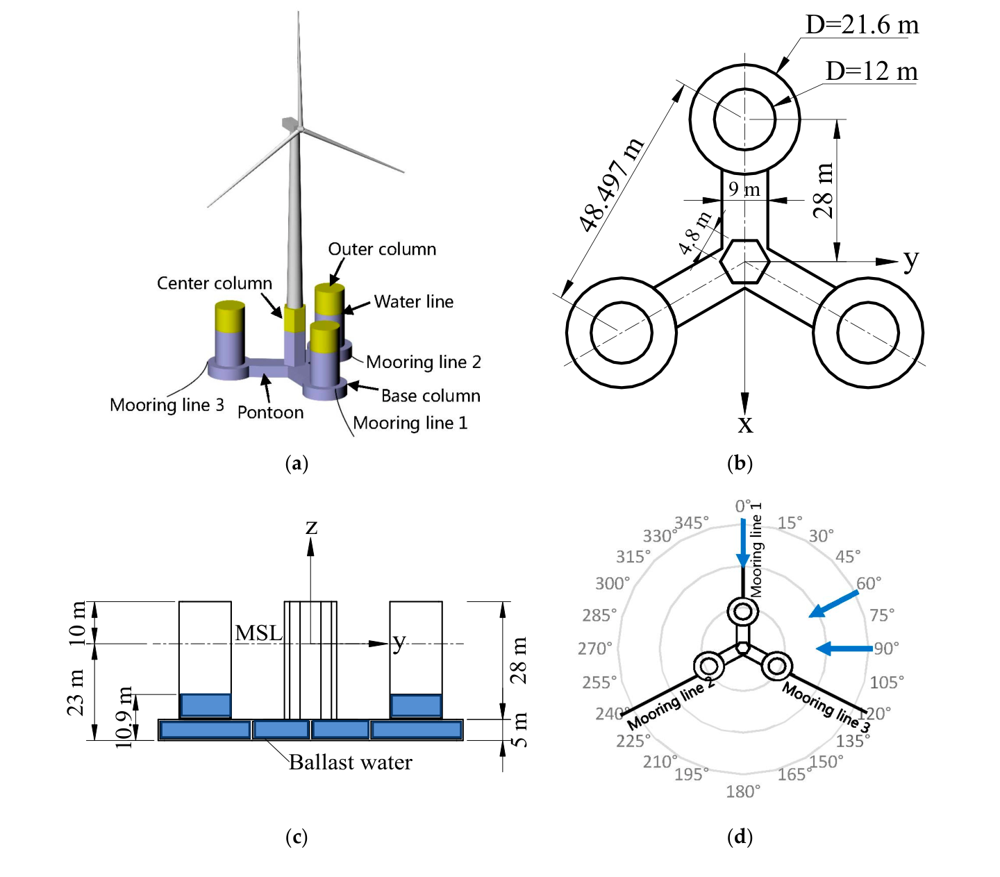

   **图 1** ConFloat 半潜式平台。（a）三维模型；（b）平台尺寸；（c）侧视图；（d）风浪荷载方向定义。MSL 为平均海平面，ballast water 为压载水；结构由中央立柱、三个外立柱与 Y 形浮箱连接，不含斜撑。

.. list-table:: 表 1 ConFloat 半潜式平台结构特性
   :header-rows: 1
   :widths: auto

   * - 结构特性
     - 不含风机
     - 包含风机
   * - 包含压载的质量（kg）
     - 1.4560×10⁷
     - 1.5237×10⁷
   * - 重心位于 MSL 以下深度（m）
     - 16.063
     - 11.797
   * - 绕重心横摇转动惯量（kg·m²）
     - 5.780×10⁹
     - 1.109×10¹⁰
   * - 绕重心纵摇转动惯量（kg·m²）
     - 5.780×10⁹
     - 1.109×10¹⁰
   * - 绕重心艏摇转动惯量（kg·m²）
     - 9.630×10⁹
     - 9.970×10⁹

平台由三根悬链线系泊，如图 1b 所示。导缆点位于底部扩大立柱外缘，水深为 MSL 以下 18 m。悬链线系泊系统特性汇总于表 2。

.. list-table:: 表 2 悬链线系泊系统特性
   :header-rows: 1
   :widths: auto

   * - 特性
     - 数值
   * - 系泊线数量
     - 3
   * - 导缆点在 MSL 以下的深度（m）
     - 18
   * - 锚点在 MSL 以下的深度（m）
     - 90
   * - 锚点距平台 z 轴的水平距离（m）
     - 424.8
   * - 未伸长系泊线长度（m）
     - 392
   * - 系泊线直径（m）
     - 0.08
   * - 水中等效单位长度表观质量（kg/m）
     - 136.248
   * - 等效拉伸刚度（MN）
     - 50

3 模型试验布置
--------------

3.1 试验设施
~~~~~~~~~~~~

如图 2 所示，哈尔滨工业大学闭回流式风洞—波浪水槽联合实验室设有两个试验段。小试验段能够生成高质量大气边界层，用于标定缩尺风机模型。大试验段在风洞下方设置波浪水槽，能够生成接近实际的联合风浪场。实验室尺寸与性能参数见表 3。

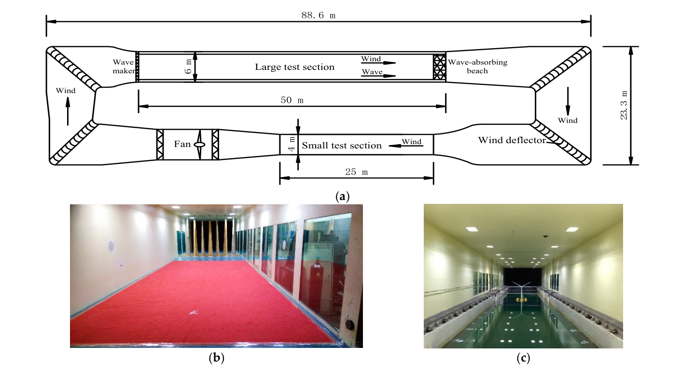

   **图 2** 风洞与波浪水槽联合实验室。（a）平面图；（b）小试验段；（c）大试验段。平面图标示风机、导流板、造波机、消波滩及风浪行进方向。

.. list-table:: 表 3 风洞—波浪水槽联合实验室尺寸及性能
   :header-rows: 1
   :widths: auto

   * - 参数
     - 数值
   * - 小试验段尺寸：宽×高×长（m）
     - 4×3×25
   * - 大试验段尺寸：宽×高×长（m）
     - 6×3.6×50
   * - 波浪水槽尺寸：宽×深×长（m）
     - 5×4.5×50
   * - 小试验段最大风速（m/s）
     - 50
   * - 大试验段最大风速（m/s）
     - 30
   * - 最大波高（m）
     - 0.4
   * - 波浪周期（s）
     - 0.5–5

3.2 试验模型
~~~~~~~~~~~~

为保证惯性力与重力之间的正确关系，试验模型及荷载依据 Froude 相似律设计，几何缩尺比为 1:60。注意，本文全部结果均按足尺表示。

平台模型由 0.95 mm 厚不锈钢制成，以保证足够强度和刚度。在浮箱、底部扩大立柱与上部立柱中放置铁块，达到目标质量、重心和转动惯量。

由于雷诺数降低对风机叶片绕流的影响复杂，几何缩尺模型几乎无法恢复全部气动力 [34–36]。不过，固定在轮毂轴上的阻力盘已成功用于模拟转子平均风推力 [6,37–39]，本文采用这一方法。阻力盘用轻质泡沫塑料制成，其中心轴上固定金属环，以补偿原型质量。

试验模拟风速 11.5 m/s 的额定风况。阻力盘初始直径根据阻力公式估计：

.. math::

   F=\frac12 C_d\rho v^2A.

其中，:math:`F` 为盘面推力，:math:`C_d` 为阻力系数，依据 DNV 规则 [40] 取 1.9；:math:`\rho` 为空气密度，:math:`v` 为轮毂风速，:math:`A` 为盘面积。在风洞小试验段标定风推力，用安装于塔底的 ATI 测力天平测量。通过试错调整盘直径，使推力与目标值相匹配。图 3 最终给出模型与原型的推力比较，以及额定风况下的等效风机模型。原型数据来自风机模拟器 Bladed。实测平均值与目标吻合良好，盘直径为 110 cm。

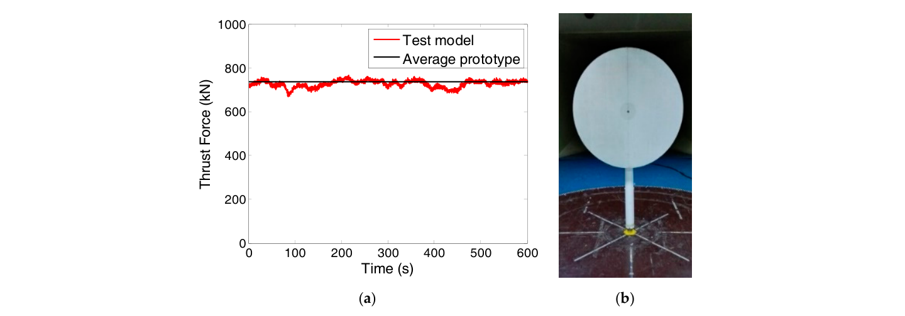

   **图 3** 风机标定试验。（a）模型与原型推力比较；（b）额定运行工况的简化风机模型。红线为试验模型，水平线为原型平均推力。

由于水槽宽度限制，悬链线无法直接按原型形状缩尺，因此采用等效水平弹簧系泊系统 [41]。悬链线的竖向力来自自身重力，其变化有限，故合理地将该竖向力计入平台压载系统。如图 4 所示，在平台周围以 :math:`120^\circ` 间隔布置三根水平弹簧系泊线。每根线由三部分构成：用于调节预张力的花篮螺栓、提供系统所需刚度的弹簧，以及连接平台的钢丝。

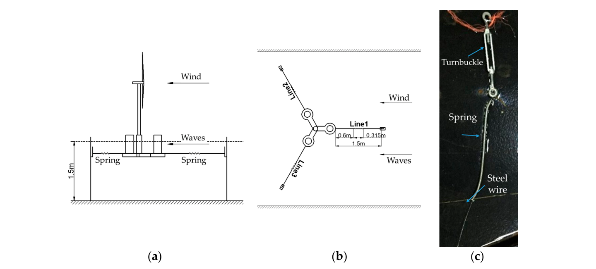

   **图 4** :math:`0^\circ` 荷载方向下弹簧系泊系统的（a）侧视图、（b）俯视图及（c）构件。

弹簧刚度为 20.5 N/m，原型对应 :math:`7.5645\times10^4\,\mathrm{N/m}`，由原型悬链线位移—恢复力／力矩曲线进行线性最小二乘拟合确定。图 5 比较三个荷载方向下，悬链线与弹簧系泊系统的纵荡恢复力及纵摇恢复力矩曲线。除纵荡位移较大时存在轻微差异外，弹簧系统水平恢复刚度与原型悬链线吻合较好；三个荷载方向的恢复刚度也基本一致。此外，为检查纵荡—纵摇耦合对系泊恢复力／力矩的影响，图 6 绘出不同纵摇状态下的纵荡恢复力，以及不同纵荡状态下的纵摇恢复力矩。图 6a–c 表明，平台纵摇对系泊恢复力影响较小，但纵荡对恢复力矩影响显著。相较原型，沿风浪正向的纵荡增大时，弹簧系泊倾向于提供更大恢复力矩。不过总体而言，在水槽模型试验中用水平弹簧模拟悬链线系泊是可行的。

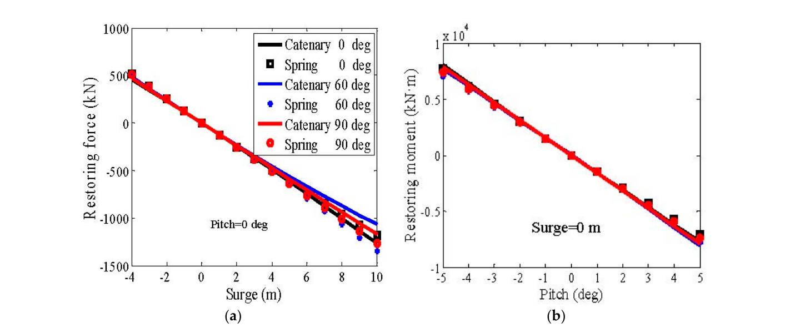

   **图 5** 三个荷载方向下，悬链线与弹簧系泊系统的（a）纵荡恢复力曲线和（b）纵摇恢复力矩曲线。实线为悬链线，标记为弹簧系统；颜色区分方向。

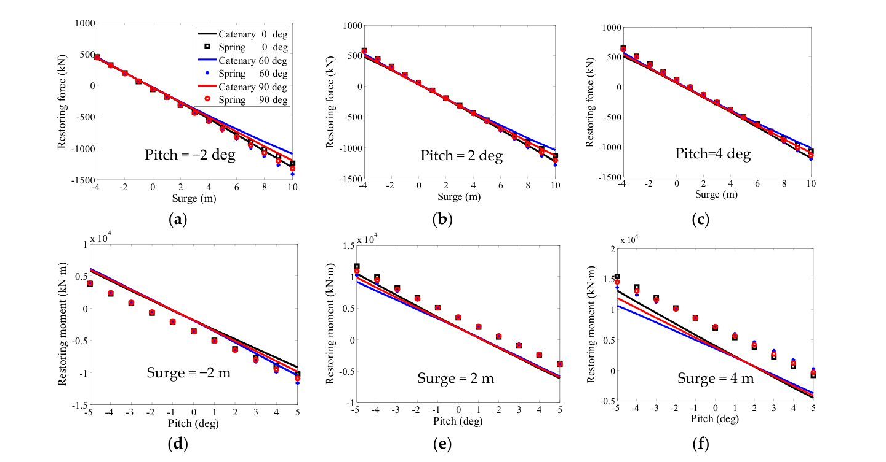

   **图 6** 不同纵摇下的纵荡恢复力：（a） :math:`-2^\circ`；（b） :math:`2^\circ`；（c） :math:`4^\circ`。不同纵荡下的纵摇恢复力矩：（d）−2 m；（e）2 m；（f）4 m。

3.3 测量仪器
~~~~~~~~~~~~

如图 7 所示，用安装在升降架上的微压计测量风剖面，用三根电容式浪高仪监测波面。FOWT 模型的六自由度运动，由自主开发的立体视觉测量系统 [42,43] 获取。该系统包括两台相机、固定于模型上的五个跟踪标记，以及图像采集／处理平台。与激光位移传感器的结果对比，证明其具有较高精度。

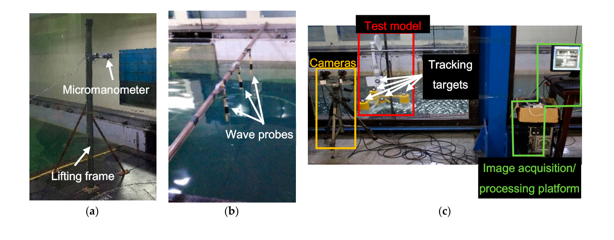

   **图 7** 测量仪器。（a）升降架上的微压计；（b）三根浪高仪；（c）立体视觉测量系统。图中标出相机、试验模型、跟踪标记及图像采集／处理平台。

3.4 风浪环境标定试验
~~~~~~~~~~~~~~~~~~~~

本文研究额定运行工况下的 FOWT 动力学。依据中国东南沿海长期海洋气象资料，轮毂平均风速、有效波高 :math:`H_s` 和谱峰周期 :math:`T_p` 分别确定为 11.5 m/s、2.23 m 和 6.74 s。

图 8a、b 给出 FOWT 模型位置的实测平均风速与湍流强度剖面。模拟风速剖面与虚线吻合较好，该虚线为风切变指数 0.1 的经验幂律剖面。由于阻力盘只能模拟风机平均推力，风洞没有刻意生成湍流风，轮毂高度湍流强度因而较小，低于 5%。此外，图 8c 比较实测波谱与目标 JONSWAP（联合北海波浪观测计划）谱。除约 0.2 Hz 附近存在可能由水槽侧壁反射波引起的差别外，实测与目标谱吻合，表明水槽能够生成指定的实际海况。

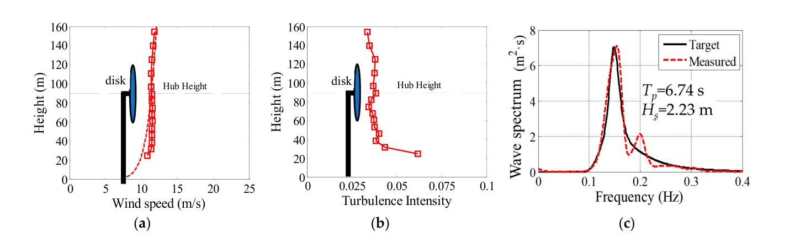

   **图 8** 实测风浪场。（a）平均风速剖面；（b）湍流强度剖面；（c）随机波浪谱。水平标记表示轮毂和阻力盘的高度范围。

3.5 试验矩阵
~~~~~~~~~~~~

为全面研究 FOWT 动力表现，开展五类试验：自由衰减、规则波、稳态风、不规则波以及联合风浪试验。

开展六自由度自由衰减试验，以估计 FOWT 运动固有周期及黏性阻尼系数。规则波试验可得到以 RAO 表征的线性水动力性能。波浪周期从 5 s 至 25 s，以 2 s 为步长，共考察 11 个周期；周期 5–15 s 时波高为 1.8 m，17–25 s 时为 2 m。为得到简谐稳态响应，每个周期试验持续 2 分钟，折合足尺 15.5 分钟。额定工况下，分别以稳态风和不规则波试验研究风、浪作用，最后进行联合试验。每种海况记录足尺 2 小时数据。为比较不同荷载方向下的表现，每项试验考察 :math:`0^\circ`、:math:`60^\circ`、:math:`90^\circ` 三个风浪来向，共定义 48 个试验工况，汇总于表 4。

.. list-table:: 表 4 试验工况矩阵，数值为足尺尺度
   :header-rows: 1
   :widths: auto

   * - 试验类型
     - 风速（m/s）
     - 波浪周期（s）
     - 波高（m）
     - 荷载方向（°）
   * - 自由衰减
     - —
     - —
     - —
     - —
   * - 规则波
     - —
     - 5、7、9、11、13、15
     - 1.8
     - 0、60、90
   * - 规则波
     - —
     - 17、19、21、23、25
     - 2.0
     - 0、60、90
   * - 仅风
     - 11.5
     - —
     - —
     - 0、60、90
   * - 不规则波
     - —
     - 6.74（峰值周期）
     - 2.23（有义波高）
     - 0、60、90
   * - 风浪联合
     - 11.5
     - 6.74（峰值周期）
     - 2.23（有义波高）
     - 0、60、90

4 数值模拟
----------

本次数值研究有三个主要目的：（1）用模型试验数据验证气动—水动—控制—弹性耦合漂浮风机动力模拟器；（2）进一步研究同向风浪方向效应的主要原因；（3）分析试验未测量的物理量，例如塔底前后向弯矩和机舱加速度。

NREL 开源时域风机模拟器 FAST，集成陆上风机与海上油气工业的计算方法和分析工具 [21]，能够实现漂浮风机系统的气动—水动—控制—弹性耦合动力分析。在 FAST 中，浮式平台视为六自由度刚体，其运动由下列微分方程描述：

.. math::

   [\mathbf M+\mathbf A(\infty)]\ddot{\mathbf q}(t)
   +\int_0^t\mathbf K(t-\tau)\dot{\mathbf q}(\tau)\,\mathrm d\tau
   +\mathbf C\mathbf q(t)+\mathbf B_{\mathrm{add}}\dot{\mathbf q}(t)|\dot{\mathbf q}(t)|
   =\mathbf F_{\mathrm{wave}}(t)+\mathbf F_{\mathrm{Aero}}(t)+\mathbf F_{\mathrm{Lines}}(t)\qquad (1)

其中，:math:`\mathbf M` 为结构质量矩阵；:math:`\mathbf A(\infty)` 为无限频率附加质量矩阵；:math:`\mathbf q(t)`、:math:`\dot{\mathbf q}(t)`、:math:`\ddot{\mathbf q}(t)` 分别为平台位移、速度和加速度向量；:math:`\mathbf K(\tau)` 为波浪辐射迟滞核，取决于附加质量及辐射阻尼矩阵；:math:`\mathbf C` 为静水恢复矩阵；:math:`\mathbf B_{\mathrm{add}}` 为用户定义的附加二次阻尼矩阵；:math:`\mathbf F_{\mathrm{wave}}(t)` 为入射波激励荷载；:math:`\mathbf F_{\mathrm{Aero}}(t)` 为风机气动荷载；:math:`\mathbf F_{\mathrm{Lines}}(t)` 为系泊荷载。下文分别讨论数值模型的水动、气动和系泊荷载。

4.1 水动力建模
~~~~~~~~~~~~~~

FAST 的水动力问题求解基于势流理论及 Morison 方程。一阶势流水动力问题包括辐射、绕射和静水力。辐射作用，是结构在静水中被迫振荡时受到的力与力矩，分为附加质量与辐射阻尼两项，对应式 (1) 左侧前两项。二者由结构几何、振荡频率及有限水深决定 [44]，与波浪来向无关。绕射作用，是结构保持固定时入射波引起的水动力荷载，对应式 (1) 的 :math:`\mathbf F_{\mathrm{wave}}(t)`，取决于物体形状和波浪来向。第三项 :math:`\mathbf C\mathbf q(t)` 表示平台产生垂荡、横摇和纵摇位移后，由水线面及重力—浮力作用引起的恢复力／力矩。这三项的水动力系数，可用面元法求解边值问题获得 [45]。

以往研究 [46–49] 表明，一阶势流理论不足以预测 FOWT 动力学。二阶水动力理论能更准确地考虑非线性自由面边界条件，以及平台实际瞬时湿表面的荷载，这些因素可能对水动力分析十分关键。一般而言，二阶水动力荷载包括平均漂移力、差频漂移力和和频漂移力。对于半潜式平台，差频漂移力尤其重要，因为它能激发结构固有频率并产生共振。

除线性辐射阻尼外，FAST 还在运动方程左侧加入二次项，考虑黏性阻尼。但实际中阻尼系数通常由经验确定，并受雷诺数效应、表面粗糙度等多种因素影响。因此 FAST 提供用户定义的二次阻尼矩阵 :math:`\mathbf B_{\mathrm{add}}`，可调节数值模型，使阻尼与自由衰减等试验结果相符。

ConFloat FOWT 数值模型同时计算一阶与二阶水动力系数。势流计算的面元模型见图 9a，通过网格尺寸敏感性分析，保证求解的独立性和效率。系统质量、重心与转动惯量等固有属性，由三维实体模型得到。分析在 0.05–3.0 rad/s 范围内，按 0.05 rad/s 步长选取 60 个波浪频率。二阶作用中，采用完整二次传递函数（QTF）计算平均漂移力和差频漂移力，忽略和频漂移力；自由面网格见图 9b。对于黏性阻力项，通过试错调整附加二次阻尼矩阵，直到每个自由度的数值自由衰减与试验数据吻合良好。

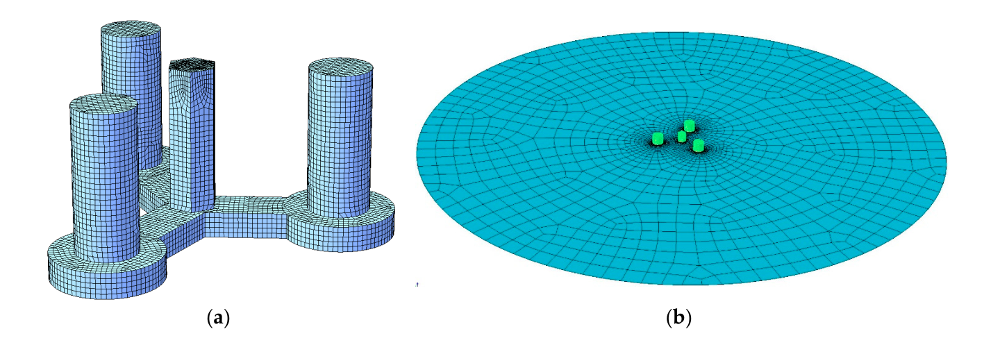

   **图 9** 水动力计算网格。（a）ConFloat 半潜式平台面元模型；（b）自由面网格。

4.2 气动力建模
~~~~~~~~~~~~~~

水平轴风机气动弹性模拟，通常采用 BEM 或 GDW 两种尾流模型计算气动力 [20]。但试验中，转子平均风作用由阻力盘而非完整转子模拟。为保持一致，关闭尾流模型，数值风机也建模为不旋转钝体，总风推力可简单估计为：

.. math::

   F_{\mathrm{Aero}}(t)=\sum_{i=1}^N\frac12 C_{d,i}^{\mathrm{WT}}\rho\left|v_{wi}(t)-v_i(t)\right|^2A_i\qquad (2)

其中，:math:`C_{d,i}^{\mathrm{WT}}` 为风机第 :math:`i` 个构件的风阻系数；:math:`\rho` 为空气密度；:math:`v_{wi}(t)` 为时刻 :math:`t`、第 :math:`i` 个构件高度处风速；:math:`v_i(t)` 为该构件沿来风方向的运动速度；:math:`A_i` 为其迎风投影面积。开始系统动力模拟前，先关闭水动力模块，调整叶片与塔筒风阻系数，使其与风机标定试验测得的平均塔底力／力矩匹配。

4.3 系泊线建模
~~~~~~~~~~~~~~

FAST 提供三种模拟悬链线或张力腿的方法：准静态法 [21]、有限元法（FEM）和集中质量法 [22]。对于试验中的水平弹簧系泊系统，图 10 表明其荷载—位移曲线具有良好线性，因此可用线性恢复矩阵模拟 [12]。与悬链线类似，弹簧系泊的纵荡与纵摇，以及横荡与横摇恢复荷载彼此耦合。本文通过线性最小二乘拟合弹簧系泊荷载—位移曲线，估计恢复矩阵。拟合直线斜率为各自由度对角元素，截距随耦合位移变化的梯度为非对角元素，即耦合项。垂荡方向弹簧恢复力相对静水恢复力很小，故忽略。式 (3) 依次给出 :math:`0^\circ`、:math:`60^\circ` 和 :math:`90^\circ` 荷载方向的线性恢复矩阵。虽然 :math:`60^\circ` 方向纵荡和纵摇刚度略大于另两个方向，但弹簧系泊系统的方向间一致性较好。

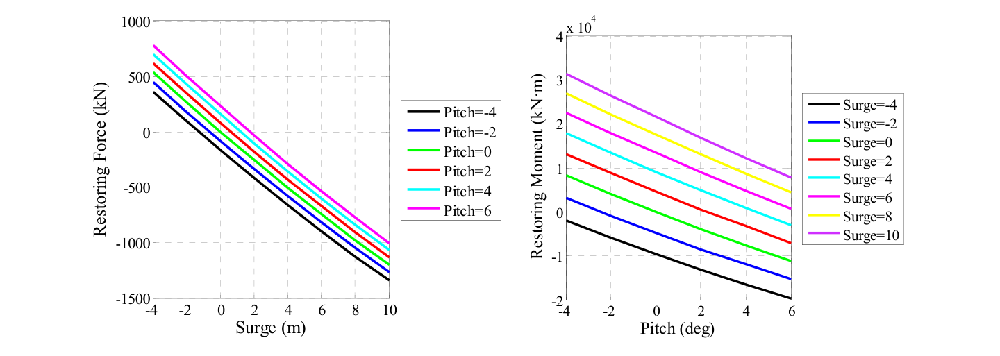

   **图 10** :math:`0^\circ` 荷载方向下，水平弹簧系泊系统的荷载—位移关系。左图为不同纵摇状态下纵荡恢复力，右图为不同纵荡状态下纵摇恢复力矩。

为便于阅读，将原式同一矩阵单元内依次排列的三个方向数值，按方向分别展开；数值和原式符号均保留：

.. math::

   \mathbf F_{\mathrm{Lines}}(t)=\mathbf C_{\mathrm{Lines}}\mathbf q(t),

   \mathbf C_{\mathrm{Lines}}^{0^\circ}=\begin{bmatrix}
   124578&0&0&0&-2287592&0\\
   0&130040&0&2332444&0&0\\
   0&0&0&0&0&0\\
   0&2334553&0&113627244&0&0\\
   -2332716&0&0&0&111233315&0\\
   0&0&0&0&0&143894662
   \end{bmatrix},

   \mathbf C_{\mathrm{Lines}}^{60^\circ}=\begin{bmatrix}
   134984&0&0&0&-2364732&0\\
   0&130040&0&2332444&0&0\\
   0&0&0&0&0&0\\
   0&2334553&0&113627239&0&0\\
   -2332407&0&0&0&116159579&0\\
   0&0&0&0&0&143894662
   \end{bmatrix},

   \mathbf C_{\mathrm{Lines}}^{90^\circ}=\begin{bmatrix}
   129927&0&0&0&-2326108&0\\
   0&130040&0&2332456&0&0\\
   0&0&0&0&0&0\\
   0&2334552&0&113626996&0&0\\
   -2332563&0&0&0&113696678&0\\
   0&0&0&0&0&143894662
   \end{bmatrix}.\qquad (3)

原式单位为：平动力／平移的元素 :math:`\mathrm{N/m}`；平动力／转角的元素 :math:`\mathrm{N/rad}`；力矩／平移的元素 :math:`\mathrm{N\,m/m}`；力矩／转角的元素 :math:`\mathrm{N\,m/rad}`。六个自由度依次为纵荡、横荡、垂荡、横摇、纵摇、艏摇。

4.4 塔筒结构建模
~~~~~~~~~~~~~~~~

FAST 采用假定模态法模拟塔筒柔性，需要前两阶弹性弯曲模态及结构属性，计算系统运动方程的模态积分。塔筒模态强烈受塔底边界条件影响，安装于浮式平台时尤其如此，因此本文采用基于有限元法的软件 BModes [50]，处理复杂边界条件下的耦合模态问题。将塔筒质量与刚度分布、塔顶质量、平台质量、附加质量、静水刚度和系泊刚度等与塔筒振型有关的参数输入 BModes，构建全系统惯性与刚度矩阵。最终求解特征值问题，得到图 11 的塔筒前后向振型。所用塔筒一、二阶固有频率分别为 0.444 Hz 和 2.949 Hz。

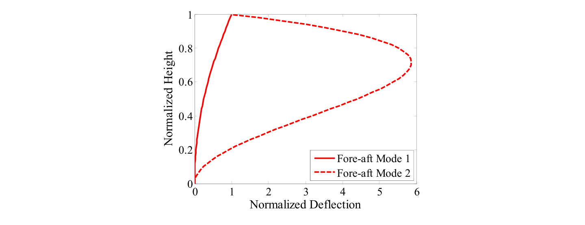

   **图 11** 塔筒前后向振型。实线与虚线分别为一、二阶模态；横纵坐标分别为归一化位移和高度。

5 结果与讨论
------------

本节通过比较试验与数值结果，讨论同向风浪荷载对 ConFloat FOWT 系统动力学的方向效应。

5.1 自由衰减试验
~~~~~~~~~~~~~~~~

自由衰减试验用于识别纵荡、横荡、垂荡、横摇、纵摇和艏摇固有周期。表 5 所列试验与数值模型固有周期吻合良好，表明数值模型的系泊刚度、重心和转动惯量与试验模型一致。通过匹配自由衰减数据调整的六自由度二次阻尼系数，见表 6。本文不考虑耦合项，因此二次阻尼矩阵只有对角元素非零。

.. list-table:: 表 5 试验与数值模拟的固有周期比较
   :header-rows: 1
   :widths: auto

   * - 自由度
     - 试验（s）
     - 模拟（s）
     - 相对误差（%）
   * - 纵荡
     - 80.5
     - 79.9
     - −0.7
   * - 横荡
     - 79.7
     - 78.6
     - −1.4
   * - 垂荡
     - 17.7
     - 17.6
     - −0.6
   * - 横摇
     - 25.8
     - 26.0
     - 0.8
   * - 纵摇
     - 26.0
     - 26.0
     - 0.0
   * - 艏摇
     - 79.0
     - 79.7
     - 0.9

.. list-table:: 表 6 数值模型附加二次阻尼系数
   :header-rows: 1
   :widths: auto

   * - 自由度
     - 二次阻尼系数
     - 单位
   * - 纵荡
     - 4×10⁶
     - N·s²/m²
   * - 横荡
     - 4×10⁶
     - N·s²/m²
   * - 垂荡
     - 1×10⁶
     - N·s²/m²
   * - 横摇
     - 2×10⁹
     - N·m·s²/rad²
   * - 纵摇
     - 2×10⁹
     - N·m·s²/rad²
   * - 艏摇
     - 4×10⁹
     - N·m·s²/rad²

5.2 规则波试验
~~~~~~~~~~~~~~

规则波试验用于研究波浪来向对 FOWT 线性水动力特性的方向效应。处理模型试验与 FAST 模拟的简谐稳态响应数据，计算 RAO，即单位波高对应的线性响应幅值。

图 12 比较三个波浪方向的纵荡、垂荡和纵摇 RAO。纵荡 RAO 幅值在数值与试验模型间吻合良好，随周期从 5 s 增至 17 s 而增大。超过 17 s 后，试验结果在 21 s 出现局部极小值，23 s 达峰；数值纵荡 RAO 则在试验周期范围内持续增加，之后在 27 s 降至 1.1，再于 29 s 上升。就方向影响而言，5–9 s 周期范围内，:math:`0^\circ` 和 :math:`60^\circ` 波浪下的幅值明显大于 :math:`90^\circ`；超过该范围，纵荡 RAO 基本相同。图 13 对三个方向纵荡力 RAO 的比较，可以解释这一趋势。

图 12b 表明，垂荡 RAO 同样较少受波浪来向影响。周期小于 15 s 时，垂荡 RAO 较小；周期接近垂荡固有周期时迅速增大。除 23 s 和 25 s 附近长周期外，大多数周期的数值结果与试验吻合，并预测 19 s 之后垂荡 RAO 逐渐下降、趋近 1。

对于图 12c 的纵摇 RAO，虽然大部分周期下方向差异较小，但在接近纵摇固有周期的 25 s 处，方向效应显著。:math:`60^\circ` 波浪下实测纵摇 RAO 几乎是 :math:`0^\circ` 和 :math:`90^\circ` 的 1.5 倍。数值结果预测了相似趋势，但高估长周期波下的幅值；纵摇 RAO 在 27 s 达峰，29 s 下降。

数值与模型试验之间的差异，可能源于 FAST 无法捕捉平台真实阻尼行为 [11]。实际黏性阻尼随波况变化。依据文献 [12] 方法估计，缩尺模型在短周期波中的雷诺数量级为 :math:`10^5`，长周期波中为 :math:`10^4`。根据 Schewe [51] 的研究，前者圆形截面的阻力系数低于 1.0，后者则高于 1.1。由于流动分离阻力是总水动力阻尼的重要组成 [11]，长周期波中的黏性阻尼通常比短周期波更显著。数值模型的二次阻尼系数依据自由衰减试验确定，图 12a、c 表明这些值适用于短周期波，因此数值模型倾向于高估长周期波响应。不过，本文主要关注波浪周期小于 10 s 的额定运行海况，所选二次阻尼系数满足本研究要求。

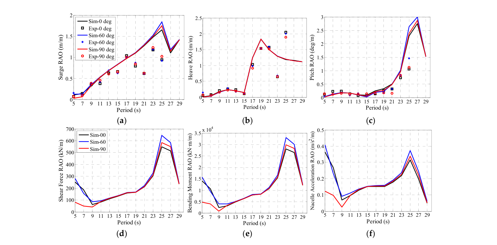

   **图 12** 三个波浪来向的 RAO 比较。（a）纵荡；（b）垂荡；（c）纵摇；（d）塔底剪力；（e）塔底弯矩；（f）机舱前后向加速度。Sim 和 Exp 分别表示数值与试验；后三项仅给出数值结果。

此外，塔底前后向剪力与弯矩对结构强度和疲劳设计至关重要，机舱加速度与传动链运行密切相关。因此，尽管试验未测量这些量，仍借助数值模拟计算其 RAO，绘于图 12。有趣的是，短周期波中的方向影响同样显著。周期 5 s 时，:math:`0^\circ` 和 :math:`60^\circ` 波浪下塔底荷载、机舱加速度 RAO，约为 :math:`90^\circ` 的三至四倍。差异随周期增大而减小，在 13–23 s 范围消失；25–27 s 时，:math:`60^\circ` 值又大于另外两个方向。这与纵荡、纵摇 RAO 趋势相似。风机响应无疑取决于平台运动。图 14 给出 5 s 规则波下纵荡、塔底荷载与机舱加速度时程，说明塔底荷载和机舱加速度的方向差异来自一阶纵荡运动。图 13 表明平台在 :math:`60^\circ` 下倾向于承受更大的波浪纵荡力，可解释上述现象。

   **图 13** 三个波浪来向的纵荡力 RAO 比较。黑、蓝、红分别对应 :math:`0^\circ`、:math:`60^\circ`、:math:`90^\circ`。纵轴单位按原图保留。

.. note::

   原图纵轴写作 kN/m²，而正文将 RAO 定义为单位波高对应的响应幅值。此处保留原轴标，不据此认定该单位在量纲上正确，也不静默重标原图。

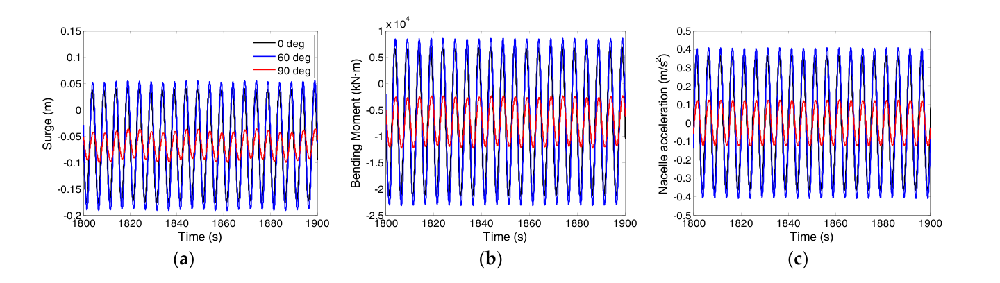

   **图 14** 5 s 规则波下（a）纵荡、（b）塔底弯矩、（c）机舱加速度时程，颜色分别对应三个波浪方向。

5.3 稳态风试验
~~~~~~~~~~~~~~

对稳态风作用下的 ConFloat 平台开展模型试验和数值模拟，检查风向对平台运动的影响。图 15 比较平均纵荡与纵摇。试验、数值一致，表明数值模型准确捕捉了风机平均气动特征。

不含波浪作用时，纵荡由转子风推力与系泊恢复力之间的平衡决定。如式 (3) 所示，弹簧系泊系统在 :math:`60^\circ` 方向的纵荡刚度较大，因此纵荡略小。图中各风向纵摇也保持较好一致性，说明这种四立柱半潜式平台抵抗不同方向风致倾覆力矩的能力相同。

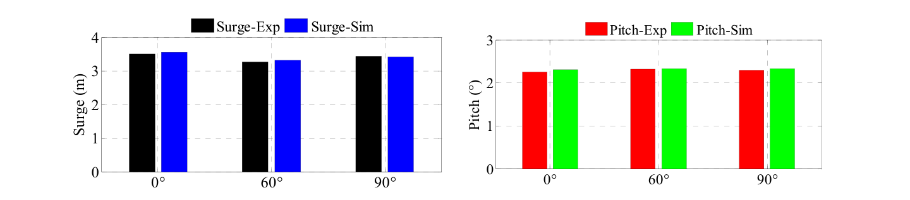

   **图 15** 三个风向的平均纵荡和纵摇比较。Exp 为试验，Sim 为数值；黑、蓝为纵荡，红、绿为纵摇。

5.4 不规则波试验
~~~~~~~~~~~~~~~~

为尽量减小比较中的建模不确定性，数值模拟直接采用水槽上游测得的波高时程作为入射波 [15,37]。所有模拟均按足尺运行 4650 s，以得到所需稳态结果。

图 16 比较三个波浪方向的纵荡和纵摇功率谱密度（PSD）。模拟准确预测了频域内的纵荡与纵摇响应。波致响应由纵荡和纵摇共振主导，0.1–0.3 Hz 入射波频范围内的分量很小。就波向而言，:math:`90^\circ` 的纵荡 PSD 幅值大于 :math:`0^\circ` 和 :math:`60^\circ`；纵摇则在 :math:`60^\circ` 达最大，:math:`90^\circ` 受到最强抑制。图 17 的最大值与标准差呈现类似趋势，但平均值在各波向间基本一致。这说明显著方向差异由二阶水动力引起。

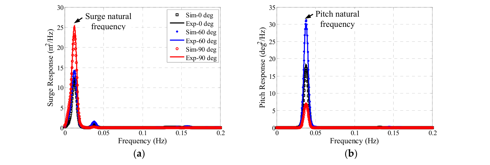

   **图 16** 三个波浪方向下（a）纵荡和（b）纵摇 PSD。Sim 为数值，Exp 为试验；图中标出纵荡、纵摇固有频率。

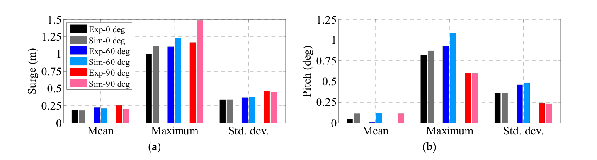

   **图 17** 三个波浪方向的 FAST 与模型试验统计比较。（a）纵荡；（b）纵摇。Mean、Maximum 和 Std. dev. 分别表示均值、最大值与标准差。

为进一步说明二阶水动力荷载如何形成方向效应，图 18 比较三个来向的荷载与运动 QTF。半潜式 FOWT 以共振响应为主，因此只绘出纵荡、纵摇固有频率对应的 QTF。横坐标 :math:`f_1` 是频率对中的一个频率，该频率对满足 :math:`|f_1-f_2|` 等于纵荡／纵摇固有频率。图 18a 表明，在额定运行波况能量较强的 0.15–0.18 Hz 范围内，:math:`90^\circ` 二阶纵荡力明显高于另两个方向。超过该范围，:math:`90^\circ` QTF 迅速下降，局部最大值倾向于出现在 :math:`60^\circ`，但如此高频段的波浪能量影响较小。图 18b 表明，平台在 :math:`60^\circ` 波浪冲击下更可能承受最大纵摇力矩。

给定荷载 QTF 后，可依据下式计算相应运动 QTF [18]：

.. math::

   \mathrm{QTF}^{\mathrm M}(\omega_d)=
   \left\{-\omega_d^2[\mathbf M+\mathbf A(\omega_d)]
   +\mathrm i\omega_d\mathbf B(\omega_d)+\mathbf C\right\}^{-1}
   \mathrm{QTF}^{\mathrm F}(\omega_d)\qquad (4)

其中，:math:`\omega_d` 为差频；:math:`\mathrm{QTF}^{\mathrm F}(\omega_d)` 和 :math:`\mathrm{QTF}^{\mathrm M}(\omega_d)` 分别为荷载与运动 QTF 向量；:math:`\mathbf B` 为辐射阻尼矩阵。

如图 18c、d 所示，纵荡 QTF 曲线与对应荷载 QTF 很相似，但纵摇 QTF 存在一些差异。波向间差别被放大，:math:`60^\circ` 的纵摇 QTF 可达 :math:`0^\circ` 的五倍。

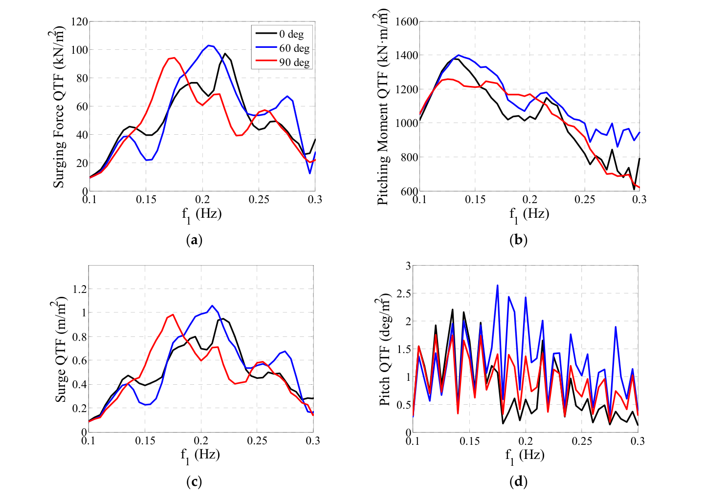

   **图 18** 三个波浪方向的荷载与运动 QTF 比较。（a）纵荡力；（b）纵摇力矩；（c）纵荡；（d）纵摇。横坐标是频率对中的 :math:`f_1`，并非差频本身。

进一步，额定运行波况的二阶运动响应可计算为 [49]：

.. math::

   q(\omega_d)=\left|\sum_{\omega_d=\omega_m-\omega_n}
   \left|\mathrm{QTF}^{\mathrm M}(\omega_d)\right|
   \sqrt{2S(\omega_m)\,\mathrm d\omega}\,
   \sqrt{2S(\omega_n)\,\mathrm d\omega}\,
   e^{\mathrm i(\phi_{mn}+\phi_m+\phi_n)}\right|\qquad (5)

其中，:math:`S(\omega)` 为单边波谱；:math:`\phi_{mn}` 为运动 QTF 相位；:math:`\phi_m`、:math:`\phi_n` 分别为频率 :math:`\omega_m`、:math:`\omega_n` 的随机波相位，假定在 0 至 :math:`2\pi` 间均匀分布 [49]。应注意，波相位不同会导致运动响应幅值不同。为整体比较三个波向，对 300 个不同波浪随机种子进行求和。为保证可比性，每个种子在三个波向均采用相同波相位。图 19 给出各随机种子的二阶运动响应。与试验现象一致，较大纵荡倾向于出现在 :math:`90^\circ`，较大纵摇则更可能出现在 :math:`60^\circ`。为便于辨识，用虚线表示响应平均值。该分析验证了波浪荷载方向效应源于二阶水动力的推断。

.. note::

   式 (5) 的指数相位项依照原文保留为 :math:`\phi_{mn}+\phi_m+\phi_n`，未根据差频合成的常用写法自行修改符号。本页为原文转写，不等同于对该式的独立重新推导。

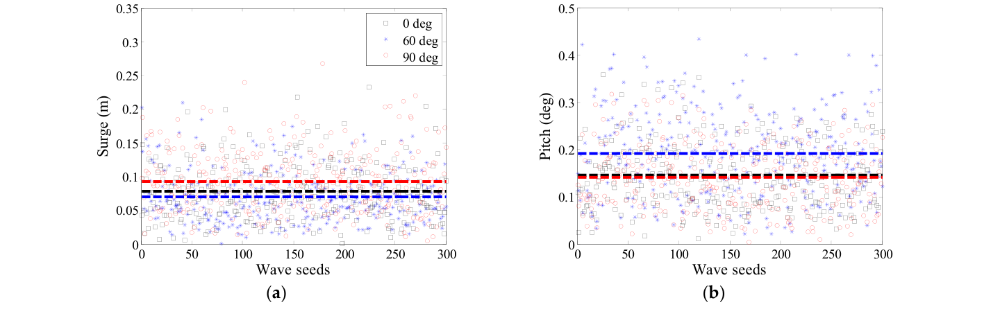

   **图 19** 额定运行波况下的二阶（a）纵荡与（b）纵摇响应。横坐标为 300 个波浪随机种子，虚线为各方向平均值。

基于上述已验证数值模型，进一步研究塔底前后向弯矩 :math:`M_{\mathrm{twr}}` 与机舱加速度 :math:`a_{\mathrm{ncl}}`，结果见图 20。风机受到三个频率分量激励：平台纵摇固有频率、入射波频以及塔筒一阶弯曲频率。其中，由一阶水动力引起的波频激励，是风机动力响应中最显著的分量。:math:`M_{\mathrm{twr}}` 与 :math:`a_{\mathrm{ncl}}` 的 PSD 最大和最小值分别出现在 :math:`60^\circ` 和 :math:`90^\circ`。该趋势与图 12e、f 的 RAO 一致，根本上与纵荡自由度的一阶波浪荷载相关，见图 13。图 20 还表明，相较机舱加速度，塔底弯矩对平台纵摇更敏感。在纵摇固有频率处，预测得到较大塔底弯矩 PSD，这是因为风机倾斜后，重力荷载产生更大力矩。此处 :math:`60^\circ` 响应再次大于另两个方向。根据上述分析，这部分差异来自二阶水动力。总体而言，一阶与二阶水动力均影响不同波向的塔底弯矩和机舱加速度差异，其中前者似乎更显著。

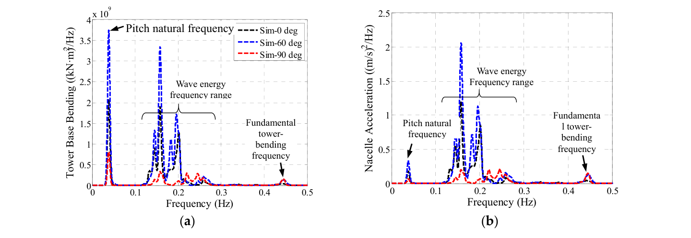

   **图 20** 三个波浪方向下（a）塔底前后向弯矩及（b）机舱加速度 PSD。标注区分纵摇固有频率、波浪能量频带和塔筒一阶弯曲频率。

.. note::

   原图机舱加速度 PSD 纵轴标为 (m/s)²/Hz，与加速度功率谱通常对应的 (m/s²)²/Hz 不一致。原轴标原样保留；这是源内单位疑点，不应据此更换响应物理量或自行换算数据。

如图 21 所示，数值塔底弯矩与机舱加速度的最大值、标准差随波向明显改变。:math:`60^\circ` 波浪下两者最大值，几乎是 :math:`90^\circ` 的两倍，说明波浪荷载方向对风机动力响应影响很大。

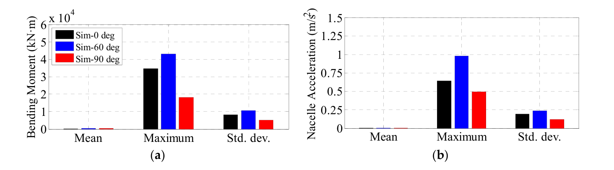

   **图 21** 三个波浪方向下（a）塔底弯矩和（b）机舱加速度的均值、最大值与标准差。

5.5 风浪联合试验
~~~~~~~~~~~~~~~~

风浪联合试验中，采用风洞实测来风速度和波高作为数值模型输入。图 22 给出三个荷载方向的平台运动 PSD。预测纵荡与试验吻合良好。虽然脉动风荷载使纵荡 PSD 略有增加，但各来向之间的相对大小与不规则波试验一致。纵摇固有频率处的振动，则被准静态风荷载显著抑制；不过 :math:`60^\circ` 方向仍表现出更大的纵摇 PSD。此外，风荷载激发了一些低频振动。由于数值模型只模拟平均气动荷载，未能捕捉这一部分响应。有趣的是，各荷载方向低频响应从大到小依次为 :math:`60^\circ`、:math:`90^\circ`、:math:`0^\circ`，与共振分量的顺序一致，说明二阶波浪荷载可能影响这些风致低频响应。总之，不同同向风浪来向间纵荡、纵摇的差异，仍主要由二阶波浪荷载造成。

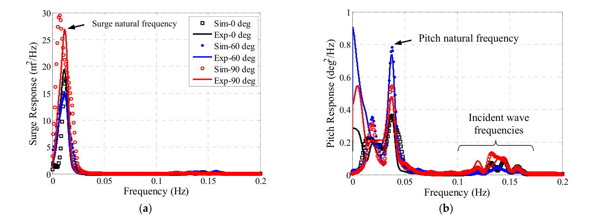

   **图 22** 三个同向风浪来向下（a）纵荡和（b）纵摇 PSD。图中区分固有频率与入射波频率范围，包含数值和试验结果。

图 23 给出三个同向风浪方向的纵荡、纵摇统计量，数值与试验吻合良好。由于风荷载的抑制，主要由二阶波浪荷载引起的纵摇方向差异，相较不规则波试验更小。

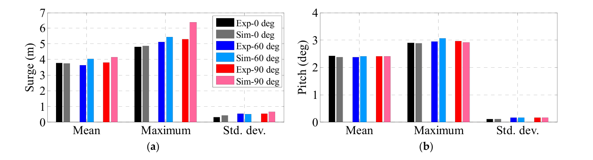

   **图 23** 三个同向风浪方向的 FAST 与模型试验统计比较。（a）纵荡；（b）纵摇。各组依次为均值、最大值、标准差。

还检查额定风浪联合工况下的塔底弯矩和机舱加速度，PSD 见图 24。比较图 20 与图 24，可将风荷载对风机动力特性的影响概括如下：首先，纵摇固有频率处响应被抑制到很低水平；其次，入射波频率分量增大。前者与被准静态风荷载抑制的二阶纵摇有关，后者与被风荷载略微放大的一阶纵荡有关，最终形成额定风浪联合工况下相应的塔底弯矩和机舱加速度。在这一情况下，各荷载方向之间的差异主要来自一阶波浪荷载。但需注意，上述结论限于试验采用的等效不旋转风机模型和稳态风条件。

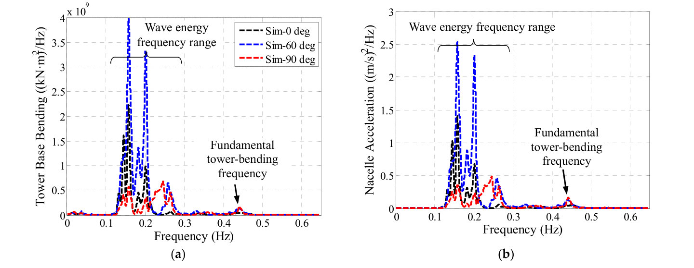

   **图 24** 三个同向风浪方向下（a）塔底前后向弯矩、（b）机舱加速度 PSD。图中标出波浪能量频带和塔筒一阶弯曲频率。

.. note::

   原图机舱加速度 PSD 纵轴标为 (m/s)²/Hz，与加速度功率谱通常对应的 (m/s²)²/Hz 不一致。原轴标原样保留；这是源内单位疑点，不应据此更换响应物理量或自行换算数据。

图 25 给出塔底弯矩和机舱加速度统计量。平均塔底弯矩取决于平均风荷载。如图 15 所示，平台运动不随风荷载方向变化，因此各荷载方向的平均塔底弯矩相同。最大值和标准差的方向差别，再次表明荷载方向对 Y 形半潜式漂浮风机的重要性。

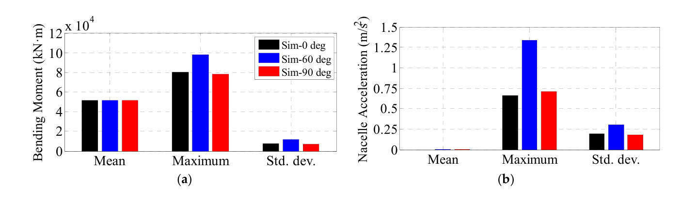

   **图 25** 三个同向风浪方向下（a）塔底弯矩、（b）机舱加速度的均值、最大值和标准差。

5.6 完整运行风机及实际风浪的模拟
~~~~~~~~~~~~~~~~~~~~~~~~~~~~~~~~

为理解更接近实际情况下的物理机制，本节开展运行风机与湍流风条件下的数值模拟。

采用水槽实测随机波，以及 NREL 开发的随机入流湍流模拟器 TurbSim [52] 生成的湍流风场作为输入。风场服从 IEC61400-1 [53] 推荐的 Kaimal 谱，轮毂平均风速与湍流强度分别为 11.4 m/s 和 14.48%；平均风剖面采用指数 0.14 的幂律描述。

图 26 比较三个方向的纵荡、纵摇 PSD。较大纵荡与纵摇 PSD 分别出现在 :math:`90^\circ` 和 :math:`60^\circ`，与前述分析一致。与图 22 的简化模型相比，实际运行模型振动明显增强，表明旋转转子和湍流风对总体响应有重要贡献。图 27 的统计数据也呈现类似现象。

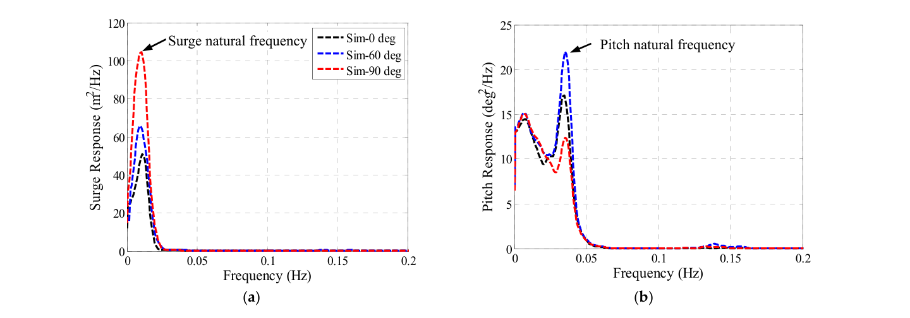

   **图 26** 完整运行风机条件下（a）纵荡和（b）纵摇 PSD，三个方向采用相同的目标风浪条件。

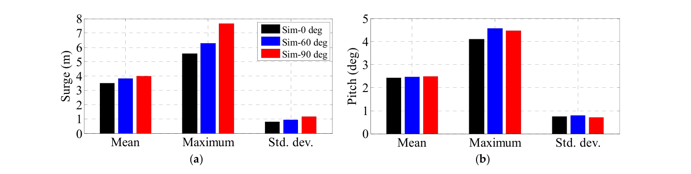

   **图 27** 完整运行风机条件下（a）纵荡、（b）纵摇的均值、最大值与标准差。

运行风机的动力响应见图 28 和图 29。塔底弯矩 PSD 在低频出现明显峰值，由低频湍流风和平台纵摇共同激发。实际运行模型还捕捉到三倍转子转频（3P）附近振动，但与其他分量相比较小。由于转速随脉动风变化，3P 振动分布在 0.5–0.65 Hz。比较图 29a 和图 25a，实际运行模型的最大值比简化模型高近 20%，说明这一低频激励的重要性。就机舱加速度而言，实际运行与简化模型的波频 PSD 基本相同，主要差别位于 3P 和纵摇固有频率附近。实际运行模型表明，相较塔底荷载，机舱加速度对 3P 激励更加敏感。因此，如图 29 所示，实际运行模型的统计响应大于简化模型。图中还给出塔顶推力。相较塔底弯矩，塔顶推力 PSD 趋势相似，但对波致振动敏感性较低。总体而言，尽管两个模型存在这些区别，二者均表明最不利荷载方向为 :math:`60^\circ`，方向差异主要由一阶波浪荷载造成。

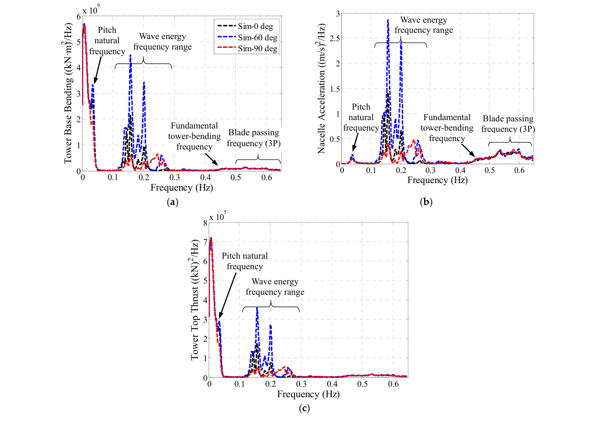

   **图 28** 前后向（a）塔底弯矩、（b）机舱加速度、（c）风推力 PSD。标注包括纵摇固有频率、波浪能量频带、塔筒一阶弯曲频率和叶片通过频率 3P。

.. note::

   原图机舱加速度 PSD 纵轴标为 (m/s)²/Hz，与加速度功率谱通常对应的 (m/s²)²/Hz 不一致。原轴标原样保留；这是源内单位疑点，不应据此更换响应物理量或自行换算数据。

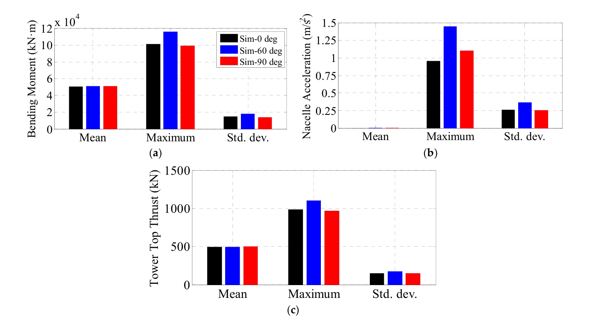

   **图 29** 前后向（a）塔底弯矩、（b）机舱加速度、（c）风推力的均值、最大值与标准差。

6 结论
------

本文通过模型试验与数值模拟，研究 Y 形半潜式风机在 :math:`0^\circ`、:math:`60^\circ` 和 :math:`90^\circ` 三个荷载方向的表现。开展额定运行海况下的 1:60 缩尺模型试验，并用试验数据验证数值模型。详细讨论同向风浪荷载方向，对 FOWT 系统纵荡、纵摇、塔底前后向弯矩和机舱加速度的影响。主要结论如下。

规则波试验与数值结果均表明，大多数周期内，波浪荷载方向对一阶垂荡和纵摇影响较小，25 s 周期除外。但在 5–9 s 周期范围，三个波向的纵荡存在明显差别，:math:`0^\circ` 和 :math:`60^\circ` RAO 大于 :math:`90^\circ`。这些差别对轻度或中等海况可能很重要，因为它们会进一步使塔底荷载、机舱加速度等一阶风机动力响应明显不同。发现 :math:`0^\circ` 和 :math:`60^\circ` 的 RAO 值，约为 :math:`90^\circ` 的三至四倍。

仅风试验表明，各风向纵摇高度一致，因为 Y 形半潜平台抵抗不同方向风致倾覆力矩的能力几乎相同。换言之，平台运动较少受风荷载方向影响。

不规则波试验中，共振主导平台纵荡、纵摇响应，波向之间差异明显。最大纵荡倾向于出现在 :math:`90^\circ`，最大纵摇则始终见于 :math:`60^\circ`。比较三个波向的力与运动 QTF 表明，造成这些运动差异的是二阶水动力。此外，数值模型预测，随机波方向也明显影响风机动力学。塔底前后向弯矩／机舱加速度的最大与最小值，分别始终出现在 :math:`60^\circ` 和 :math:`90^\circ`。随机波激发一阶与二阶平台运动，其中一阶纵荡和二阶纵摇的方向差别，分别造成入射波频率与纵摇固有频率处不同的塔底荷载／机舱加速度。

对于风浪联合情况，实际运行与简化模型的比较表明，在脉动风主导频带内，平台纵荡和纵摇振动增强。不过，各荷载方向运动差异的主要原因仍是二阶水动力。就塔底荷载和机舱加速度而言，湍流风与转子旋转分别激发低频和 3P 振动，但这些分量不构成各荷载方向之间的响应差异；造成塔底荷载和机舱加速度差异的，是一阶水动力的方向差别。

总体而言，这些发现表明，海上安装前应全面预先确定方向效应，这对 Y 形漂浮风机的运行维护十分重要。

参考文献
--------

[1] Breton, S.; Moe, G. Status, plans and technologies for offshore wind turbines in Europe and North America. Renew. Energy 2009, 34, 646–654. `CrossRef <http://dx.doi.org/10.1016/j.renene.2008.05.040>`_.

[2] Ederer, N. The market value and impact of offshore wind on the electricity spot market: Evidence from Germany. Appl. Energy 2015, 154, 805–814. `CrossRef <http://dx.doi.org/10.1016/j.apenergy.2015.05.033>`_.

[3] Esteban, M.; Leary, D. Current developments and future prospects of offshore wind and ocean energy. Appl. Energy 2012, 90, 128–136. `CrossRef <http://dx.doi.org/10.1016/j.apenergy.2011.06.011>`_.

[4] Musial, W.; Butterfield, S.; Boone, A. Feasibility of floating platform systems for wind turbines. In Proceedings of the 42nd AIAA Aerospace Sciences Meeting and Exhibit, Reno, NV, USA, 5–8 January 2004; The American Institute of Aeronautics and Astronautics: Reston, VA, USA, 2004.

[5] Stiesdal, H. Hywind: The world’s first floating MW-scale wind turbine. Wind Dir. 2009, 52, 1–9.

[6] Roddier, D.; Cermelli, C.; Aubault, A.; Weinstein, A. WindFloat: A floating foundation for offshore wind turbines. J. Renew. Sustain. Energy 2010, 2, 33104. `CrossRef <http://dx.doi.org/10.1063/1.3435339>`_.

[7] Fukushima Offshore Wind Consortium. Fukushima Floating Offshore Wind Farm Demonstration Project (Fukushima FORWARD). Available online: http://www.fukushima-forward.jp/pdf/pamphlet3.pdf (accessed on 8 December 2017).

[8] Karimirad, M.; Michailides, C. V-shaped semisubmersible offshore wind turbine: An alternative concept for offshore wind technology. Renew. Energy 2015, 83, 126–143. `CrossRef <http://dx.doi.org/10.1016/j.renene.2015.04.033>`_.

[9] Bruinsma, N. Validation and Application of a Fully Nonlinear Numerical Wave Tank. Master’s Thesis, Delft University of Technology, Delft, The Netherlands, 2016.

[10] Liu, Y.; Li, S.; Yi, Q.; Chen, D. Developments in semi-submersible floating foundations supporting wind turbines: A comprehensive review. Renew. Sustain. Energy Rev. 2016, 83, 433–449. `CrossRef <http://dx.doi.org/10.1016/j.rser.2016.01.109>`_.

[11] Coulling, A.J.; Goupee, A.J.; Robertson, A.N.; Jonkman, J.M.; Dagher, H.J. Validation of a FAST semi-submersible floating wind turbine numerical model with DeepCwind test data. J. Renew. Sustain. Energy 2013, 5, 023116. `CrossRef <http://dx.doi.org/10.1063/1.4796197>`_.

[12] Robertson, A.; Jonkman, J.M.; Masciola, M.; Song, H.; Goupee, A.; Coulling, A.; Luan, C. Definition of the Semisubmersible Floating System for Phase II of OC4; Report No. NREL/TP-5000-60601; Contract No. DE-AC36-08-GO28308; National Renewable Energy Laboratory: Golden, CO, USA, 2014.

[13] Jonkman, J.M.; Buhl, M.L., Jr. FAST User’s Guide; Report No. NREL/EL-500-38230; Contract No. DE-AC36-99-GO10337; National Renewable Energy Laboratory: Golden, CO, USA, 2005.

[14] Michailides, C.; Gao, Z.; Moan, T. Experimental study of the functionality of a semisubmersible wind turbine combined with flap-type Wave Energy Converters. Renew. Energy 2016, 93, 675–690. `CrossRef <http://dx.doi.org/10.1016/j.renene.2016.03.024>`_.

[15] Gao, Z.; Moan, T.; Wan, L.; Michailides, C. Comparative numerical and experimental study of two combined wind and wave energy concepts. J. Ocean Eng. Sci. 2016, 1, 36–51. `CrossRef <http://dx.doi.org/10.1016/j.joes.2015.12.006>`_.

[16] Chen, J.; Hu, Z. Experimental investigation of aerodynamic effect–induced dynamic characteristics of an OC4 semi-submersible floating wind turbine. Proc. Inst. Mech. Eng. Part M 2017. `CrossRef <http://dx.doi.org/10.1177/1475090217706194>`_.

[17] Bachynski, E.E.; Thys, M.; Sauder, T.; Chabaud, V.; Sæther, L.O. Real-Time Hybrid Model Testing of a Braceless Semi-Submersible Wind Turbine: Part II—Experimental Results. In Proceedings of the 35th International Conference on Ocean, Offshore and Arctic Engineering, Busan, Korea, 19–24 June 2016; American Society of Mechanical Engineers: New York, NY, USA, 2016.

[18] Naess, A.; Moan, T. Stochastic Dynamics of Marine Structures; Cambridge University Press: Cambridge, UK, 2012.

[19] Wan, L.; Greco, M.; Lugni, C.; Gao, Z.; Moan, T. A combined wind and wave energy-converter concept in survival mode: Numerical and experimental study in regular waves with a focus on water entry and exit. Appl. Ocean Res. 2017, 63, 200–216. `CrossRef <http://dx.doi.org/10.1016/j.apor.2017.01.013>`_.

[20] Moriarty, P.J.; Hansen, A.C. AeroDyn Theory Manual; National Renewable Energy Laboratory: Golden, CO, USA, 2005.

[21] Jonkman, J.M. Dynamics Modeling and Loads Analysis of an Offshore Floating Wind Turbine. Ph.D. Thesis, University of Colorado, Golden, CO, USA, 2007.

[22] Hall, M.; Goupee, A. Validation of a lumped-mass mooring line model with DeepCwind semisubmersible model test data. Ocean Eng. 2015, 104, 590–603. `CrossRef <http://dx.doi.org/10.1016/j.oceaneng.2015.05.035>`_.

[23] Wang, L.; Sweetman, B. Multibody dynamics of floating wind turbines with large-amplitude motion. Appl. Ocean Res. 2013, 43, 1–10. `CrossRef <http://dx.doi.org/10.1016/j.apor.2013.06.004>`_.

[24] Ormberg, H.; Bachynski, E.E. Global analysis of floating wind turbines: Code development, model sensitivity and benchmark study. In Proceedings of the 21st International Offshore and Polar Engineering Conference, Rhodes, Greece, 17–22 June 2012; International Society of Offshore and Polar Engineers: Mountain View, CA, USA, 2012.

[25] Philippe, M.; Babarit, A.; Ferrand, P. Effect of wave direction relative to wind on the motions of offshore floating wind turbine systems. In Proceedings of the 3rd International Conference and Exhibition on Ocean Energy, Bilbao, Spain, 6–8 October 2010; Ocean Energy Systems: Lisbon, Spain, 2010.

[26] Philippe, M.; Babarit, A.; Ferrant, P. Modes of response of an offshore wind turbine with directional wind and waves. Renew. Energy 2013, 49, 151–155. `CrossRef <http://dx.doi.org/10.1016/j.renene.2012.01.042>`_.

[27] Wayman, E.N. Coupled Dynamics and Economic Analysis of Floating Wind Turbine Systems. Master’s Thesis, Massachusetts Institute of Technology, Cambridge, MA, USA, 2006.

[28] Ramachandran, G.K.V.; Bredmose, H.; Sorensen, J.N.; Jensen, J.J. Fully Coupled Three-Dimensional Dynamic Response of a Tension-Leg Platform Floating Wind Turbine in Waves and Wind. J. Offshore Mech. Arct. Eng. 2014, 136, 020901. `CrossRef <http://dx.doi.org/10.1115/1.4025599>`_.

[29] Barj, L. Influence of Met-Ocean Conditions on the Loads Analysis of a Floating Wind Turbine. Master’s Thesis, The Pennsylvania State University, State College, PA, USA, 2013.

[30] Barj, L.; Stewart, S.; Stewart, G.; Lackner, M.; Jonkman, J.; Robertson, A.; Matha, D. Wind/wave misalignment in the loads analysis of a floating offshore wind turbine. In Proceedings of the 32nd ASME Wind Energy Symposium, National Harbor, MD, USA, 13–17 January 2014; The American Institute of Aeronautics and Astronautics: Reston, VA, USA, 2014.

[31] Bachynski, E.E.; Kvittem, M.I.; Luan, C.; Moan, T. Wind-wave misalignment effects on floating wind turbines: Motions and tower load effects. J. Offshore Mech. Arct. Eng. 2014, 136, 0419024. `CrossRef <http://dx.doi.org/10.1115/1.4028028>`_.

[32] Karimirad, M.; Michailides, C. V-shaped semisubmersible offshore wind turbine subjected to misaligned wave and wind. J. Renew. Sustain. Energy 2016, 83, 126–143. `CrossRef <http://dx.doi.org/10.1016/j.renene.2015.04.033>`_.

[33] Jonkman, J.; Butterfield, S.; Musial, W.; Scott, G. Definition of a 5-MW Reference Wind Turbine for Offshore System Development; Report No. NREL/TP-500-38060; Contract No. DE-AC36-08-GO28308; National Renewable Energy Laboratory: Golden, CO, USA, 2009.

[34] Martin, H.R. Development of a Scale Model Wind Turbine for Testing of Offshore Floating Wind Turbine Systems. Master’s Thesis, University of Maine, Orono, ME, USA, 2011.

[35] Martin, H.R.; Kimball, R.W.; Viselli, A.M.; Goupee, A.J. Methodology for wind/wave basin testing of floating offshore wind turbines. J. Offshore Mech. Arct. Eng. 2012, 136, 020905.

[36] Fowler, M.J.; Kimball, R.W.; Thomas, I.D.A.; Goupee, A.J. Design and testing of scale model wind turbines for use in wind/wave basin model tests of floating offshore wind turbines. In Proceedings of the 32nd International Conference on Ocean, Offshore and Arctic Engineering, Nantes, France, 9–14 June 2013; American Society of Mechanical Engineers: New York, NY, USA, 2013.

[37] Wan, L.; Gao, Z.; Moan, T. Experimental and numerical study of hydrodynamic responses of a combined wind and wave energy converter concept in survival modes. Coast. Eng. 2015, 104, 151–169. `CrossRef <http://dx.doi.org/10.1016/j.coastaleng.2015.07.001>`_.

[38] Wan, L.; Gao, Z.; Moan, T.; Lugni, C. Experimental and numerical comparisons of hydrodynamic responses for a combined wind and wave energy converter concept under operational conditions. Renew. Energy 2016, 93, 87–100. `CrossRef <http://dx.doi.org/10.1016/j.renene.2016.01.087>`_.

[39] Wan, L.; Gao, Z.; Moan, T.; Lugni, C. Comparative experimental study of the survivability of a combined wind and wave energy converter in two testing facilities. Ocean Eng. 2016, 111, 82–94. `CrossRef <http://dx.doi.org/10.1016/j.oceaneng.2015.10.045>`_.

[40] Det Norske Veritas. Recommended practice dnv-rp-c205. In Environmental Conditions and Environmental Loads; Det Norske Veritas: Oslo, Norway, 2010.

[41] Ishihara, T.; Phuc, P.V.; Sukegawa, H.; Shimada, K.; Ohyama, T. A study on the dynamic response of a semi-submersible floating offshore wind turbine system Part 1: A water tank test. In Proceedings of the 12th International Conference on Wind Engineering, Gairns, Australia, 1–6 July 2007; Australasian Wind Engineering Society: Gairns, Australia, 2007.

[42] Shan, B.; Zheng, S.; Ou, J. Free vibration monitoring experiment of a stayed-cable model based on stereovision. Measurement 2015, 76, 228–239. `CrossRef <http://dx.doi.org/10.1016/j.measurement.2015.08.025>`_.

[43] Shan, B.; Zheng, S.; Ou, J. A stereovision-based crack width detection approach for concrete surface assessment. KSCE J. Civ. Eng. 2016, 20, 803–812. `CrossRef <http://dx.doi.org/10.1007/s12205-015-0461-6>`_.

[44] Faltinsen, O. Sea Loads on Ships and Offshore Structures; Cambridge University Press: Cambridge, UK, 1993.

[45] Lee, C. WAMIT Theory Manual; Massachusetts Institute of Technology: Cambridge, MA, USA, 1995.

[46] Duarte, T.; Sarmento, A.; Jonkman, J. Effects of second-order hydrodynamic forces on floating offshore wind turbines. In Proceedings of the 32nd ASME Wind Energy Symposium, National Harbor, MD, USA, 13–17 January 2014; The American Institute of Aeronautics and Astronautics: Reston, VA, USA, 2014.

[47] Bayati, I.; Jonkman, J.; Robertson, A.; Platt, A. The Effects of Second-Order Hydrodynamics on a Semisubmersible Floating Offshore Wind Turbine; Report No. NREL/CP-5000-61752; Contract No. DE-AC36-08-GO28308; National Renewable Energy Laboratory: Golden, CO, USA, 2014.

[48] Coulling, A.J.; Goupee, A.J.; Robertson, A.N.; Jonkman, J.M. Importance of second-order difference-frequency wave-diffraction forces in the validation of a fast semi-submersible floating wind turbine model. In Proceedings of the 32nd International Conference on Ocean, Offshore and Arctic Engineering, Nantes, France, 9–14 June 2013; American Society of Mechanical Engineers: New York, NY, USA, 2013.

[49] Roald, L.; Jonkman, J.; Robertson, A.; Chokani, N. The effect of second-order hydrodynamics on floating offshore wind turbines. Energy Procedia 2013, 35, 253–264. `CrossRef <http://dx.doi.org/10.1016/j.egypro.2013.07.178>`_.

[50] Bir, G. User’s Guide to BModes (Software for Computing Rotating Beam-Coupled Modes); Report No. NREL/TP-500-39133; Contract No. DE-AC36-99-GO10337; National Renewable Energy Laboratory: Golden, CO, USA, 2005.

[51] Schewe, G. On the force fluctuations acting on a circular cylinder in crossflow from subcritical up to transcritical Reynolds numbers. J. Fluid Mech. 1983, 133, 265–285. `CrossRef <http://dx.doi.org/10.1017/S0022112083001913>`_.

[52] Kelley, N.D.; Jonkman, B.J. Overview of the TurbSim Stochastic Inflow Turbulence Simulator; Report No. NREL/TP-500-41137; Contract No. DE-AC36-99-GO10337; National Renewable Energy Laboratory: Golden, CO, USA, 2007.

[53] International Electrotechnical Commission. Wind Turbines—Part 1: Design Requirements; IEC61400-1; International Electrotechnical Commission: Geneva, Switzerland, 2005.
