.. _paper-note-ref-zhou2020-RE:

Y形半潜式漂浮风机平台安装朝向的重要性：基于代理模型的案例研究：论文精解
========================================================================

精简版微信公众号文章：待发布

.. contents:: 本页目录
   :local:
   :depth: 2

论文信息
--------

**原文题名：** Importance of platform mounting orientation of Y-shaped semi-submersible floating wind turbines: A case study by using surrogate models。

**作者：** Shengtao Zhou，Chao Li（通讯作者），Yiqing Xiao，Po Wen Cheng。

**单位：** 哈尔滨工业大学（深圳）土木与环境工程学院；德国斯图加特大学斯图加特风能研究机构。

**期刊：** Renewable Energy，156（2020），260–278。DOI：`10.1016/j.renene.2020.04.014 <https://doi.org/10.1016/j.renene.2020.04.014>`_。

**稿件日期：** 2019年8月8日收稿；2020年3月31日修回；2020年4月2日录用；2020年4月16日在线发表。

**WOEAI 相关方向：** 海洋能源结构 / 一体化分析。

摘要
----

Y形半潜式平台通常由三个外立柱和一个中央立柱组成，各立柱通过Y形浮箱连接，是漂浮风机（FWT）常用基础概念之一。由于构型并非完全对称，海洋环境的方向效应对浮式系统动力响应具有显著影响，说明海上安装前应全面考虑平台安装朝向（platform mounting orientation，PMO）。本文旨在从全寿命动力表现角度评估PMO的重要性。然而，对25年海洋气象数据库中的全部短期工况逐一模拟，计算成本不可承受。因此，采用最大差异算法选取有限的代表性荷载工况，并在FWT气动—水动—控制—弹性耦合非线性模拟器FAST中重现。以完整模拟的一年结果标定、验证四种代理模型后，采用Kriging模型构建全寿命响应。最后，反映系统表现的五项指标统计表明，由于水动力特性不同，四种PMO下浮式系统表现不同。这些发现说明PMO的重要性，并为Y形半潜式漂浮风机的安装提供指导。

**关键词：** Y形半潜式平台；平台安装朝向；全寿命动力表现；代理模型；安装。

1 引言
--------

发展可再生能源是应对气候变化的有效措施。海上风能潜力巨大，正在全球快速增长。截至2018年底，全球海上风电累计装机容量已达22 GW，预计到2050年增长至500 GW。随着近海风能开发在不远的将来逐渐饱和，风能行业已将目光转向深海风资源。考虑到底固定基础建设投资随水深迅速增加，漂浮风机被认为是深水风能开发的有前景方案。

浮式平台设计对FWT系统运行维护具有重要作用。由于稳定性好、安装方便，由三个外立柱和一个中央立柱通过Y形浮箱连接的Y形半潜式平台，是漂浮风电领域常见概念之一，例如已建成的足尺示范项目Fukushima Mirai [1]，以及OO-Star Wind Floater [2]、Gusto MSC Tri-Floater [3]等预设计概念。由于构型并非完全对称，其水动力特性随波浪方向改变，使系统动力学对海洋环境方向效应敏感。

以往研究讨论了风浪错向的影响。Bachynski的工作 [4] 研究平台运动和塔底疲劳，发现某些错向工况虽会增加运动，但最大塔底疲劳主要来自同向荷载工况。Karimirad等 [5] 和Wang等 [6] 也发现，风浪错向对半潜式浮式系统整体响应影响不显著。相反，Zhou的研究 [7] 表明，同向风浪工况的方向效应更加明显。三个同向风浪来向下，平台运动、塔底荷载和机舱加速度存在显著差异。例如，最不利来向的峰值机舱加速度，比有利来向几乎大50%。研究还表明，平台运动差异来自不同的二阶水动力，塔底荷载和机舱加速度差异则由不同的一阶水动力造成。这些研究成功说明荷载方向的影响及观测现象背后的机制，并意味着海上安装前应认真考虑PMO。

处理PMO问题最直接的方法，是使一阶水动力系数最小的方向沿主导波向布置，即遵循平台设计朝向（platform design orientation，PDO）。然而，一方面，一阶水动力并不是决定FWT整体动力表现的唯一因素。例如，半潜式平台系泊荷载对系泊布置和平台慢漂运动更敏感，而PDO下慢漂未必最小。另一方面，对于波浪玫瑰图分布较均匀的海域，主导波向并不明确，可以预期，选择不同主导波向会或多或少得到不同结果。因此，采用试算比较，即假定多种PMO并检查哪种动力表现更好，更为可取，也比PDO方法提供更多信息。

真实海洋环境始终较复杂，包含大量不同强度的同向与错向荷载工况。上述研究均基于特定海况的短期动力分析，不足以全面描述真实海况的整体影响。合理PMO的确定应以长期、即全寿命动力分析为依据。

分箱网格法和代理模型法常用于预测FWT全寿命动力学。分箱网格法将环境条件制成表格，模拟每个荷载工况网格的动力响应，再按对应海况发生概率加权，将所有短期模拟的贡献相加得到全寿命响应。Ren等 [8] 利用该方法成功估计一种风浪联合发电系统的长期表现。但该方法主要缺点是所需模拟量很大，尤其当环境条件空间维度增加时。Ren的工作开展了84480次短期模拟，以覆盖全部可能风浪事件。

代理模型法是长期分析中更高效的选择。其基本思想是通过回归分析建立响应近似函数，使响应估计变成简单代数计算，显著降低计算成本。代理模型的确定或训练，依赖能够重现响应随海洋环境变化的代表性环境条件响应数据。可采用K均值算法（KMA）、自组织映射（SOM）、最大差异算法（MDA）等先进聚类方法，从海洋气象数据库选取代表性荷载工况子集。Camus等 [9] 比较这三种方法，发现MDA善于寻找罕见海况并界定数据空间边界。拉丁超立方抽样（LHS）、拟随机抽样（QRS）等随机抽样方法也可用于工况选择。Müller等 [10] 将LHS用于海上风机疲劳荷载评估。代理模型基函数选择也是值得关注的问题。文献 [11,12] 综述了代理模型在工程中的应用。多项式响应面、径向基函数（RBF）、Kriging、支持向量机（SVM）、空间映射、人工神经网络（ANN），以及较新的贝叶斯网络（BN）、傅里叶代理建模和随机森林，都可用于工程。但文献指出，模型选择高度依赖具体问题。在海上风电领域，Guanche [13] 用RBF重构单桩外力长期序列，验证表明仅1000次短期模拟即可准确估计。Martini的工作 [14] 将RBF用于浮式风电场全寿命发电量分析。ANN因效率高、易实现，也被用作FWT疲劳损伤代理模型 [10]。但迄今尚无FWT相关文献比较不同代理模型的表现。

本文旨在从全寿命动力表现角度评估Y形半潜式平台PMO的重要性。首先建立代理模型评价指标，即塔底和导缆点疲劳损伤、平台峰值倾斜角、机舱峰值加速度和发电量。为获得准确估计并探讨代理模型适用性，标定和比较四种模型的结果。随后利用所建模型，比较四种PMO的全寿命评价指标。最后讨论PMO影响，并在文末总结结论。应指出，文中结论可应用于典型Y形半潜式平台；其他结构类型仍需进一步研究，才能作出适当评价。

2 浮式风电系统描述
--------------------

本文系统由安装在Y形半潜式平台上的NREL 5 MW风机 [15] 构成，见图1。浮体采用预应力混凝土，有利于降低制造成本，提高抗腐蚀和抗疲劳损伤能力。大截面浮箱还能提供压载空间，降低重心，减小运动响应，尤其是垂荡。平台和系泊线的几何尺寸、结构特性等详细信息，已在前期研究 [7] 中汇总。

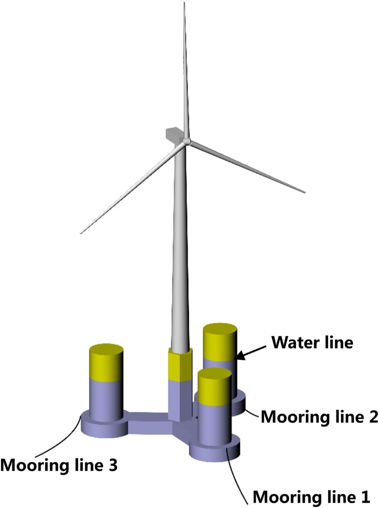

   **图 1** 所研究浮式风电系统的构型。图中标示水线及三根系泊线；Y形浮箱连接中央与三个外立柱。

图2定义惯性坐标系、PMO及荷载方向。正x轴和正y轴分别指向西和南。PMO角α定义为负y轴与系泊线1之间的夹角。考虑平台对称性，仅讨论图3所示α=0°、30°、60°、90°四种PMO。风浪来向采用类似定义。假定机舱偏航角始终与风向一致。图2也给出平台六自由度运动相对于惯性坐标系的正方向。

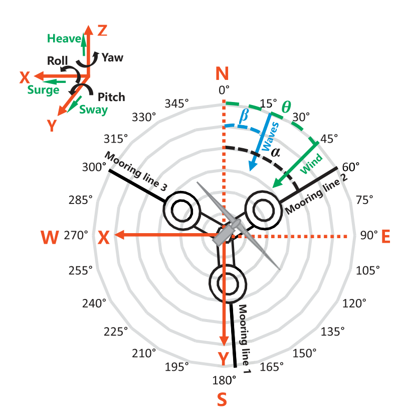

   **图 2** 惯性坐标系、平台安装朝向和荷载方向的定义。Surge/Sway/Heave为纵荡/横荡/垂荡，Roll/Pitch/Yaw为横摇/纵摇/艏摇；α、θ、β分别表示PMO、风向、波向。

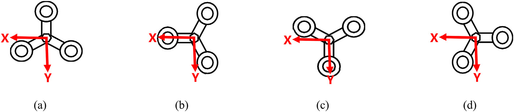

   **图 3** 研究的四种平台安装朝向：（a）α=0°；（b）α=30°；（c）α=60°；（d）α=90°。

3 海洋气象数据
----------------

研究地点位于中国南海深圳近海，东经114.5°、北纬22°，见图4。当地海洋气象数据来自荷兰地球观测系统与服务咨询研究机构ARGOSS，基于雷达高度计、雷达散射计、成像雷达观测，以及第三代海洋风浪后报模型WaveWatch III [16] 的组合。浮标观测验证显示，风速和波高误差分别小于0.2 m/s和0.05 m，表明数据库具有较好可靠性。

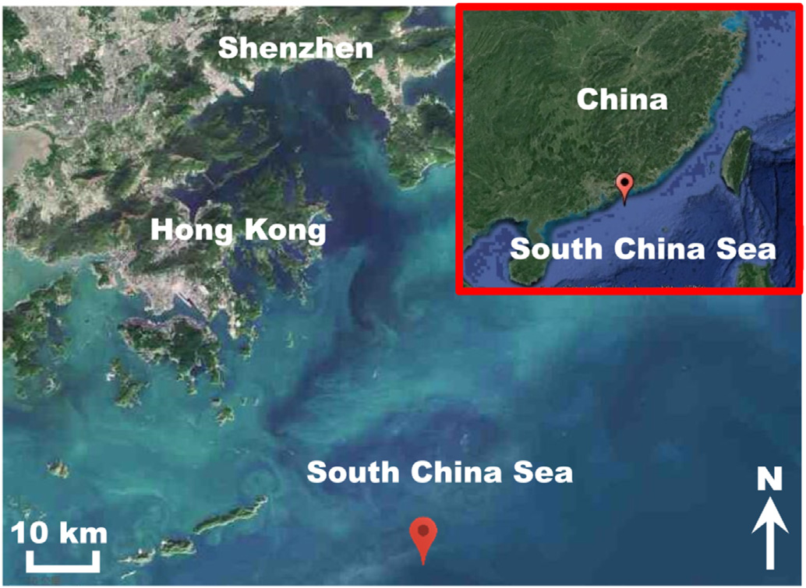

   **图 4** 研究场址位置。原图包含深圳、香港、中国南海及10 km比例尺。

数据库包含1992年1月1日至2016年12月31日共25年的风浪资料，共73052个样本，变量包括10 m高度3小时平均风速、风向、有义波高、谱峰周期及波向。根据IEC 61400-3 [17] 和DNV-OS-J101 [18] 推荐，将10 m平均风速用指数0.14的幂律平均风剖面换算至轮毂高度。图5风、浪玫瑰图概括场址海洋环境。大多数风浪来自东方。近80%的波高集中于0–2 m，而平均风速分布更均匀：2.5–5 m/s占25%，5–7.5 m/s占34.29%，7.5–10 m/s占22.06%。

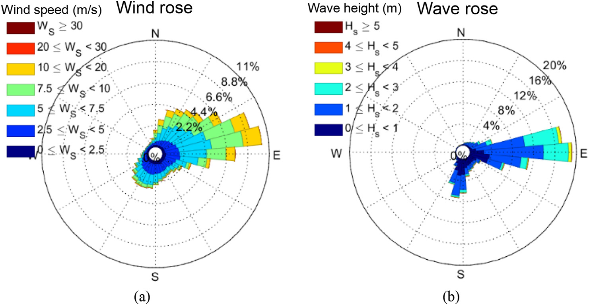

   **图 5** 研究场址总体海洋环境条件：（a）风玫瑰图；（b）浪玫瑰图。

4 方法
--------

由于计算成本巨大，直接穷举模拟或采用分箱网格法开展长期动力分析并不可行。为实现全寿命分析，本文采用高效代理模型法。首先选取代表性海洋气象数据子集，减少必须模拟的短期荷载工况数量，再利用所选工况动力响应建立或训练代理模型。本节详细说明这一过程，并介绍动力模拟及后处理技术。

4.1 代表性环境条件的选择
~~~~~~~~~~~~~~~~~~~~~~~~~~~~

选取过程旨在从包含N个n维观测的海洋气象数据库中，确定能够代表数据变化的M样本子集 {v₁,v₂,…,vM}，其中M远小于N。这一要求对数据驱动代理建模十分重要。例如，训练子集若未纳入极端荷载工况，代理模型就难以准确预测类似工况。文献 [9] 比较三种先进数据聚类技术，发现MDA能较好寻找低概率海况并界定数据空间边界，从而代表数据库变化。因此，本文采用MDA选择环境条件。MDA首先选择与数据库其他数据的归一化距离之和最大的样本，形成初始目标子集 {v₁}。然后计算其余N−1个观测到目标子集的归一化距离，将距离最大的观测加入子集。反复执行，直至选出M个目标样本。在第R+1次迭代中，任一点i到目标子集的归一化距离定义为：

.. math::

   d_{i,\mathrm{subset}(R)}^{\min}=\min\left[d_{i,R},d_{i,\mathrm{subset}(R-1)}^{\min}\right]
   \qquad (1)

其中，:math:`d_{i,R}` 为点i与第R次迭代所选子集点之间的归一化距离；:math:`d_{i,\mathrm{subset}(R-1)}^{\min}` 为点i与此前R−1个子集点之间的最小距离。

本文考虑平均风速、风向、有义波高、谱峰周期和波向五个环境变量，每个观测表示为五维向量 :math:`\mathbf X_i=[w_i,\theta_i,H_{s,i},T_{p,i},\beta_i]`。标量变量按数据库中的最大、最小值归一化：

.. math::

   w_i^{\mathrm{nor}}=\frac{w_i-w_i^{\min}}{w_i^{\max}-w_i^{\min}},\qquad H_{s,i}^{\mathrm{nor}}=\frac{H_{s,i}-H_{s,i}^{\min}}{H_{s,i}^{\max}-H_{s,i}^{\min}},\qquad T_{p,i}^{\mathrm{nor}}=\frac{T_{p,i}-T_{p,i}^{\min}}{T_{p,i}^{\max}-T_{p,i}^{\min}}
   \qquad (2)

对于以弧度定义的圆周变量 :math:`\theta_i,\beta_i\in[0,2\pi]`，采用以下归一化方式：

.. math::

   \theta_i^{\mathrm{nor}}=\frac{\theta_i}{\pi},\qquad \beta_i^{\mathrm{nor}}=\frac{\beta_i}{\pi}
   \qquad (3)

两个方向的差取 :math:`|\theta_i^{\mathrm{nor}}-\theta_j^{\mathrm{nor}}|` 与 :math:`2-|\theta_i^{\mathrm{nor}}-\theta_j^{\mathrm{nor}}|` 中较小者。这样，归一化方向差位于0–1，与标量变量一致。两个观测间的归一化距离总体可表示为：

.. math::

   \begin{aligned}
   d_{i,j}={}&\sqrt{(w_i^{\mathrm{nor}}-w_j^{\mathrm{nor}})^2+(H_{s,i}^{\mathrm{nor}}-H_{s,j}^{\mathrm{nor}})^2+(T_{p,i}^{\mathrm{nor}}-T_{p,j}^{\mathrm{nor}})^2}\\
   &+\left(\min\left(\left|\theta_i^{\mathrm{nor}}-\theta_j^{\mathrm{nor}}\right|,2-\left|\theta_i^{\mathrm{nor}}-\theta_j^{\mathrm{nor}}\right|\right)\right)^2\\
   &+\left(\min\left(\left|\beta_i^{\mathrm{nor}}-\beta_j^{\mathrm{nor}}\right|,2-\left|\beta_i^{\mathrm{nor}}-\beta_j^{\mathrm{nor}}\right|\right)\right)^2.
   \end{aligned}
   \qquad (4)

.. note::

   原式(4)的根号横线只覆盖第一行三个标量差的平方项；两项圆周方向差的平方排在根号外。此处按原版保留，不静默改写为五项共同开平方，也不据此确认作者程序的实际实现。

4.2 短期动力模拟
~~~~~~~~~~~~~~~~~~~~

采用开源时域风机模拟工具FAST [19]，模拟所选环境条件下的FWT动力响应。FAST集成AeroDyn、HydroDyn、MoorDyn、ServoDyn和ElastoDyn五个子程序，实现浮式风电系统气动—水动—控制—弹性耦合动力分析。

4.2.1 气动力
^^^^^^^^^^^^^^^^^^

转子气动力采用准定常叶素动量（BEM）理论计算。为补偿经典BEM理论的主要局限，采用Glauert修正、Prandtl叶尖损失、Prandtl轮毂损失以及Pitt和Peters斜尾流修正 [20]。此外，用Minnema/Pierce非定常翼型气动模型考虑非定常附着流、后缘流动分离、动态失速等流动滞后现象。塔筒对叶片局部流场的影响，以及塔筒气动荷载，则分别基于含Bak修正的势流模型和准定常方法计算。

4.2.2 水动力
^^^^^^^^^^^^^^^^^^

附加质量、辐射阻尼和波浪激励力等水动力系数，先通过频域势流求解器获得，再用迟滞函数或傅里叶变换转到时域。由于二阶差频漂移力对半潜式平台十分重要 [21]，分析中予以考虑。一般而言，获得二阶漂移力主要有完整二次传递函数（QTF）与Newman近似两种途径。完整QTF方法基于经典摄动法直接求解二阶速度势，在浮体湿表面积分非线性压力，得到六自由度二阶波浪力，但求解复杂且耗时。当浮式系统固有频率较小时，Newman近似可由平均慢漂波浪力估计差频力，而平均慢漂力只需解一阶速度势即可得到，因而显著减少计算量。Coulling等 [21] 指出，Newman近似能给出满意预测。但对半潜式平台，该方法只适用于固有频率较小的水平自由度，即纵荡、横荡与艏摇。虽然半潜式FWT试验表明，仅波浪条件下，差频纵摇／横摇力主导平台纵摇／横摇运动，并显著影响不同PMO的响应差异，但真实风浪联合工况中，运行风机产生的气动阻尼使这些作用小得多 [7]。因此，本文假定忽略二阶纵摇／横摇力可以接受。考虑两种方法效率，模拟采用Newman近似。首先利用基于波场动量守恒方程的远场积分法计算平均漂移系数，再用Newman近似方程的扩展形式，即Standing等公式 [22]，估计差频系数：

.. math::

   D(\omega_m,\omega_n)=\frac12\left\{\operatorname{sgn}[\widetilde D(\omega_m)]+\operatorname{sgn}[\widetilde D(\omega_n)]\right\}\left\{|\widetilde D(\omega_m)\widetilde D(\omega_n)|\right\}^{1/2}
   \qquad (5)

其中，:math:`D(\omega_m,\omega_n)` 为频率对 :math:`\omega_m,\omega_n` 的差频系数；:math:`\widetilde D(\omega_m)`、:math:`\widetilde D(\omega_n)` 分别为对应频率的平均漂移系数。对于所有Newman型近似，通常将 :math:`D(\omega_m,\omega_n)` 的相位设为零。

波致黏性阻尼也对结构动力学具有重要作用。FAST通过两种方式实现：对每个浸没构件使用Morison方程黏性阻力项，或采用整体二次阻尼矩阵。本文采用后者，整体阻尼系数由前期研究 [7] 介绍的自由衰减试验确定。

4.2.3 系泊动力学
^^^^^^^^^^^^^^^^^^^^^^

系泊分析通常采用准静态法、集中质量法和有限元法。集中质量法考虑索段水动力阻力、附加质量和惯性力，比准静态法更有利于预测系泊荷载 [23]。同时，合理忽略对系泊张力响应影响很小的弯曲与扭转弹性后，集中质量模型的计算成本低于典型有限元程序。本文进行工况间比较，关注系泊张力的相对大小，而非绝对值，因此认为集中质量模型能高效捕捉环境工况之间的差异。故采用基于集中质量法的MoorDyn [24] 分析系泊动力学。

4.2.4 随机风浪场
^^^^^^^^^^^^^^^^^^^^^^

湍流风场和随机波场分别由TurbSim与HydroDyn生成，作为动力模型外部输入。湍流风场遵循Kaimal谱，平均风剖面采用IEC 61400-3 [17] 推荐的指数0.14幂律；随机波场遵循JONSWAP谱。与海洋气象数据库一致，每个风浪场持续3小时。应指出，生成并储存足够大、足够细的全场湍流风文件，需要大量内存和存储空间。例如，100个荷载工况、每工况6次实现，共600个风文件约需1 TB存储。为此，预先生成从切入风速3 m/s到最大风速37 m/s、间隔0.5 m/s的风场数据库。对于给定工况，选用与目标风速最近的风文件作为模拟输入。

后处理时，通常删去响应初始段，以确保模拟结果中不含瞬态行为。为缩短这一过程、提高效率，依据平均风推力估计浮式系统稳态，包括转速、桨距角、平台纵荡与纵摇，并作为模拟初始条件。为减小统计不确定性，每个荷载工况考虑6次随机实现，其动力响应取这6次实现的平均值。

4.3 长期响应构建
~~~~~~~~~~~~~~~~~~~~

4.3.1 代理模型
^^^^^^^^^^^^^^^^^^^^

得到代表性环境条件下的FWT动力响应后，即可建立代理模型，并预测25年中其余工况的响应。即使可用数据有限，多种代理构建方法仍能模拟复杂系统响应。RBF、Kriging和ANN是工程中最常用的三类统计／经验数据驱动方法，本文讨论其对FWT长期动力响应预测的适用性。

假设已知m维空间的N个样本 :math:`\mathbf X=\{\mathbf x^1,\mathbf x^2,\ldots,\mathbf x^N\}` 及对应响应 :math:`\mathbf Y=\{y^1,y^2,\ldots,y^N\}`。代理方法旨在建立显式函数，既正确重现已知训练样本响应，也准确预测任意给定点响应。RBF模型由一个多项式与n个基函数的加权和构成，可写为：

.. math::

   \widehat f(\mathbf x^j)=p(\mathbf x^j)+\sum_{i=1}^N \omega_i\psi(\|\mathbf x^j-\mathbf x^i\|)
   \qquad (6)

其中，:math:`\widehat f(\mathbf x^j)` 为输入向量 :math:`\mathbf x^j` 处的RBF响应近似；:math:`p(\mathbf x^j)` 为单项式基，通常是零阶或一阶多项式；:math:`\omega_i` 为权重；:math:`\psi` 为径向基函数，是预测点与N个基函数中心中第i个中心间欧氏距离的函数，原文记 :math:`d=\mathbf x^j-\mathbf x^i`。基函数有多种形式，例如线性 :math:`\psi(d)=d`、三次 :math:`\psi(d)=d^3`、薄板样条 :math:`\psi(d)=d^2\ln d`，可以低计算成本模拟较简单响应。高斯 :math:`\psi(d)=\exp[-d^2/(2\sigma^2)]`、多二次 :math:`\psi(d)=(d^2+\sigma^2)^{1/2}`、逆多二次 :math:`\psi(d)=(d^2+\sigma^2)^{-1/2}` 等引入形状参数σ，能更灵活模拟复杂响应。一般而言，RBF模型由多项式系数、径向基权重及可能存在的形状参数定义。确定参数时，先给σ任意值，再强制满足 :math:`\widehat f(\mathbf X)=\mathbf Y`，求多项式系数和权重。然后用交叉验证误差评价模型 [11]，继续尝试不同σ，最终采用误差最小的参数组合，即试错法。本文检验无参数薄板样条（TPS）和带待定形状参数的高斯两种基函数。

Kriging模型将描述响应总体趋势的回归函数，与由相关基函数构成的局部模型相结合。它与RBF的主要区别，是将响应视为随机过程，即使该响应实际上来自确定性程序。这一特征使模型能够衡量任意点的近似不确定性。未知点 :math:`\mathbf x^j` 的Kriging预测为：

.. math::

   \widehat f(\mathbf x^j)=\widehat\mu+\boldsymbol\psi^{\mathrm T}(\mathbf x^j)\boldsymbol\Psi^{-1}(\mathbf Y^{\mathrm T}-\mathbf1\widehat\mu)
   \qquad (7)

.. math::

   \widehat\mu=\frac{\mathbf1^{\mathrm T}\boldsymbol\Psi^{-1}\mathbf Y^{\mathrm T}}{\mathbf1^{\mathrm T}\boldsymbol\Psi^{-1}\mathbf1}
   \qquad (8)

其中，:math:`\mathbf1` 为长度N、元素全为1的列向量；:math:`\boldsymbol\psi(\mathbf x^j)` 为点 :math:`\mathbf x^j` 与样本数据 :math:`\mathbf X` 之间的1×N相关向量；:math:`\boldsymbol\Psi` 为样本间的N×N相关矩阵。任意两点 :math:`\mathbf x`、:math:`\mathbf x\prime` 的相关函数为：

.. note::

   原文在式(7)使用相关向量的转置，而相邻文字将该向量称为1×N。此处保留原式与维数说明，不自行改写其中之一；实现时应另核对向量方向。

.. math::

   \operatorname{cor}[Y(\mathbf x),Y(\mathbf x\prime)]=\psi(\mathbf x,\mathbf x\prime)=\exp\left(-\sum_{i=1}^{m}\theta_i|x_i-x_i\prime|^{p_i}\right)
   \qquad (9)

相关函数取决于两点距离。距离越小，相关性越高，一个点的预测越受另一个点影响，反之亦然。函数由两组参数定义：pᵢ控制距离增加时相关性的初始衰减，假定响应光滑连续时通常取2；θᵢ描述每个维度上，一个点对邻近点的影响范围。Kriging引入随机过程概念，因此从概率角度确定这些参数。原文指出，当训练输入X处响应Y的似然最大时，模型泛化误差最小，即最大似然估计（MLE）。应注意，Kriging通常对不同维度采用不同参数，因而比RBF引入更多参数，函数近似更灵活。

具有一个sigmoid隐含层和线性输出层的前馈ANN，是函数近似最常用的神经网络，并已被证明在满足相应条件时，能够以任意期望精度逼近任意函数 [25]。因此，本文只研究这类网络。图6说明两层ANN流程。首先将样本点x输入隐含层，进行预激活，即神经元偏置与带权输入样本值的线性组合：

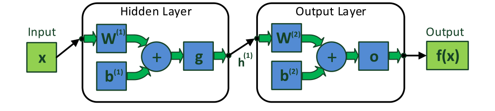

   **图 6** 含一个隐含层和输出层的前馈ANN结构。W、b、g、o分别表示权重、偏置、隐含层激活函数与输出层激活函数。

.. note::

   原图英文图题写“one hidden neurons”，正文与结构图则明确为一个隐含层，并非只有一个神经元；此处依据正文解释网络层数，神经元数量见附录A。

.. math::

   a_i^{(1)}(\mathbf x)=b_i^{(1)}+\sum_{j=1}^{m}W_{i,j}^{(1)}x_j
   \qquad (10)

其中，:math:`b_i^{(1)}` 为第i个神经元偏置，:math:`W_{i,j}^{(1)}` 为样本点第j维元素xⱼ到第i个神经元的连接权重。通过激活函数g，可计算第i个神经元的激活值、即隐含层值：

.. math::

   h_i^{(1)}(\mathbf x)=g(a_i^{(1)})=\frac{1}{1+\exp(-a_i^{(1)})}
   \qquad (11)

上式为sigmoid激活函数。隐含层值输入输出层后执行类似过程，采用输出激活函数o，本文为线性形式，最终得到近似函数值：

.. math::

   f(\mathbf x)=o\left(b^{(2)}+\sum_{i=1}^{N_{\mathrm{neurn}}}W_i^{(2)}h_i^{(1)}\right)=b^{(2)}+\sum_{i=1}^{N_{\mathrm{neurn}}}W_i^{(2)}h_i^{(1)}
   \qquad (12)

其中，:math:`N_{\mathrm{neurn}}` 为隐含层神经元数，通常通过收敛研究确定，见附录A。对已知数据标定网络偏置和权重的过程称为“训练”，本文采用推荐的Levenberg–Marquardt反向传播算法 [26]。样本的70%用于训练，另15%用于验证泛化能力并在过拟合前停止训练，最后15%用于独立检验网络泛化。

原响应函数复杂程度，对选择合适函数构建技术起关键作用 [12]，但这一信息通常事先未知，且不同响应的复杂性可能不同。因此，为FWT响应面选择最佳近似技术并不简单。为保证全寿命动力预测准确，设计标定研究，按以下步骤检验三类代理模型的适用性。

a. 从25年数据库通过MDA选出的M个工况及其响应，用于建立三类代理模型。所选工况数M是影响模型表现的重要因素，因此同时开展M的敏感性分析，考虑200、400、600、1000和1400五个取值。

b. 完整模拟2016年全部2928个工况的响应，作为参考标定数据库。

c. 用步骤a建立的代理模型重现2016年响应，与步骤b的参考数据库比较，评价模型表现。

该标定研究在90° PMO下开展，结果见第5.2节。最终用最优代理模型重构全寿命响应，并比较四种PMO的动力表现。

4.3.2 FWT性能评价指标
^^^^^^^^^^^^^^^^^^^^^^^^^^^^^^

为使发电量最大，漂浮风机应在一定安全限度内设计，动力性能评价也应遵循这一原则。FWT在全寿命内经历大幅波动风浪荷载，易受疲劳损伤。塔底与导缆点是荷载传递关键位置，承受较大内力，是最重要的位置之二。除疲劳外，还应关注与风机运行密切相关的系统运动。例如，平台倾斜不仅可能不利地改变齿轮箱润滑分布或轴承荷载 [27]，还会增大发电波动。机舱加速度则影响停机时间；超过给定阈值时，风机停机以避免传动链过载。综上，用塔底疲劳、导缆点疲劳、平台峰值倾斜角、机舱峰值加速度和发电量五个量评价FWT长期动力表现。

FAST模拟提供绕x、y轴弯矩，两者均影响塔底疲劳。图7所示塔底截面特定位置的轴向应力为：

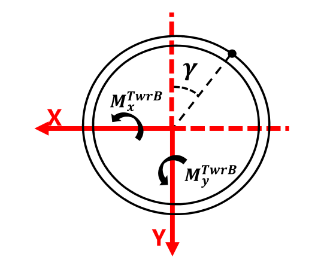

   **图 7** 塔底截面的应力检查点。r为截面半径，γ为检查点位置角；图中保留x、y轴与对应弯矩的方向定义。

.. math::

   \sigma(\gamma)=\frac{M_x^{\mathrm{TwrB}}}{I_x}r\cos\gamma+\frac{M_y^{\mathrm{TwrB}}}{I_y}r\sin\gamma
   \qquad (13)

其中，r为塔底截面半径，Iₓ、Iᵧ为截面惯性矩，γ为疲劳检查点位置角。风机重力荷载波动也产生轴向应力，但贡献较小，故忽略。各检查点的疲劳损伤，采用DNV-RP-C203 [28] 推荐的S–N曲线中的D曲线和雨流计数法计算。导缆点疲劳采用类似方法，无档锚链S–N曲线参数来自系泊设计规范DNVGL-OS-E301 [29]。

类似地，将平台横摇与纵摇时程合成为倾斜角，将x、y向机舱加速度合成为水平加速度。从每个模拟工况提取最大值，作为代理模型输入。

估计全寿命发电量时，考虑超过切出风速、指定倾斜角阈值和机舱加速度阈值所引起的停机时间。

5 结果与讨论
--------------

5.1 所选海洋气象数据
~~~~~~~~~~~~~~~~~~~~~~~~

图8展示从25年海洋气象数据库选出的环境工况。为便于观察，图中仅展示600个所选工况。可见MDA正确代表了数据库变化，不仅覆盖发生最频繁工况所在的核心区域，也较好捕捉稀疏区域和数据空间边界。这些信息很重要，使代理模型能够近似预测大风速、大波高、风浪错向等罕见或极端海况的FWT动力响应。

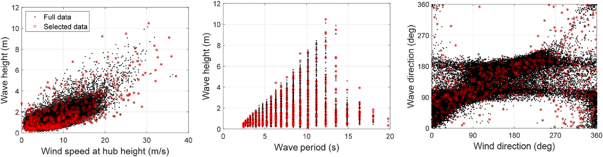

   **图 8** 利用MDA从全寿命海洋气象数据库选择环境工况。从左到右：轮毂高度3小时平均风速与有义波高；谱峰周期与有义波高；平均风向与波向。图中黑色为全部数据，红色为所选工况。

5.2 代理模型标定
~~~~~~~~~~~~~~~~~~~~

图9给出四种代理模型的塔底截面疲劳损伤分布。黑实线为2016年全部FAST模拟的参考结果，虚线为不同所选工况数量的代理预测。所有模型均成功捕捉损伤随截面位置变化的总体趋势：最高损伤位于位置角60°–90°，以及对称的240°–270°，最低位于150°。但模型一致性有所不同。抽样点数M增加时，代理结果逐渐向参考线收敛，其中Kriging比另外三种模型更快，仅600个MDA抽样点即可与参考结果较好吻合。主要原因之一，是Kriging用已知点之间的相关性作为基函数；预测特定点时，通过相关矩阵考虑全部已知点贡献，充分利用已知信息，因此较少数据也能给出合理结果。RBF中，TPS基优于高斯基，TPS的1000点结果可与高斯的1400点结果相比。高斯RBF的基函数比无参数TPS更复杂，但这种比较表明，对塔底疲劳近似可能“过于复杂”，收敛变慢。相反，两层ANN的复杂性不足，即使训练采用1400点，误差仍较大，意味着需要更多模拟数据才能改善吻合。为量化四种模型的差别，图10给出按式(A.1)定义的归一化均方根误差（NRMSE），清楚显示收敛并量化上述趋势。这些比较说明，只有模型与问题复杂性匹配，才能充分发挥作用。总体而言，Kriging与RBF-TPS是塔底疲劳近似的两种有前景方法。

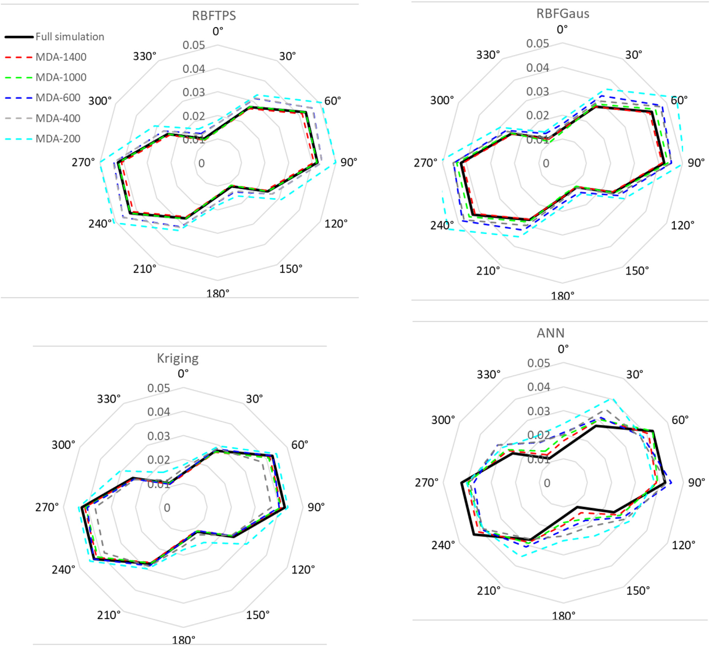

   **图 9** 累计塔底疲劳损伤的代理模型标定。四个面板依次比较RBF-TPS、高斯RBF、Kriging及ANN，角度为塔底截面检查点位置角，不是PMO。

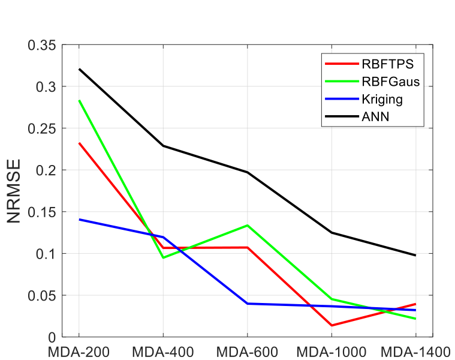

   **图 10** 四种代理模型预测塔底疲劳的归一化均方根误差，随MDA所选工况数变化。

图11给出导缆点疲劳标定结果。RBF与Kriging仅400个抽样点便能得到合理结果。但点数增加时，导缆点1的RBF结果反而偏离参考值，并出现波动。这可能来自RBF对抽样点的敏感性。原文依据式(6)解释，RBF权重参数在输入空间各维度相同，即假设平均风速、风向、有义波高、谱峰周期及波向对导缆点疲劳的贡献相同。为匹配训练点响应，权重通常由主导维度决定，不可避免地高估其余维度贡献，增加训练点敏感性。更多高疲劳损伤样本加入训练集时，RBF倾向于高估损伤。相反，式(9)中Kriging相关参数通常随维度变化，能描述各维度贡献，对训练集较不敏感，因此随着抽样点增加，Kriging比RBF稳定。图12给出相对完整模拟的预测误差。RBF和Kriging收敛至较低误差，约5%或更低；但类似塔底疲劳，ANN即使使用1400点，在导缆点2、3仍明显偏离参考数据，高估约20%。

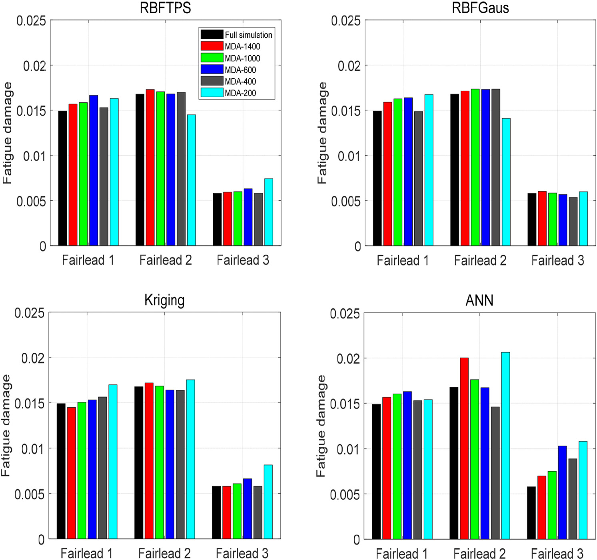

   **图 11** 累计导缆点疲劳损伤的代理模型标定。每个面板比较三个导缆点，黑柱为完整模拟，彩色柱为不同样本数的代理预测。

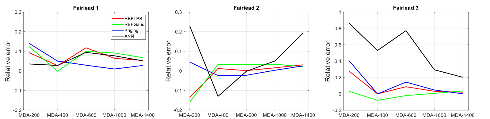

   **图 12** 四种代理模型预测导缆点疲劳的相对误差，三个面板分别为导缆点1、2、3。

平台峰值倾斜角和对应NRMSE见图13、14。即使只有200个抽样点，四种模型预测与完整模拟也较好吻合。但仍需留意模型间表现差异。与此前比较一致，Kriging比RBF收敛更快。有趣的是，疲劳分析中表现不佳的ANN，此处结果很好。图14表明，仅200个MDA样本便充分收敛，其NRMSE甚至低于1400样本的RBF。原因之一，是环境参数与平台倾斜响应的关系，比其与疲劳损伤的关系更直接，这种简单关系与两层ANN结构相匹配。

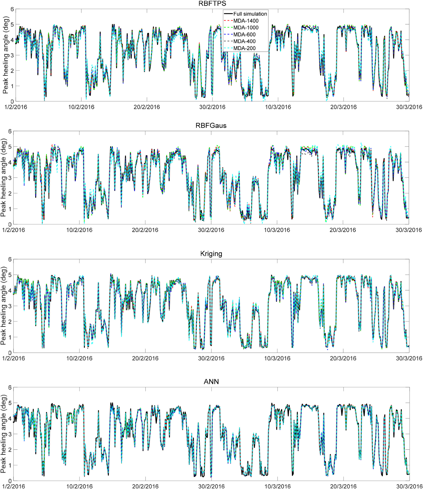

   **图 13** 平台峰值倾斜角的代理模型标定。四个面板分别对应RBF-TPS、高斯RBF、Kriging及ANN；图示为2016年参考与预测序列。

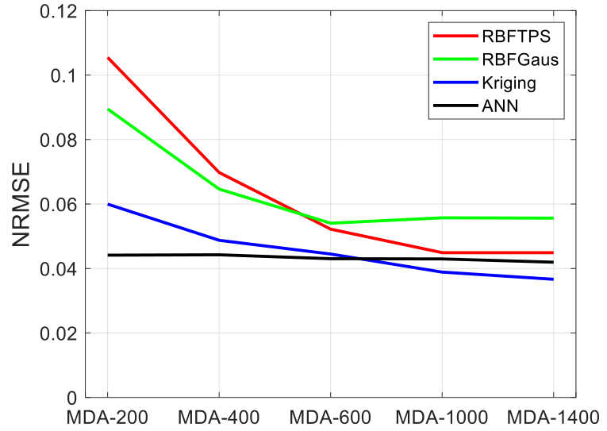

   **图 14** 四种代理模型预测平台峰值倾斜角的归一化均方根误差。

机舱峰值加速度的图15、16呈现类似趋势。图16的NRMSE表明，加速度代理预测不如平台倾斜角准确，最小NRMSE约7%，而图14约4%。此外，虽然多数MDA样本数下ANN的NRMSE小于Kriging，但它有时低估时序中的峰值，见图15第四面板。这些峰值关系到风机停机时间，因此从这一角度看，Kriging优于ANN。

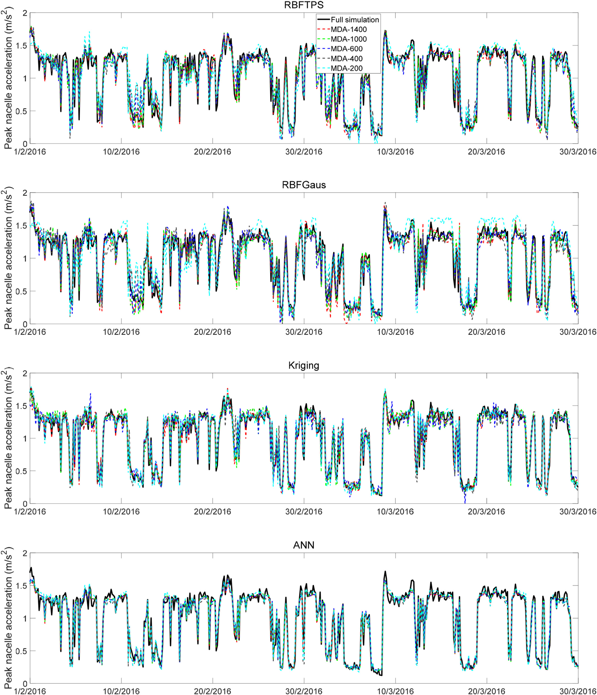

   **图 15** 机舱峰值加速度的代理模型标定。四面板依次为RBF-TPS、高斯RBF、Kriging、ANN；低整体误差不意味着所有局部峰值都被准确捕捉。

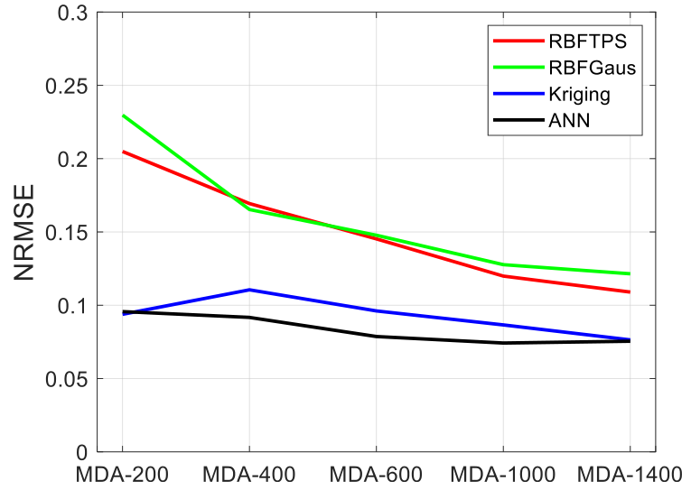

   **图 16** 四种代理模型预测机舱峰值加速度的归一化均方根误差。

关于发电量，图17表明，所有被检验模型都与完整模拟较好吻合，四种代理模型的差别可忽略，样本数对近似结果影响很小。这说明发电量是低阶问题，不同复杂程度的代理模型都能处理。对于这类问题，计算效率是选择模型的主要考虑。

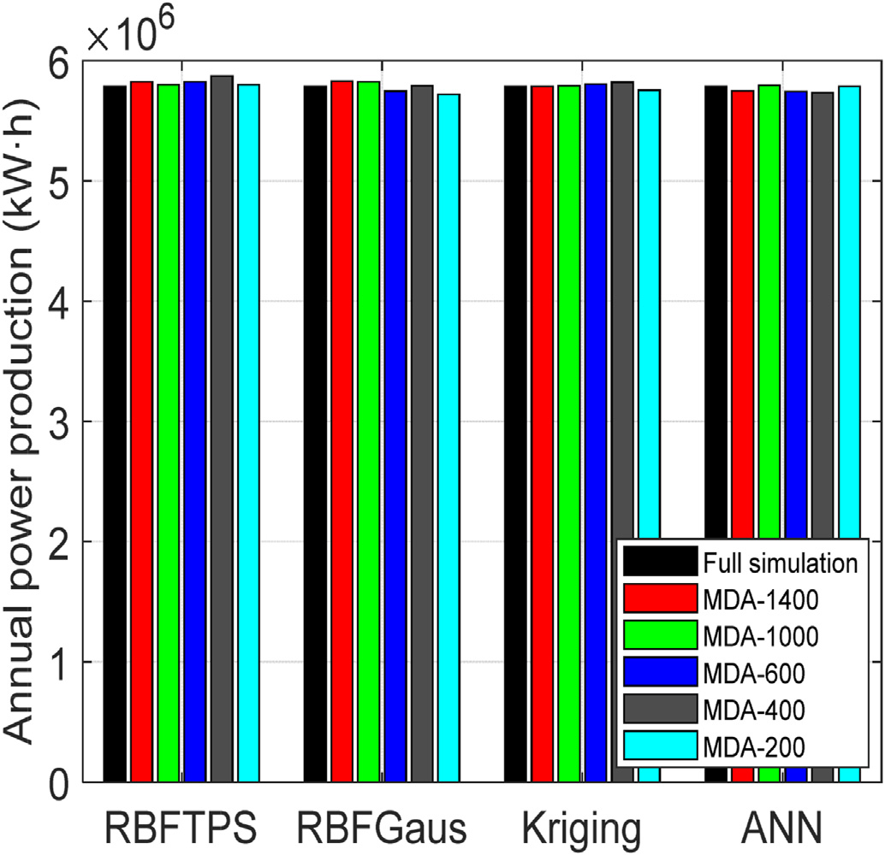

   **图 17** 发电量的代理模型标定。纵轴为年发电量（kW·h），黑柱为完整模拟，其他颜色为不同MDA样本数量。

图18比较四种模型训练时间。无论使用多少训练点，高斯RBF始终耗时最多，原因是形状参数σ采用试错确定。本文每次函数近似均在[10⁻²,10²]内搜索30个对数等间距值，并用交叉验证检验，耗费大量计算资源。相反，无参数TPS基RBF训练时间很短，1400点模型可在30 s内建立。两层ANN效率相近。Kriging因不同维度相关参数不同，待定参数多于RBF，计算成本显著高于TPS RBF，但仍明显低于试错高斯RBF。

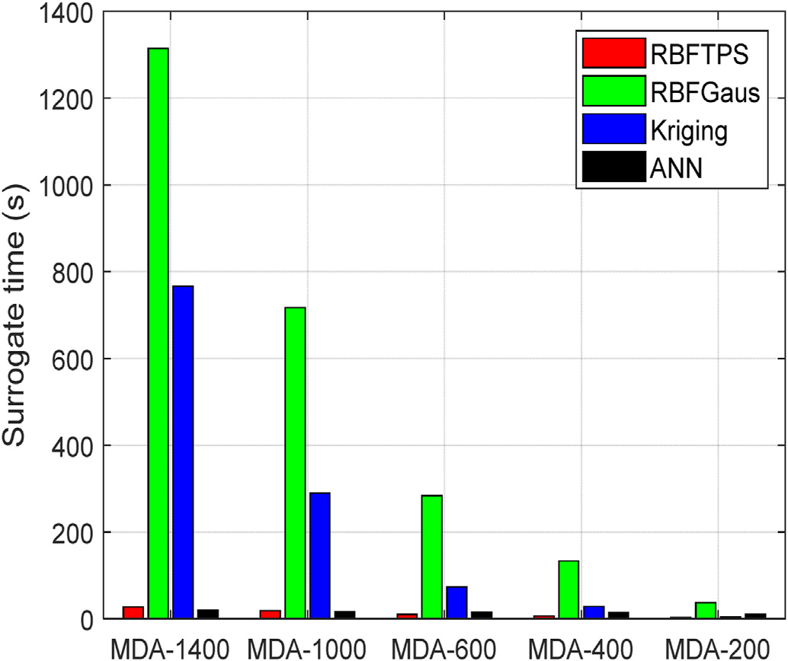

   **图 18** 四种代理模型的计算耗时比较。纵轴为代理模型训练时间，单位s；不包含生成全部FAST训练响应的总耗时。

综上，低阶问题中无参数基RBF和两层ANN更高效；疲劳损伤近似等高度非线性问题，更推荐Kriging。后续分析为获得准确结果，全部全寿命响应均采用1400个抽样点构建的Kriging模型预测。

5.3 平台安装朝向的影响
~~~~~~~~~~~~~~~~~~~~~~~~~~

5.3.1 塔底疲劳
^^^^^^^^^^^^^^^^^^^^

图19比较四种PMO的塔底截面疲劳损伤分布。最大累计损伤超过1，意味着结构失效。应指出，所用塔筒为基准模型，并非专为本文浮式系统设计，这是疲劳表现不佳的主要原因。但本文关注PMO对疲劳的影响，而非FWT绝对疲劳表现。与图9一致，全寿命疲劳损伤在位置角60°–90°及240°–270°最大，在150°最小，因为来自东方的风浪荷载最频繁。峰值处差异明显：30°布置损伤最严重，可比60°大25%；0°和90°位于两者之间。对半潜式平台，塔底弯矩主要由波浪以其对应频率激发，因此全寿命塔底疲劳差异主要来自不同水动力荷载。图20比较东向波浪下纵荡一阶激励力，趋势与疲劳图类似：30° PMO波浪力最大，在5–7 s周期范围，0°/60°及90°峰值约分别为30°的1/6和3/4。周期增加时，0°/60°与90°差别消失，但30°仍占主导，直至周期超过10 s。疲劳主要由谱峰周期通常小于10 s的中等海况造成，这解释30°布置最不利的原因。虽然0°和60°在东向波浪下水动力相同，但一部分波浪来自南方，见图5。此时0° PMO变为两个外立柱迎浪、一个背浪的最不利布置，对应图20红线；60°则相反，对应绿线。因此，图19中0°峰值疲劳大于60°。

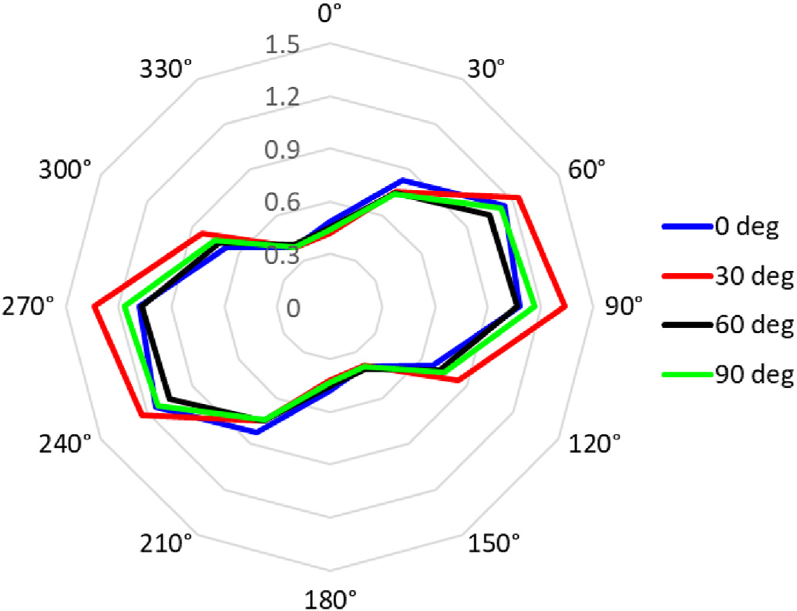

   **图 19** 四种平台安装朝向的全寿命塔底疲劳损伤。极角为塔底截面检查点位置；曲线颜色表示不同PMO。

.. note::

   本算例塔筒的最大累计疲劳损伤超过1。原文明确说明这是未针对该浮式系统重新设计的基准塔筒，本文比较不能被解释为已验证全寿命安全的工程方案。

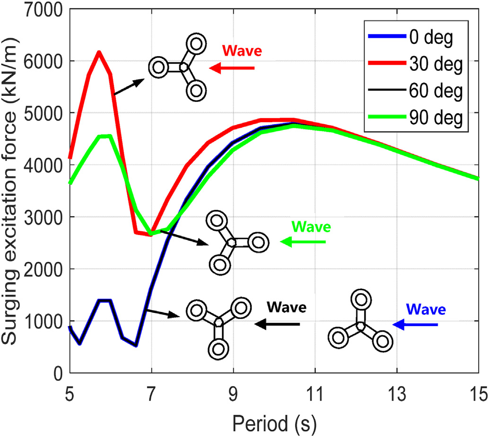

   **图 20** 东向波浪条件下的纵荡一阶波浪激励力比较。横轴为波浪周期，纵轴为单位波幅的激励力；示意图对应各PMO迎浪布局。

为说明现象机制，图21给出波面高程云图，施加振幅为1、周期6 s的东向规则波。绕射和辐射作用使规则波场受到浮体显著干扰。0° PMO下，波峰首先冲击立柱1，随后分为两部分：一部分向南离开平台，另一部分进入立柱2与4之间的通道。通过通道后波峰再次分离，其中一部分从45°方向作用于立柱4。图22概括这些波峰运动轨迹。此时除立柱1外，大部分立柱免于入射波正面冲击。但30°和90°图呈现不同情况，所有立柱均承受正面冲击。30°时，立柱1、2处分离的波浪分量汇成一个较大波峰，即所谓通道效应，先后冲击立柱4、3。相比之下，90°构型阻止这一通道效应，波面高程低于30°。这些图定性解释：6 s周期下，0°/60° PMO纵荡水动力最小，30°最大。

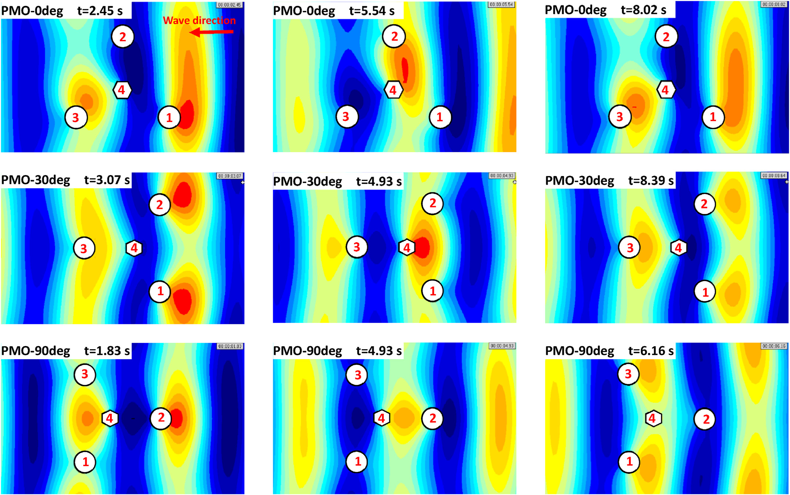

   **图 21** 振幅为1、周期6 s的东向规则波作用下的波面高程云图。各行从上到下为0°、30°、90° PMO；每行从左到右为不同时间。原图立柱编号及时间标识保留。

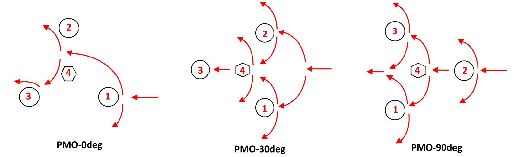

   **图 22** 0°、30°、90° PMO下的波峰运动轨迹。图中箭头为对波峰传播与分离的定性归纳，不是同时施加的多个独立来波。

5.3.2 导缆点疲劳
^^^^^^^^^^^^^^^^^^^^^^

图23比较导缆点全寿命疲劳。由于风浪荷载集中来自东方，三个导缆点损伤分布不均。30°、60°、90° PMO中，导缆点2倾向于承受更大疲劳荷载，其中60°损伤大于另外两种布置。对于半潜式平台悬链线系泊，导缆点疲劳主要与平台慢漂有关。图24比较东向波浪下纵荡慢漂力。横坐标Period₁是周期对之一，满足 :math:`|1/\mathrm{Period}_1-1/\mathrm{Period}_2|` 等于纵荡固有频率，单位Hz。在中等海况最常见的5.5–7.3 s周期内，60°慢漂力大于其他两种朝向。超出该范围，60°降至另两者以下，但差别较小。这意味着60°慢漂更大，从而产生更大疲劳损伤。不过，水动力并非系泊荷载的唯一影响因素。0°与60°慢漂水动力系数相同，疲劳分布却完全不同：0°峰值出现在导缆点3，三个导缆点间差别在四种PMO中最小。这说明系泊布置与主导波向的相对关系，也显著影响导缆点疲劳。该布置更有利，因为荷载分配均匀，可提高系泊系统可靠性；荷载集中会显著增加特定系泊线失效概率，进而增加系统失效概率。有趣的是，60°塔底疲劳最低，但从系泊系统角度看却是不利设计。

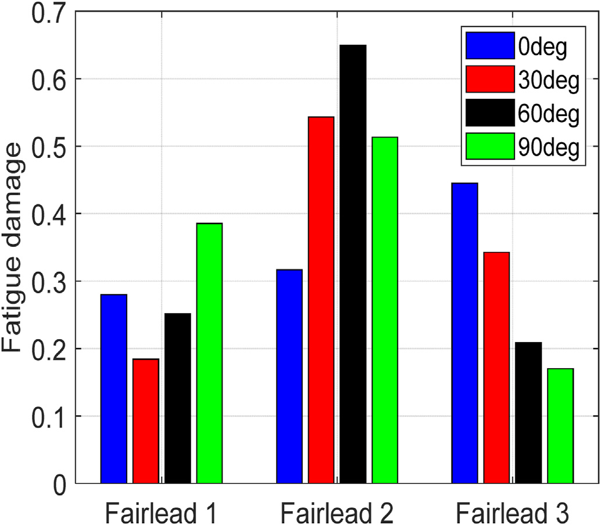

   **图 23** 四种平台安装朝向的全寿命导缆点疲劳损伤。三个组对应导缆点1、2、3。

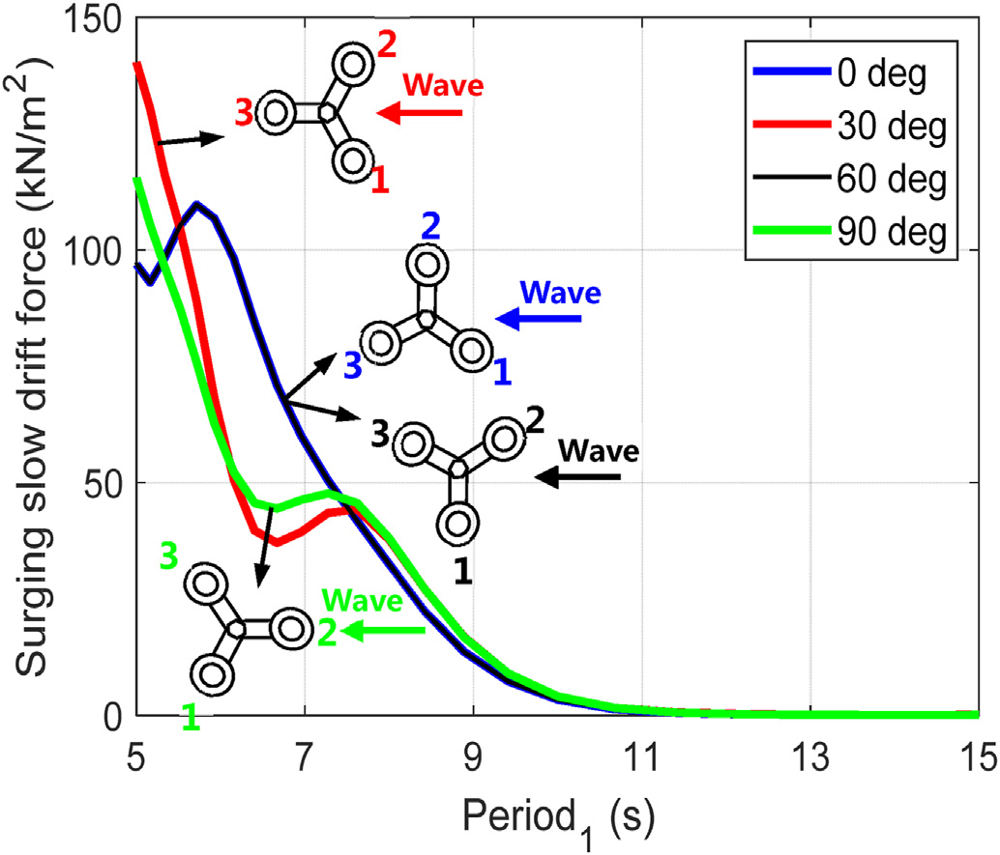

   **图 24** 东向波浪下纵荡慢漂力比较。Period₁是满足差频等于纵荡固有频率的周期对中的一个周期，不是差频周期。

5.3.3 平台倾斜角
^^^^^^^^^^^^^^^^^^^^^^

平台倾斜角主要关注峰值，图25给出不同峰值倾斜角水平的超越概率。四种PMO差别并不显著，直至峰值角增大到较高水平。为解释这一现象，图26给出东向波浪的纵摇响应幅值算子（RAO）。一方面，30°单位波高纵摇响应大于另三种布置，可解释其大倾斜角超越概率最高。前文提到一部分波浪来自南方，此时0° RAO最大，因此其超越概率倾向高于60°。另一方面，四种RAO的绝对差值很小，30°与0°/60°最大差仅0.07°/m，意味着除中等或严重海况外，纵摇差别很难明显辨认。因此，大倾斜角超过4.6°时的超越概率差异，比小角度时更明显。不过，最大差异仍小于3%，说明平台布置对倾斜响应的影响不及其对结构疲劳的影响显著。

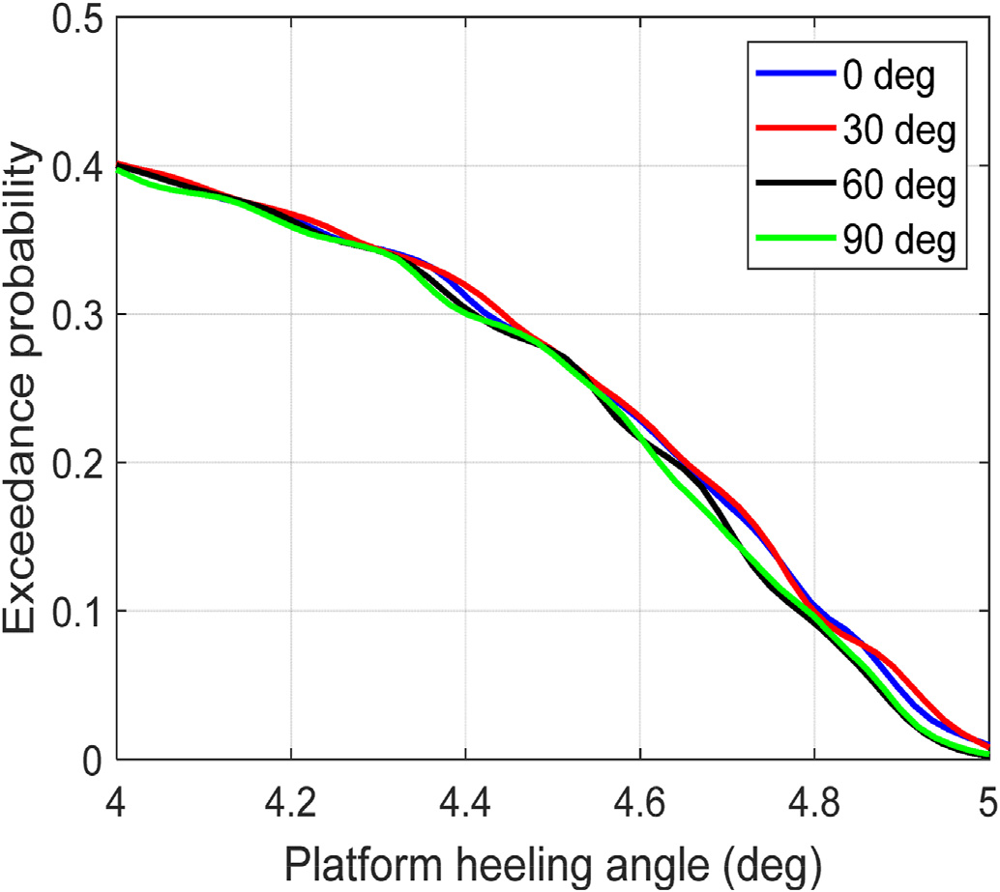

   **图 25** 平台峰值倾斜角的超越概率。横轴为平台倾斜角，单位°。

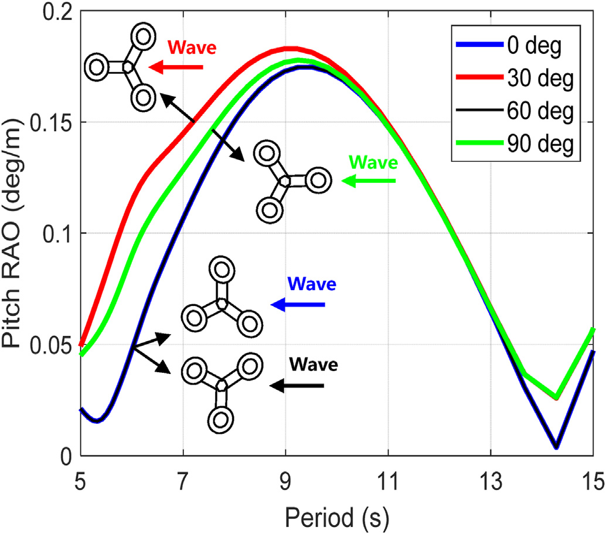

   **图 26** 东向波浪下的纵摇RAO比较。横轴为波浪周期，纵轴为单位波高纵摇响应，单位°/m。

5.3.4 机舱加速度
^^^^^^^^^^^^^^^^^^^^^^

图27机舱加速度呈现与峰值倾斜角相反的趋势：大多数峰值加速度范围内，四种PMO差别明显；加速度越接近极值，差别逐渐消失。与前述结果一致，30°最不利，大加速度超越概率最高。90°在约1.2–1.3 m/s²区间的概率水平接近30°，随加速度增加，迅速降至0°和60°水平。该趋势与图20波浪激励力相关。类似塔底荷载，半潜式机舱加速度主要受一阶水动力激励，幅值与海况强度正相关。中等海况谱峰周期较短，为5–7 s，90°平台水平波浪力几乎是0°、60°的三倍，使1.2–1.3 m/s²区间超越概率绝对差达到5%。严重海况中，波浪周期增加，三种布置受到相近水动力，因此超过1.3 m/s²后超越概率相近。四种布置最大绝对差可达10%，说明PMO对机舱峰值加速度的重要性。

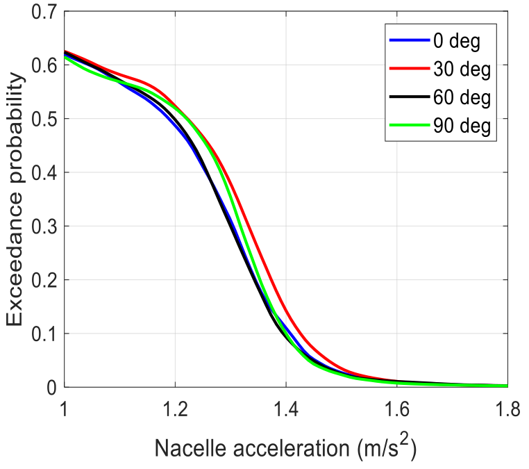

   **图 27** 机舱峰值水平加速度的超越概率。横轴为加速度，单位m/s²；曲线颜色对应不同PMO。

图28比较荷载方向空间中的最大峰值加速度分布。决定最大机舱峰值加速度归属的是波向。例如，波向约90°和210°时，30°布局较其他布局更可能取得较大峰值；90°布局对应的峰值则集中于约150°波向。各PMO出现最大加速度响应的工况数量，与波向分布相关。为减轻塔顶响应，应避免相对主导波向两个外立柱迎浪、一个背浪的上述不利布置。

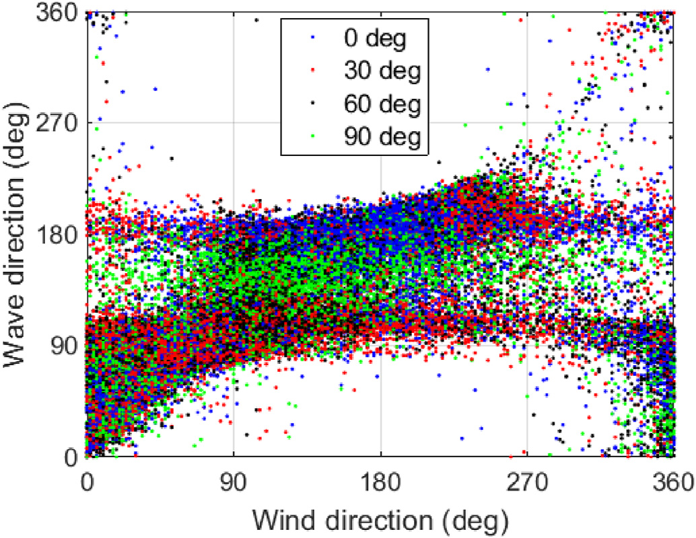

   **图 28** 荷载方向空间中最大机舱峰值加速度的归属分布。各点颜色标识同一风浪工况下，四种PMO中哪种具有最大峰值；不是加速度大小的连续色标。

5.3.5 发电量
^^^^^^^^^^^^^^^^^^

研究FWT动力学如何影响发电量十分重要。本文假定，只要某个3小时工况内峰值倾斜角或机舱峰值加速度超过指定阈值，风机在整个该工况内均不发电。表1、2列出不同阈值组合下，四种PMO中的最大与最小全寿命发电量。与前图一致，原表蓝、红、黑、绿分别代表0°、30°、60°、90° PMO。多数情况下90°布置最有利于发电，但在“松—紧”约束，即倾斜角阈值大而加速度阈值小时，预测60°发电更多。显然，30°动力表现较差，更可能发电较少；严格倾斜角约束下，0°也是不利布置。为比较表1、2，表3列出按(Pmax−Pmin)/Pmin计算的提高比例。两表差异显著，且程度高度依赖阈值。倾斜角阈值较高时差异倾向更大，可达45.8%。这些结果表明，PMO也显著影响发电量。

.. note::

   这里的45.8%来自指定停机假设和阈值组合下，四种PMO预测发电量的最大值相对最小值之差，不是实测增发比例，也不是所有阈值下都能获得的增益。本文把发生一次峰值超限的整个3小时工况记为零发电。

.. list-table:: 表 1 最大全寿命发电量矩阵（kW·h），括号内为PMO
   :header-rows: 1
   :widths: auto

   * - 加速度阈值（m/s²）／倾斜角阈值
     - 4.1°
     - 4.3°
     - 4.5°
     - 4.7°
     - 4.9°
   * - 1.3
     - 8.824E+07（90°）
     - 9.515E+07（90°）
     - 1.116E+08（60°）
     - 1.755E+08（60°）
     - 2.539E+08（60°）
   * - 1.4
     - 1.244E+08（90°）
     - 1.450E+08（90°）
     - 1.835E+08（90°）
     - 2.775E+08（90°）
     - 3.897E+08（60°）
   * - 1.5
     - 1.329E+08（90°）
     - 1.585E+08（90°）
     - 2.115E+08（90°）
     - 3.156E+08（90°）
     - 4.389E+08（60°）
   * - 1.6
     - 1.371E+08（90°）
     - 1.632E+08（90°）
     - 2.175E+08（90°）
     - 3.269E+08（90°）
     - 4.511E+08（90°）
   * - 1.7
     - 1.397E+08（90°）
     - 1.659E+08（90°）
     - 2.205E+08（90°）
     - 3.301E+08（90°）
     - 4.554E+08（60°）

.. list-table:: 表 2 最小全寿命发电量矩阵（kW·h），括号内为PMO
   :header-rows: 1
   :widths: auto

   * - 加速度阈值（m/s²）／倾斜角阈值
     - 4.1°
     - 4.3°
     - 4.5°
     - 4.7°
     - 4.9°
   * - 1.3
     - 8.458E+07（60°）
     - 8.864E+07（0°）
     - 1.021E+08（90°）
     - 1.278E+08（30°）
     - 1.741E+08（30°）
   * - 1.4
     - 1.161E+08（0°）
     - 1.341E+08（0°）
     - 1.755E+08（30°）
     - 2.331E+08（30°）
     - 3.261E+08（30°）
   * - 1.5
     - 1.305E+08（30°）
     - 1.542E+08（0°）
     - 2.035E+08（0°）
     - 2.867E+08（30°）
     - 4.028E+08（30°）
   * - 1.6
     - 1.334E+08（30°）
     - 1.597E+08（0°）
     - 2.119E+08（60°）
     - 3.000E+08（30°）
     - 4.218E+08（30°）
   * - 1.7
     - 1.361E+08（30°）
     - 1.636E+08（0°）
     - 2.173E+08（60°）
     - 3.050E+08（30°）
     - 4.276E+08（30°）

.. list-table:: 表 3 发电量提高比例矩阵
   :header-rows: 1
   :widths: auto

   * - 加速度阈值（m/s²）／倾斜角阈值
     - 4.1°
     - 4.3°
     - 4.5°
     - 4.7°
     - 4.9°
   * - 1.3
     - 4.3%
     - 7.3%
     - 9.3%
     - 37.3%
     - 45.8%
   * - 1.4
     - 7.1%
     - 8.1%
     - 4.6%
     - 19.0%
     - 19.5%
   * - 1.5
     - 1.9%
     - 2.8%
     - 3.9%
     - 10.1%
     - 9.0%
   * - 1.6
     - 2.7%
     - 2.2%
     - 2.6%
     - 9.0%
     - 6.9%
   * - 1.7
     - 2.6%
     - 1.4%
     - 1.5%
     - 8.2%
     - 6.5%

6 结论
--------

本文研究PMO对Y形半潜式风机全寿命动力表现的影响。基于海洋气象数据聚类技术和时域动力模拟建立的代理模型，可直接输入海洋气象向量，高效预测系统全寿命动力响应。比较讨论四种PMO的塔底及导缆点疲劳损伤、平台倾斜角、机舱加速度和发电量，主要结论如下。

代理模型表现取决于原响应函数的复杂程度。两层ANN能准确预测平台和塔筒峰值运动，但塔底及导缆点疲劳预测不够理想。RBF的TPS与高斯基均与多数参考数据较好吻合，但后者采用试错算法，计算成本明显更高。Kriging为输入向量各维度引入相关系数，使函数近似更灵活，在FWT动力预测中表现最稳定，计算成本介于高斯RBF与ANN/TPS RBF之间。总体而言，低阶问题优先选择无参数基RBF或两层ANN；疲劳损伤等高度非线性问题推荐Kriging。

不同PMO可造成高达25%的塔底疲劳损伤差异，源于一阶水动力。相对主导波向两个外立柱迎浪、一个背浪的布置，倾向承受较大波浪荷载，是最不利PMO。

此外，平台布置显著影响导缆点疲劳。一方面，不同布置的慢漂运动不同，而慢漂主导系泊荷载幅值；另一方面，随PMO改变的系泊布置影响系泊线间荷载分配。有趣的是，塔底疲劳最低的布置，导缆点疲劳却最不利。

类似地，由于水动力特性不同，平台倾斜和机舱加速度也随布置变化，对加速度的影响比倾斜角更显著。考虑超过倾斜角及机舱加速度阈值引起的停机后，全寿命发电量也受平台布置影响，影响程度高度依赖阈值。

本文提出Y形半潜式平台选择适当PMO的基本准则：优先选择沿主导波向一阶水动力较低的PMO，因为它与塔底疲劳、平台倾斜及机舱加速度密切相关；同时，应使各导缆点系泊荷载尽可能均匀，以提高系泊系统可靠性。但系泊荷载分配由平台慢漂波浪力、系泊布置、风向和波向共同决定，不能由单一因素简单确定，仍需长期动力分析。本案例依据这些准则推荐0° PMO。应指出，这一建议目前仅限于主导风浪集中在某个特定方向的环境。为获得更一般结论，还需开展环境条件敏感性分析，即检验不同类型环境下是否得到相同决策准则，作者将在后续研究中开展。

综上，本文提供选择FWT动力代理模型的基本思路，并说明PMO对浮式系统全寿命运行的重要性。这些发现表明，海上安装前应基于长期海洋气象数据，全面考虑Y形半潜式平台布置。

附录A 神经元数量敏感性
------------------------

图A1给出ANN神经元数量的敏感性研究。用归一化均方根误差评价ANN表现，定义如下：

.. math::

   e_{\mathrm{NRMSE}}=\frac{\sqrt{\frac1N\sum_{i=1}^{N}(\widehat y_i-y_i)^2}}{\overline y}
   \qquad (A1)

其中，:math:`\widehat y` 为预测值，y为参考值，N为数据集大小，:math:`\overline y` 为参考值均值。图示表明，对于疲劳损伤预测，适当增加神经元数有助于改善ANN表现；但会增大平台峰值倾斜角、机舱峰值加速度和发电量预测的不稳定性。因此，前者采用30个神经元，后三者采用5个。

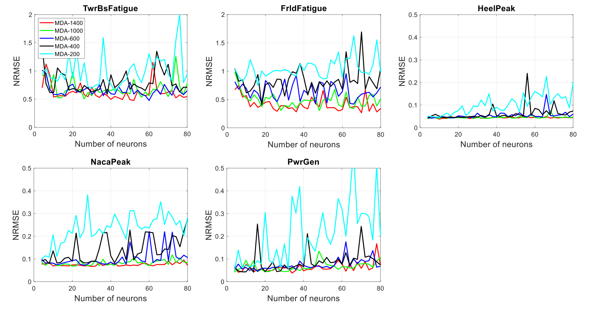

   **图 A1** 不同神经元数下ANN的性能评价。从左到右、先上排后下排，分别为塔底疲劳、导缆点疲劳、平台峰值倾斜角、机舱峰值加速度、发电量；曲线颜色表示MDA样本数。

参考文献
--------

[1] Fukushima Offshore Wind Consortium, Fukushima floating offshore wind farm demonstration project (Fukushima FORWARD), Available online: http://www.fukushima-forward.jp/pdf/pamphlet3.pdf. accessed on 8 December 2017.

[2] W. Yu, K. Müller, F. Lemmer, H. Bredmose, M. Borg, G. Sanchez, T. Landbo, Public definition of the two LIFES50þ 10MW floater concepts, LIFES50þ Deliv. 4 (2) (2017). `原文参考链接 <http://refhub.elsevier.com/S0960-1481(20)30542-5/sref2>`_。

[3] Fons Huijs, Erik-Jan de Ridder, Feike Savenije, Comparison of model tests and coupled simulations for a semi-submersible floating wind turbine, in: ASME 2014 33rd International Conference on Ocean, Offshore and Arctic Engineering, American Society of Mechanical Engineers, 2014, p. V9A. `原文参考链接 <http://refhub.elsevier.com/S0960-1481(20)30542-5/sref3>`_。

[4] E.E. Bachynski, M.I. Kvittem, C. Luan, T. Moan, Wind-wave misalignment effects on floating wind turbines: motions and tower load effects, J. Offshore Mech. Arct. 136 (2014). `原文参考链接 <http://refhub.elsevier.com/S0960-1481(20)30542-5/sref4>`_。

[5] M. Karimirad, C. Michailides, V-shaped semisubmersible offshore wind turbine subjected to misaligned wave and wind, J. Renew. Sustain. Energy 8 (2016). `原文参考链接 <http://refhub.elsevier.com/S0960-1481(20)30542-5/sref5>`_。

[6] K. Wang, Z. Cheng, T. Moan, M.O.L. Hansen, Effect of difference-frequency forces on the dynamics of a semi-submersible type FVAWT in misaligned wave-wind condition, in: The Twenty-Fifth International Ocean and Polar Engineering Conference, International Society of Offshore and Polar Engineers, 2015. `原文参考链接 <http://refhub.elsevier.com/S0960-1481(20)30542-5/sref6>`_。

[7] S. Zhou, B. Shan, Y. Xiao, C. Li, G. Hu, X. Song, Y. Liu, Y. Hu, Directionality effects of aligned wind and wave loads on a Y-shape semi-submersible floating wind turbine under rated operational conditions, Energies 10 (2017) 2097. `原文参考链接 <http://refhub.elsevier.com/S0960-1481(20)30542-5/sref7>`_。

[8] N. Ren, Z. Gao, T. Moan, L. Wan, Long-term performance estimation of the Spar–Torus-Combination (STC) system with different survival modes, Ocean Eng. 108 (2015) 716. `原文参考链接 <http://refhub.elsevier.com/S0960-1481(20)30542-5/sref8>`_。

[9] P. Camus, F.J. Mendez, R. Medina, A.S. Cofi~no, Analysis of clustering and selection algorithms for the study of multivariate wave climate, Coast Eng. 58 (2011) 453. `原文参考链接 <http://refhub.elsevier.com/S0960-1481(20)30542-5/sref9>`_。

[10] K. Müller, M. Dazer, P. Cheng, Damage assessment of floating wind turbines using Latin hypercube sampling, Energy Procedia 137 (2017) 119. `原文参考链接 <http://refhub.elsevier.com/S0960-1481(20)30542-5/sref10>`_。

[11] A.I.J. Forrester, A.J. Keane, Recent advances in surrogate-based optimization, Prog. Aerosp. Sci. 45 (2009) 50. `原文参考链接 <http://refhub.elsevier.com/S0960-1481(20)30542-5/sref11>`_。

[12] S. Razavi, B.A. Tolson, D.H. Burn, Review of surrogate modeling in water resources, Water Resour. Res. 48 (2012). `原文参考链接 <http://refhub.elsevier.com/S0960-1481(20)30542-5/sref12>`_。

[13] Y. Guanche, R. Guanche, P. Camus, F.J. Mendez, R. Medina, A multivariate approach to estimate design loads for offshore wind turbines, Wind Energy 16 (2013) 1091. `原文参考链接 <http://refhub.elsevier.com/S0960-1481(20)30542-5/sref13>`_。

[14] M. Martini, R. Guanche, J.A. Armesto, I.J. Losada, C. Vidal, Met-ocean conditions influence on floating offshore wind farms power production, Wind Energy 19 (2016) 399. `原文参考链接 <http://refhub.elsevier.com/S0960-1481(20)30542-5/sref14>`_。

[15] Jonkman J, Butterfield S, Musial W, Scott G. reportDefinition of a 5-MW Reference Wind Turbine for Offshore System Development. National Renewable Energy Laboratory, Golden, CO, Technical Report No. NREL/TP- 500-38060 2009.

[16] H.L. Tolman, User manual and system documentation of WAVEWATCH III TM version 3.14. Technical note, MMAB Contrib. 276 (2009) 220. `原文参考链接 <http://refhub.elsevier.com/S0960-1481(20)30542-5/sref16>`_。

[17] International Electrotechnical Commission, IEC 61400-3: wind turbines part 3: design requirements for offshore wind turbines, Int. Electrotech. Commission (2009) 21–22. `原文参考链接 <http://refhub.elsevier.com/S0960-1481(20)30542-5/sref17>`_。

[18] Det Norske Veritas, DNV-OS-J101-Design of offshore wind turbine structures, Det. Norske Veritas (2014) 41–42. `原文参考链接 <http://refhub.elsevier.com/S0960-1481(20)30542-5/sref18>`_。

[19] J.M. Jonkman, M.L. Buhl Jr., FAST User’s Guide, National Renewable Energy Laboratory, Golden, CO, 2005. Technical Report No. NREL/EL-500-38230. `原文参考链接 <http://refhub.elsevier.com/S0960-1481(20)30542-5/sref19>`_。

[20] P.J. Moriarty, A.C. Hansen, AeroDyn Theory Manual, National Renewable Energy Laboratory, 2005. `原文参考链接 <http://refhub.elsevier.com/S0960-1481(20)30542-5/sref20>`_。

[21] A.J. Coulling, A.J. Goupee, A.N. Robertson, J.M. Jonkman, Importance of Second- Order Difference-Frequency Wave-Diffraction Forces in the Validation of a Fast Semi-submersible Floating Wind Turbine Model, National Renewable Energy Laboratory, Golden, CO, 2013. Technical Report No. NREL/CP-5000- 57697. `原文参考链接 <http://refhub.elsevier.com/S0960-1481(20)30542-5/sref21>`_。

[22] R.G. Standing, W.J. Brendling, D. Wilson, Recent developments in the analysis of wave drift forces, in: Low-Frequency Damping and Response. Offshore Technology Conference, Offshore Technology Conference, Houston, Texas, 1987, p. 10. `原文参考链接 <http://refhub.elsevier.com/S0960-1481(20)30542-5/sref22>`_。

[23] M. Hall, A. Goupee, Validation of a lumped-mass mooring line model with DeepCwind semisubmersible model test data, Ocean Eng. 104 (2015) 590. `原文参考链接 <http://refhub.elsevier.com/S0960-1481(20)30542-5/sref23>`_。

[24] M. Hall, MoorDyn—Users Guide, Department of Mechanical Engineering, University of Maine, Orono, ME, USA, 2015. `原文参考链接 <http://refhub.elsevier.com/S0960-1481(20)30542-5/sref24>`_。

[25] K. Hornik, M. Stinchcombe, H. White, Multilayer feedforward networks are universal approximators, Neural Network. 2 (1989) 359. `原文参考链接 <http://refhub.elsevier.com/S0960-1481(20)30542-5/sref25>`_。

[26] M.H. Beale, M.T. Hagan, H.B. Demuth, Neural network toolbox. User’s Guide, MathWorks 2 (2010) 77. `原文参考链接 <http://refhub.elsevier.com/S0960-1481(20)30542-5/sref26>`_。

[27] S. Butterfield, W. Musial, J. Jonkman, P. Sclavounos, L. Wayman, Engineering Challenges for Floating Offshore Wind Turbines, National Renewable Energy Laboratory, Golden, CO, 2007. Technical Report No. NREL/CP-500-38776. `原文参考链接 <http://refhub.elsevier.com/S0960-1481(20)30542-5/sref27>`_。

[28] Det Norske Veritas, DNV-RP-C203 Fatigue Design of Offshore Steel Structures, Det Norske Veritas, 2012. `原文参考链接 <http://refhub.elsevier.com/S0960-1481(20)30542-5/sref28>`_。

[29] Det Norske Veritas, Germanischer Lloyd, DNVGL-OS-E301 Position Mooring, DNVGL, 2018. `原文参考链接 <http://refhub.elsevier.com/S0960-1481(20)30542-5/sref29>`_。
