.. _paper-note-ref-zhou2021-OE:

漂浮风机半潜式下部结构的全局敏感性研究：制造成本、结构特性与水动力：论文精解
============================================================================

精简版微信公众号文章：待发布

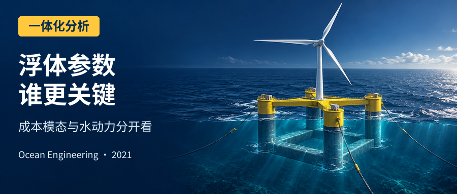

.. contents:: 本页目录
   :local:
   :depth: 2

论文信息
--------

**原文题名：** Global sensitivity study on the semisubmersible substructure of a floating wind turbine: Manufacturing cost, structural properties and hydrodynamics。

**作者：** Shengtao Zhou，Kolja Müller，Chao Li（通讯作者），Yiqing Xiao，Po Wen Cheng。

**单位：** 哈尔滨工业大学（深圳）土木与环境工程学院；西班牙巴塞罗那GE Renewable Energy；德国斯图加特大学Stuttgart Wind Energy。

**期刊：** Ocean Engineering，221（2021），108585。DOI：`10.1016/j.oceaneng.2021.108585 <https://doi.org/10.1016/j.oceaneng.2021.108585>`_。

**稿件日期：** 2020年7月20日收稿；2020年12月2日修回；2021年1月2日录用。

**WOEAI 相关方向：** 海洋能源结构 / 一体化分析。

摘要
----

通过优化技术权衡下部结构的资本支出与动力表现，是漂浮风机（FWT）在能源行业广泛应用的关键。浮式下部结构优化是高维问题。敏感性分析能够识别与潜在目标函数或约束最相关的设计参数，降低设计空间维度，并增进对整个设计空间中参数相互关系的认识。本文评价浮体主要尺寸和系泊参数，对四立柱半潜式FWT制造成本、结构特性及水动力的影响。采用两种广泛使用的全局敏感性分析方法，即基于方差的方法和基于密度的方法，衡量10个设计参数的敏感性贡献。立柱半径是下部结构制造成本和纵荡固有频率最有影响的因素之一；平台纵摇与塔筒前后向固有频率对立柱间距更敏感。水动力方面，立柱间距、半径和平台吃水，是纵荡、纵摇及塔顶加速度波频响应最关键的三个因素。低频二阶水动力响应中，吃水影响较弱，立柱间距和半径更加占主导。这些结果经输入—输出样本的可视化检查确认。研究为FWT下部结构设计空间提供新视角，并为进一步研究长期动力表现的敏感性奠定基础，例如平台峰值倾斜角、机舱加速度、塔底和导缆点疲劳损伤。

**关键词：** 漂浮风机；下部结构；全局敏感性分析；制造成本；结构特性；水动力。

1 引言
--------

漂浮风机是开发深海风能的有效技术。其发展挑战之一是下部结构设计，下部结构由浮式平台和定位系统组成，在整机总成本中占较大比例，也显著决定系统动力表现。如何权衡资本支出和性能，是FWT在能源行业广泛应用的关键。

优化技术为这一问题提供有前景的方案。合理设置设计变量、约束和目标函数后，可用优化算法在设计空间搜索最优方案。该方法已用于不同目的的FWT设计。例如，Lemmer等（2020）提出考虑控制器设计的三柱半潜式浮体形状优化示例方法；相反，Brommundt等（2012）和Benassai等（2018）在固定浮体几何下优化系泊。Karimi和Hall等（Karimi等，2016）同时参数化平台与系泊，建立优化框架，探索下部结构设计空间多样性。Fylling和Berthelsen（2011）开发WINDOPT，概念设计浮体、系泊与动态电缆。较近的Hegseth等（2020）对10 MW Spar风机的平台、塔筒、系泊和变桨控制器进行一体化优化。一般而言，设置优化过程首先要指定待优化变量，而定义特定FWT下部结构涉及数十个参数，因而自然产生一个问题：哪些参数应选为设计变量？

最直接的做法是将结构全部参数化，但会导致高维优化，获得收敛结果需要大量计算资源。更高效的途径是降低设计空间维度：把对目标函数重要的参数作为自由变量，较不重要者在整个优化过程中保持不变。衡量结构参数重要性，是实现这一目标的关键。

敏感性分析（SA）为此提供方法。FWT下部结构设计可视作输入—输出过程：给定包含k个因素的设计参数输入，总能通过函数或模型映射得到相应属性／性能指标输出。SA研究模型输出变化如何归因于输入因素变化。显然，在给定输入变化范围内，引起输出变化越大的因素越敏感或越重要。SA一般分局部和全局两类：局部SA考察参考点附近的输出变化，全局SA考察整个可行设计空间。上述下部结构优化主要服务概念设计阶段，关注全局信息，因此本文聚焦全局SA。

多数工程问题没有输入—输出显式表达式，无法解析计算敏感性指标（SI），必须采用基于抽样的SA。全局SA有“一次一个因素”（OAT）与“一次所有因素”（AAT）两种输入抽样策略。OAT只改变一个输入，其余固定，通常与Morris方法（Morris，1991）结合。该方法取r个基本效应的均值作为全局敏感性度量，基本效应定义为特定输入在参考点附近的函数偏导。只需r(k+1)次函数计算，成本低，适合排序和筛选等初步SA。排序是按相对输出贡献排列输入，筛选则识别影响最小的输入。Martin等（2016）和Velarde等（2019）分别将其用于底固定海上风机运行维护成本、基础疲劳荷载SA。但OAT抽样及线性假设，使其无法确定输入间高阶交互，而这些作用对FWT下部结构设计可能十分重要。

为克服该局限，研究者提出基于AAT抽样的更精细方法，同时改变全部输入以产生输出变化。例如，相关性方法用Pearson、Spearman或偏相关系数度量敏感性；回归方法将输入—输出样本拟合为线性／非线性函数，提取敏感性指标（Pianosi等，2016）。Velarde等（2019）也用于海上风机基础疲劳分析。其优点是易实现，可用于小数据集；但输入—输出关系强非单调或非线性时可能不准确，而FWT下部结构设计恰可能属于此类问题。

基于方差分解的方法能捕捉整个可行变化空间内的非线性因素交互。Glišić等（2017）将著名的Sobol指标（Sobol，1993）这一典型方差敏感性度量，用于单桩疲劳SA。该方法可准确量化敏感性，但需要大量函数计算才能收敛。因此，为提高效率，方差SA通常结合代理建模，也称元建模，建立后以简单代数计算近似耗时函数求值。Müller（2020）据此以可接受计算量量化FWT荷载对环境条件的敏感性。另一种加速途径是逐步选择输入：早期使用Morris、Pearson系数、线性回归等简单低成本方法识别较不重要因素，再对较小输入集应用计算密集的精细方法。受此启发，Hübler等（2017）提出海上风机分层四步全局SA，表明不同下部结构和工况中，只有少数参数有影响，许多其他输入可视作确定量而不损失精度。

这些应用说明，SA是帮助设计者理解各种因素影响海上风机的有力统计工具。FWT下部结构优化长期被视作黑箱，因为缺乏设计变量如何影响目标函数的认识。迄今尚无相关研究全面连接浮体形状、系泊布置等设计变量，与制造成本、结构特性、水动力等性能指标，而这对早期设计十分重要。本文尝试用SA解决。图1说明下部结构SA的输入—输出逻辑，输入为描述结构几何／构型的参数，据此计算固有属性。

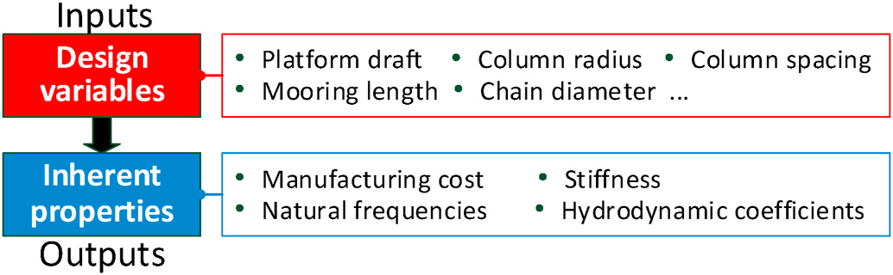

   **图 1** FWT下部结构敏感性分析的输入—输出逻辑。输入包括吃水、立柱半径和间距、系泊长度、链径等；输出包括制造成本、刚度、固有频率与水动力系数。

本文有两个目标：（a）识别概念设计阶段浮体／系泊构型优化的关键设计变量；（b）增进对四柱半潜式FWT下部结构高维设计空间的认识。以10 MW漂浮风机为案例，先考虑设计约束定义可行设计空间，再于第4节介绍制造成本、结构特性、水动力三类输出计算，第5节说明两种SA方法并归纳流程，第6节展示讨论结果，最后总结结论。

2 输入变化空间的定义
----------------------

图2为研究的FWT系统：DTU 10 MW基准风机（Bak等，2013）搭载NAUTILUS Floating Solutions,S.L提出的四柱钢制半潜平台（Yu等，2017）。平台工作水深130 m，采用四根悬链线，相邻线夹角90°。原始方案的几何尺寸、结构和水动力特性，已在欧盟“地平线2020”研究创新计划资助的LIFES50+项目公开定义文件中汇总（Yu等，2017）。

.. figure:: ../../../wechat/assets/public-safe/ref-zhou2021-OE/fig02.jpg
   :alt: 图2 研究风机的下部结构构型与系泊布置。左图为四立柱、环形浮箱与上部梁；中图为四根90°间隔系泊线；右图定义链径、未伸长线长、锚半径及导缆点高度。SWL为静水面。
   :align: center
   :width: 100%

   **图 2** 研究风机的下部结构构型与系泊布置。左图为四立柱、环形浮箱与上部梁；中图为四根90°间隔系泊线；右图定义链径、未伸长线长、锚半径及导缆点高度。SWL为静水面。

敏感性研究首先定义设计空间。下部结构用11个变量参数化，分别列于表1并示于图2。

.. list-table:: 表 1 敏感性研究的尺寸变量
   :header-rows: 1
   :class: longtable

   * - 自由变量
     - 单位
     - 范围
     - 离散间隔
   * - 吃水 D
     - m
     - [14,64]
     - 2
   * - 立柱半径 r
     - m
     - [3,8]
     - 1
   * - 中心线立柱间距 d
     - m
     - [18,52]
     - 2
   * - 梁高 hbeam
     - m
     - [2,5]
     - 1
   * - 浮箱宽 wpotn
     - m
     - [6,20]
     - 1
   * - 浮箱高 hpotn
     - m
     - [1,6]
     - 1
   * - 钢壁厚 twall
     - mm
     - [30,80]
     - 10
   * - 未伸长系泊线长 Lmor
     - m
     - [470,970]
     - 20
   * - 锚链公称直径 Dchain
     - mm
     - [40,180]
     - 10
   * - 锚半径 Rmor
     - m
     - [490,990]
     - 20
   * - 导缆点高 Hfrld
     - m
     - [-64,7]
     - 2

最小气隙是浮式结构甲板高度的重要考虑，但本文整个敏感性研究固定甲板相对静水面高度为7.776 m，与原设计相同。若轮毂高度固定，塔高取决于甲板高度，因此该处理可使用恒定塔筒设计，简化分析并聚焦下部结构。为简化，未显式建模浮体内部加劲肋和舱壁，表1钢壁厚可理解为计入外表面及内部构件质量贡献的等效厚度。给定吃水后，通过浮体排水量与系统总重平衡确定压载重量，总重包括风机、平台、压载及系泊预张力竖向荷载。系泊构型由四个参数描述。假定使用无档锚链，可据这些参数估算水中等效单位长度重量ωmoor（N/m）和轴向刚度EA（N）（Barltrop，1998）：

.. math::

   \omega_{\mathrm{moor}}=0.1875D_{\mathrm{chain}}^2
   \qquad (1)

.. math::

   EA=90000D_{\mathrm{chain}}^2
   \qquad (2)

3 约束
--------

直接在表1设计空间开展SA存在风险，因为显然不是所有设计都满足浮式结构基本要求，不可行方案会损害分析结果。因此，采用多种约束剔除不可行样本。

首先，为保证新生成设计的几何合理性，采用表2所列约束。

.. list-table:: 表 2 几何约束
   :header-rows: 1
   :class: longtable

   * - 约束
     - 说明
   * - :math:`2r<\sqrt{2}d`
     - 相邻立柱之间应留间隙。
   * - :math:`2r<w_{\mathrm{potn}}`
     - 立柱完整嵌入浮箱，增强柱间连接。
   * - :math:`w_{\mathrm{potn}}<\sqrt{2}d/2`
     - 浮箱应保持环形。
   * - :math:`h_{\mathrm{potn}}<Draft`
     - 浮箱不应过高。
   * - :math:`\sqrt{(R_{\mathrm{moor}}-d-r)^2+(z_{\mathrm{water}}+H_{\mathrm{frld}})^2}<L_{\mathrm{moor}}` ，且 :math:`L_{\mathrm{moor}}<R_{\mathrm{moor}}-d-r+z_{\mathrm{water}}+H_{\mathrm{frld}}`
     - 悬链线长度须满足三角形边长准则；zwater表示水深。
   * - :math:`-Draft\le H_{\mathrm{frld}}\le H_{\mathrm{deck}}`
     - 导缆点应连接在立柱上。

此外，还应认真考虑浮式结构设计原则。例如静水恢复能力，尤其横摇／纵摇自由度，是重要性能指标，与影响发电和最大允许倾角的风致倾斜相关。恢复刚度大可减小平均横摇／纵摇，但也可能使固有周期降低，与入射波周期重叠而共振。为进一步降低共振风险，通常要求垂荡与横摇／纵摇固有周期至少相隔数秒。本文采用四组约束筛选平台（DNV-RP-0286，2019）：

.. math::

   0<\bar q_4<10^\circ,\qquad0<\bar q_5<10^\circ
   \qquad (3)

.. math::

   \frac{2\pi}{\omega_{\mathrm{eigen},3}}\ge17\ \mathrm s
   \qquad (4)

.. math::

   \frac{2\pi}{\omega_{\mathrm{eigen},4}}\ge20\ \mathrm s,\qquad\frac{2\pi}{\omega_{\mathrm{eigen},5}}\ge20\ \mathrm s
   \qquad (5)

.. math::

   \left|\frac{2\pi}{\omega_{\mathrm{eigen},3}}-\frac{2\pi}{\omega_{\mathrm{eigen},4}}\right|\ge3\ \mathrm s,\qquad\left|\frac{2\pi}{\omega_{\mathrm{eigen},3}}-\frac{2\pi}{\omega_{\mathrm{eigen},5}}\right|\ge3\ \mathrm s
   \qquad (6)

其中，q₄、q₅为额定风况下平台平均横摇和纵摇角；ωeigen,3、ωeigen,4、ωeigen,5分别为垂荡、横摇和纵摇固有频率。这些量按下式计算：

.. math::

   \overline{\mathbf F}=\begin{bmatrix}
   \bar F_{\mathrm{aero},1}^{\mathrm{rated}}\\
   \bar F_{\mathrm{aero},2}^{\mathrm{rated}}\\
   \bar F_{\mathrm{aero},3}^{\mathrm{rated}}+F_B+F_G\\
   \bar F_{\mathrm{aero},4}^{\mathrm{rated}}-\bar F_{\mathrm{aero},2}^{\mathrm{rated}}z_{\mathrm{hub}}+F_By_{\mathrm{CoB}}-F_Gy_{\mathrm{CoG}}\\
   \bar F_{\mathrm{aero},5}^{\mathrm{rated}}+\bar F_{\mathrm{aero},1}^{\mathrm{rated}}z_{\mathrm{hub}}-F_Bx_{\mathrm{CoB}}+F_Gx_{\mathrm{CoG}}\\
   \bar F_{\mathrm{aero},6}^{\mathrm{rated}}\\
   \bar F_{\mathrm{aero},1}^{\mathrm{rated}}\varphi_{\mathrm{TT}}^{\mathrm{FA}}+\bar F_{\mathrm{aero},5}^{\mathrm{rated}}\varphi_{s,\mathrm{TT}}^{\mathrm{FA}}\\
   \bar F_{\mathrm{aero},2}^{\mathrm{rated}}\varphi_{\mathrm{TT}}^{\mathrm{SS}}-\bar F_{\mathrm{aero},4}^{\mathrm{rated}}\varphi_{s,\mathrm{TT}}^{\mathrm{SS}}
   \end{bmatrix}
   \qquad (7)

.. math::

   F_B=\rho_wgV_{\mathrm{sub}},\qquad F_G=-m_{\mathrm{FWT}}g+\bar T_{V,\mathrm{frld}}
   \qquad (8)

.. math::

   \overline{\mathbf q}=(\mathbf C_{\mathrm{struc}}+\mathbf C_{\mathrm{moor}})^{-1}\overline{\mathbf F}
   \qquad (9)

其中， :math:`\bar F_{\mathrm{aero},i}^{\mathrm{rated}}` 为第i自由度的额定平均气动力／力矩。考虑八自由度，即平台纵荡、横荡、垂荡、横摇、纵摇、艏摇，以及塔顶一阶前后向和侧向模态挠度，假定风沿图2正x方向。zhub为轮毂高度；xCoB、yCoB和xCoG、yCoG分别为浮心、重心的x、y坐标；ρw为水密度；Vsub、mFWT为排水体积和浮式系统总质量；TV,frld为系泊系统竖向预张力；φTT的FA、SS上标分别表示塔顶一阶前后向、侧向振型挠度，φs,TT为其斜率。Cstruc为8×8刚度矩阵，左上6×6子矩阵为浮体静水刚度，第7、8行列表示塔筒刚度及与浮体相互作用，见Pegalajar-Jurado等（2018）。Cmoor为平台平均位移处线性化系泊刚度矩阵，第7、8行列为零。所有量均在图2坐标系中定义。

无阻尼耦合固有频率通过求解以下特征值问题得到：

.. math::

   \omega^2\mathbf q(\omega)=[\mathbf M+\mathbf A(\omega)]^{-1}(\mathbf C_{\mathrm{struc}}+\mathbf C_{\mathrm{moor}})\mathbf q(\omega)
   \qquad (10)

其中，q为8×1平台运动向量，M、A分别为8×8质量和附加质量矩阵。由于A与频率有关，采用迭代法求特征值。每个频率下计算八个可能固有频率；当其中某个频率等于循环中该次迭代的输入频率时，即得到系统固有频率。

拖曳嵌入锚成本低、易安装，常用于悬链线系泊。它在一定上拔角范围内工作，通常30°–50°，平台运动引起的大角度可能导致拖锚失效。为避免此情况，需要足够长度的系泊线躺在海床，使锚不承受竖向张力。本文假设至少十分之一线长应位于海床：

.. math::

   L_{\mathrm{moor}}-\frac{|\bar T_{V,\mathrm{frld}}|}{\omega_{\mathrm{moor}}}\ge\frac{L_{\mathrm{moor}}}{10}
   \qquad (11)

其中，TV,frld为导缆点竖向张力。系泊刚度也是重要指标，大平移可能损坏动态电缆。采用文献Benassai等（2018）建议的参考允许偏移／水深比0.15：

.. math::

   \frac{\Delta x_{\mathrm{offset}}}{z_{\mathrm{water}}}\le0.15
   \qquad (12)

平台偏移和导缆点张力随环境变化，但其平均幅值主要由平均气动力决定，可由风机推力系数曲线获得。因此，可在额定风况快速初检式(11)–(12)。考虑系泊线在不同来向下表现不同，检查0°–40°风向，间隔10°，其中0°沿图2X轴。系泊张力由自主开发的准静态程序计算。

风机设计关键之一，是避免转子推力在转频1P或叶片通过频率、三叶机组为3P处波动，引起塔筒共振。平台静水与系泊恢复刚度作为塔筒边界条件，对其特征频率影响显著，因此每种平台／系泊设计均须保证塔筒频率位于共振区外。图3为DTU 10 MW风机Campbell图：蓝区为运行中塔筒频率可能被1P、3P、6P气动荷载激发的共振区，绿区为潜在可行区域。按塔筒固有频率与激励频率关系，通常分为刚性、柔性和柔—柔设计（Burton等，2011）。本文只考虑刚性区，因为柔性和柔—柔区与通常0.05–0.3 Hz的波频重叠；同时，浮式塔筒通常承受比陆上更大内力，柔性设计较难满足极限和正常使用限状态要求。

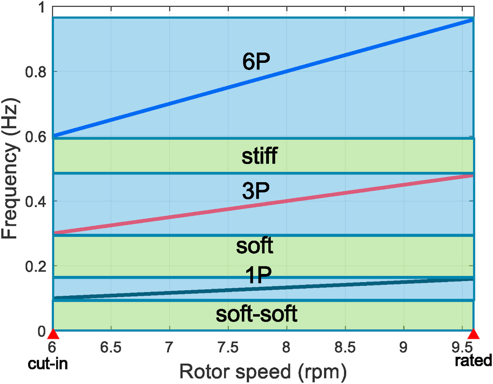

   **图 3** DTU 10 MW基准风机的Campbell图。蓝区为共振区，绿区分别为stiff、soft、soft-soft潜在设计区；横轴转速，纵轴频率。

4 输出评价
------------

4.1 制造成本
~~~~~~~~~~~~~~~~

浮式下部结构总建设支出包括许多部分，其中安装、运输等成本高度依赖具体项目。因此，本文仅关注与结构尺寸密切相关的制造成本。Benveniste等（2016）指出，单个浮式下部结构制造成本包括材料、人工和间接费用。材料成本由结构钢与压载构成，可用总质量乘单价估计。钢结构人工成本主要与焊缝长度、涂装面积有关（Farkas和Jármai，2013）。焊缝长度取决于原钢板尺寸，须结合钢铁行业标准、运输车辆和钢板卷板机等加工设备尺寸限制估计。本文假设使用10 m长、4 m宽原钢板，图4示意立柱与梁／浮箱的焊接拼缝。焊接制造时间分为准备、组装及点固时间Tw1，实际焊接时间Tw2，以及附加工序时间Tw3，单位min（Farkas和Jármai，2013）：

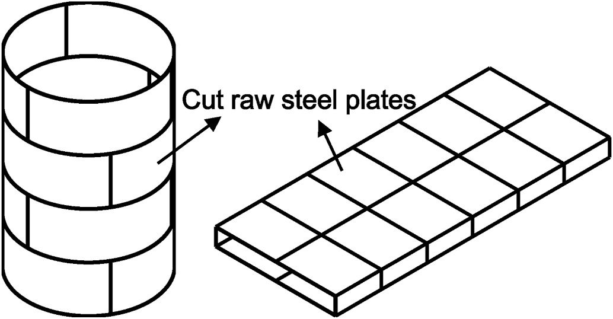

   **图 4** 圆形立柱和矩形梁／浮箱的焊接拼缝示意。Cut raw steel plates表示裁切后的原钢板。

.. math::

   T_{w1}=C_1\Theta_{dw}\sqrt{\kappa\rho V_s},\qquad T_{w2}=\sum_i C_{2i}\alpha_{wi}^{m}L_{wi},\qquad T_{w3}=0.3\sum_i C_{2i}\alpha_{wi}^{m}L_{wi}
   \qquad (13)

其中，C₁取决于焊接工艺，通常为1；难度系数Θdw在本文取1；κ为待组装裁切钢板数；ρ为钢密度；Vs为钢结构体积；C₂ᵢ、m为第i钢板对应焊接工艺参数，采用双K形对接焊缝埋弧焊时分别取0.1053、1.94（Farkas和Jármai，2013）；αwi为焊缝尺寸，Lwi为焊缝长度。得到时间后，乘人工单价计算焊接成本；涂装成本按Tizani等（1996）的单位面积价格估计。系泊线成本采用类似方法。

间接费用虽不直接关联制造过程，但为维持经营所必需，例如劳动管理、办公材料、摊销等。工程经验表明，其约占总制造成本27%（Benveniste等，2016）。总制造成本最终估计为：

.. math::

   TC=\frac{m_{\mathrm{ptfm}}P_{\mathrm{steel}}+m_{\mathrm{blst}}P_{\mathrm{blst}}+(T_{w1}+T_{w2}+T_{w3})P_{\mathrm{labor}}+AP_{\mathrm{paint}}+m_{\mathrm{moor}}P_{\mathrm{moor}}}{0.73}
   \qquad (14)

其中，mptfm、mblst、mmoor分别为平台、压载、系泊线质量，A为平台表面积；Psteel、Pblst、Plabor、Ppaint、Pmoor分别为钢材、压载、人工、涂装和系泊单价，见表3。价格随时间波动，为考虑不确定性对SA的影响，将钢材、人工、系泊单价设为服从指定分布的随机变量。表3参数与分布基于既有成本研究价格调查，见Tizani等（1996）、Myhr等（2014）、Trading Economics统计和Ziprecruiter。钢材—系泊、钢材—人工、系泊—人工价格相关系数分别假定0.7、0.15、0.15。采用Nataf变换（Liu和Der Kiureghian，1986）生成2000组联合概率价格样本，并对每组计算第5节所述敏感性指标。

.. list-table:: 表 3 制造成本估计采用的价格
   :header-rows: 1
   :class: longtable

   * - 价格
     - 单位
     - 均值
     - 标准差
     - 分布
     - 来源
   * - 钢材 Psteel
     - €/kg
     - 0.491
     - 0.0407
     - 正态
     - Trading Economics statistics
   * - 压载 Pblst
     - €/kg
     - 0.070
     - —
     - —
     - —
   * - 人工 Plabor
     - €/h
     - 17.052
     - 3.104
     - 核分布
     - Ziprecruiter
   * - 涂装 Ppaint
     - $/mm²
     - 14.400×10⁻⁶
     - —
     - —
     - Tizani等（1996）
   * - 系泊 Pmoor
     - €/kg
     - 2
     - 0.166
     - 正态
     - Myhr等（2014）

.. note::

   式(13)正文时间单位为min，表3人工单价为€/h；涂装价格则按原表列为$/mm²，其他价格多为欧元。原式(14)未展开时间、面积及币种换算，此处保留公式和单位，不假装已完成统一币种的工程报价核算。表中价格为原研究采用的历史输入，不代表当前市场价格。

4.2 结构特性
~~~~~~~~~~~~~~~~

这里结构特性主要指平台／塔筒位移的恢复刚度和固有频率。计算需质量、重心和转动惯量等基本信息。为实现批量计算，借助CAD软件CATIA进行参数化建模。静水刚度用Cstruc矩阵第5个对角元素表示：

.. math::

   C_{\mathrm{struc},55}=\sum_i-z_i m_i g+\rho_wg\iint_{\mathrm{wp}}x^2\,\mathrm ds+\rho_wgV_{\mathrm{sub}}z_{\mathrm{CoB}}
   \qquad (15)

其中，mᵢ、zᵢ为多体系统第i物体质量及重心，zCoB为浮心z坐标。

系泊特性用线性化水平恢复刚度表征，在平台未位移位置附近施加3 m纵荡扰动，对恢复力—位移曲线作线性最小二乘拟合估计。平台与系泊特性作为塔筒边界条件描述，采用BModes（Bir，2005）进行塔筒模态分析。本文SA关注一阶前后向固有频率。

4.3 水动力
~~~~~~~~~~~~~~

系泊半潜式平台的波致运动主要包括波频和低频两部分，前者由以下一阶水动力激励：

.. math::

   F_{\mathrm{hydro}}^{(1)}(\omega)=X(\omega)\sqrt{2S(\omega)\Delta\omega}\,e^{\mathrm i(\phi_X+\phi_S)}
   \qquad (16)

其中，X(ω)为单位波幅的一阶波浪激励力／力矩，S(ω)为单边波浪功率谱密度，φX和φS分别为X(ω)、S(ω)的相位。

低频响应由二阶水动力引起，对半潜式平台十分关键，因为它可激发共振，尤其是阻尼较小的纵荡／横荡，从而产生较大系泊荷载。采用完整差频二次传递函数（QTF）表征，可通过Pinkster方法（Pinkster，1980）计算。给定波谱S(ω)，低频水动力为：

.. math::

   F_{\mathrm{hydro}}^{(2)}(\omega_d)=\sum_{\omega_d=\omega_m-\omega_n}\mathrm{QTF}(\omega_d)\sqrt{2S(\omega_m)\Delta\omega}\sqrt{2S(\omega_n)\Delta\omega}\,e^{\mathrm i(\phi_{\mathrm{QTF}}+\phi_m+\phi_n)}
   \qquad (17)

其中，QTF(ωd)为频率对ωm、ωn的差频水动力系数，ωd=|ωm−ωn|；φQTF为QTF相位，φm、φn为第m、n个波浪分量相位。

.. note::

   式(17)求和条件写ωd=ωm−ωn，文字定义含绝对值，且指数使用相位加号。此处逐一保留原式与原定义，不静默改成其他差频合成约定。

将水动力荷载代入运动方程求波致响应。一阶与二阶响应分别求解，以便在SA中独立研究各自影响因素：

.. math::

   \mathbf q^{(1)}(\omega)=\left\{-\omega^2[\mathbf M+\mathbf A(\omega)]+\mathrm i\omega[\mathbf B_{\mathrm{rad}}(\omega)+\mathbf B_{\mathrm{vis}}(\omega)]+\mathbf C_{\mathrm{struc}}+\mathbf C_{\mathrm{moor}}\right\}^{-1}\mathbf F_{\mathrm{hydro}}^{(1)}(\omega)
   \qquad (18)

.. math::

   \mathbf q^{(2)}(\omega_d)=\left\{-\omega_d^2[\mathbf M+\mathbf A(\omega_d)]+\mathrm i\omega_d[\mathbf B_{\mathrm{rad}}(\omega_d)+\mathbf B_{\mathrm{vis}}(\omega_d)]+\mathbf C_{\mathrm{struc}}+\mathbf C_{\mathrm{moor}}\right\}^{-1}\mathbf F_{\mathrm{hydro}}^{(2)}(\omega_d)
   \qquad (19)

其中，Brad、Bvis为频率相关辐射阻尼及线性化黏性阻尼。除Bvis采用迭代Borgman线性化方法计算，见Lemmer等（2018），全部水动力系数由势流求解器ANSYS Aqwa（ANSYS，2016）获得。其他矩阵确定方法见Pegalajar-Jurado等（2018）。波致水平机舱加速度也是设计的重要考虑，在小位移／挠度假定下可计算为：

.. math::

   a_{\mathrm{nac}}^{(1)}(\omega)=-\omega^2[q_1^{(1)}(\omega)+z_{\mathrm{hub}}q_5^{(1)}(\omega)+q_7^{(1)}(\omega)]
   \qquad (20)

.. math::

   a_{\mathrm{nac}}^{(2)}(\omega)=-\omega^2[q_1^{(2)}(\omega)+z_{\mathrm{hub}}q_5^{(2)}(\omega)+q_7^{(2)}(\omega)]
   \qquad (21)

第i自由度的一阶与二阶运动响应标准差为：

.. math::

   \sigma_i^{(1)}=\sqrt{\sum_{j=1}^{N_\omega}\frac{|q_i^{(1)}(\omega_j)|^2}{2}}
   \qquad (22)

.. math::

   \sigma_i^{(2)}=\sqrt{\sum_{j=1}^{N_\omega}\frac{|q_i^{(2)}(\omega_j)|^2}{2}}
   \qquad (23)

遵循LIFES50+设计依据文件（Krieger等，2015），考虑表4的21个代表波况，Hs、Tp、p分别为有义波高、谱峰周期和发生概率，假定JONSWAP谱。最终采用一阶、二阶运动响应的加权标准差作为水动力SA指标：

.. math::

   \sigma_i^{(1),w}=\sum_{j=1}^{n}\sigma_{i,j}^{(1)}p_j
   \qquad (24)

.. math::

   \sigma_i^{(2),w}=\sum_{j=1}^{n}\sigma_{i,j}^{(2)}p_j
   \qquad (25)

.. list-table:: 表 4 代表环境条件（Krieger等，2015）
   :header-rows: 1
   :class: longtable

   * - Hs / m
     - Tp / s
     - p / %
   * - 1.38
     - 5
     - 3.45
   * - 1.38
     - 7
     - 6.89
   * - 1.38
     - 11
     - 3.45
   * - 1.67
     - 5
     - 5.99
   * - 1.67
     - 8
     - 11.98
   * - 1.67
     - 11
     - 5.99
   * - 2.2
     - 5
     - 6.41
   * - 2.2
     - 8
     - 12.83
   * - 2.2
     - 11
     - 6.41
   * - 3.04
     - 7
     - 5.12
   * - 3.04
     - 9.5
     - 10.24
   * - 3.04
     - 12
     - 5.12
   * - 4.29
     - 7.5
     - 2.90
   * - 4.29
     - 10
     - 5.81
   * - 4.29
     - 13
     - 2.90
   * - 6.2
     - 10
     - 0.94
   * - 6.2
     - 12.5
     - 1.88
   * - 6.2
     - 15
     - 0.94
   * - 8.31
     - 10
     - 0.19
   * - 8.31
     - 12
     - 0.37
   * - 8.31
     - 14
     - 0.19

5 敏感性分析方法
------------------

根据Pianosi等（2016）的全局SA分类，两种方法可处理非线性输入—输出关系：基于方差的方法（VBM）和基于密度的方法（DBM）。两者均采用AAT抽样，即同时改变所有输入引起输出变化，可捕捉输入因素的直接影响和交互效应。

5.1 基于方差的方法
~~~~~~~~~~~~~~~~~~~~~~

考虑模型Y=f(X₁,X₂,…,Xk)，标量输出Y是k个输入因素的函数。VBM的理论基础是：输出方差V(Y)可以较好代表输出变化，并可分解为不同输入变化来源的贡献（Saltelli等，2010）：

.. math::

   V(Y)=\sum_{i=1}^{k}V_i+\sum_{i=1}^{k}\sum_{j>i}^{k}V_{ij}+\cdots+V_{12\ldots k}
   \qquad (26)

其中，Vi表示第i输入单独作用，即主效应引起的Y部分方差，Vij表示第i、j因素交互引起的部分方差，高阶项依此类推。

两边除以V(Y)，得到基于方差的敏感性指标：

.. math::

   \sum_{i=1}^{k}S_i+\sum_{i=1}^{k}\sum_{j>i}^{k}S_{ij}+\cdots+S_{12\ldots k}=1
   \qquad (27)

相应地，Si为主效应或一阶指标，衡量单个因素对输出方差的直接贡献。数学上，它是Xi完全确定、没有不确定性时输出方差的预期减少量（Saltelli等，2010）：

.. math::

   S_i=\frac{V(Y)-E_{X_i}[V_{X_{\tilde i}}(Y\mid X_i)]}{V(Y)}=\frac{V_{X_i}[E_{X_{\tilde i}}(Y\mid X_i)]}{V(Y)}
   \qquad (28)

其中， :math:`V_{X_{\tilde i}}(Y\mid X_i)` 表示固定Xi，对其余全部输入 :math:`X_{\tilde i}` 的可能值计算Y方差； :math:`E_{X_i}` 表示对Xi所有可能值取期望。利用恒等式 :math:`V_{X_i}[E_{X_{\tilde i}}(Y\mid X_i)]+E_{X_i}[V_{X_{\tilde i}}(Y\mid X_i)]=V(Y)` ，可简化为一项（Mood，1950）。

另一常用方差指标为总效应STi，衡量一个输入的直接效应及与其他输入交互的总体贡献，即式(27)所有与Xi有关项之和。由于 :math:`V_{X_{\tilde i}}[E_{X_i}(Y\mid X_{\tilde i})]` 是其余输入的主效应，V(Y)减去该项，即式(26)全部Xi相关项的贡献。因此：

.. math::

   ST_i=\frac{V(Y)-V_{X_{\tilde i}}[E_{X_i}(Y\mid X_{\tilde i})]}{V(Y)}=\frac{E_{X_{\tilde i}}[V_{X_i}(Y\mid X_{\tilde i})]}{V(Y)}
   \qquad (29)

这两个方差指标计算相当直接。Saltelli等（2010）推荐了两个高效估计式：

.. math::

   V_{X_i}[E_{X_{\tilde i}}(Y\mid X_i)]=\frac{1}{N_V}\sum_{j=1}^{N_V}f(B)_j[f(A_B^{(i)})_j-f(A)_j]
   \qquad (30)

.. math::

   E_{X_{\tilde i}}[V_{X_i}(Y\mid X_{\tilde i})]=\frac{1}{2N_V}\sum_{j=1}^{N_V}[f(A)_j-f(A_B^{(i)})_j]^2
   \qquad (31)

A、B为两个独立的NV×k抽样矩阵，NV为样本点数，k为输入数。可生成NV×2k的Sobol准随机序列，以左半为A、右半为B。 :math:`A_B^{(i)}` 除第i列来自B外，其余列均来自A；i、j分别为输入和样本索引，f为相应子集的输出。

由于能捕捉非线性输入—输出关系，VBM被认为比基本效应、相关和回归分析、统计检验等常用SA方法更准确。一阶和高阶指标还能反映模型自身结构（Oakley和O’Hagan，2004），有助于深入理解FWT下部结构优化等黑箱问题。但这依赖输入独立的方差分解假设；输入相关会破坏指标之间清晰的对应关系，产生反直觉结果（Pianosi等，2016）。另一个假设是方差足以表征输出变化，而对多峰或高偏态分布并非如此（Liu等，2006）。典型例子是f(x₁,x₂)=x₁/x₂，其中两输入分别服从自由度10和13.978的χ²分布。如图5，输出正偏且右尾长，散点图总体显示x₁比x₂影响大，Liu等（2006）的不确定性分析也确认了这一点；但VBM总效应ST₁=0.5442、ST₂=0.5462，显示二者同等重要。下部结构设计显然不能完全满足这些假设：约束会裁剪多维设计空间，即使约束前独立抽样，变量仍不可避免地产生不同程度相关；且输入—输出关系非线性，水动力尤其如此，可能出现高度偏态输出。因此，仅用VBM不能保证结果可靠。

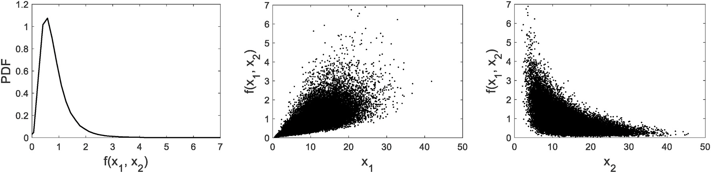

   **图 5** 函数f(x₁,x₂)=x₁/x₂的输出概率密度及相应输入—输出散点图。

5.2 基于密度的方法
~~~~~~~~~~~~~~~~~~~~~~

本文还引入DBM，弥补VBM局限，并通过方法间比较提高可信度。DBM以输出概率密度（PDF）或累积分布（CDF）的变化衡量敏感性：所有输入同时变化产生无条件PDF／CDF，固定Xi为指定值、其余输入变化产生条件PDF／CDF，两者差异衡量对Xi的敏感性。Pianosi和Wagener（2015）推荐CDF，因为比PDF更易计算指标。采用Kolmogorov–Smirnov统计量表示CDF差异：

.. math::

   KS(X_i)=\max|F_Y-F_{Y\mid X_i}|
   \qquad (32)

FY、FY|Xi分别为无条件和条件CDF。KS取决于Xi固定为何值，因此DBM指标Ti对Xi所有可能值 :math:`X_i^{(1)},X_i^{(2)},\ldots,X_i^{(n)}` 的KS取统计量：

.. math::

   T_i=\underset{X_i=X_i^{(1)},X_i^{(2)},\ldots,X_i^{(n)}}{\operatorname{statistic}}[KS(X_i)]
   \qquad (33)

统计运算可取最大值、均值或中位数，本文取均值。图6红实线为输出无条件CDF，虚线为Xi固定六个不同值时的条件CDF，以各虚线到红实线最大距离的均值度量敏感性。

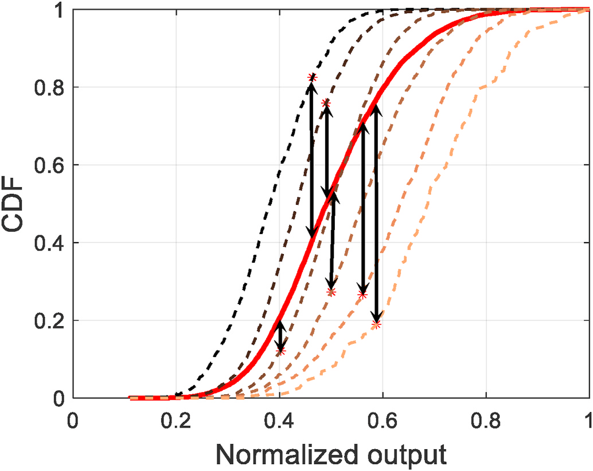

   **图 6** CDF差异的示例：各固定输入对应条件CDF，与无条件CDF的最大距离用于构成敏感性指标。

DBM的主要优点是不依赖任何假设，因此无论输入相关性和输出分布类型如何，都可用于不同情形。不过，敏感性度量没有完美方案：DBM可捕捉总效应，但难以识别单个输入的主效应，无法像VBM那样显式反映模型结构。即便如此，它仍是VBM的良好补充。表5总结两者差异。

.. note::

   “不依赖任何假设”是原作者在本节及表5对两种方法所作的比较性表述；它不表示有限样本、条件分布估计或结果可迁移性无需检查。本文仍进行了收敛和可视化核查。

.. list-table:: 表 5 两种敏感性分析方法比较
   :header-rows: 1
   :class: longtable

   * - 项目
     - 基于方差的方法 VBM
     - 基于密度的方法 DBM
   * - 优点
     - 可捕捉非线性输入—输出关系；一阶及高阶指标反映模型结构。
     - 可捕捉非线性输入—输出关系；不作任何假设，适用广泛工程问题；收敛较快。
   * - 不足
     - 依赖输入独立假设；输出多峰或高度偏态时无效；收敛相对慢。
     - 仅有总效应指标，不能反映输入—输出模型结构。
   * - 敏感性指标
     - Si：单个输入对输出方差直接贡献的主效应指标；STi：考虑主效应及与其他输入交互的总效应指标。
     - Ti：考虑主效应及与其他输入交互的总效应指标。

5.3 敏感性分析流程
~~~~~~~~~~~~~~~~~~~~~~

图7概括分析流程。首先定义初始输入变化空间，利用Sobol准随机序列生成NV个设计样本；用约束检查可行性。对满足浮式结构基本要求者，计算制造总成本、结构特性及水动力表现，再据此计算VBM和DBM指标。通常难以预先合理确定样本数，因此在循环末进行收敛分析，扩充样本并重复流程，直至指标充分收敛。

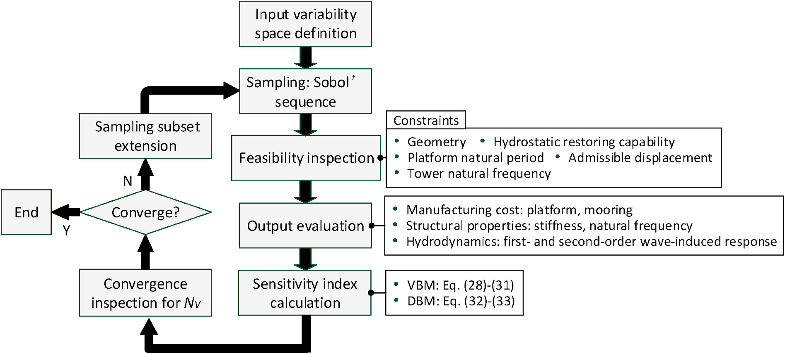

   **图 7** SA流程：定义输入空间，Sobol抽样，约束检查，评价制造成本／结构特性／水动力，计算VBM与DBM指标，检验收敛；未收敛则扩充样本，收敛后输出指标。

6 结果与讨论
--------------

6.1 输入因素的独立性
~~~~~~~~~~~~~~~~~~~~~~~~

VBM对输入和输出性质要求较严格，讨论指标前应仔细检查。Sobol准随机序列共生成145100个设计，仅9304个满足约束，不可行比例超过93%。根据有效样本计算输入相关系数，见表6，绝对值大于0.2的元素标红。多数输入独立性良好，但仍有数个高度相关。

表6原图红色标记的非对角项为D–Hfrld=-0.364、r–d=-0.445、r–wpotn=0.396、d–wpotn=-0.261、Lmoor–Rmoor=0.996。原表以sym标明矩阵对称；下三角省略值，此处以“—”表示，可由上三角对称取得，不当作零。

.. list-table:: 表 6 输入因素的相关系数矩阵（原表上三角）
   :header-rows: 1
   :class: longtable

   * - 参数
     - D
     - r
     - d
     - hbeam
     - wpotn
     - hpotn
     - twall
     - Lmoor
     - Dchain
     - Rmoor
     - Hfrld
   * - D
     - 1
     - -0.088
     - -0.184
     - 0.003
     - -0.095
     - -0.068
     - -0.016
     - -0.019
     - -0.018
     - -0.014
     - -0.364
   * - r
     - —
     - 1
     - -0.445
     - 0.026
     - 0.396
     - -0.057
     - 0.056
     - -0.001
     - -0.017
     - -0.015
     - 0.047
   * - d
     - —
     - —
     - 1
     - -0.027
     - -0.261
     - -0.058
     - -0.117
     - -0.026
     - 0.019
     - 0.012
     - 0.055
   * - hbeam
     - —
     - —
     - —
     - 1
     - 0.020
     - -0.006
     - -0.014
     - -0.012
     - -0.005
     - -0.013
     - 0.016
   * - wpotn
     - —
     - —
     - —
     - —
     - 1
     - -0.024
     - 0.002
     - 0.001
     - 0.007
     - -0.007
     - 0.040
   * - hpotn
     - —
     - —
     - —
     - —
     - —
     - 1
     - 0.012
     - 0.004
     - 0.000
     - 0.001
     - 0.024
   * - twall
     - —
     - —
     - —
     - —
     - —
     - —
     - 1
     - 0.021
     - 0.001
     - 0.017
     - 0.006
   * - Lmoor
     - —
     - —
     - —
     - —
     - —
     - —
     - —
     - 1
     - -0.161
     - 0.996
     - 0.075
   * - Dchain
     - —
     - —
     - —
     - —
     - —
     - —
     - —
     - —
     - 1
     - -0.184
     - 0.070
   * - Rmoor
     - —
     - —
     - —
     - —
     - —
     - —
     - —
     - —
     - —
     - 1
     - 0.040
   * - Hfrld
     - —
     - —
     - —
     - —
     - —
     - —
     - —
     - —
     - —
     - —
     - 1

典型例子是Lmoor与Rmoor。图8(a)显示全部可行组合；受约束限制，样本沿窄带分布、线性相关强，每个Lmoor仅对应3–4个Rmoor值，违背VBM输入独立假设。为处理此问题，计算VBM指标时将二者视为一个综合输入，假定Rmoor完全依赖Lmoor。具体而言，为Lmoor构造交叉矩阵时，同时用B的对应列替换A中Lmoor、Rmoor两列。

图8(b)的r与d是另一例子。r增大时，d的可行范围逐渐缩小，最终仅余小、中值。这源自式(5)约束：间距和半径都大的方案静水刚度较大，横摇／纵摇固有周期较短，会与波周期重叠，因此“大—大”组合被剔除，造成显著相关。wpotn、r、d也有类似情况。D与Hfrld的相关则源于几何约束。

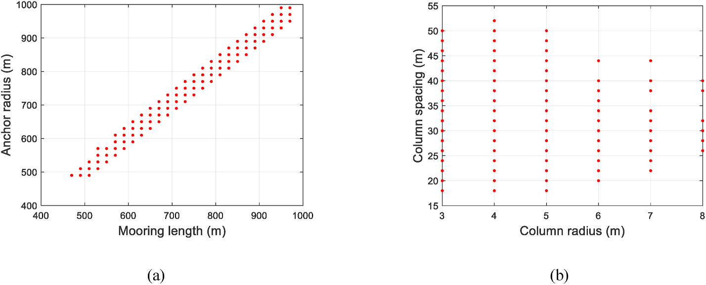

   **图 8** 可行设计空间：（a）系泊线长度与锚半径；（b）立柱半径与立柱间距。

6.2 输出分布的偏度
~~~~~~~~~~~~~~~~~~~~~~

输出分布形态也是应用VBM的重要考虑。图9给出10个研究输出的归一化PDF：制造总成本TC、平台纵荡固有频率ω₁、纵摇固有频率ω₅、塔筒一阶弯曲频率ω₇，以及纵荡、纵摇、机舱加速度的一阶和二阶加权标准差。所有输出均为单峰，但形态差异显著。TC、ω₅近似正态，图例旁偏度较小；ω₁、一阶纵摇标准差及全部二阶标准差右尾较长，偏度更高；ω₇、一阶纵荡和机舱加速度标准差介于两者之间。因此，预计VBM对TC、ω₅的表现好于对ω₁、ω₁、一阶纵摇及二阶纵荡、纵摇、机舱加速度标准差的表现。

.. note::

   上一段末列两次ω₁，按原文保留其重复；不据此增添第11个输出。研究的输出仍为本段开头列明的10项。

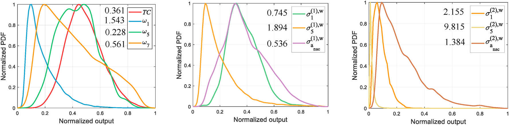

   **图 9** 各输出的归一化概率分布；图例附近列出偏度，水动力输出区分一阶和二阶。

6.3 收敛分析
~~~~~~~~~~~~~~~~

按Müller（2020）进行收敛研究，确保样本足以得到合理指标。图10每个子图展示一个输入对10个输出的敏感性贡献。多数曲线充分收敛：VBM基本需3000个样本，DBM需5000个。但这不表示VBM计算更高效，因为DBM函数求值数等于样本数，VBM还须计算式(30)–(31)的交叉子集。所有指标在0–1之间，STi始终大于相应Si。这些观察表明SA实现良好，可据此讨论平台／系泊构型如何影响成本、结构特性和水动力。

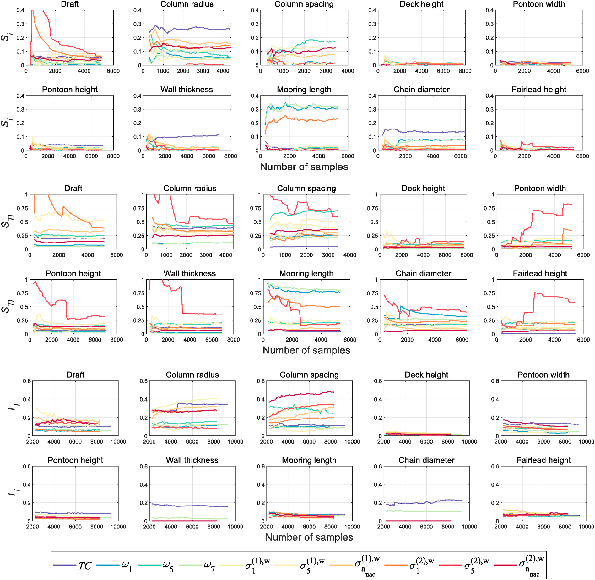

   **图 10** 敏感性指标收敛曲线：上面两行为VBM主效应Si，中间两行为VBM总效应STi，下面两行为DBM总效应Ti；每个子图对应一个输入，各颜色为不同输出。

6.4 制造成本
~~~~~~~~~~~~~~~~

图11比较10个输入的成本指标。为便于比较，VBM除以最大STi，DBM除以最大Ti。为考察价格变化，计算2000组价格组合的指标；柱长为归一化指标中位数，顶端箱线表示变化范围。多数输入变化很小，说明价格波动影响较小。立柱是半潜结构主体，占较多材料及焊接、涂装人工，因此立柱尺寸理应重要。结果表明，无论Si、STi还是Ti，立柱半径影响最大。VBM将吃水STi排第二，但Si较小，意味着主要来自与其他变量交互。可推测该变量是立柱半径，因为其他因素指标太小或交互太弱。DBM排序不同：吃水总效应中等，与间距、浮箱宽、壁厚相当；链径更重要、排第二。两方法也有共识：甲板高度与导缆点位置几乎可忽略，系泊线长不及链径重要，与 :math:`m_{\mathrm{moor}}\propto D_{\mathrm{chain}}^2L_{\mathrm{mor}}` 一致。

.. note::

   表1变量hbeam定义为甲板梁高度，而第2节固定甲板相对静水面的高度7.776 m；原文后续图文称“Deck height／甲板高度”。这里保留原称谓，但不将该变量误解为重新改变固定的甲板标高。

.. figure:: ../../../wechat/assets/public-safe/ref-zhou2021-OE/fig11.jpg
   :alt: 图11 制造成本敏感性指标，柱长为2000组价格下归一化指标的中位数，箱线表示变化范围。
   :align: center
   :width: 100%

   **图 11** 制造成本敏感性指标，柱长为2000组价格下归一化指标的中位数，箱线表示变化范围。

可视检查输入—输出样本，有助于定性评价敏感性。一方面这是辨认VBM与DBM差异最可靠的途径，另一方面能补充全局方法概括／平均指标之外的局部信息。散点图很常用（Pianosi等，2016），但本文离散抽样，例如立柱半径仅3–8 m、间隔1 m的六值，每个值对应数千输出，散点会严重重叠。故采用图12箱线图：红点为均值、红横线为中位数，箱底／顶为25%／75%分位，须约覆盖±2.7σ，十字为区间外样本。图12钢材、人工、系泊价格分别0.524 €/kg、27 €/h、2 €/kg。箱线可反映式(28)主效应：先固定Xi，对其余输入取输出期望，再对Xi全部值取方差。一般而言，Si反映红点的方差；红点单调且梯度大，方差趋大，如半径、壁厚、链径、浮箱宽。图11基本符合这一排序，但显然低估浮箱宽，Si甚至低于浮箱高，反直觉。

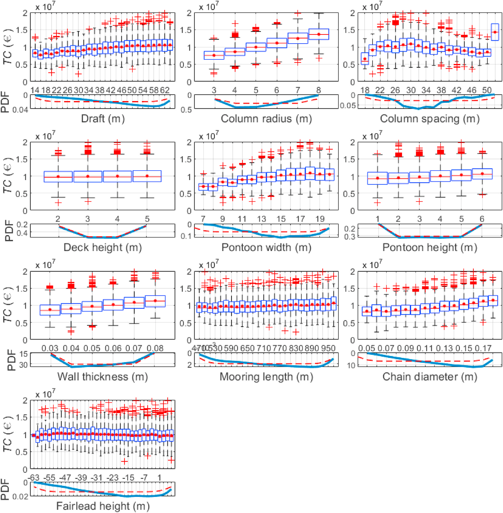

   **图 12** 制造成本随10个下部结构构型变量的箱线图，下方为输入概率密度；红点均值、红线中位数。

对吃水和间距，平均制造成本初期明显增加，此后增速大幅降低，间距甚至负增长，最终趋于常数。与图8(b)解释一致，式(5)横摇／纵摇固有周期约束阻止成本无限增加。平缓或下降区段抵消初始上升区的敏感性贡献，因此二者平均Si较小。

箱线下的PDF中，虚、实线分别为约束前、后分布。高度参与约束的输入分布显著改变：初始Sobol样本基本均匀，剔除不可行组合后，峰度和偏度增加。VBM指标倾向反映数据密集区域而非稀疏区域。吃水、间距、浮箱宽虽在箱线左侧有明显输出变化，但概率密度大的样本多位于变化平缓区，这也是Si较小的原因。DBM没有这种偏向：如图6，每个输入值对应一条条件CDF，统计时平等对待所有曲线。这可部分解释间距、浮箱宽的STi和Ti明显差异。

依式(29)，总效应STi尤其在高维问题中难以可视化，但它等于主效应加交互效应，因此可间接展示输入交互。图11提示吃水与立柱间距存在强交互，图13三维散点进一步检查：立柱半径小时，成本随吃水缓慢增加，半径增大后增长斜率迅速增加。因此从经济性看，若可满足设计要求，调整吃水比调整半径更合适。

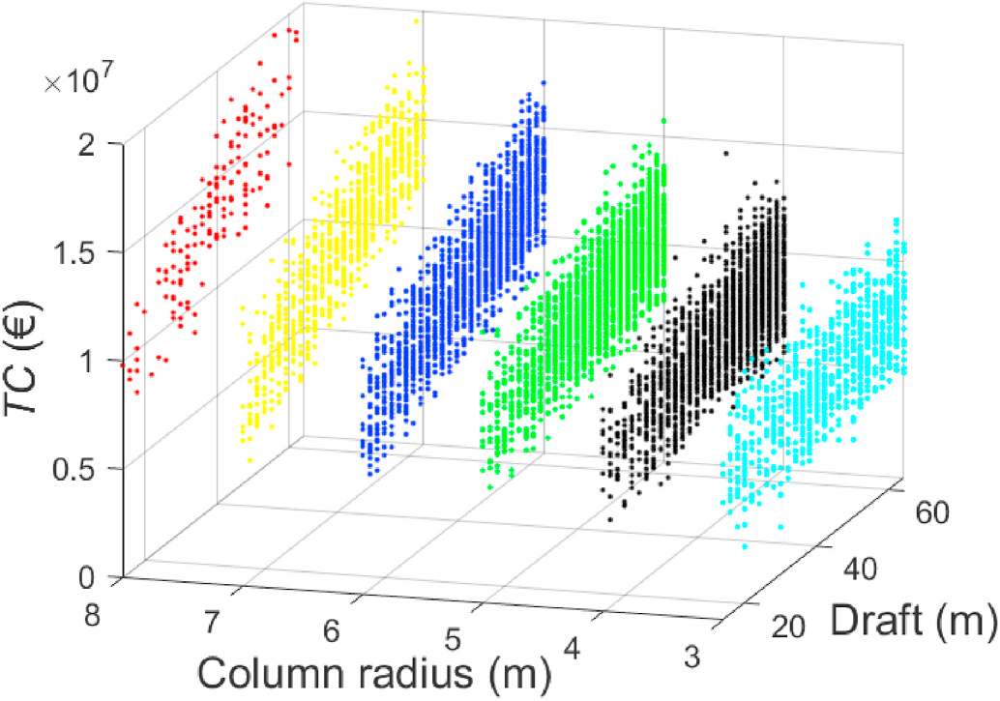

   **图 13** 不同立柱半径下，吃水—制造成本的三维散点图。

.. note::

   上段原文先称“吃水与立柱间距”交互，但图13图注、图例及随后解释均为“吃水与立柱半径”。保留这一源内不一致，不把原文前一句悄悄改成已无歧义的结论。

总体上，VBM大多数结果与可视数据一致，前提是图9所示成本PDF偏度较小。相较DBM，VBM低估间距和浮箱宽总效应，主要可能有两个原因：样本不均使指标偏向密集区域，忽略稀疏区域；输入依赖违背独立性假设，表6中间距与浮箱宽相关不可忽略。

6.5 结构特性
~~~~~~~~~~~~~~~~

纵荡固有频率取决于包含附加质量的结构质量与系泊刚度。图14给出水平系泊刚度和纵荡固有频率归一化指标。对前者，线长和链径占主导；间距等平台构型也有可观影响，因为改变悬链线形状及几何刚度。图15说明导缆点位置的重要性：同色样本线长、链径相同，导缆点位置不同，水平刚度随间距显著变化，解释其敏感性贡献。图14(b)的DBM表明，平台构型重要性上升到与系泊参数相当。由于纵荡固有频率分布高偏态，VBM明显不同，预测线长最重要、平台参数贡献很低。

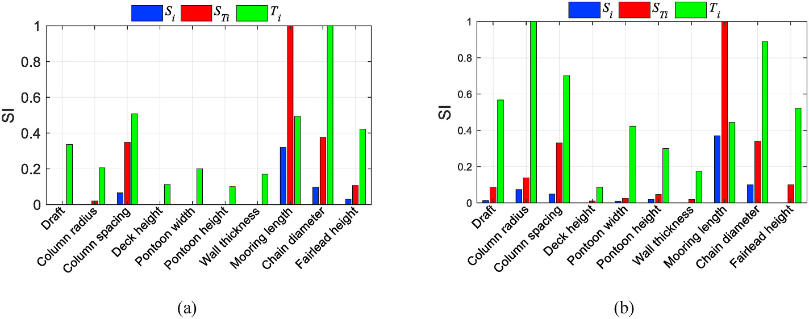

   **图 14** （a）水平系泊刚度、（b）平台纵荡固有频率的敏感性指标。

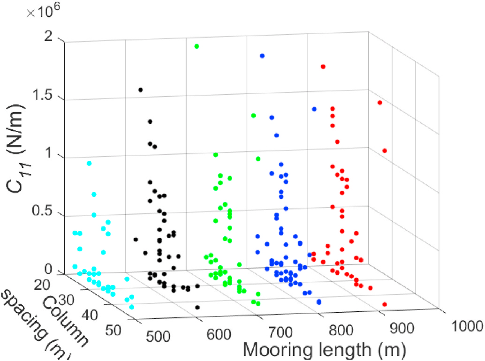

   **图 15** 五个不同系泊线长、固定链径0.160 m时，立柱间距—水平系泊刚度散点图。原图纵轴文字边缘即有截断，未重画数据或补造标签。

图16箱线再次检查这一差异，明确显示半径和链径最敏感，吃水、间距、线长较不显著，基本与DBM一致，也确认VBM的不准确。尽管高偏态显著影响VBM，其对不敏感因素的预测仍合理：甲板高度、浮箱高、壁厚的Si接近0。

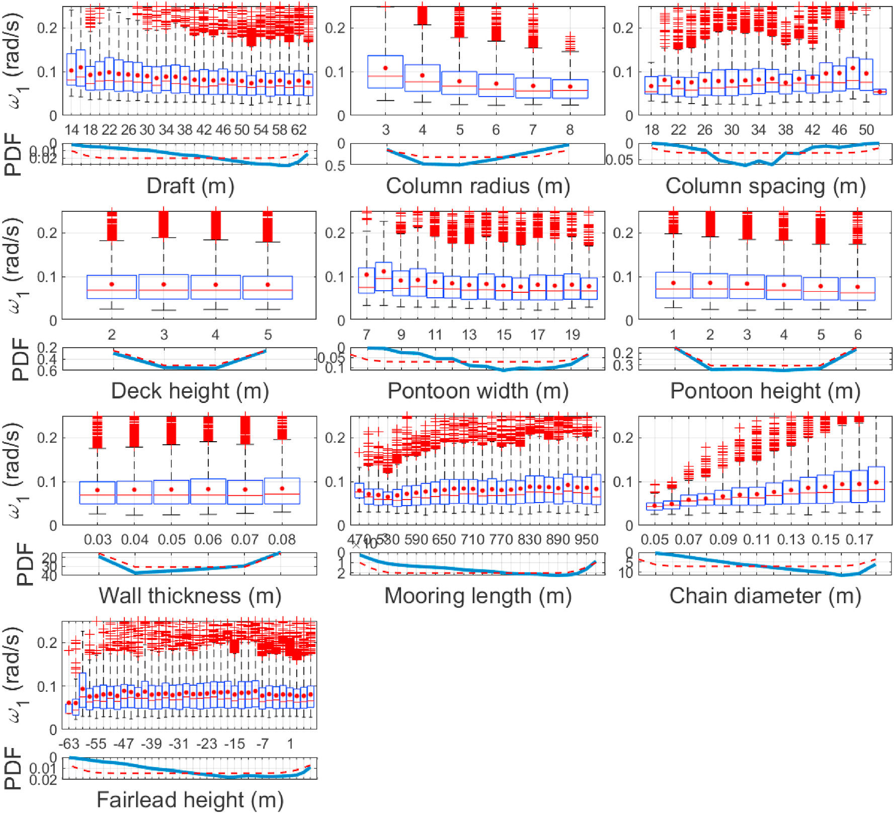

   **图 16** 纵荡固有频率随10个下部结构变量的箱线图。

纵摇和塔筒一阶弯曲频率偏度较小，使VBM更可信，图17中VBM总效应与DBM良好一致。纵摇固有频率取决于浮力、重力和水线面作用形成的静水刚度；图17(a)、(c)分别为纵摇固有频率与静水刚度，均表明间距最敏感。这意味着水线面效应比浮力—重力效应更关键，因为水线面二次矩高度依赖间距。吃水、半径也显著，但VBM显示主要贡献来自交互，显然发生于三个主要平台参数之间。

图17(b)塔筒一阶弯曲频率呈现与纵摇频率相似趋势。塔筒频率也取决于静水刚度，但机制不同。特征值问题不仅依赖系统质量、刚度、阻尼等固有属性，还依赖施加的边界条件；平台静水刚度变化改变塔筒边界条件，进而改变固有频率。

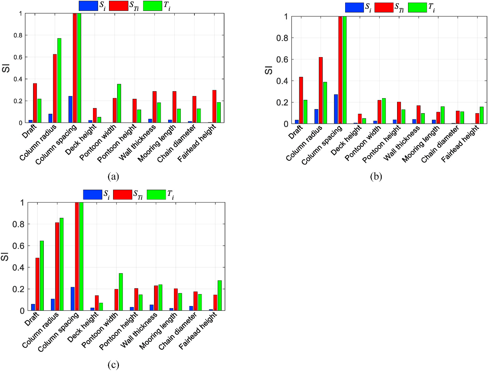

   **图 17** （a）纵摇固有频率、（b）塔筒一阶弯曲频率、（c）纵摇静水恢复刚度的敏感性指标。

图18(a)展示纵摇频率随三个最重要输入的变化。频率增减取决于输入对刚度项还是惯性项贡献更大。间距表现出混合作用：增大间距同时增大水线面二次矩和浮体转动惯量，两种相反作用的强弱取决于间距值。小于34 m时，静水刚度增加占主导，纵摇频率统计值上升；超过34 m时，与间距平方成正比的转动惯量增加更主导，趋势反转。增大半径比增大吃水更显著提高纵摇频率，与图17(a)一致。图18(b)中，下部结构尺寸增大，塔筒频率趋低；因涉及复杂特征值问题，内在原因仍需进一步研究。

.. figure:: ../../../wechat/assets/public-safe/ref-zhou2021-OE/fig18.jpg
   :alt: 图18 （a）纵摇固有频率、（b）塔筒一阶弯曲频率随吃水、立柱半径与间距的箱线图。
   :align: center
   :width: 100%

   **图 18** （a）纵摇固有频率、（b）塔筒一阶弯曲频率随吃水、立柱半径与间距的箱线图。

6.6 水动力
~~~~~~~~~~~~~~

浮体一阶水动力表现用式(24)–(25)定义的运动响应加权标准差描述。图19为三个关注自由度的指标。总体而言，决定质量、静水刚度和波浪激励的吃水、半径、间距，是一阶水动力的主要考虑。两方法对此一致，虽对三者排序不同。

纵荡方面，虽系泊参数主导水平恢复刚度，但其对一阶水动力影响较小；换言之，式(18)水平刚度项不如惯性和波浪激励项重要。两方法均认为间距重要，因为它改变波场中立柱相互作用，显著改变水动力荷载。半径影响相当，VBM表明它与吃水、间距有强交互。

纵摇方面，吃水比在纵荡中更关键。增加吃水会增大转动惯量、附加质量，并因重心降低增大静水刚度，有利于稳定；另一方面，船体增大通常也增大波浪激励。但水深增大时流体质点运动较慢，波浪荷载减小，因此总荷载增量不应很大。总体利大于弊，适度增加吃水有助于减轻一阶纵摇。

机舱加速度主要来自平台水平与转动运动之和，因此其指标继承图19(a)、(b)特征。

.. figure:: ../../../wechat/assets/public-safe/ref-zhou2021-OE/fig19.jpg
   :alt: 图19 一阶（a）纵荡、（b）纵摇、（c）机舱加速度加权标准差的敏感性指标。
   :align: center
   :width: 100%

   **图 19** 一阶（a）纵荡、（b）纵摇、（c）机舱加速度加权标准差的敏感性指标。

图20为一阶响应对三个主要输入的箱线图。多数图存在临界值：其下增加吃水和间距显著改变波致运动，其上响应统计特征趋稳。增加间距减轻立柱在波场中的相互作用；箱线表明小于34 m时有利于减振，该值为本算例完全消除立柱相互作用的最小间距。它与特征波长有关，因而依赖场址。吃水临界值也约34 m，其下增加吃水显著降低运动，验证图19(b)解释；其上平台运动统计几乎不再改变，但机舱加速度略有上升。Lemmer等（2020）讨论过相似现象：浅吃水半潜平台纵荡与纵摇激励反相，纵摇正时纵荡负，抵消使轮毂前后运动小；深吃水平台两运动同相叠加，塔顶响应较大。这表明把下部结构设计得特别大效率不高，优化时建议搜索域等于或略大于临界值范围。立柱半径增大使平台和机舱运动显著增大，因此限制半径是改善水动力与降低成本的关键。

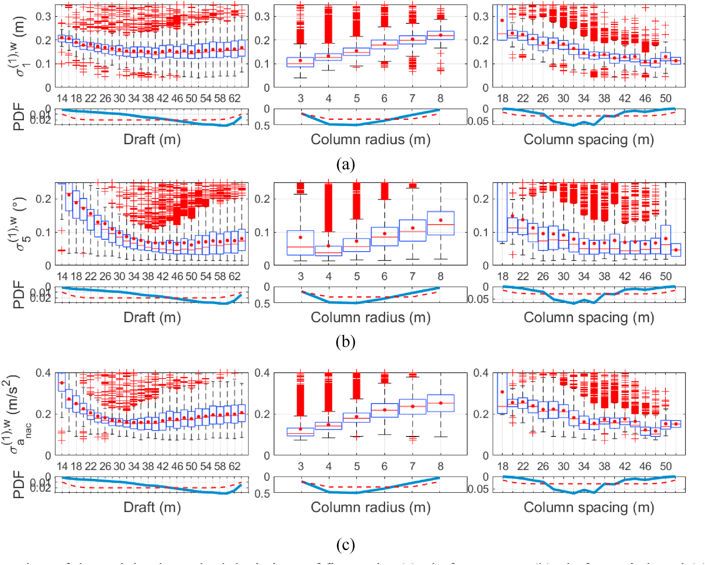

   **图 20** 一阶（a）纵荡、（b）纵摇、（c）机舱加速度加权标准差，随吃水、半径、间距的箱线图。

.. note::

   约34 m是这组构型、约束及代表波况下的转折，不是所有场址通用尺寸，也不是已完成的最优设计。加权标准差按式(24)–(25)是标准差的概率加权和，不应改写成长期混合分布的总体标准差。

差频二阶响应也是半潜下部结构的重要指标，图21给出结果。纵荡虽因偏度使两方法明显不同，但均指出系泊参数重要，因为慢漂对依赖系泊构型的纵荡固有频率敏感。例如样本中三个相同船体D=18 m、r=7 m、d=34 m，配不同系泊，其纵荡固有频率0.0454、0.0704、0.109 rad/s，对应二阶加权纵荡标准差0.802、0.489、0.276 m，最大约最小三倍。根本上这反映力QTF矩阵沿垂直主对角方向的梯度。矩阵主要由浮体几何和质量分布决定，对响应重要的元素差频等于或接近固有频率，位于平行主对角线的一条线上，与对角线距离为固有频率的函数。图14(b)、16显示半径、链径、间距与纵荡频率密切相关，低频纵荡也继承此特征。纵摇频率基本不依赖系泊参数，因此图21(b)低频纵摇由平台参数主导。塔顶加速度来自纵荡和纵摇，是二者某种组合；图21(c)显示与纵摇更相关，因为纵摇固有频率高得多。

.. figure:: ../../../wechat/assets/public-safe/ref-zhou2021-OE/fig21.jpg
   :alt: 图21 二阶（a）纵荡、（b）纵摇、（c）机舱加速度加权标准差的敏感性指标。
   :align: center
   :width: 100%

   **图 21** 二阶（a）纵荡、（b）纵摇、（c）机舱加速度加权标准差的敏感性指标。

图22箱线再次显示，高偏态情况下DBM比VBM可信。适当增大间距和链径有利于减小低频纵荡，但效果远不及限制半径；对纵摇和塔顶运动，增大间距最有效。与图20一致，临界间距也约34 m。比较图20、22，二阶纵荡、纵摇幅值与一阶相当，有时更高，说明二阶水动力对半潜平台的重要性。

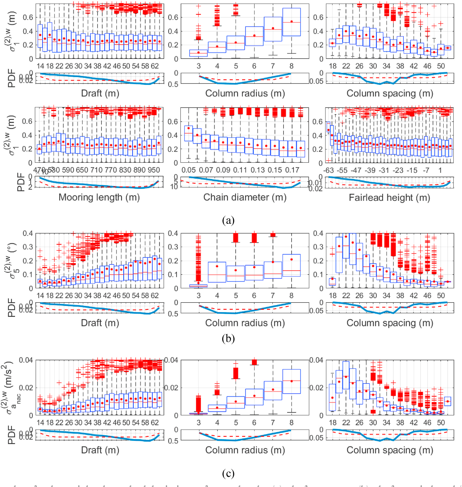

   **图 22** 二阶（a）纵荡、（b）纵摇、（c）机舱加速度加权标准差的箱线图。

7 结论
--------

本文为四柱半潜式漂浮风机建立敏感性分析流程，研究下部结构构型对制造成本、结构特性和水动力的影响。考虑浮式结构基本要求，定义较大且受约束的设计空间，用VBM和DBM衡量10个参数的敏感性贡献，并通过输入—输出可视检查验证、比较指标。主要结论如下。

敏感性分析可识别设计参数如何影响经济性和动力特性。立柱为半潜平台主体，半径决定大部分材料／人工用量与总质量、惯性，因此对制造成本和纵荡固有频率影响最大。纵摇与塔筒前后向频率更敏感于间距，因为它通过水线面矩影响静水刚度，也影响转动惯量。一阶水动力的三个关键因素是间距、半径、吃水。增加间距减轻波场中立柱相互作用和水动力荷载，显著减小波频纵荡、纵摇、塔顶响应；增加吃水有利于稳定。但两措施仅在参数低于临界值时有效，本例为34 m，超过后水动力统计特征稳定。低频二阶响应中吃水影响较弱，间距与半径更占主导。

方法应用方面，VBM受输出偏度影响。低偏态时与DBM良好一致，高偏态时结果不可接受，因为它仅评价分布二阶矩，高偏态下不再是良好离散度指标。约束造成的偏向抽样也影响VBM，使其偏向数据密集区而非稀疏区。即便如此，不推荐忽略约束、使用完整样本集，因为不可行设计超过93%，会淹没可行样本的信息。相反，作者认为DBM不像VBM依赖这些假设，结果基本与可视检查一致，但不能揭示输入交互。

本工作是建立半潜式FWT下部结构SA框架的第一步，为设计空间提供新视角，说明SA用于该设计的可行性与有效性。后续将进一步研究设计参数及结构固有属性如何影响长期动力表现，例如峰值机舱加速度、平台倾角，以及塔底和导缆点寿命期疲劳损伤。

.. note::

   本论文完成的是制造成本、结构固有属性和代表波况频域响应的敏感性研究；末段长期峰值与寿命疲劳是后续工作，不是本文已完成的全耦合长期验证或工程安全认证。

参考文献
--------

* ANSYS, A., 2016. AQWA User’s Manual Release 17.0. ANSYS Inc, USA. Canonsburg (PA). `原文链接 <http://refhub.elsevier.com/S0029-8018(21)00020-2/sref1>`__。

* Bak, C., Zahle, F., Bitsche, R., Kim, T., Yde, A., Henriksen, L., Natarajan, A., Hansen, M., 2013. Description of the DTU 10MW Reference Wind Turbine. Technical University of Denmark, Roskilde Denmark. https://rwt.windenergy.dtu.dk/dtu10mw/dtu-10mw-rwt.

* Barltrop, N., 1998. Floating Structures: a Guide for Design and Analysis, vol. 2. CMPT, England. `原文链接 <http://refhub.elsevier.com/S0029-8018(21)00020-2/sref3>`__。

* Benassai, G., Campanile, A., Piscopo, V., Scamardella, A., 2018. Optimization of mooring systems for floating offshore wind turbines. Coast Eng. J. 57, 1550021. `原文链接 <http://refhub.elsevier.com/S0029-8018(21)00020-2/sref4>`__。

* Benveniste, G., Lerch, M., de Prada, M., Kretschmer, M., Berque, J., López, A., Pérez-Morán, G., 2016. LCOE tool description, technical and environmental impact evaluation procedure. LIFES50+ Deliv 2 (2). `原文链接 <http://refhub.elsevier.com/S0029-8018(21)00020-2/sref5>`__。

* Bir, G., 2005. User’s Guide to BModes (Software for Computing Rotating Beam-Coupled Modes). National Renewable Energy Laboratory, Golden, CO. Technical Report No. NREL/TP-500-39133. `原文链接 <http://refhub.elsevier.com/S0029-8018(21)00020-2/sref6>`__。

* Brommundt, M., Krause, L., Merz, K., Muskulus, M., 2012. Mooring system optimization for floating wind turbines using frequency domain analysis. Energy Procedia 24, 289–296. `原文链接 <http://refhub.elsevier.com/S0029-8018(21)00020-2/sref7>`__。

* Burton, T., Jenkins, N., Sharpe, D., Bossanyi, E., 2011. Wind Energy Handbook. John Wiley & Sons. `原文链接 <http://refhub.elsevier.com/S0029-8018(21)00020-2/sref8>`__。

* Det Norske Veritas, 2019. DNV-RP-0286: Coupled Analysis of Floating Wind Turbines. Det Norske Veritas. `原文链接 <http://refhub.elsevier.com/S0029-8018(21)00020-2/sref9>`__。

* Farkas, J., Jármai, K., 2013. Optimum Design of Steel Structures. Springer. `原文链接 <http://refhub.elsevier.com/S0029-8018(21)00020-2/sref10>`__。

* Fylling, I., Berthelsen, P.A., 2011. WINDOPT: an optimization tool for floating support structures for deep water wind turbines. In: Proceedings of the 30th (2011) International Conference on Ocean, Offshore and Arctic Engineering. The American Society of Mechanical Engineers (ASME), Rotterdam, pp. 767–776. `原文链接 <http://refhub.elsevier.com/S0029-8018(21)00020-2/sref11>`__。

* Glišić, A., Ferraz, G.T., Schaumann, P., 2017. Sensitivity analysis of monopiles’ fatigue stresses to site conditions using Monte Carlo simulation. In: Proceedings of the 27th (2017) International Ocean and Polar Engineering Conference. Cupertino: International Society of Offshore and Polar Engineers (ISOPE), pp. 305–311. `原文链接 <http://refhub.elsevier.com/S0029-8018(21)00020-2/sref12>`__。

* Hegseth, J.M., Bachynski, E.E., Martins, J.R.R.A., 2020. Integrated design optimization of spar floating wind turbines. Mar. Struct. 72, 102771. `原文链接 <http://refhub.elsevier.com/S0029-8018(21)00020-2/sref13>`__。

* Hübler, C., Gebhardt, C.G., Rolfes, R., 2017. Hierarchical four-step global sensitivity analysis of offshore wind turbines based on aeroelastic time domain simulations. RENEW ENERG 111, 878–891. `原文链接 <http://refhub.elsevier.com/S0029-8018(21)00020-2/sref14>`__。

* Karimi, M., Hall, M., Buckham, B., Crawford, C., 2016. A multi-objective design optimization approach for floating offshore wind turbine support structures. J. Ocean Eng. Mar. Energy 3 (1), 69–87. `原文链接 <http://refhub.elsevier.com/S0029-8018(21)00020-2/sref15>`__。

* Krieger, A., Ramachandran, G.K.V., Vita, L., Alonso, P.G., Almería, G.G., Berque, J., Aguirre, G., 2015. Design Basis, LIFES50+ Deliv 7 (2). `原文链接 <http://refhub.elsevier.com/S0029-8018(21)00020-2/sref16>`__。

* Lemmer, F., Yu, W., Cheng, P., 2018. Iterative frequency-domain response of floating offshore wind turbines with parametric drag. J. Mar. Sci. Eng. 6, 118. `原文链接 <http://refhub.elsevier.com/S0029-8018(21)00020-2/sref17>`__。

* Lemmer, F., Yu, W., Müller, K., Cheng, P.W., 2020. Semi-submersible wind turbine hull shape design for a favorable system response behavior. Mar. Struct. 71, 102725. `原文链接 <http://refhub.elsevier.com/S0029-8018(21)00020-2/sref18>`__。

* Liu, P., Der Kiureghian, A., 1986. Multivariate distribution models with prescribed marginals and covariances. Probabilist. Eng. Mech. 1, 105–112. `原文链接 <http://refhub.elsevier.com/S0029-8018(21)00020-2/sref19>`__。

* Liu, H., Chen, W., Sudjianto, A., March 2006. Relative entropy based method for probabilistic sensitivity analysis in engineering design. ASME. J. Mech. Des 128 (2), 326–336. `原文链接 <http://refhub.elsevier.com/S0029-8018(21)00020-2/sref20>`__。

* Martin, R., Lazakis, I., Barbouchi, S., Johanning, L., 2016. Sensitivity analysis of offshore wind farm operation and maintenance cost and availability. RENEW ENERG 85, 1226–1236. `原文链接 <http://refhub.elsevier.com/S0029-8018(21)00020-2/sref21>`__。

* Mood, A.M., 1950. Introduction to the Theory of Statistics. `原文链接 <http://refhub.elsevier.com/S0029-8018(21)00020-2/sref22>`__。

* Morris, M.D., 1991. Factorial sampling plans for preliminary computational experiments. Technometrics 33, 161–174. `原文链接 <http://refhub.elsevier.com/S0029-8018(21)00020-2/sref23>`__。

* Müller, K., 2020. Probabilistic Fatigue Load Assessment for Floating Wind Turbines. PhD thesis of University of Stuttgart. `原文链接 <http://refhub.elsevier.com/S0029-8018(21)00020-2/sref24>`__。

* Myhr, A., Bjerkseter, C., Ågotnes, A., Nygaard, T.A., 2014. Levelised cost of energy for offshore floating wind turbines in a life cycle perspective. RENEW ENERG 66, 714–728. `原文链接 <http://refhub.elsevier.com/S0029-8018(21)00020-2/sref25>`__。

* Oakley, J.E., O’Hagan, A., 2004. Probabilistic sensitivity analysis of complex models: a Bayesian approach. J. Roy. Stat. Soc. B 66, 751–769. `原文链接 <http://refhub.elsevier.com/S0029-8018(21)00020-2/sref26>`__。

* Pegalajar-Jurado, A., Borg, M., Bredmose, H., 2018. An Efficient Frequency-Domain Model for Quick Load Analysis of Floating Offshore Wind Turbines. Wind Energy Science Discussions, pp. 1–30. `原文链接 <http://refhub.elsevier.com/S0029-8018(21)00020-2/sref27>`__。

* Pianosi, F., Wagener, T., 2015. A simple and efficient method for global sensitivity analysis based on cumulative distribution functions. Environ. Model. Software 67, 1–11. `原文链接 <http://refhub.elsevier.com/S0029-8018(21)00020-2/sref28>`__。

* Pianosi, F., Beven, K., Freer, J., Hall, J.W., Rougier, J., Stephenson, D.B., et al., 2016. Sensitivity analysis of environmental models: a systematic review with practical workflow. ENVIRON MODELL SOFTW 79, 214–232. `原文链接 <http://refhub.elsevier.com/S0029-8018(21)00020-2/sref29>`__。

* Pinkster, J.A., 1980. Low Frequency Second Order Wave Exciting Forces on Floating Structures. PhD thesis of Delft University of Technology. `原文链接 <http://refhub.elsevier.com/S0029-8018(21)00020-2/sref30>`__。

* Saltelli, A., Annoni, P., Azzini, I., Campolongo, F., Ratto, M., Tarantola, S., 2010. Variance based sensitivity analysis of model output. Design and estimator for the total sensitivity index. Comput. Phys. Commun. 181, 259–270. `原文链接 <http://refhub.elsevier.com/S0029-8018(21)00020-2/sref31>`__。

* Sobol, I.M., 1993. Sensitivity estimates for nonlinear mathematical models. Math. Model Civ. Eng. 1, 407–414. `原文链接 <http://refhub.elsevier.com/S0029-8018(21)00020-2/sref32>`__。

* Tizani, W., Yusuf, K.O., Davies, G., Smith, N.J., 1996. A knowledge based system to support joint fabrication decision making at the design stage Case studies for CHS trusses. In: Tubular Structures International Symposium, vol. 7. E & FN SPON, pp. 483–489. `原文链接 <http://refhub.elsevier.com/S0029-8018(21)00020-2/sref33>`__。

* Trading Economics statistics. https://tradingeconomics.com/commodity/steel/. (Accessed 15 November 2020).

* Velarde, J., Kramhøft, C., Sørensen, J.D., 2019. Global sensitivity analysis of offshore wind turbine foundation fatigue loads. RENEW ENERG 140, 177–189. `原文链接 <http://refhub.elsevier.com/S0029-8018(21)00020-2/sref35>`__。

* Yu, W., Müller, K., Lemmer, F., Bredmose, H., Borg, M., Sanchez, G., Landbo, T., 2017. Public definition of the two LIFES50+ 10MW floater concepts. LIFES50+ Deliv 4 (2). `原文链接 <http://refhub.elsevier.com/S0029-8018(21)00020-2/sref36>`__。

* Ziprecruiter. https://www.ziprecruiter.com/Salaries/Shipyard-Welder-Salary/. (Accessed 17 November 2020).
