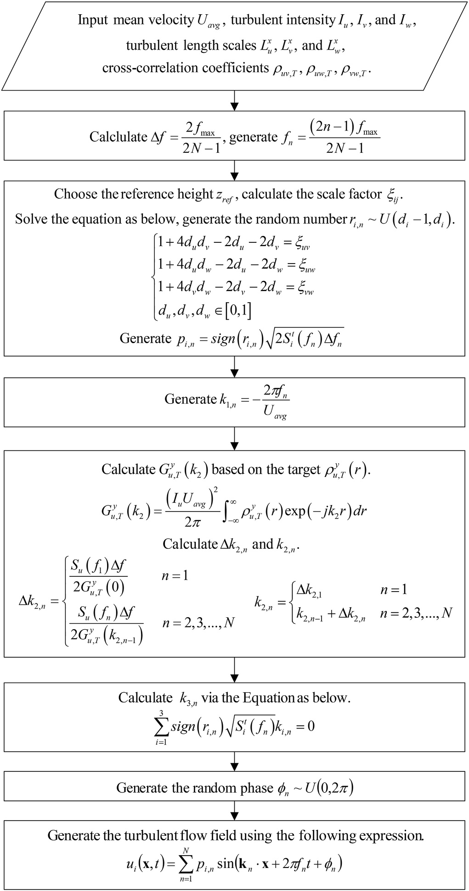
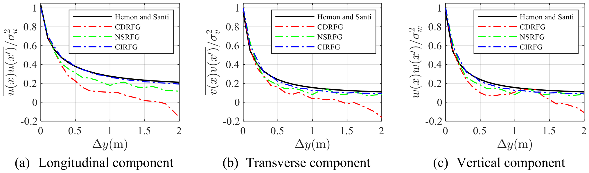
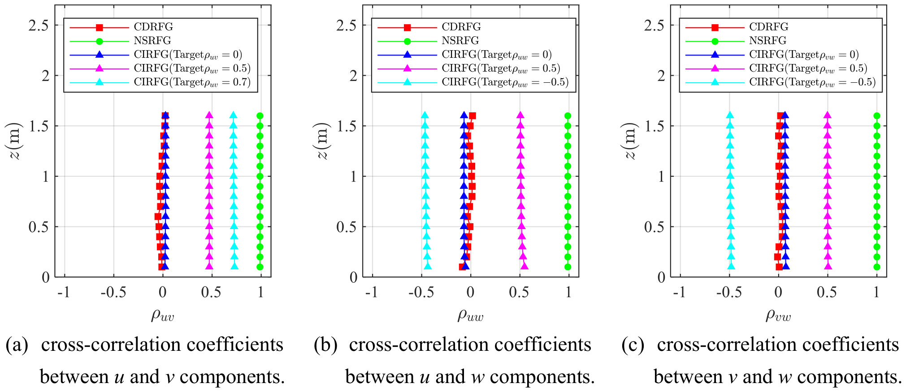
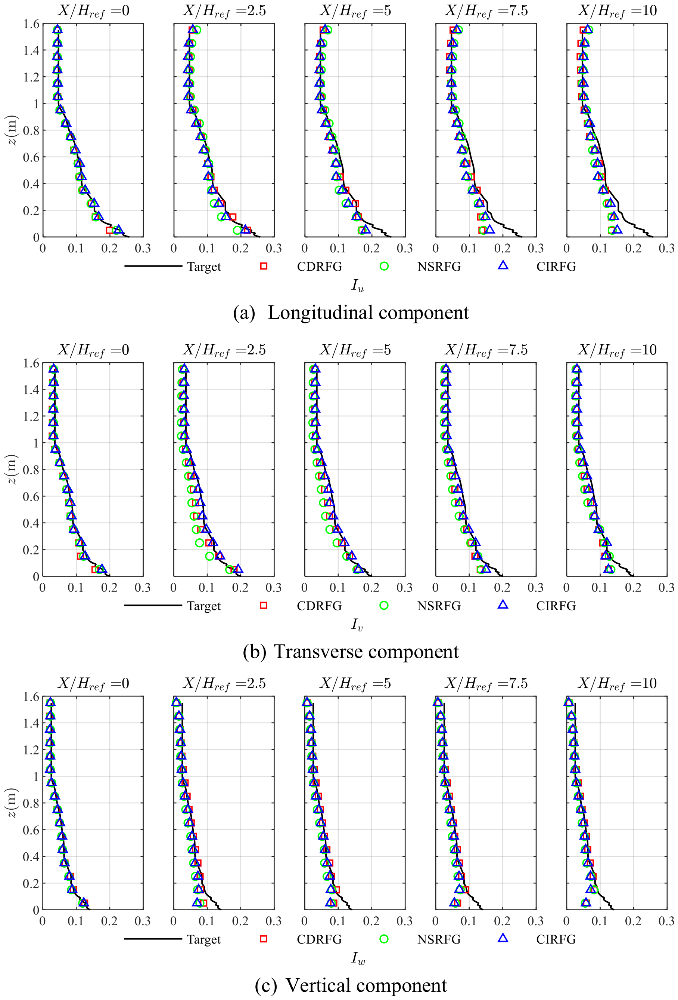
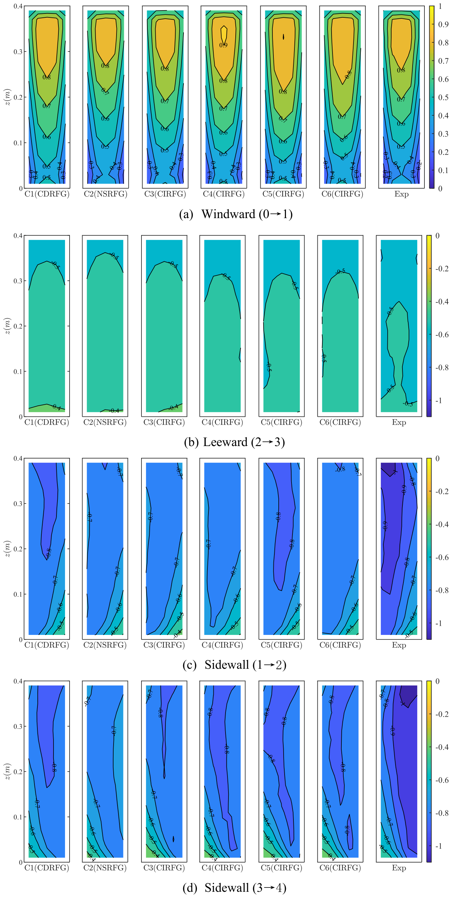

# 数值风洞 | 入流湍流除了有谱，还要怎样“相关”？

入口湍流的强度和频率谱相同，空间结构与速度分量之间的关系仍可能不同。这些差别会随流场进入下游，影响建筑绕流和风压预测。本文研究如何把目标相关性写进随机流生成参数，并检查其在大气边界层中的发展。

## 论文信息

- 论文题名: Consistency improved random flow generation method for large eddy simulation of atmospheric boundary layer
- 作者: <u>Chen Lingwei</u>; **Li Chao**\*; Wang Jinghan; Hu Gang; Zheng Qingxing; Zhou Qingfeng; Xiao Yiqing
- 期刊: Journal of Wind Engineering and Industrial Aerodynamics
- 年份: 2022
- DOI: https://doi.org/10.1016/j.jweia.2022.105147
- WOEAI 相关方向: 工程结构抗风 / 数值风洞

## 摘要

真实的入流湍流是大气边界层大涡模拟获得准确结果的关键。现有合成湍流方法已经得到广泛应用，但仍存在空间相关性以及不同速度分量之间的互相关性不能被严格再现的问题。为此，论文提出了一种新的入流湍流生成方法，即一致性改进随机流生成方法（CIRFG）。该方法通过显式嵌入湍流特征来模拟空间相关性和不同速度分量之间的互相关性，因此可以在无需经验参数的情况下用于任意场景。

同时，CIRFG 仍保持满足任意平均风速、湍流强度、频率谱、时间相关性等目标湍流特征的能力。进一步的大气边界层流场模拟表明，该方法具有良好的风剖面自维持能力。最后，通过与高层建筑绕流风洞试验结果对比，验证了该方法的准确性和可行性。

## 研究问题与解决思路

常用合成湍流方法能够匹配单点风谱和强度，但空间相关性与速度分量互相关未必同时满足目标，依赖经验参数调整也增加了试错。本文从目标相关函数及互相关系数出发确定随机流的波数和幅值参数，再以空域发展和建筑风荷载检验生成效果。其中直接约束的空间相关对象及互相关可解条件均有限定，不能理解为任意三维相关结构均可独立指定。

## 把目标相关性转成波数与幅值参数

CIRFG 的基本形式与随机 Fourier 合成方法相近：

$$
u_i(\mathbf{x},t)=\sum_{n=1}^{N} p_{i,n}\sin(\mathbf{k}_n\cdot\mathbf{x}+2\pi f_n t+\varphi_n)
$$

这里 $u_i$ 是第 $i$ 个脉动速度分量，$\mathbf{k}_n$ 是波数向量，$f_n$ 是频率，$\varphi_n$ 是随机相位。论文的关键不在于重新发明这一类合成框架，而在于把目标湍流特征嵌入到 $p_{i,n}$、$k_{1,n}$、$k_{2,n}$ 和 $k_{3,n}$ 的确定过程中。

第一步是速度分量互相关。论文通过随机参数 $r_{i,n}$ 控制不同速度分量幅值符号之间的关系，并用目标互相关系数求解尺度因子，在随机符号期望等于尺度因子、谱段数 $N\to\infty$ 的推导条件下，使计算互相关系数满足：

$$
\rho_{ij,C}=\xi_{ij}\rho_{ij,C}^{\max}=\rho_{ij,T}
$$

这意味着互相关不再只是生成后检查的统计结果，而是生成参数本身的一部分。目标还必须满足原文表 1 的可解条件，不能把三个分量之间的目标相关系数任意拼在一起。

第二步是空间相关。为满足 Taylor 冻结假设，论文取：

$$
k_{1,n}=-\frac{2\pi f_n}{U_{\mathrm{avg}}}
$$

再从目标 $Y$ 方向空间相关函数对应的波数谱出发，递推得到 $k_{2,n}$。这样，空间相关性不需要通过经验长度尺度反复试算，而可以由目标统计特征直接导入。

论文图 2 CIRFG 方法流程图

图中展示 CIRFG 的主要步骤：从目标平均风速、湍流强度、频率谱、空间相关和互相关要求出发，推导波数与随机幅值参数，再生成可用于 LES 入口边界的湍流速度场。

## 相关性控制怎样影响边界层与建筑风荷载？

CIRFG 在 $Y$ 方向由 $u$ 分量的目标空间相关函数推导波数序列，使生成湍流不再依赖经验参数来“调出”相关性。论文把目标空间相关转换为波数谱，再由谱面积递推确定 $k_{2,n}$。这里直接约束的是 $u$ 分量的 $Y$ 向相关性；$v$、$w$ 分量在本文算例中吻合较好，但并未被独立显式约束。$Z$ 向目标相关性同样没有被直接施加。

论文图 9 Y 方向空间相关系数对比

图中比较了 CDRFG、NSRFG、CIRFG 与目标空间相关系数。读图时重点看 CIRFG 曲线与目标值的贴合程度，它对应论文中“无需经验参数施加空间相关性”的核心验证。

CIRFG 可以根据目标互相关系数生成不同相关水平的 $u$、$v$、$w$ 分量，而 CDRFG 和 NSRFG 在这一点上存在明显偏差。论文指出，CDRFG 生成的不同速度分量互相关系数接近 0，NSRFG 结果接近 1，二者都难以自由匹配任意目标互相关。

论文图 11 不同速度分量之间互相关系数对比

这组图把目标互相关与三种方法的模拟结果放在一起。关注点不是单个曲线的形状，而是 CIRFG 能随目标设定改变分量之间的相关水平。

空域 ABL 模拟显示，三种 RFG 类方法生成的平均速度剖面总体与目标吻合，CIRFG 入口湍流在建筑位置附近保持了较好的风剖面自维持能力。论文同时提醒，高频谱能量会因 LES 网格分辨率和能量过滤而衰减，因此入流方法并不能替代网格、亚格子模型和计算域设置的整体审查。

论文图 17 X 方向湍流强度剖面发展

图中展示不同流向位置的湍流强度剖面。读图时可以比较入口、发展区和建筑位置附近的剖面变化，判断生成湍流进入计算域后的衰减程度。

高层建筑绕流模拟表明，平均风压系数分布总体与 TPU 风洞试验一致；但风压标准差和基底力/力矩系数标准差整体偏低。这一区分很重要：入流方法改进了统计一致性，但 LES 的脉动压力预测仍受湍流能量过滤、数值误差、网格分辨率和分量互相关设定共同影响。

在 CIRFG 建筑算例中，平均阻力系数 $C_D$ 和基底弯矩系数 $C_{Mx}$ 相对 TPU 风洞试验的误差绝对值小于 $5\%$；NSRFG 工况 C2 约为 $6\%$，不在这一范围内。C5 的五项基底力／力矩系数标准差带符号相对误差均值为 $-8.69\%$，其绝对值在六个工况中最小。这里是带符号均值，不是平均绝对误差，也不表示每一项都偏低。

论文图 20 建筑表面平均风压系数分布等值图

图中比较了不同工况的建筑表面平均风压系数分布。读图时重点看迎风面、侧墙和背风面的整体分布是否与 TPU 数据库保持一致。

## 目标相关系数与边界处理还有哪些约束？

工程使用前，需先从实测、风洞或可信数据库确定目标相关性，再检查其是否满足方法的可解条件。生成端的统计一致性还应结合下游风谱、压力脉动与局部风压验证，不能由平均风压吻合推断所有脉动量均已准确。

这篇论文并没有声称 CIRFG 已经解决所有 LES 入流问题。高层建筑算例中，多数风压和基底力/力矩标准差低于风洞试验，但存在例外：原文表 7 的 C5 阻力系数标准差比试验高 $7.38\%$。这些结果说明，脉动量预测还受到 LES 能量过滤、计算网格、边界条件和数值误差影响。

严格无散度的推导针对均匀湍流；对于随高度变化的非均匀 ABL，原文采用近似处理，入口仍出现人工压力波动。本文利用 outflow 出口和合适的压力参考点减小建筑附近的波动，并未证明任意出口条件下都不需要修正。

此外，论文也指出，不同速度分量之间的合理互相关系数本身仍需要进一步研究。CIRFG 提供的是施加满足可解条件的目标互相关性的能力，但工程使用时仍要回答一个更前置的问题：目标互相关系数应该如何从实测、风洞或可信数据库中确定。

点击阅读原文，可查看本论文的全文精解、相关性构造公式与 LES 验证。
