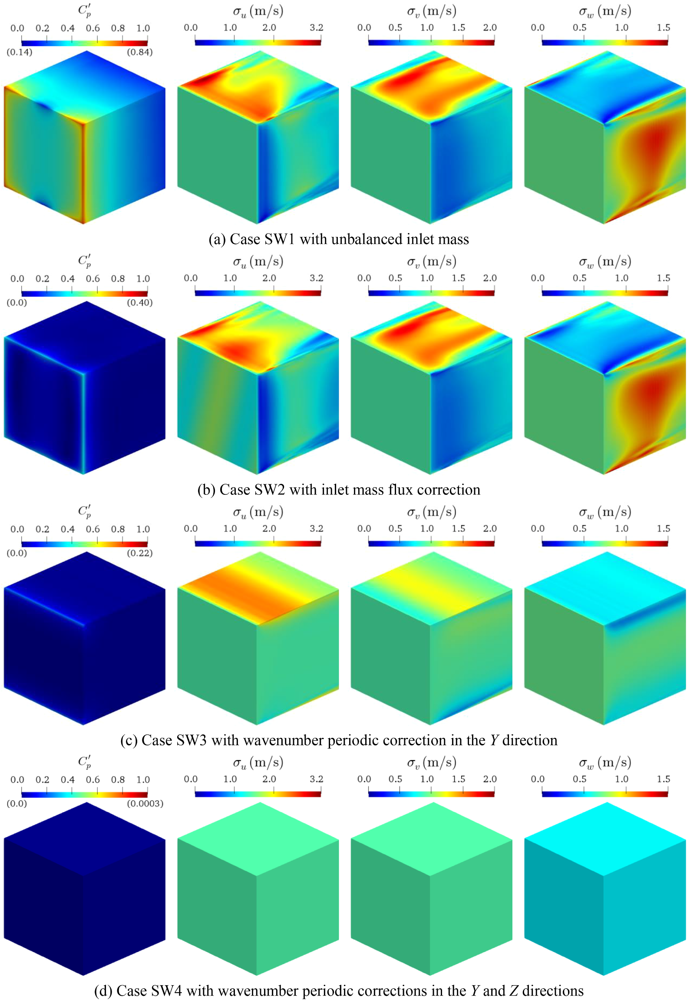
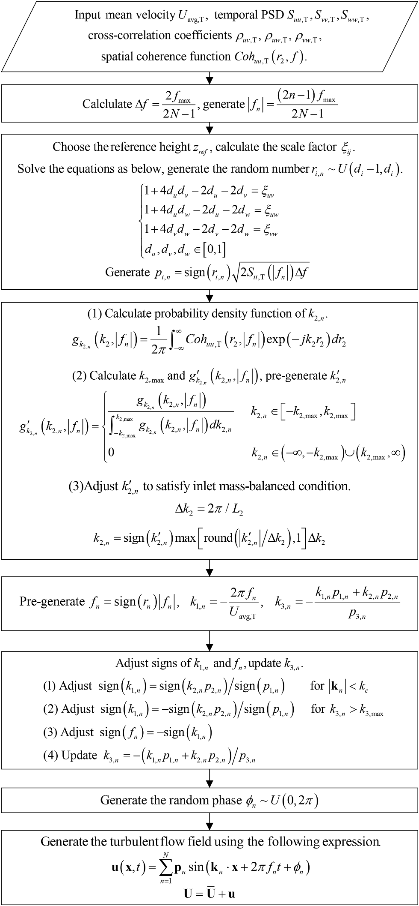
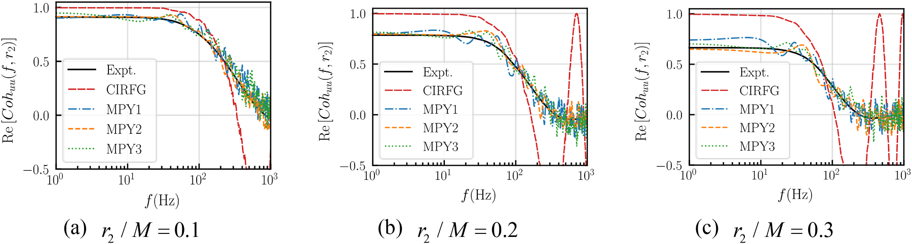
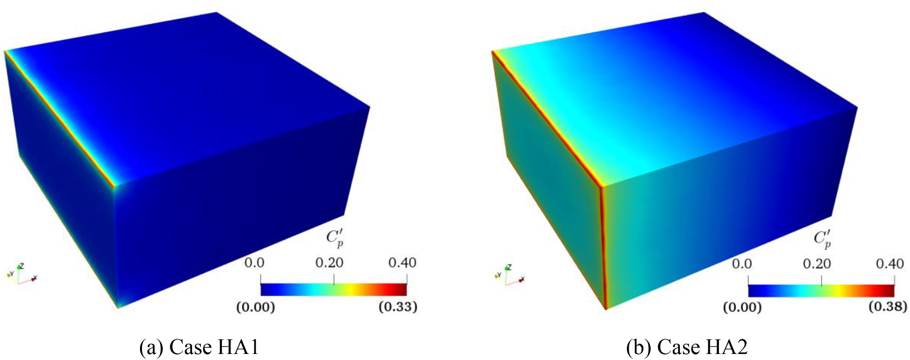
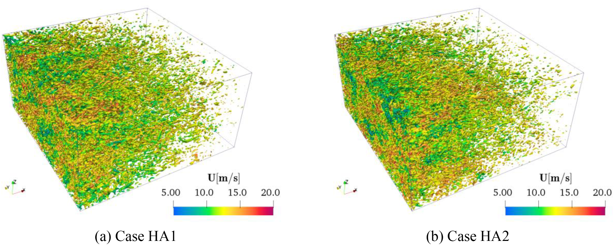

# 数值风洞 | 风速谱对了，风压为什么还可能算偏？

做大涡模拟时，我们常用湍流强度和能谱检查入口风场：两者与目标吻合，入流似乎就准备好了。但如果接下来关心的是建筑表面的脉动风压，还要多问一句：这些压力波动来自湍流，还是入口条件本身？

这篇发表于 Journal of Computational Physics 的论文讨论的就是这个问题。入口处的脉动流量如果不能保持平衡，即使速度统计量看起来不错，也可能产生人工压力波动。我们在既有随机流生成方法 CIRFG 上加入空间相干与质量平衡约束，形成 CMRFG 方法，并用均匀湍流算例检验它的效果。

## 论文信息

- 论文题名: A coherence-improved and mass-balanced inflow turbulence generation method for large eddy simulation
- 作者: <u>Chen Lingwei</u>; **Li Chao**\*; Wang Jinghan; Hu Gang; Xiao Yiqing
- 期刊: Journal of Computational Physics
- 年份: 2024
- DOI: https://doi.org/10.1016/j.jcp.2023.112706
- WOEAI 相关方向: 工程结构抗风 / 数值风洞与湍动入流

## 摘要

真实的入口湍流对于大涡模拟获得准确结果至关重要。本文提出一种改进的入口湍流生成方法，称为相干性改进且质量平衡的随机流生成方法（coherence-improved and mass-balanced random flow generation, CMRFG）。首先，论文研究入口质量平衡条件的影响。

随后，所提出方法被显式推导为能够满足任意空间相干函数和质量平衡条件，因此生成的湍流场能够有效保持原始湍流特征，并且不需要额外的入口质量通量修正。同时，新方法保留了既有方法的优点，能够满足任意湍流强度、时间谱、时间相关和空间相关系数。此外，所提出方法还保证满足无散度条件和 Taylor 冻结假设，这对于流场的准确发展至关重要。

最后，对均匀各向同性和各向异性湍流场的大涡模拟表明，CMRFG 生成的湍流场与实验结果高度一致，并且计算域内没有人工压力波动。

上述为原摘要表述。正文同时报告入口与侧边界交线处仍有局部人工压力；本文保留这一适用边界，不能将摘要理解为所有边界位置都已消除压力污染。

## 先把压力误差的来源分清楚

可以先看一个较简单的单波传输算例。入口质量通量不平衡时，入口边缘的最大压力波动达到动压的约 $0.84$ 倍；到了 $X=2\,\mathrm{m}$ 处，仍有约 $15\%$ 动压量级的人工压力波动。对需要计算风压的模拟来说，这部分误差不能忽略。

论文图 4 SW1 至 SW4 工况流场统计脉动

从上到下为 SW1–SW4；从左到右为脉动压力系数及三个速度分量的标准差。先比较最左列的入口边缘，再看速度统计；压力色标相同，部分速度色标范围不同，压力图色标下括号列出各工况的最小值和最大值。

给入口加周期修正能够改善压力，但也会改变原本想生成的湍流。SW3 只在 $Y$ 向修正，中心区域的湍流动能保持得较好；SW4 同时修正 $Y$、$Z$ 两向，消除了该单波算例中的非物理压力波动，初始湍流动能却由约 $1.64$ 降到 $1.53\,\mathrm{m^2/s^2}$，减少约 $6.7\%$。

抑制人工压力波动时，还要尽量保住原来设定的速度场特征。CMRFG 把质量平衡放进随机流的生成过程，减少生成之后再作修正的需要。

## 在生成入口风场时，就考虑相干与质量平衡

CMRFG 的第一处改动与空间相干有关。相距一段距离的两个点，其速度脉动在不同频率下如何联系，不能仅由一个空间相关系数描述。方法把横向波数 $k_{2,n}$ 看作随机变量，由 $u$ 分量在 $Y$ 方向的目标相干函数推导波数的概率密度函数，使生成的风场能够逼近给定的相干结构。

这里有一个需要说清的限制：三个速度分量共用这组波数。直接输入的目标是 $u$ 分量在 $Y$ 方向的相干函数，并不意味着三个分量的任意相干函数都可以分别指定。

第二处改动是修正 $k_{2,n}$，让入口宽度成为相应波长的整数倍，使每个单波分量在入口处满足质量平衡。用一个积分条件来理解，就是：

$$
\iint_S u_1(\mathbf{x},t)\,\mathrm{d}S = 0
$$

$S$ 是入口截面，$u_1(\mathbf{x},t)$ 是纵向脉动速度。截面上不同位置的脉动可以很强，但把它们对应的流量加起来，应当相互抵消。

论文图 7 CMRFG 方法流程图

沿箭头阅读：目标湍流统计量 → 频率、随机幅值与波数 → 波数修正 → 速度场；先看输入，再看修正所处的位置。

对于均匀网格，生成场的入口质量通量能够保持恒定；非均匀网格仍可能需要少量修正，但对原始湍流特征的扰动会明显减小。方法保留了对湍流强度、时间谱、时间相关和空间相关系数的适配能力，并满足均匀湍流场中的无散度条件和 Taylor 冻结假设。

## 相干与压力怎样检验，结果适用到哪里？

在 CBC 均匀各向同性湍流验证中，原 CIRFG 的低频相干与目标存在偏差，CMRFG 在多个空间间距下更接近给定目标。

论文图 17 不同空间间距下的 Y 方向空间相干函数对比

从左到右为空间间距逐渐增大的三组对比。黑色实线为实验目标，红色线为 CIRFG，蓝、橙、绿线为 CMRFG 的 MPY1–MPY3 工况；注意低频偏差及相干实部低于零的区间。

图里比较的是相干函数的实部，负值也保留了。只看绝对值，会丢掉横向负相关的信息。

随机生成的结果还有离散性。CBC 两点统计的每个工况独立生成了 50 次，论文比较集合平均、包络和最佳拟合结果；KCM 入流则独立生成了 20 次，再保留最佳拟合的随机参数。因此，图中选出的吻合曲线不能理解为任意一次随机生成都会有同样表现。

相干检验之外，还要比较质量平衡修正前后的压力。

各向异性验证采用 KCM 空间衰减均匀湍流，计算域为 $5.12\,\mathrm{m} \times 5.12\,\mathrm{m} \times 2.56\,\mathrm{m}$。HA1 带质量平衡修正，HA2 不带修正。

论文图 28 脉动压力系数分布云图

左图为带质量平衡修正的 HA1，右图为未修正的 HA2；两图色标范围相同，括号分别列出各图最小值和最大值。中心区域与入口、侧边界交线分开看。

HA2 在 $x/M=30$ 处的非期望压力波动可达到约 $12\%$ 动压量级；HA1 中心感兴趣区域的脉动压力系数约为 $1.5\%$。**质量平衡修正确实抑制了计算域内部的压力污染，但这两个数对应不同位置，不能直接换算成普遍的降幅。** 入口与侧边界交线处仍有局部非物理压力波动，边界相容性的问题还在。

压力改善之后，湍流自身的发展也需要检查。下面的涡结构具有随机性，并随流动向下游逐渐衰减，速度标准差、湍流动能和空间谱总体上与实验目标保持一致。

论文图 30 8 s 时刻 Q=1000 的等值面，按瞬时速度大小着色（流向从左到右）

左图为 HA1，右图为 HA2；每幅图内流向均从左到右。等值面以 $Q=1000$ 提取，颜色表示瞬时速度大小。

## 用于工程风压计算之前，还要验证什么？

这项工作提醒我们：验收 LES 入口，不能只拿出一条吻合的速度谱。空间相干是否符合目标、入口质量通量是否平衡、入口与侧边界是否相容，都可能影响最后的压力结果。

论文验证的是均匀各向同性和空间衰减均匀各向异性湍流，并没有直接验证具体建筑群或复杂地形。建筑风压与城市微尺度风环境是潜在应用方向；迁移过去，还需要给出适合目标场景的入流统计量，核对大气边界层剖面、地貌粗糙度、网格和计算域，并与实验或现场资料比较。论文提出可以按已有过程扩展到非均匀湍流，但更真实的非均匀湍流相干函数如何确定，仍待研究。

CMRFG 改进了入口的生成方法，并没有替代这些检查。对于压力敏感的计算，先分清“湍流带来的压力”和“入口设置带来的压力”，才谈得上判断后续结果。

点击阅读原文，可查看这篇论文的全文精解、公式推导及附录。
