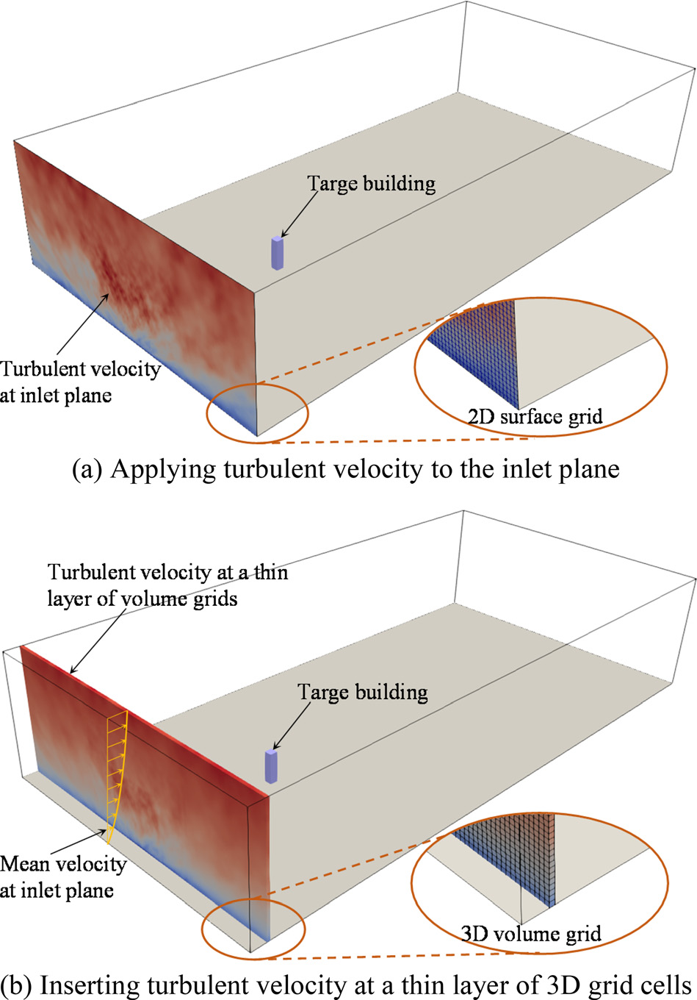
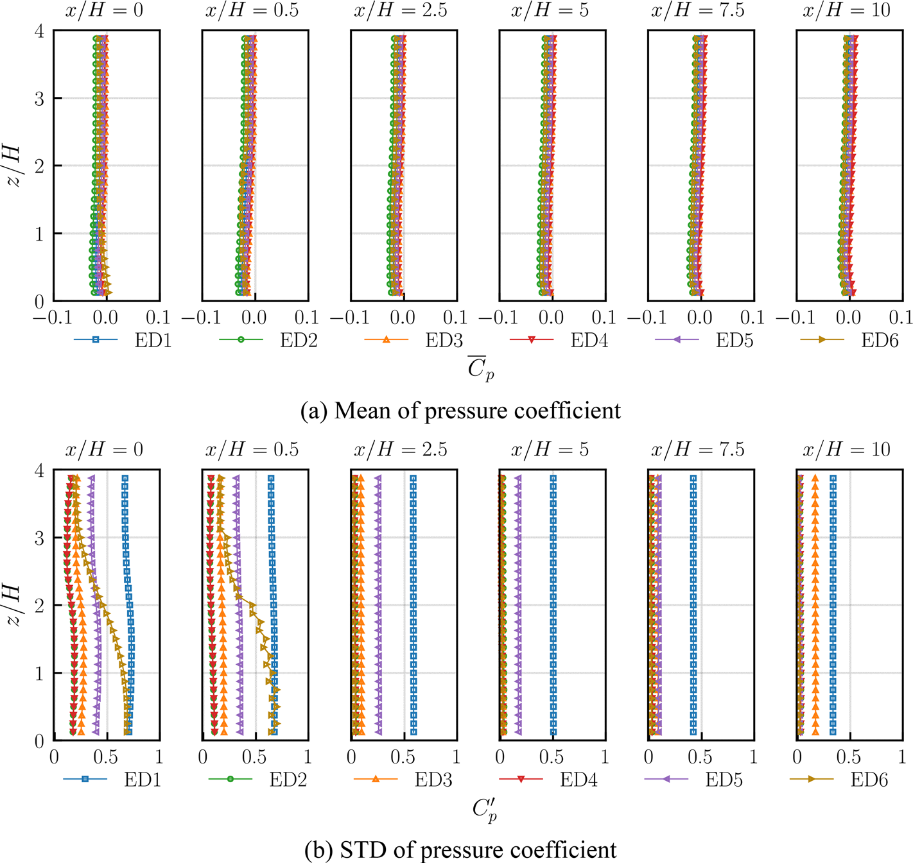
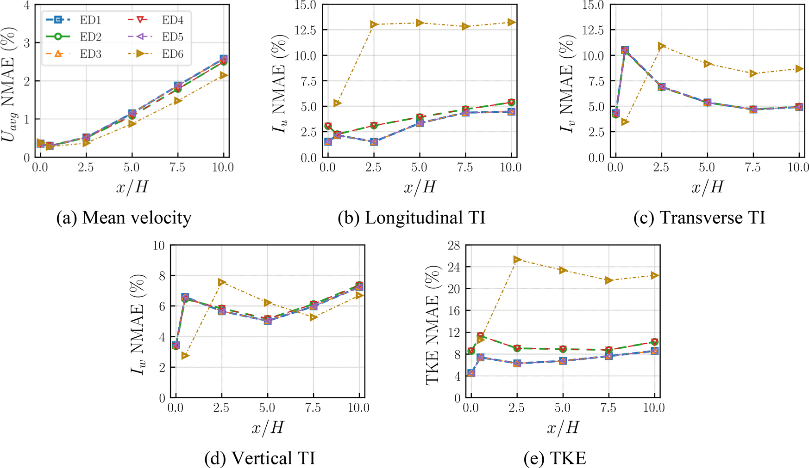
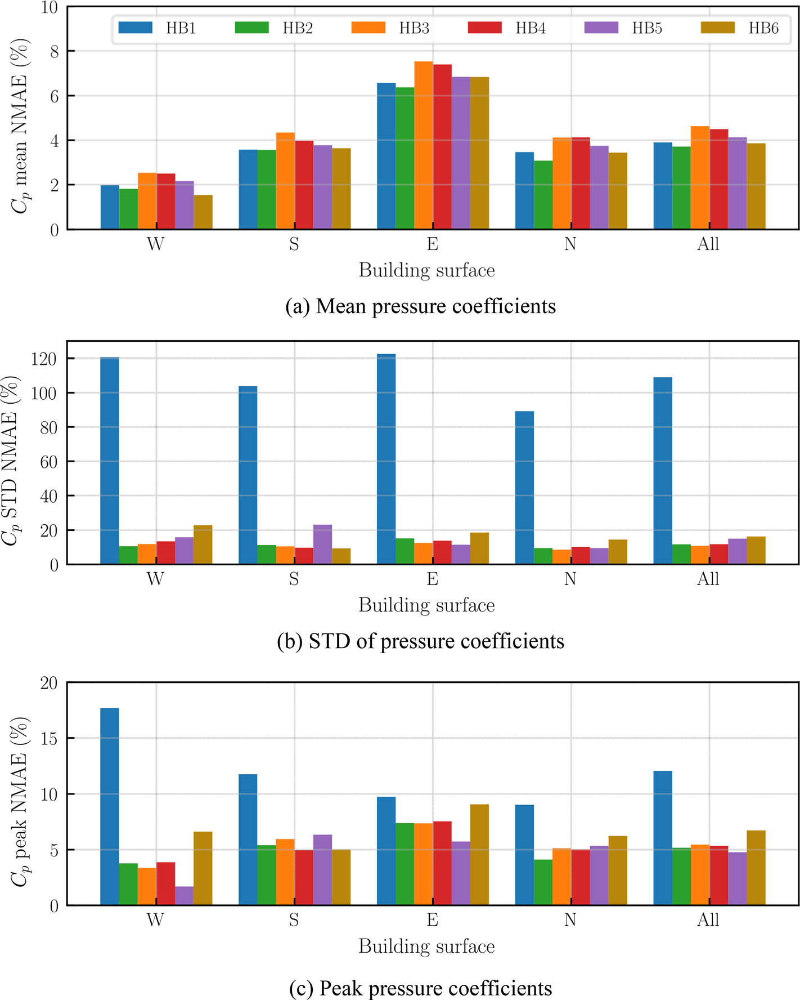
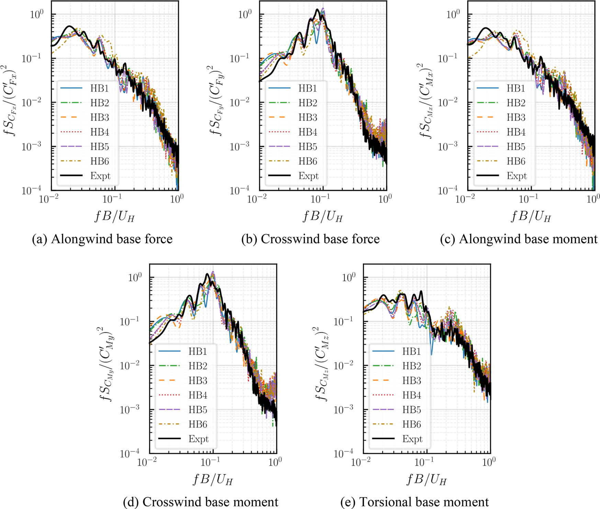

# 工程结构抗风 | 算出的脉动风压，哪些来自入口误差？

建筑表面的脉动风压，可能混入入口质量失衡造成的人工压力波动。即使平均风压和整体力看起来合理，局部压力也未必可信。本文在同一套合成湍流入口下比较三种抑制方法，检查压力改善与湍流统计变化之间的取舍。

## 论文信息

- 论文题名: Comparing methods for reducing artificial pressure fluctuations using large eddy simulation in high-rise building wind load assessment
- 作者: <u>Chen Lingwei</u>; **Li Chao**\*; Wang Jinghan; He Xin; Wang Xiangjie; Hu Gang; Wang Xiaolu
- 期刊: Physics of Fluids
- 年份: 2024
- DOI: https://doi.org/10.1063/5.0240163
- WOEAI 相关方向: 工程结构抗风 / 数值风洞

## 摘要

减小人工压力脉动是模拟大气边界层湍流中的关键挑战之一。本研究以合成湍流方法为基础，比较三种 RAPF 方法的性能：入口质量修正、无散修正和局部压力修正。首先，空域大涡模拟表明，IMC 和 DFC 方法能够在整个流场内有效抑制不真实的压力脉动。随着湍流向下游发展，压力脉动迅速衰减，并变得几乎可以忽略。相比之下，LPC 方法只通过调整压力参考位置减小局部非物理压力脉动；随着距离参考点增大，压力脉动会逐渐增大。

此外，IMC 和 DFC 方法会调整初始湍流场，使其满足入口质量平衡或无散条件，从而改变初始湍流特性。LPC 方法不修改初始湍流，因此能够更好地保持原始湍流特性。最后，高层建筑风荷载模拟表明，采用 IMC、DFC 和 LPC 方法均可得到合理的建筑表面压力均值、标准差和峰值，以及合理的整体基底力和基底力矩。

## 研究问题与解决思路

合成湍流入口若存在瞬时质量失衡，压力求解会产生非物理脉动，并可能污染建筑风荷载统计。修正入口速度可以减小这种污染，却也会改变原有湍流；调整压力参考位置则有局部适用范围。本文以同一入流生成方法为基础，比较入口质量修正、无散修正和局部压力修正，先做空域检查，再对照建筑表面风压与整体力，区分压力抑制效果和入流保持能力。

## 三种方法分别修改流量、速度场和压力参考

本文没有提出一个全新的入流湍流生成器，而是围绕同一套 CDRFG 合成湍流入口，对三类常用 RAPF 思路进行了并排比较。

::: figure 1

论文图 1 不同入流湍流施加方法示意图

图中对比了两种施加入流湍流的方式：一种是把湍流速度直接施加到入口平面，另一种是在入口附近薄层三维网格中插入湍流速度。读图时重点看入口平面、薄层体网格和目标建筑之间的位置关系。

:::

第一类是 IMC。它在每个时间步调整入口速度，使入口瞬时体积流量与目标平均体积流量一致。这个方法简单、计算成本低，但会改变入口处原始湍流场。

第二类是 DFC。它不直接把湍流场作为入口边界，而是在入口后方薄层体网格中插入湍流场，再通过压力修正步骤得到满足离散连续性方程的速度场。这个方法更贴近不可压缩求解器的约束，但插入后的湍流还需要下游发展。

第三类是 LPC。在本文入口、出口压力均设为零梯度 Neumann 边界的条件下，它通过设置压力参考点，在局部区域抵消由入口质量失衡带来的附加压力脉动。它不修改入口湍流，因此更能保留原始湍流特性，但抑制效果会随着离参考点距离增加而减弱。

为了量化 LES 与试验或目标值的偏差，论文使用归一化平均绝对误差（NMAE）：

$$
\mathrm{NMAE}
=\frac{\mathrm{MAE}}{Q_{\mathrm{Expt}}^{\max}-Q_{\mathrm{Expt}}^{\min}}\times100
$$

这里 $Q_{\mathrm{Expt}}$ 表示试验或目标统计量，$\mathrm{MAE}$ 是逐点绝对偏差的平均值。分母为对应试验统计量的最大值与最小值之差，所以文中的 NMAE 不是逐点相对误差的平均；它也不表示每个测点都偏离同一个百分比。

## 空域压力与建筑风压给出了哪些不同判断？

空域算例首先把目标建筑拿掉，只观察入流湍流在计算域中的发展。这样可以把“入口方法本身引入的压力污染”和“建筑绕流产生的真实压力变化”分开。

未采用 RAPF 方法时，入口质量失衡会在整个空域中产生明显非物理压力脉动，并在建筑位置附近达到动压约 $50\%$ 的量级。这说明，人工压力脉动不是入口附近可以忽略的小扰动，而可能直接进入后续建筑压力测量区域。

::: figure 7

论文图 7 压力系数均值和标准差剖面沿 X 方向的对比

上排(a)为压力系数均值，下排(b)为标准差；各排从左到右按图顶的$x/H$位置读取，纵轴为$z/H$。ED1–ED6依次用蓝色方块、绿色圆点、橙色上三角、红色下三角、紫色左三角和黄褐色右三角区分。

:::

读图时重点看下半部分子图 (b) 的压力系数标准差：ED1 在多个下游位置都保持较高脉动，而 IMC、DFC 相关算例在入口后方快速降低；LPC 算例的低脉动区域则围绕压力参考点展开。

三类 RAPF 方法都能降低人工压力脉动，但它们处理的是不同环节。IMC 通过入口质量平衡直接处理流量问题，DFC 通过速度压力耦合处理无散约束，LPC 则通过压力参考点处理局部压力漂移。

IMC 和 DFC 的优势在于全流场抑制更稳，LPC 的优势在于不改动原始入口湍流，但压力参考点需位于关注区域附近、同时避开建筑对流场的影响范围。因此，LPC 的局部抑制效果不能视为全域压力误差均已消除。

::: figure 11

论文图 11 湍流特性 NMAE 沿 X 方向的变化

上排(a)–(c)分别为平均风速、纵向和横向湍流强度，下排(d)、(e)为竖向湍流强度与湍动能；横轴均为$x/H$，纵轴为NMAE百分比。六种线色和标记对应ED1–ED6，按左上图图例辨认。

:::

这组曲线把平均速度、三个方向湍流强度和湍动能误差放在一起比较。读图时可重点看建筑位置 $x/H=5$：LPC 保留初始湍流的能力较强，IMC 误差适中，DFC 在湍动能上出现更明显偏差。

高层建筑算例把目标建筑放在距入口 $5H$ 的位置，使用 TPU 数据库中的测压点布置对比 LES 与风洞结果。平均风压在各算例中都相对稳定，但脉动风压和峰值压力对人工压力污染更敏感。

采用 RAPF 方法后，建筑所有表面压力系数标准差的 NMAE 从未修正算例的 $108\%$ 降至约 $10.8\%-16.3\%$。这一区别提示我们，评价 LES 风荷载不能只看平均压力；脉动压力和峰值压力才更容易暴露入口方法带来的非物理误差。

在建筑 $2H/3$ 高度的比较中，未修正算例的压力标准差约为动压的 $50\%$–$70\%$，采用 RAPF 方法后约为 $10\%$–$40\%$，更接近试验结果。这是该高度压力脉动相对动压的量级，与上面的 NMAE 误差指标不同。

::: figure 23

论文图 23 建筑表面压力系数 NMAE 对比

从上到下(a)–(c)分别为压力系数均值、标准差和峰值的NMAE，纵轴均为百分比；横轴W、S、E、N为各建筑表面，All为全部表面。蓝、绿、橙、红、紫、黄褐色柱分别对应HB1–HB6。

:::

图中分别比较平均、标准差和峰值压力系数的 NMAE。重点看中间子图：未修正的 HB1 在压力标准差上误差最高，而 HB2–HB6 明显降低；下方子图 (c) 的峰值压力对人工脉动同样敏感。

论文还比较了基底力和基底力矩。一个容易误判的现象是：即使局部表面压力里含有人工脉动，对称建筑在整体积分后仍可能把部分虚假脉动相互抵消。

对称建筑的整体基底力和力矩可能掩盖局部压力污染，因此局部测点风压仍应作为 LES 风荷载评估的关键检查面。这对工程复核很重要：如果只看整体力谱，可能会低估入口压力污染对局部围护结构或局部风压峰值的影响。

::: figure 24

论文图 24 总基底力和基底力矩系数频谱对比

上排(a)–(c)依次为顺风基底力、横风基底力、顺风基底弯矩，下排(d)、(e)为横风基底弯矩与扭矩。横轴均为无量纲频率$fB/U_H$（$B$为建筑宽度，$U_H$为建筑顶高度处风速），纵轴为相应的归一化频谱；黑色实线为试验，六种彩色线为HB1–HB6。

:::

这张图比较顺风向、横风向、弯矩和扭矩频谱。读图时应把它与建筑表面压力误差一起看：整体频谱吻合较好，并不自动说明每个表面测点的脉动风压都同样可靠。

## 正式风荷载计算前需要检查什么？

正式计算前可先在空域检查目标建筑位置的湍流统计和人工压力脉动，再进入建筑算例比较局部压力与整体力。方法选择需同时考虑参考点位置、入口统计变化和下游发展距离，不能只以某一压力曲线变平为依据。

本文的比较建立在 CDRFG 合成湍流入口、TPU 方形截面高层建筑数据库、OpenFOAM v2206 和特定网格/边界条件设置上。结论可以指导类似 LES 数值风洞中的 RAPF 方法选择，但不应被直接推广为所有入口生成方法、所有建筑外形和所有求解器的通用排序。

此外，LPC 的效果依赖压力参考点位置；IMC 和 DFC 虽然能更稳地降低人工压力脉动，但会在不同程度上改变初始湍流场。进入工程流程时，我们仍需要结合目标风场剖面、湍流谱、相干性、网格分辨率、计算域长度和风洞或现场数据进行综合验证。

峰值压力采用基于矩的 Hermite 模型估计，不能将文中的峰值理解为从最后 $8\,\mathrm{s}$ 时程中直接读取的单个最大值。

最后，本文也提醒我们：局部表面风压、峰值压力和整体基底力并不总是给出相同判断。对于围护结构风压、局部极值和抗风优化问题，局部测点层面的复核仍然是必要环节。

## 从论文到工程

这项研究为数值风洞中的压力可信度提供了可追查的分析依据，使风荷载结果能够回到入口设置和压力处理环节逐项检验。它的工程意义在于帮助设计者辨别流场自身的脉动与数值边界带来的干扰，比较不同修正方案对局部风压和整体受力的影响。对于建筑抗风分析与围护结构研究，这种检查路径有助于提高方案比较的解释力，也为后续改进入流构造和数值设置明确了重点。应用仍需结合目标湍流与荷载指标验证。

点击阅读原文，可查看本论文的全文精解、压力修正设置与风压误差对比。

本文由 AI 辅助整理与撰写
