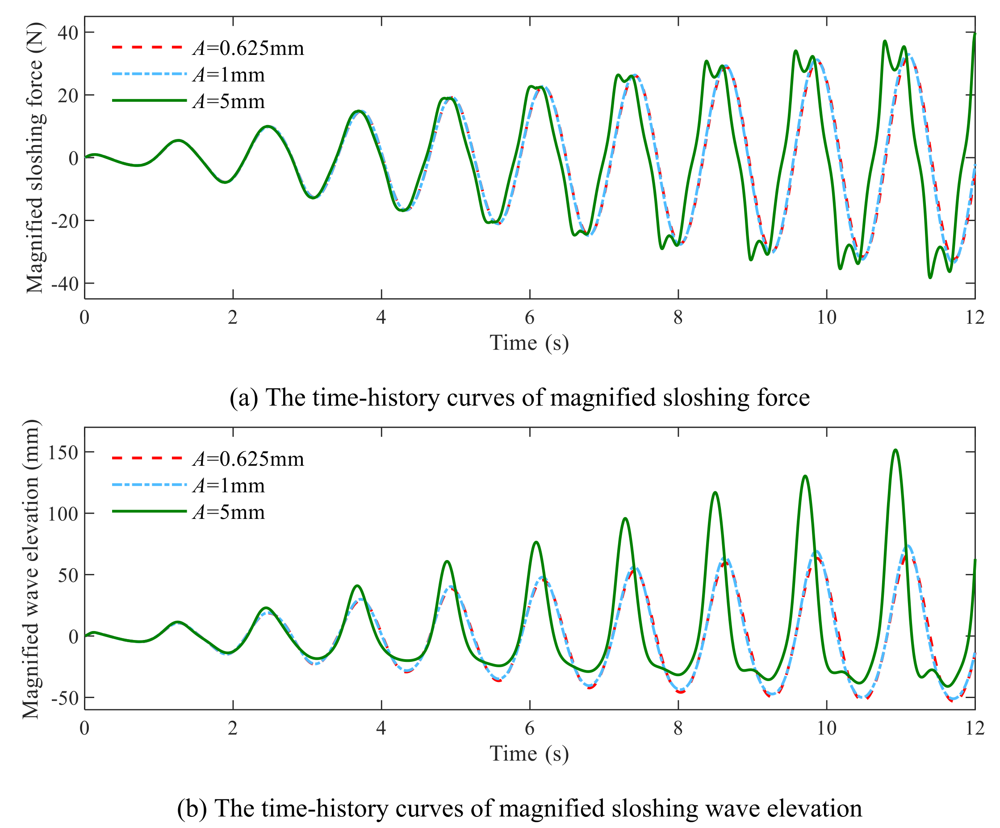
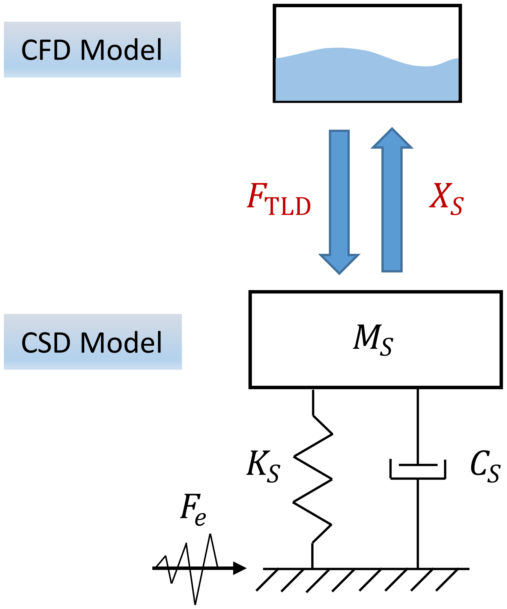
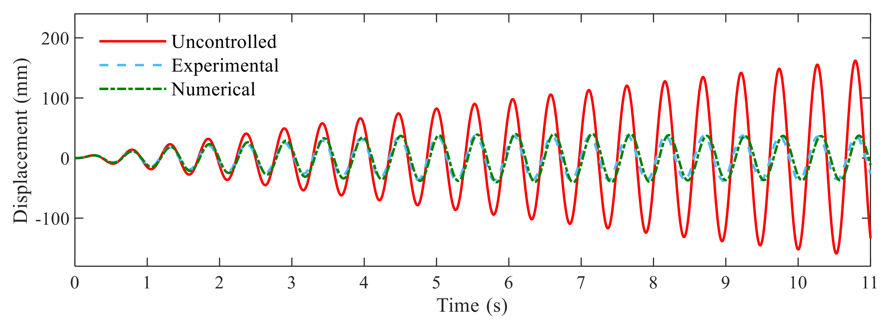
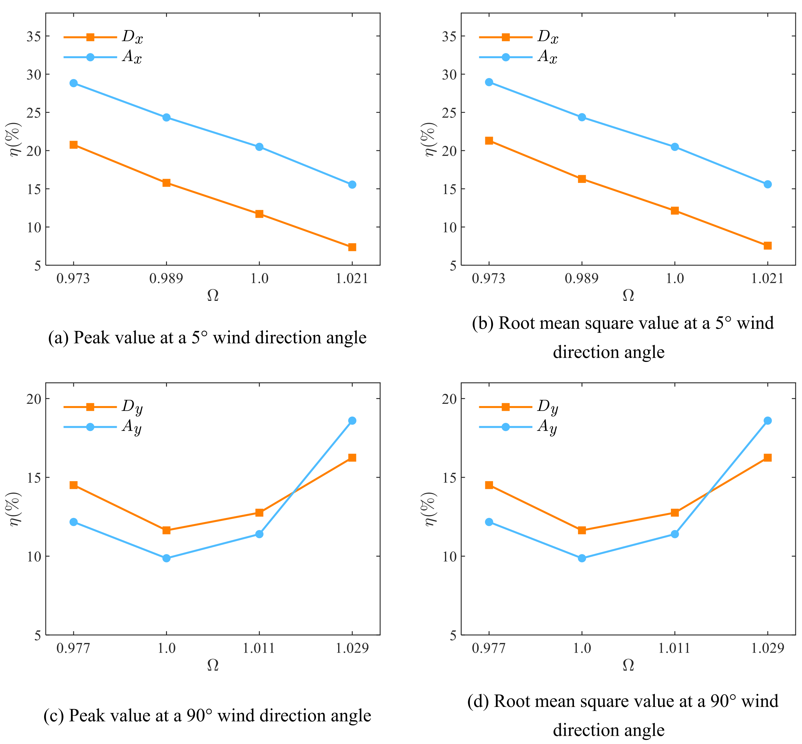

# 结构风工程 | 消防水箱怎样减轻风振，为什么不能只加水？

屋顶消防水箱能否兼顾储水与减振，关键要看建筑的响应，而不能只看箱里的水晃得多大。这篇论文先检验水的非线性晃荡，再把水箱反力传回结构计算，比较增加水量与调整频率的控制效果。

## 论文信息

- 论文题名：Numerical research on nonlinear liquid sloshing and vibration control performance of tuned liquid damper
- 作者：<u>He Xin</u>；**Li Chao**\*；Chen Lingwei；Yang Junhui；Hu Gang；Ou Jinping
- 期刊：Journal of Building Engineering
- 年份：2024
- DOI：[10.1016/j.jobe.2024.110660](https://doi.org/10.1016/j.jobe.2024.110660)
- WOEAI 相关方向: 结构风工程 / 结构抗风

## 摘要

通常设置于高层建筑顶部的高位消防水箱可改造为调谐液体阻尼器（Tuned Liquid Damper，TLD），减轻建筑结构的风致振动，从而改善人员舒适度。本文采用计算流体力学（Computational Fluid Dynamics，CFD）方法研究TLD的非线性液体晃荡特性，重点建立分析TLD与高层建筑耦合过程的数值模型。考察液深、激励幅值等因素对非线性液体晃荡特性的影响。此外，基于OpenFOAM二次开发，提出结构—TLD系统双向耦合数值模型。该耦合模型实现结构振动与TLD液体晃荡之间的相互作用，同时有效降低计算资源需求和计算时间。利用振动台试验结果，对比非线性液体晃荡特性和结构振动响应，验证数值模型的准确性。通过改变质量比和调谐比，进一步分析TLD减轻足尺高层建筑风致振动响应的效果。双向耦合数值模型旨在揭示TLD的非线性液体晃荡特性和振动控制性能，为工程师提供准确、经济、高效的TLD详细设计与评估方法。

## 研究问题与解决思路

要判断水箱是否有助于控制风振，需要同时知道液体怎样运动，以及它给结构施加的反力怎样改变建筑响应。等效质量—弹簧—阻尼模型便于初步设计，但液面破碎、飞溅时，其适用性受到激励幅值和液深限制；单独算水箱，又缺少结构运动的反馈。论文因此先核验两相流模型，再用结构位移驱动水箱、把液体反力传回结构，在同一时程中比较质量比和调谐比的作用。

## 同一水箱，液体不一定随激励等比例晃动

水箱的晃荡频率受液深和沿晃荡方向的箱长影响。初步调谐可以参考线性波理论，但激励增大、液面破碎后，还需要看实际的共振峰是否偏离这一预测。

在本文矩形水箱算例中，浅水表现出硬弹簧特征，共振峰偏向较高的激励频率；液深增加后逐渐出现软化，共振峰向较低频率移动。当液深比$h/L=25\%$时，作者未观察到明显频率偏移。这里的$h$是液深、$L$是沿晃荡方向的箱长；这一结果限于该组水箱和激励条件，不能直接作为所有水箱的分界线。

作者用一个直观比较检验“小幅响应能否按比例外推”：把$0.625\,\mathrm{mm}$激励下的响应放大8倍，把$1\,\mathrm{mm}$下的响应放大5倍，再与$5\,\mathrm{mm}$激励下的响应对照。如果响应近似线性，这些曲线应当接近。

图14 不同激励振幅下放大后的液体晃荡响应时程曲线比较。

上图为晃荡力，下图为波面高度；红色虚线、蓝色点划线对应两组放大后的小激励响应，绿色实线对应$5\,\mathrm{mm}$激励。沿时间轴比较后半段的波面峰值，以及晃荡力曲线的双峰。

曲线起初接近，液体运动增强后逐渐分开。大幅晃荡时，液体先撞击箱壁，随后受重力作用回落，形成两个力峰；波面也会破碎。小幅响应乘以倍数，因而不能再现这组大幅激励下的波面起伏。原文对简化理论预测双峰能力的讨论有特定模型与工况范围，不能扩展为所有非线性理论都不适用。

## 水箱反力要传回结构，才能算减振

建筑带动水箱运动，液体又向箱壁施力，反过来改变建筑响应。计算需要保留这两个方向的数据传递：每个时间步，结构侧用Newmark-beta法求解位移，并传给OpenFOAM中的水箱；流体侧用体积分数法（VOF）跟踪水与空气的界面，求出压力和黏性作用产生的晃荡力，再将反力传回结构，进入下一时间步。

图15 双向耦合数值模型示意图。

上方为流体计算，下方为结构模型；向上的$X_s$箭头表示传入水箱的结构位移，向下的$F_{\mathrm{TLD}}$箭头表示反馈给结构的液体晃荡力。

这种分工让结构运动方程与流体网格各自求解，避免为复杂建筑的结构域再建立整套流固耦合网格。论文据此讨论建模和计算负担的减少，但没有给出可直接套用于其他项目的运行时间或加速比例。

作者分层核验这套计算：先用既有试验中的波面和箱壁压力数据检验流体模型，再用装有纯水TLD的单自由度刚架试验数据检验耦合响应。湍流模型比较中，大涡模拟（LES）与$k$–$\omega$ SST对波面时程均与试验较接近，后续计算选用SST；这一选择有该组验证依据，并不表示它对所有两相流问题都更准确。

## 刚架减振78.5%，不能搬成高楼的效果

第一层耦合验证针对单自由度刚架。在幅值为$3\,\mathrm{mm}$、频率与结构基频一致的简谐基座激励下，安装TLD后的最大结构位移降低了$78.5\%$。这个数字回答的是特定共振工况下的刚架位移变化。

图18 安装和未安装 TLD 时的结构顶部位移响应。

红色实线为未控制的位移，蓝色虚线为安装TLD后的试验结果，绿色点划线为相应数值预测；三条曲线使用同一位移坐标，单位为毫米。

模型仍有局部误差。原文在另一幅液面比较图中指出，$t=5.9\,\mathrm{s}$附近发生剧烈破碎时，界面区域网格分辨率有限，数值预测低估了局部破碎波高。主要运动与试验接近，不意味着每个飞溅峰值都准确。

第二层分析换成CAARC高层建筑数值基准模型，风荷载依据缩尺风洞测压。10年重现期风荷载下，X向最不利风向为$5^\circ$，Y向为$90^\circ$；初步TLD方案使两向峰值加速度分别由$0.316$降至$0.252\,\mathrm{m/s^2}$、由$0.468$降至$0.422\,\mathrm{m/s^2}$。

刚架试验比较位移，高楼模型比较风振加速度，研究对象、激励和指标都不同，不能把$78.5\%$当作高楼的控制效果。这一建筑算例对绕Z轴扭转的控制也不足，不能写成水箱已改善整栋建筑的全部振动。上述高楼结果来自数值模型，并非实际大楼改造后的监测。

将这一思路用于实际建筑，风荷载输入、结构承载、设备维护与消防供水要求仍需单独核验；本文没有完成实楼改造或消防合规验证。

## 调好频率，比一味增大水量更值得比较

增加液体质量会增加结构承担的附加重量，却未必让各项控制效果同步改善。在论文的质量比比较中，最大减振率为$28.9\%$，作者认为显著加水并非高效的优化办法。于是，另一组比较保持质量比$0.95\%$和液深，通过调整水箱平面尺寸改变晃荡频率，考察调谐的作用。这里的质量比按液体质量与结构广义质量之比计算，不是分别用X、Y两向不同的模态质量作分母。

论文用调谐比（原式13）说明两个频率的相对关系：

$$
\Omega = \frac{\omega_{\mathrm{TLD}}}{\omega_s}
$$

$\omega_{\mathrm{TLD}}$为液体晃荡角频率，$\omega_s$为结构角频率。$\Omega=1$表示两者相同；设计时还要比较附近取值，检验非线性晃荡下哪一种设置更有效。

图26 不同调谐比 Ω 下 TLD 减振率 η 的比较。

上排为$5^\circ$风向下X向响应，下排为$90^\circ$风向下Y向响应；左列比较峰值，右列比较均方根。蓝色圆点对应加速度减振率，橙色方块对应位移减振率。

减振率$\eta$表示相对于未装TLD的同类结构响应降低的比例，图中的不同指标要分别阅读。原文给出的两方向调谐例子为$\Omega_x=0.973$、$\Omega_y=1.029$，限于这座数值建筑和相应工况，不能当作所有高楼的最优取值。

原文结论另将调谐后的减振率概括为从$15.6\%$提高到$28.8\%$。这不能与质量比研究中的$28.9\%$最大值，或前述不同风向的两向加速度变化，拼成同一指标、同一基线的改善幅度。

## 从论文到工程

对于考虑屋顶水箱减振的高层建筑设计，这项研究提供了把箱体方案与整栋建筑响应连接起来的分析工具。设计者可以把水箱尺寸、液深和调谐选择放在同一套计算中比较，判断控制效果是否值得相应的空间与附加重量；也能将非线性晃荡纳入详细评估，支持初步方案筛选后的参数优化。这使既有储水空间承担附加阻尼功能的设想有了可进一步检验的路径，也为继续研究其他水箱构型提供了工具。实际应用仍需结合具体建筑条件及消防供水要求核验。

点击“阅读原文”，可查看本论文的完整科学正文精解、28幅原图、13个公式和3张可编辑表，以及缩尺尺寸、质量口径和部分公式写法的核对说明。

本文由 AI 辅助整理与撰写
