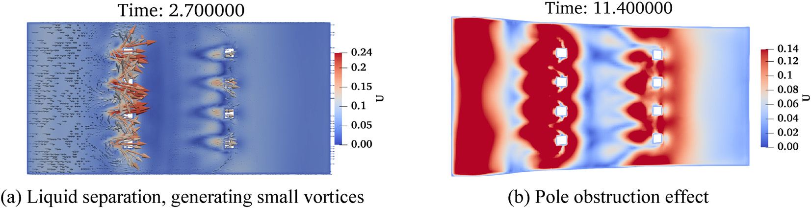
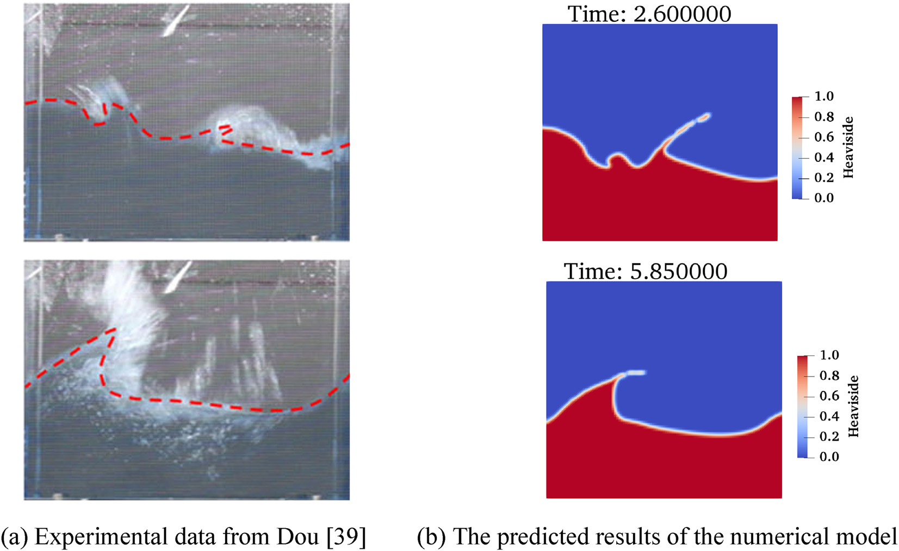
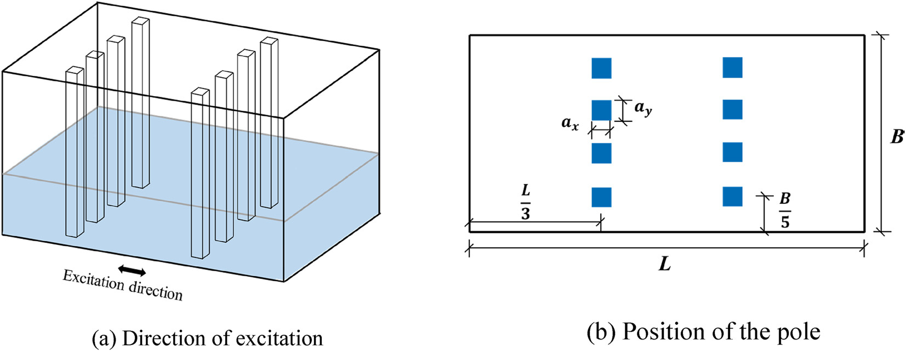
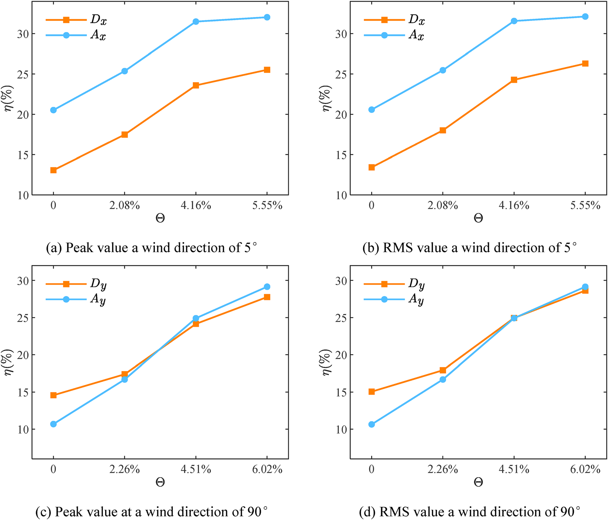
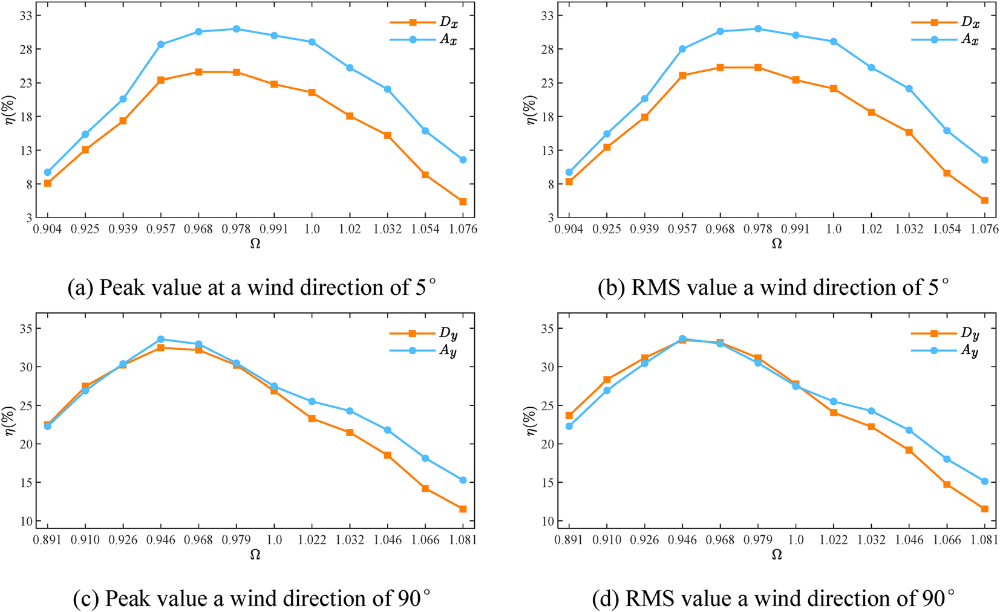

# 结构抗风 | 液舱内部更能耗能，建筑就一定减振更好吗？

调谐液体阻尼器依靠水的运动耗散能量，但液面大幅晃动时，耗能、调谐和结构响应会相互影响。本文把液体计算与建筑动力响应双向耦合，研究舱内立柱、激励幅值和频率调谐怎样共同影响减振效果。

## 论文信息

- 论文题名: Numerical investigation of nonlinear sloshing features and vibration mitigation efficiency of the implanted pole tuned liquid damper
- 作者: <u>He Xin</u>; **Li Chao**\*; Chen Lingwei; Hu Gang; Ou Jinping
- 期刊: Physics of Fluids
- 年份: 2025
- DOI: https://doi.org/10.1063/5.0293483
- WOEAI 相关方向: 工程结构抗风 / 结构抗风

## 摘要

调谐液体阻尼器（TLD）是一种经济高效的动力吸振装置，能够有效减小高层建筑过大的风致振动，从而改善居住者舒适度。本文提出一种植入式立柱 TLD。植入式立柱不仅能在多个方向上扰动晃荡液体，从而提高能量耗散效率，而且具有较高刚度，可为大型水箱提供支撑并抵抗显著液体晃荡力，最终保障 TLD 的安全稳定运行。

为进一步研究植入式立柱对 TLD 内部液体振荡响应和减振效率的影响，本文采用计算流体动力学方法，通过耦合 level set 方法和 volume of fluid（VOF）方法（CLS-VOF）改进 OpenFOAM 两相流求解器，提高自由液面追踪精度。研究考察了液深、立柱尺寸和激励幅值对内部液体非线性振荡特征的影响。

此外，本文通过 OpenFOAM 二次开发建立了结构-TLD 系统的双向耦合数值模型，该模型能够准确捕捉液体振荡与结构动力响应之间的相互作用。数值模拟结果与实验数据吻合良好。进一步通过改变立柱阻塞率和调谐比，分析了植入式立柱 TLD 减小高层建筑风致振动响应的有效性。该双向耦合数值模型准确高效，可辅助工程师开展 TLD 精细设计与优化。

## 研究问题与解决思路

液舱内部阻尼增大，并不直接等于建筑响应按相同比例减小。大幅晃荡会改变液体的频率和耗能，结构运动又反过来影响液体受激状态，单独分析液舱难以反映这种反馈。本文采用两相流求解与结构动力计算的双向耦合方法，考察立柱布置、激励幅值与调谐频率，并分别在单自由度体系和高层建筑算例中检验响应变化，区分液舱耗能与结构减振效果。

## 液体晃荡与结构响应怎样双向耦合？

论文首先在 OpenFOAM 中改进两相流求解器，将 level set 方法和 VOF 方法耦合为 CLS-VOF 路线。VOF 有利于质量守恒，level set 有利于界面法向和曲率计算；二者结合后，可以更清晰地捕捉自由液面，并减弱伪流问题。

对 TLD 本体，论文设置不同液深比 $h/L$、立柱阻塞率 $\Theta$ 和激励幅值 $A$，分析液体波高峰值、晃荡力峰值和等效阻尼变化。立柱阻塞率用论文中的定义表示为：

$$
\Theta=\frac{a}{B}
$$

其中 $a$ 为立柱截面尺寸，$B$ 为水箱宽度。这个指标把“立柱有多挡水”转化为可调参数，便于比较不同立柱尺寸对晃荡和耗能的影响。

论文图 14 自由液面速度云图说明植入式立柱对液体振荡的影响

图中可以看到，立柱尖角附近出现液体分离和小涡，立柱阻塞也会切断部分晃荡能量传递路径，这是阻尼提高的重要机制。

在结构-TLD 耦合方面，论文通过 OpenFOAM 二次开发建立双向耦合数值模型。流体域用 CLS-VOF 捕捉液体晃荡并计算晃荡力，结构域用 Newmark-beta 数值积分求解结构响应，两者通过通信接口实时交换数据。

论文图 22 自由液面捕捉结果对比

图中比较了试验自由液面与双向耦合数值模型的预测结果，说明模型能够捕捉自由液面卷起、破碎等强非线性现象。

论文图 9 植入式立柱 TLD 模型示意

图中展示了水箱内两列植入式立柱的布置方式，以及用于定义立柱阻塞率的截面尺寸和水箱宽度。

## 从液面晃荡到建筑响应，改善体现在哪里？

没有立柱时，随着液深比 $h/L$ 增大，液体振荡会从 hard spring 特征转向 soft spring 特征，非线性特征也会发生变化。布置立柱后，液体晃荡行为明显改变：随着阻塞率 $\Theta$ 增大，液体晃荡能量降低，自由液面上升受到限制，振荡响应减小。

论文指出，立柱增强耗能主要来自两方面。一方面，立柱阻塞作用把晃荡液体分割为多个小区域，打断能量传递路径，抑制自由液面上升；另一方面，立柱尖角处会发生液体分离并产生小涡，立柱表面与液体之间的黏性相互作用也会增加能量耗散。

激励幅值 $A$ 反映外部输入能量大小。论文结果显示，随着 $A$ 增大，波高和晃荡力峰值显著上升，振荡能量逐步积累，波形开始叠加，自由液面可能发生破碎；同时，晃荡周期减小、共振响应滞后，表现出 hard spring 效应。

论文进一步给出不同激励幅值下的能量耗散效率变化：内液等效阻尼比 $\zeta$ 随 $A$ 增大而提高。尤其在 $h/L$ 和 $\Theta$ 较小时，液体振荡更剧烈，波浪破碎和非线性特征更明显，能量耗散机制随之增强。

论文用单自由度框架结构和 TLD 控制试验对双向耦合数值模型进行验证。结构位移响应和液体晃荡响应与试验数据吻合，平均相对误差分别为 $5.26\%$ 和 $13.91\%$。与标准流固耦合方法相比，该模型计算时间从 $5218\,\mathrm{s}$ 降至 $4632\,\mathrm{s}$。

在与验证试验相同的单自由度框架参数和共振激励条件下，数值模型比较了未控、纯水 TLD 和植入式立柱 TLD。植入式立柱 TLD 相对未控结构使顶部最大位移响应降低 $85.2\%$。这说明植入式立柱并不是只改变水箱内部流动图像，而是能转化为结构响应控制效果。

论文进一步以 CAARC 高层建筑模型为对象，研究 $10$ 年重现期风荷载下的风致振动控制。建筑高度为 $182.88\,\mathrm{m}$，平面长度 $45.72\,\mathrm{m}$、宽度 $30.48\,\mathrm{m}$，并采用风洞测压试验数据作为风荷载输入。

在基准参数下，植入式立柱 TLD 可以减小建筑平动响应。论文报告，$A_x$ 从 $0.3163$ 降至 $0.2398\,\mathrm{m/s^2}$，$A_y$ 从 $0.4683$ 降至 $0.3902\,\mathrm{m/s^2}$；位移响应 $D_x$ 从 $0.2443$ 降至 $0.203\,\mathrm{m}$，$D_y$ 从 $0.4184$ 降至 $0.3457\,\mathrm{m}$。其对平动响应控制明显，对绕 $Z$ 轴扭转响应影响较小。

论文图 26 不同立柱阻塞率下减振率对比

图中比较了 $5^\circ$ 和 $90^\circ$ 风向下峰值响应与 RMS 响应的减振率。原文用 $\eta=1-R/R_o$ 表示减振率，其中 $R$、$R_o$ 分别为有 TLD 和无 TLD 时的结构响应。立柱阻塞率增大时，减振率 $\eta$ 提高，但增长速度逐渐放缓。

立柱布置也影响结果。原文已比较 X 向和 Y 向布置：$5^\circ$ 风向下差别较小，$90^\circ$ 下 X 向布置更优；Y 向还出现液体撞击顶板的问题，不能把所有自由液面破碎均理解为有利耗能。

调谐比同样关键。原文用 $\Omega$ 表示 TLD 振荡频率与结构频率的比值：

$$
\Omega=\frac{\omega_{\mathrm{TLD}}}{\omega_s}
$$

在约 $\pm5\%$ 的调谐范围内，植入式立柱 TLD 表现出较好的鲁棒性。$5^\circ$ 风向下，$\Omega=0.978$ 时减振率达到最大；$90^\circ$ 风向下，$\Omega=0.946$ 时结构风致响应显著降低。

论文图 29 不同调谐比下减振率对比

图中显示，调谐比偏离最优范围后，减振率会下降；但植入式立柱带来的附加阻尼使 TLD 在一定频率偏差内仍保持有效。

## 调谐与非线性效应对应用有什么限制？

工程应用需要同时核查液体耗能、结构响应和舱体局部受力。单自由度共振算例中相对无控体系的峰值位移降幅为 $85.2\%$，这一数值不能套用到后面的 CAARC 建筑风荷载算例；建筑算例还需分别比较两个平动方向和扭转响应。

本文结论基于矩形水箱、矩形植入式立柱、OpenFOAM 中的 CLS-VOF 两相流模型、论文设置的液深比和阻塞率范围，以及 CAARC 高层建筑模型的风洞测压荷载。换成其他水箱形状、立柱截面、结构体系、屋顶布置或风环境后，最优参数需要重新计算。

论文最后也指出，本文主要研究矩形立柱 TLD。后续可进一步比较圆形、流线型、菱形等不同立柱形状的阻尼性能差异，以及倒角或端部开槽矩形立柱的影响。

此外，TLD 是以调谐和液体晃荡为基础的被动控制装置。即便植入式立柱提高了鲁棒性，设计仍需关注结构频率变化、施工与维护条件、液体晃荡力、水箱局部强度和长期运行可靠性，不能只用单一减振率指标替代完整工程校核。

## 从论文到工程

这项研究把液舱构造的调整与建筑整体响应联系起来，为利用水体耗能改善风振表现提供了更完整的分析工具。设计者由此可以同时比较立柱布置、调谐选择和结构反馈，判断水箱内部的变化怎样转化为建筑层面的控制效果。对于高层建筑的舒适度设计，这种思路有助于协调设备空间与减振需求，并为后续不同水箱构型的研究提供共同的比较基础，让方案选择更接近结构实际承受的运动。应用仍需核验目标建筑与长期运行条件。

点击阅读原文，可查看本论文的全文精解、流固耦合验证与建筑减振算例。

本文由 AI 辅助整理与撰写
