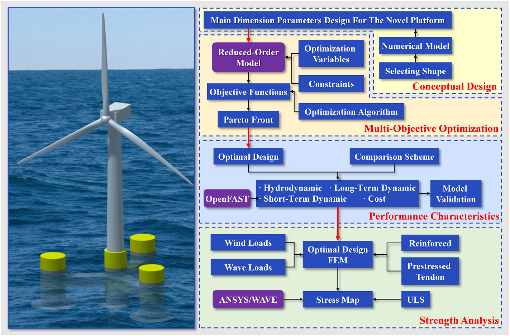
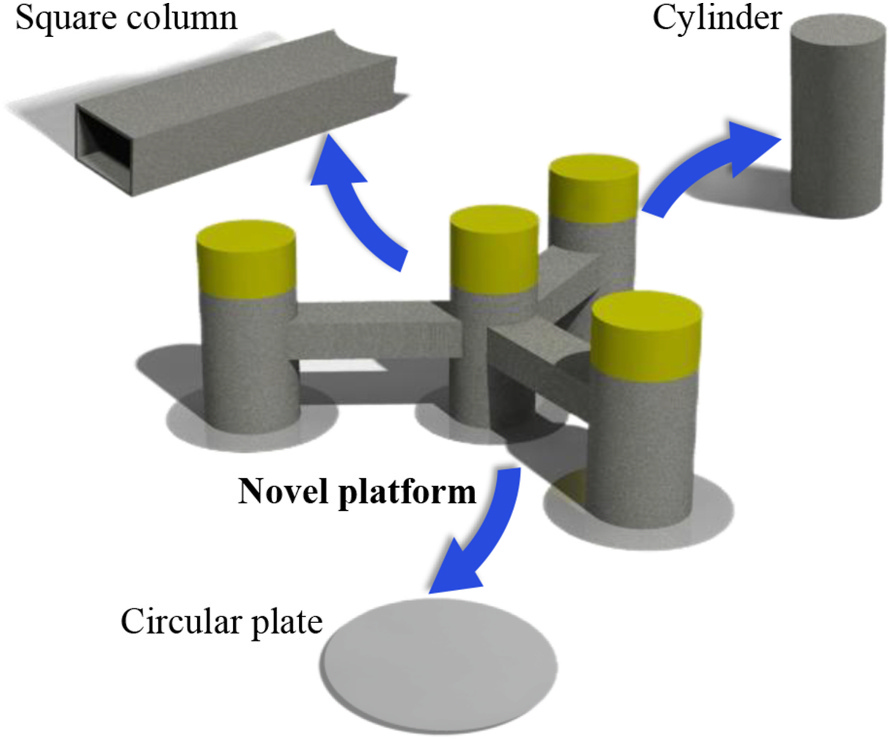
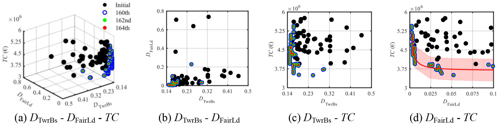
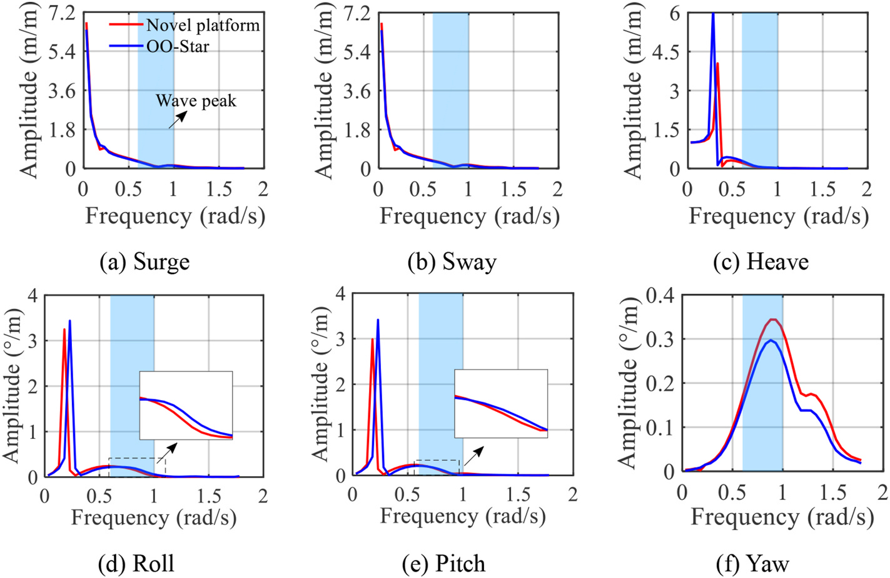
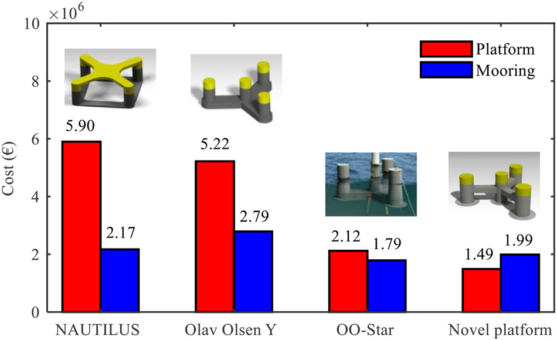
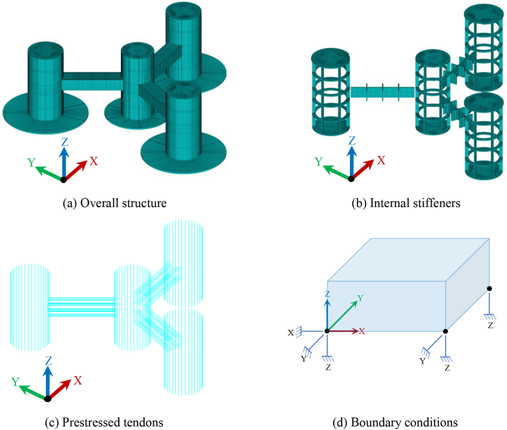
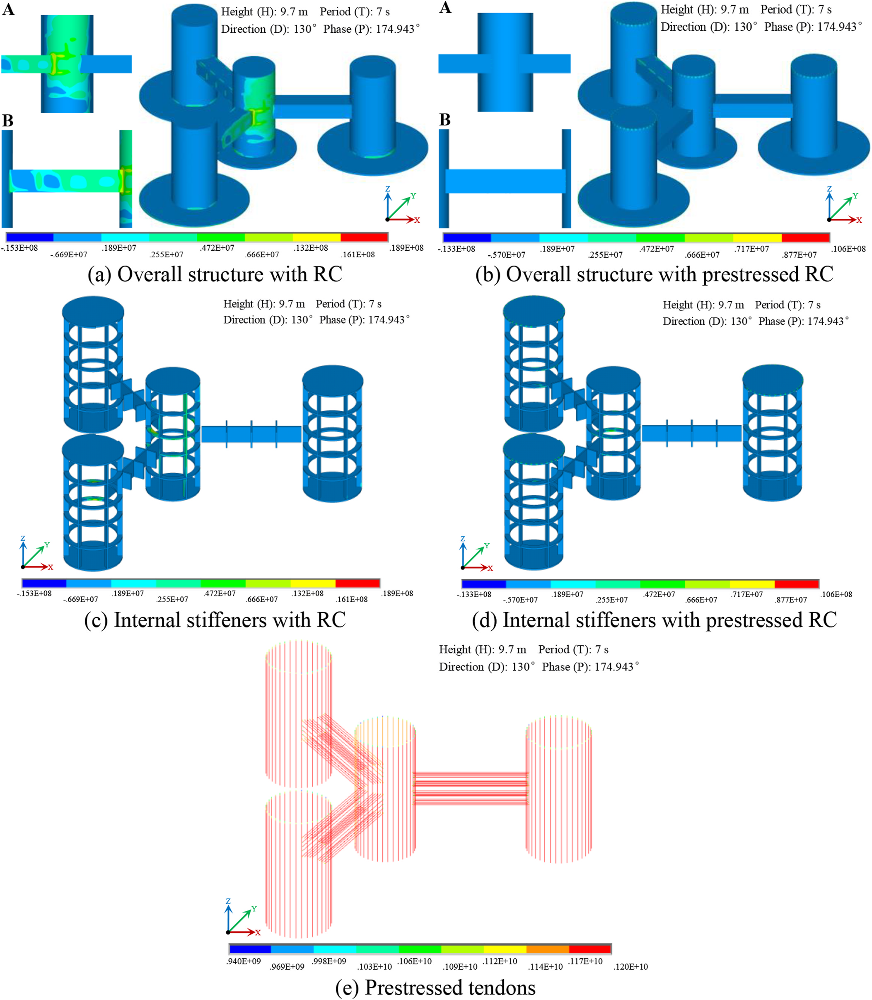

# 混凝土浮体 | 混凝土半潜平台怎样同时比较成本、疲劳与强度？

混凝土平台是否划算，不能只比较材料单价。平台尺度和系泊配置还会影响长期响应与疲劳，优化结果也需要结构强度检查。本文把这些环节接入同一概念设计流程，比较一种模块化半潜平台与既有方案。

## 论文信息

- 论文题名: Structural design and optimization of a novel semi-submersible floating offshore wind turbine platform using reinforced concrete
- 作者: <u>He Weiwen</u>; **Li Chao**\*; Zheng Shunyun; Zhou Shengtao; Liu Shangpei; Ou Jinping
- 期刊: Ocean Engineering
- 年份: 2026
- DOI: https://doi.org/10.1016/j.oceaneng.2025.123951
- WOEAI 相关方向: 海洋能源结构 / 混凝土浮体

## 摘要

近年来，全球可再生能源快速发展，海上风电增长尤为明显。全球约 $80\%$ 的潜在海上风能资源位于水深超过 $60\,\mathrm{m}$ 的海域，使浮式风机，特别是半潜式平台，成为重要研究对象。

针对钢结构半潜式平台成本高、形式多样导致标准化制造困难，以及钢筋混凝土半潜式浮式风机平台在优化、性能表征和结构强度验证方面研究不足的问题，本文提出一种基于模块化思想的新型钢筋混凝土半潜式浮式风机平台概念。研究完成主尺度参数设计、优化变量选择，并建立由长期动力响应驱动的多目标优化框架。

该框架使用降阶模型计算长期动力响应和经济指标，以约束条件筛选设计方案，并采用 NSGA-II 遗传算法追踪 Pareto 前沿。结果显示，优化过程收敛良好，目标函数得到明显改善，并形成多个有潜力的设计方案。选取成本最优方案后，论文进一步与 LIFES 50+ OO-Star 方案进行性能比较；数值模拟结果表明，新平台在论文设定的长期服役性能和建造成本指标上表现更优。最后，研究建立最优方案的有限元模型，在极限状态条件下进行结构强度分析，结果显示加入预应力筋后平台满足强度要求。整体而言，这项工作为钢筋混凝土半潜式浮式风机平台的结构设计和优化提供了系统参考。

## 研究问题与解决思路

钢筋混凝土可改变半潜平台的建造成本与质量分布，但较低的平台本体成本未必对应更优的系统方案，长期运动、塔底与系泊疲劳以及混凝土受拉问题都需要考虑。本文研究如何把主尺度和系泊参数纳入多目标优化，用降阶模型比较长期响应与成本，再对选定方案开展含预应力筋的有限元强度分析。研究范围是整体概念设计，局部节点仍需在详细设计中优化。

## 把平台尺度、系泊与成本放进同一优化过程

::: figure 1

论文图 1 研究路线

左侧为浮式风机示意，右侧沿箭头依次读概念设计、多目标优化、性能比较与强度分析四个区域。

:::

论文先提出一种模块化钢筋混凝土半潜式平台。平台由圆柱、方柱和圆板等相对简单的构件组成，意图服务标准化制造与装配，并以 DTU $10\,\mathrm{MW}$ 风机作为支撑对象。

::: figure 7

论文图 7 新型平台概念设计

按蓝箭头辨认方柱、圆柱和圆板与中央平台构型的对应位置。

:::

图中展示了新型平台由圆柱、方柱和圆板等模块构件组合而成的基本构型，这也是论文讨论标准化和模块化潜力的结构基础。

在动力响应计算上，论文使用研究团队已有的降阶模型 ROM 快速估计浮式风机长期动力响应。模型把平台视为刚体、塔架视为柔性体，并用频域动力方程计算响应特征。为了进入优化流程，研究还建立了与实体模型对应的参数化水动力模型。

在成本目标上，论文把平台、垂荡板、压载和系泊系统等费用统一纳入总建造成本估算：

$$
TC=\frac{m_{\mathrm{ptfm}}P_{\mathrm{con}}+m_{\mathrm{hp}}P_{\mathrm{steel}}+m_{\mathrm{ballst}}P_{\mathrm{ballst}}+m_{\mathrm{moor}}P_{\mathrm{moor}}}{0.7}
$$

这里 $m_{\mathrm{ptfm}}$、$m_{\mathrm{hp}}$、$m_{\mathrm{ballst}}$ 和 $m_{\mathrm{moor}}$ 分别表示平台、垂荡板、压载和系泊系统质量，$P_{\mathrm{con}}$、$P_{\mathrm{steel}}$、$P_{\mathrm{ballst}}$ 和 $P_{\mathrm{moor}}$ 表示对应单位成本。分母 $0.7$ 对应人工及其他费用占总建造成本 $30\%$ 的估算假设。这一成本范围包含平台本体以外的构件和系泊，比较不同方案时需保持口径一致。

优化算法采用 NSGA-II 多目标遗传算法，目标是在约束条件下搜索 Pareto 前沿。论文报告优化在第 $164$ 代达到收敛判据，并得到 $50$ 个 Pareto 最优主尺度组合。

::: figure 16

论文图 16 目标函数对比

左图为三目标散点，其余为两两投影；黑、蓝、绿、红标记分别为初始及第160、162、164代，按坐标区分塔底疲劳、导缆孔疲劳和成本。

:::

这组图展示了塔底疲劳损伤、导缆孔疲劳损伤和总建造成本之间的关系；一个重要现象是，在钢筋混凝土平台中，导缆孔疲劳损伤与总成本之间的相关性变得突出，提示设计时不能把平台和系泊系统割裂开来。

## 成本最优方案在哪些指标上改善，代价是什么？

论文的 Pareto 前沿分析显示，导缆孔疲劳损伤 $D_{\mathrm{FairLd}}$ 与总建造成本 $TC$ 呈明显相关：要降低导缆孔疲劳损伤，往往需要在系泊系统上付出更高成本。由于钢筋混凝土平台本体相对钢结构平台成本降低，系泊系统在总成本中的权重就更值得关注。

平台主尺度与系泊参数因此需要联合比较。平台主尺度、系泊链直径、系泊线长度和柱间距之间的组合关系，会共同决定长期性能与经济指标。

论文选取成本最优方案，并与 LIFES 50+ OO-Star 方案进行比较。两者都以混凝土材料和 DTU $10\,\mathrm{MW}$ 风机为对象，但外形和浮筒布置不同。在论文选取的 $135^\circ$ 波向下，新平台垂荡峰值和背景波频 RAO 低于 OO-Star。横摇和纵摇的背景波频比较需谨慎解读：第 5.2 节称新平台背景波频响应略低，但图 19(d)(e) 放大窗存在局部交叉，不能据此作整个背景波频区处处更低或更高的全称判断。

::: figure 19

论文图 19 两类平台在 135 度波向下的 RAO 对比

六个面板依次为纵荡、横荡、垂荡、横摇、纵摇和艏摇；红线为新平台、蓝线为 OO-Star，浅蓝带和局部放大窗用于辨认背景波频区。

:::

RAO 图用于比较单位波高规则波下的响应幅值。论文据此讨论新平台在垂荡、横摇和纵摇等自由度上抵抗波浪荷载的表现。

在长期响应指标上，论文报告新平台相较 OO-Star 的塔底最大累计疲劳损伤降低约 $36\%$，导缆孔最大累计疲劳损伤降低约 $21\%$。作者据此概括长期服役性能改善约 $36\%$，但不能解释为已验证寿命延长同一比例。表 8 的长期倾角指标由 OO-Star 的 $5.2884^\circ$ 增至新平台的 $8.4970^\circ$，约增加 $61\%$，仍低于该文采用的 $10^\circ$ 约束。

论文以平台结构和系泊系统为范围，比较新平台、NAUTILUS、Olav Olsen Y 和 OO-Star 的总建造成本。结果显示，新平台总建造成本估算为约 $3.48$ 百万欧元，其中平台本体约 $1.49$ 百万欧元；平台本体成本相较 NAUTILUS 和 Olav Olsen Y 分别降低约 $75\%$ 和 $71\%$，相较 OO-Star 约低 $30\%$。

::: figure 27

论文图 27 总建造成本对比

横轴列出四种平台，红柱为平台部分、蓝柱为系泊部分；纵轴及柱顶数字按百万欧元读取。

:::

这张图把平台和系泊系统成本分开显示，能看出混凝土平台本体成本下降后，系泊系统对总成本的影响更不能忽略。

需要注意的是，这里的成本结论来自论文采用的成本模型、材料单价、目标风机和比较方案，适合作为概念设计阶段的相对比较，不应直接等同于某个实际项目的最终报价。

完成动力响应和成本比较后，论文进一步建立有限元模型，对新平台最优方案进行极限状态强度分析。模型包括 C50 混凝土、普通钢筋和预应力筋，并在 ULS 组合下施加设计波浪与风荷载。

::: figure 29

论文图 29 新型平台强度分析有限元模型

按(a)至(d)依次查看整体结构、内部加劲、预应力筋和边界条件；彩色坐标箭头给出方向。

:::

有限元模型把整体结构、内部加劲、预应力筋和边界条件放在同一强度分析框架中，用于检查优化方案能否满足极限状态下的承载要求。

论文报告，普通配筋方案六个工况的最大第一主应力均超过 $1.89\,\mathrm{MPa}$；预应力使最大应力平均降低约 $69\%$，结论部分另报告加劲应力降低约 $50\%$。但表 16 同时给出预应力方案“最大应力” $3.71\text{–}5.88\,\mathrm{MPa}$ 和“整体应力范围”上限 $1.18\text{–}1.58\,\mathrm{MPa}$。作者依据整体应力范围认为满足强度，并指出局部应力集中范围有限。按本文整体概念设计的研究范围，可据此理解预应力方案的整体强度改善与可行性；局部节点和应力集中处理留待后续详细设计优化，不能将整体应力范围与局部最大值混为同一指标。

::: figure 35

论文图 35 新型平台的第一主应力结果

(a)(b)为普通配筋与预应力整体结构，(c)(d)为对应内部加劲，(e)为预应力筋；各面板分别使用自己的色标，A、B为局部放大位置。

:::

## 概念设计结论怎样进入后续结构设计？

该流程可用于筛选平台主尺度和系泊参数：先用长期响应与成本约束缩小方案范围，再对选定方案作结构分析。普通配筋与预应力方案的比较，说明构造设计需要接续总体优化；文中整体强度可行性的判断不替代局部节点的详细设计。

本文的结果来自数值模拟、降阶模型、成本估算和有限元强度分析。论文结尾也明确指出，研究仍局限于数值模拟，后续需要在条件成熟时开展缩尺水池试验，以进一步提高结果可靠性。

成本对比应理解为特定假设、特定比较对象和特定估算范围下的概念设计结论；实际工程还会受到供应链、施工组织、海域条件、规范要求、港口设施、运维策略和融资条件影响。

此外，本文关注的是 DTU $10\,\mathrm{MW}$ 风机和论文设定目标海域下的新型钢筋混凝土半潜式平台。若换成更大容量风机、不同水深、不同波浪气候或不同系泊系统，主尺度优化和强度设计都需要重新计算。

## 从论文到工程

这项研究把混凝土浮体的材料选择、尺度设计和长期动力表现放进同一套方案比较中，为海上漂浮风电探索更合适的支撑结构提供了概念设计依据。它的意义在于让建造成本与关键部件的服役需求尽早相互约束，帮助设计者识别值得进一步细化的结构和系泊组合。将方案优化衔接到预应力与强度分析，也为后续详细设计明确了需要重点完善的环节，使材料方案的讨论能够逐步落实到结构性能。实际采用仍需试验及项目条件下的完整校核。

点击阅读原文，可查看本论文的全文精解、优化结果、成本假设与强度分析。

本文由 AI 辅助整理与撰写
