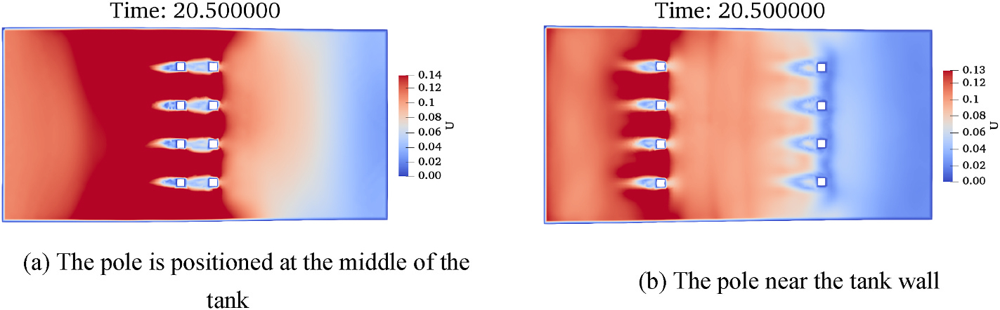
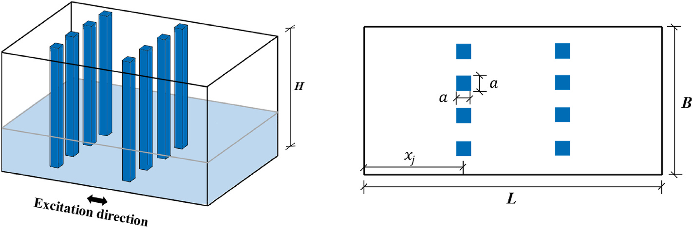
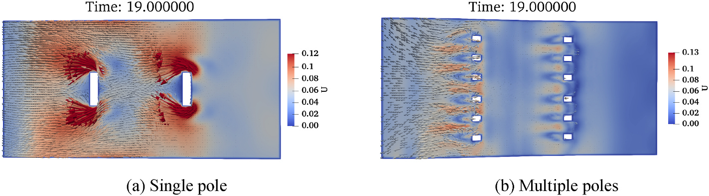
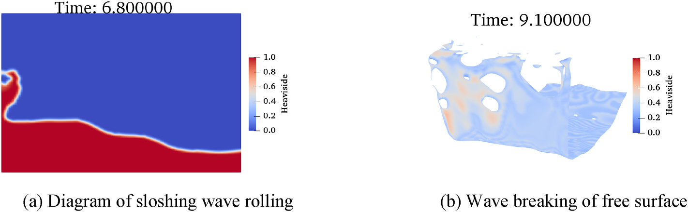
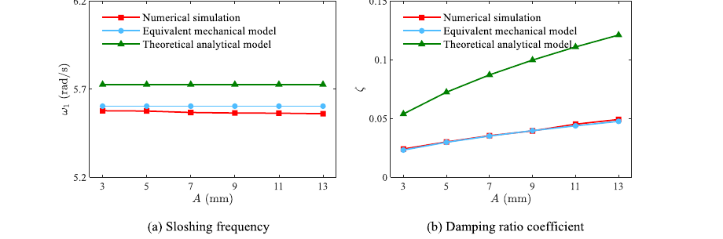

# 结构抗风 | 液舱加了立柱，频率和阻尼会怎样变化？

液体阻尼器靠水的晃荡耗散结构振动能量，但在水箱里增加立柱，也会改变调谐频率和内部流动。本文用数值模拟比较立柱布置，再拟合频率与阻尼的等效模型，为初步设计提供参数估算。

## 论文信息

- 论文题名: Numerical research on the impact of built-in rectangular poles on the dynamic characteristics of rectangular liquid tanks
- 作者: <u>He Xin</u>; **Li Chao**\*; Chen Lingwei; Hu Gang; Ou Jinping
- 期刊: Ocean Engineering
- 年份: 2026
- DOI: https://doi.org/10.1016/j.oceaneng.2026.124728
- WOEAI 相关方向: 工程结构抗风 / 结构抗风

## 摘要

调谐液体阻尼器（TLD）通过利用水箱内液体振荡来减小海洋平台结构过大的振动响应。然而，传统纯水 TLD 的能量耗散能力有限，往往难以满足结构振动控制需求。为提高 TLD 的阻尼性能，有必要引入内部阻挡装置。同时，当 TLD 应用于海洋平台结构时，水箱尺寸较大且液体晃荡力显著，需要强度较高的内部支撑构件来保证安全稳定运行。

本文提出一种带内置矩形立柱的创新 TLD 构型。首先，基于计算流体动力学（CFD），通过耦合 level set 和 volume of fluid（VOF）算法（CLS-VOF）改进 OpenFOAM 两相流求解器。该改进能有效抑制伪流，并提高自由液面捕捉精度。数值模拟结果与实验数据吻合良好，验证了所提数值模型的可靠性与准确性。

随后，系统研究了液体充填高度、立柱数量、立柱安装位置、立柱阻塞率和激励幅值等关键参数对内部液体非线性晃荡行为的影响，建立了带立柱矩形液舱动力特性的基础数据库。进一步地，论文采用粒子群优化（PSO）算法建立等效机械模型，用于估计带立柱矩形液舱的晃荡频率和阻尼性能。理论预测与数值模拟结果对比验证了模型精度。该等效机械模型能够快速、可靠地确定 TLD 动力参数，为工程应用中 TLD 的初步设计与优化提供有效支持。

## 研究问题与解决思路

内置立柱可为大型液舱提供支撑，也会改变绕流、附加质量和能量耗散，因而不能只按立柱数量判断阻尼效果。逐个方案开展精细两相流计算，又不利于早期参数比选。本文研究液深、立柱布置及激励幅值怎样影响晃荡频率和阻尼，通过经实验对照的数值模型建立参数数据库，再拟合等效机械模型。该模型首先服务于液舱动力参数估算，整体结构的减振效果仍需另行验证。

## 先把自由液面算清楚，再建立等效模型

论文首先改进 OpenFOAM 两相流求解器，将 level set 方法和 VOF 方法耦合为 CLS-VOF 路线。VOF 有利于质量守恒，level set 有利于界面法向和曲率计算；二者结合后，可以更清晰地捕捉自由液面，并抑制气液界面附近的伪流。

模型验证分两步进行。对破坝液体算例，CLS-VOF 对自由液面破碎和卷起的捕捉更清晰；对带孔板和挡板液舱的实验对比，CLS-VOF 在波高和壁面压力预测上都降低了平均相对误差。验证通过后，论文将该模型用于内置矩形立柱 TLD 的参数研究。

参数数据库围绕矩形液舱和内置立柱展开。论文用立柱阻塞率描述单个立柱相对于液舱宽度的阻挡程度：

$$
\Theta=\frac{a}{B}
$$

其中 $a$ 为立柱截面尺寸，$B$ 为液舱宽度。它表示单根立柱的相对尺寸；讨论多根立柱时，还要区分每列总阻塞率。

论文图 12 不同立柱位置下的流场速度分布

按立柱位置对照各组流场，重点看立柱后方尾流、相邻立柱间通道和舱壁附近区域。

在等效模型部分，论文先用线性波理论给出无内置立柱时的一阶晃荡频率：

$$
\omega_1=\sqrt{\frac{\pi g}{L}\tanh\left(\frac{\pi h}{L}\right)}
$$

其中 $L$ 为液舱沿晃荡方向的尺寸，$h$ 为静水深度。考虑立柱引起的附加质量后，带内置矩形立柱 TLD 的一阶晃荡频率被写为：

$$
\omega_{1T}=\left(1+\frac{m_{\mathrm{add}}}{m^*}\right)^{Q_1}\omega_1
$$

其中 $m_{\mathrm{add}}$ 表示立柱扰动带来的附加质量效应，$m^*$ 表示液体广义质量，$Q_1$ 为通过数据库拟合得到的参数。这个表达式把 CFD 观察到的“立柱使周围液体一起加速，从而降低晃荡频率”转化成可计算模型。

论文图 7 内置矩形立柱 TLD 示意图

图中展示了液舱中的两列矩形立柱、激励方向，以及立柱截面尺寸 $a$、液舱宽度 $B$ 和立柱位置 $x_j$ 等关键参数。

## 立柱位置、数量和激励幅值分别改变了什么？

随着立柱阻塞率 $\Theta$ 增大，周围液体被迫参与运动，附加质量效应增强，TLD 内部液体固有频率降低。与此同时，立柱会阻断液体能量传递路径，削弱自由液面上升和整体晃荡幅值。

阻尼提高的机制主要来自两个方面。一方面，液体绕过立柱时在边缘形成涡，流速越高，剪切和涡耗散越明显；另一方面，液体和立柱表面的黏性相互作用增加了额外耗能。因此，立柱尺寸和位置需要与液舱的调谐要求一起选择。

论文显示，立柱安装位置对液体频率影响较小，但对阻尼系数影响明显。当立柱从舱壁向中部移动时，液体主要流动区域与立柱尾流更充分耦合，阻尼比逐步提高。

立柱数量的作用更微妙。在每列总阻塞率保持不变时，把较大的立柱拆成更多小立柱，会降低单个立柱的阻塞强度并增加流动通道，涡脱落强度减弱，湍动能耗散率降低，阻尼系数可能下降。因此，立柱设计不能只追求数量，而要同时考虑单根尺寸、列数、位置和总阻塞率。

论文图 14 不同立柱数量下的流场特征对比

对照单根较宽立柱与多根较窄立柱工况，观察通道宽度及柱后涡结构的尺寸和位置。

激励幅值 $A$ 代表外部输入能量大小。小幅激励下，自由液面较平顺，流速较低，立柱边缘涡强度有限；随着 $A$ 增大，液体运动加剧，自由液面会出现卷起、破碎和更强的非线性波形，流速升高也会强化立柱边缘的涡脱落。

自由液面破碎、湍动区域和黏性相互作用都会参与耗能。论文结果显示，激励幅值会显著影响晃荡频率和阻尼比，因此在工程初设中不能只用小幅线性响应代表实际强激励工况。

论文图 16 大幅激励下的非线性晃荡特征

按图中时刻观察自由液面的卷起、破碎与舱壁接触位置，注意不要把不同时刻的波峰直接作为同一统计量比较。

论文使用 PSO 从参数数据库中拟合等效机械模型。晃荡频率模型的拟合结果为 $Q_1=-0.265$、$Q_2=2.645$，决定系数 $R^2=0.984$，相关系数 $r=0.998$；阻尼比模型的拟合结果为 $R^2=0.872$、$r=0.934$。这些指标衡量模型对数值数据库的拟合程度，不能单独证明实际结构的减振效果。

论文还把新模型与基于势流理论的理论解析模型、CLS-VOF 数值模型进行对比。结果表明，本文等效机械模型与数值模拟更接近；传统理论解析模型由于线性化非线性项，并且损失系数多来自小幅激励实验，容易高估液体阻尼性能。

论文图 19 不同激励幅值下液体晃荡频率和阻尼比变化

按激励幅值分别对照 CFD、等效机械模型与理论解析模型的曲线，观察峰值位置及幅值差异。

## 怎样把液舱参数用于结构初步设计？

初步设计时，可以用等效模型比较液深、立柱尺寸和布置对应的频率与阻尼，再对少量候选方案开展精细 CFD 或流固耦合计算。论文以海洋平台振动控制为背景；用于建筑等其他结构时，需要重新核对目标频率和实际激励，不能把液舱数据库的拟合精度当作整座结构的减振幅度。

本文结论基于矩形液舱、内置矩形立柱、单向简谐激励和论文给定的参数范围。换成圆形、倒角方形或变截面立柱后，流场分离和耗能机制可能变化，频率与阻尼模型需要重新标定。

论文最后也指出，后续研究需要扩展到随机激励和多向激励下的液体晃荡特征，并建立更完整的海洋结构模型来评估 TLD 的结构减振效果。对高层建筑或其他工程结构应用而言，也应结合实际结构频率、安装空间、水箱构造、长期维护和安全校核，不宜只凭单一阻尼指标做设计结论。

点击阅读原文，可查看本论文的全文精解、参数研究和等效机械模型。
