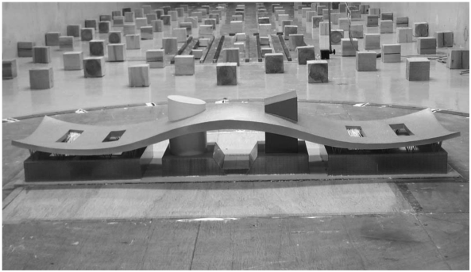
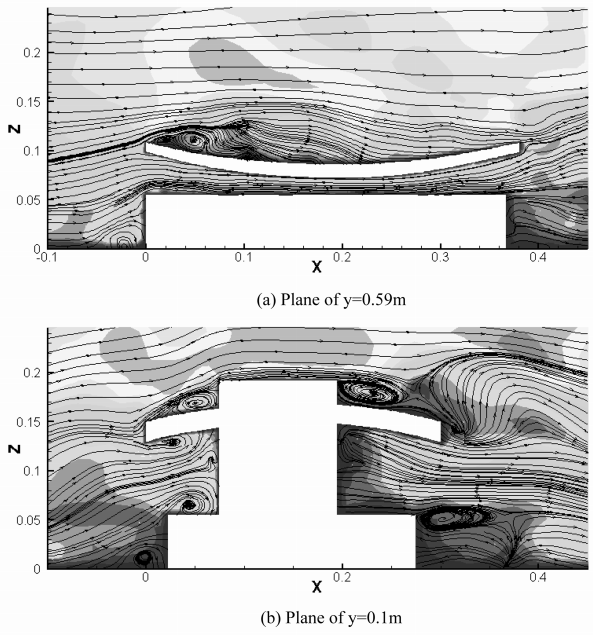
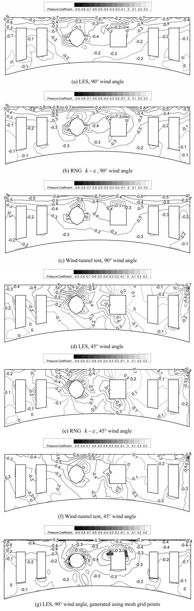
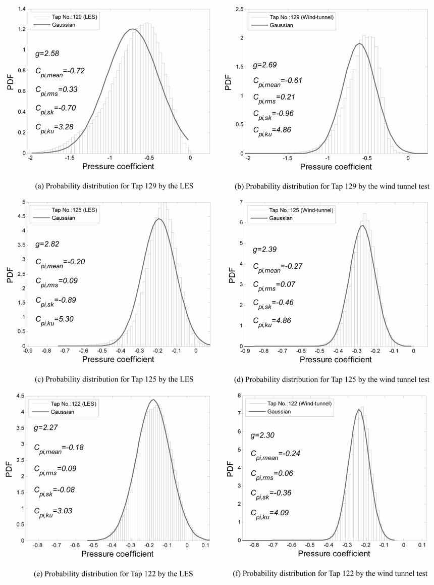
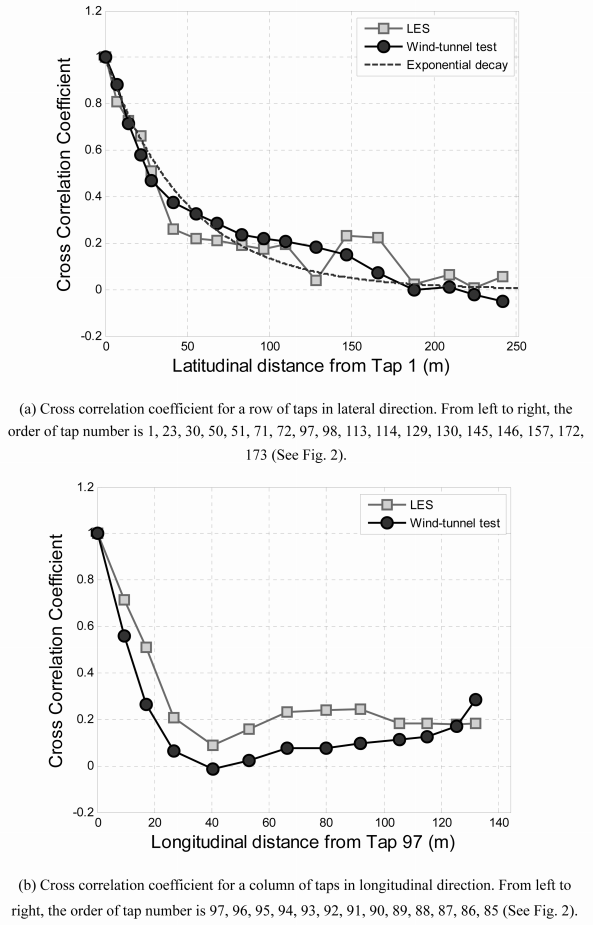

# 结构风工程 | 大涡模拟的风压预测，怎样用物理风洞检验？

大跨度曲面屋盖的迎风边缘可能承受很强的瞬时吸力，平均风压吻合并不代表脉动和峰值也可靠。这篇论文以深圳市民中心屋盖为对象，把具有空间相关性的湍流入口与大涡模拟结合，再用风洞测压逐项核对。

## 论文信息

- 论文题名: Large eddy simulation of wind loads on a long-span spatial lattice roof
- 作者: **Li Chao**\*; Li Q.S.\*; Huang S.H.; Fu J.Y.; Xiao Y.Q.
- 期刊: Wind and Structures
- 年份: 2010
- DOI: [10.12989/was.2010.13.1.057](https://doi.org/10.12989/was.2010.13.1.057)
- WOEAI 相关方向: 结构风工程 / 数值风洞

## 摘要

深圳市民中心长 $486\,\mathrm{m}$ 的屋盖是世界上最长的空间网格屋盖结构之一。本文对这座大跨度结构的风作用开展了全面数值研究。采用两位作者近期提出的离散合成随机流生成技术（DSRFG；Huang and Li 2008），生成具有空间相关性的湍流入口场。采用计算流体力学（CFD）方法，以大涡模拟（LES）和雷诺平均 Navier–Stokes 方程（RANS）模型，数值评估屋盖风荷载的分布与特征。研究的主要目标是探索利用 CFD 技术估计复杂曲面屋盖风作用的有效方法。

在数值研究的同时，在边界层风洞中对整个屋盖进行同步测压，确定平均、脉动及峰值风压系数分布，以及压力脉动的频谱、空间相关系数和概率特征。随后将数值结果与这些试验数据比较，以验证数值方法。比较表明，结合 DSRFG 技术的 LES 能够较好地预测复杂形状大跨度屋盖的风作用，尤其是迎风檐口附近通常出现最不利负风压的分离区。所推荐的 LES、入口湍流生成技术及相关数值处理，可为结构工程师在设计阶段评估大跨度屋盖风作用提供帮助。

摘要所说的屋盖风作用，在正文数值比较中有一个重要限定：模型省略树状支柱，下表面风压与试验存在明显差异，因此论文只讨论屋盖上表面的预测结果。

## 研究问题与解决思路

曲面屋盖的吸力既受来流湍流影响，也受檐口分离、再附和塔楼周围涡运动控制。只核对平均风压，无法判断局部强吸力出现的频率，也无法判断多个位置的压力是否同时变化。论文的思路是在入口生成具有目标风速谱和空间相关性的脉动风，让大涡模拟继续求解气流与屋盖的相互作用，再把平均值、均方根、频谱、概率分布和空间相关性分别与风洞试验比较。这里检验的是一套数值计算在具体屋盖上的能力，而不是用一个总误差代替所有风荷载指标。

## 入流要有相关性，计算还要保留分离涡

研究对象不是平屋面。深圳市民中心屋盖中部和两端宽度不同，上下表面均为曲面，中间还穿出圆形与矩形塔楼。风洞采用 $1{:}400$ 刚性模型，屋盖上下表面对称布置348对测压孔，以 $312.5\,\mathrm{Hz}$ 同步采样，每条记录20480个样本。数值计算则重点比较 $90^\circ$ 和 $45^\circ$ 两个风向。

::: figure 1

论文图 1 风洞试验中的深圳市民中心模型

屋盖中央有两座形状不同的塔楼。

:::

入口采用离散合成随机流生成方法，把不同波数的随机谐波合成脉动速度场。目标不只有平均风速和湍流强度，还包括纵向风速谱与空间相关性。积分长度尺度控制相关性的空间尺度；由于风洞难以按实测比例再现其随高度的变化，计算采用了缩尺后的日本建筑学会半经验关系。

屋盖周围的大涡由方程直接求解，小尺度作用采用动态亚格子动能模型。它不是简单使用固定常数的Smagorinsky模型。计算同时保留RNG $k\text{-}\varepsilon$ 模型，用来提供初始场和平均风压的比较基线。网格在复杂屋盖附近加密，LES近壁区采用增强壁面函数，RNG采用增强壁面处理；这些都是论文结果成立的数值条件，不能只保留“LES”这个名称。

## 分离区更好，不代表所有区域都更好

迎风檐口后方的分离涡会带来较大吸力，圆形和方形塔楼还会引起局部分离与马蹄涡。论文通过瞬时流线展示这些流动结构，再检查相应位置的风压。

::: figure 8

论文图 8 LES 模拟的非定常流线

上、下图分别是 $y=0.59\,\mathrm{m}$ 和 $y=0.1\,\mathrm{m}$ 的截面；沿箭头观察檐口后的回流，以及塔楼前后出现的旋涡。

:::

图6将两个风向下的数值方法与风洞结果放在相同屋盖平面上，可对照迎风边缘、中央塔楼附近和下游各区。

::: figure 6

论文图 6 屋盖上表面平均压力系数等值线

（a）至（c）依次为 $90^\circ$ 风向的LES、RNG和风洞；（d）至（f）为 $45^\circ$ 风向的同序对照；（g）为 $90^\circ$ 风向LES全部网格点生成的等值线。灰度与线旁数字均表示压力系数。

:::

平均风压总体上与试验吻合，但两种方法各有更合适的区域。迎风分离区内，LES比RNG模型更合理；再附区内，反而是RNG模型相对更好。屋盖曲率和开口使下游流动更难准确模拟，因此不能把结果概括为“LES全面优于RANS”。

表1中，CFD减去风洞试验所得平均压力系数差值的标准差，在 $90^\circ$ 风向约为0.07，在 $45^\circ$ 风向约为0.075。这里是多个测点差值的标准差，不是“误差只有7%”，也不是峰值风压误差。网格加密前后平均风压没有明显变化，不能据此断言所有瞬态统计量都已达到相同的网格独立性。

脉动压力的空间分布也与试验大致一致，但LES给出的幅值普遍偏大。压力谱在迎风分离区的吻合好于再附区；局部涡脱落的频率特征能够被捕捉。这些结果支持分区、分指标判断，而不支持用单一精度标签替代检查。

## 峰值要看分布，还要看多个测点怎样联动

对于高斯分布，偏度为0、峰度为3。迎风分离区的压力却明显负偏，大负压比高斯假设下更容易出现。图10把前部、中部和后部三个测点的LES与风洞概率分布并排比较，说明压力统计特征会随着流动沿屋盖发展而改变。

::: figure 10

论文图 10 压力系数的概率分布

左列为LES，右列为风洞；从上到下依次是测点129、125、122。直方图与高斯曲线对比，图内同时列出平均值、均方根、偏度、峰度和峰值因子。

:::

论文采用样本分布的下侧压力阈值，令98.5%的信号高于该阈值，再求峰值因子和峰值体型变化系数。**这个98.5%描述的是所用样本的分位条件，不是重现期极值，也不是结构安全概率。** 原文个别统计数字与图10标注存在不一致，全文精解并列保留了两处值，没有把它们改造成新的精度结论。

压力的空间相关性同样不能忽略。沿迎风边缘，相关性总体随距离增大而减弱；沿风向，相关性最低位置可用于讨论平均再附位置。LES大体捕捉了这些变化，但部分相关系数高于试验，作者将其与小于滤波尺度的脉动未直接解析联系起来。

::: figure 13

论文图 13 LES 与风洞试验的压力相关性比较

上图比较横向一排测点，下图比较纵向一列测点；方框为LES，实心圆为风洞，上图虚线为指数衰减关系。

:::

## 这套验证还不能替代什么

数值模型省略了树状支柱，所以下表面结果不在验证范围内，不能直接用本文上表面结果宣称净风压已经得到可靠预测。论文也没有完成屋盖动力响应、构件强度或围护系统安全评定。

LES时间步为 $0.001\,\mathrm{s}$，仅取4000个压力样本，短于风洞记录。论文还专门处理参考压力位置的脉动污染：顶部附近入口采用很低的湍流强度，将参考点放在靠近顶边界的单元。因此，迁移到另一座屋盖时，几何细节、入口谱和积分尺度、网格、近壁处理、参考压力及采样长度都需要重新核验，不能把这一案例当作通用的极值设计工具。

## 从论文到工程

这项研究为复杂屋盖的数值抗风分析提供了多指标验证路径，使风压预测能够同时接受平均值、脉动特征和空间联系的检验。它的工程价值在于帮助设计者辨别不同区域、不同荷载统计量的可靠程度，为进一步比较屋盖形态和局部风效应明确需要关注的位置。把来流构造、分离流动与风洞证据连接起来，也为后续改进计算设置及围护结构荷载研究提供了基础，让数值风洞更有针对性地服务于设计判断。具体屋盖仍需完整几何与荷载专项验证。

点击阅读原文，可查看完整科学正文精解、16个编号公式、全部原图以及网格比较表。

本文由 AI 辅助整理与撰写
