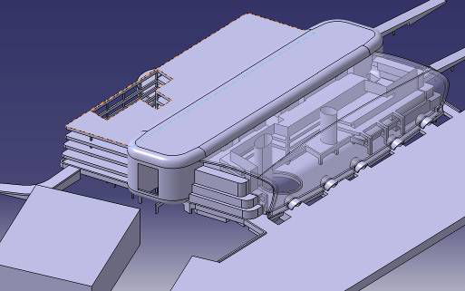
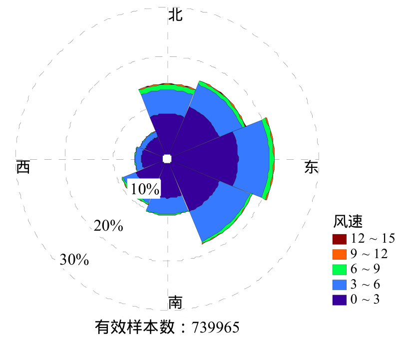
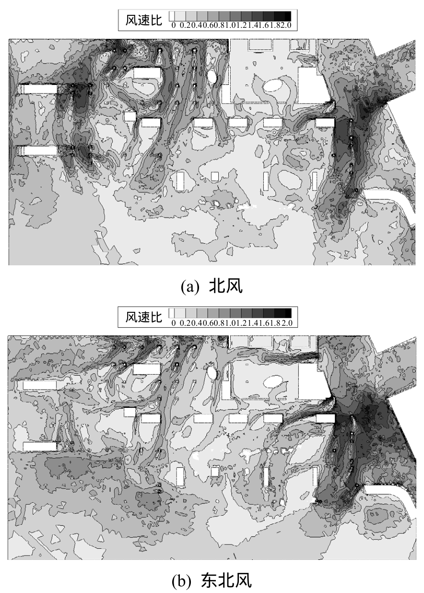
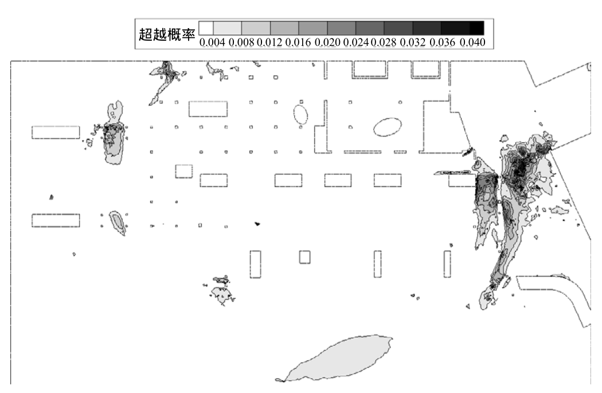

# 数值风洞 | 行人觉得风大，怎样从风速算到发生概率？

入口处的风速放大，并不直接等于那里经常不舒适。研究一座半开敞交通建筑，需要同时知道局部气流怎样被建筑改变，以及这样的来风一年中有多常见。这篇论文将八个风向的数值风洞结果与气象观测统计衔接，用超越阈值概率区分舒适度与危险度。

## 论文信息

- 论文题名：基于超越阈值概率的行人风环境数值评估
- 作者：**李朝**、肖仪清\*、滕军、欧进萍、陈宜言
- 期刊：工程力学
- 年份：2012
- DOI：10.6052/j.issn.1000-4750.2011.03.0106
- WOEAI 相关方向: 工程结构抗风 / 数值风洞

## 摘要

大尺度的建筑物和密集的建筑群都会对其周边的风环境造成较大的影响，并可能引起行人风环境问题。首先阐述了行人风环境评估的超越阈值概率方法，提出了综合考虑平均风和阵风影响的行人风环境评估标准；其次，结合某半开敞式的大跨空间建筑，统计了该地区风速气象观测资料并估计了概率参数；再次，使用计算流体力学数值风洞技术，获得了8个风向下的风场分布；最后，给出了场地全风向超越不舒适风速阈值的概率分布图，评价了该建筑的行人风环境。结果表明：该文所述方法能够给出复杂建筑的行人不舒适度和危险度详实评估结果。

## 研究问题与解决思路

建筑改变局部风速，但舒适性还取决于来风频率、阵风影响和人的活动类型。只看某一风向的一张风速图，难以判断问题出现得有多频繁。论文先从多年观测中拟合各风向的风速分布，再用数值风洞求建筑周围的等效风速比；依据场地粗糙度和高度差，把行人位置的阈值换算到气象站。最后按风向频率合并超越概率，并分别使用舒适度和危险度判据，定位需要关注的区域。

## 平均风加上脉动影响，舒适与危险分开判断

本文的对象是深圳一座半开敞大跨交通建筑。二层楼板上的椭圆形开口连通上下空间，周边建筑也会干扰来风。只建立外部实体模型，难以表达内部通风路径；研究因此保留内部空间，并对周边建筑作简化建模。

论文图 2 建筑三维模型

模型包含半开敞建筑内部空间。下文讨论的是其行人区域风环境，不是屋盖结构的风荷载或承载力。

评估采用“等效风速”：在平均风速上增加脉动风速标准差与峰值因子的乘积。这样，同样的平均风速如果伴随更强脉动，对行人的影响也可以不同。

论文选定两组不同参数：舒适度取阈值 $6\,\mathrm{m/s}$、峰值因子 $g=1$；危险度取阈值 $20\,\mathrm{m/s}$、$g=3$。它们不是两个可任意互换的风速界限，也不能直接与只考虑平均风速的标准混用。

达到阈值解决“是否超限”，发生概率回答“有多常见”。舒适度还按快步、漫步、闲坐区分：例如不舒适阈值的超越概率落在 $2.5\%$ 至 $5\%$ 时，本文采用的表格将漫步评价为“优”，闲坐却为“中”。活动需求不同，同一风场的评价可以不同。这里介绍的是论文采用的研究判据，并非对现行规范的说明。

## 八个风向不是等权相加，气象站也不是行人位置

研究汇集周边 44 个气象站连续三年的逐小时记录。测风仪位于 B 类空旷场地的 10 米高度，每小时记录末十分钟的平均风速与风向。去除仪器故障产生的无效记录后，得到 739965 组有效数据；作者忽略站点周边环境差异，将其合并统计。

论文图 1 该地区风速风向频率玫瑰图

径向长度表示频率，颜色区分风速段。北、东北、东、东南方向较常见，较强来风也集中于这四个方向。

全周被划成八个风向区间，各区间分别拟合双参数 Weibull 风速分布。最大似然估计得到的参数通过了置信度为 95% 的 K-S 检验。因此，一个方向局部加速明显，但若相应来风较少，其对总超越概率的贡献未必最大。

气象站和建筑场地还存在粗糙度与高度差。建筑位于 C 类城市地面，评估高度是 1.75 米。论文在梯度风速相同的假定下，将 B 类 10 米风速与 C 类行人高度参考风速关联，得到换算系数 1.870。再结合局部风速比，将行人位置的阈值换算为观测站处的阈值，代入各风向概率分布。

这个系数属于文中所选的地面参数和高度，不能直接套到另一建筑。合并站点、Weibull 拟合和地面转换同样会影响最终概率，不能把数值风洞单独看作全部证据。

## 风速比接近二，不代表超限概率也是两倍

研究分别建立八套风向网格，每套约 350 万单元，采用混合网格并在近地面和行人高度加密。湍流闭合使用 SST $k$–$\omega$，计算的是定常平均风场。

RANS 没有直接解析阵风时程。论文利用求得的湍动能估计脉动强度，再构成等效风速；因此这里的阵风影响是模型推算，不是逐秒模拟得到的极值记录。风速比则定义为局部行人高度等效风速与入口同高度平均风速之比。

论文图 4 等效风速比分布图

上图为北风，下图为东北风，均在一层 1.75 米高度。灰度色标为无量纲风速比，不是米每秒。

在通风门全部开启的条件下，有遮挡室内空间的比值大多低于 0.2，迎风门开启处局部达到约 0.8；无遮挡的开敞室内空间最大约 1.6，建筑外部最大达到约 2。建筑既能遮挡气流，也能形成局部加速。

风速比描述的是局部放大或削弱，概率还需经过风速分布函数换算。由于各风向网格不同，作者先用 Kriging 插值将结果放到同一套坐标上，再合并风频加权的超越概率，避免把不同位置的数据直接相加。

## 入口仍值得改善，但结果不是无条件安全保证

论文图 5 全风向行人不舒适阈值风速超越概率分布图

色标用概率小数表示，0.040 是 4%，不是 0.04%。此图采用舒适度参数 $g=1$，不是危险度计算图。

该建筑主要人员活动类型为漫步。论文得到的不舒适阈值最大超越概率约为 0.04，按所用判据评为“优”。较高概率出现在部分室外区域、半开敞车流区和行人入口，与现场工作人员反映风较大的区域对应。入口人流密集，即使整体等级为优，作者仍建议采取防风措施。

另取 $g=3$ 计算危险度，最大超越概率为 $1.757\times10^{-6}$，小于所选判据“有一定危险”的下限 $5\times10^{-4}$。这是给定建筑、统计样本和模型条件下的判断，不能解释为任意极端天气、任意使用状态下都安全。

现场反馈提供了区域对应的定性支持，但论文没有报告全场风速实测误差，也没有给出设置绿化防风带后的效果。作者明确指出，所提评估标准还需要更多现场及风洞舒适度调查来验证。这项工作的价值，是把建筑局部气流、来风频率与使用需求连在一起，使改善位置的选择不只依赖一张最大风速图。

点击阅读原文，可查看完整评估程序、十二个公式、三张数据表、全部原图和判据适用条件。

本文由 AI 辅助整理与撰写
