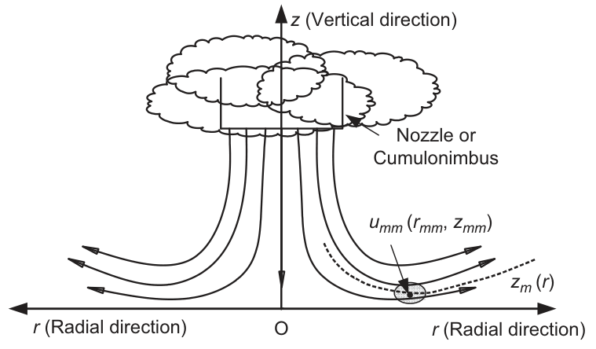
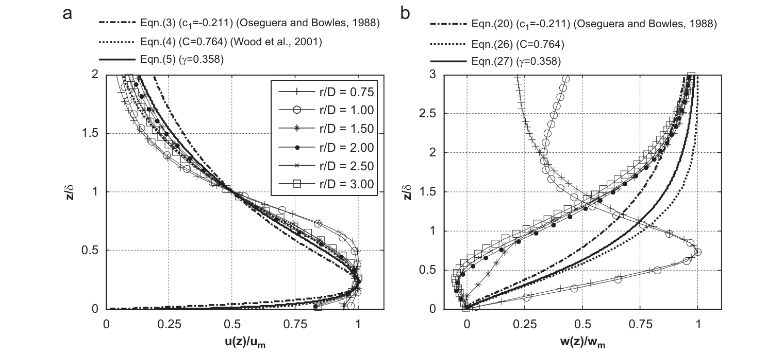
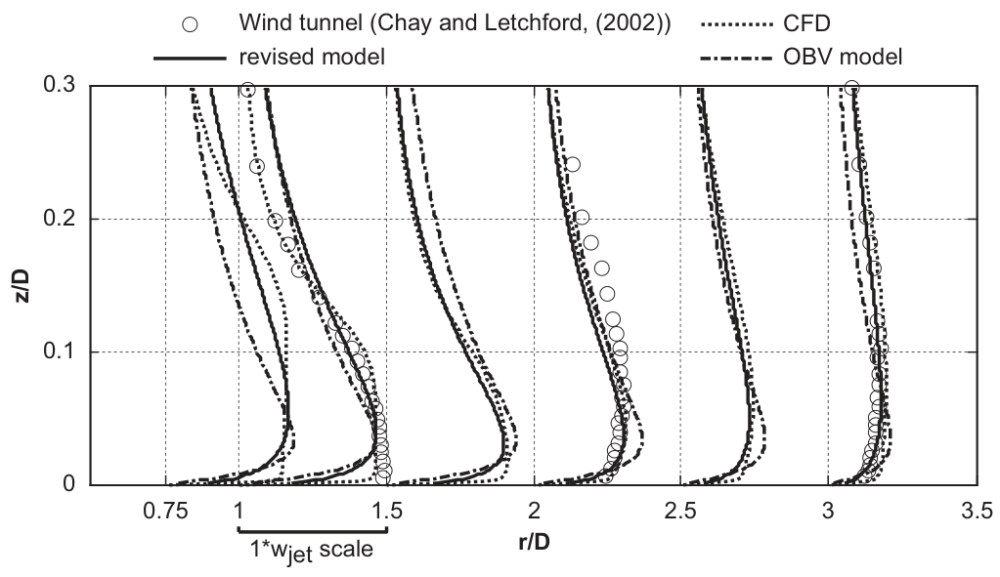
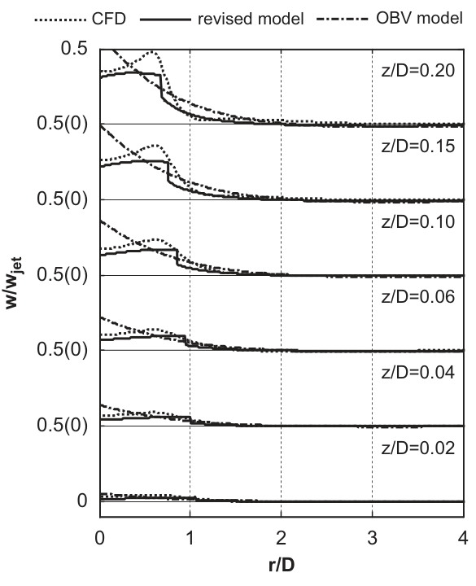

# 数值风洞 | 下击暴流的风速剖面，为什么要随边界层一起变化？

下击暴流撞击地面后向四周扩散，近地风速剖面也随边界层增长而改变。这篇论文修正了描述下击暴流的经验模型，用三维冲击射流模拟检验变化的特征尺度能否更准确地刻画径向风速。

## 论文信息

- 论文题名：A revised empirical model and CFD simulations for 3D axisymmetric steady-state flows of downbursts and impinging jets
- 作者：**Li Chao**；Li Q S\*；Xiao Y Q；Ou J P
- 期刊：Journal of Wind Engineering and Industrial Aerodynamics
- 年份：2012
- DOI：https://doi.org/10.1016/j.jweia.2011.12.004
- WOEAI 相关方向: 工程结构抗风 / 数值风洞

## 摘要

已有研究认识到，下击暴流在年极值风中占有很高的比例。尽管真实下击暴流的风特性十分复杂，且远未得到全面认识，但在极端风主要由下击暴流控制的地区，简化的解析模型和经验模型仍是结构抗风设计的有用工具。本文旨在建立一个简单且精度更高的经验模型，用于描述下击暴流和冲击射流的三维轴对称稳态速度场。原始 OBV 模型（Oseguera and Bowles, 1988；Vicroy, 1991）仅通过形状函数考虑边界层效应，并将边界层的发展视为线性变化。然而，下击暴流和冲击射流的边界层厚度呈非线性增长。

本文发展的修正模型将变化的特征长度引入速度形状函数，并为强度尺度量增加独立形状函数，从而纳入这种非线性效应。此外，通过深入分析形状函数的内在性质，本文提出一个简单的径向速度竖向形状函数，并修正径向速度的径向形状函数，以提高模型的简洁性和精度。采用雷诺应力模型（RSM）开展详细的三维计算流体动力学（CFD）模拟，用于修正模型的拟合与验证。与原始 OBV 模型相比，修正模型得到的稳态流场更加准确，尤其是径向速度剖面。

## 研究问题与解决思路

用经验模型计算下击暴流作用时，不能只给一个最大风速，还要描述强风出现的高度、半径以及沿途衰减。原始 OBV 模型把这些空间变化组合在固定尺度的形状函数里，难以反映边界层向外扩展时的非线性增长。论文把特征长度和最大径向速度分别写成位置的函数，再用冲击射流 CFD 与既有实测、风洞资料检查各个形状函数及组合后的速度场。问题的重点是稳态平均速度结构，而不是把真实雷暴的全部瞬态过程都装入模型。

## 固定一个剖面形状，还需要让尺度随位置改变

这里的“径向”是从下沉气流中心沿地面向外的方向，“竖向”是离地高度方向。径向速度的竖向剖面先增大后减小，最大值对应的高度可作为特征长度；沿半径的速度剖面同样存在峰值位置。若这些尺度始终固定，模型中的强风区域就难以跟随边界层发展而改变。

图 1 中，虚线所示的最大径向速度高度并不是一条水平线。论文引入随半径变化的特征高度，以及随高度变化的特征半径，同时单独拟合最大径向速度的包络线。这样，“剖面长什么样”和“这个位置的峰值有多大”不必共用同一个形状函数。

论文图 1 下击暴流与冲击射流边界层非线性增长示意图

竖向坐标为离地高度，横向为径向距离；虚线表示最大径向速度所在高度随半径的变化。

## 一个参数，也要满足峰值条件

原文指出，三种竖向模型实质上都只有一个独立参数；旧模型写出的多个参数之间存在隐式或显式约束，新模型的优点是表达更简洁，而不是减少独立自由参数。

论文提出的径向速度竖向形状函数只有一个参数：

$$
u_{\mathrm{VS}}(z)=\left(\frac{z}{z_m}\right)^\gamma e^{\gamma(1-z/z_m)}
$$

其中 $z_m$ 是最大径向速度所在高度，$\gamma$ 控制曲线形状。该函数在 $z=z_m$ 处自然达到归一化最大值 1，且导数为零，不必再额外调整多个参数来满足峰值条件。径向形状函数则在峰值半径外引入可调指数，使衰减曲线更灵活。

这些参数不能从一种流动直接照搬到另一种流动。论文分别拟合现场数据与缩尺冲击射流 CFD 数据，两组最佳参数存在差异，作者将其与雷诺数差别联系起来。参数化的用途是允许重新拟合，而不是宣布一套参数适用于所有雷暴。

CFD 使用雷诺应力模型，以考虑冲击、分离和涡环运动中的湍流各向异性。三种雷诺数分别为 $6.9\times10^4$、$3.5\times10^5$ 和 $6.9\times10^5$；入口湍流强度为 0.04。地面按光滑壁面处理，这一条件也决定了结果不能直接代表粗糙城市地表。

论文图 8 竖向形状函数与 CFD 结果的比较

左图为径向速度，右图为竖向速度；不同符号表示不同径向位置，曲线代表不同经验函数。

## 径向风速改善了，近地面和竖向速度仍有偏差

把重新拟合的形状函数、特征尺度和峰值包络线组合后，修正模型在论文检验的 $0.75<r/D<3$ 与 $0.02<z/D<0.2$ 范围内，比原始 OBV 模型更接近 CFD 和风洞结果，改善主要体现在径向速度。这里 $D$ 为喷口直径，$r$ 为半径，$z$ 为离地高度。

图 15 可以直接比较这项变化，但不能忽略局部偏差。在 $r/D=1$ 的近地面区域，两种经验模型都低估了径向速度。论文在实测剖面讨论中也指出，低高度处的风速低估可能给低层结构设计带来风险。因此，不能只凭较高位置的剖面吻合，就推定近地面荷载也足够准确。

论文图 15 径向速度的竖向剖面

空心圆为风洞数据，点线为 CFD，实线为修正模型，点划线为原始 OBV 模型；下方短标尺表示喷口速度的量级。

竖向速度更难处理。原始分离变量模型可以从质量连续方程推导竖向速度；引入随位置变化的尺度后，径向与竖向变量耦合，原推导不再能直接照用。论文采用直接代入特征尺度的处理，但坦陈竖向速度结果仍不理想。图 18 中，修正模型能再现中心区的大致变化趋势，却低估了速度幅值。

论文图 18 竖向速度的径向剖面

各条剖面对应不同离地高度；点线、实线、点划线分别表示 CFD、修正模型和原始 OBV 模型。

## 稳态射流是建模基础，不是完整的雷暴替身

实验室冲击射流能再现下击暴流的一些主要平均速度特征，但真实下击暴流还包含短生命周期、移动、降水和低温下沉气流等过程。持续供能的稳态射流，其径向速度衰减也可能比真实事件缓慢。论文据此区分了现场数据与实验室、CFD 结果之间的差别。

这套模型可作为参数化描述平均风场的基础，输入尺度、强度与经过校准的形状参数，得到不同位置的速度剖面。原文还提出，将模型与移动速度结合可生成多点速度时程；这不等于本论文已验证完整移动雷暴的瞬态气动作用。面向具体工程时，仍需更多实测与风洞数据确定参数，并复核近地面偏差、地表粗糙度及竖向速度处理。

## 从论文到工程

这项研究为下击暴流平均风场的参数化描述提供了基础，使尺度、强度与空间位置能够共同进入工程风场分析。它的价值在于将不同位置的速度剖面组织为连贯的模型，帮助研究者比较强风作用范围以及结构所在高度、位置对应的来风。对于后续非平稳风荷载研究，这种表达也有助于将观测资料转化为可检验的参数，并为叠加移动效应或衔接动力分析准备风场输入，让复杂事件的工程建模具有清楚的起点。实际采用仍需现场校准与瞬态过程验证。

点击“阅读原文”，查看完整中文译文、形状函数推导、全部原图及模型适用范围。

本文由 AI 辅助整理与撰写
