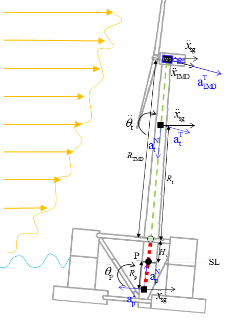
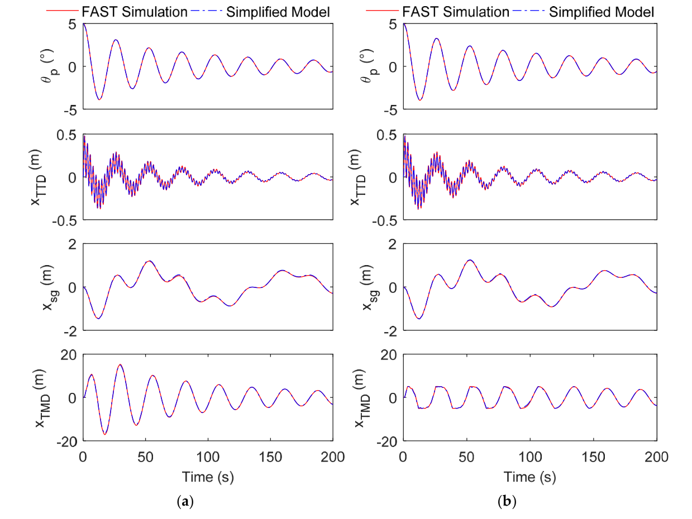
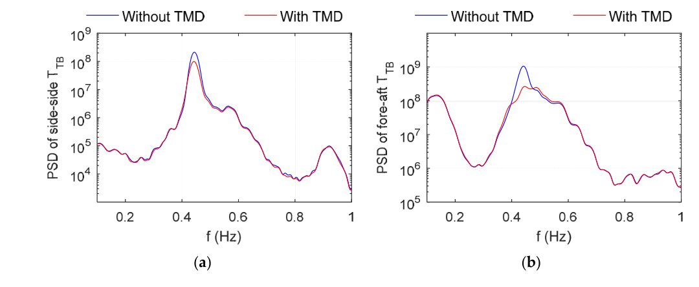

# 一体化分析 | 漂浮风机装阻尼器，该调平台还是塔筒？

给半潜式风机加调谐质量阻尼器，首先要决定减小哪一种运动。本文把平台、塔筒与阻尼器放进同一个简化模型中寻优，再回到风浪耦合计算，比较针对平台低频运动和塔筒振动的两类方案。

## 论文信息

- 论文题名：Passive Vibration Control of a Semi-Submersible Floating Offshore Wind Turbine
- 作者：**Li Chao**；Zhuang Tongyi；Zhou Shengtao；Xiao Yiqing\*；Hu Gang
- 期刊：Applied Sciences
- 年份：2017
- DOI：[10.3390/app7060509](https://doi.org/10.3390/app7060509)
- WOEAI 相关方向: 海上漂浮风电 / 一体化分析

## 摘要

海上漂浮风机有潜力以商业化方式利用深水区域丰富的风能资源。与固定基础风机相比，浮式基础运动使海洋环境下风机的振动和荷载更加复杂。为减小风机响应，本文研究在机舱或塔筒中设置前后向调谐质量阻尼器（TMD），对半潜式海上风机实施被动控制。根据半潜式平台的运动特征，提出考虑平台纵摇和纵荡、塔筒倾斜以及TMD平移自由度的简化结构模型。识别十个未知参数后，采用纵摇自由衰减响应验证所确定模型的正确性。

为避免局部极小值，同时采用穷举法和遗传算法优化TMD的质量、刚度与阻尼。在三种实际环境条件下评估六组优化后的TMD装置，并采用极值和疲劳响应减小率评价控制效果。结果发现，直接耗散塔筒振动能量的高刚度TMD总体表现稳定。与Spar型基础相似，机舱或塔筒中的TMD能够延长漂浮风机的使用寿命。

编辑说明：本文验证依据为数值模拟，不是服役寿命实测。原文表7与表8在自存工况的部分减小率符号上不一致，不能把摘要的寿命表述理解为所有工况、所有响应均有改善。

## 研究问题与解决思路

半潜式风机有平台的低频运动，也有塔筒自身的弯曲振动。质量块放在机舱里，调谐到哪一段频率，关系到它实际从哪里吸收能量。直接把完整风机模型用于大量参数搜索，计算成本较高；只优化一个孤立塔筒，又可能遗漏平台耦合。论文保留四个主要自由度，用自由衰减响应识别和验证简化模型，再分别搜索低、高刚度参数，最后在全耦合模型中检查风浪作用下的极值与疲劳变化。

## 四个自由度用于寻优，完整模型用于验算

研究对象是搭载NREL 5 MW风机的OC4-DeepCwind半潜式系统。简化模型把平台、塔筒及转子机舱组件、TMD分别视为刚体，保留平台纵荡、平台纵摇、塔筒倾斜和质量块平移。塔筒弯曲通过等效弹簧与阻尼表示。

这一模型不是不受约束的小质量块模型。考虑机舱空间，质量块相对机舱的最大位移取$5\,\mathrm m$，到达限位后会产生接触力。轨道则假定为直线、无摩擦，弹簧与阻尼系数恒定。

模型先用初始纵摇$5^\circ$的自由衰减识别十个未知参数，再检查$10^\circ$初始纵摇，以及TMD有、无限位的情况。平台纵荡、纵摇和塔顶位移与FAST计算比较接近。这里的“验证”是简化模型与既有全耦合计算工具的交叉验证，并非对实机减振装置的试验验收。

论文图 2 OC4-DeepCwind简化动力模型示意图

沿塔筒中心线看塔筒倾斜与平台转角，再看顶部质量块的水平运动；图中的位置和加速度符号对应四自由度模型。

论文图 5 启用TMD时简化模型与FAST的5度纵摇自由衰减响应比较

左列无限位，右列有限位；每列从上到下为纵摇、塔顶位移、纵荡和TMD位移。红线为FAST，蓝色点划线为简化模型。

## 自由衰减中较优，不等于风浪中仍然较优

优化目标是塔顶位移标准差。低刚度区域用穷举法搜索，高刚度区域用遗传算法搜索，质量范围为$6000–20{,}000\,\mathrm{kg}$。两类结果对应不同能量通道：低刚度TMD的频率接近平台纵摇，高刚度TMD则接近塔筒一阶前后弯曲频率。

低刚度方案在自由衰减中可以获得较大的目标函数改善。例如，质量$20{,}000\,\mathrm{kg}$时，塔顶位移标准差减小14.23%；相同质量的高刚度方案在这个优化工况中的减小率为9.94%。这两个数不能直接拿来选最终方案，因为它们来自无风浪的自由衰减工况。

回到实际风浪，平台运动频率受到波浪谱影响。论文运行工况的波浪谱峰周期为$14\,\mathrm s$，而平台纵摇固有周期为$26.8\,\mathrm s$。按平台固有频率调谐的低刚度方案，不一定仍能有效吸收主要运动能量。高刚度方案主要作用于塔筒振动，整体表现较稳定；低刚度质量块还更容易撞击限位，增加维护方面的顾虑。

## 塔底疲劳能改善，但平台姿态未必改善

六组优化方案在三种环境中检验：轮毂平均风速分别为$10$、$18$和$37\,\mathrm{m/s}$，对应不同湍流强度和海况。每组计算取最后$600\,\mathrm s$分析，并对三组随机环境结果取平均。论文用第95百分位数表示“极值”指标，用短期损伤等效荷载（DEL）表示疲劳指标。

在$10\,\mathrm{m/s}$运行工况中，质量$20{,}000\,\mathrm{kg}$的高刚度TMD使侧向塔底弯矩DEL减小39.32%，前后向DEL减小7.78%。这不是整机所有载荷都降低了同样幅度。前后向弯矩绝对值本来比侧向大，两个方向的百分比不能替代各自的实际载荷核查。

同一方案对平台纵摇、横摇的第95百分位数减小率分别为−1.55%和−0.92%，也就是略有增加。原因之一是质量比不同：这个TMD占整套系统质量约0.14%，但占风机质量约3.33%，对塔筒和平台的作用尺度并不相同。高处增加的重力还可能加剧倾斜。

论文图 9 额定运行工况下有无TMD时塔底弯矩的功率谱密度

左图侧向，右图前后向；蓝线无TMD，红线有TMD。横轴为频率，可重点比较塔筒固有频率附近的谱峰。

## 自存工况和原表符号，需要保留到设计复核

论文最终选取的高刚度方案为质量$20{,}000\,\mathrm{kg}$、弹簧系数$133{,}467\,\mathrm{N/m}$、阻尼系数$9293\,\mathrm{N/(m/s)}$。这是一组针对特定基准风机和优化条件得到的参数，不是可直接套用于其他机型的配置。

更重要的是，原文并非所有结果都支持“减小疲劳”。表7中，$37\,\mathrm{m/s}$自存工况的疲劳DEL减小率全部为负；而表8对应的部分数值又写成正值。全文译文保留两表并标出差异，导读不从这种冲突中挑选更好看的结果。

实际选型还需要核查质量块行程、限位碰撞、安装负担、环境谱、控制器状态和不同方向载荷。

## 从论文到工程

这项研究为漂浮风机的附加减振设计提供了系统比较工具，使阻尼器调谐能够同时考虑平台运动与塔筒振动。它的工程价值在于把较低成本的参数搜索与完整耦合复核衔接起来，帮助设计者筛选值得深入分析的配置，并辨别局部响应改善对整机意味着什么。对于后续减振装置与风机结构的联合设计，这种思路也有助于协调安装负担、动力特性和目标荷载，让装置选择建立在更完整的系统需求之上。具体方案仍需全工况与构造可靠性验证。

点击阅读原文，可查看完整模型推导、十九个原始公式、八张可编辑数据表、符号表及参考文献。

本文由 AI 辅助整理与撰写
