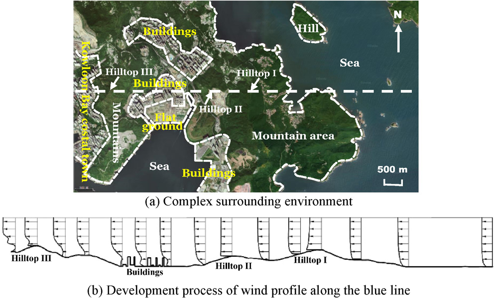
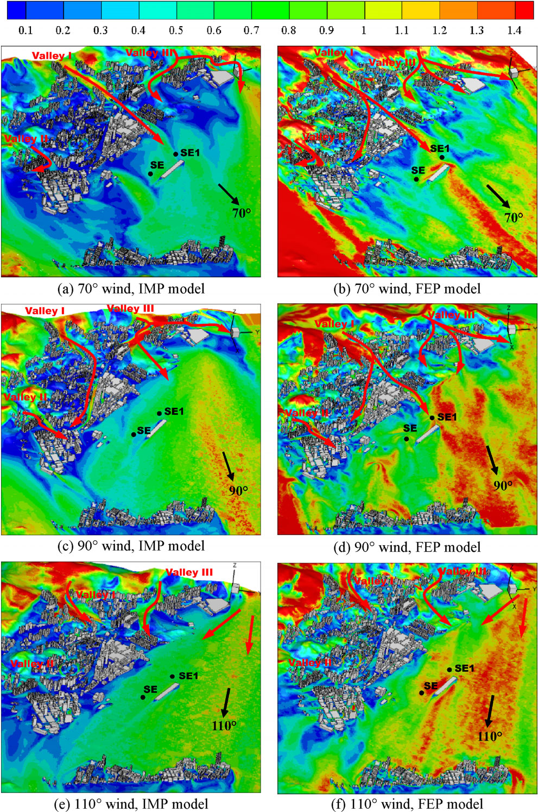
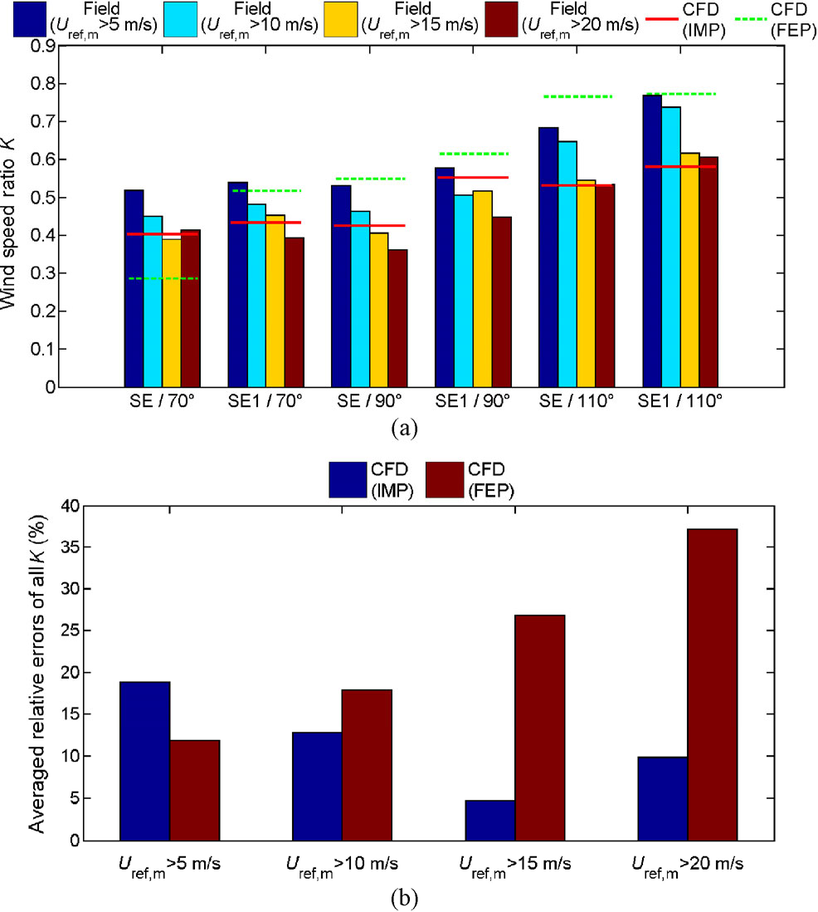
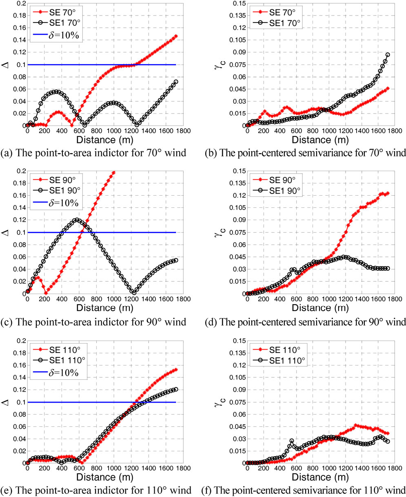

# 数值风洞 | 城市模型已经建细，为什么入口风还不能简单给定？

山地、建筑和海面混在一起时，吹进城区的风往往已不是一条规则剖面。这篇论文比较两种入流确定方法，用香港九龙湾一年实测资料验证，并据此评估两个气象站的风速能够代表多大范围。

## 论文信息

- 论文题名：Effects of inflow conditions on mountainous/urban wind environment simulation
- 作者：**Li Chao**；Zhou Shengtao；Xiao Yiqing\*；Huang Qin；Li Lixiao；Chan P W
- 期刊：Building Simulation
- 年份：2017
- DOI：https://doi.org/10.1007/s12273-017-0348-1
- WOEAI 相关方向: 工程结构抗风 / 数值风洞

## 摘要

入流条件在风环境的计算流体动力学（Computational Fluid Dynamics, CFD）模拟中起关键作用。本文以香港九龙湾沿海城区的微尺度风气候为研究对象，采用两种广泛使用的入流条件确定方法检验其表现。一种方法将速度剖面拟合为经验形式，即对数律或指数律，下文称为拟合经验剖面（Fitted Empirical Profile, FEP）方法。另一种方法对上游区域预模拟得到的出流速度及湍流特性进行插值，下文称为插值多尺度剖面（Interpolated Multiscale Profile, IMP）方法。将这一山地／城市区域的地理信息系统（GIS）数据数字化并简化为 CFD 几何模型。按照已发表的 CFD 最佳实践指南（BPG），审慎设置数值算法、计算域尺寸、网格系统和边界条件。利用两个气象站一年的足尺风测数据验证后发现，两种入流条件导致明显不同的结果。由于对地形／建筑遮挡效应考虑较少，FEP 方法倾向于预测更高风速。随着风速阈值提高、更多热力影响被排除，IMP 结果与实测数据的一致性逐渐提高。最后，将经过验证的模拟结果用于两个气象站的空间代表性评估，同时采用点面一致性指标和以点为中心的半方差。结果表明，气象站在 400 m 范围内具有良好的代表性。

## 研究问题与解决思路

局部城区网格再细，也不能自动补回入口之外的山地和建筑对来风的影响。常用经验剖面把复杂上游环境概括为粗糙度参数，计算方便，却可能丢掉不同高度和位置的遮挡、增速与尾流。论文先计算上游区域，把速度和湍流信息传到目标城区，再与经验剖面方法比较。检验不只看风场图是否合理，而是用参考站和城区测站的风速比核对，同时检查实测样本筛选条件会怎样改变验证结论。

## 两种入口的差别，是上游环境怎样进入计算

拟合经验剖面（FEP）按照对数律或幂律给定入流，并为湍流量设置相应表达式。它需要选取合适的粗糙度，还要留出入流发展距离。插值多尺度剖面（IMP）先模拟上游区域，再把出口截面的三维速度和湍流信息插值到目标区域入口。

图 9 展示了为什么这个区别重要：海上来风经过迎风坡、山顶和背风侧，先增速、再分离减速；随后又受建筑影响。把这段过程压成一条规则曲线，可能无法保留各位置真实的差别。

论文图 9 上游区域的周边环境及上游计算域内风剖面的发展过程

上图标出山顶、建筑与海面，下图沿选定路径展示剖面变化；注意山体背风侧与后续建筑区的低风速部分。

这篇论文采用的是 CFD–CFD 衔接，不是用天气预报模型重演某次台风。上游入口位于海面，可以给定较简单的对数风剖面；经过上游模拟后，再将复杂剖面传入城区。目标城区与上游网格并不完全匹配，信息传递使用反距离插值。

## 风场预测不同，还要用同一套实测条件判断

论文比较 $70^\circ$、$90^\circ$、$110^\circ$ 三个风向，采用稳态雷诺平均模拟。横澜岛 WGL 站提供入流参考，城区 SE、SE1 站用于验证。两城区站的风速仪离地高度分别为 $12.9\,\mathrm m$ 和 $15.9\,\mathrm m$，并非把所有实测点都当作同一高度。

在入口截面，IMP 出现不规则低风速区，影响高度可达海拔 $600\,\mathrm m$；FEP 的低风速区则呈层状，影响范围较小。进入城区后，两者对遮挡与通风路径的预测也不同。论文以离地 $15\,\mathrm m$ 的云图比较发现，$70^\circ$ 来风时，IMP 在两站附近给出约为背景风 $40\%$ 的风速，FEP 则接近 $80\%$。这两个数对应同一论文工况下的方法比较，不是某次台风实测风速的差值。

论文图 15 风速比云图

左列为 IMP，右列为 FEP；从上到下是三个风向，色标为局地风速与各方法入口同高度风速之比。

验证使用一年的观测资料，取 $10$ 分钟平均；每个目标风向只保留参考站风向在正负 $5^\circ$ 内的样本，并考虑风从 WGL 传播到城区的时滞。比较的是测站风速除以参考风速后的比值，避免直接把不同背景强度混在一起。

## 筛选阈值一变，哪种方法更准也会变

稳态中性模拟只考虑机械作用，实测却还包含热力作用。论文缺少计算大气稳定度所需的竖向温度、压力等资料，因而用提高风速阈值的办法，尝试筛除热力影响较强的样本。这是近似筛选，不能等同于逐条确认中性层结。

阈值为 $5\,\mathrm{m/s}$ 时，FEP 风速比平均相对误差约为 $12\%$，反而小于 IMP 的近 $20\%$。提高阈值后，FEP 误差增加，在 $20\,\mathrm{m/s}$ 阈值时达到 $37\%$；IMP 在 $15$ 与 $20\,\mathrm{m/s}$ 两个阈值下均低于 $10\%$。所以，“IMP 更准”的表述必须和较强风、较接近中性假设的条件放在一起。

论文图 16 FEP 与 IMP 模型验证结果

上图比较各站、各风向的风速比，下图给出四种筛选阈值下的平均相对误差；注意每组阈值对应的实测样本不同。

同时，阈值提高会减少样本。四个阈值筛选后，记录总数依次为 3531、1133、57 和 33。最高阈值下，$70^\circ$ 风向只有 4 条记录。论文据此建议检查阈值敏感性，并强调使用较高阈值时仍要保证足够样本，不能只挑误差最小的一组作为全部证据。

## 测站代表性需要同时看均值偏差和空间变化

经验证后，论文用 IMP 风场评估 SE、SE1 的代表性。一项指标比较站点与区域平均值，另一项计算周围点相对站点的半方差。前者回答“平均起来像不像”，后者补充“周围各点差异有多大”。只检查平均值，可能把彼此抵消的局地差异漏掉。

两项指标给出的范围并不总一致。论文保守采用较小范围：$70^\circ$ 风向下，SE 与 SE1 分别为 $1200\,\mathrm m$ 和 $845\,\mathrm m$；$90^\circ$ 风向下均为 $400\,\mathrm m$；$110^\circ$ 风向下分别为 $545\,\mathrm m$ 和 $425\,\mathrm m$。摘要中的“400 m 范围内代表性良好”，不是所有风向的代表范围都恰好止于 400 m。

论文图 17 三个风向下的点面一致性指标与以点为中心的半方差

左列是点面指标，蓝线为 $10\%$ 阈值；右列是半方差。红线表示 SE，黑色空心点表示 SE1。

这个判断也有边界：半方差没有公认的代表性阈值，范围选择带有主观性；本文仅验证中性、固定风向的稳态流动。跨尺度插值的质量守恒、热力耦合，以及小尺度高频湍流与大尺度来流的组合，仍是原文明确提出的后续问题。

点击“阅读原文”，查看完整中文译文、入流公式、四张可编辑表格及全部原图。

本文由 AI 辅助整理与撰写
