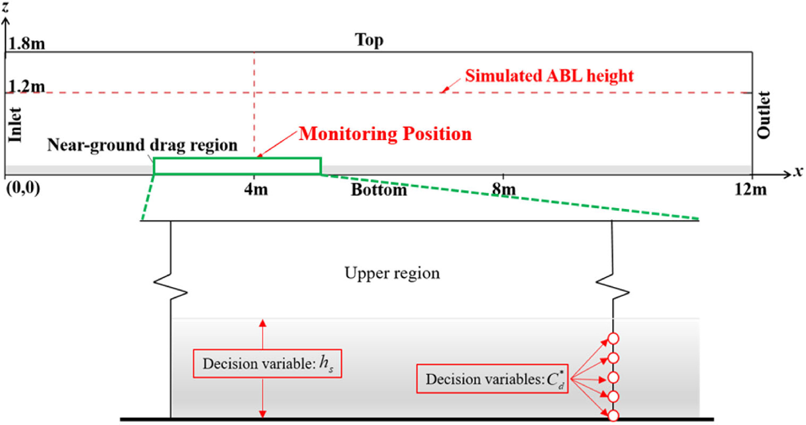
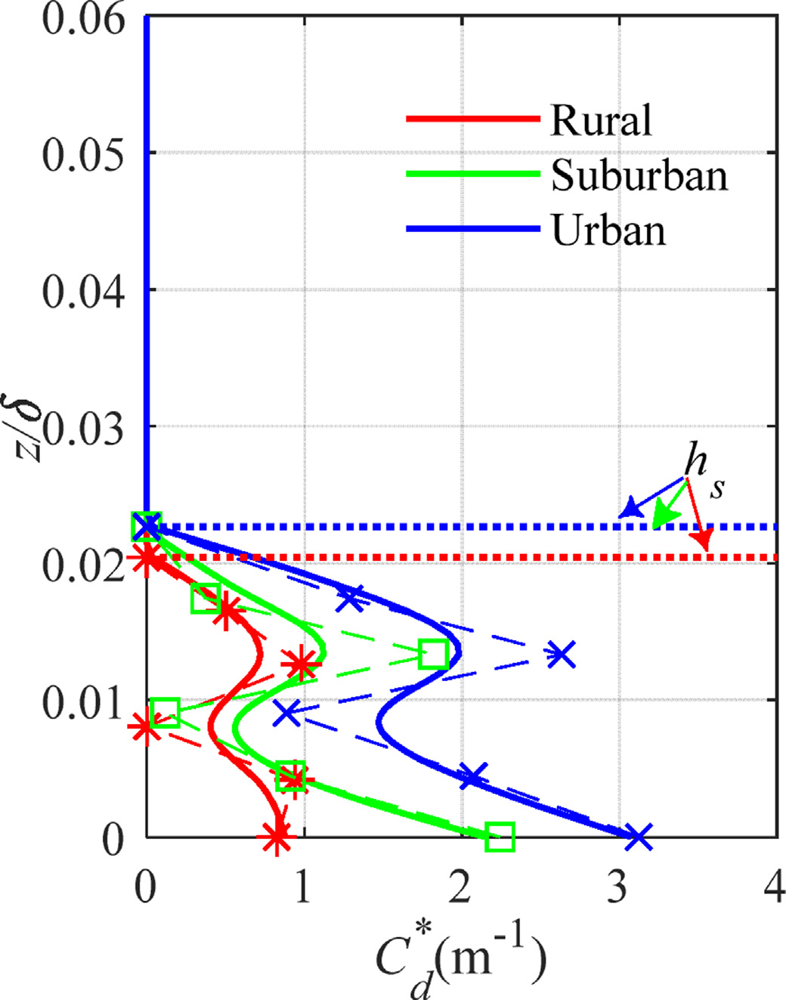
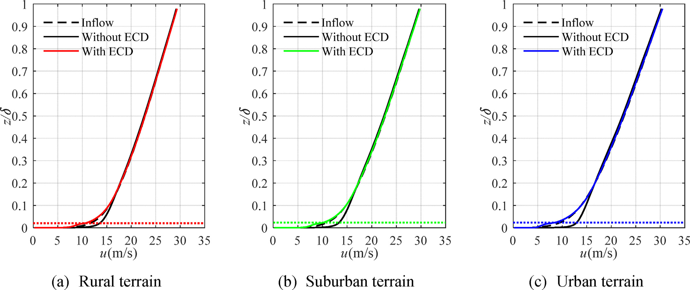
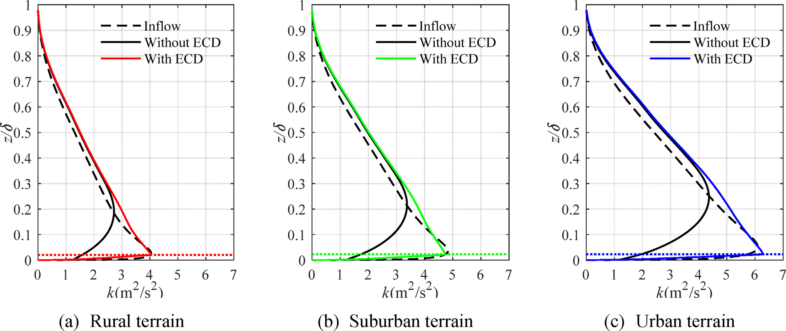
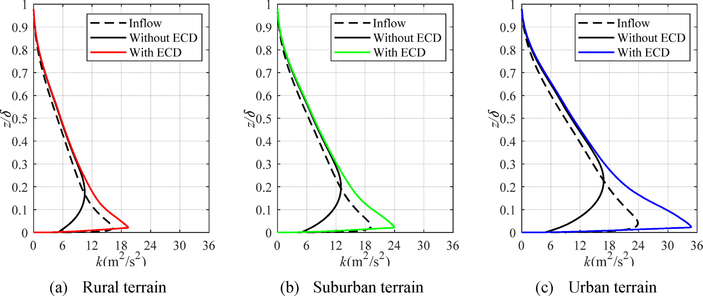

# 数值风洞 | 入流剖面给对了，为什么下游还会走样？

风工程计算常把关心的建筑放在入口下游。若风速和湍流还没到建筑就已改变，后续结果也会受到影响。本文从地面粗糙元产生阻力的机制出发，只在近地有限高度内加入等效阻力，再用优化算法寻找能维持目标风场的参数。

## 论文信息

- 论文题名：RANS simulation of horizontal homogeneous atmospheric boundary layer over rough terrains by an enriched canopy drag model
- 作者：**Li Chao**；Wang Jinghan；Hu Gang；Li Lixiao；Xiao Yiqing\*
- 期刊：Journal of Wind Engineering and Industrial Aerodynamics
- 年份：2020
- DOI：[10.1016/j.jweia.2020.104281](https://doi.org/10.1016/j.jweia.2020.104281)
- WOEAI 相关方向: 工程结构抗风 / 数值风洞

## 摘要

大气边界层（ABL）由地球表面障碍物，例如地形、植被、建筑物等引起的摩擦作用产生。受这一物理机制启发，本文提出扩展冠层阻力（ECD）模型，在计算流体动力学中实现水平齐次ABL流动。该模型能更灵活地再现各类实际粗糙地表的作用，而不限于植被类型。采用多目标进化算法，确定所提ECD模型适当的近地阻力及其作用高度。此外，采用进化算法，使入口条件与下游目标位置之间的平均风速和湍动能（TKE）差异最小。

基于剪切应力输运$k-\omega$湍流模型，针对乡村、郊区和城市地表，开展一组采用对数律和幂律入口流动的模拟，以说明ECD模型的有效性。结果表明，所提ECD模型能够以数值方式再现地表粗糙度，改善平均速度与TKE的流向齐次性，并适用于不同网格分辨率、近壁处理方法、标准$k-\varepsilon$湍流模型及模拟维度。

## 研究问题与解决思路

“水平齐次”要求流动变量沿水平方向不再变化，仅给入口指定目标风剖面并不足以保证这一点。入口、顶面、壁面处理和湍流模型需要相容。把粗糙元逐个画出来很耗网格，而在整个计算域加入修正力，又偏离了地面障碍物主要作用于近地层的机制。

论文因此扩展冠层阻力模型：不再把它限定为植被叶面积密度，而用随高度变化的综合阻力系数描述地表作用；通过入口与下游监测剖面的差异反求阻力。平均风速和TKE分别作为优化目标，避免只顾其中一项。

## 阻力只加近地层，但会改变湍流生成

模型在流向动量方程中加入

$$
S_u=-C_d^*(z)|\mathbf u|U
$$

其中$C_d^*(z)$是综合阻力系数，单位为$\mathrm{m^{-1}}$，$U$是流向平均速度。阻力只作用于高度$h_s$以下，域内其他区域不加这项源项。

这里没有同时给TKE和耗散率方程添加冠层源项。近地速度受到阻滞后，速度剪切及雷诺应力也随之改变，TKE生成可以间接受到影响。只保留动量源项使模型较简洁，却也意味着湍动能不一定像平均速度那样容易维持。

::: figure 1

论文图 1 决策变量示意图

上图灰带是近地阻力区，红色虚线标出下游监测位置；下图给出作用高度和五个离散阻力系数。

:::

## 六个参数，不是一个通用粗糙度旋钮

二维计算域长$12\,\mathrm m$、高$1.8\,\mathrm m$，模拟的实验室尺度边界层高约$1.2\,\mathrm m$。论文在$x=4\,\mathrm m$处比较下游与入口剖面。待优化量包括作用高度，以及其下五个均匀高度上的阻力系数，中间用样条插值，共六个参数。

NSGA-II同时压低平均速度和TKE的相对误差，最终得到一组Pareto解，而不是唯一的“最佳参数”。论文对对数律工况选择TKE误差较小的解，因为此时各解的平均速度误差已较小；对幂律工况则优先选择速度误差最小的解。若关注污染物扩散，这个取舍可能需要改变。

得到的作用高度只占边界层高度的一小部分。不同地表的系数曲线也不同，不能只取一个常数就代替整套标定。论文中一次完整优化平均约需37小时，其中91%的时间用于CFD计算；这是采用36个CPU线程的具体计算记录，并非其他硬件上的耗时承诺。

::: figure 8

论文图 8 对数律入流条件下的最优综合冠层阻力系数

横轴为综合阻力系数，纵轴为归一化高度；红、绿、蓝分别对应乡村、郊区和城市，水平点线标出作用高度。

:::

## 平均风改善明显，误差必须分清口径

对数律入流下，乡村、郊区和城市的平均速度目标相对误差，从无ECD时的15.7%、25.8%、43%，降至5.6%、4.8%、7.0%。对应的TKE目标误差则从37.2%、39.3%、42.6%，降至26.1%、27.0%、26.8%。平均风更接近目标，并不表示湍动能误差也已很小。

幂律入流也有改善，但TKE更难保持。三类地表的TKE目标误差在采用ECD后仍为50.5%、44.0%、39.8%。原文还指出，上部区域可能因入流与顶边界不相容而继续发展，超出了近地阻力的有效作用范围。

另一个容易混淆的地方是表4。它采用120个均匀高度采样点计算平均绝对差，再分别用参考风速及其平方归一化。这个指标与逐点除以入口值的目标相对误差不同，不能把两组百分数放在同一尺度上宣传“精度提高”。

::: figure 9

论文图 9 对数律入流条件下的平均速度剖面

三个面板从左到右为乡村、郊区和城市；横轴为平均风速，纵轴为归一化高度。黑虚线为入口，黑实线为无 ECD，红、绿、蓝实线为相应地表的 ECD 结果。

:::

与平均速度配套的湍动能剖面，是检查两个优化目标是否同时维持的另一项证据。

::: figure 10

论文图 10 对数律入流条件下的湍动能剖面

从左到右为乡村、郊区和城市；横轴为湍动能，纵轴为归一化高度。黑虚线是入口剖面，黑实线为无 ECD，红、绿、蓝实线为相应地表的 ECD 结果，横向点线标出近地作用高度。

:::

三类地表的湍动能改善仍有残差，因此不能把平均速度曲线接近目标直接换算为湍流也已准确。

## 参数可以迁移，但湍动能仍要重新检查

论文把SST模型下得到的阻力系数用于标准$k-\varepsilon$模型，并比较增强壁面处理与标准壁面函数。平均速度和TKE的齐次性均有改善。把二维网格扩展成三维后，中心截面剖面也与二维结果接近。

跨风速检验则给出了更严格的边界。分别针对5和20 m/s重新优化，能改善各自的目标剖面；但直接搬用10 m/s下优化的系数时，5 m/s工况近地TKE不足，20 m/s工况近地TKE偏大。后一种情况的近地平均速度也偏低。因此，“换风速后重新标定有效”和“同一套参数直接通用”是两回事。

::: figure 28

论文图 28 参考风速20米每秒时的湍动能剖面

三个面板依次为乡村、郊区和城市；横轴为湍动能，纵轴为归一化高度。黑虚线是入口目标，黑实线为无 ECD，红、绿、蓝实线为相应地表的 ECD 结果。

:::

这里沿用10 m/s工况得到的阻力系数；彩色曲线在近地部分高于入口目标，显示迁移参数后仍需检查TKE。

这项工作提供的是一种近地阻力标定方法，不是免校核的入流设置。它仍需专门优化，本文也没有完成实尺度或LES验证。用于具体建筑风场之前，应先在空域检查平均风、湍流和上下边界是否能共同维持，而不是等建筑载荷出现差异后再追查入口。

## 从论文到工程

这项研究将近地阻力与目标风剖面的维持联系起来，为数值风洞准备稳定的边界层来流提供了标定思路。它的工程意义在于让入口、地表和湍流模型之间的相容性能够在放入建筑之前得到检验，帮助分析人员减少来流沿程变化对荷载判断的干扰。对于不同地貌下的建筑风效应研究，这种方法也为组织空域检查和参数比较提供了基础，使后续计算能够围绕目标风场展开，并明确哪些输入值得优先校准。迁移仍需重新核验风速与湍流剖面。

点击阅读原文，可查看全文译文、十五个编号公式、五张可编辑表格、四十八项符号及全部三十三幅原图。

本文由 AI 辅助整理与撰写
