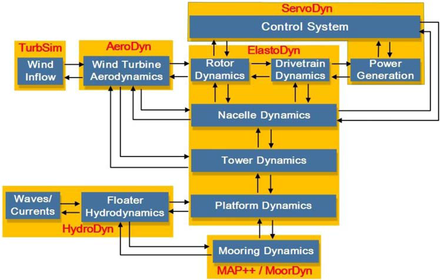
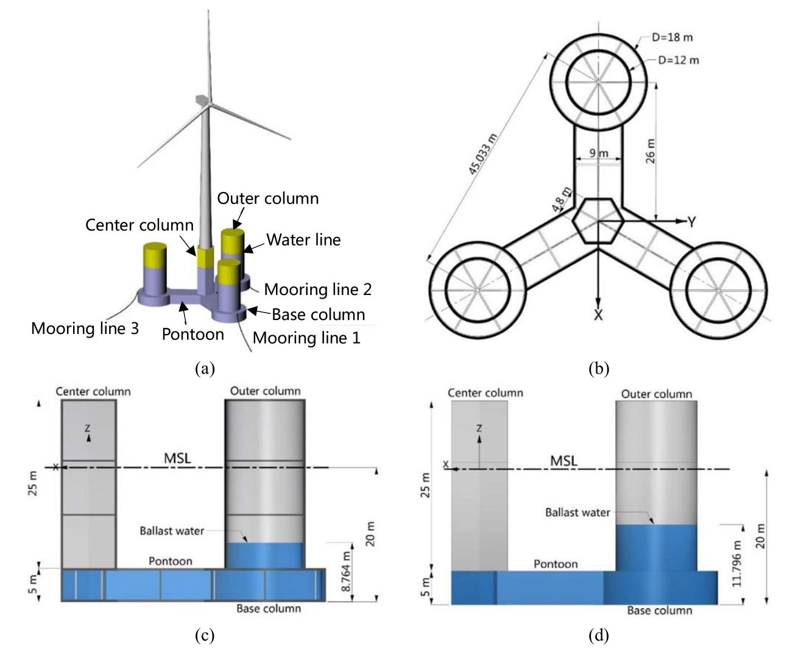
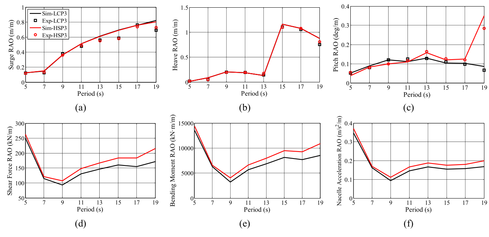
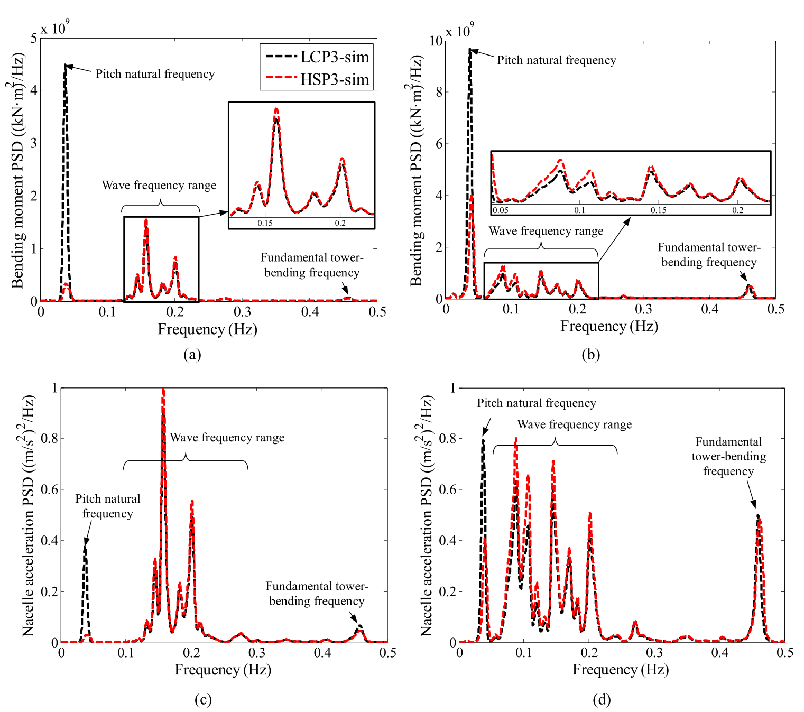
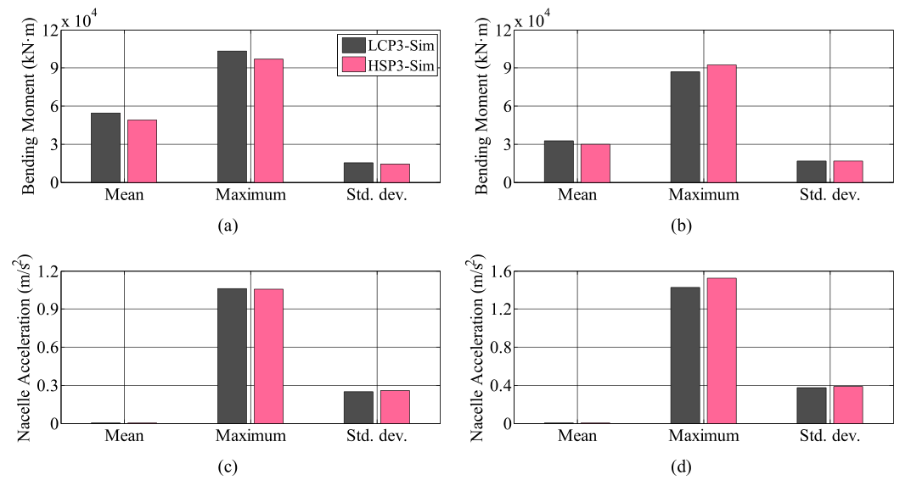

# 海洋能源结构 | 同一座半潜平台换成钢或混凝土，载荷会怎样变？

平台外形和吃水相同，换一种材料后，风机的运动和载荷也可能改变。本文比较混凝土与钢两种 Y 型半潜平台，通过模型试验和耦合仿真，检查质量分布变化如何传递到平台纵摇、塔底载荷与机舱加速度。

## 论文信息

- 论文题名: Dynamics of a Y-shaped semi-submersible floating wind turbine: a comparison of concrete and steel support structures
- 作者: **Li Chao**; Zhou Shengtao\*; Shan Baohua; Hu Gang; Song Xiaoping; Liu Yongqing; Hu Yimin; Yiqing Xiao
- 期刊: Ships and Offshore Structures
- 年份: 2022
- DOI: https://doi.org/10.1080/17445302.2021.1937801
- WOEAI 相关方向: 海洋能源结构 / 混凝土浮体

## 摘要

混凝土半潜式浮式风机由于在建造和维护方面相对于钢结构具有优势，正受到海上风能行业越来越多的关注。然而，建造材料对浮式风机动力特性的影响此前研究较少。本文通过 $1{:}60$ 比尺的风浪联合模型试验和耦合多体仿真，研究分别安装在混凝土和钢制 Y 型半潜平台上的两种浮式风机动力响应。结果表明，重心较低的钢结构在减小平台纵摇运动方面具有优势；与混凝土结构相比，钢结构受到的由纵摇引起的塔底载荷和机舱加速度也更小。不过，在波频响应中出现了相反趋势，使两种结构在塔底载荷和机舱加速度方面的差异并不显著。

## 研究问题与解决思路

材料改变会影响平台本体质量及所需压载，进而改变重心、回复刚度和固有周期。因此，材料选型不能仅用平台运动大小来判断，还要看运动如何传递到风机结构。本文在几何、吃水和系泊布置相同的前提下比较混凝土与钢平台，用缩尺试验核对平台运动，再通过耦合仿真分析塔底载荷和机舱加速度，区分不同频率范围和风浪工况下的响应差异。

## 保持几何不变，怎样比较两种材料方案？

这项研究采用了两条互相校验的路线：一条是 $1{:}60$ 比尺风浪联合模型试验，另一条是基于 FAST 的耦合多体动力学仿真。

两种试验状态均以不锈钢实体模型和内部铁块匹配原型质量分布，并非缩尺混凝土/钢材料直接对比；用水平弹簧等效原型系泊，用非旋转阻力盘匹配平均风推力。模型试验仅测平台运动，比较 LCP3 和 HSP3 在自由衰减、规则波、风单独作用、非规则波以及风浪联合作用下的平台运动。与试验验证对应的 FAST 使用相同的等效气动和弹簧回复条件；塔底前后向弯矩和机舱加速度由数值模型计算。完整运行风机、Kaimal 湍流风与随机波是另行设置的数值工况。

::: figure 10

论文图 10 FAST 仿真器框架

沿模块之间的箭头读：左侧是风与波流输入，中部连接转子、塔架和平台，上部是控制系统，下部是系泊动力；双向箭头标出模块间的信息交换。

:::

耦合仿真把入流、气动、伺服控制、塔架、平台水动力和系泊动力连接起来，用于解释试验中观测到的平台运动差异，并推算风机结构动力响应。

论文中用于解释横摇/纵摇固有周期的关系式可以写为：

$$
T = 2\pi \left(\frac{I}{D h_T}\right)^{0.5}
$$

其中，$T$ 是浮体横摇或纵摇固有周期，$I$ 是转动惯量，$D$ 是浮体排水量，$h_T$ 是稳心高度。原文式旁仅将 $D$ 称作排水量，未明确其单位；这里保留原式，不能在量纲口径不明时直接代入排水体积或质量。这个简式用于解释趋势，完整耦合计算还要考虑其他动力效应；在其他条件相同时，稳心高度增大会缩短周期。对这篇论文而言，HSP3 钢平台因为需要更多压载水达到相同吃水，重心低于 LCP3 混凝土平台，从而带来不同的纵摇动力响应。

::: figure 1

论文图 1 半潜式浮式风机的构型

（a）为风机、平台和系泊总览，（b）为平台平面尺寸；下排（c）、（d）分别为混凝土与钢平台侧视，蓝色区域标出压载水。

:::

研究对象由 $5\,\mathrm{MW}$ 风机、Y 型半潜式平台和三根悬链线系泊组成；混凝土与钢平台保持相同几何、吃水和系泊布置，以便把差异集中到材料和质量分布上。

## 重心变化为何让运动与载荷出现不同趋势？

在相同尺寸、吃水和系泊布置下，混凝土平台本体质量更大，因此达到目标吃水所需压载水较少；钢平台本体质量更小，需要更多压载水，最终使 HSP3 的重心低于 LCP3。

这一重心差异直接影响横摇和纵摇固有周期。自由衰减试验显示，HSP3 横摇周期为 $25.2\,\mathrm{s}$，LCP3 为 $26.7\,\mathrm{s}$；纵摇分别为 $24.7\,\mathrm{s}$ 和 $26.5\,\mathrm{s}$，差值为 $1.5\,\mathrm{s}$ 与 $1.8\,\mathrm{s}$。在风单独作用下，HSP3 抵抗倾覆力矩的能力更强；论文结论中指出，在额定稳态风单独作用下，HSP3 的平均平台纵摇角比 LCP3 小约 $0.5^\circ$。

规则波结果中，LCP3 和 HSP3 在纵荡和垂荡 RAO 上差异很小，但纵摇 RAO 出现明显差别。低重心的 HSP3 在部分周期范围内纵摇较小，不过当波浪周期接近结构固有周期时，响应增长会提前出现。

::: figure 12

论文图 12 LCP3 与 HSP3 模型的响应幅值算子对比

上排（a）–（c）为纵荡、垂荡和纵摇，下排（d）–（f）为剪力、弯矩和机舱加速度。横轴为波浪周期；黑色对应 LCP3，红色对应 HSP3，上排的线和散点分别标示仿真与试验，下排为数值结果。

:::

图 12 上排平台运动有试验/仿真对照，下排塔底载荷与机舱加速度为数值结果。材料与重心变化对不同响应的影响并不一致。

一个重要结果是：虽然 HSP3 在部分工况下平台纵摇更小，但它在波频范围内可能产生更大的塔底载荷和机舱加速度。这是因为更大的静水回复刚度会在周期波浪作用下带来更强的平台纵摇加速度，进而通过柔性塔架反映到结构动力响应中。

波浪单独作用的结构响应谱进一步区分了纵摇固有频率、波频和塔筒弯曲频率附近的贡献。

::: figure 17

论文图 17 两种波浪工况下塔底前后向弯矩与机舱加速度的功率谱密度

上排为塔底弯矩，下排为机舱加速度；左列为额定工况，右列为最大工况。横轴为频率，黑虚线与红点划线分别表示 LCP3、HSP3 仿真；箭头和括号标出纵摇固有频率、波频范围及塔筒一阶弯曲频率。

:::

这些曲线是结构载荷和加速度的数值结果，与前面的平台运动试验验证分工不同；不同频段的相反趋势仍需分别看待。

在非规则波和风浪联合作用下，LCP3 和 HSP3 的差异不再表现为简单的“某一种材料全面更优”。论文指出，HSP3 在平台纵摇运动和由纵摇引起的塔底载荷方面有优势，但在波频响应中又可能出现相反趋势。

::: figure 26

论文图 26 组合随机风浪条件下风机结构动力学统计数据

上排为塔底前后向弯矩，下排为机舱加速度；左列为额定运行工况，右列为最大运行工况。每幅图横轴依次为均值、最大值、标准差，深灰柱与粉柱分别为 LCP3、HSP3 数值结果。

:::

在完整运行风机的随机波与湍流风数值工况中，额定工况的机舱加速度较接近，但最大运行工况 HSP3 的机舱加速度最大值更高；不能笼统说所有载荷、加速度或统计量的差异都不显著。

从动力性能角度看，LCP3 混凝土平台具有较长纵摇固有周期，能让固有周期远离部分入射波周期；在一阶水动力载荷诱导的塔底载荷和机舱加速度方面也有较小响应。相应地，它的平均平台纵摇和二阶水动力载荷诱导的纵摇振荡更大。

HSP3 钢平台则具有较小平均平台纵摇、较小二阶水动力诱导的纵摇振荡，以及较小的纵摇固有频率处塔底载荷；但其纵摇固有周期更接近入射波周期，在一阶水动力载荷诱导的塔底载荷和机舱加速度上可能更大。

## 材料选型需要同时检查哪些动力指标？

这一比较提示，材料和压载方案应连同目标海域波浪周期一起评估。先检查重心、固有周期和平台倾角，再看低频与波频响应对塔底载荷、机舱加速度的贡献，才能判断某项运动改善是否伴随其他响应增大。

这项研究比较的是同一座 Y 型半潜式 $5\,\mathrm{MW}$ 浮式风机平台在混凝土和钢材料方案下的动力响应，不应直接外推为所有浮式风机平台或所有海况中的材料选择结论。

需要特别注意几个边界：

- 模型试验采用 $1{:}60$ 比尺、不锈钢模型及内部配重，阻力盘模拟平均推力，水平弹簧等效系泊；
- 比较前提是平台尺寸、吃水和系泊系统保持一致；
- 结论主要围绕动力性能，不等同于完整的全寿命成本、施工、运维或疲劳寿命评估；
- 论文中的典型工况不能覆盖所有目标海域的风浪联合分布；
- 后续工程设计仍需结合具体风机容量、平台尺度、材料强度、施工方案和海况统计重新校核。

## 从论文到工程

这项研究为浮式平台材料选型提供了系统动力学依据，使混凝土与钢的比较能够延伸到风机、平台和系泊共同工作的表现。它的设计意义在于揭示材料引起的质量分布变化怎样传递到不同部件，帮助设计者同时关注平台运动和机组受力。对于海上漂浮风电的方案研究，这种比较方式有助于协调材料、压载与总体布置，为后续强度、建造和服役评价确定需要重点分析的组合，使材料选择与系统需求更紧密衔接。项目采用仍需完整荷载与结构校核。

点击阅读原文，可查看本论文的全文精解、模型试验与各风浪工况对比。

本文由 AI 辅助整理与撰写
