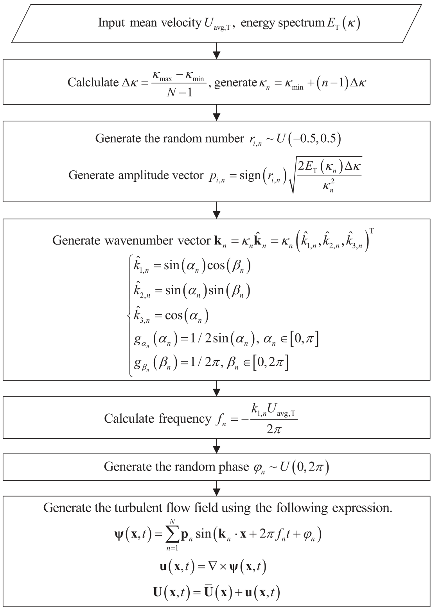
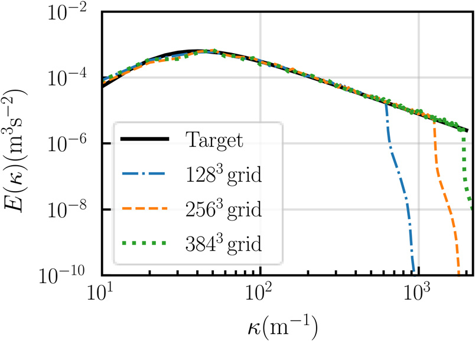
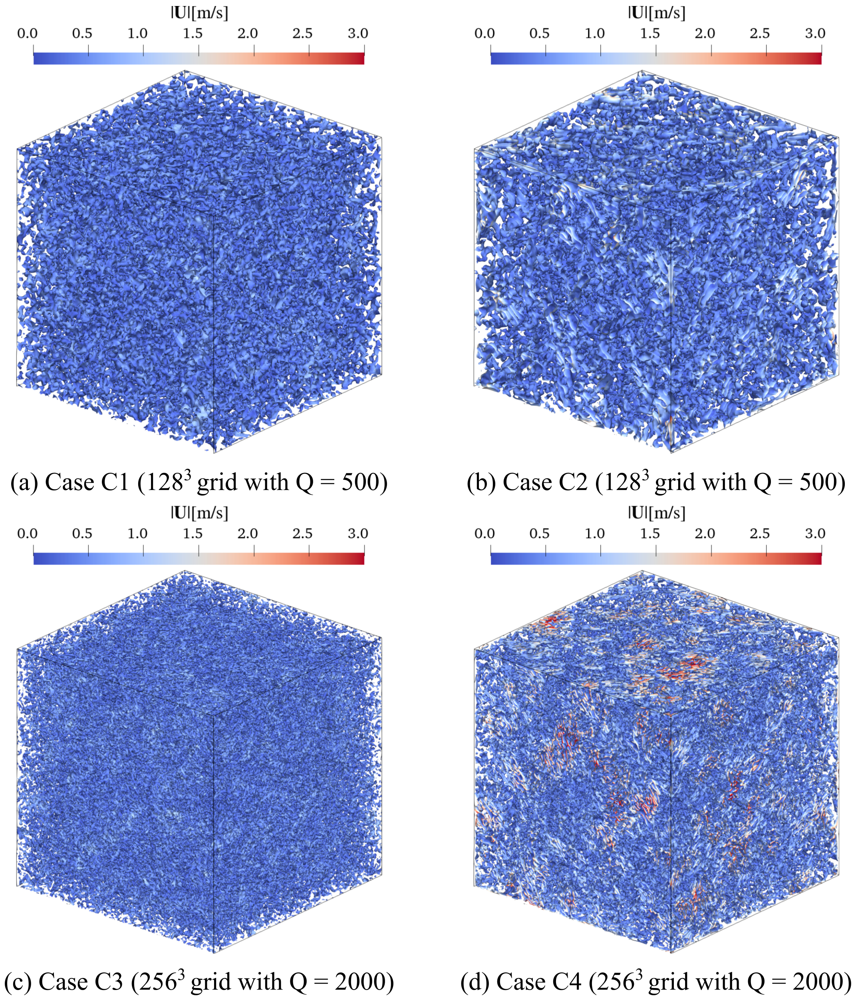
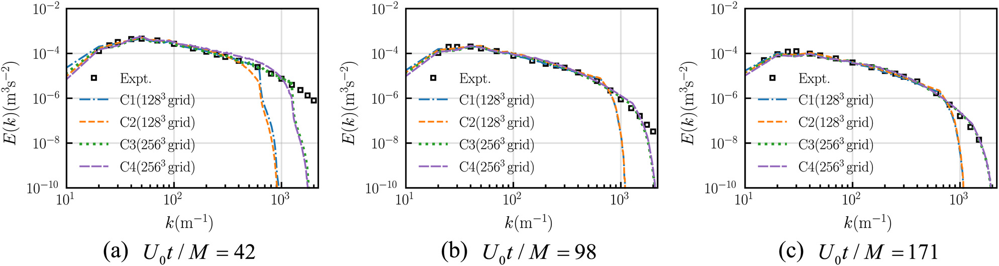

# 数值风洞 | 从矢量势出发，怎样生成无散湍流？

合成湍流既要具有目标能谱，也要适应不可压缩流动的约束。先生成速度再修正散度，可能改变原有统计特征。本文改从矢量势出发，以旋度构造速度场，并在均匀各向同性湍流中检验谱特征与衰减过程。

## 论文信息

- 论文题名: A novel vector potential random flow generation method for synthesizing divergence-free homogeneous isotropic turbulence with arbitrary spectra
- 作者: **Li Chao**; Chen Lingwei\*; Wang Jinghan; Zhang Wentong; Wang Xiangjie; Wang Zhuoran; Hu Gang
- 期刊: Physics of Fluids
- 年份: 2024
- DOI: https://doi.org/10.1063/5.0194006
- WOEAI 相关方向: 工程结构抗风 / 数值风洞

## 摘要

本文提出一种新的矢量势随机流生成方法，即 VPRFG 方法，用于合成具有任意谱的无散均匀各向同性湍流。该方法首先采用基于随机流生成的方式构造矢量势场，随后对该场施加旋度运算，得到天然满足无散条件的湍流场。

在所提出方法的公式中，我们显式引入任意均匀各向同性三维空间互谱密度和 Taylor 冻结假设，从而保证生成湍流符合指定统计特征，包括能谱、一维空间功率谱密度、时间功率谱密度、空间相干函数、湍动能和 Reynolds 应力。此外，本文以 von Karman 能谱为目标值，通过数值算例验证了该方法的理论精度。

最后，由 VPRFG 方法生成的均匀各向同性时间衰减盒湍流的大涡模拟结果与实验结果吻合良好。

## 研究问题与解决思路

匹配目标能谱与满足无散条件是合成湍流中的两个不同要求，生成后的散度修正可能改变已设定的统计量，时间与空间谱也需要保持相容。本文先按目标均匀各向同性谱构造随机矢量势，再通过旋度得到速度，并用频率—波数关系引入 Taylor 冻结假设，结合理论推导与衰减盒湍流检验结果。连续数学无散与离散网格上的质量守恒仍需区分。

## 由矢量势的旋度构造脉动速度

VPRFG 的核心想法是：不直接随机生成速度场，而是先生成一个矢量势场 $\boldsymbol{\psi}(\mathbf{x},t)$，再通过旋度得到脉动速度 $\mathbf{u}(\mathbf{x},t)$。

$$
\mathbf{u}(\mathbf{x},t)=\nabla \times \boldsymbol{\psi}(\mathbf{x},t)
$$

这条公式的含义很直接：只要速度由矢量势的旋度得到，速度场就继承了旋度场的无散性质。论文中进一步把矢量势写成随机波数、幅值、频率和相位的叠加形式：

$$
\boldsymbol{\psi}(\mathbf{x},t)=\sum_{n=1}^{N}\mathbf{p}_n
\sin(\mathbf{k}_n\cdot\mathbf{x}+2\pi f_n t+\varphi_n)
$$

其中，$\mathbf{p}_n$ 是幅值向量，$\mathbf{k}_n$ 是波数向量，$f_n$ 是频率，$\varphi_n$ 是随机相位，$N$ 是谱段数量。论文 Eq. (17) 将上述旋度关系展开成三个速度分量的计算公式，便于在网格上生成三维脉动速度场。

论文图 3 VPRFG 方法流程图

方法从目标平均速度、目标能谱、计算域和网格参数出发，依次生成波数、幅值、频率和随机相位，最后由矢量势场的旋度得到脉动速度场。

无散条件来自旋度的数学性质，并采用空间均匀、无散的目标平均速度。论文给出的关键推导可以概括为：

$$
\nabla\cdot\mathbf{U}(\mathbf{x},t)
=\nabla\cdot\mathbf{u}(\mathbf{x},t)
=\nabla\cdot\left(\nabla\times\boldsymbol{\psi}(\mathbf{x},t)\right)=0
$$

这里 $\mathbf{U}(\mathbf{x},t)$ 是瞬时速度，$\mathbf{u}(\mathbf{x},t)$ 是脉动速度。这个关系说明，VPRFG 不是在生成之后再“修补”散度，而是在构造方式上让速度场满足无散条件。

为了让合成湍流在入口边界中按平均流输运，论文按原式（25）将频率与波数第一分量联系为 $f_n=-k_{1,n}U_{\mathrm{avg},\mathrm{T}}/(2\pi)$，并得到 Taylor 冻结假设下的平移关系：

$$
u_i(\mathbf{x},t-\tau)=u_i(\mathbf{x}+U_{\mathrm{avg},\mathrm{T}}\tau\mathbf{e}_1,t)
$$

其中，$U_{\mathrm{avg},\mathrm{T}}$ 是目标平均速度，$\tau$ 是时间间隔，$\mathbf{e}_1$ 是 $x$ 方向单位向量。通俗地说，时间上向前或向后看的同一湍动结构，可以等价理解为沿平均流方向平移后的空间结构。

## 目标谱与衰减盒湍流检验了哪些性质？

论文从三维空间互谱密度出发证明：当谱段数 $N$ 足够大时，VPRFG 计算得到的能谱 $E_{\mathrm{C}}(\kappa)$ 可以逼近目标能谱 $E_{\mathrm{T}}(\kappa)$。

$$
E_{\mathrm{C}}(\kappa)\approx
\lim_{N\to\infty}\sum_{n=1}^{N}
E_{\mathrm{T}}(\kappa_n)\Delta\kappa\,\delta(\kappa-\kappa_n)
=E_{\mathrm{T}}(\kappa)
$$

其中，$\kappa$ 表示波数大小，$\kappa_n$ 是第 $n$ 个离散波数，$\Delta\kappa$ 是波数间隔，$\delta(\cdot)$ 是 Dirac delta 函数。这条关系说明，方法不是只追求某个经验曲线形状，而是在谱离散和极限意义下让生成能谱回到目标能谱。

湍动能也可以由能谱面积给出：

$$
K_{\mathrm{C}}=\int_0^{\infty}E_{\mathrm{C}}(\kappa)\,d\kappa
=\sum_{n=1}^{N}E_{\mathrm{T}}(\kappa_n)\Delta\kappa
$$

这意味着，在所解析的波数区间内增加谱段数量、并扩展有效波数范围，计算得到的湍动能可向目标值靠近。有限计算域、网格及时间步会截断可表示的谱；仅增加谱段数不会补回截断区间外的能量。

论文图 4 以 von Karman 能谱为目标生成湍流的能谱

不同网格分辨率下生成能谱整体贴近目标曲线，高分辨率网格覆盖了更宽的波数范围。

以往一些随机流生成方法可以较方便地控制谱特征，但并不天然满足无散条件；另一些方法利用矢量势改善无散性，却没有同时处理时间谱和空间谱之间的一致关系。

VPRFG 的贡献在于把这两件事放在同一个公式体系里：用 $\nabla\times\boldsymbol{\psi}$ 保证无散，用频率与波数的关系嵌入 Taylor 冻结假设，再通过三维空间互谱密度控制目标统计特征。这样生成的均匀各向同性湍流可以同时联系能谱、一维空间 PSD、时间 PSD、空间相干函数、湍动能和 Reynolds 应力等指标。

为了检验方法在 LES 初始场中的表现，论文使用 Comte-Bellot and Corrsin 实验能谱作为初始条件，开展均匀各向同性时间衰减盒湍流模拟。计算域边长为 $0.2\pi\,\mathrm{m}$，最小波数为 $10\,\mathrm{m}^{-1}$，网格分辨率包括 $128^3$ 和 $256^3$，并与实验时刻 $U_0t/M=42$、$98$、$171$ 进行对比。

论文图 7 初始时刻不同网格的 Q 准则等值面

Q 准则等值面展示了生成湍流中的涡结构。左上、右上、左下、右下分别为 C1、C2、C3、C4；上排 $128^3$ 网格取 $Q=500$，下排 $256^3$ 网格取 $Q=2000$。C1/C3 采用式（17），C2/C4 采用式（18），因此差异同时涉及网格、生成方式与等值面阈值，不能只归因于网格分辨率。

论文结果显示，采用 Eq. (17) 生成的流场在湍动能衰减、三维能谱和由参考谱推得的空间相关系数上具有较好一致性。采用离散旋度式（18）的 C2/C4 会改变初始统计特征，尤其 C4 初始能量偏高，不能将全部工况概括为同样准确。尤其在能谱对比中，不同时刻的计算曲线能够跟随实验能谱变化，较高网格分辨率也能覆盖更宽能谱范围。

论文图 9 衰减盒湍流能谱

衰减盒湍流算例把 VPRFG 生成的初始场放入 LES 中检验。式（17）工况总体较贴近参考能谱；式（18）的 C4 在初始时刻偏高，后续才逐渐接近，且高波数端受网格截断影响。

## 连续无散为什么仍需检查离散与入口边界？

使用时应先确认目标统计量与均匀各向同性假设相容，再检查谱截断、网格离散及边界流量。能谱、相干函数和 Reynolds 应力由同一目标谱联系起来，不能彼此独立任意指定。用于非均匀大气边界层仍需额外的方法扩展。

在实际 LES 入口中，还需要注意几个边界。

- 若用于速度入口边界，入口质量守恒和平衡压力波动仍需要结合相应边界处理方法。
- 有限体积离散会带来数值误差。连续无散并不保证单元中心速度的离散散度严格为零；压力-速度耦合后，论文观察到面通量守恒良好，而单元中心速度仍有离散散度误差。两者不能混为同一检查。
- 过度追求离散层面的严格零散度，可能改变初始湍流统计特征。论文基于数值分析建议采用 Eq. (17) 的理论公式生成流场，以获得更真实的湍流结构。
- 当前工作尚未解决任意非均匀各向异性三维空间互谱密度的构造问题，这是后续研究需要继续推进的方向。

## 从论文到工程

从矢量势构造速度场，为兼顾湍流统计与质量守恒提供了可以从理论上追溯的生成路径。这项研究的工程价值在于让入流设计中的不同要求有共同的数学基础，帮助数值风洞研究者判断目标谱、空间联系与离散求解之间怎样协调。对于后续湍流生成方法的发展，它也提供了可供比较的基础模型，使边界处理和非均匀流场扩展能够围绕明确的约束展开，逐步提高入口设置对风效应计算的支撑能力。具体应用仍需核验流场假设与离散边界处理。

点击阅读原文，可查看本论文的全文精解、矢量势推导与盒湍流验证。

本文由 AI 辅助整理与撰写
